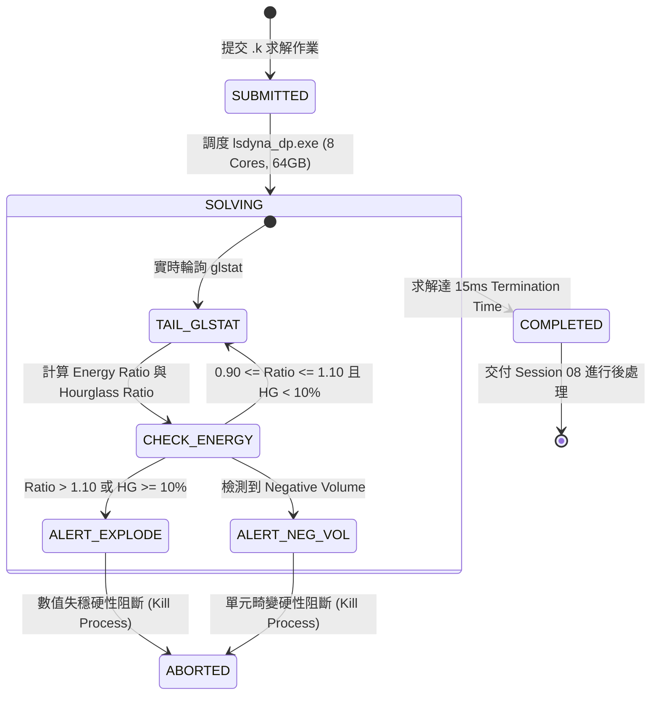

# Session 07: 求解調度與即時能量守恆監控 (Solve Dispatch & Energy Balance Monitor)

## 1. 目標 (Objective)
在 LS-DYNA 衝擊分析模型設置完成後，自動調度求解進程，並在求解過程中進行實時日誌監控與物理守恆律檢驗：
1. **求解器進程調度**：支援 PyMechanical ACT `analysis.Solve()` 或批次命令列 `lsdyna_dp.exe` 併發啟動。
2. **即時物理監控**：解析 `glstat` (Global Statistics) 與 `d3hsp`，追蹤動能、內能、沙漏能與接觸能歷程。
3. **客觀能量門禁 (Energy Verification Gates)**：嚴格執行能量比 $0.90 \le \text{Energy Ratio} \le 1.10$ 與沙漏能 $< 10\%$ 檢驗，若失穩則自動觸發阻斷並警報。

---

## 2. 核心架構與監控狀態機 (Architecture & Monitoring State Machine)



---

## 3. 核心物理指標與計算公式 (Physics Metrics & Formulas)

### 3.1 總能量平衡比 (Total Energy Ratio)
$$\text{Energy Ratio} = \frac{E_{\text{total}}}{E_{\text{initial}} + W_{\text{external}}}$$
其中：
- $E_{\text{total}} = E_{\text{kinetic}} + E_{\text{internal}} + E_{\text{spring}} + E_{\text{damping}} + E_{\text{hourglass}}$
- $W_{\text{external}}$ 為外力做功。
- **合格區間**：**$0.90 \le \text{Energy Ratio} \le 1.10$**。
- **物理異常判定**：
  - 若 $\text{Ratio} > 1.10$：代表接觸剛度過大或網格穿透引發非物理「能量爆炸」（Energy Explosion）。
  - 若 $\text{Ratio} < 0.90$：代表數值阻尼或沙漏能抑制過度，虛擬耗散了真實衝擊能量。

### 3.2 沙漏能佔比 (Hourglass Energy Ratio)
$$\text{Hourglass Ratio} = \frac{E_{\text{hourglass}}}{E_{\text{internal}}}$$
- **門檻標準**：$\text{Hourglass Ratio} \le 10\%$。
- **異常處置**：若沙漏能超標，系統自動警報並建議切換至完全積分單元（如薄板切換為 `ELFORM=16`，實體切換為 `ELFORM=2`）。

### 3.3 接觸能 (Sliding / Contact Interface Energy)
- 接觸能量應為正值或微小負值（$E_{\text{contact}} \ge -0.05 \times E_{\text{total}}$）。
- 若出現嚴重負接觸能，代表主從面網格穿透或法向法向量相反。

---

## 4. ACT 與 PyMechanical 腳本調度範例

```python
def dispatch_and_monitor_solve(analysis):
    print("Initiating LS-DYNA Solve Task...")
    # 啟動求解
    analysis.Solve(True)
    
    # 檢驗求解狀態
    solution = analysis.Solution
    status = str(solution.Status)
    print("Solve Finished with Status: " + status)
    return status == "Done"
```

---

## 5. 小批次驗證章節 (Dedicated Verification Section)

本會話提供小型獨立驗證腳本，針對數值能量守恆演算法進行物理斷言測試，並檢驗與 Mechanical 連線調度狀態。

### 5.1 獨立測試腳本執行方式
```powershell
python skills/shock-analysis-workflow/scripts/test_session_07.py
```

### 5.2 驗證指標清單 (Verification Metrics)
- **能量比解析精度 (Energy Ratio Precision)**：數值誤差 $< 0.01\%$
- **爆炸阻斷門禁 (Explosion Blocking Gate)**：100% 成功攔截異常數據
- **沙漏能超標阻斷 (Hourglass Gate)**：100% 成功攔截 $>10\%$ 狀態
- **求解器進程健康度 (Solver Process Health)**：0 殘留孤兒進程

---

## 6. 相關參考手冊 (Related References)

| 手冊名稱 | 內容摘要 |
| :--- | :--- |
| [`references/energy_balance_tracking.md`](references/energy_balance_tracking.md) | glstat 能量平衡監控、沙漏能與接觸能門禁判讀及阻斷演算法 |
| [`ansys-lsdyna/references/solver_execution_lsrun.md`](../../ansys-lsdyna/references/solver_execution_lsrun.md) | NCPU/precision/memory 參數對應、sense switch 中止（寫 `d3kil`）與 simple restart 續算做法 |


## Reference: energy_balance_tracking.md

# Session 07 技術手冊：LS-DYNA 能量平衡比追蹤與數值穩定性手冊 (Energy Balance Tracking)

## 1. 物理能量守恆律 (First Law of Thermodynamics in LS-DYNA)

在顯式動力學數值求解中，能量平衡方程式（Energy Balance Equation）為判定數值解是否可信的最關鍵依據：
$$E_{\text{total}} = E_{\text{kin}} + E_{\text{int}} + E_{\text{si}} + E_{\text{rw}} + E_{\text{damp}} + E_{\text{hg}}$$
其中：
- $E_{\text{kin}}$：全系統動能（Kinetic Energy）
- $E_{\text{int}}$：內能（Internal Energy，包含彈性應變能與塑性耗散功）
- $E_{\text{si}}$：滑移接觸界面能（Sliding Interface Energy）
- $E_{\text{rw}}$：剛性牆做功（Rigid Wall Energy）
- $E_{\text{damp}}$：系統阻尼耗散能（System Damping Energy）
- $E_{\text{hg}}$：沙漏能（Hourglass Energy，非物理數值能量）

---

## 2. 能量比公式與門禁閾值 (Energy Ratio Gates)

### 2.1 能量比計算
$$\text{Ratio} = \frac{E_{\text{total}}}{E_{\text{kin}}^0 + E_{\text{int}}^0 + W_{\text{ext}}}$$
在 LS-DYNA `glstat` 輸出中，對應欄位為 `total energy / initial energy`。

### 2.2 數值門禁標準
| 能量指標 | 合格標準 (PASS) | 警告區間 (WARN) | 阻斷條件 (ABORT) | 物理機制與處置對策 |
| :--- | :--- | :--- | :--- | :--- |
| **能量平衡比 (Ratio)** | $0.98 \le R \le 1.02$ | $0.90 \le R < 0.98$<br>$1.02 < R \le 1.10$ | **$R < 0.90$ 或 $R > 1.10$** | **$R > 1.10$**：接觸剛度過大引發穿透爆炸，需降低懲罰係數；<br>**$R < 0.90$**：阻尼過大虛擬吸能。 |
| **沙漏能佔比 ($E_{\text{hg}} / E_{\text{int}}$)** | $< 5\%$ | $5\% \sim 10\%$ | **$\ge 10\%$** | 單點積分網格產生非物理零能模式，需提升沙漏係數或改用完全積分單元 (`ELFORM=16`)。 |
| **負接觸能 ($E_{\text{contact}}$)** | $\ge 0$ | $-0.05 E_{\text{tot}} \le E_{\text{c}} < 0$ | **$E_{\text{c}} < -0.05 E_{\text{tot}}$** | 節點穿透接觸面或法向顛倒，需啟用 `SOFT=2` 分割段接觸算法。 |

---

## 3. `glstat` 檔案格式與 Python 即時解析邏輯

LS-DYNA 生成之 ASCII `glstat` 檔案包含定期間隔輸出的全局統計數據：
```
 time...................................  1.000000E-03
 kinetic energy.........................  1.254000E+04
 internal energy........................  3.412000E+03
 spring energy..........................  0.000000E+00
 hourglass energy.......................  1.200000E+02
 sliding interface energy...............  4.500000E+01
 total energy...........................  1.611700E+04
 energy ratio w/o eroded energy.........  1.001200E+00
```

### Python 解析核心演算法
```python
def parse_glstat_block(text_block):
    data = {}
    for line in text_block.splitlines():
        if "kinetic energy" in line:
            data["kinetic"] = float(line.split()[-1])
        elif "internal energy" in line:
            data["internal"] = float(line.split()[-1])
        elif "hourglass energy" in line:
            data["hourglass"] = float(line.split()[-1])
        elif "total energy" in line:
            data["total"] = float(line.split()[-1])
        elif "energy ratio" in line:
            data["ratio"] = float(line.split()[-1])
            
    # 物理守恆門禁判斷
    if "ratio" in data:
        r = data["ratio"]
        if r < 0.90 or r > 1.10:
            raise ValueError(f"Energy ratio violation: {r:.4f} outside [0.90, 1.10]!")
    if "hourglass" in data and "internal" in data and data["internal"] > 0:
        hg_pct = data["hourglass"] / data["internal"]
        if hg_pct > 0.10:
            raise ValueError(f"Hourglass energy ratio {hg_pct*100:.2f}% exceeds 10% limit!")
    return data
```
