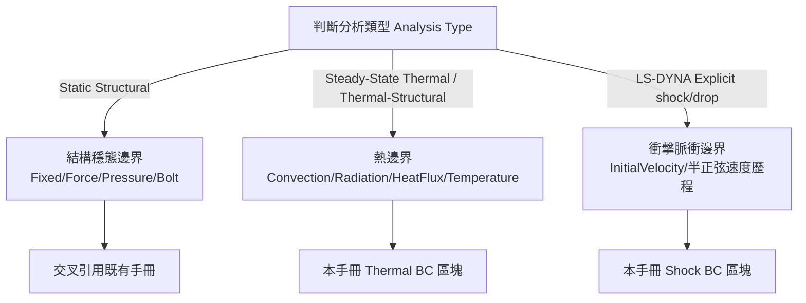

# ANSYS Mechanical 邊界條件施加通用主控手冊

本技能提供約束（Supports）與載荷（Loads）施加的雙模式統一入口：
**(a) 靜態結構/熱分析穩態邊界**；**(b) LS-DYNA shock/drop 半正弦波衝擊脈衝與初始速度邊界**。
既有結構力學類載荷（Fixed/Displacement/Force/Pressure/BoltPretension）已在 `ansys-mechanical` 技能完整定義，本技能不重複建立，僅交叉引用並新增 **Thermal BC** 與 **Shock BC** 兩類本手冊獨有內容。

---

## 一、雙模式判斷與路由 SOP

1. **判斷分析系統類型**：讀取 `analysis.AnalysisType` 或分析樹名稱，決定走結構 / 熱 / 衝擊三條分支。
2. **結構穩態邊界（Static Structural / Transient Structural）**：
   Fixed Support、Displacement、Force、Pressure、Bolt Pretension 三步載荷法等**完整定義已在**
   [`../ansys-mechanical/references/boundary_conditions_and_loads.md`](../ansys-mechanical/references/boundary_conditions_and_loads.md)，
   本手冊不重複，直接引用該文件的 API 範例。
3. **熱邊界（Steady-State Thermal / Thermal-Structural 耦合）**：
   新增內容見 [`references/thermal_boundary_conditions.md`](references/thermal_boundary_conditions.md)，涵蓋
   Convection（對流換熱係數 HTC）、Radiation（表面輻射率 Emissivity）、Heat Flux、Temperature 四類邊界。
4. **衝擊脈衝邊界（LS-DYNA Explicit shock/drop）**：
   新增內容見 [`references/shock_pulse_boundary_conditions.md`](references/shock_pulse_boundary_conditions.md)，整理半正弦波
   脈衝公式與 `AddInitialVelocity()` / `AddVelocity()` 施加方式，並交叉引用 `shock-analysis-workflow` 既有 Analysis Settings 規範。

---

## 二、模組路由表 (Module Router)

| 任務情境 | 專精手冊 / 腳本 | 核心重點 |
|---|---|---|
| 結構約束與力/壓力/螺栓載荷（既有定義） | [`ansys-mechanical/references/boundary_conditions_and_loads.md`](../ansys-mechanical/references/boundary_conditions_and_loads.md) | Fixed/Displacement/Remote Displacement/Force/Pressure/Bolt Pretension 三步法 |
| **熱邊界（本手冊新增）** | [`references/thermal_boundary_conditions.md`](references/thermal_boundary_conditions.md) | Convection HTC、Radiation Emissivity、Heat Flux、Temperature BC |
| **衝擊脈衝邊界（本手冊新增）** | [`references/shock_pulse_boundary_conditions.md`](references/shock_pulse_boundary_conditions.md) | 半正弦波公式、InitialVelocity/Velocity 歷程、六方向衝擊矩陣 |
| LS-DYNA Analysis Settings 標準矩陣（既有定義） | [`shock-analysis-workflow/06-constraint-load/SKILL.md`](../shock-analysis-workflow/06-constraint-load/SKILL.md) | Hourglass Type 6、TSSFAC=0.9、雙精度求解設定 |
| ACT API 存在性查證 | `api_search(query, product="mechanical")` | 撰寫前先查證類別/成員是否存在，避免幻覺 API |
| 三模式統一施加腳本 | [`scripts/apply_boundary_conditions.py`](scripts/apply_boundary_conditions.py) | 依 `bc_mode` 參數（`static`/`thermal`/`shock`）切換施加邏輯 |

---

## 三、三模式共用參數對照 (Parameter Reference)

| 參數 | 適用模式 | 說明 |
|---|---|---|
| `bc_mode` | 全部 | `"static"` / `"thermal"` / `"shock"`，決定施加邏輯分支 |
| `location_ns` | 全部 | Named Selection 名稱字串，須於幾何階段預先建立 |
| `component_values` | static/shock | 分量載荷字典，如 `{"X": 0, "Y": -15000, "Z": 0}` |
| `htc_value` / `ambient_temp` | thermal | 對流換熱係數 (W/m²·°C) 與環境溫度 |
| `emissivity` | thermal | 表面輻射率 (0~1)，需搭配 Ambient/Radiation Temperature |
| `shock_g` / `pulse_duration` | shock | 衝擊峰值加速度 (G) 與脈衝持續時間 (s)，詳見 shock 參考手冊公式 |
| `shock_axis` | shock | 衝擊方向，格式如 `"+Y"` / `"-X"`，對應六方向矩陣 |

---

## 四、工程嚴禁事項清單 (Don'ts)

- ❌ **嚴禁重複定義既有結構載荷類型**：Fixed/Displacement/Force/Pressure/Bolt Pretension 一律引用 `ansys-mechanical` 既有手冊，本手冊僅新增 Thermal 與 Shock 兩類。
- ❌ **嚴禁假設未經查證之 ACT API 存在**：所有本手冊列出的 API（`AddConvection`, `AddRadiation`, `AddHeatFlux`, `AddTemperature`, `AddInitialVelocity`, `AddVelocity`）已於 `mechanical_api.json` 核實存在；若需使用本手冊未列出的 API，必須先以 `api_search` 查證，不確定時在 references 標註「待 api_search 查證」。
- ❌ **嚴禁混用熱邊界與結構邊界單位制**：熱分析慣用 SI (W, °C)，結構 LS-DYNA 慣用 NMM (N, mm, ms)，混用將導致物理量級錯誤。
- ❌ **嚴禁略過 LS-DYNA Analysis Settings 標準矩陣直接施加衝擊脈衝**：衝擊速度歷程必須搭配 `shock-analysis-workflow` 既有 Hourglass/TSSFAC/雙精度設定一併生效，否則數值阻尼與沙漏能無法保證收斂。
- ❌ **嚴禁對同一 Named Selection 疊加衝突邊界**：同一面同時施加 Fixed Support 與 Displacement 非零分量會導致求解器邏輯矛盾。

---

## 五、客觀驗證完成條件 (Verification Conditions)

1. **API 真實性**：所有程式碼範例中使用的 ACT API 皆可於 `docs/api_inventory/mechanical_api.json` 查得同名成員。
2. **分支邏輯正確性**：`scripts/apply_boundary_conditions.py` 依 `bc_mode` 正確路由至對應施加函式，三模式互不干擾。
3. **交叉引用完整性**：既有結構載荷段落未重複定義，皆以連結交叉引用原文件。
4. **frontmatter 合法性**：`quick_validate.py` 驗證回傳 exit code 0。
