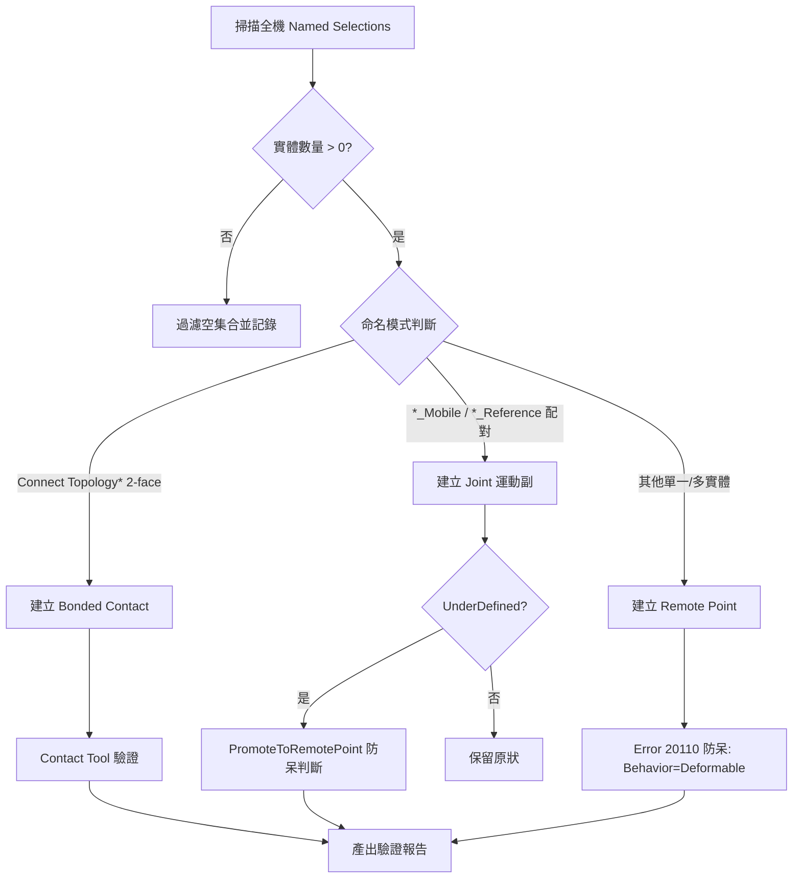

# ANSYS Mechanical 連接關係建立與驗證主控手冊

本技能提供從 SpaceClaim 匯出的 Named Selection 自動建立 Bonded Contact、Joint（運動副）與 Remote Point（遠端點）的通用流程，並內建 Contact Tool 驗證與 Error 20110 過度約束防呆機制。適用於 static、thermal、LS-DYNA 顯式三類分析，不限定單一產品線。

---

## 一、核心 SOP

1. **掃描與過濾**：遍歷 `Model.NamedSelections.Children`，`Entities.Count == 0` 一律跳過並計入 `skipped_empty`。
2. **類型判斷**：依命名慣例與實體拓樸（2-face / `_Mobile`+`_Reference` 配對 / 其他）分流至對應建立函式。
3. **建立連接**：呼叫對應腳本（見下方 Router）建立 Bonded Contact / Joint / Remote Point。
4. **Contact Tool 驗證**：求解前以 `AddContactTool()` 檢查穿透量與狀態。
5. **過度約束防呆**：對螺絲孔、鈑金介面類遠端點強制 `Behavior = LoadBehavior.Deformable`，避免 LS-DYNA Error 20110。
6. **UnderDefined 判斷**：Revolute/Cylindrical Joint 若判定為 `UnderDefined`，依使用者設定決定是否 `PromoteToRemotePoint()`，預設**不**自動降級破壞性操作。
7. **回報**：輸出建立數量、跳過數量、驗證結果，供客觀驗收。

---

## 二、模組路由表 (Module Router)

| 問題 / 階段 | 參考手冊 | 核心內容 |
|---|---|---|
| Joint 與 Remote Point 建立演算法 | [`references/joint_and_remote_point_creation.md`](references/joint_and_remote_point_creation.md) | Mobile/Reference 配對、BodyToBody Scoping、UnderDefined 判定、PromoteToRemotePoint |
| Contact Tool 驗證與過度約束防呆 | [`references/contact_verification_and_overconstraint_guard.md`](references/contact_verification_and_overconstraint_guard.md) | 穿透量判讀、Error 20110 根因與防呆、空集合過濾 |
| 接觸類型列舉與公式（Bonded/Frictional/...） | `ansys-mechanical/references/connections_and_contacts.md` | ContactType、ContactFormulation、PinballRadius（本技能不重複定義，交叉引用） |
| Named Selection 命名慣例與 RM 分組 | （若存在）`ansys-named-selection-rm-contact` | SpaceClaim 側 NS 命名規則與分組策略（本技能消費端，不重複定義產出規則） |
| 幾何體間干涉檢查（求解前健檢） | `ansys-spaceclaim-interface-check/SKILL.md` | BodyInterferenceMesh 診斷手法，與本技能的連接建立屬前後接續步驟 |

執行腳本：
- [`scripts/create_bonded_contacts_from_ns.py`](scripts/create_bonded_contacts_from_ns.py)：掃描 `Connect Topology*` 2-face NS，批次建立 Bonded Contact。
- [`scripts/create_joints_from_ns.py`](scripts/create_joints_from_ns.py)：掃描 `_Mobile`/`_Reference` 配對 NS，建立 Fixed/Revolute/Cylindrical Joint。

---

## 三、三種分析類型的差異處理

| 分析類型 | 接觸行為重點 | 遠端點重點 |
|---|---|---|
| **static / modal** | `ContactFormulation` 建議 `AugmentedLagrange`，須執行 Contact Tool 驗證穿透量 | `Behavior` 依工況選 `Rigid`（集中載荷簡化）或 `Deformable`（避免局部過硬） |
| **thermal** | Bonded 接觸需確認熱傳導介面（Thermal Contact Resistance）另於熱分析設定補充，本技能僅處理幾何介面建立本身 | 遠端點用於熱流率施加點，`Behavior` 通常為 `Deformable` 避免虛假熱傳導路徑 |
| **lsdyna_explicit** | 全域單表面接觸另由上層 LS-DYNA 匯出流程注入 `*CONTACT_AUTOMATIC_SINGLE_SURFACE`，本技能處理的是局部 Bonded 介面與運動副 | 螺絲孔等多點共用遠端點**必須** `Behavior = Deformable`，否則觸發 Error 20110 |

---

## 四、絕不能做清單 (Don'ts)

> [!CAUTION]
> 1. **嚴禁對空集合 Named Selection 建立連接**：`Entities.Count == 0` 的 NS 必須先過濾跳過，否則 Scoping 階段會丟出例外中斷整個批次流程。
> 2. **嚴禁對共用節點的多個剛性遠端點使用 `Rigid` Behavior**：薄板螺絲孔或鈑金介面若有多個 Remote Point 綁定同一區域且皆為 `Rigid`，會在 LS-DYNA 顯式求解觸發 `Error 20110`（multiple rigid bodies constrain the same node）；必須設為 `Deformable`，詳見 `references/contact_verification_and_overconstraint_guard.md`。
> 3. **嚴禁未經 Contact Tool 驗證直接求解**：接觸對建立後必須呼叫 `AddContactTool()` 評估穿透量與狀態（Sticking/Sliding/Open），穿透量應小於特徵尺寸的 0.1% 或單元尺寸的 1%，未驗證嚴禁放行求解。
> 4. **嚴禁對 `UnderDefined` 的 Revolute/Cylindrical Joint 自動破壞性降級**：僅在使用者明確要求 `Promote_To_RemotePoint=True` 時才執行 `PromoteToRemotePoint()`；預設應保留 UnderDefined 狀態供求解器計算，不可擅自降級破壞原始運動副定義。
> 5. **嚴禁重複定義 `ContactType` / `ContactFormulation` 列舉**：這些列舉已於 `ansys-mechanical/references/connections_and_contacts.md` 完整定義，本技能的腳本與文件一律交叉引用，不重複列出列舉值。
> 6. **嚴禁憑記憶假設未查證 API**：若 references 中標註「待 api_search 查證」，實作前必須先呼叫 `api_search` / `api_get` 確認簽名存在。
