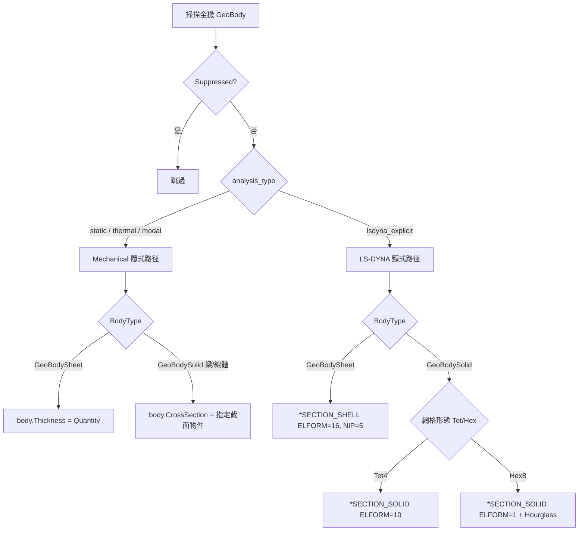

# ANSYS Mechanical 截面與厚度指派主控手冊

本技能提供殼單元厚度（Shell Thickness）、梁截面（Cross Section）與單元公式（Element Formulation）的雙模式指派：**(a) Mechanical 原生隱式/熱分析**路徑使用 `Body.Thickness` / `Body.CrossSection` 物件屬性；**(b) LS-DYNA 顯式**路徑產生 `*SECTION_SHELL` / `*SECTION_SOLID` 關鍵字卡片。兩路徑共用「掃描 Body → 判斷 BodyType → 依分析類型指派」的核心流程，供 server/機構衝擊（shock）、wireline、payment 等多產品線共用。

---

## 一、核心路由決策 (Analysis-Type Router)

**判斷依據**：`analysis_type` 參數由呼叫端指定（`"static"` / `"thermal"` / `"modal"` 走隱式；`"lsdyna_explicit"` 走顯式）。兩路徑皆先以 `body.GetGeoBody()` 取得 `BodyType`（`GeoBodySheet` 判定殼、`GeoBodySolid` 判定實體/梁），避免對未抑制清單重複掃描。

---

## 二、模組路由表 (Module Router)

| 問題 / 階段 | 參考手冊 | 核心內容 |
|---|---|---|
| Mechanical 隱式殼厚度與截面 API | [`references/shell_thickness_implicit.md`](references/shell_thickness_implicit.md) | `Body.Thickness`、`Body.CrossSection`、梁截面類型、API 存在性查證結果 |
| LS-DYNA 顯式截面卡片 | [`references/section_cards_explicit_lsdyna.md`](references/section_cards_explicit_lsdyna.md) | `*SECTION_SHELL` / `*SECTION_SOLID` ELFORM 選型、NIP、沙漏控制 |
| 網格劃分與厚度方向層數 | `ansys-mechanical/references/mesh.md` | 薄壁件 Shear Locking 防護、Sweep 層數建議（本技能不重複定義） |
| 求解控制、大變形開關 | `ansys-mechanical/references/analysis_setup.md` | Large Deflection、Substeps（本技能不重複定義） |
| API 存在性查證 | `api_search(query, product="mechanical")` | 撰寫腳本前先查證，嚴禁憑記憶假設 API 簽名 |

執行腳本：
- [`scripts/assign_section_thickness.py`](scripts/assign_section_thickness.py)：依 `analysis_type` 參數切換隱式/顯式路徑的統一入口。

---

## 三、標準 SOP

1. **連線取得 Model**：PyMechanical gRPC（Port 10000+）或 ACT 腳本環境內建 `Model` handle。
2. **掃描 Body**：`model.Geometry.GetChildren(DataModelObjectCategory.Body, True)`，過濾 `Suppressed == True`。
3. **判斷 BodyType**：呼叫 `body.GetGeoBody()`，依 `str(geo_body.BodyType)` 分流 `GeoBodySheet` / `GeoBodySolid`。
4. **依 analysis_type 指派**：
   - 隱式（static/thermal/modal）：殼體寫入 `body.Thickness = Quantity(value, "mm")`；梁/線體寫入 `body.CrossSection`（需先在 `Model.Geometry` 下建立或引用既有截面定義，詳見 `references/shell_thickness_implicit.md`）。
   - 顯式（lsdyna_explicit）：依 BodyType 與（若為實體）網格形態輸出對應的 `*SECTION_SHELL` / `*SECTION_SOLID` 卡片字串，交由上層 LS-DYNA 匯出流程寫入 `.k` 檔。
5. **回報統計**：輸出成功指派數量、跳過數量（含 Suppressed 與未知 BodyType），供呼叫端做客觀驗證。
6. **驗證**：隱式路徑斷言 `body.Thickness.Value > 0`；顯式路徑斷言產出的卡片字串包含正確 `ELFORM`。

---

## 四、絕不能做清單 (Don'ts)

> [!CAUTION]
> 1. **嚴禁對 `GeoBodySolid` 呼叫 `Thickness` 屬性**：`Thickness` 僅定義於殼體（`GeoBodySheet`），對實體零件賦值會導致 ACT 執行期例外或靜默失敗，必須先判斷 `BodyType`。
> 2. **嚴禁省略 Suppressed 過濾**：對已抑制（Suppressed）的 Body 寫入厚度或截面會造成求解前模型樹異常，必須在掃描階段 `continue` 跳過。
> 3. **嚴禁憑記憶假設不確定的 API**：若 `references/*.md` 中標註「待 api_search 查證」，執行前必須先呼叫 `api_search` 或 `api_get` 確認簽名存在，不可直接假設可用。
> 4. **嚴禁在隱式與顯式路徑間混用卡片語法**：Mechanical 隱式分析不支援 `*SECTION_SHELL` 關鍵字卡片語法，僅能透過原生物件屬性（`Thickness`/`CrossSection`）設定；兩路徑嚴格由 `analysis_type` 參數隔離，不可交叉呼叫。
> 5. **嚴禁重複定義網格品質或求解控制邏輯**：厚度方向網格層數、Shear Locking 防護已於 `ansys-mechanical/references/mesh.md` 定義，本技能僅處理截面指派本身，不得重複或衝突定義。
