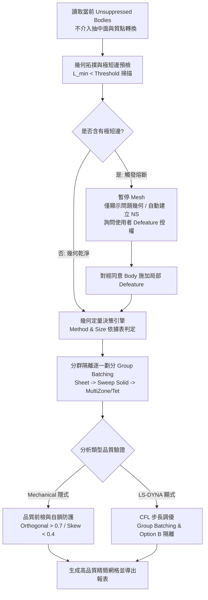

# ANSYS Mesh 網格工程與效能調優主控手冊

本手冊為 ANSYS Mechanical（隱式結構）與 LS-DYNA（顯式動力學）雙軌網格控制與自動化調優標準規範，整合 Google NotebookLM 26 章教學精華、本機 ACT Group Batching 極速隔離微調演算法，以及整機模型（Full-Chassis）基於客觀幾何拓撲指標與極短邊熔斷之自適應劃分體系。

---

## 一、核心物件進入點 (Entry Handles)

在 Mechanical ACT 腳本與 PyMechanical 環境中，預設全域物件 handle 如下：

```python
Model       = DataModel.Project.Model       # 幾何與模型核心
Mesh        = Model.Mesh                    # 網格控制核心節點
Geometry    = Model.Geometry                # 幾何拓撲核心
Analyses    = Model.Analyses                # 分析系統清單
Selection   = ExtAPI.SelectionManager       # 選取管理器
```

---

## 二、整機網格與雙軌調優 SOP 流程



### 1. 整機幾何前檢與極短邊熔斷 (Short-Edge Gatekeeper)
- **尊重當下激活狀態**：只要 `Suppressed == False`（含 PSU、硬碟架、插卡等），一律視為必跑幾何直接進行劃分，不擅自轉質點或抑制。
- **極短邊預檢與視覺隔離**：若偵測到邊長 $L_{\text{edge}} < 0.25\text{ mm}$，**立即中斷 Mesh**；將問題幾何設為 `Visible = True`，其餘正常幾何設為 `Visible = False`；自動建立 `NS_ShortEdges_ALL` 與各件具名選擇，向使用者報告並徵詢 Defeature 授權。
- **Defeature 授權制**：嚴禁擅自盲目開啟全域 Defeature，僅對使用者明確同意之 Body 施加 `DefeaturingTolerance`。

### 2. 客觀量化驅動 Method 與 Size
- **等效特徵壁厚**：$t_{\text{eq}} = \frac{2V}{A_{\text{surf}}}$（精準估算薄壁折彎件平均肉厚）。
- **薄殼 (`Sheet`)**：指派 `QuadDominant`，尺寸 $S = \text{clamp}(D_{\text{mid}} / 20, 2.0\text{ mm}, 8.0\text{ mm})$。
- **規則薄壁實體 ($R_{\text{slender}} \ge 8, \rho_{\text{planar}} \ge 0.70$)**：指派 `Sweep Method`，厚度方向強制 `SweepNumberDivisions = 2 ~ 3`，面內尺寸放大至 $\min(D_{\text{mid}}/15, 4 t_{\text{eq}})$，單元數立減 70%~80% 且徹底杜絕剪切自鎖。
- **正交塊體 ($\rho_{\text{planar}} \ge 0.75$)**：指派 `MultiZone` 自動 Hex 化。
- **複雜異形件**：指派 `Patch Conforming Tet`，搭配 `Growth Rate = 1.25 ~ 1.30` 與曲率角 $24^\circ \sim 30^\circ$ 抑制單元暴增。
- **螺栓孔連接**：自動識別 `Scr_RM_grp` 等 Named Selection，施加 Edge Sizing（孔周長 8~12 等份）並生成 1~2 層四邊形 Edge Washer 墊圈環狀網格。

### 3. Mechanical 隱式品質前檢 (Implicit Quality Check)
- 依目標 solver、單元型別與版本確認網格指標定義；記錄極端值位置、元素數量與缺陷類型。品質指南中的數值屬於該指標的候選警示值，未經該分析驗證不得升級成通用求解硬阻斷。
- 薄壁結構需評估厚度方向解析度、單元階次、殼／實體適用性與結果收斂；不得單憑「一層」或單元名稱判定結果必然失效。

### 4. LS-DYNA 顯式 CFL 時間步長調優 (Explicit CFL Tuning)
- 啟動 `cfl_mesh_tuner_fast.py`，採用 `Floating Range` 浮動相對微調。
- 以 $3 \sim 5$ 個零件為小批次（Group Batching），透過 `suppress_others_except` 隔離其餘組件。
- 零件 CFL 達標（$\ge \text{Criteria\_MinCFL}$，如 $0.9\ \mu\text{s}$）即刻鎖定尺寸並 Suppress（Option B 動態達標隔離），實現零負擔陪跑。

---

## 三、專精參考手冊路由表 (Router)

| 領域分類 | 專精手冊路徑 | 核心內容要點 |
| :--- | :--- | :--- |
| **整機定量決策與短邊熔斷** | [`references/chassis_mesh_decision_matrix.md`](references/chassis_mesh_decision_matrix.md) | 等效壁厚 $t_{\text{eq}}$ 計算、Method 與 Size 定量依據表、極短邊視覺隔離與 Named Selection 熔斷 SOP。 |
| **品質指標標準** | [`references/metrics_and_quality_standards.md`](references/metrics_and_quality_standards.md) | Skewness、Orthogonal、Aspect Ratio、Jacobian、CFL 步長量化門檻與求解器速度關係。 |
| **劃分方法與清理** | [`references/mesh_methods_and_geometry_healing.md`](references/mesh_methods_and_geometry_healing.md) | Sweep、MultiZone、Patch Conforming Tet、Pinch Control 與 Defeaturing 容差配置。 |
| **局部控制與墊圈** | [`references/local_controls_and_washers.md`](references/local_controls_and_washers.md) | Sphere/Body of Influence、Edge Washer 演算法與薄壁厚度方向多層控制。 |
| **CFL 調優與分群** | [`references/cfl_tuning_and_group_batching.md`](references/cfl_tuning_and_group_batching.md) | CFL 臨界步長推算、Group Batching 分群隔離加速與 Option B 動態達標跳出。 |

---

## 四、核心自動化腳本清單 (Automation Scripts)

- [`scripts/chassis_mesh_gatekeeper.py`](scripts/chassis_mesh_gatekeeper.py)：**整機模型幾何預檢、極短邊熔斷視覺隔離、Method/Size 定量推薦與分群劃分主控腳本。**
- [`scripts/auto_mesh_generator.py`](scripts/auto_mesh_generator.py)：全自動特徵自適應劃分、螺栓孔 Washer 生成與 Hex-Tet 容錯自愈腳本。
- [`scripts/cfl_mesh_tuner_fast.py`](scripts/cfl_mesh_tuner_fast.py)：極速 CFL 時間步長優化器（整合分群隔離與動態達標鎖定）。
- [`scripts/check_mesh_quality.py`](scripts/check_mesh_quality.py)：網格品質全面診斷、分級統計與 CSV 報告輸出工具。

---

## 五、工程紅線禁忌清單 (Don'ts)

> [!CAUTION]
> 1. **負體積與品質警示需分開判讀**：負體積、元素翻轉或 solver 明確拒絕屬於阻斷條件。Skewness／Orthogonal 等警示值需核對目標產品的指標定義、元素型別和分析需求，再定位最差區域與評估影響；不得把 Fluent 門檻套用至 Mechanical 或 LS-DYNA。
> 2. **薄壁解析需做模型選型與收斂檢查**：考慮薄殼、中面、二階實體或掃掠網格等選項。層數和單元階次是建模依據之一，應用厚度方向敏感度／網格收斂檢查支持，不視為普遍硬性規則。
> 3. **嚴禁擅自開啟全域 Defeaturing**：未經幾何掃描與使用者同意，嚴禁盲目配置全域 DefeaturingTolerance，防止關鍵定位特徵消失。
> 4. **嚴禁忽略極短邊強行 Mesh**：發現極短邊必須熔斷暫停，隔離問題幾何並建立 Named Selection 徵詢使用者決策。
> 5. **嚴禁擅自簡化 Unsuppressed 組件**：未經使用者要求，嚴禁將未抑制的 PSU、插卡或結構體擅自轉為質點或予以抑制。

網格指標的來源等級與適用條件見 [`references/metrics_and_quality_standards.md`](references/metrics_and_quality_standards.md)；以固定 QoI 做三組以上網格收斂見 [`references/mesh_convergence_verification.md`](references/mesh_convergence_verification.md)。
