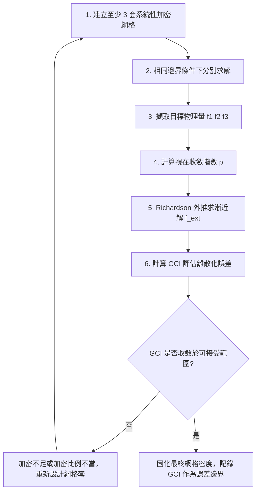

# 網格收斂性驗證：GCI 與 Richardson Extrapolation 標準流程 (`mesh_convergence_verification.md`)

本手冊整理網格收斂性驗證（Mesh Convergence / Grid Independence Study）的標準工程流程，適用於 ANSYS Mechanical（隱式結構）與 Fluent（CFD）需要證明結果不受網格密度影響的場合。內容依據通用數值方法文獻（Richardson 1911 外推法；Roache 1994, 1998 GCI 方法；ASME V&V 20 標準）整理，並對照 Google NotebookLM 查詢結果進行查證標註。

---

## 一、查證狀態說明

查詢 **ANSYS Mesh** 與 **Ansys Official** 兩個筆記本後確認：兩者皆僅涵蓋「網格加密後觀察目標物理量是否趨於平穩」的定性收斂研究概念（即一般所稱 Mesh Independence Study），**未包含** GCI 或 Richardson Extrapolation 的公式推導、網格加密比例建議值或安全係數的官方 ANSYS 文件出處。

本手冊下列公式與係數屬於計算流體力學／計算力學領域的通用數值方法標準做法（非 ANSYS 專屬 API 或功能），**待 api_search 查證**：若需要 ANSYS 原生工具（如 Fluent 內建 Adaption 功能或 Mechanical 內建 Convergence 工具）對應的具體 API 名稱與呼叫方式，應另行查證 PyAnsys / ACT API 文件，不應假設 ANSYS 內建一鍵式 GCI 計算工具。

---

## 二、標準流程總覽

### Step 1：建立至少 3 套系統性加密網格

- 以同一套幾何與邊界條件，建立網格密度依序遞增的三套網格（粗 $h_3$、中 $h_2$、細 $h_1$，其中 $h_1 < h_2 < h_3$）。
- 加密比例 $r = h_{\text{coarse}} / h_{\text{fine}}$ 建議維持在 $1.3 \sim 2.0$ 之間：
  - 比例過小（接近 1.0），三套網格差異不足，計算出的收斂階數 $p$ 易因數值噪訊而失真。
  - 比例過大，粗網格可能落在非漸近收斂區（Asymptotic Range）之外，導致外推結果不可信。
- 三套網格應維持相同的加密策略（例如全域均勻縮放元素尺寸），避免局部加密方式不一致造成比例失真。

### Step 2 ~ 3：求解並擷取目標物理量

在完全相同的材料、邊界條件、求解器設定下，分別求解三套網格，擷取同一個關顺物理量（如最大應力、特定節點位移、阻力係數、壁面熱通量等）記為 $f_1, f_2, f_3$（對應細、中、粗網格）。

### Step 4：計算視在收斂階數 (Apparent Order $p$)

$$p = \frac{1}{\ln(r)} \left| \ln\left| \frac{f_3 - f_2}{f_2 - f_1} \right| \right|$$

- $p$ 代表數值方法的實際收斂速率；若網格與數值方法運作正常，$p$ 應接近理論階數（如二階中心差分對應 $p \approx 2$）。
- 若 $p$ 遠低於理論值或出現負值，通常代表三套網格之一落在非漸近收斂區，或存在局部網格品質問題（如 Skewness/Orthogonal Quality 不良，見 `references/metrics_and_quality_standards.md`），應優先排查網格品質而非直接採信外推結果。

### Step 5：Richardson 外推求漸近解

$$f_{\text{ext}} = f_1 + \frac{f_1 - f_2}{r^p - 1}$$

$f_{\text{ext}}$ 為假設網格尺寸趨近於零時的理論漸近解，作為誤差評估的參考基準，本身不是求解器直接輸出的物理量。

### Step 6：計算 GCI (Grid Convergence Index)

$$GCI_{21} = \frac{F_s \left| \dfrac{f_1 - f_2}{f_1} \right|}{r^p - 1} \times 100\%$$

- $F_s$ 為安全係數：三套網格比較時建議採用 $F_s = 1.25$；僅用兩套網格比較（風險較高，建議避免）時採用 $F_s = 3.0$。
- $GCI_{21}$ 代表細網格解相對於漸近解的離散化誤差帶（百分比），數值越小代表網格加密已趨於穩定。

---

## 三、判定標準與工程取捨

| GCI 範圍 | 判定 | 建議動作 |
| :--- | :--- | :--- |
| $< 1\%$ | 網格已充分收斂 | 可採用當前網格密度，記錄 GCI 作為結果誤差邊界 |
| $1\% \sim 5\%$ | 可接受，依工程重要性權衡 | 關鍵結構件建議再加密一級確認；非關鍵部位可接受 |
| $> 5\%$ | 尚未收斂 | 必須再加密網格重新驗證，不應直接採用該結果 |

> 上述分級為通用工程經驗判準（非逐條對應單一 ANSYS 官方手冊章節），具體專案應依其安全係數與法規要求自行訂定驗收門檻。

---

## 四、常見陷阱

1. **加密比例不一致導致階數失真**：若三套網格並非沿同一加密策略（例如中間那套局部手動調整過某個區域），$p$ 的計算會失去物理意義，應重新建立具一致縮放邏輯的網格套。
2. **誤將迭代收斂當作網格收斂**：求解器內部殘差（Residual）收斂只代表單一網格下的迭代解已穩定，與「結果是否受網格密度影響」是兩個獨立問題，必須分別驗證。
3. **局部物理量比全域物理量更敏感**：全域能量或反力可能很快趨於穩定，但局部應力集中點或局部渉流分離點往往需要更細的網格才會收斂，驗證時應針對實際關注的局部量進行。
4. **非漸近收斂區誤用外推公式**：若最粗網格的誤差機制與另外兩套網格不同階（例如最粗網格網格品質已劣化到產生數值震盪），$p$ 與 $f_{\text{ext}}$ 的推導前提不成立，應捨棄最粗網格重新選取加密梯度。

---

## 五、來源與查證聲明

- 定性的「網格加密觀察目標物理量是否平穩」概念，查詢自 **Ansys Official** 筆記本中關於 Mechanical／Fluent 網格收斂性研究的教學內容整理轉述，非逐字引用。
- GCI 公式、安全係數建議值與加密比例建議，整理自計算流體力學／計算力學領域公認的 Roache GCI 方法與 ASME V&V 20 標準慣例，為通用數值方法知識，不是 nlm 筆記本內容，亦非特定 ANSYS 版本功能。
- 本文件所有公式與門檻值皆不涉及特定專案的機敏路徑、客戶資訊或單一案例數字，符合技能演化規範中的防過擬合原則。
