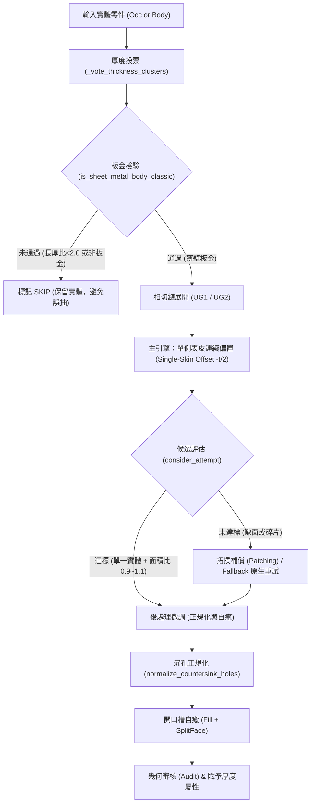

# ANSYS Midsurface Engineering (SpaceClaim & ACT)

## Overview

本技能封裝 ANSYS SpaceClaim (SCDM) 與 ACT 板金中面自動化抽取的全流程架構、拓撲修復工法與品質門禁標準。專門解決板金件中面抽取時常遇到的**破面、特徵遺失、沉孔孔徑異常、端部外輪廓畸變、以及非板金塊體誤判**等工程難題。

此技能記錄表皮偏移、沉孔處理、成型特徵補面和薄壁篩選等方法。速度、特徵辨識成功率及對任意模型的可靠性尚無本技能附帶的完整驗證，不能視為保證。

**引擎無關方法**：分析對立面與厚度、選取表皮、建立候選中面、檢查位置及特徵。這些方法仍須由幾何核心執行。

**SpaceClaim 專屬操作**：下方 `ThickenFaces`、`OffsetEdges`、`Fill`、`SplitFace` 和 `Combine.Merge` 是文件描述的 SpaceClaim 操作。CLI 的 audit 與 batch harness 使用 ANSYS 連線；抽取 agent 本身位於外部目錄，不能從這些包裝工具推定其實際能力。

**獨立 OCCT 原型**：`scripts/occt_midsurface.py` 僅支援單一平面輪廓直擠、可透過幾何檢查的薄板，包含直穿孔。折彎、變厚、沉孔、舌片及壓肋尚不支援，並回報 `unsupported`，不輸出中面。選擇厚度候選使用面積特徵長度與厚度比至少 5 的啟發式門檻，並非殼模型適用性的保證。

---

## Dependencies

* **ansys-geometry-core (`ansys.geometry.core`)**：用於透過 gRPC 與本機 SpaceClaim 實例（連接埠 50051）通訊。
* **ansys-spaceclaim**：通用 SpaceClaim 幾何前處理基礎技能。
* **SpaceClaim.Api (`V24` / `V25`)**：IronPython 2.7 內嵌執行環境與 ACT Wizard 擴充外掛。
* 獨立原型使用隔離環境中的 `cadquery-ocp`；不需要 ANSYS，驗證使用 OCP 7.9.3.1。

---

## Quick Start

### 獨立平板原型
例如使用 Python 3.14，在專案根目錄建立隔離的套件目錄（此安裝會下載相依套件）：
```powershell
python -m pip install --target .codex-step-work/lib cadquery-ocp==7.9.3.1.1
$env:PYTHONPATH = "$PWD/.codex-step-work/lib"
```
在技能目錄執行：
```bash
python scripts/occt_midsurface.py input.step --output mid.step --report report.json --tolerance-mm 0.01
```
輸出路徑必須不存在。結束碼 0 表示通過原型檢查，1 表示讀取或運算錯誤，2 表示不支援；報告使用 mm。距離是表皮到中面的最短距離，不能代替完整的局部誤差圖或 CAE 適用性判定。

### 1. 檢驗零件是否滿足薄壁縱橫比（Aspect Ratio Guard）
```bash
# 檢驗 2x2x2 mm 立方體（預期判定為 Solid Bulk Block 並攔截）
python scripts/midsurface_cli.py verify-sheet-metal --thickness 2.0 --span 2.0 --output check_cube.json

# 檢驗 20x20x2 mm 標準板金件（預期判定為 Sheet Metal 並通過）
python scripts/midsurface_cli.py verify-sheet-metal --thickness 2.0 --span 20.0 --output check_plate.json
```

### 2. 審核當前 SpaceClaim 中已抽取之中面品質
```bash
# 連線 SpaceClaim 並檢驗連通性、孔徑與 14.14mm 倒角
python scripts/midsurface_cli.py audit --body-name "SM-LATCH-RACK-STOP-EDR" --output audit_report.json
```

### 3. 無人值守批次中面抽取測試 (Headless Batch Harness)
```bash
python scripts/batch_midsurface_harness.py --target "SM-LATCH-RACK-STOP-EDR" --output harness_report.json
```

---

## Utility Scripts

本技能於 `scripts/` 提供兩大專用 CLI 工具：

| 腳本路徑 | 主要功能與子命令 | 參數說明與範例 |
| :--- | :--- | :--- |
| `scripts/midsurface_cli.py` | `verify-sheet-metal`<br>薄壁長厚比幾何防呆檢驗 | `--thickness` (mm), `--span` (mm), `--area` (mm²), `--min-ratio` (預設 2.0), `--output` (JSON) |
| `scripts/midsurface_cli.py` | `audit`<br>連線審核中面幾何完整性 | `--body-name` (名稱子字串), `--host`, `--port` (預設 50051), `--output` (JSON) |
| `scripts/batch_midsurface_harness.py` | 無 UI 批次中面抽取測試 Harness | `--target` (名稱過濾), `--agent-dir` (SC_midsurface_Agent 目錄), `--output` (JSON) |

---

## SpaceClaim 文件記載的流程

以下描述是 SpaceClaim 方法及案例目標，不代表獨立 OCCT 原型已支援全部特徵。



### Step 1: 厚度偵測與縱橫比防呆
* 透過對立面幾何分析（`_theoretical_offset_mm`）快速投票出最可能板厚。
* 檢驗 $\text{Aspect Ratio} = \frac{\sqrt{\max(A_{\text{skin1}}, A_{\text{skin2}})}}{\text{Thickness}} \ge 2.0$。若長寬與厚度相當（如正方體），強制標記為 Solid 並拒絕抽取。

### Step 2: 單側表皮連續偏置 (Single-Skin Offset)
* 複製外皮面集至根節點，執行 `ThickenFaces -t/2`。
* 複製遠端頂面（Far Cap）並刪除過渡中間體，生成純淨中面曲面。

### Step 3: 沉頭孔正規化與開口自癒 (Countersink & Notch Healing)
* 參考文件程式片段使用錐面半角 0.50～1.35 rad，並限制半徑及階差；這是特定案例啟發式，非通用緊固件標準。
* 閉合孔直接透過 `OffsetEdges` 向內精確收縮階差 $\Delta R$。
* 破出外緣之槽口先透過 `Fill` 自動平復邊界，再以 `SplitFace.ByCurves + Delete` 打出穿孔小圓。

### Step 4: 拓撲補償與審核 (Audit & Quality Gate)
* 針對折彎舌片與加強肋等未相切面，透過 `patch_unoffset_skin_faces` 進行補償偏移並與主體 `Combine.Merge`。
* 檢查 `components_count == 1`；單一連通分量不足以證明沒有局部缺面或間隙。

---

## Verification & Quality Gates

以下是文件中記載的案例檢查項目，並非通用工程驗收門檻；應以具體模型與分析目的訂定：

1. **連通性**：`components_count == 1`；仍需獨立檢查缺面與幾何間隙。
2. **面積覆蓋率門檻**：中面面積與參考外皮面積比率 $\text{Ratio} \in [0.90, 1.10]$。
3. **特徵一致性**：
   - 若工程需求允許，檢查沉孔是否依規則簡化為穿孔小圓徑（$r_{\text{minor}}$）。
   - `has_1414` 是特定模型的邊長啟發式，不能通用判定倒角或圓角是否正確。
   - 折彎舌片與加強肋完整存在，無白色矩形空洞破面。
4. **編碼底線**：所有 ACT 內嵌腳本全英文 ASCII 註解，防止 IronPython 解譯器崩潰。

---

## Reference Documentation

深入專題請參閱 `references/` 目錄：
* [`countersink_and_notch_healing.md`](references/countersink_and_notch_healing.md)：沉頭孔判定、孔徑收縮、破口自癒與動態防呆協議。
* [`formed_features_and_latch_patching.md`](references/formed_features_and_latch_patching.md)：沖壓折彎舌片、加強肋與凹坑翻邊補償技術。
* [`sheet_metal_aspect_ratio_guard.md`](references/sheet_metal_aspect_ratio_guard.md)：薄壁長厚比防呆公式與 2x2x2mm 邊界驗證。
* [`wizard_xml_ui_design.md`](references/wizard_xml_ui_design.md)：SpaceClaim ACT Wizard XML 人因介面排版規範。
