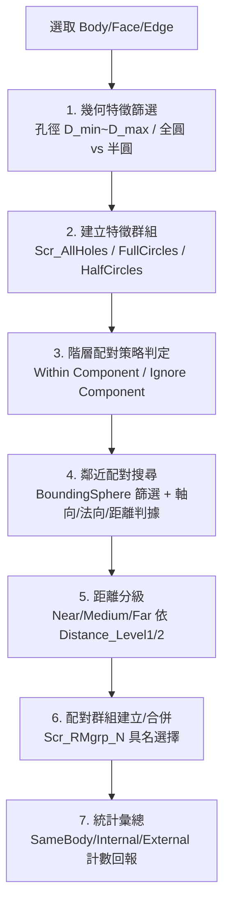

# SpaceClaim 幾何分類與具名群組建立主控手冊

本技能將零散的孔位/邊幾何依特徵尺寸、形狀與空間鄰近關係自動分類，並建立供下游 Mechanical 連接 (Connections/Remote Point) 消費的具名群組 (Named Selection)。核心引擎改寫自既有 ACT 外掛 `SC_RM_grp_creation.py`，去除 UI Properties 綁定，改為通用函式參數介面。

---

## 一、分類配對 SOP

1. **特徵篩選**：依孔徑範圍 `diameter_min/max` 篩選圓形邊，並區分全圓邊 (Full Circle) 與半圓/缺口邊 (Half Circle)，供後續不同連接類型使用。
2. **階層配對策略**：`Pairing_Strategy` 決定跨 Component 的配對是否允許——`Ignore Component`（全域配對，含跨元件）或 `Within Component`（僅同一元件內配對），由 `CheckHierarchicalPairing` 判定。
3. **鄰近配對搜尋**：以候選邊中點建立 BoundingSphere 篩選鄰近邊，再用軸向平行度（圓孔）或法向夾角+距離（任意邊）判據確認是否構成配對。
4. **距離分級（可選）**：若啟用 `enable_distance_grouping`，依配對邊間距劃分 Near/Medium/Far 三級並附加命名後綴。
5. **群組建立與合併**：新配對建立新具名群組；若配對邊已存在既有群組則合併擴充，避免重複建組。

---

## 二、專精參考手冊與腳本導引表 (Router)

| 工程領域 / 任務情境 | 專精手冊 / 實作腳本 | 核心重點與關鍵規範 |
|---|---|---|
| **幾何分類維度定義** | [`references/classification_dimensions.md`](references/classification_dimensions.md) | 孔徑、全圓/半圓判別公式、厚度/曲率/位置分類維度與資料結構。 |
| **階層配對策略細節** | [`references/pairing_strategy.md`](references/pairing_strategy.md) | Within/Ignore Component 判定邏輯、SameBody/Internal/External 統計、距離分級門檻。 |
| **通用分類配對引擎** | [`scripts/classify_and_group_engine.ironpy`](scripts/classify_and_group_engine.ironpy) | 基於 `SC_RM_grp_creation.py` 改寫，去除 ACT UI Properties，改為函式參數驅動。 |
| **既有階層式孔位配對腳本（參照不重複）** | [`../ansys-spaceclaim-modeling/scripts/rm_hole_group_hierarchical.ironpy`](../ansys-spaceclaim-modeling/scripts/rm_hole_group_hierarchical.ironpy) | 既有 argsDict 驅動版本，本技能之引擎為其通用化擴充，兩者判準一致不重複定義。 |

---

## 三、工程嚴禁事項清單 (Don'ts)

- ❌ **嚴禁跨 Component 配對時忽略 Pairing_Strategy**：`Within Component` 策略下若誤判為 `Ignore Component`，會把不同元件（如螺絲與機殼）錯誤配對成同一連接群組，導致後續 Mechanical 建立錯誤的 Remote Point 配對關係。
- ❌ **嚴禁對體積為零的 Body（面/殼）邊套用實體專屬排除規則**：原引擎對 `Volume != 0` 的實體才排除同 Body 內配對，殼體/面之間的配對不可套用此排除，否則會漏判合法配對。
- ❌ **嚴禁未去重即建立具名群組**：合併既有群組前必須檢查邊是否已存在於目標群組，重複加入會造成群組成員膨脹與後續 Mechanical 端 Scoping 錯誤。
- ❌ **嚴禁省略全圓/半圓邊分類直接混用**：全圓孔（鎖孔配對）與半圓/缺口邊（卡勾、定位結構）的工程意義不同，`mode=0` 時必須分別建立 `FullCircles`/`HalfCircles` 子群組供下游判讀。
- ❌ **嚴禁假設 ACT Properties 綁定存在於通用引擎**：`classify_and_group_engine.ironpy` 的參數一律透過函式呼叫傳入（或 `argsDict`），嚴禁內部直接引用 `step.Properties[...]`（該寫法僅存在於原始 ACT Wizard 版本）。

---

## 四、客觀驗證完成條件 (Verification Conditions)

1. **分類結果非空判定**：若裝配體中存在符合孔徑篩選條件的邊，`holes_found` 必須 > 0；若預期有孔但結果為 0，應視為設定錯誤（孔徑範圍/選取範圍）而非正常結果。
2. **階層統計一致性**：`hier_same_body + hier_internal + hier_external` 總和必須等於實際建立的配對群組數，不可出現統計遺漏。
3. **具名群組命名唯一性**：所有新建群組名稱必須透過 `GetGroupNameANDIndex` 類函式確認無重名衝突，嚴禁產生同名群組覆蓋既有資料。
4. **回傳信封完整**：腳本執行完成必須回傳 `result["ok"] == "yes"`，異常時 `result["ok"] == "no"` 並附帶 `result["error"]` 訊息，不得靜默失敗。
