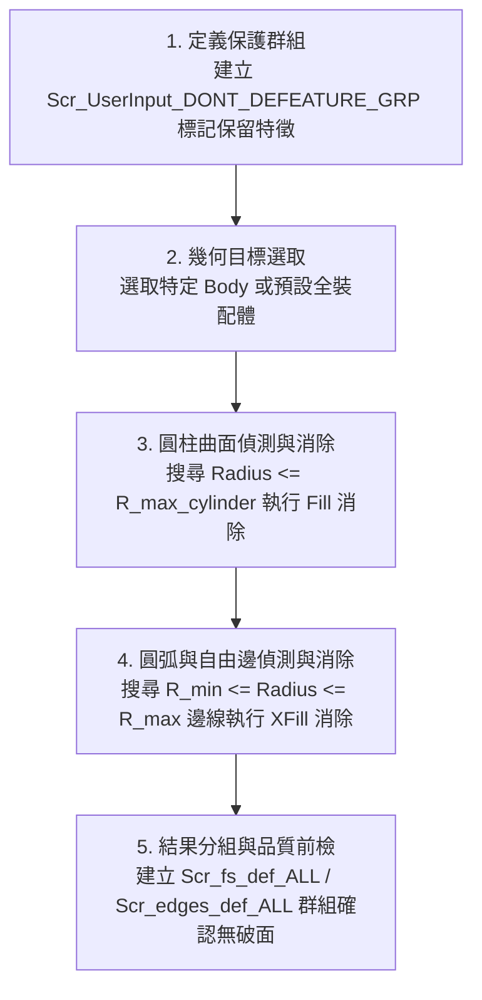

# SpaceClaim 幾何特徵批量消除 (Defeature) 手冊

本技能規範利用 SpaceClaim API 自動消除 CAE 前處理階段非關鍵微小特徵（圓柱孔、倒角、小圓弧邊、短邊線），以避免網格劃分時產生奇異小單元、大幅降低顯式動力學（LS-DYNA）CFL 計算時間步長瓶頸。

---

## 一、核心操作進入點 (Entry Points)

- **MCP 工具調用**：
  ```python
  await geometry_defeature_features(
      r_max_cylinder=3.5,        # 欲消除圓柱面之最大半徑 (mm)
      r_min_circle=0.0,          # 欲消除圓邊線之最小半徑 (mm)
      r_max_circle=3.5,          # 欲消除圓邊線之最大半徑 (mm)
      defeature_face=True,       # 是否執行曲面特徵消除
      defeature_edge=True,       # 是否執行邊線特徵消除
      dont_defeature_group="Scr_UserInput_DONT_DEFEATURE_GRP"  # 排除保護群組
  )
  ```
- **IronPython 腳本路徑**：
  `scripts/defeature_engine.ironpy`

---

## 二、去特徵標準執行流程 (Standard SOP)



### 1. 保護特徵前置定義
若裝配體有螺絲固定孔或定位銷孔不可填實，應先將該邊線/曲面加入命名選擇群組 `Scr_UserInput_DONT_DEFEATURE_GRP`，去特徵引擎會自動排除該集合。

### 2. 曲面去特徵 (Face Defeature)
- 遍歷實體邊界面，識別幾何形狀為 `Cylinder` 或 `ProceduralSurface` 之曲面。
- 當曲面半徑 $\le R_{\text{max\_cylinder}}$（預設 $3.5\text{ mm}$）時，加入候選消除集。
- 呼叫 `Fill.Execute()` 填平小孔或凹槽。

### 3. 邊線去特徵 (Edge Defeature)
- 偵測邊線曲率半徑落於 $[R_{\text{min\_circle}}, R_{\text{max\_circle}}]$ 區間之圓弧邊與過渡倒角。
- 依相鄰兩面夾角自動選擇拔模延伸或直接縫合（`ExtrudeEdges` / `Fill`）。

---

## 三、工程參數對照 (Parameter Reference)

| 參數名稱 | 預設值 | 說明 |
| :--- | :--- | :--- |
| `r_max_cylinder` | `3.5` mm | 欲消除圓柱曲面之最大半徑（直徑 $\le 7.0\text{ mm}$ 的孔洞將被填平） |
| `r_min_circle` | `0.0` mm | 欲消除圓邊線之最小半徑 |
| `r_max_circle` | `3.5` mm | 欲消除圓邊線之最大半徑 |
| `max_edges_at_once` | `3000` | 單批次處理邊線上限，避免記憶體暴增 |
| `fs_grp_sizefilter` | `1.5` mm² | 去特徵後之碎面面積過濾門檻 |

詳細演算法細節請參閱 [`references/defeature_parameters.md`](references/defeature_parameters.md)。

---

## 四、工程禁忌與注意事項 (Don'ts)

- **嚴禁在無保護下對關鍵螺孔去特徵**：執行前必須確認是否已宣告 `Scr_UserInput_DONT_DEFEATURE_GRP`。
- **嚴禁單次過大半徑消除**：若設定 $R > 10\text{ mm}$，可能破壞主要結構外型與承載特徵。
- **避免多實體一次性大批量崩潰**：大型裝配體建議分 Body 或分組件批次執行。

## 內嵌腳本來源

執行 material_assignment_engine、rm_joint_creator、defeature、imprint_contacts、midsurface 或 rm_group 前，讀取 [宿主腳本唯一來源](../ansys-geometry-modeling/references/embedded_scripts.md)。products 為唯一來源，技能內歷史副本不作執行入口；由 CPython／MCP 讀原文送宿主。
