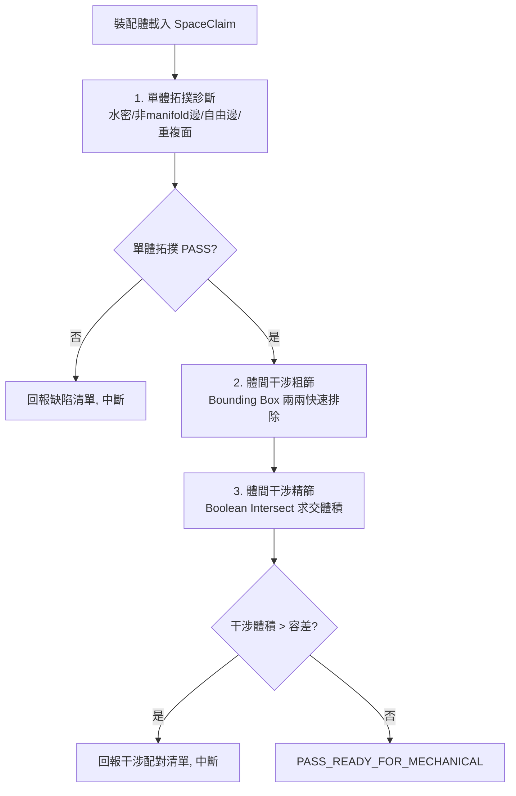

# SpaceClaim 裝配體閘門檢查主控手冊

本技能是幾何前處理送入 Mechanical 網格劃分**之前**的最後一道閘門，目的是在 SpaceClaim 階段先行抓出拓撲缺陷與體間干涉，避免進到 Mechanical 才發現（成本更高、定位更難）。

與 `ansys-spaceclaim-modeling/references/cad_diagnostics.md`（單體微小面/短邊/滲漏判準）互補，本技能專注於**裝配體層級**：多體/多零件之間的干涉與拓撲一致性，兩者判準不重複定義。

---

## 一、閘門檢查 SOP

1. **單體拓撲診斷**：對裝配體內每個 Body 檢查水密性 (watertight)、非 manifold 邊、自由邊 (free edge)、重複面 (duplicate face)。此步驟與 `ansys-spaceclaim-modeling` 的微小面/短邊判準互補，非取代。
2. **干涉粗篩 (Broad Phase)**：以各 Body 的 Bounding Box 兩兩比對，快速排除不可能相交的配對，大幅降低精篩運算量。
3. **干涉精篩 (Narrow Phase)**：對粗篩通過的配對執行布林求交 (Boolean Intersect) 計算交集體積，體積 > 容差即判定為真實干涉。
4. **閘門判定**：任一步驟未通過則中斷並回報缺陷/干涉清單，PASS 才允許繼續（如 Mesh/Named Selection/匯出）。

---

## 二、專精參考手冊與腳本導引表 (Router)

| 工程領域 / 任務情境 | 專精手冊 / 實作腳本 | 核心重點與關鍵規範 |
|---|---|---|
| **水密性與拓撲一致性判準** | [`references/watertight_and_manifold_checks.md`](references/watertight_and_manifold_checks.md) | 非manifold邊、自由邊、重複面的幾何定義與偵測邏輯、裝配體層級水密性彙總規則。 |
| **體間干涉兩階段偵測策略** | [`references/body_interference_detection.md`](references/body_interference_detection.md) | Bounding Box 粗篩公式、Boolean Intersect 精篩、容差設定與配對報告格式。 |
| **SpaceClaim 原生干涉偵測腳本** | [`scripts/check_assembly_interference.ironpy`](scripts/check_assembly_interference.ironpy) | 原生 IronPython，無需離開 SpaceClaim 即可完成粗篩+精篩，輸出 result 字典。 |
| **PyAnsys Geometry 拓撲診斷腳本** | [`scripts/check_watertight_topology.py`](scripts/check_watertight_topology.py) | 透過 gRPC 連線既有 Design，批量稽核水密性與拓撲缺陷並輸出 JSON 報告。 |
| **單體微小面/短邊判準（互補不重複）** | [`../ansys-spaceclaim-modeling/references/cad_diagnostics.md`](../ansys-spaceclaim-modeling/references/cad_diagnostics.md) | 狹長面、極短邊、流體滲漏之單體判準，與本技能裝配體干涉判準分工。 |

---

## 三、工程嚴禁事項清單 (Don'ts)

- ❌ **嚴禁跳過粗篩直接精篩**：裝配體 Body 數量達兩位數以上時，若略過 Bounding Box 粗篩直接對所有配對做布林求交，運算量為 $O(n^2)$ 且極度耗時，必須先粗篩排除。
- ❌ **嚴禁忽略裝配公差產生的微量干涉**：真實裝配常有 micron 級重合面（如螺紋嵌合），必須設定合理干涉體積容差（見 `body_interference_detection.md`），避免誤判為缺陷。
- ❌ **嚴禁對 Suppressed/隱藏 Body 略過檢查**：隱藏或抑制狀態的 Body 仍可能在求解時被啟用，閘門檢查必須涵蓋所有 Body（含抑制狀態），並在報告中註明狀態。
- ❌ **嚴禁未查證 API 存在性即編寫腳本**：若 `references/*.md` 中標註「待 api_search 查證」的 API，使用前必須先以 `api_search`/`api_get` 工具或 `spaceclaim_api.json` 比對確認存在，不可假設存在。
- ❌ **嚴禁略過閘門直接進入網格劃分**：任何 `FAIL` 或 `WARNING` 狀態的裝配體，必須先修復缺陷/干涉，嚴禁帶著未解決的拓撲缺陷或干涉送入 Mechanical。

---

## 四、客觀驗證完成條件 (Verification Conditions)

1. **拓撲診斷零檢出**：所有 Body 的非manifold邊、自由邊（非預期的殼體邊界除外）、重複面檢出數為 0，裝配體整體 `watertight_assembly == true`。
2. **干涉清零判定**：體間干涉精篩結果中，干涉體積超過容差（預設 $10^{-9}\,\text{m}^3$，依最小特徵尺度調整）的配對數為 0。
3. **回傳信封完整**：腳本執行完成回傳結構化報告（`result["ok"] == "yes"` 或 JSON `overall_status == "PASS_READY_FOR_MECHANICAL"`），且附帶每個 Body/配對的明細，不得僅回傳總結文字。
4. **效能門檻**：粗篩階段必須將精篩配對數降至總配對數的合理比例以內（視複雜度，一般應 < 20%），避免 $O(n^2)$ 全量精篩拖垮大型裝配體檢查時間。
