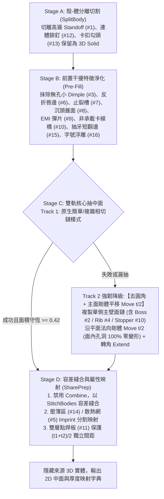

# ANSYS SpaceClaim 伺服器機殼中面抽取與修復主控手冊

本技能專為伺服器機殼（1U/2U/4U Chassis、HDD Cage、Fan Wall、Air Baffle）與機構薄板件設計，建立**「16 大機殼特徵分級處置矩陣」**與**「四階段混合抽中面自愈管線（Stage A ~ D）」**，解決原生 `Midsurface` 因拔模角、非對稱肋、反折圓角（$R < t/2$）與止裂槽導致的漏抽破洞，以及硬布林 `Combine` 近共面崩潰問題。

---

## 一、四階段混合抽中面標準 SOP（Stage A ~ D）

### 1. Stage A：殼-體分離切割 (`SplitBody` for Hybrid Shell-Solid)
- 針對高度遠大於板厚（$H > 2.5t$）之壓鉚螺柱 (`Standoff` #1)、連體拉釘 (#12) 與導風罩楔形卡扣勾頭 (#13)，沿基板表面切開保留為獨立 **3D Solid**，基板傷口 `Fill` 並保留中心安裝圓孔後進入抽中面。

### 2. Stage B：前置干擾特徵淨化 (`Pre-Fill` Defeaturing)
- 抽取前於 3D 實體階段直接以 `Fill.Execute` 抹除不貢獻整體剛度的微特徵：無孔小凸點 (`Dimple` #3)、180° 反折死邊唇部 (`Hem` #6)、折彎角止裂槽 (`Relief` #7)、沉頭孔 $45^\circ$ 錐面 (`Countersink` #8)、邊緣 `EMI` 彈片 (#9)、非承載卡線橋 (#10)、抽牙孔短翻邊唇 (#15) 與沖壓字號浮雕 (#16)。

### 3. Stage C：原生配對與「主面剛體平移 `Move` $t/2$」雙軌抽取
- **Track 1（原生簡單/複雜相切鏈模式）**：依面積差切換簡單模式或手動 `GetTangentChain()` 迴圈模式。
- **Track 2（強韌降級工法：`Copy + Move` $t/2$）**：當原生指令拋出例外或面積守恆率 $\eta_{\text{area}} = A_{\text{mid}} / A_{\text{solid}} < 0.42$ 時，自動複製單側主壁面鏈（含承載凸台 `Boss` #2、大型加強筋 `Rib` #4、限位插舌 #10），沿各自平面法向**剛體平移 `Move` $t/2$**（面內圓孔、滑軌葫蘆孔 100% 原尺寸零變形），再延伸相交轉角。

### 4. Stage D：容差縫合 (`SharePrep`)、間距保護與厚度映射
- **以 `SharePrep` 取代 `Combine`**：啟用 `StitchBodies = True`、`RemoveShortEdges = True`、`RemoveSlivers = True` 進行容差縫合與清理。
- **雙層點焊板 (`Spot Weld / Tox` #11) 保護**：抹平 Tox 凹凸坑並記錄圓心座標；不同零件的平行貼合中面維持 $\frac{t_1+t_2}{2}$ 物理間距，**嚴禁跨件強拉縫合**。
- **局部壓薄區 (`Coining` #14) 與密集散熱網 (`Louver/Vent` #5)**：維持單一無斷差連續中面，透過 `Imprint` 分割子面以映射局部變薄厚度 $t_2$ 或折減彈性模數 $E_{\text{eff}}$。

---

## 二、模組路由表 (Module Router)

| 任務情境 | 參考手冊 / 腳本 | 核心重點 |
|---|---|---|
| **伺服器機殼 16 大特徵處置與內核機制** | [`references/chassis_16_features_decision_matrix.md`](references/chassis_16_features_decision_matrix.md) | 原生 API 四大死穴、Combine 失敗根因、16 大機殼特徵量化識別與 Stage A~D 處置對策 |
| **候選薄板判定、前置過濾與面積守恆門禁** | [`references/midsurface_extraction_criteria.md`](references/midsurface_extraction_criteria.md) | 對向面配對公式、鈑金三項判定、面積守恆率 $\eta_{\text{area}}$ 觸發降級條件 |
| **剛體平移 $t/2$ 降級工法與拓撲修復** | [`references/midsurface_repair_patterns.md`](references/midsurface_repair_patterns.md) | `Copy + Move t/2`、SharePrep 容差縫合、雙層點焊板間距保護、壓薄區厚度映射 |
| **完整可執行四階段抽取與修復腳本** | [`scripts/midsurface_extract_and_repair.ironpy`](scripts/midsurface_extract_and_repair.ironpy) | 整合 Pre-Fill、原生雙模式、剛體平移 $t/2$ 降級與 SharePrep 修復之 ACT 腳本 |
| **ANSYS API 存在性查證** | `api_search(query, product="spaceclaim")` | 呼叫不確定之 SpaceClaim API 前先查證，禁止臆測 |

---

## 三、絕不能做清單 (Don'ts)

> [!CAUTION]
> 1. **嚴禁對中面片調用硬布林 `Combine`**：面體在近共面或 T 型加強筋交界處調用 `Combine` 極易崩潰，一律改用帶容差之 `SharePrep` (`StitchBodies = True`)。
> 2. **嚴禁抹平承載凸台 (`Boss` #2) 與大型加強筋 (`Rib/Emboss` #4)**：抹平 Boss 會破壞與 PCB 之裝配間隙 $\Delta h$；抹平加強筋會導致機殼抗彎剛度與模態頻率暴跌 40%~70%。
> 3. **嚴禁跨零件強行 Stitch 雙層點焊貼合板 (#11)**：兩緊貼零件抽中面後相距 $\frac{t_1+t_2}{2}$，強行縫合會導致邊緣嚴重扭曲變形。
> 4. **嚴禁遺漏厚度回填**：必須輸出 `{body_name: thickness_mm}` 映射表供下游 Mechanical 指派 Shell Thickness。

## 內嵌腳本來源

執行 material_assignment_engine、rm_joint_creator、defeature、imprint_contacts、midsurface 或 rm_group 前，讀取 [宿主腳本唯一來源](../ansys-geometry-modeling/references/embedded_scripts.md)。products 為唯一來源，技能內歷史副本不作執行入口；由 CPython／MCP 讀原文送宿主。
