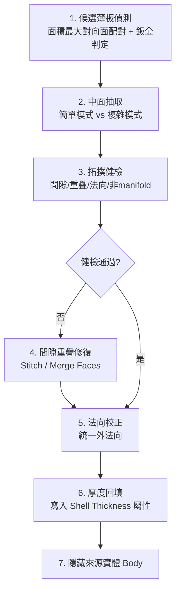

# ANSYS SpaceClaim 中面抽取與修復主控手冊

本技能將鈑金薄板件的中面 (Midsurface) 抽取邏輯，從單一巢狀腳本獨立為具備完整 SOP 的技能，供結構衝擊分析 (shock)、wireline 機構件與 payment 裝置鈑金件共用。殼單元 (SHELL181) 前處理的核心前提是中面幾何乾淨無缺陷；本手冊同時規範抽取後的拓撲健檢與修復步驟。

---

## 一、標準 SOP：候選偵測 → 抽取 → 健檢 → 修復 → 厚度回填

### 1. 候選薄板偵測 (Candidate Thin-Body Detection)
對每個選取的 `IDesignBody`：依面積由大到小排序所有面，取面積最大面為基準，依序尋找下一個面積相近（面積差比例 ≤ `area_difference_ratio`）且法向近似平行或反向（`|n1·n2| > 0.99`）的候選面，並量測兩面最小距離。只有距離落在 `(0, max_thickness]` 區間才視為有效厚度配對。詳細判定公式與鈑金體 (sheet-metal) 篩選準則見 [`references/midsurface_extraction_criteria.md`](references/midsurface_extraction_criteria.md)。

### 2. 中面抽取 (Midsurface Extraction)
依面積差異比例動態切換兩種模式：
- **簡單模式**（面積差 ≤ `complex_area_diff`）：呼叫 `Midsurface.AddMatchingFacePairs(f1, f2, tol, autoExtend=True)`，交由 SpaceClaim 自動尋找相切面鏈。
- **複雜模式**（面積差 > `complex_area_diff`，用於有壓折邊/加強肋的鈑金件）：關閉自動尋找，手動迴圈加入 `GetTangentChain()` 取得的所有相切面，避免壓折邊遺失。

兩種模式皆設定 `OffsetType = Middle`、`AllowNonManifold = False`、`ExtendSurfaces = True`。

### 3. 拓撲健檢 (Post-Extraction Topology Check)
抽取後必須核對：中面是否存在未縫合邊 (free edge)、重疊面、法向不一致、以及是否為單一 manifold 殼體。健檢準則與偵測邏輯見 [`references/midsurface_repair_patterns.md`](references/midsurface_repair_patterns.md)。

### 4~5. 間隙重疊修復與法向校正
依健檢結果執行 Stitch（縫合容差內間隙）、Merge Faces（去除重疊面）、`FlipFacePair`（抽取執行前校正配對方向）統一外法向。`UnifyNormals`/獨立 `FlipFaces` 指令物件經查證不存在，細節與替代做法見 [`references/midsurface_repair_patterns.md`](references/midsurface_repair_patterns.md)。

### 6. 厚度回填 (Thickness Back-fill)
抽取後原始實體厚度資訊會遺失，必須將量測到的 `thickness` 寫回殼體的 `Plate.Thickness` 屬性（或留供 Mechanical 端指派 Shell Thickness），確保後續殼單元剛度正確。

---

## 二、模組路由表 (Module Router)

| 任務情境 | 參考手冊 / 腳本 | 核心重點 |
|---|---|---|
| 候選薄板判定公式、面積比例與鈑金篩選門檻 | [`references/midsurface_extraction_criteria.md`](references/midsurface_extraction_criteria.md) | 面積差異比例、主面比例、厚度上限、簡單/複雜模式切換邏輯 |
| 間隙、重疊、法向翻轉、非 manifold 修復手法 | [`references/midsurface_repair_patterns.md`](references/midsurface_repair_patterns.md) | Stitch 容差、Merge Faces、FlipFacePair、厚度回填寫入時機 |
| 完整可執行抽取與修復腳本 | [`scripts/midsurface_extract_and_repair.ironpy`](scripts/midsurface_extract_and_repair.ironpy) | 整合候選偵測、雙模式抽取、健檢與修復於單一 ACT/batch 腳本 |
| ANSYS API 存在性查證 | `api_search(query, product="spaceclaim")` | 任何不確定的 SpaceClaim API 呼叫前，先用此工具查證，禁止臆測 |

---

## 三、絕不能做清單 (Don'ts)

> [!CAUTION]
> 1. **嚴禁跳過鈑金判定直接對所有實體抽取中面**：非薄板實體（如實心螺絲柱、鑄件凸台）強制抽取中面會產生無意義的退化幾何，必須先通過 `is_sheet_metal_body` 三項判定（厚度上限、面積相似度、主面覆蓋率）。
> 2. **嚴禁在未做拓撲健檢前把中面殼體直接送入網格劃分**：抽取後的中面可能存在縫合間隙或法向不一致，未經健檢修復直接劃網格會導致殼單元法向混亂（影響接觸與壓力方向）或網格破洞。
> 3. **嚴禁對複雜鈑金件（含壓折邊/加強肋）使用簡單模式抽取**：簡單模式的自動相切搜尋在壓折邊處容易遺漏薄壁延伸面，造成中面不完整；面積差超過 `complex_area_diff` 門檻時必須強制使用複雜模式（手動相切鏈迴圈）。
> 4. **嚴禁遺漏厚度回填**：抽取中面後原始實體厚度資訊不會自動保留，若不回填 Shell Thickness，下游 Mechanical 殼單元分析會使用預設厚度（通常為 0 或 1mm），導致剛度嚴重失真。
> 5. **嚴禁假設不確定的 API 存在**：涉及 Stitch / Merge Faces / UnifyNormals 等修復 API 若無法在既有素材或 `api_search` 中查證存在，必須在 references 中標注「待 api_search 查證」，不可憑記憶杜撰呼叫。

## 內嵌腳本來源

執行 material_assignment_engine、rm_joint_creator、defeature、imprint_contacts、midsurface 或 rm_group 前，讀取 [宿主腳本唯一來源](../ansys-geometry-modeling/references/embedded_scripts.md)。products 為唯一來源，技能內歷史副本不作執行入口；由 CPython／MCP 讀原文送宿主。
