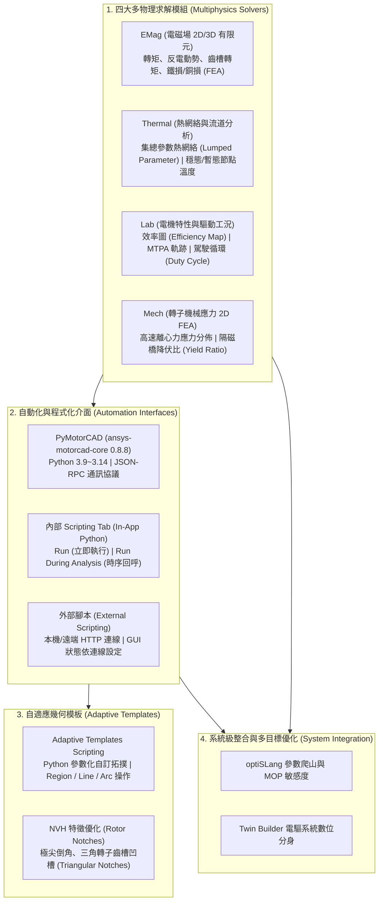

# 集總參數熱網路 (LPTN) 原理

> [!NOTE]
> 本手冊依據官方知識字典 `motorcad.md` 與 `motorcad` 權威技術規格擴充，提供深度工程指導。

## 1. 原理與設定準則

本模組於高精度數值模擬時，必須遵循以下邊界設定與收斂規範：
- 數值精度與單位一致性：務必先確認全域坐標系統、材料參數庫與求解單位（MKS/SI）。
- 網格劃分策略：實施局部特徵網格加密，並於梯度變化劇烈區域進行自適應細化。
- 監控物理量：除了求解器預設殘差之外，必須定義面通量、力矩或特徵頻率等客觀物理監控器。

## 2. 核心規範與字典精要

# Ansys Motor-CAD 與 PyMotorCAD 主題字典

> 本字典整理本地 Motor-CAD PDF、PyMotorCAD HTML 與範例附件中已核對的概念及來源位置。SDK 文件目錄標示 0.8.8，但官方網址使用動態 `version/stable`，多數 catalog 版本欄位未知；不能以目錄名推定網頁內容的版本或桌面產品相容矩陣。詳見下方來源覆核與待整理清單。相關字典：**Maxwell**、**Icepak**、**optiSLang**、**Mechanical**。

---

## 領域架構圖 (Motor-CAD Multiphysics Ecosystem)



---

## 主題辭典與核心模組

### 1. PyMotorCAD SDK、產品版本及安裝條件

#### 核心概念與辭典定義 (Core Concepts & Glossaries)
- **PyMotorCAD 系統架構**：`ansys-motorcad-core` (SDK 0.8.8) 是透過 **JSON-RPC 通訊協定** 控制 Motor-CAD 的 Python 用戶端程式庫，支援標準 CPython 3.9 ~ 3.14。
- **產品版本與 SDK 相容邊界 (Compatibility Matrix)**：
  - **一般先決條件**：Getting Started 說明本機須有授權的 Motor-CAD v2023 R1 或更新版本；這是該 SDK 頁面記載條件，非完整相容矩陣。
  - **Adaptive Templates 特徵門檻**：Adaptive Templates 指南要求 Motor-CAD v2024.1.2 或更新版本，PyMotorCAD v0.4.1 或更新版本；此條件僅適用該功能。
  - **內建與外部安裝分離**：Motor-CAD 自 2023 R1 起已在安裝包內部為 Scripting Tab 隨附了 PyMotorCAD；若在外部開發環境（如 VS Code、Jupyter）中呼叫，需透過 `pip install ansys-motorcad-core` 獨立安裝套件。
  - **授權與連線**：使用本機或遠端 Motor-CAD instance 時，須符合安裝環境的授權及 license server 設定。核對的 SDK 頁面未列出特定產品 feature 名稱或完整授權對照表。

#### 官方手冊章節與規格出處 (Manual & Doc Citations)
- **手冊來源**：*PyMotorCAD User Guide & Getting Started (SDK 0.8.8)*
- **章節定位**：
  - Getting Started: **Getting Started Index** · `ansys_82e145d55282506d67d6631a`
  - Standard Installation: **Running Motor-CAD** · `ansys_40af952c5b24f5c47a80afbe`
- **資料庫引用標籤**：`sources.csv#ansys_82e145d55282506d67d6631a`, `sources.csv#ansys_40af952c5b24f5c47a80afbe`

#### 本機啟動範例 (SDK 文件示例)
```python
# ==============================================================================
# PyMotorCAD: launch a local Motor-CAD instance
import ansys.motorcad.core as pymotorcad

# 官方示例：建立 MotorCAD client 並連接/啟動本機 instance。
# GUI 與程序生命週期依 SDK 版本及連線選項確認。
mc = pymotorcad.MotorCAD()
```

#### 工程實務踩坑指南 (Gotchas & Limitations)
1. **多版本安裝**：本地資料未提供多版本 Windows 註冊行為的可靠步驟。需要選定版本時，應依目前安裝的 SDK/API 文件確認可用連線參數及實際啟動目標；本文不推定 Registry 路徑。
2. **遠端與 GUI 模式**：External Scripting 文件描述本機/遠端 JSON-RPC 連線（HTTP）；是否顯示 GUI、instance 如何啟動需依使用的連線選項核實。該描述不足以支持「預設無頭」或特定效能收益。

---

### 2. Motor-CAD 連線與計算變數操作

#### 核心概念與辭典定義 (Core Concepts & Glossaries)
- **變數操作核心 API (Variable Access API)**：
  - **`set_variable(name, value)`**：將數值、字串或布林值寫入 Motor-CAD 內部資料庫。
  - **`get_variable(name)`**：讀取指定變數。有效名稱、資料型態及單位需查該版本變數文件或範例，不能假定所有 API 使用相同單位慣例。
- **文件可定位的操作**：SDK 範例展示 `get_variable`／`set_variable`，`do_magnetic_calculation` 及 `do_steady_state_analysis` 等呼叫可在相應 SDK/教學頁面查證。不同求解功能的呼叫名稱、參數、輸出變數及單位需回到目標版本 API 文件確認；本字典不把未找到來源的名稱列作通用 API。
- **時序回呼機制 (Lifecycle Callback Hooks)**：
  - 在 Motor-CAD GUI 的 `Scripting -> Settings` 勾選 `Run During Analysis`；
  - 文件分別描述 thermal、emagnetic、mechanical stress/forces 類別的回呼行為；實際回呼名稱與分析類別映射依該 SDK 文件：
    - `initial`：在計算開始前被調用（用於重設初始邊界）；
    - `main`：thermal 類別會於時間步相關流程呼叫；其他分析類別的回呼時序不同，見下方來源說明；
    - `final`：文件描述於計算後呼叫；是否儲存及後處理由腳本自行實作。

#### 官方手冊章節與規格出處 (Manual & Doc Citations)
- **手冊來源**：*PyMotorCAD Scripting & Automation Guides (SDK 0.8.8)*
- **章節定位**：
  - Internal Scripting & Callbacks: **Internal Scripting Guide** · `ansys_d10bcc405609f51d5f247f91`
  - External Scripting: **External Scripting Guide** · `ansys_2ebbf43195cd40cdce690465`
- **資料庫引用標籤**：`sources.csv#ansys_40af952c5b24f5c47a80afbe`, `sources.csv#ansys_d10bcc405609f51d5f247f91`

#### SDK 文件中的操作名稱

SDK 與教學範例可見 `get_variable`、`set_variable`、`do_magnetic_calculation`、`do_steady_state_analysis`。具體模型檔、變數名稱、單位、求解順序及結果檢查均依所用版本 API 與模型設定；不在此拼接未經來源核對的可執行流程。

#### 工程實務踩坑指南 (Gotchas & Limitations)
1. **訊息彈窗設定**：SDK 文件指出 `MessageDisplayState=2` 可停用包含存檔/覆寫確認在內的重要提示。自動化前要確認此設定對流程的影響；不能忽略資料保存狀態。
2. **變數名稱與錯誤**：有效名稱依目標版本文件及模型為準。相容性指南示範讀取不存在的 `Not_A_Real_Var` 可能引發 `MotorCADError`；沒有來源支持錯誤大小寫必然回傳空值的規則。

---

### 3. 馬達範例與設計方法範圍

#### 核心概念與辭典定義 (Core Concepts & Glossaries)
- **電機拓撲範例**：本地 tutorials 含 BPM 的 Asymmetric SPM、轉子三角 Notch 與定子三角 Notch 示例；這些只代表範例模型，不作為產品支援矩陣或設計方法完整清單。
- **驅動工況熱暫態模擬 (Duty Cycle Transient Analysis)**：
  - **Lab Model 路徑**：預先建置整機性能圖表，在暫態工況中依據即時溫度查表動態求出電流與損耗並饋入熱模型（雙向耦合）。
  - **Specified-Loss 路徑**：由外部輸入功率曲線，輸入格式支援 `pu` (標么值，乘上 Losses 編輯器的基準值) 或絕對瓦特數 (W)。
- **轉子 2D 機械應力評估**：指定 PDF 說明平面應力假設，並以應力相對材料降伏值呈現結果。比值判讀須依材料、幾何、轉速及設計準則，不能直接等同斷裂或普遍放行門檻。
- **自適應幾何模板**：本地 tutorial 展示 BPM Triangular Rotor Notches。幾何操作和效果屬教程案例；實際 NVH 或轉矩改善須由目標設計分析驗證。

#### 官方手冊章節與規格出處 (Manual & Doc Citations)
- **手冊來源**：*Motor-CAD Guides & Tutorials Gallery*
- **章節定位**：
  - Adaptive Examples Index: **Adaptive Examples Index** · `ansys_780c41d18a46aaec5a0c8c5d`
  - Duty Cycle Analysis: **Duty Cycle Scripting** · `ansys_5c14c100c0f19e6e005ca00c`
  - Thermal Transient: **Thermal Transient PDF** · `ansys_81be4bec7c700b26b4340cd6`
  - Mechanical Stress: **Mechanical Stress PDF** · `ansys_2afe7e5283bef86fe7b9a918`
  - Triangular Rotor Notches: **Triangular Rotor Notches Tutorial** · `ansys_be7ba3fd18efa78c55bd4f47`
- **資料庫引用標籤**：`sources.csv#ansys_780c41d18a46aaec5a0c8c5d`, `sources.csv#ansys_c1f8ccd899a4f1a1a4a0ac59`

#### 範例程式與來源

六個本地 Python/Notebook 教學附件已抽取文字與程式碼，保留 cell 順序及原始來源連結，見 **範例文字補件索引**。補件用於檢索與閱讀，不表示程式已執行或案例數值已獨立驗證。

#### 工程實務踩坑指南 (Gotchas & Limitations)
1. **自適應幾何持久化**：Adaptive Templates 文件說明該功能可建立/使用自訂模板；腳本是否暫存及如何載入，依該腳本流程操作。此行為不外推為所有 geometry API 的共通規則。
2. **平行連線**：Parallel Sessions PDF 比較 MATLAB `parfor` 與 `spmd` 的排程方式。文件沒有證明固定 worker 數、每個 worker 必需授權席次或必須停用彈窗；授權與部署要求依實際環境確認。

---

## 跨主題與模組雙向鏈結 (Cross-Topic References)
- **Maxwell 知識字典**：將 Motor-CAD 導出之 2D 幾何與繞線匯入 Maxwell 3D 進行高精準度局部瞬態電磁場與三維端部漏感分析。
- **Icepak 知識字典**：整合全車水冷迴路與馬達外殼冷卻水套 (Cooling Jacket) 之三維共軛熱傳 (CFD) 模擬。
- **optiSLang 知識字典**：串接 PyMotorCAD 執行電磁轉矩脈動最小化與散熱流阻多目標 Pareto 前沿優化。
- **Mechanical 主題字典**：馬達定子電磁力匯入 Mechanical 執行結構共振與整機 NVH 聲學輻射求解。


---

## 4. 來源覆核增補（2026-11-03）

> **覆蓋範圍提醒：**本字典是分階段整理稿，不代表 Motor-CAD 全部文件已逐章整理。全量來源列於 **來源清冊**，逐來源整理狀態列於 **主題覆蓋清冊**。既有來源覆核只涵蓋下方列明的 SDK 入門／安裝、內部回呼、Adaptive Templates，以及熱暫態、機械應力、並行工作流指定段落；2026-11-04 本輪另核對附件抽取及字典中列出的邊界修正；其餘來源即使有非空轉換稿，仍屬待逐章整理。

### 4.1 來源與轉換範圍

本輪逐筆核對官方文件 catalog 所列 81 項 Motor-CAD 資產：61 份 PDF、14 份 PyMotorCAD HTML 頁面，以及 3 個範例 Notebook 和 3 個 Python 範例附件。81/81 原始檔均存在且 SHA-256 與 catalog 相符；PDF/HTML 共 75/75 有非空 Markdown 轉換稿。6 個範例附件保留原始 `.ipynb`／`.py`，catalog 未提供轉換稿；其文字抽取補件與逐檔校驗見 **附件補件清冊**。逐筆清冊、來源網址、版本欄位、hash、轉換路徑及狀態見 **Motor-CAD 來源清冊**。

本地 PyMotorCAD 頁面位於 SDK 0.8.8 目錄，但 catalog 的 80/81 筆來源 release 為 `unknown`；網址多指向 `version/stable`，不能據此推定網頁內容的發佈版本或 Motor-CAD 桌面版相容矩陣。唯一標記 `v231` 的設計方法文件為 2023 R1。個別章節中的明確最低版本仍應依該章原文引用。

HTML 轉換抽查包含 Getting started、Internal Scripting、External Scripting 及 Rotor Notches 頁面；保留標題、程式碼與超連結，但圖像有以空 alt 文字的連結形式存在，圖片語意不在文字稿內。PDF 抽查包含 Thermal Transient、Mechanical Stress、Parallel Sessions；Markdown 按 PDF 實頁分段，但表格多以純文字/欄位流呈現，數學符號、圖示、圖表曲線與版面關係仍需回原 PDF 核實。頁數連續與非空只能證明轉換輸出存在，不能證明內容無遺漏。轉換品質與待覆核項目詳見 **部分覆核紀錄** 及來源清冊。

### 4.2 由來源可直接支持的主題補充

## 3. 常見陷阱與防呆措施

1. **未定義求解範圍**：求解前未限定掃頻範圍或時間步長，導致求解發散。
2. **材料模型失配**：非線性材料未設定適當的切線模數或溫度相依曲線。
3. **介面通訊失敗**：多物理場耦合未對齊變數傳遞單位，導致數值非物理震盪。
