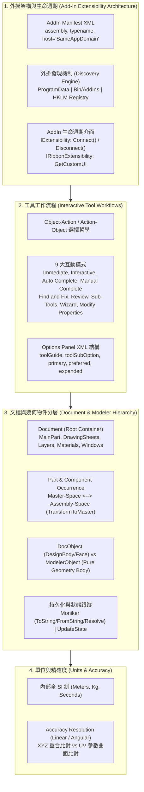

# Ansys Discovery 即時幾何與物理探索 核心 API 與工作流指南

> [!NOTE]
> 本文件由知識字典 `discovery.md` 精煉而成，提供標準工程流程與自動化腳本簽名。
> 可調用 MCP 工具 `ans_get_knowledge_dictionary(product='discovery')` 查閱完整章節。

## 1. 模組架構與工作流說明

本模組遵循 ANSYS 現代自動化架構與雙軌工程標準：
1. **初始化與通訊連線**：支援本地 gRPC / 批次執行以及遠端伺服器程序掛載。
2. **參數配置與資料交換**：透過結構化物件或日誌檔精準傳遞幾何、材料與網格控制項。
3. **求解監控與非同步等待**：使用 Sentinel 工具或狀態輪詢器追蹤計算收斂情況。
4. **結果匯出與報告整合**：產出結構化數值報表與 3D 視覺化資料。

## 2. 知識字典精華摘錄

# Ansys Discovery 開發知識字典

> 本字典彙整 Ansys Discovery 延伸擴充體系 (Extensibility and Add-ins Developer Guide 2026 R1 / v261) 的部分內容；除個別標明已核對的項目外，既有主張與程式簽章仍待逐項核實。內容涵蓋基於 .NET/C# 之 Add-In 外掛架構、XML 清單配置與載入生命週期、9 大工具互動工作流程 (Tool Workflows)、文檔/部件/視窗物件模型結構 (Document/Part/Window Hierarchy)、原始主體與裝配實體轉換 (Master vs. Occurrence)、Moniker 持久識別元、以及 v232 歷史開發者手冊之來源分類稽核。相關幾何與前處理請參閱 **SpaceClaim 主題字典**、**Geometry 主題字典** 與 **Mechanical 主題字典**。

---

## 領域架構圖 (Discovery Extensibility & Object Model)

---

## 主題辭典與核心模組

### 1. 開發 API 與語言

#### 核心概念與辭典定義 (Core Concepts & Glossaries)
- **Discovery 延伸開發環境**：
  - Discovery 外掛程式 (Add-In) 是以受控程式碼 (Managed .NET Framework 4.8) 開發的類別庫 DLL。
  - **C# 入門範例**：官方指南提供 C# add-in 建立步驟；其他語言支援及跨版本相容性未在此處驗證。
- **Add-In 核心生命週期介面 (AddIn Lifecycle Interfaces)**：
  - **`IExtensibility`**：外掛程式之必要入口介面；v261 C# 入門範例實作 `bool Connect()` 與 `void Disconnect()`。
  - **`IRibbonExtensibility`**：Ribbon UI 擴充介面；文件說明 `GetCustomUI` 回傳 XML 描述。Getting Started 稱自訂 Ribbon 時亦需實作 `ICommandExtensibility`。
  - **`ICommandExtensibility`**：文件描述啟動時以 `Initialize` 新增或修改命令；命令狀態與執行行為需參照相關 API。
- **清單檔案 (Manifest XML Schema)**：
  - 描述外掛程式中繼資料的 XML 檔，關鍵元素包含：
    - `name` / `description`：在 Discovery Options 視窗中顯示的外掛名稱與說明。
    - `assembly`：DLL 檔案名稱或絕對路徑。
    - `typename`：實作 `IExtensibility` / `AddIn` 的完整類別名稱（含命名空間）。
    - `host`：該 v261 頁屬性說明寫 Discovery 僅支援 `SameAppDomain`；同頁 XML 範例卻使用 `NewAppDomain`，兩處不一致，使用前須依實際版本文件及環境確認。
- **外掛搜尋路徑與登錄檔探索**：
  - `%ProgramData%\Discovery\AddIns\`
  - 安裝目錄下的 `<Discovery_Install_Dir>\AddIns\`
  - 系統登錄檔：`HKEY_LOCAL_MACHINE\SOFTWARE\Discovery\AddIns`
  - 命令列 `Discovery.exe /AddInManifestFile="<manifest 路徑>"` 可指定 manifest。

#### 官方手冊章節與規格出處 (Manual & Doc Citations)
- **手冊來源**：*Discovery Extensibility and Add-ins Developer Guide (Release 2026 R1 / v261)*
- **章節定位**：
  - Developer Guide Introduction: **Extensibility Guide Index** · `ansys_e44c35953a01fe33e2f7e4c0`
  - Getting Started & Creating C# Add-In: **Getting Started Markdown** · `ansys_9c278173f8ee7f11654e1607`
  - Creating Manifest Files: **Manifest Guide** · `ansys_6158720fdeabfe6010dfb550`
- **資料庫引用標籤**：`sources.csv#ansys_e44c35953a01fe33e2f7e4c0`, `sources.csv#ansys_9c278173f8ee7f11654e1607`, `sources.csv#ansys_77079e257cea08ad85806245`, `sources.csv#ansys_6158720fdeabfe6010dfb550`

#### C# Add-In 生命週期範例（v261）

官方 C# 入門頁的類別繼承 `AddIn` 並實作 `IExtensibility`；範例的兩個方法簽章分別為 `public bool Connect()` 和 `public void Disconnect()`，初始化與清理分別置於其中。此處是最小生命週期導讀，不包含 Ribbon、命令註冊或完整可安裝外掛。**Creating a C# add-in**（`sources.csv#ansys_77079e257cea08ad85806245`）。

先前稿件的 `Connect(IApplication application)`、`override` 與單獨實作 Ribbon 的範例未經編譯且與該入門頁或 Getting Started 描述不一致，已移出現用字典並保留備份；未編譯或載入外掛。

#### 工程實務踩坑指南 (Gotchas & Limitations)
1. **Manifest XML 的 AppDomain 衝突陷阱**：在某些官方教學範例中，XML 寫有 `host="NewAppDomain"`；然而手冊屬性規格表明確聲明 **Discovery 目前僅支援 `SameAppDomain`**。原文未說明此衝突在特定安裝環境中的實際錯誤，不能推定例外類型或載入結果。
2. **命名空間歷史相容性**：雖然本產品為 Discovery v261，底層受控 API 目前仍沿用 `SpaceClaim.Api.V22` / `Discovery.Api.V22`。編寫程式碼時切勿自行猜測並引用不存在的 `Discovery.Api.V261` 命名空間。

---

### 2. 工具工作流程

#### 核心概念與辭典定義 (Core Concepts & Glossaries)
- **選取哲學 (Selection Philosophies)**：
  - **Object-Action (物件-動作)**：使用者先選取幾何面或實體，再點擊工具按鈕。若選取不相容，工具會反灰或拒絕執行。
  - **Action-Object (動作-物件)**：使用者先點擊工具按鈕，工具自動設定選取篩選器 (Filter)，只允許使用者點選符合條件的圖元。
  - 官方指南建議：高品質自訂工具應盡可能**同時支援這兩種選取模式**。
- **9 大自訂工具互動模式 (9 Interactive Workflow Patterns)**：
  - **Immediate Action**：選取幾何後立即套用並完成，無額外參數（如 `Fill`, `Plane`）。
  - **Interactive**：滑鼠拖曳或輸入即時預覽 (Live Preview)，放開滑鼠即刻生成幾何（如 `Pull`, `Move`）。
  - **Auto Complete**：當必要引數（如兩個面、一個軸心）齊備後自動生成並提交，文件要求支援 Undo（如 `Mirror`, `Combine`）。
  - **Manual Complete**：由使用者手動點擊綠色勾選按鈕 (Check Mark) 或按 Enter 完成（如 `Midsurface`, `Linear Pattern`）。
  - **Find and Fix**：一啟用工具即全域掃描問題特徵，支援「全部修復」或「逐一忽略」（如 `Extra Edges`, `Small Faces`）。
  - **Review**：在高亮模型特定區域時淡化其餘背景（如 `Contact Review`）。
  - **Tools With Sub-Tools**：包含高階工具與子工具列（如 `Structural Setup` 包含 `Fixed Support`, `Pressure`）。
  - **Wizard (精靈導引)**：多步驟循序引導（如 `Internal Flow Volume`）。
  - **Modify Properties**：選取物件後由 HUD 彈窗提供數值調整。
- **Options Panel XML 結構**：
  - 自訂工具可定義面板控制項，分為 `toolGuide` (左側快捷導引圖示)、`toolSubOption` (下拉子選單)、`primary` (核心數值輸入)、`preferred` (偏好設定) 與 `expanded` (收合群組)。

#### 官方手冊章節與規格出處 (Manual & Doc Citations)
- **手冊來源**：*Discovery Quick Reference for Tool Usage (Release 2026 R1 / v261)*
- **章節定位**：
  - Quick Reference Overview: **Quick Reference Introduction** · `ansys_12320df025f00027f462fa84`
  - Tool Workflows & Patterns: **Tool Workflows Reference** · `ansys_cb98748024ca6a79679a6b40`
  - Customizing Tools: **Customizing Tools Guide** · `ansys_5921d9ac5920c5763468dac6`
- **資料庫引用標籤**：`sources.csv#ansys_12320df025f00027f462fa84`, `sources.csv#ansys_cb98748024ca6a79679a6b40`, `sources.csv#ansys_5921d9ac5920c5763468dac6`

#### 自訂工具的來源與待驗證範圍

v261 文件以衍生自 `SpaceClaim.Api.V22.Tool` 的類別示範自訂工具；`OptionsXml` 定義選項面板版面，該頁範例使用 `public override string OptionsXml`。實際 XML 結構與命令連結應回到 **Customizing tools**（`sources.csv#ansys_5921d9ac5920c5763468dac6`）。

Auto Complete 工作流程文件要求支援 Undo，但該條目未指定 `CreateUndoGroup` 實作方法或聲稱不使用它必然破壞歷史；先前未編譯且未取得 API 依據的程式與斷言已移至備份。此處未編譯、載入或操作工具。**Tool Workflows**（`sources.csv#ansys_cb98748024ca6a79679a6b40`）。

---

### 3. 文件與視窗結構

#### 核心概念與辭典定義 (Core Concepts & Glossaries)
- **文檔核心架構 (Document Structure)**：
  - **`Document`**：頂層專案容器。包含唯一的 `MainPart`、零至多個工程圖紙 (`DrawingSheet`)、圖層集合 (`LayerCollection`)、材料庫與開啟的視窗 (`Window`)。
  - **`Part` 與裝配架構 (`Component Occurrence`)**：
    - `Part` 容納實體幾何 (`DesignBody`)、空間曲線 (`DesignCurve`)、基準面 (`DatumPlane`) 與子組件 (`Component`)。
    - **Master vs. Occurrence**：`Component` 是指向樣板部件 (Template Part) 的實體參照，帶有裝配坐標變換矩陣 (`Placement`)。
    - **坐標空間映射**：`TransformToMaster` 負責將裝配空間 (Assembly-Space) 座標轉換為部件主空間 (Master-Space)。
- **Doc Object 與 Modeler Object 之分界**：
  - **Modeler Object (`Body`, `Face`, `Edge`)**：純幾何/拓撲數學實體，僅存在於記憶體中進行幾何計算，不屬於 Document，不顯示於視窗中。
  - **Doc Object (`DesignBody`, `DesignFace`)**：屬於 Document，具備父子階層、圖層指派、顏色、名稱、Moniker 與 UpdateState，會在視窗中被彩現。
- **持久識別元與狀態跟蹤 (Moniker & UpdateState)**：
  - **`Moniker`**：可持久序列化為字串之唯一識別碼，即便文檔重新開啟，仍可透過 `Moniker.Resolve(document)` 找回對應物件。
  - **`UpdateState`**：doc object master 的變更狀態，可保存其字串表示並在另一個工作階段重建；來源未將其定義為字串雜湊。它只表示物件本身，不涵蓋所含或參照的其他物件；例如子 design body 變更不會改變父 Part 的 UpdateState。
- **單位系統與容差比對 (Units & Accuracy)**：
  - **內部強制全 SI 制**：所有長度以公尺 (m)、質量以公斤 (kg)、時間以秒 (s) 運算。
  - **幾何判等**：XYZ 物件直接使用 `==`（內建 `Accuracy.LinearResolution` 判等）；UV 物件或曲線重合必須使用 `Geometry.IsCoincident`。

## 3. 雙軌數值基準與驗收標準

- **商業求解軌**：連線正式求解器執行高保真模擬。
- **無授權基準軌**：執行 `scripts/verify_discovery_baseline.py` 驗證解析數值正確性（Exit Code 0）。
