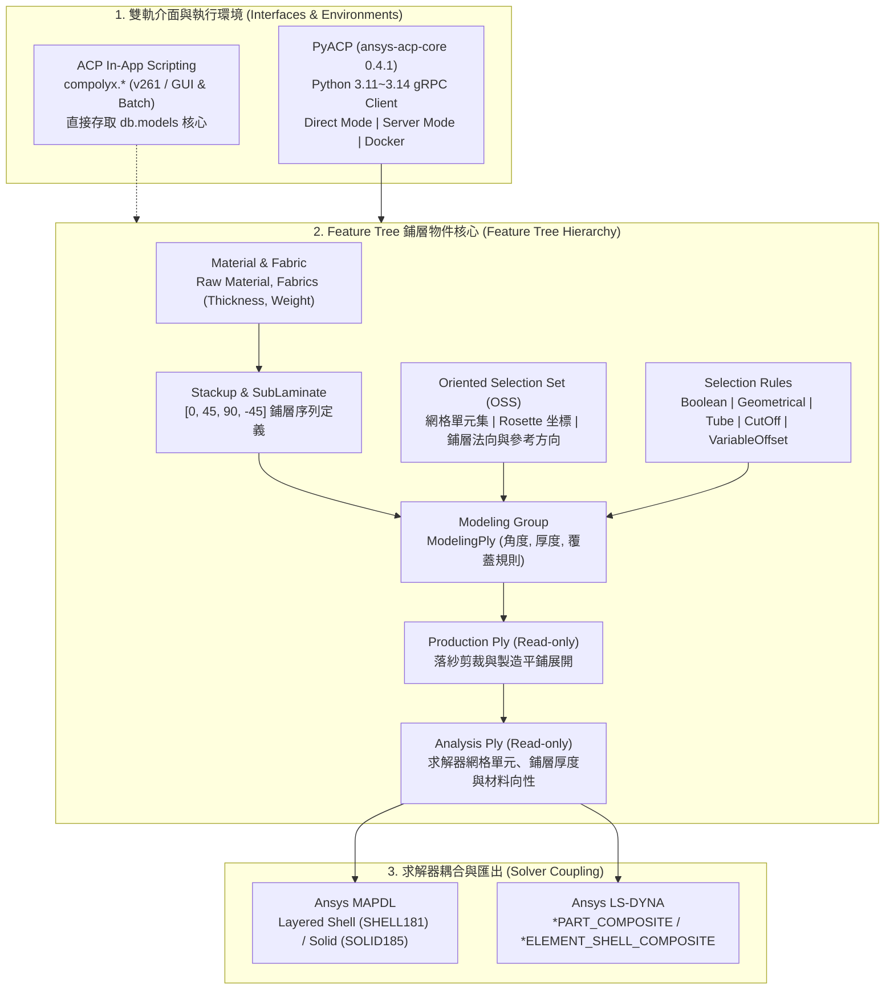

# Granta MI 企業級材料資料庫治理

> [!NOTE]
> 本手冊依據官方知識字典 `acp.md` 與 `acp` 權威技術規格擴充，提供深度工程指導。

## 1. 原理與設定準則

本模組於高精度數值模擬時，必須遵循以下邊界設定與收斂規範：
- 數值精度與單位一致性：務必先確認全域坐標系統、材料參數庫與求解單位（MKS/SI）。
- 網格劃分策略：實施局部特徵網格加密，並於梯度變化劇烈區域進行自適應細化。
- 監控物理量：除了求解器預設殘差之外，必須定義面通量、力矩或特徵頻率等客觀物理監控器。

## 2. 核心規範與字典精要

# ANSYS Composite PrepPost (ACP) 主題辭典

> 本主題深入剖析 ANSYS Composite PrepPost (ACP) 複合材料前處理與後處理的架構體系。詳細拆解 ACP 內嵌腳本 API (`compolyx`) 與現代化 Python 用戶端程式庫 `ansys-acp-core` (PyACP 0.4.1) 的介面與版本邊界、gRPC 無頭啟動與 GUI 連線邊界限制、完整 Feature Tree 樹狀物件模型（從 Raw Material、Fabric、Stackup 到 ModelingPly、ProductionPly 與 AnalysisPly）、方向與落紗 (Rosette / Draping) 演算法、失效準則 (Failure Criteria) 配置，以及進階 Selection Rules 幾何篩選與網格覆蓋率求值。

---

## 領域架構圖 (ACP Architecture & Feature Tree Map)



---

## 主題辭典與核心模組

### 1. 介面與版本邊界

#### 核心概念與辭典定義 (Core Concepts & Glossaries)
- **ACP 雙軌介面體系**：
  - **In-App `compolyx` 介面**：ACP GUI 內建的 Python 直譯環境與命令歷史紀錄器（History / Shell views）。透過全域物件 `db` 存取當前模型（例如 `db.models['class40.1']`），適用於 GUI 錄製巨集與本地批次腳本 (`File > Run Script`)。
  - **PyACP (`ansys-acp-core`)**：Ansys 官方推出的開源 gRPC 用戶端。在標準 CPython (3.11~3.14) 環境中運行，透過網路通訊協定控制無頭 ACP 後端服務 (`ACPInstance`)，適用於現代化 CI/CD、微服務整合與全自動化參數化設計。
- **版本相容性矩陣 (Compatibility Matrix)**：
  - PyACP `0.4.1` 明確要求後端 ACP 服務版本為 **Ansys 2024 R2 (v242) 或更高版本**（支援 v242, v251, v252, v261）。
  - 低於 2024 R2 的舊版 Ansys（如 2023 R2 / 2024 R1）未內建標準 gRPC 服務端點，僅支援 `compolyx` 內嵌腳本。
- **Feature Gates 與傳輸模式**：
  - **Direct Mode (直接本機模式)**：用戶端與 ACP 服務端運行在同一台主機且能存取相同的本機檔案系統。檔案傳輸開銷為零。
  - **Server / Remote Mode (遠端服務模式)**：透過網路連線遠端伺服器或 Docker 容器。必須啟用 `auto_transfer_files=True`，客戶端自動透過 gRPC 流式傳輸將 CDB/H5 網格檔案上傳至伺服器臨時工作區，並將產生的複合材料結果下載至本地。

#### 手冊章節與規格出處 (Manual & Doc Citations)
- **In-App API 手冊**：*Ansys ACP In-App Scripting API 2026 R1* (**Getting Started In-App**)
- **PyACP 手冊**：*PyACP User Guide (SDK 0.4.1)* (**Getting Started PyACP**)
- **Source IDs**：`sources.csv#ansys_54a172e10060cce93837025b`, `sources.csv#ansys_be6b9be103ce7da063f509b6`, `sources.csv#ansys_b212dc49cf7116b3ea83521f`.

#### 雙軌介面特性對照矩陣 (Interface Comparison Matrix)

| 特性維度 | In-App `compolyx` 腳本 | PyACP (`ansys-acp-core`) |
|---|---|---|
| **直譯器要求** | ACP 內建 Python 直譯器 | 標準 CPython 3.11 ~ 3.14 |
| **GUI 互動性** | 運行於 GUI 內部，即時更新視圖 | 完全無頭 (Headless)，無原生 GUI 視窗 |
| **遠端/容器化部署** | 不支援（僅限本地批次） | 原生支援 (Docker Container / Kubernetes / PyPIM) |
| **檔案相依性** | 依賴本地硬碟路徑 | 支援 gRPC 自動檔案上傳與下載流 |
| **最低 Ansys 版本** | 支援所有舊版至 v261 | 強制要求 Ansys 2024 R2 (v242) 或更新版 |

---

### 2. PyACP 啟動與 GUI 連線

#### 核心概念與辭典定義 (Core Concepts & Glossaries)
- **`launch_acp()` 啟動管線**：
  ```python
  import ansys.acp.core as pyacp
  acp = pyacp.launch_acp(mode=pyacp.LaunchMode.STANDALONE, timeout=120)
  ```
  在本地後台自動拉起一個 ACP gRPC 伺服器進程並返回 `ACPInstance` 連線物件。
- **授權檢驗與故障排除 (Licensing Requirements)**：
  - 後端服務啟動時必須簽出 `acp_preppost` 或 `ansys` 授權特徵；
  - 伺服器啟動若超時（預設 120 秒），多為授權伺服器連線延遲或通訊埠 (`ANSYSLMD_LICENSE_FILE`) 阻塞；需排查本機防火牆與環境變數設定。
- **通訊協定與傳輸安全 (gRPC Transports)**：
  - 支援 `insecure`（純明文）、`uds`（Unix Domain Socket，Linux 高速本地 IPC）、`wnua`（Windows 具名通道）及 `mtls`（雙向憑證加密安全傳輸）。
- **關鍵邊界限制：與 ACP GUI 的脫耦性**：
  - **PyACP 啟動的是完全獨立的無頭服務進程，無法即時掛載、操控或同步至已經開啟的 ACP 桌面 GUI 視窗**。
  - **模型檢視與同步策略**：在 PyACP 中完成鋪層配置後，必須調用 `model.save(path="composite_model.acp")` 進行儲存；若需在 ACP GUI 中預覽，需手動打開 GUI 執行 `File > Open`；若 GUI 已經開啟該檔案，需點擊 `Reload Model` 以重新加載修改後的拓撲。

#### 手冊章節與規格出處 (Manual & Doc Citations)
- **手冊來源**：*PyACP Getting Started & Launch Modes* (**0.4.1 Getting Started**)
- **Source IDs**：`sources.csv#ansys_be6b9be103ce7da063f509b6`, `sources.csv#ansys_f4add1a91e06b1e951290115`, `sources.csv#ansys_14717918c9f71a55355f67b7`.

#### PyACP 啟動與模型生命週期範例 (Python Scripting Example)
```python
# ==============================================================================
# PyACP Script: Launch Server, Import FEA Mesh, Configure Layup, and Save
# Note: ASCII-only comments to prevent IronPython encoding issues.
# ==============================================================================
import ansys.acp.core as pyacp

# Step 1: Launch headless ACP server instance with explicit timeout
acp_instance = pyacp.launch_acp(
    timeout=180.0,
    auto_transfer_files=True
)

try:
    # Step 2: Import base finite element model (MAPDL CDB format)
    cdb_path = r"C:\Models\plate_mesh.cdb"
    model = acp_instance.import_model(
        path=cdb_path,
        format=pyacp.ModelInputFormat.ANSYS_CDB
    )

    # Step 3: Verify model status and active entities
    print("ACP Model Name: {0}".format(model.name))
    print("Element Set Count: {0}".format(len(model.element_sets)))

    # Step 4: Save populated ACP composite project to disk
    acp_project_path = r"C:\Models\final_composite.acp"
    model.save(acp_project_path)
    print("Model saved successfully for GUI inspection.")

finally:
    # Step 5: Always close connection and tear down background server process
    acp_instance.close()
```

#### 工程實務踩坑指南 (Gotchas & Limitations)
1. **背景進程孤兒化 (Orphaned Server Process)**：若未將 `acp_instance` 置於 `try...finally` 區塊或使用 Context Manager，當腳本拋出異常崩潰時，後台 `acp_server.exe` 不會自動退出，持續佔用授權直到手動在工作管理員中殺死。
2. **檔案相對路徑在 Remote 模式下的解析錯誤**：在 Docker 或遠端模式下，若使用本地相對路徑（如 `./mesh.cdb`），服務端無法定位該路徑；務必傳入絕對路徑或依賴 `auto_transfer_files=True` 由用戶端打包上傳。

---

### 3. Feature Tree 與鋪層物件

#### 核心概念與辭典定義 (Core Concepts & Glossaries)
- **Feature Tree 物件階層**：ACP 透過樹狀資料模型組織複合材料物件：
  $$\text{Model} \to \text{Material} \to \text{Fabric} \to \text{Stackup} \to \text{OSS} \to \text{ModelingGroup} \to \text{ModelingPly} \to \text{AnalysisPly}$$
- **定位坐標系 (Rosette) 與定向單元集 (Oriented Selection Set, OSS)**：
  - **Rosette**：定義空間坐標系的基準點與軸向（笛卡爾坐標、柱面坐標、球面坐標）。
  - **Oriented Selection Set (OSS)**：將特定幾何網格面 (`ElementSet`) 與坐標系 (`Rosette`) 關聯，定義鋪層的面法向 (Normal Direction, 出模方向) 與參考方向 (Reference Direction, $0^\circ$ 纖維鋪放基準角)。
- **Modeling Ply, Production Ply 與 Analysis Ply**：
  - **Modeling Ply**：工程師設計意圖的直接表達，包含指定的材料/織物、鋪層角度（例如 $45^\circ$）、厚度及所屬選擇規則。
  - **Production Ply (唯讀)**：考慮落紗 (Draping) 展開、工廠裁片邊界與重疊接縫後的製造實體。
  - **Analysis Ply (唯讀)**：有限元素求解器最終讀取的網格分層表示。包含各網格單元上的真實物理厚度、法向向量與主材料方向角。
- **落紗分析 (Draping Algorithm)**：雙曲面幾何成形時，纖維會產生剪切變形 (Shearing Angle)。ACP 支援測地線 (Geodesic) 與正交剪切落紗計算，精確預測纖維轉向與局部厚度增厚效應。
- **失效準則 (Failure Criteria)**：內建最大應力/應變、Tsai-Wu、Tsai-Hill、Hoffman、Puck、Hashin 及層間分層 (Delamination / LaRC05) 等多種失效評定模型。

#### 手冊章節與規格出處 (Manual & Doc Citations)
- **手冊來源**：*PyACP User Guide: Concepts & Feature Tree* (**Feature Tree Guide**)
- **In-App API 手冊**：*Ansys ACP In-App Scripting API 2026 R1* (**ModelingGroup.create_modeling_ply**)
- **Source IDs**：`sources.csv#ansys_8f627c6d092b0bc41088e921`, `sources.csv#ansys_b212dc49cf7116b3ea83521f`, `sources.csv#ansys_2a45bfe28469b764d5eab1c0`, `sources.csv#ansys_dbc5cf0818fbe6dc90b646dc`.

## 3. 常見陷阱與防呆措施

1. **未定義求解範圍**：求解前未限定掃頻範圍或時間步長，導致求解發散。
2. **材料模型失配**：非線性材料未設定適當的切線模數或溫度相依曲線。
3. **介面通訊失敗**：多物理場耦合未對齊變數傳遞單位，導致數值非物理震盪。
