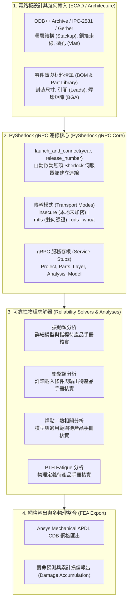

# Ansys Sherlock 電子可靠度與 PCB 疲勞預測 核心 API 與工作流指南

> [!NOTE]
> 本文件由知識字典 `sherlock.md` 精煉萃取而成，提供標準 API 流程、邊界條件與驗證基準。
> 如需完整原文與版本對照，可調用 `ans_get_knowledge_dictionary(product='sherlock')`。

## 1. 核心架構與求解流程

1. **環境初始化**：確認 Python 環境與對應產品授權，透過專屬客戶端連線。
2. **模型前處理**：匯入幾何模型，指定材料物性、熱力學參數或光學表面屬性。
3. **網格劃分與邊界條件**：建立適應性網格，指派載荷、熱源、激勵源或環境邊界。
4. **求解監控與收斂準則**：設置殘差監視器、能量守恆檢查與收斂閾值。
5. **後處理與數據導出**：提取場量分佈、感測器響應與驗證指標。

## 2. 知識字典精選內容

# Ansys Sherlock 與 PySherlock 主題字典

> 範圍說明：本文整理已列出的 PySherlock SDK API、連線、專案匯入與分析案例，不能視為完整 Sherlock 桌面產品手冊。SDK 文件版號與 Sherlock 產品版號分開標示；未知版號不推定。catalog 有 1,235 筆 Sherlock 文件，其中 1,094 筆 API reference、130 筆 tutorial；逐來源 SHA 與文字檔狀態見 **來源清冊**。清冊僅證明原始檔雜湊及轉換檔狀態，正文語義尚未逐篇核對；本字典中既有工程分析主張也須以各段所列來源與頁面為準，不構成已驗證的分析建議。相關電路板與多物理分析請參閱 **Mechanical 主題字典**、**PCB Warpage 主題字典** 與 **Icepak 主題字典**。

---

## 領域架構圖 (Sherlock Reliability & PySherlock Architecture)



---

## 主題辭典與核心模組

### 1. PySherlock 與產品版本邊界

#### 核心概念與辭典定義 (Core Concepts & Glossaries)
- **PySherlock 架構定位**：`ansys-sherlock-core` 是 Ansys 官方為 Sherlock 可靠性物理軟體提供的現代化 Pythonic gRPC 用戶端。運行於標準 CPython 3.9 ~ 3.14，可完全無頭 (Headless) 運行於 Windows 與 Linux 環境。
- **產品版本與 SDK 版本分離原則**：
  - **PySherlock SDK 版號**：本機文件庫對應 `ansys-sherlock-core 2.1.4` 與 `2.1.5`（兩版 API 結構逐行一致）。
  - **Sherlock 桌面產品版號**：例如 `2022 R2`、`2024 R1`、`2025 R2`、`2026 R1`。
- **關鍵功能可用性矩陣 (Availability Matrix)**：
  - **最低產品先決條件**：PySherlock 一般操作要求本機安裝授權版 **Sherlock 2022 R2 或更新版本**。
  - **`launch_and_connect()` 邊界**：該 API 方法明確標記為 **`Available Since: 2025 R2`**。在 2022 R2 ~ 2024 R2 環境下，無法呼叫此方法自動啟動並連線，必須使用傳統方式手動啟動 Sherlock gRPC 伺服器，再透過 `SherlockClient.connect()` 連線。
  - **專案匯入與分析**：`Project.import_odb_archive` 與 `Analysis.run_analysis` 自 **Sherlock 2021 R1** 起即已提供。

#### 官方手冊章節與規格出處 (Manual & Doc Citations)
- **手冊來源**：*PySherlock Getting Started & User Guide (SDK 2.1.4 / 2.1.5)*
- **章節定位**：
  - Getting Started: **PySherlock Getting Started Guide** · `ansys_03a01675e3ec0448a4609447`
  - User Guide: **PySherlock User Guide** · `ansys_5b9ab0d537f7ee42bb3355bb`
  - Launcher API: **Launcher API Reference** · `ansys_8fe2c6d2e3a266ee8921dd62`
- **資料庫引用標籤**：`sources.csv#ansys_03a01675e3ec0448a4609447`, `sources.csv#ansys_dd9d04316ba5a87573d77458`, `sources.csv#ansys_48a487536247777ce3260d58`

#### 版本檢查與啟動參數範例 (Python Scripting Example)
```python
# ==============================================================================
# PySherlock: Verify Version Prerequisites and Launch Server
# Note: ASCII-only comments to prevent IronPython encoding issues.
# ==============================================================================
import ansys.sherlock.core.launcher as launcher

# Explicitly target specific Sherlock release if multiple versions installed
target_year = 2026
target_release = 1

try:
    # launch_and_connect is available since Sherlock 2025 R2
    client, install_dir = launcher.launch_and_connect(
        year=target_year,
        release_number=target_release,
        port=9090,
        timeout=120
    )
    print("Successfully connected to Sherlock {0} R{1}".format(target_year, target_release))
    print("Sherlock Binary Directory: {0}".format(install_dir))
    
    # Perform operations...
    
finally:
    # Always close gRPC connection channel
    client.close()
```

#### 工程實務踩坑指南 (Gotchas & Limitations)
1. API 參考標示 `launch_and_connect` 自 Sherlock 2025 R2 起提供；更舊版的連線方式及錯誤行為需查該版文件，本字典不推定。

---

### 2. gRPC server 與連線生命週期

#### 核心概念與辭典定義 (Core Concepts & Glossaries)
- **Sherlock gRPC 無頭伺服器架構**：
  - Sherlock 底層後端伺服器在無 GUI 模式下監聽 gRPC 請求，預設監聽位址為 `127.0.0.1:9090`。
  - 啟動連線等待上限 `timeout` 預設為 120 秒；API 頁未指明內部等待階段。
- **四大傳輸模式 (Transport Modes)**：
  - **`insecure`**：未加密連線；文件未提供部署適用性或效能比較。
  - **`mtls` (相互 TLS 驗證)**：預設傳輸模式；`certs_dir` 預設 `./certs`。
  - **`uds` (Unix Domain Socket)**：`uds_dir` 預設 `$HOME/.conn`；作業系統支援條件需依目標安裝環境確認。
  - **`wnua` (Windows Named User Authentication)**：Windows 專屬具名使用者管道驗證。
- **生命週期管理原則**：
  - 範例以 `client.close()` 關閉用戶端連線；`try...finally` 是確保例外時仍執行清理的 Python 寫法。

#### 官方手冊章節與規格出處 (Manual & Doc Citations)
- **手冊來源**：*PySherlock Launcher API Reference (SDK 2.1.4 / 2.1.5)*
- **章節定位**：
  - `launch_and_connect` API Parameters: **launch_and_connect Markdown** · `ansys_dd9d04316ba5a87573d77458`
- **資料庫引用標籤**：`sources.csv#ansys_5b9ab0d537f7ee42bb3355bb`, `sources.csv#ansys_8fe2c6d2e3a266ee8921dd62`, `sources.csv#ansys_dd9d04316ba5a87573d77458`

#### 連線與傳輸模式配置範例 (Python Scripting Example)
```python
# ==============================================================================
# PySherlock: Headless Connection with Custom Transport and Timeout
# Note: ASCII-only comments to prevent IronPython encoding issues.
# ==============================================================================
import ansys.sherlock.core.launcher as launcher

# Step 1: Connect to an existing Sherlock server or launch a new one
client, install_dir = launcher.launch_and_connect(
    host="127.0.0.1",
    port=9090,
    timeout=180,                         # 3 minutes initialization timeout
    transport_mode="insecure",           # Plaintext transport for local IPC
    single_project_path=None             # Multi-project workspace mode
)

try:
    # Step 2: Check server service availability via Ping/Echo or basic query
    print("Sherlock gRPC channel established successfully.")
    
finally:
    # Step 3: Ensure channel is torn down

## 3. 雙軌數值基準與驗收標準

- **商業求解器軌**：在具備有效授權環境下，調用官方求解器執行全物理場模擬。
- **數值基準驗證軌**：在無授權或離線 CI 環境下，執行 `scripts/verify_sherlock_baseline.py` 進行解析解比對。
