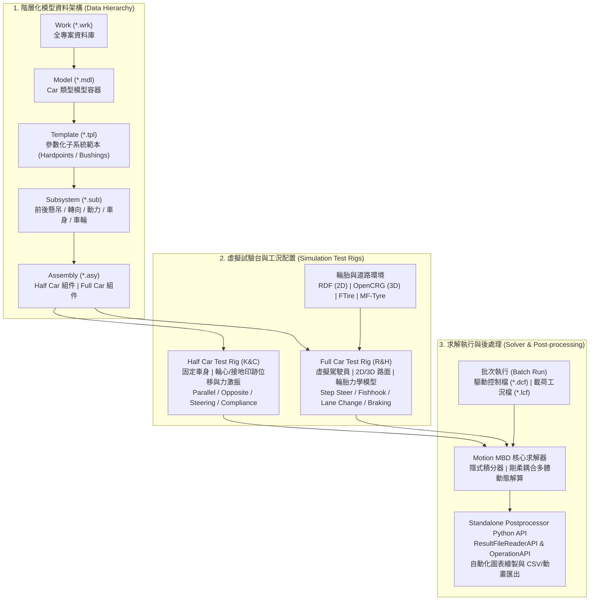

# 齒輪嚙合與傳動鏈分析

> [!NOTE]
> 本手冊依據官方知識字典 `motion.md` 與 `motion` 權威技術規格擴充，提供深度工程指導。

## 1. 原理與設定準則

本模組於高精度數值模擬時，必須遵循以下邊界設定與收斂規範：
- 數值精度與單位一致性：務必先確認全域坐標系統、材料參數庫與求解單位（MKS/SI）。
- 網格劃分策略：實施局部特徵網格加密，並於梯度變化劇烈區域進行自適應細化。
- 監控物理量：除了求解器預設殘差之外，必須定義面通量、力矩或特徵頻率等客觀物理監控器。

## 2. 核心規範與字典精要

# Ansys Motion 多體動力學主題辭典 (Motion & CAR Toolkit)

> 範圍提醒：本頁列出的 Motion／CAR Toolkit 與 API 主題是有界摘要，不代表 Motion 全產品文件已完成整理。逐筆來源及 PDF 轉換狀態見 **Motion 來源清冊**；來源正文尚未全面語義覆核。

> 本主題深入剖析 Ansys Motion 多體動力學 (Multi-Body Dynamics, MBD) 及其車輛專用模組 CAR Toolkit 的架構體系。涵蓋階層化資料模型 (Work/Model/Assembly/Subsystem/Template)、半車懸吊運動學與順應性 (Half Car K&C) 測試台配置、整車操縱穩定性與平順性 (Full Car R&H) 標準分析工況、輪胎/道路 (RDF & OpenCRG) 互動模型、批次解算 (Batch Run with `.dcf` / `.lcf`)，以及基於 Standalone Postprocessor Python API 的全自動化曲線與圖表後處理。

---

## 領域架構圖 (CAR Toolkit Hierarchy & Workflow Map)



---

## 主題辭典與核心模組

### 1. CAR Toolkit 模型階層與整車分析

#### 核心概念與辭典定義 (Core Concepts & Glossaries)
- **階層化資料架構 (Data Structure Hierarchy)**：CAR Toolkit 遵循嚴格的物件封裝與繼承架構：
  - **Work / Model**：頂層工作區與模型資料庫。一個 Work 可包含多個 Model；Model 專門管理 Assembly、Subsystem、Template、力元 (Force Elements) 與網格部件。
  - **Template (範本, `*.tpl`)**：參數化的子系統架構原型。定義了連桿拓撲、運動副自由度、硬點 (Hardpoints) 與襯套/彈簧參數化介面。
  - **Subsystem (子系統, `*.sub`)**：範本具體實例化的子總成。填入具體硬點三維坐標、力元檔案（如非線性襯套剛度曲線、阻尼器特徵），包含前懸吊、後懸吊、轉向系統、車身、動力傳動及輪胎車輪。
  - **Assembly (組件, `*.asy`)**：將多個子系統與試驗台環境整合為可求解實體的總成，主要分為 **Half Car Assembly**（半車懸吊）與 **Full Car Assembly**（整車）。
- **半車懸吊運動學與順應性分析 (Half Car K&C Analysis)**：
  - **車身剛性固定**：將車身子系統固定於慣性坐標系，消弭整車平動與俯仰/側傾干擾。
  - **輪跳工況 (Wheel Travel)**：對左右輪施加同向平移 (Parallel Wheel Travel) 或反向平移 (Opposite Wheel Travel)，評估輪距變化 (Track Change)、軸距變化 (Wheelbase Change)、外傾角 (Camber)、束角 (Toe)、主銷後傾角 (Caster) 及側傾中心高度 (Roll Center Height)。
  - **順應性工況 (Compliance)**：在輪心或接地面施加縱向力 ($F_x$)、側向力 ($F_y$) 或回正力矩 ($M_z$)，評估襯套彈性變形引起的彈性運動學 (Elastokinematics) 響應。
- **整車操縱穩定性與平順性分析 (Full Car R&H Analysis)**：
  - **閉環/開環控制**：虛擬駕駛員模型根據目標路徑或轉向盤輸入時序動態調節方向盤轉角、油門踏板與制動壓力。
  - **標準分析工況 (Analysis Categories)**：
    1. *Open-loop steering*：階躍轉向 (Step Steer)、斜坡轉向 (Ramp Steer)、掃頻正弦 (Swept Sine)、正弦停滯 (Sine with Dwell, ISO 19364)、魚鉤轉向 (Fishhook)。
    2. *Cornering*：穩態迴轉 (Constant Radius / Constant Steer Cornering)。
    3. *Course*：雙移線 (Double Lane Change, ISO 3888)、繞樁 (Slalom)。
    4. *Straight-line*：直線加速、直線制動 (Braking on $\mu$-split / uniform road)。

#### 手冊章節與規格出處 (Manual & Doc Citations)
- **手冊來源**：*Ansys Motion 2026 R1 CAR Toolkit Manual* (Release 2026 R1)
- **章節與精確頁碼定位**：
  - Section 1.1 "An overview of CAR toolkit" & Data Structure: PDF physical pages 2–3, 10–12 (**Car_Manual.md#L9**)
  - Section 1.2 "How to use CAR toolkit" (Work/Model/Assembly/Templates): PDF physical pages 23–30 (**Car_Manual.md#L399**)
  - Section 1.3 "Additional elements and inputs for Full Car simulation" (Tire & Road RDF/OpenCRG): PDF physical pages 67–75 (**Car_Manual.md#L1238**)
  - Section 1.4.4 "Full Car Analysis": PDF physical pages 89–117 (Common parameters, road visualization, load cases, DCF export)
  - Section 1.4.5 "Half Car Analysis": PDF physical pages 118–128 (Wheel travel, steering analysis, compliance, LCF export)
  - Section 1.5 & 1.6 "Batch Run & Post Processing": PDF physical pages 129–192
  - Source ID: `sources.csv#ansys_0e043df6310e4a1cb10bc1ce`.

#### 分析工況與參數設定矩陣 (Simulation Setup Matrix)

| 試驗台類別 | 分析類別 (Category) | 核心工況 (Analysis Type) | 必要輸入子系統 | 關鍵輸出性能指標 |
|---|---|---|---|---|
| **Half Car Rig** | Wheel Travel | Parallel Wheel Travel | 前或後懸吊子系統、轉向 (選配) | Camber/Toe 隨輪跳變化、側傾中心高 |
| **Half Car Rig** | Wheel Travel | Opposite Wheel Travel | 前或後懸吊子系統、轉向 (選配) | 懸吊側傾角剛度、輪距變化率 |
| **Half Car Rig** | Steering | Static Steering | 前懸吊 + 轉向子系統 | 阿克曼誤差 (Ackermann Error)、轉向比 |
| **Half Car Rig** | Compliance | Longitudinal / Lateral Force | 前或後懸吊子系統 | 襯套縱向/側向順應性位移、轉向後行角 |
| **Full Car Rig** | Open-loop Steering | Step Steer / Fishhook | 前後懸吊、前後輪胎、車身、轉向 | 橫擺角速度 (Yaw Rate)、側向加速度響應 |
| **Full Car Rig** | Course | Double Lane Change (ISO 3888) | 前後懸吊、輪胎、車身、轉向、動力、制動 | 循跡路徑偏差、側翻穩定度、側傾角 |
| **Full Car Rig** | Straight-line | Braking on Split-$\mu$ | 前後懸吊、輪胎、車身、轉向、動力、制動 | 制動距離、減速度、跑偏偏航角 |

#### 批次執行與後處理整合 (Batch Run & Python API)
在完成 GUI 參數配置後，CAR Toolkit 支援將工況設定分別匯出為：
- **`*.lcf` (Load Case File)**：半車載荷工況檔案；
- **`*.dcf` (Driving Control File)**：整車駕駛控制時序檔案。
隨後可使用命令列無頭模式調用 Motion 求解器批次執行 (`MotionBatch.exe -i model.mdl -lcf case.lcf`)。

求解完成後，利用 Standalone Postprocessor Python API 進行非互動後處理與曲線輸出：
```python
# ==============================================================================
# Standalone Postprocessor Python API: Automated K&C Curve Extraction
# Note: ASCII-only comments to prevent IronPython encoding issues.
# ==============================================================================
import os
import sys

# Add Motion Postprocessor Modules directory to sys.path
post_modules_path = r"C:\Program Files\ANSYS Inc\v261\Motion\Document\Postprocessor API for Python\Modules"
if post_modules_path not in sys.path:
    sys.path.append(post_modules_path)

import ResultFileReaderAPI

result_file = r"C:\Simulations\HalfCar_ParallelTravel.dfr"

# Open result database
reader = ResultFileReaderAPI.OutputReader(result_file)

# Extract Wheel Travel Displacement (Z) and Camber Angle Curve
# Target: Left Wheel Center / Component: Camber
time_steps = reader.GetTimeSteps()
wheel_z = reader.GetResultData("Suspension.LeftWheel", "Displacement", "Z")
camber_angle = reader.GetResultData("Suspension.LeftWheel", "Orientation", "Camber")

# Write to standardized CSV for engineering report
output_csv = r"C:\Simulations\KC_Camber_vs_Travel.csv"
with open(output_csv, "w") as fp:
    fp.write("Wheel_Travel_mm,Camber_deg\n")
    for z, c in zip(wheel_z, camber_angle):
        fp.write("{0:.4f},{1:.4f}\n".format(z * 1000.0, c))

reader.Close()
```

#### 工程實務踩坑指南 (Gotchas & Limitations)
1. **硬點 (Hardpoint) 坐標系衝突**：Template 中的硬點預設參考 Subsystem 局部坐標系或車輛全域坐標系 (ISO/SAE 坐標系：X 向前、Y 向右、Z 向下；或 Ansys 標準坐標系：X 向前、Y 向左、Z 向上)。若在匯入懸吊硬點時坐標系軸向混淆，會導致連桿幾何錯位穿透，求解器初始迭代即發散。
2. **2D RDF 道路邊界越界**：使用 2D Road Data File (`*.rdf`) 進行直線制動或轉向工況時，車輛輪胎若橫向滑移超出 RDF 定義的道路寬度範圍，求解器因找不到路面接觸法向量而發生數值崩潰；對於大橫向位移工況必須配置 3D Spline 或 OpenCRG 道路。
3. **襯套剛度矩陣非線性穿透**：力元襯套檔案 (`*.bsh`) 的剛度曲線必須保證在大變形下具備漸近硬化特徵；若曲線末端斜率未外插或剛度定義過軟，在大衝擊載荷下會出現連桿穿透奇異點 (Singularity Error)。

---

### 2. Template, Subsystem 與 Assembly 關聯機制
- **參數傳遞與變更連動**：修改 Template 的連桿拓撲會自動向下廣播至所有引用該範本的 Subsystem；但在 Subsystem 層面覆寫的硬點坐標不會反向污染原始 Template。
- **介面連接器 (Interface & Communication)**：各子系統之間的力學約束透過 Interface 標記點 (Marker) 配對建立。例如前懸吊子系統的轉向節 (Upright/Knuckle) 硬點與轉向子系統的轉向拉桿 (Tie-rod) 介面進行自動運動副關聯。

---

## 雙向鏈結與參照索引
- [[rigid_body_dynamics|Rigid Body Dynamics (RBD) 剛體動力學辭典]]：Mechanical RBD 物件導向指令與底層資料庫讀寫。
- [[mechanical|Ansys Mechanical 主題辭典]]：ACT 腳本、剛柔耦合模型匯入與結構分析。
- [[lsdyna|Ansys LS-DYNA 衝擊分析辭典]]：整車碰撞、衝擊動態學與非線性大變形求解。

## Motion API Tutorial：自訂 Operation 的最小生命週期

Motion 2026 R1 API Tutorial 的 Operation 範例示範在 Motion Pre 中新增簡單的 C# 操作：建立 C# project，引用 `VMAppCore.dll` 與 `System.Windows.Forms`，並依手冊步驟設定 license；`TestOperation` 繼承 `VM.Managed.Operation.OperationBase`，建構子傳入 `VM.Managed.Document`，以 `Execute()` 實作操作、`Name` 提供名稱。建置輸出 `OPERATION.dll` 後，教學將它複製到 Motion `Pre` 目錄，再以 Ribbon resource、Ribbon XML 和 subsystem module XML 註冊按鈕與 command。範例的 `Execute()` 只顯示訊息框，不是模型修改或求解範例。


## 3. 常見陷阱與防呆措施

1. **未定義求解範圍**：求解前未限定掃頻範圍或時間步長，導致求解發散。
2. **材料模型失配**：非線性材料未設定適當的切線模數或溫度相依曲線。
3. **介面通訊失敗**：多物理場耦合未對齊變數傳遞單位，導致數值非物理震盪。
