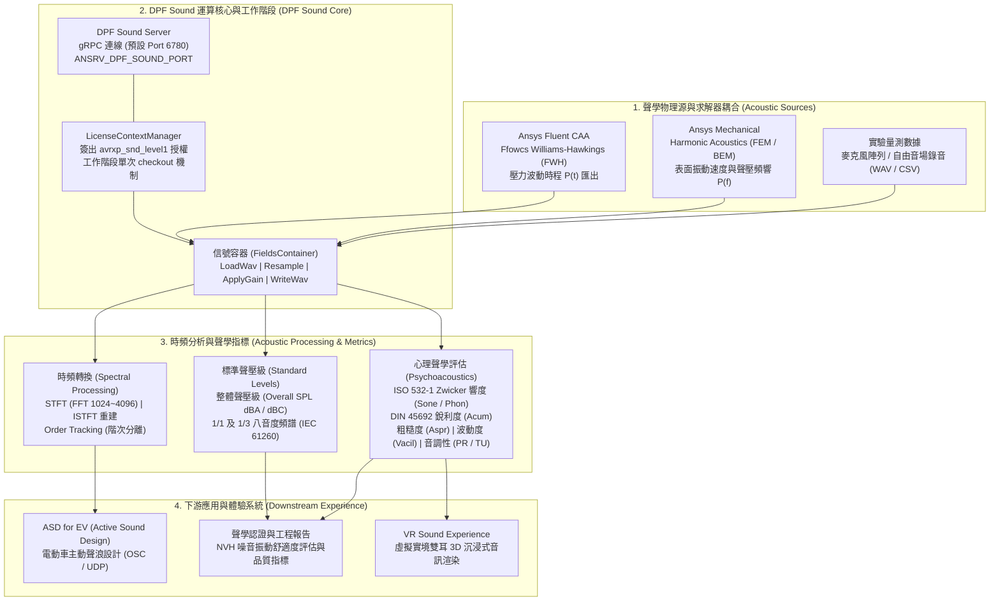

# Ansys Sound 心理聲學指標標準

> [!NOTE]
> 本手冊依據官方知識字典 `sound.md` 與 `sound` 權威技術規格擴充，提供深度工程指導。

## 1. 原理與設定準則

本模組於高精度數值模擬時，必須遵循以下邊界設定與收斂規範：
- 數值精度與單位一致性：務必先確認全域坐標系統、材料參數庫與求解單位（MKS/SI）。
- 網格劃分策略：實施局部特徵網格加密，並於梯度變化劇烈區域進行自適應細化。
- 監控物理量：除了求解器預設殘差之外，必須定義面通量、力矩或特徵頻率等客觀物理監控器。

## 2. 核心規範與字典精要

# Ansys Sound 與 PyAnsys Sound 知識字典

> 本字典分開整理 PyAnsys Sound SDK 與 2026 R1 的 ASDforEV／VR Sound／Car Sound Simulator 文件。各節說明其核對依據及未覆蓋範圍；標準、物理求解器與工程門檻的未核實草稿已集中標示為待來源覆核。

---

## 領域架構圖 (Sound & Psychoacoustics Architecture)

---

## 主題辭典與核心模組

### 1. DPF Server 與授權工作階段

#### 核心概念與辭典定義 (Core Concepts & Glossaries)
- **DPF Sound Server 架構**：PyAnsys Sound 透過 DPF Server 執行其操作；User Guide 說明可連線遠端 DPF Server 或啟動本機 server。此版本快照的產品 release 未知，套件路徑有 0.3.0 與 0.4.0，不混為產品版本。
- **連線機制 (`connect_to_or_start_server`)**：
  - 若系統設定環境變數 `ANSRV_DPF_SOUND_PORT`，客戶端將嘗試連線遠端或本機既有 DPF Server（預設連接埠為 `6780`）。
  - 若未設定該環境變數，客戶端會依 PyDPF-Core 文件所述的 server installation priority 嘗試尋找本機 DPF Server。Sound User Guide 沒有在此處明列 `AWP_ROOT261`，所以此處不推定固定搜尋環境變數或安裝路徑。
- **授權情境管理 (`LicenseContextManager`)**：
  - 聲學運算運算子需要簽出 `avrxp_snd_level1` 授權特徵（Increment）。
  - **工作階段共用模式** (`use_license_context=True`)：在工作階段啟動時由 `LicenseContextManager` 一次性完成授權簽出，多個運算子執行期間共用同一授權，直至物件銷毀或工作階段關閉時釋放。
  - **未使用 context 模式** (`use_license_context=False`)：教學說明每次使用 DPF Sound operator 時都 checkout license；不外推其他授權管理器行為。

#### 手冊章節與規格出處 (Manual & Doc Citations)
- **官方手冊**：*PyAnsys Sound User Guide & Tutorials* (**User Guide**)
- **授權範例**：*Initialize DPF Server and Deal with License* (**Tutorial 001**)
- **本機路徑**：如上所列 User Guide 與 Tutorial 001。這兩頁是 `version/stable` 的快照，目錄標示 0.4.0；線上 stable 現行版未核實。

---

### 2. WAV 訊號匯入、重取樣、增益與輸出（PyAnsys Sound SDK 文件版）

#### 概念與原文可支持的操作

- `LoadWav(path_to_wav)` 讀取 WAV，`process()` 後可用 `get_output()` 取得 DPF `FieldsContainer`、`get_output_as_nparray()` 取得 NumPy array，並可讀取格式及取樣頻率。文件沒有在此 API 條目中保證聲壓校準或某一取樣位元格式的轉換語意。
- `Resample(signal, new_sampling_frequency)` 將輸入 signal 重取樣至指定 Hz。範例把 44,100 Hz 重取樣為 20,000 Hz；這是教學例值，不是建議所有工作都降到 20 kHz。
- `ApplyGain(signal, gain, gain_in_db=True)` 接受 dB（預設）或線性增益（`gain_in_db=False`）。範例對訊號施加 10 dB。來源沒有描述削波偵測或自動正規化，所以增益後峰值／削波檢查仍是使用者需另行確認的處理步驟。
- `WriteWav(signal, path_to_write, bit_depth)` 可輸出單聲道或多聲道的 DPF signal；文件列出的 `bit_depth` 選項為 `float32`（預設）、`int32`、`int16`、`int8`。既有草稿中的 `int24` 未在此版本 API 文件列出，已改以文件明列的選項為準。

#### 教學範例資料流

`LoadWav` → `Resample(new_sampling_frequency=20000.0)` → `ApplyGain(gain=10.0, gain_in_db=True)` → `WriteWav(bit_depth="int16")`。範例原 WAV 取樣頻率為 44,100 Hz，示範讀取／處理／輸出；數值只代表案例。輸出路徑由範例檔名加 `_modified.wav` 建立。

來源： **WAV 操作教學**、**`LoadWav`**、**`Resample`**、**`ApplyGain`**、**`WriteWav`**。來源為 `version/stable` 動態網址，本機副本置於 0.4.0 文件目錄；線上 stable 目前版號未由本機快照證明。

---

### 3. 時頻轉換與頻譜分析（PyAnsys Sound SDK 文件版）

`Stft(signal, fft_size=2048, window_type="HANN", window_overlap=0.5)` 執行短時傅立葉轉換。API 文件明列窗型：`TRIANGULAR`、`BLACKMAN`、`BLACKMANHARRIS`、`HAMMING`、`HANN`、`GAUSS`、`FLATTOP`、`RECTANGULAR`；overlap 可介於 0 與 1。文件說 FFT size 使用 2 的次方可有較佳效能，未將此描述成準確度保證，也未規定普遍適用的 overlap 建議值。

教學流程用 `fft_size=1024` 計算並繪圖，接著改為 4096、`window_overlap=0.95`、`window_type="TRIANGULAR"` 後重新 `process()`；再把 STFT 輸出傳給 `Istft(stft)` 重建時域 signal。這些是範例參數；手冊只展示結果圖，未給重建誤差門檻或保證任意輸入均無損重建。參數改動後須再呼叫 `process()`，符合使用者指南對共通 class method 的說明。

來源： **STFT／ISTFT 教學**、**`Stft` API**、**`Istft` API**。原先草稿所稱 `HANNING` 別名、普遍 50–95% overlap 建議、OLA 重建細節均不由這些引用頁支持，未在此作為建議保留。

---

### 4. 聲學判讀與待來源覆核項目

現有一般聲學文字有部分合理的工程方向，但當前引用的 PyAnsys Sound User Guide 與 tutorial 只證明 SDK 操作，不證明相關國際標準內容、標準版本、判定條件、Fluent CAA 網格截止頻率、聲場比較條件或舒適度門檻。故下表內容標記為待核來源，不應直接用作設計或驗收門檻：

| 待核主張 | 缺少的證據 | 可保留的目前說法 |
|---|---|---|
| `L_eq`、`OASPL`、dBA/dBC、20 µPa 參考值與 IEC 61672-1 對應 | 標準正文或明確說明其測量條件的可靠來源；SDK 的 `OverallLevel` API 名稱不足以證明標準符合性 | SDK 有 `OverallLevel`、`LevelOverTime` 等標準 level 類別，不能只憑類別名宣稱符合某 IEC 方法 |
| 1/1 與 1/3 octave、IEC 61260、中心頻率與適用範圍 | 標準版本與方法條件 | SDK API 有 octave 與 one-third-octave level operators，來源章節列出 signal／PSD 輸入類別 |
| ISO 532-1／ISO 532-2、DIN 45692、ECMA／ISO 音調性演算法與 Sone／Acum／Vacil 等解釋 | 標準正文／官方方法說明，及所用 SDK class 對應的方法與版本 | 0.4.0 API 目錄含 `psychoacoustics` 類別；這僅是功能存在證據，計算細節與適用域仍待逐類核對 |
| Fluent FWH 波長至少 8–12 cells、Cutoff Frequency、模擬與量測比較界線 | 對應 Fluent/Mechanical 技術手冊、網格／時間步條件與有效性參考 | Sound SDK 使用時域 signal；無法由 Sound 手冊推導聲源求解品質 |
| `S > 1.5` 尖銳度不適、粗糙度／波動度調變頻率峰值與其他主觀門檻 | 標準或特定研究來源及測試條件 | 暫不提供普遍的人類感受門檻 |
| WAV 輸出 clipping、自動 normalization、Pa/FS 校準流程 | SDK/API 或量測鏈校準文件 | SDK API 列出增益與位深選項，但上述流程未在已核頁面定義 |

已核 API 導覽：`standard_levels` 說明從時域 signal 或 PSD 計算 overall、level-over-time、octave 與 one-third-octave levels；`spectral_processing` 說明其子套件含 PSD 計算。此兩個索引頁沒有詳述 IEC 符合性，也沒有列出可作為通用實務規範的頻帶或計權條件。來源：**`standard_levels` API 導覽**、**`spectral_processing` API 導覽**。

---

### 5. PyAnsys Sound Server 與授權生命週期（SDK 0.4.0 文件快照）

`connect_to_or_start_server()` 可連接遠端 DPF Server 或啟動本機 DPF Server。User Guide 說明：設定 `ANSRV_DPF_SOUND_PORT` 時會嘗試連接遠端伺服器，預設 port 為 6780，也可明確傳入 `port`；未設定時會依 PyDPF-Core 的 server installation priority 嘗試定位本機伺服器。這是 SDK server discovery 行為，不等於此機器已安裝或已成功啟動伺服器。

授權教學指出所需 increment 為 `avrxp_snd_level1`。`use_license_context=True` 會讓 `LicenseContextManager` 在 context 建立時簽出 increment，並可於該 session 的多個 operator 間共用；文件示例刪除 manager 物件後釋放。`use_license_context=False` 範例說明每次呼叫 DPF Sound operator 都會 checkout license。教學執行時間是其示例環境的觀測值，不保證其他機器效能。未檢查本機授權伺服器，未連線或執行任何 operator。

來源：**PyAnsys Sound User Guide**、**Initialize DPF Server and Deal with License 教學**。兩個頁面為 `version/stable` 動態來源的本機副本，目錄標示 0.4.0；不可單憑目錄推定官方 stable 現行版。

---
## 5. ASDforEV 訊息與 UDP 通訊（2026 R1）

ASDforEV API 使用 OSC message over UDP。每則訊息由 keyword 與單一資料值（float 或 string）組成；`ACTIVE` 是文件列出的例外，只有 keyword 而沒有 data。keyword 與字串資料區分大小寫。大部分控制值的有效範圍沒有在訊息表中規定，應依 ASDforEV 的圖形介面設定確認，不從名稱推定單位或範圍。

### 連線方向與存活訊息

| 方向 | UDP port | 用途 |
| --- | ---: | --- |
| 外部應用程式 → ASDforEV | 7450 | 發送 vehicle、sound function 與其他控制訊息。 |
| ASDforEV → 外部應用程式 | 7460 | 接收音效名稱等回覆。 |

讀取 CAN 資料的專用應用程式應每 5 秒送出不帶 data 的 `ALIVE`，讓 ASDforEV 知道資料仍在讀取。不要把此訊息格式套用到本機 DPF Sound Server 的 gRPC 連線；它屬於 ASDforEV 的應用程式通訊介面。

### Vehicle 與 sound function 訊息

| Keyword 範例 | Data | 文件定義 |
| --- | --- | --- |
| `Speed` | float | 車速，單位 kph。 |
| `RPM` | float | 引擎轉速。 |
| `Load` | float | Accelerator pedal load，百分比。 |
| `Acceleration` | float | 車輛加速度，單位 g。 |
| `Torque` | float | 引擎扭矩，單位 N·m。 |
| `Brake` | float | Brake pedal position，百分比。 |
| `Ambiance1_Activate`、`Ambiance1_Angle` | float | 控制音效啟用及方位角；同類型訊息延伸至 Ambiance2、Ambiance3。 |
| `ADAS1_Activate`、`ADAS1_Silence`、`ADAS1_Angle` | float | 控制 ADAS1 啟用、靜音時間與方位角；同類型訊息延伸至 ADAS2–ADAS5。 |
| `ICEASD_RPM`、`ICEASD_Speed`、`ICEASD_Load` | float | 分別提供 ICE-ASD 音高／增益控制所用引擎轉速、車速及負載。 |

從 ASDforEV 接收的訊息包含 `Ambiance1`–`Ambiance3`、`ADAS1`–`ADAS5` 及 `HMI1`–`HMI15`。資料是音效功能名稱字串，供讀取 CAN 資料的應用程式顯示。這是回傳名稱，不應與發送方向的 float 控制值混淆。

來源：**訊息總覽與大小寫規則**（v261，文件 last update 09.03.2026）；**送往 ASDforEV 的訊息**；**從 ASDforEV 接收的訊息**；**UDP ports**。來源清冊 ID 建議見本模組處理報告。

## 6. Car Sound Simulator OSC 訊息格式（2026 R1）

Car Sound Simulator 文件將外部模擬資料提供者描述為 OSC client、Car Sound Simulator 描述為 OSC server；OSC packet 經 Ethernet 上的 UDP 傳送。此應用程式僅使用 OSC Message，不使用 OSC Bundle。OSC packet 的資料長度須為 4 bytes 的倍數。

## 3. 常見陷阱與防呆措施

1. **未定義求解範圍**：求解前未限定掃頻範圍或時間步長，導致求解發散。
2. **材料模型失配**：非線性材料未設定適當的切線模數或溫度相依曲線。
3. **介面通訊失敗**：多物理場耦合未對齊變數傳遞單位，導致數值非物理震盪。
