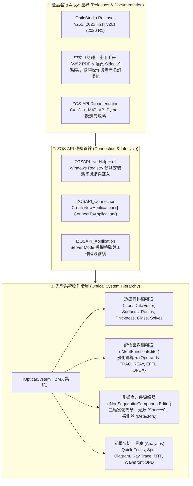

# Ansys Zemax OpticStudio 鏡頭設計與 ZOS-API 核心 API 與工作流指南

> [!NOTE]
> 本文件由知識字典 `zemax.md` 精煉萃取而成，提供標準 API 流程、邊界條件與驗證基準。
> 如需完整原文與版本對照，可調用 `ans_get_knowledge_dictionary(product='zemax')`。

## 1. 核心架構與求解流程

1. **環境初始化**：確認 Python 環境與對應產品授權，透過專屬客戶端連線。
2. **模型前處理**：匯入幾何模型，指定材料物性、熱力學參數或光學表面屬性。
3. **網格劃分與邊界條件**：建立適應性網格，指派載荷、熱源、激勵源或環境邊界。
4. **求解監控與收斂準則**：設置殘差監視器、能量守恆檢查與收斂閾值。
5. **後處理與數據導出**：提取場量分佈、感測器響應與驗證指標。

## 2. 知識字典精選內容

# Zemax OpticStudio 與 ZOS-API 主題字典

> 本主題深度整理 Zemax OpticStudio (Ansys 旗下光學設計旗艦軟體) 與其程式化擴充介面 ZOS-API 的核心架構。涵蓋 OpticStudio 產品線與版本標記規範、v252 中文（簡體）使用手冊與逐頁 Markdown sidecar 檢索體系、ZOS-API .NET/Python 雙軌連線生命週期、循序 (Sequential) 與非循序 (Non-Sequential) 光學物件階層、透鏡資料編輯器 (LDE)、評價函數 (MFE) 操作及 Quick Focus 官方基準範例。相關光學與微納光子學整合請參閱 **Lumerical 主題字典**、**Speos 主題字典** 與 **AnsysEM 主題字典**。

---

## 領域架構圖 (OpticStudio & ZOS-API Architecture)



---

## 主題辭典與核心模組

### 1. OpticStudio 產品與版本標示

#### 核心概念與辭典定義 (Core Concepts & Glossaries)
- **產品線版本演進與雙重標籤 (Product Release Boundaries)**：
  - **產品版號 (Product Release)**：OpticStudio 採用年度發行標記，例如 `2025 R2`（內部標記為 `v252`）與 `2026 R1`（內部標記為 `v261`）。
  - **API 組件版號 (ZOS-API Assembly Version)**：ZOS-API 作為 .NET 程式庫，其二進位介面組件 (`ZOSAPI.dll`, `ZOSAPI_Interfaces.dll`) 具有獨立的組件版本與建置編號（例如 `v252` 對應 2025 R2 SP02；`v261` 對應 2026 R1）。
  - **版本分離原則**：產品發行版號、ZOS-API 文件版號與本機實際安裝的 OpticStudio build 必須分開驗證；不可將 v261 API 文件所述的最新特性推定相容於 v252 或更早版本。
- **授權層級 (Edition Tiers)**：
  - **Standard**：基礎循序光學透鏡設計與像差優化。
  - **Professional**：增加基礎非循序光學追跡與偏振分析。
  - **Premium / Enterprise**：完整支援 CAD 雙向匯出入、自由曲面 (Freeform Surfaces)、高階雜散光分析、光熱效能 (STOP) 與完整 ZOS-API 自動化。

#### 官方手冊章節與規格出處 (Manual & Doc Citations)
- **手冊來源**：*OpticStudio Developer Portal & v252 Manual*
- **章節定位**：
  - Developer Portal Overview: `sources.csv#ansys_a8d6a90b66f20d654fb896a9`
  - v252 User Manual Release Notes: `sources.csv#ansys_cee9d96acf92045606853b99`
- **資料庫引用標籤**：`sources.csv#ansys_a8d6a90b66f20d654fb896a9`, `sources.csv#ansys_cee9d96acf92045606853b99`

#### 產品與版本檢查腳本 (Python Scripting Example)
```python
# ==============================================================================
# ZOS-API: Check Installed OpticStudio Version and Edition
# Note: ASCII-only comments to prevent IronPython encoding issues.
# ==============================================================================
import clr
import winreg

# Query Windows Registry for OpticStudio installation path
reg_path = r"Software\Zemax"
try:
    with winreg.OpenKey(winreg.HKEY_CURRENT_USER, reg_path) as key:
        install_dir, _ = winreg.QueryValueEx(key, "ZemaxRoot")
        print("Detected OpticStudio Install Directory: {0}".format(install_dir))
except WindowsError:
    print("Warning: OpticStudio registry key not found in HKCU.")
```

#### 工程實務踩坑指南 (Gotchas & Limitations)
1. **API 組件與安裝版本失配 (Assembly Version Mismatch)**：若在 Python 腳本中引用了較新版本（如 v261）的 `ZOSAPI.dll`，但本機背景安裝執行的為舊版（如 v252）OpticStudio 伺服器，將在建立連線時引發 `COMException` 或 `TypeLoadException`。務必使用 `ZOSAPI_NetHelper` 自動解析本機匹配路徑。

---

### 2. 中文（簡體）使用手冊 PDF 與頁碼 sidecar

#### 核心概念與辭典定義 (Core Concepts & Glossaries)
- **中文使用手冊（v252 User Manual zh）**：
  - 本地收錄 `OpticStudio_UserManual_zh.pdf`（Release 2025 R2 / v252）；sidecar 抽出的本文使用簡體中文。來源取得及授權狀態尚未核實，檔名 `zh` 本身也不能證明地區版本。
  - **逐頁 Markdown Sidecar 檢索**：文字 sidecar 以 `PDF Page N` 實體頁碼標記；頁標連續且機械檢查未發現空文字頁，但未測搜尋延遲，也未驗證字元、公式、圖表或表格的抽取準確度。
- **光學核心專有名詞標準術語表 (Standard Optical Glossaries)**：
  - **LDE (Lens Data Editor)**：透鏡資料編輯器，定義折射/反射面曲率半徑、厚度、玻璃材質、圓錐常數及半直徑。
  - **MFE (Merit Function Editor)**：評價函數編輯器，以數值運算元 (Operands) 定義優化目標與權重。
  - **NSC (Non-Sequential Component)**：非循序元件編輯器，支援任意三維空間實體、散射模型、探測器與雜散光分析。
  - **EPD (Entrance Pupil Diameter)**：入瞳直徑，決定系統集光能力與數值孔徑 (NA)。
  - **Primary Wavelength & Field**：主波長（通常為 d 光 587.6 nm）與視場設定（視場角、物高）。
  - **Quick Focus**：快速聚焦工具，自動微調指定透鏡厚度以達到最小光斑半徑。

#### 官方手冊章節與規格出處 (Manual & Doc Citations)
- **手冊來源**：*OpticStudio v252 中文（簡體）使用手冊*
- **章節定位**：
  - **v252 中文（簡體）OpticStudio User Manual PDF** · `ansys_cee9d96acf92045606853b99`
  - **頁碼 Markdown sidecar**
- **資料庫引用標籤**：`sources.csv#ansys_cee9d96acf92045606853b99`

#### 工程實務踩坑指南 (Gotchas & Limitations)
1. **圖表與光路圖人工核對原則**：Sidecar 文字檢索專注於參數定義與操作步驟；複雜的光線追跡扇形圖 (Ray Fan Plots)、干涉圖樣 (Interferograms) 與機械公差圖表，受限於純文字抽取，在進行高精度量產公差分配時，仍應回到原 PDF 實體頁碼視覺核對。

---

### 3. ZOS-API release 入口

#### 核心概念與辭典定義 (Core Concepts & Glossaries)
- **ZOS-API 四大執行模式 (Execution Modes)**：
  - **Standalone Mode (獨立模式)**：外部程式透過 ZOS-API .NET/COM 連線介面啟動背景 OpticStudio instance；官方文件將 `CreateNewApplication()` 描述為啟動 headless instance，並明確指出仍需有效授權。此處來源未提及 gRPC，不應把 gRPC 當成已確認的連線方式。
  - **User Extensions (使用者擴充)**：從 OpticStudio GUI 主選單的 `Extensions` 啟動，可在外部程式視窗中即時讀取並修改當前已開啟的光學系統。
  - **User Analysis (自訂分析)**：在 GUI 內部以圖表視窗形式嵌入自訂的偏振、波動光學或特殊探測器後處理。
  - **User Operands (自訂運算元)**：在評價函數編輯器中自訂 DLL 運算元，即時介入局部或全域優化循環。
- **NetHelper 連線引導管線 (Connection Pipeline)**：
  - 透過 `ZOSAPI_NetHelper.dll` 的 `ZOSAPI_Initializer.Initialize()` 自動定位安裝目錄並載入二進位依賴項；
  - 建立 `IZOSAPI_Connection`，呼叫 `CreateNewApplication()` 取得 `IZOSAPI_Application`；
  - 存取主光學系統 `application.PrimarySystem`。
- **生命週期與釋放原則**：
  - Standalone 模式結束時，必須明確釋放 Application 物件（在 Python 中呼叫 `del zos` 或在 C# 中調用 `FinishStandaloneApplication()`），否則後台 `OpticStudio.exe` 伺服器進程將長期殘留並佔用授權。

#### 官方手冊章節與規格出處 (Manual & Doc Citations)
- **手冊來源**：*ZOS-API Reference (v252 & v261)*
- **章節定位**：
  - v252 API Introduction: **v252 ZOS-API Index** · `ansys_4088c338ca97a11c08745788`
  - v261 API Introduction: **v261 ZOS-API Index** · `ansys_aab461b941fe7d1abdaf66f4`
  - Previous Releases: **Previous Releases Overview** · `ansys_008933dde3ceeb3ca2f1d9a5`
- **資料庫引用標籤**：`sources.csv#ansys_008933dde3ceeb3ca2f1d9a5`, `sources.csv#ansys_4088c338ca97a11c08745788`, `sources.csv#ansys_aab461b941fe7d1abdaf66f4`

#### 連線與生命週期範例 (Python Standalone Script)
```python
# ==============================================================================
# ZOS-API Python Standalone Connection Template
# Note: ASCII-only comments to prevent IronPython encoding issues.
# ==============================================================================

## 3. 雙軌數值基準與驗收標準

- **商業求解器軌**：在具備有效授權環境下，調用官方求解器執行全物理場模擬。
- **數值基準驗證軌**：在無授權或離線 CI 環境下，執行 `scripts/verify_zemax_baseline.py` 進行解析解比對。
