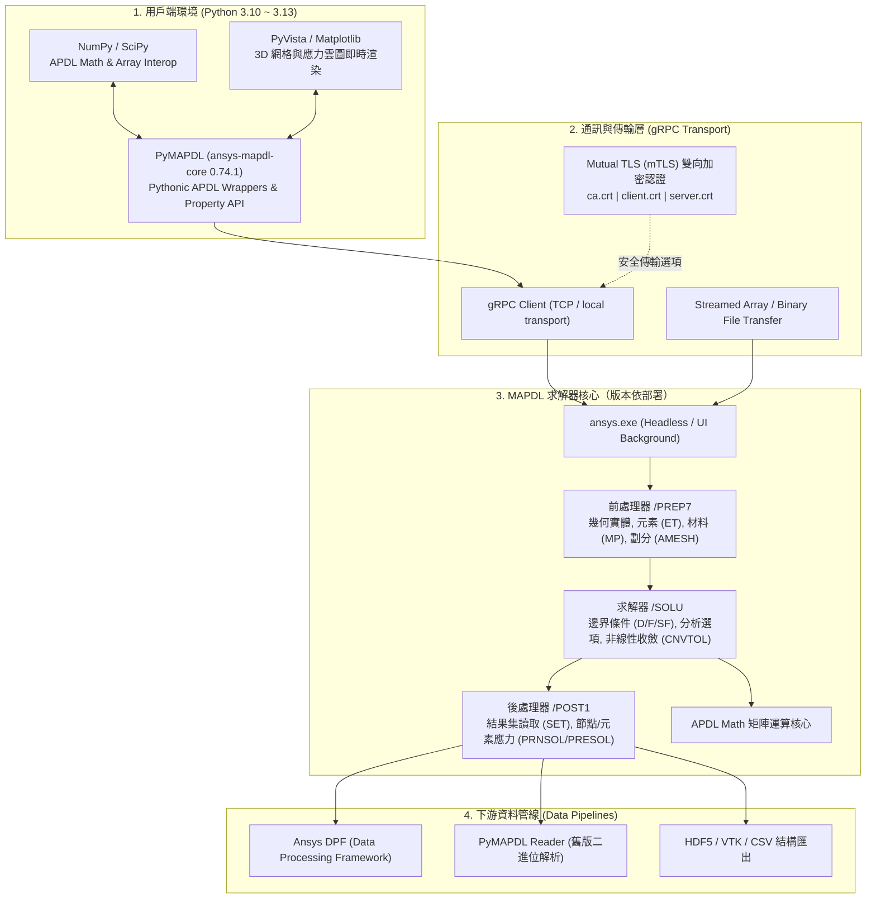

# Ansys MAPDL / PyMAPDL 結構分析 核心 API 與工作流指南

> [!NOTE]
> 本文件由知識字典 `mapdl.md` 精煉而成，提供標準工程流程與自動化腳本簽名。
> 可調用 MCP 工具 `ans_get_knowledge_dictionary(product='mapdl')` 查閱完整章節。

## 1. 模組架構與工作流說明

本模組遵循 ANSYS 現代自動化架構與雙軌工程標準：
1. **初始化與通訊連線**：支援本地 gRPC / 批次執行以及遠端伺服器程序掛載。
2. **參數配置與資料交換**：透過結構化物件或日誌檔精準傳遞幾何、材料與網格控制項。
3. **求解監控與非同步等待**：使用 Sentinel 工具或狀態輪詢器追蹤計算收斂情況。
4. **結果匯出與報告整合**：產出結構化數值報表與 3D 視覺化資料。

## 2. 知識字典精華摘錄

# Ansys MAPDL 與 PyMAPDL 主題字典

> 本字典整理 MAPDL 與 PyMAPDL 的概念、操作及參數，來源 SDK metadata 為 0.74.1；MAPDL 產品版本依各來源記錄。範例與求解結果須按實際模型另行驗證。本批未執行 MAPDL、安裝指令、範例或求解。

---

## 領域架構圖 (PyMAPDL Architecture & Solver Execution Pipeline)



---

## 主題辭典與核心模組

### 1. PyMAPDL SDK、MAPDL 版本與程序生命週期

`ansys-mapdl-core`（PyMAPDL）是用戶端套件；MAPDL 是另外安裝並啟動的求解器程序。這批 HTML 的 `docsearch:version` 全部為 **0.74.1**，不代表 MAPDL 產品版本也為 0.74.1；stable URL 亦可能隨網站更新。本機保留來源 SHA-256 以固定本次引用。

| 項目 | 本批官方文件可支持的內容 | 使用界線 |
| --- | --- | --- |
| Python | Install PyMAPDL 列 Python 3.10–3.13，適用 Windows、macOS、Linux 上的用戶端 | 不代表每個平台都可原生安裝 MAPDL |
| MAPDL 安裝 | 需要可供連線的本機或遠端 MAPDL；標準安裝器的 Mechanical Products 包含 MAPDL | 安裝、平台、授權依部署的產品版本確認 |
| gRPC | Versions and interfaces 稱為預設且推薦介面，支援遠端連線及串流 | 最早支援版本的正文與表格互相衝突，見下方 |
| CORBA | 同頁記載 PyMAPDL 0.68 已移除 CORBA，legacy 表仍列歷史 MAPDL 支援 | 不把歷史表的勾選當作 SDK 0.74.1 可用性保證 |
| Console | 同頁描述 Linux 上早至 MAPDL 13.0 的文字介面，並建議轉向現代版本 | 不推定目前版本維護狀態或完整功能 |

**來源內的版本衝突：** Versions and interfaces 的 gRPC 正文寫 Ansys 2020 R1 and later；同頁相容表把 2020 R1／R2 標為不支援 gRPC，從 2021 R1 才勾選。Install MAPDL 則建議最新功能使用 2021 R1 以上。這些證據不足以建立單一「最早支援版本」結論；舊部署需再依該產品版本官方文件確認。本字典刪除先前沒有逐項依據的 2021 R2 串流、2022 R2 mTLS、2024 R1 零拷貝及 2026 R1 容器功能階梯。

`launch_mapdl()` 可啟動本機 MAPDL 並建立 client；`launch_mapdl_process()` 只啟動新的本機程序並回傳連線資訊，不能用來連線既有 instance。連線已啟動的 instance 可用 `Mapdl(ip, port=...)` 或 `launch_mapdl(start_instance=False)`。遠端模式需要先在遠端啟動 gRPC server，PyMAPDL 不負責在遠端啟動 MAPDL。

Launcher 的安全傳輸段落列 `insecure`、`uds`、`wnua`、`mtls`；自動選擇依作業系統而異。該段建議遠端連線使用 mTLS，UDS 僅適用本機，不能由此推定每個舊 MAPDL 版本均支援所有模式。程序關閉與授權釋放應依 instance 的擁有方式處理，勿把停止 client 一概解讀為可終止共用遠端 server。

來源：**Install PyMAPDL**（`sources.csv#official_mapdl_9d6f8e5967fb92a3`）；**Install MAPDL**（`sources.csv#official_mapdl_f5e7cd7c1fbfce58`）；**Versions and interfaces**（`sources.csv#official_mapdl_380729160250e400`）；**Launch PyMAPDL**（`sources.csv#official_mapdl_a8ba11f396c024ad`）。

---

### 2. 官方帶孔平板教學與結果適用範圍

官方 **MAPDL 2D Plane Stress Concentration Analysis** 展示 2D 平面元素建模，再與 3D 元素比較。以下是該教學的設定摘要，供回到原文閱讀；不是本機已求解或驗證的模型。

| 設定 | 官方教學內容 |
| --- | --- |
| 單元與厚度 | `PLANE183`、`KEYOPTION(3)=3`；實常數厚度 0.001 m |
| 材料與單位 | SI；彈性模數 210e9 Pa、Poisson ratio 0.3、密度 7800 kg/m³ |
| 幾何 | 完整矩形平板，長 0.4 m、寬 0.1 m；孔徑／板寬比 0.3 |
| 邊界條件 | 左側 UX 固定，再選左側中點一個節點固定 UY；右側施加總力 1 kN |
| 名義應力 | 依 `F/(w*t)` 計算，並與離孔較遠截面的應力比較 |
| 比較方法 | 教學從結果讀取應力，用 `nanmax`／`nanmean` 處理沒有應力的 midside nodes，並考慮孔徑對有效截面的影響 |

先前字典的四分之一平板、100 mm 尺寸、壓力載入及 `get_value(...MAX,S,EQV)` 程式並非這份官方教學的逐字範例，本批以來源摘要取代。若建立自己的模型，應獨立確認元素選項、選取集合、載荷、剛體自由度、結果量與參考解的適用條件。有限板寬、孔徑比與名義應力定義會影響應力集中比較，不能把任意幾何的最大等效應力一律當作無限平板的 `Kt=3` 驗收。網格收斂與誤差門檻依專案、指標及有效參考設定。

來源：**教學完整正文**（`sources.csv#ansys_efc8a076229c8282990d25fb`；SDK metadata 0.74.1，MAPDL product release unknown）。原始程式／Notebook 與來源圖像均保留；本批沒有執行它們。

---

### 3. PyMAPDL gRPC 工作目錄與檔案接收(SDK metadata 0.74.1)

#### 核心概念與辭典定義 (Core Concepts & Glossaries)
- **工作目錄隔離 (Workspace Isolation)**：
  - MAPDL 求解時會產生大量暫存二進位檔（如 `.full` 剛度矩陣檔、`.rst` 結構結果檔、`.esav` 單元狀態檔、`.err` 錯誤日誌）。官方 User guide 明載 `launch_mapdl()` 預設使用 temporary directory；指定 `run_location` 才選定工作目錄。若希望使用 Python 的當前目錄，可明確傳入 `os.getcwd()`，並避免多個程序共用相同工作檔。
- **檔案傳輸管線 (File Transfer Pipeline)**：
  - 在遠端連線或 Docker 容器模式下，用戶端與伺服器硬碟隔離，PyMAPDL 提供 `mapdl.upload()` 與 `mapdl.download()` 串流傳輸機制，透過 gRPC 區塊將 CDB 網格輸入檔上傳至遠端工作區，並在求解完成後下載結果檔。

#### 腳本與 API 關鍵用法 (File Transfer Scripting)

```python
# Upload input files and download results via PyMAPDL
# Upload a custom geometry CDB deck to remote MAPDL server
mapdl.upload("./models/chassis.cdb")

# Read the uploaded CDB deck inside MAPDL
mapdl.cdread("DB", "chassis.cdb")

# Solve structural analysis
mapdl.solu()
mapdl.solve()
mapdl.finish()

# Download solution binary file back to local machine
mapdl.download("file.rst", target_dir="./local_results")
```

---

### 4. PyMAPDL `non_interactive` 命令緩衝與查詢時機

#### 核心概念與辭典定義 (Core Concepts & Glossaries)
- **命令緩衝機制 (Command Buffering Mechanism)**：
  - 對於需要高頻迴圈執行的 APDL 腳本區塊，使用 `with mapdl.non_interactive:` 可以避免每個 APDL 命令都進行一次 gRPC 網路請求。PyMAPDL 會在記憶體中將區塊內的所有指令收集成批次檔案，並在退出區塊時一次性以 `Mapdl.input()` 提交給後端執行。
- **查詢時序禁忌**：
  - 離開 `non_interactive` 區塊前，MAPDL 伺服器並未執行任何區塊內的指令；因此在區塊內呼叫 `get_value()` 或 `get_array()` 無法取得即時運算結果。

#### 腳本與 API 關鍵用法 (Non-interactive Buffering)

```python
# Using non_interactive for fast batch geometry generation
with mapdl.non_interactive:
    for i in range(1, 101):
        x = i * 2.0

## 3. 雙軌數值基準與驗收標準

- **商業求解軌**：連線正式求解器執行高保真模擬。
- **無授權基準軌**：執行 `scripts/verify_mapdl_baseline.py` 驗證解析數值正確性（Exit Code 0）。
