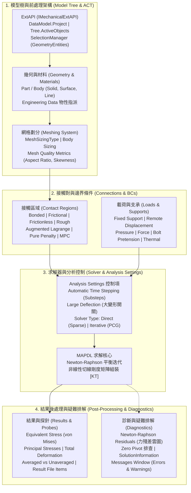

# 隨機振動 PSD 分析與 Miles 方程評估 核心 API 與工作流指南

> [!NOTE]
> 本文件由知識字典 `mechanical.md` 精煉萃取而成，提供標準 API 流程、邊界條件與驗證基準。
> 如需完整原文與版本對照，可調用 `ans_get_knowledge_dictionary(product='mechanical')`。

## 1. 核心架構與求解流程

1. **環境初始化**：確認 Python 環境與對應產品授權，透過專屬客戶端連線。
2. **模型前處理**：匯入幾何模型，指定材料物性、熱力學參數或光學表面屬性。
3. **網格劃分與邊界條件**：建立適應性網格，指派載荷、熱源、激勵源或環境邊界。
4. **求解監控與收斂準則**：設置殘差監視器、能量守恆檢查與收斂閾值。
5. **後處理與數據導出**：提取場量分佈、感測器響應與驗證指標。

## 2. 知識字典精選內容

# Mechanical 主題辭典

> 深入剖析 Ansys Mechanical 有限元素結構分析、熱力學、接觸力學與動力學的理論基礎、ACT 自動化腳本、網格劃分、求解器設定、後處理數值評定與非線性收斂疑難排解體系。主要依據 v261 (2026 R1) Mechanical Scripting Guide、ACT API Reference 與 PyMechanical SDK。

---

## 領域架構圖 (Mechanical Simulation & Architecture Map)



---

## 主題辭典
### 1. ACT 與物件模型

Mechanical ACT 腳本透過物件模型讀取或修改模型樹。v261 Scripting Guide 的範例使用 `ExtAPI` 進入 ACT API，也展示 `DataModel.Project`、`Model`、`Tree.ActiveObjects` 和 `ExtAPI.SelectionManager` 等入口。

**腳本檢查順序**

1. 先確認目前作用中的分析、模型物件和單位系統。
2. 依物件型別取得目標物件，再確認該物件存在且屬於預期分析。
3. 寫入屬性後檢查 Details、訊息和模型樹的變化。

v261 API reference 列出 `IMechanicalExtAPI` 及其子介面。屬性和方法應按目標 release 查文件；同名物件在不同分析類型下不一定有相同作用。

來源：**v261 Scripting Guide，第 2 節，PDF 第 23–24 頁**；[v261 `IMechanicalExtAPI`](https://developer.synopsys.com/docs/mechanical-scripting-interface/api/ansys/mechanical/stubs/v261/Ansys/ACT/Interfaces/Mechanical/IMechanicalExtAPI.md)；**來源清冊**。

### 2. 分析設定與求解

Analysis Settings 控制時間步或子步、非線性控制及結果輸出等設定。v261 腳本手冊展示 `AutomaticTimeStepping`、`TimeStep`、`InitialSubsteps`、`MinimumSubsteps` 和 `MaximumSubsteps` 等屬性。

手冊範例中有自動時間步關閉、時間步設為 `1e-2 [s]` 的案例，也有自動時間步開啟、初始／最小／最大子步設為 20／15／50 的案例。這些數值只屬於範例，不是通用預設值或建議值。

**設定前後的查核**

- 確認分析類型、載荷步和時間單位，再選擇以時間步或子步控制。
- 非線性分析需依模型狀態核對步控制、非線性控制與輸出控制。
- 求解前確認設定套用到預期分析；求解後檢查完成狀態與訊息。

來源：**v261 Scripting Guide，第 9 節範例，PDF 第 328、341 頁**；[v261 `ANSYSAnalysisSettings` API](https://developer.synopsys.com/docs/mechanical-scripting-interface/api/ansys/mechanical/stubs/v261/Ansys/ACT/Automation/Mechanical/AnalysisSettings/ANSYSAnalysisSettings.md)；**來源清冊**。

### 3. 接觸與邊界條件

#### 核心概念與辭典定義 (Core Concepts & Glossaries)
- **接觸對 (Contact Pair)**：由接觸側 (Contact Side / `SourceLocation`) 與目標側 (Target Side / `TargetLocation`) 組成的力學界面。底層映射為 MAPDL 的 `CONTA174` (3D 高階面面接觸單元) 與 `TARGE170` (3D 目標面單元)。
- **接觸行為類型 (Contact Behaviors)**：
  - **線性接觸**：`Bonded`（法向與切向完全綁定，無分離、無滑移）、`No Separation`（法向禁止分離，允許無摩擦切向自由滑移）。可在線性求解器中一次直接求解。
  - **非線性接觸**：`Frictionless`（法向抗穿透，切向零阻力滑移）、`Rough`（法向抗穿透，切向完全鎖定不允許滑移）、`Frictional`（遵循庫倫摩擦定律 $\tau_{lim} = \mu P$）、`Forced Frictional Sliding`（強制動摩擦滑動）。需進行 Newton-Raphson 非線性迭代。
- **接觸演算法體系 (Formulations)**：
  - `Pure Penalty` (純罰函數)：以彈簧剛度 $K_n$ 抵禦穿透 ($F_n = K_n x_p$)；對剛度因子極其敏感，剛度過小穿透量大，剛度過大矩陣病態發散。
  - `Augmented Lagrange` (增廣拉格朗日法)：在罰函數基礎上引入拉格朗日乘子迭代修正，顯著降低對法向剛度的敏感性；為 Ansys Mechanical 預設推薦演算法。
  - `Normal Lagrange` (純拉格朗日法)：將接觸壓力作為額外自由度引入聯立方程，實現物理零穿透；但會使剛度矩陣對角線上出現零元素，增加計算量且易引發數值震盪 (Chattering)。
  - `MPC` (多點約束方程式)：以內部線性方程直接綁定節點自由度，不引入接觸彈簧與額外自由度；適用於 Bonded 與 No Separation，但需嚴格防範與剛性支承/遠端點重疊引發過約束 (Over-constraint)。
  - `Beam` (無質量梁單元)：使用無質量梁單元連結接觸面，適用於特定大間隙縫隙連接。
- **對稱接觸 vs 非對稱接觸 (Symmetric vs Asymmetric)**：
  - 非對稱接觸 (Asymmetric)：僅約束 Contact 節點不穿透 Target 表面（Target 節點可穿透 Contact 面）；計算速度快。
  - 對稱接觸 (Symmetric)：建立雙向互為 Contact/Target 的雙重接觸對；結果更精確，但計算量翻倍且可能引入接觸過約束。
- **Contact 與 Target 選擇五大黃金準則**：
  1. **材料剛度準則**：較硬材料（高彈性模數）表面設為 Target，較軟材料設為 Contact。
  2. **凸凹幾何準則**：凸曲面設為 Contact，凹曲面或平面設為 Target。
  3. **網格密度準則**：較細密網格面設為 Contact，較粗糙網格面設為 Target。
  4. **表面積準則**：較小表面設為 Contact，較大表面設為 Target。
  5. **單元階次準則**：高階單元（帶中間節點）設為 Target，一階單元設為 Contact。
- **邊界條件與支承載荷 (Boundary Conditions & Supports)**：
  - **支承 (Supports)**：`Fixed Support`（完全固定 $UX=UY=UZ=ROTX=ROTY=ROTZ=0$）、`Frictionless Support`（法向位移約束 $U_n=0$，切向自由滑動）、`Displacement`（分向強制位移約束）、`Remote Displacement`（透過遠端點 Pilot Node 控制空間位移與轉角，支援 Rigid, Deformable, Coupled 行為）。
  - **載荷 (Loads)**：`Force`（集中/分佈力，保持方向不變或跟隨變形）、`Pressure`（始終沿表面局部法向的表面載荷）、`Bolt Pretension`（螺栓預緊力載荷，依循 Lock / Load 雙載荷步時序）、`Thermal Condition`（熱應力分析之溫度場載荷）。

#### 官方手冊章節與精確頁碼定位 (Manual Citations with Precise Pages)
- **手冊來源**：*Ansys Scripting in Mechanical Guide* (Release 2026 R1 / v261, 全書 422 頁) 與 *Ansys Mechanical User's Guide* (v261 / v252)
- **關鍵章節與物理頁碼定位**：
  - **邊界條件 Field 離散值與時間/表格設定**：Scripting Guide Section 3.2 "Boundary Conditions & Discrete Fields", physical pages 85–92 (印製頁碼 67–74).
  - **Named Selection scope、坐標系與向量方向載荷**：Scripting Guide Section 4.1 "Scoping by Named Selection and 3D Vectors", physical pages 97–105, 190.
  - **ContactRegion API、Location.Ids 與 Connections 物件模型**：Scripting Guide Section 6.3 "Connections and Contact Region Automation", physical pages 216–224.
  - **Analysis Settings 時間步與非線性控制**：Scripting Guide Section 9.1, physical pages 328–341.
  - **User's Guide 界面與理論章節**：
    - *Mechanical User's Guide v261*, "Contact Region", "Designate Contact and Target Sides", "Contact Workflow", "Define Advanced Contact Settings", "Investigating Contact Regions", "Troubleshooting Convergence Problems".
  - Source IDs: `sources.csv#ansys_fe2dfc779b81c0c40548da4c`, `sources.csv#ansys_5e2bebb2441b5e3d3b48dbfc`, `sources.csv#ansys_ff42a74daafe4ee5898c46ff`, `sources.csv#ansys_e72dcab8aca9af04a65e76e8`, `sources.csv#ansys_cca1446761ea3149debbfcfb`, `sources.csv#web_mechanical_contact_region_v261`, `sources.csv#web_mechanical_contact_advanced_v261`, `sources.csv#web_mechanical_contact_inspect_v261`, `sources.csv#web_mechanical_contact_convergence_v261`.

#### 接觸類型、演算法與求解器適用矩陣 (Contact Formulation & Solver Compatibility Matrix)

| 接觸類型 (Type) | 推薦演算法 (Formulation) | 適用求解器 (Solver) | 物理自由度與穿透特徵 | 適用工程場景 |
|---|---|---|---|---|
| **Bonded** | `MPC` 或 `Augmented Lagrange` | MAPDL / Explicit | 法向及切向無位移跳變 ($u_c = u_t$)；零穿透 | 焊接接合、膠合、螺栓粘合等效 |
| **No Separation** | `MPC` 或 `Augmented Lagrange` | MAPDL / Explicit | 界面不開裂，但切向可無阻力自由滑移 | 滑軌、銷軸配合且不考慮摩擦 |
| **Frictionless** | `Augmented Lagrange` | MAPDL / Explicit | 抗法向侵入，切向剪切應力為零 ($	au = 0$) | 潤滑光滑接觸、模具沖壓導向 |
| **Frictional** | `Augmented Lagrange` / `Pure Penalty` | MAPDL / LS-DYNA | 庫倫摩擦定律，切向存在非線性能量耗散 | 制動摩擦副、過盈配合壓裝、微動磨損 |
| **Rough** | `Augmented Lagrange` | MAPDL | 法向開合，一旦接觸切向完全鎖定不滑動 | 極高粗糙度表面咬合、防滑齒面 |

#### 關鍵 ACT 自動化建立腳本 (Mechanical ACT Python Scripting)
```python
# ==============================================================================
# Mechanical ACT Script: Automated Contact Pair & Boundary Condition Setup
# Note: ASCII-only comments to prevent IronPython encoding issues.
# ==============================================================================
import Ansys
clr.AddReference("Ansys.ACT.Interfaces")

model = ExtAPI.DataModel.Project.Model
connections = model.Connections
analysis = model.Analyses[0]

# Step 1: Create Contact Region under Connections
connection_group = connections.Children[0] if connections.Children.Count > 0 else connections.AddConnectionGroup()
contact_region = connection_group.AddContactRegion()
contact_region.Name = "Frictional_Plate_Contact"

# Step 2: Configure Contact Type and Formulation
contact_region.ContactType = Ansys.Mechanical.DataModel.Enums.ContactType.Frictional
contact_region.ContactFormulation = Ansys.Mechanical.DataModel.Enums.ContactFormulation.AugmentedLagrange

## 3. 雙軌數值基準與驗收標準

- **商業求解器軌**：在具備有效授權環境下，調用官方求解器執行全物理場模擬。
- **數值基準驗證軌**：在無授權或離線 CI 環境下，執行 `scripts/verify_random_vibration_baseline.py` 進行解析解比對。
