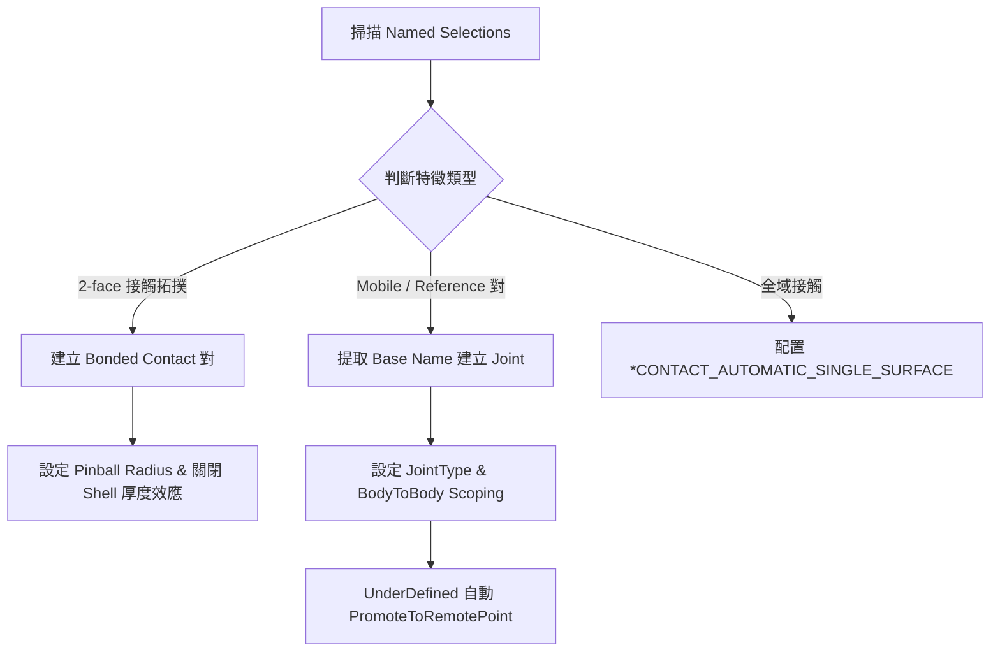

# Session 02: 接觸對與運動副自動建立 (Contact & Joint Creation)

## 1. 目標 (Objective)
在 LS-DYNA 衝擊分析模型中，建立各組件間的介面關係，包含：
1. **全域單表面自接觸 (Global Single Surface Contact)**：防止全機所有零件在劇烈衝擊形變下發生自穿透。
2. **局部綁定接觸對 (Bonded Contact Regions)**：鎖定緊固件、散熱片墊片與 PCB 黏著介面。
3. **運動副機構 (Kinematic Joints)**：針對把手開關、退出機構等旋轉鉸鏈（Revolute Joint）與固定接頭（Fixed Joint）進行自動配對。

---

## 2. ACT 自動化建立引擎 (ACT Automation Engine)

本會話整合了 ACT 工具 `Mech_bonded` 與 `MECH_RM_Joint_Creation.py` 的核心演算法：



---

## 3. 介面建立策略與參考手冊 (Progressive Disclosure)

- **自動運動副建立 (`create_joints_from_ns`)**：自動解析 _Mobile / _Reference 後綴，成對建立 BodyToBody 關節。
- **綁定接觸批次配置 (`create_bonded_contacts`)**：針對 2-face 連接拓撲自動配置 Bonded Contact，設定 Pinball 半徑為 1.22 mm。
- **全域單表面接觸 (`*CONTACT_AUTOMATIC_SINGLE_SURFACE`)**：注入 SOFT=1、動靜摩擦係數 0.2 之整機自防穿透卡片。

> 完整演算法程式碼與 LS-DYNA 卡片定義，詳見專門手冊：
> - [`../../../ansys-lsdyna/references/contacts.md`](../../../ansys-lsdyna/references/contacts.md)

---

## 4. 小批次驗證章節 (Dedicated Verification Section)

本會話提供小型單元測試腳本，透過動態建立 1 個接觸對與 1 個旋轉關節、驗證其屬性並立即清除，以達到 0 殘留測試驗證。

### 4.1 驗證步驟
1. 透過 PyMechanical gRPC 連線至 Port 10000。
2. 建立暫存 Connection Group `_TEST_Verification_Group`。
3. 建立 1 個 Sample Bonded Contact，設定 Pinball Radius 為 `1.22 mm`。
4. 建立 1 個 Sample Revolute Joint，設定 Scoping 為 `BodyToBody`。
5. 進行屬性斷言檢驗（ContactType == Bonded, JointType == Revolute, Scoping == BodyToBody）。
6. 安全刪除測試物件與暫存群組，恢復模型原始狀態。

### 4.2 獨立測試腳本執行方式
執行以下獨立測試腳本：
```powershell
python skills/shock-analysis-workflow/scripts/test_session_02.py
```

### 4.3 驗證評估指標 (Verification Metrics)
- **接觸對建立與屬性檢核**: PASS (Bonded, Pinball=1.22mm)
- **運動副建立與 Scoping 檢核**: PASS (Revolute, BodyToBody)
- **模型無污染狀態 (Pristine State)**: 100% 乾淨（0 殘留測試物件）

---

## 5. 相關參考手冊 (Related References)

| 手冊名稱 | 內容摘要 |
| :--- | :--- |
| [`../../../ansys-lsdyna/references/contacts.md`](../../../ansys-lsdyna/references/contacts.md) | 運動副腳本、Pinball 綁定接觸對配置與單表面接觸卡片 |


## Reference: contact_formulations.md

# Contact Formulations & Joint Creation Scripts

本手冊為 Session 02: 接觸對與運動副自動建立（Contact & Joint Creation）之底層演算法與 LS-DYNA 關鍵字卡片實作細節。

---

### 2.1 自動運動副建立演算法 (`MECH_RM_Joint_Creation.py`)
自動掃描命名規則中包含 `_Mobile` 與 `_Reference` 後綴的 Named Selections，並建立對應之運動副：
```python
import clr
clr.AddReference("Ansys.ACT.Interfaces")
clr.AddReference("Ansys.Mechanical.DataModel")
from Ansys.Mechanical.DataModel.Enums import JointType, JointScopingType

def create_joints_from_ns(model, ExtAPI, prefix="RMP_", mobile_suffix="_Mobile", ref_suffix="_Reference", joint_type=JointType.Revolute):
    conn = model.Connections
    all_ns = model.NamedSelections.Children
    
    # 建立或取得專屬 Connections Group
    joints_grp = None
    for cg in conn.Children:
        if cg.Name == "Scr_Joints_Group":
            joints_grp = cg
            break
    if not joints_grp:
        joints_grp = conn.AddConnectionGroup()
        joints_grp.Name = "Scr_Joints_Group"
        
    # 收集 Base Names
    rm_base_names = set()
    for ns in all_ns:
        if ns.Name.startswith(prefix):
            b_name = ns.Name
            if b_name.endswith(mobile_suffix):
                b_name = b_name[:-len(mobile_suffix)]
            elif b_name.endswith(ref_suffix):
                b_name = b_name[:-len(ref_suffix)]
            rm_base_names.add(b_name)
            
    # 遍歷建立 Joint
    for base_name in rm_base_names:
        m_ns = None
        r_ns = None
        for ns in all_ns:
            if ns.Name == base_name + mobile_suffix:
                m_ns = ns
            elif ns.Name == base_name + ref_suffix:
                r_ns = ns
                
        if m_ns and r_ns and m_ns.Entities.Count > 0 and r_ns.Entities.Count > 0:
            joint = joints_grp.AddJoint()
            joint.Name = base_name
            joint.Type = joint_type
            joint.ConnectionType = JointScopingType.BodyToBody
            
            # 設定 Reference 與 Mobile Location
            ref_sel = ExtAPI.SelectionManager.CreateSelectionInfo(Ansys.ACT.Interfaces.Common.SelectionTypeEnum.GeometryEntities)
            ref_sel.Ids = r_ns.Location.Ids
            joint.ReferenceLocation = ref_sel
            
            mob_sel = ExtAPI.SelectionManager.CreateSelectionInfo(Ansys.ACT.Interfaces.Common.SelectionTypeEnum.GeometryEntities)
            mob_sel.Ids = m_ns.Location.Ids
            joint.MobileLocation = mob_sel
```

### 2.2 綁定接觸對批次配置 (`Mech_bonded.py`)
針對 SpaceClaim 匯出的 `Connect Topology` 2-face Named Selections，批次建立 Bonded Contact 並設定適當之 Pinball 搜尋半徑（防止數值公差導致漏綁）：
```python
from Ansys.Mechanical.DataModel.Enums import ContactType, ContactPinballType

def create_bonded_contacts(model, ExtAPI, pinball_mm=1.22):
    conn = model.Connections
    bonded_grp = conn.AddConnectionGroup()
    bonded_grp.Name = "_Bonded_by_script"
    
    for ns in model.NamedSelections.Children:
        if ns.Name.startswith("Connect Topology") and len(ns.Location.Ids) == 2:
            f1 = ExtAPI.SelectionManager.CreateSelectionInfo(Ansys.ACT.Interfaces.Common.SelectionTypeEnum.GeometryEntities)
            f1.Ids = [ns.Location.Ids[0]]
            f2 = ExtAPI.SelectionManager.CreateSelectionInfo(Ansys.ACT.Interfaces.Common.SelectionTypeEnum.GeometryEntities)
            f2.Ids = [ns.Location.Ids[1]]
            
            bonded = bonded_grp.AddContactRegion()
            bonded.Name = ns.Name
            bonded.ContactType = ContactType.Bonded
            bonded.SourceLocation = f1
            bonded.TargetLocation = f2
            bonded.PinballRegion = ContactPinballType.Radius
            bonded.PinballRadius = Quantity("{} [mm]".format(pinball_mm))
            bonded.ShellThicknessEffect = False
```

### 2.3 全域接觸卡片配置 (`*CONTACT_AUTOMATIC_SINGLE_SURFACE`)
在 LS-DYNA Keyword 中注入全域單表面接觸，適用於整機碰撞與跌落衝擊：
```
*CONTACT_AUTOMATIC_SINGLE_SURFACE
$#     cid                                                                 title
         1 Global Single Surface Contact
$#    ssid      msid     sstyp     mstyp    sboxid    mboxid       spr       mpr
         0         0         0         0         0         0         1         1
$#      fs        fd        dc        vc       vdc    penchk        bt        dt
     0.200     0.200     0.000     0.000    20.000         0     0.000 1.000E+20
$#     sfs       sfm       sst       mst      sfst      sfmt       fsf       vsf
     1.000     1.000     0.000     0.000     1.000     1.000     1.000     1.000
$#    soft    sofscl    lcidab    maxpar     tnbrx                depth      bsort
         1     0.100         0     1.025         0                    2         10
```