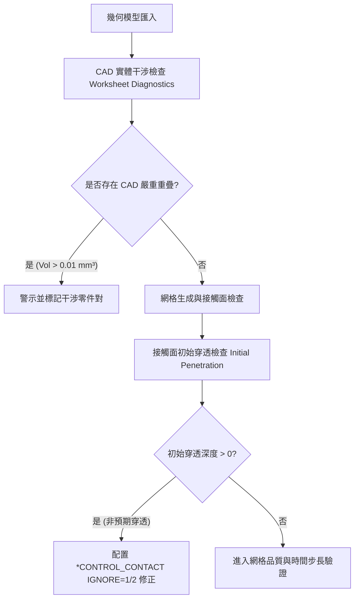

# Session 03: 網格優先級、干涉預檢與顯式時間步長調校 (Mesh Tuning & Time Step Quality)

## 1. 目標 (Objective)
在 LS-DYNA 衝擊與跌落分析中，網格品質直接決定了計算穩定性與計算效率。本會話之目標包括：
1. **網格前置干涉檢查 (Pre-Mesh Interference Checks)**：在劃分網格前檢測 CAD 實體重疊與接觸面初始穿透，杜絕 $t=0$ 瞬間接觸能量爆炸。
2. **多區域網格優先級階梯 (MultiZone Priority Setup)**：針對規則金屬實體優先採用 MultiZone 六面體網格。
3. **顯式動力學特徵時間步長控制 ($\Delta t \ge 2.0 \times 10^{-8}\text{ s}$)**：確保最小單元尺寸不造成高頻震盪或時間步長崩潰。

---

## 2. 幾何與網格干涉預檢防呆 (Interference & Initial Penetration Pre-Checks)

本會話整合了 ACT 工具 `MECH_Interference_Check.py` 的檢查機制：



## 3. 網格方法優先級階梯 (Mesh Method Priority Cascade)

1. **Priority 1: MultiZone (六面體 Hexahedral 優先)**
   - 適用於所有規則金屬機殼底座、固定治具塊與散熱底板。
   - 透過 `mesh.AddAutomaticMethod()` 並設定 `mc.Method = MethodType.MultiZone`。
2. **Priority 2: Sweep Method (掃掠網格)**
   - 適用於圓柱銷（Pin）、導軌與等截面實體。
3. **Priority 3: Tetrahedrons (Patch Independent / Patch Conforming 四面體)**
   - 適用於具備複雜拔模角與不規則外型之 DFM 把手或壓鑄件。
4. **Priority 4: Shell Quad/Tri (中面薄板殼單元)**
   - 適用於 2D 中面鈑金零件。

---

---

## 4. 顯式時間步長準則與參考手冊 (Progressive Disclosure)

- **顯式時間步長控制準則 (CFL Condition)**：要求 $\Delta t = L/c \ge 2.0 \times 10^{-8}\text{ s}$（20 ns 門檻），其中聲速  = \sqrt{E/\rho}$。
- **CAD 實體干涉檢查 (`check_cad_interference`)**：透過 Worksheet Diagnostics 偵測重疊體積。
- **網格初始穿透檢查與防護**：設定 `*CONTROL_CONTACT IGNORE=1` 於 t=0 投射穿透節點。

> 完整干涉診斷腳本、控制卡與各材料 CFL 臨界尺寸速查表，詳見專門手冊：
> - [`../../../../geometry-meshing/ansys-mesh/references/metrics_and_quality_standards.md`](../../../../geometry-meshing/ansys-mesh/references/metrics_and_quality_standards.md)

---

## 5. 小批次驗證章節 (Dedicated Verification Section)

為避免在大模型上進行耗時之全機網格劃分與求解，本會話採用 **3 個樣本 Solid Body** 進行快速小批次控制與特徵時間步長驗證。

### 5.1 驗證步驟
1. 透過 PyMechanical gRPC 連線至 Port 10000。
2. 篩選出 3 個代表性實體零件（Solid Bodies）。
3. 依據材料物性計算特徵聲速 $c = \sqrt{E/\rho}$ 與設定尺寸之顯式時間步長 $\Delta t = L/c$。
4. 驗證 $\Delta t \ge 2.0 \times 10^{-8}\text{ s}$（20 ns 門檻）。
5. 對 3 個樣本 Body 分別掛載 `MultiZone` 自動方法與 `2.0 mm` 區域 Sizing 控制。
6. 驗證控制項正確綁定後，立即安全刪除測試控制項，維持模型乾淨無殘留。

### 5.2 獨立測試腳本執行方式
執行以下獨立測試腳本：
```powershell
python skills/shock-analysis-workflow/scripts/test_session_03.py
```

### 5.3 驗證評估指標 (Verification Metrics)
- **樣本實體零件數 (Sample Solid Bodies)**: 3
- **MultiZone 方法配置驗證**: PASS (3 / 3)
- **局部 Sizing 配置驗證**: PASS (3 / 3, Size = 2.0 mm)
- **特徵聲速與時間步長**: $c = 5047.5\text{ m/s}, \Delta t = 3.962 \times 10^{-7}\text{ s} \ge 2.0 \times 10^{-8}\text{ s}$ (PASS)
- **模型無污染狀態 (Pristine State)**: 100% 乾淨（0 殘留測試控制項）

---

## 6. 相關參考手冊 (Related References)

| 手冊名稱 | 內容摘要 |
| :--- | :--- |
| [`../../../../geometry-meshing/ansys-mesh/references/metrics_and_quality_standards.md`](../../../../geometry-meshing/ansys-mesh/references/metrics_and_quality_standards.md) | CAD 干涉診斷腳本、*CONTROL_CONTACT IGNORE 卡片與 CFL 聲速時間步長表 |


## Reference: mesh_quality_criteria.md

# Mesh Quality Criteria & Interference Diagnostic Scripts

本手冊為 Session 03: 網格優先級、干涉預檢與顯式時間步長調校之底層腳本、LS-DYNA 關鍵字卡片與 CFL 判據速查表。

---

### 2.1 CAD 實體干涉檢查 (`MECH_Interference_Check.py`)
透過 Mechanical Diagnostics Criteria 檢測零件間重疊體積：
```python
def check_cad_interference(model):
    ns_name = "Interference_Check_Results"
    for ns_old in list(model.NamedSelections.Children):
        if ns_old.Name == ns_name:
            ns_old.Delete()

    ns = model.AddNamedSelection()
    ns.Name = ns_name
    ns.ScopingMethod = GeometryDefineByType.Worksheet
    
    # 建立幾何體積大於 0 之重疊診斷條件
    crit0 = ns.GenerationCriteria.Add(None)
    crit0.EntityType = SelectionType.GeoBody
    crit0.Criterion = SelectionCriterionType.Size
    crit0.Operator = SelectionOperatorType.GreaterThan
    crit0.Value = Quantity("0 [mm mm mm]")
    
    crit1 = ns.GenerationCriteria.Add(None)
    crit1.Action = SelectionActionType.Diagnostics
    ns.Generate()
```

### 2.2 網格初始穿透檢查與 LS-DYNA 控制卡修正
- **問題現象**：若網格表面在初始狀態存在幾何穿透，LS-DYNA 顯式求解器會在第 1 個 cycle 產生極大的排斥力，導致單元扭曲負體積（Negative Volume）。
- **關鍵字防護**：在 `*CONTROL_CONTACT` 中設定 `IGNORE=1` 或 `IGNORE=2`，於 $t=0$ 自動將穿透節點投射回主接觸面：
```
*CONTROL_CONTACT
$#  slsfac    rwpnal    islchk    shlthk    penopt    thkchg     orien    enmass
     0.100     0.000         1         2         1         0         1         0
$#  usrstf    usrstr    sfric     dfric     edc       vfc       th        th_sf
     0.000     0.000     0.000     0.000     0.000     0.000     0.000     0.000
$#  ignore    bktchg    pastop    
         1         0         0
```

---

## 4. 顯式時間步長控制準則 ($\Delta t \ge 2.0 \times 10^{-8}\text{ s}$)

顯式動力學中，Courant-Friedrichs-Lewy (CFL) 穩定性條件要求時間步長滿足：
$$\Delta t \le \frac{L}{c}, \quad c = \sqrt{\frac{E}{\rho}}$$

| 材料名稱 | 彈性模數 $E\text{ (GPa)}$ | 密度 $\rho\text{ (kg/m}^3\text{)}$ | 聲速 $c\text{ (m/s)}$ | 臨界最小尺寸 $L_{\min}\text{ (mm) for }\Delta t=20\text{ ns}$ | 建議網格尺寸 |
| :--- | :--- | :--- | :--- | :--- | :--- |
| **結構鋼 (Structural Steel / SGCC)** | 200.0 | 7850 | 5047.5 | 0.101 mm | 1.5 ~ 3.0 mm |
| **鋁合金 (AL6061-T6)** | 68.9 | 2700 | 5051.6 | 0.101 mm | 1.5 ~ 3.0 mm |
| **工程塑膠 (PC+ABS / PA66)** | 2.4 | 1200 | 1414.2 | 0.028 mm | 1.0 ~ 2.0 mm |
| **FR-4 電路板** | 22.0 | 1900 | 3402.8 | 0.068 mm | 1.0 ~ 2.0 mm |

---
