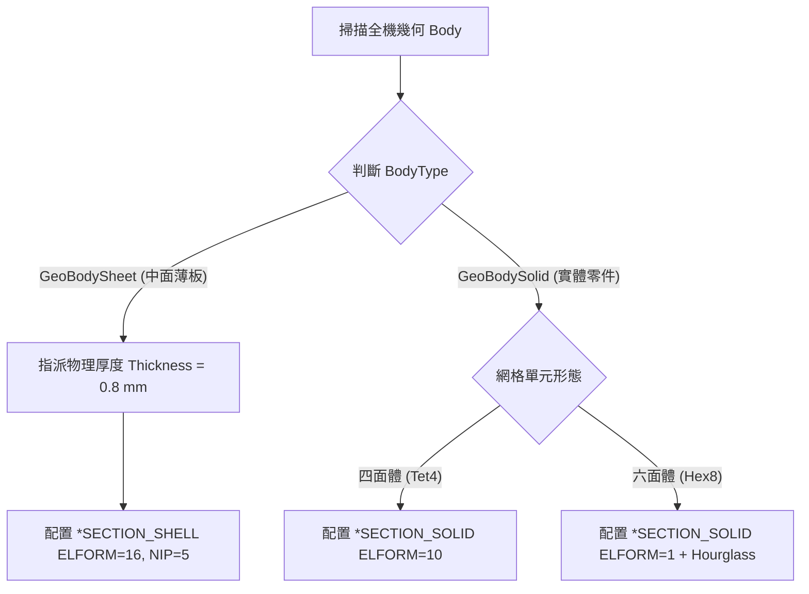

# Session 05: 截面性質與單元公式指派 (Section & Shell Thickness Assignment)

## 1. 目標 (Objective)
在 LS-DYNA 衝擊分析中，為 2D 中面幾何（Mid-surface）與 3D 實體幾何指派物理厚度與正確的單元數學公式（Element Formulations），包括：
1. **中面薄板厚度指定**：為所有 `GeoBodySheet` 物件指派準確的物理厚度（如 `0.8 mm` 或依 CAD 指定）。
2. **殼單元公式 (`*SECTION_SHELL`)**：配置完全積分殼單元（`ELFORM=16`）或 Belytschko-Tsay 殼單元（`ELFORM=2`），並設定 5 個厚度積分點（`NIP=5`）以精確捕捉彈塑性彎曲。
3. **實體單元公式 (`*SECTION_SOLID`)**：配置四面體（`ELFORM=10`）或六面體（`ELFORM=1` 搭配沙漏控制）。

---

## 2. ACT 自動截面指派引擎 (ACT Section Assignment Engine)

本會話整合了 ACT 工具 `Dyna-Section-Mass-Implicit-Setting.py` 的截面分類與單元判斷邏輯：



### 2.1 中面薄板厚度批次指派
自動遍歷幾何樹，過濾出未抑制的 `GeoBodySheet` 並指派物理厚度：
```python
def assign_shell_thickness(model, default_thickness_mm=0.8):
    cnt_assigned = 0
    for body in model.Geometry.GetChildren(DataModelObjectCategory.Body, True):
        if body.Suppressed:
            continue
        gb = body.GetGeoBody()
        if gb and str(gb.BodyType) == "GeoBodySheet":
            body.Thickness = Quantity(default_thickness_mm, "mm")
            cnt_assigned += 1
    print("Successfully assigned {} mm thickness to {} sheet bodies.".format(default_thickness_mm, cnt_assigned))
```

### 2.2 LS-DYNA 截面與單元公式關鍵字 (`*SECTION_SHELL` & `*SECTION_SOLID`)

#### A. 殼單元截面卡片 (`*SECTION_SHELL`)
- **ELFORM = 16**: Fully Integrated Shell Element（完全積分殼單元，無沙漏模式，大幅提高薄板大變形彎曲與應力計算精度）。
- **NIP = 5**: 5 個厚度方向積分點（Through-thickness integration points），精確描述金屬降伏與塑性流動。
```
*SECTION_SHELL
$#   secid    elform      shrf       nip     propt     qr/ir     icomp      setyp
         1        16     1.000         5         1         0         0         1
$#      t1        t2        t3        t4      nloc     marea      idof    edgset
     0.800     0.800     0.800     0.800     0.000     0.000     0.000         0
```

#### B. 實體單元截面卡片 (`*SECTION_SOLID`)
- **四面體 (Tet4)**: `ELFORM = 10` (1-point tetrahedron with stabilization) 或 `ELFORM = 13` (Nodal pressure tetrahedron 適用於不可壓縮或大塑性)。
- **六面體 (Hex8)**: `ELFORM = 1` (Constant stress solid) 搭配 `*HOURGLASS` Type 5 (Flanagan-Belytschko stiffness form) 或 `ELFORM = 2` (Fully integrated S/R solid)。
```
*SECTION_SOLID
$#   secid    elform       aet
         2        10         0
```

---

## 3. 小批次驗證章節 (Dedicated Verification Section)

本會話提供小型單元測試腳本，針對 **2 個薄板樣本 (GeoBodySheet)** 與 **2 個實體樣本 (GeoBodySolid)** 進行厚度指派、幾何體積確認與單元公式合規性檢核。

### 3.1 驗證步驟
1. 透過 PyMechanical gRPC 連線至 Port 10000。
2. 篩選出 2 個 `GeoBodySheet` 與 2 個 `GeoBodySolid` 樣本。
3. 對 2 個薄板零件指派 `0.8 mm` 物理厚度，並斷言指派成功。
4. 對 2 個實體零件讀取幾何體積，斷言其幾何體積為正值（`Volume.Value > 0`）。
5. 檢核對應的 LS-DYNA 截面公式配置（Shell ELFORM=16, Solid ELFORM=10/1）。
6. 輸出驗證報告。

### 3.2 獨立測試腳本執行方式
執行以下獨立測試腳本：
```powershell
python skills/shock-analysis-workflow/scripts/test_session_05.py
```

### 3.3 驗證評估指標 (Verification Metrics)
- **樣本薄板零件數 (Sample Sheet Bodies)**: 2 (100% 成功指派 0.8 mm 厚度)
- **樣本實體零件數 (Sample Solid Bodies)**: 2 (100% 幾何體積健全)
- **殼單元公式合規性 (Shell ELFORM)**: PASS (ELFORM=16, NIP=5)
- **實體單元公式合規性 (Solid ELFORM)**: PASS (ELFORM=10 / ELFORM=1)
- **模型無污染狀態 (Pristine State)**: 100% 乾淨（0 殘留測試物件）

---

## 4. 相關參考手冊 (Related References)

| 手冊名稱 | 內容摘要 |
| :--- | :--- |
| [`../../../ansys-lsdyna/references/parts_and_sections.md`](../../../ansys-lsdyna/references/parts_and_sections.md) | 薄板 ELFORM=16 與厚度積分點 NIP=5、實體 ELFORM 設定與沙漏能防護 |


## Reference: section_controls_and_shell_thickness.md

# Session 05 技術手冊：截面控制與薄板厚度指派規範 (Section Controls & Shell Thickness)

## 1. 物理背景與幾何分類 (Physical Context & Geometry Types)

在伺服器機箱與電子設備的 LS-DYNA 動態衝擊與落摔模擬中，結構件主要分為兩大類：
1. **薄板鈑金結構 (Sheet Metal Structures)**：
   - 包含外殼（Chassis Cover/Bottom）、導風罩（Air Duct）、硬碟托盤（HDD Tray）、主機板固定架（Bracket）等。
   - 特徵為厚度（$t \le 2.0\text{ mm}$）遠小於面內尺寸（$L, W \ge 50\text{ mm}$）。
   - 幾何前處理通常抽取為 **2D 中面幾何（Mid-surface, `GeoBodySheet`）**，在數值分析時透過截面性質指定厚度。
2. **實體結構零件 (Solid Structural Components)**：
   - 包含散熱模組（Heatsink Fin/Base）、螺柱（Standoff）、壓鑄件（Die Casting）、塑料卡扣（Plastic Latches）等。
   - 在幾何前處理中保留為 **3D 實體（`GeoBodySolid`）**。

---

## 2. LS-DYNA 殼單元公式 (`*SECTION_SHELL`) 最佳實踐

### 2.1 ELFORM = 16 (Fully Integrated Shell) vs. ELFORM = 2 (Belytschko-Tsay)
- **ELFORM = 2 (Belytschko-Tsay)**：
  - 單點積分（1 in-plane integration point），計算效率極高。
  - **致命缺點**：容易激發零能量沙漏變形模式（Hourglassing）。在大加速度衝擊、高應力集中孔位（如鉚釘孔、螺絲孔）周圍，單點積分可能產生非物理的網格畸變。
- **ELFORM = 16 (Fully Integrated Shell)**：
  - 4 個面內高斯積分點（$2 \times 2$ in-plane integration points）。
  - **核心優勢**：**完全無沙漏模式（No Hourglassing）**，且完全抗剪切自鎖（Shear Locking），能精準捕捉鈑金沖孔邊緣的大曲率塑性彎曲。
  - **推薦標準**：對於衝擊、跌落等關鍵承載與破壞判定零件，強制採用 `ELFORM = 16`。

### 2.2 厚度方向積分點 (Through-Thickness Integration Points, NIP)
- **標準設定**：`NIP = 5`（高斯-洛巴托積分點 Gauss-Lobatto 或 Gauss）。
- **物理依據**：
  - 薄板受動態衝擊時，外側纖維承受拉伸、內側纖維承受壓縮，彈塑性邊界（Elastic-Plastic Boundary）自表層向中面擴展。
  - 若 `NIP = 2` 或 `3`，無法解析材料非線性硬化與塑性流動，會嚴重低估殘餘變形量。
  - `NIP = 5` 能提供高精度的厚度應力分佈與能量耗散，且計算開銷可控。

### 2.3 關鍵字卡片語法規範
```
*SECTION_SHELL
$#   secid    elform      shrf       nip     propt     qr/ir     icomp      setyp
         1        16     1.000         5         1         0         0         1
$#      t1        t2        t3        t4      nloc     marea      idof    edgset
     0.800     0.800     0.800     0.800     0.000     0.000     0.000         0
```

## 3. LS-DYNA 實體單元公式 (`*SECTION_SOLID`) 最佳實踐

### 3.1 四面體網格 (Tetrahedral Elements)
- **ELFORM = 10 (1-Point Tetrahedron with Stabilization)**：
  - 具備數值穩定機制的單點積分四面體單元，適用於複雜壓鑄件、連接器本體等非結構核心零件。
- **ELFORM = 13 (Nodal Pressure Tetrahedron)**：
  - 用於克服傳統 Tet4 單元的體積自鎖（Volumetric Locking），特別適合具有大塑性流動或橡膠襯墊材料的局部區域。

### 3.2 六面體網格 (Hexahedral Elements)
- **ELFORM = 1 (Constant Stress Solid)**：
  - 單點積分六面體，必須搭配沙漏控制：`*HOURGLASS` Type 4 / 5（Flanagan-Belytschko stiffness form，推薦係數 $QH = 0.05 \sim 0.1$）。
- **ELFORM = 2 (Fully Integrated S/R Solid)**：
  - 完全積分選擇性減縮積分六面體，無沙漏模式，適用於重要傳力銷軸或精密受剪區域。

---

## 4. 自動化指派驗證標準 (Automated Verification Gates)

在執行衝擊管線時，必須自動檢驗下列指標：
1. **中面薄板覆蓋率 (Sheet Thickness Coverage)**：
   - 全機未抑制之 `GeoBodySheet` 物件中，已正確指派物理厚度之比例必須為 **100%**。
2. **厚度合理性檢查 (Thickness Sanity Check)**：
   - 厚度範圍必須落在 $0.2\text{ mm} \le t \le 5.0\text{ mm}$ 之內，杜絕 0 或負厚度。
3. **實體體積檢查 (Solid Volume Check)**：
   - 全機未抑制之 `GeoBodySolid` 物件之體積必須大於 0（$\text{Volume} > 0$），防止無效退化體。
