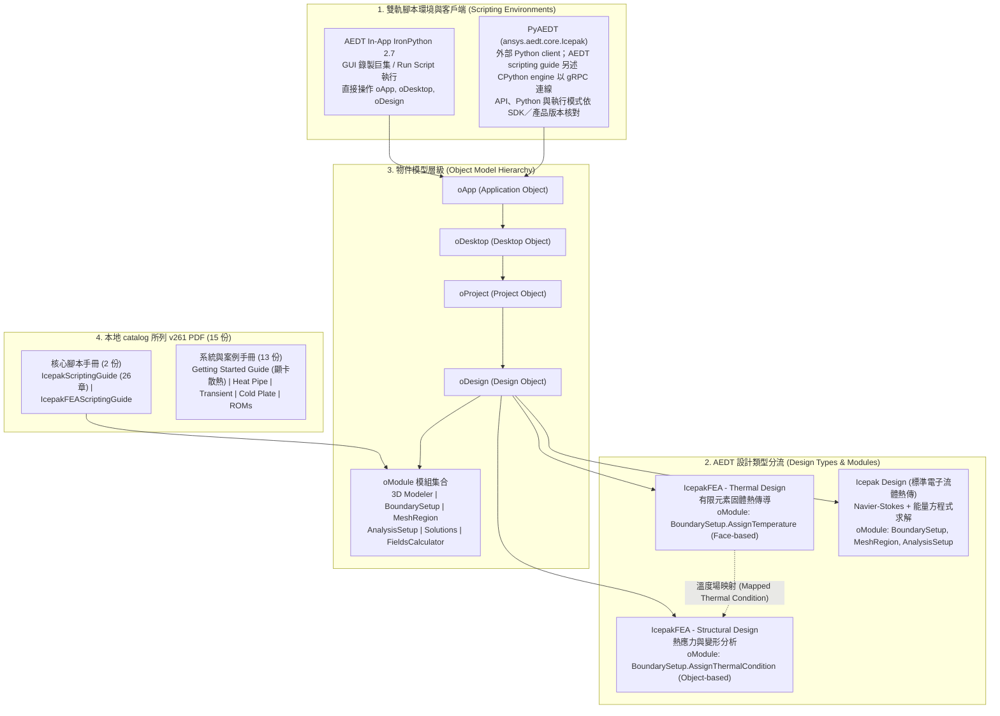

# Ansys Icepak 電子散熱與熱流模擬 核心 API 與工作流指南

> [!NOTE]
> 本文件由知識字典 `icepak.md` 精煉萃取而成，提供標準 API 流程、邊界條件與驗證基準。
> 如需完整原文與版本對照，可調用 `ans_get_knowledge_dictionary(product='icepak')`。

## 1. 核心架構與求解流程

1. **環境初始化**：確認 Python 環境與對應產品授權，透過專屬客戶端連線。
2. **模型前處理**：匯入幾何模型，指定材料物性、熱力學參數或光學表面屬性。
3. **網格劃分與邊界條件**：建立適應性網格，指派載荷、熱源、激勵源或環境邊界。
4. **求解監控與收斂準則**：設置殘差監視器、能量守恆檢查與收斂閾值。
5. **後處理與數據導出**：提取場量分佈、感測器響應與驗證指標。

## 2. 知識字典精選內容

# Ansys Icepak 主題字典

> 本主題整理 Icepak 與 IcepakFEA 的有界操作/API概念。2026-11-06 已從官方 v261 目錄取得24份PDF（8,587實體頁）與Icepak/IcepakFEA兩個目錄區段，補齊本機原缺的9份文件。15份既有PDF與官方擷取的檔案雜湊不同，但每一實體頁抽取文字逐字相同；原件與對照證據均保留。不同設計類型、產品release與SDK版本依來源分別標示，圖表與完整工程語意仍有下方缺口。

---

## 領域架構圖 (Icepak Architecture & Module Hierarchy)

---

## 官方網站文件入口與本機缺口（2026 R1）

[Ansys Electronics v261 PDFs 目錄](https://ansyshelp.ansys.com/public/Views/Secured/Electronics/v261/en/Content/PDFs.htm) 將 Icepak Help、Icepak Scripting、Getting Started Guides，以及 IcepakFEA Help、Scripting 和四份 Getting Started Guide 分列。Getting Started 清單還列出本地 15 份 PDF 目錄未涵蓋的 Classic Icepak File Conversion、Non-Conformal Mesh、Extract Delphi Network。目錄本身提供閱讀入口，不代表本機 catalog 已收錄所有連結文件。

由官方 v261 目錄可直接開啟 [Icepak Scripting Guide](https://ansyshelp.ansys.com/public/Views/Secured/Electronics/v261/en/PDFs/IcepakScriptingGuide.pdf) 與 [IcepakFEA Scripting Guide](https://ansyshelp.ansys.com/public/Views/Secured/Electronics/v261/en/PDFs/IcepakFEAScriptingGuide.pdf)。網頁 PDF 分別為 1,326 與 1,554 頁，封面皆標 Release 2026 R1／January 2026；本地同名 v261 PDF 頁數相符。2026-11-06 已核對所有15份本機PDF：官方下載的原件SHA-256均不同，但實體頁數及逐頁抽取文字全部相同；這項文字一致性不證明版面/隱藏物件或byte內容相同。

目錄說明 Icepak Getting Started Guide 涵蓋材料、邊界、mesh regions、monitors、求解、後處理、fields summary 與 DOE；Transient Simulation guide 涵蓋資料集、piecewise linear transient power、時間步設定、監控與結果後處理。這是網站目錄的用途摘要，未代替逐份原始手冊內容。官方 PDF 的版權頁載明文件受 Ansys 軟體授權及保密條款約束；團隊分享原文或衍生內容前應核對實際授權。網頁工具可讀取此 v261 入口與 PDF 文字，不能由此推定所有使用者帳號、下載權限或再散布權均相同。

## 主題辭典與核心模組

### 1. v261 PDF 轉換與頁碼定位 (v261 PDF Extraction & Citation System)

#### 核心概念與辭典定義 (Core Concepts & Glossaries)
- **PDF 數位化與 Markdown Sidecar 機制**：
  - 本知識庫對 Ansys Electromagnetics Suite 2026 R1 (v261) catalog 標示為 v261 的 15 份 Icepak PDF 本機文件已有 Markdown 轉換檔，並在同目錄生成對應的 `.md` 側車檔案 (Markdown Sidecar)。
  - **`PDF Page N` 標記**：15 份 sidecar 的頁標記已核對為從 1 連續至各自末頁，可作為回查 PDF 的頁面線索；這項檢查不代表正文、表格、圖表或掃描內容已全面驗證。逐來源頁數與狀態見 `../maintenance/knowledge_dictionary_passes/2026-11-02/icepak_sources.csv`。
- **圖表、公式與版面審查邊界**：
  - 本 Icepak 清冊的 15 份 PDF 皆有連續頁標，並且未發現 sidecar 空文字頁；逐頁圖表／公式忠實度仍未全面驗收，機械檢查清單見 `../maintenance/knowledge_dictionary_passes/2026-11-02/icepak_empty_page_review_20261103.csv`。
  - **驗收準則**：當需要確認電路板 PCB 各向異性導熱係數張量設定、風扇 P-Q 特性曲線離散點或求解器收斂準則極限時，必須依 `PDF Page N` 標記回到原版 PDF 進行最終核對。

#### 15 份本地 v261 Icepak PDF 清冊（不代表網站文件全集）

| Document ID | 手冊完整名稱 | 實體檔名與側車路徑 | 涵蓋領域與核心內容 |
|---|---|---|---|
| `ansys_a0ad7c8d3f30ba37736aa6bd` | Icepak Scripting Guide | `IcepakScriptingGuide.pdf` (.md) | 核心總手冊 (26 章)：AEDT 物件模型、邊界、網格、求解與場計算器 |
| `ansys_e6e6c75160f5628b306a53ac` | IcepakFEA Scripting Guide | `IcepakFEAScriptingGuide.pdf` (.md) | 有限元素熱傳與熱應力腳本手冊：`AssignTemperature` 與 `AssignThermalCondition` |
| `ansys_f85db01edc5ff35a4e710a6d` | Icepak Getting Started Guide | `Icepak Getting Started Guide.pdf` (.md) | 系統級顯卡散熱完整流程：PCB 各向異性材料、風扇、散熱片與局部網格細化 |
| `ansys_20a97f8c82b1799648394a28` | Heat Pipe Model | `Getting Started with Icepak - Heat Pipe Model.pdf` (.md) | 熱管等效高導熱實體建模、Non-model Box 網格控制區域與監視器 |
| `ansys_bc1620da7e20295a9511ba2d` | Transient Simulation | `Getting Started with Icepak - Transient Simulation.pdf` (.md) | 暫態熱功耗分段線性曲線 (`ds_pwr`)、時間步間隔儲存與溫度歷程動畫後處理 |
| `ansys_3507139888357e25a198b115` | Scripting Example | `Getting Started with Icepak - Scripting Example.pdf` (.md) | AEDT GUI 錄製巨集修改、迴圈切面 (Plane Cut) 建立與批次匯出 JPEG |
| `ansys_fa35acb12735b9f7f9ed637d` | Cold Plate Model | `Getting Started with Icepak - Cold Plate Model.pdf` (.md) | 水冷板內部冷卻液流道 (Liquid Cooling) 建模、共軛熱傳與壓降評估 |
| `ansys_bf6155ba03c8d81c722a6647` | Finned Heat Sink | `Getting Started with Icepak - Finned Heat Sink.pdf` (.md) | 鰭片散熱器自然對流與強迫風冷對比、熱阻與流阻特性計算 |
| `ansys_8d00d495fd5805ec664a5317` | Coil and Plate | `Getting Started with Icepak - Coil and Plate.pdf` (.md) | 電磁線圈歐姆損耗熱耗散、平面感應發熱與熱傳導 |
| `ansys_5f42dd3dbab0333bbb2c31f7` | LPV ROM | `Getting Started with Icepak - LPV ROM.pdf` (.md) | 線性參數變化降階模型 (Linear Parameter-Varying ROM) 萃取與系統整合 |
| `ansys_44b4c13d8bda194732617bd3` | LTI ROM | `Getting Started with Icepak - LTI ROM.pdf` (.md) | 線性非時變降階模型 (Linear Time-Invariant ROM) 狀態空間矩陣萃取 |
| `ansys_64912b92ecabe51f17e9e029` | Optimization of Fan Location | `Getting Started with Icepak - Optimization of Fan Location.pdf` (.md) | Optimetrics 參數化掃描風扇座標、風道死區消除與最高結溫最小化 |
| `ansys_b3f82a992ae674c5d81710b1` | RF Amplifier | `Getting Started with Icepak - RF Amplifier.pdf` (.md) | 射頻功放晶片高功率密度熱源、Delphi 雙熱阻模型設定與均熱板分析 |
| `ansys_ab7bcb5462217b7587ece24b` | Waveguide Filter | `Getting Started with Icepak - Waveguide Filter.pdf` (.md) | 高頻電磁損耗匯入、波導濾波器發熱與熱漂移評估 |
| `ansys_933615912214fb1ea1827a6b` | Toolkits | `Getting Started with Icepak - Toolkits.pdf` (.md) | 電子封裝巨集、EDA 電氣走線銅皮比率匯入與自動散熱工具箱 |

#### 手冊章節與規格出處 (Manual & Doc Citations)
- **手冊來源**：`sources.csv` 中所有 15 筆 Icepak 文件清單；對應實體檔案位於 `<REPO_ROOT>\docs\ANSYS_Document\Icepak\v261\manuals\`。
- **引用範例**：
  - *IcepakFEAScriptingGuide.pdf*：物理頁碼 Page 957–958 (`AssignTemperature`)、Page 959–960 (`AssignThermalCondition`)。
  - *Icepak Getting Started Guide.pdf*：物理頁碼 Page 19–42（Graphics Card 初始求解）、Chapter 5（局部網格細化）。
  - *Getting Started with Icepak - Transient Simulation.pdf*：物理頁碼 Page 13–29（瞬態時間步與 Piecewise Linear 功耗）。

#### 工程實務踩坑與注意事項 (Gotchas & FAQ)
- **物理頁碼與手冊內頁編碼差異**：PDF 閱讀器的實體頁數 (Physical Page) 與手冊內頁印刷頁數 (如 `1-1`, `Contents-1`) 常有 4~12 頁的封面/前言位移。**規範：所有 Markdown sidecar 的 `## PDF Page N` 均指實體物理頁碼**，避免跳轉錯位。
- **抽取文本中的分詞斷行**：在由 PDF 轉換的 Markdown 中，部分複合專業名詞可能出現多餘空格（如 `com panies`, `pro prietary`）。在撰寫腳本字串時必須查驗原始語法，避免將斷字帶入 API 參數中。

---

### 2. Icepak 與 IcepakFEA Scripting 範圍 (Scripting Scope & Architecture)

#### 核心概念與辭典定義 (Core Concepts & Glossaries)
- **AEDT 統一物件模型階層 (Object Model Hierarchy)**：
  - Icepak 內嵌於 Ansys Electronics Desktop (AEDT) 架構下，遵從樹狀物件模型：
    $$\text{oApp} \longrightarrow \text{oDesktop} \longrightarrow \text{oProject} \longrightarrow \text{oDesign} \longrightarrow \text{oModule}$$
  - **核心 oModule 模組職能**：
    - `BoundarySetup`：建立熱源、開口 (Opening)、格柵 (Grille)、散熱片 (Heatsink) 與風扇 (Fan) 邊界條件。
    - `MeshRegion`：在指定區域幾何上建立局部網格控制參數。
    - `AnalysisSetup`：設定流動/熱平衡求解器、流態（層流/湍流方程）、輻射模型（Discrete Ordinates / Surface-to-Surface）與收斂準則。
    - `Solutions`：執行計算 (`Solve`)、匯出解資料與讀取殘差。
    - `FieldsCalculator` / `ReportSetup`：後處理場量計算、監視器歷程曲線與溫度場雲圖繪製。
- **Standard Icepak vs. IcepakFEA 設計類型邊界**：
  - **Standard Icepak Design**：專注於電子設備機箱內的共軛熱傳 (Conjugate Heat Transfer, CHT) 與流場 CFD 計算。採用六面體為主之直角網格 (Cartesian Meshing) 或非結構多面體網格。
  - **IcepakFEA - Thermal Design**：專注於純固體導熱之有限元素法 (FEM) 求解。邊界條件作用於面或體單元。
  - **IcepakFEA - Structural Design**：專注於由溫度梯度引起的結構熱應力、熱形變與翹曲。
- **溫度激發 scoping 與兩種資料模式**：
  - `AssignTemperature`：**IcepakFEA - Thermal Design** 使用；參數為 boundary name、`Faces` 清單、`Temperature` 字串，手冊範例把 `90cel` 指派給 faces `[8, 17]`。編輯既有溫度邊界時，`Edit()` 不能更改 faces；手冊指示用 `AddAssignmentTo`、`RemoveAssignmentFrom` 或 `Reassign` 調整實體指派。
  - `AssignThermalCondition`：**IcepakFEA - Structural Design** 使用；`Objects` 指定目標幾何。`Uniform=True` 時給單一溫度條件；`Uniform=False` 時以 project、product、design、solution 及參數映射讀取來源結果，另有 `ForceSourceToSolve`、`PreservePartnerSoln`、`PathRelativeTo` 控制欄位。
  - 來源：*IcepakFEA Scripting Guide* v261 PDF physical pages 957–960。頁 959–960 的範例抽取文字有缺失符號，這裡只整理可辨識參數名稱，未把殘缺範例重建成程式。

#### 腳本環境與設計類型特性對比 (Scripting Scope Comparison)

| 維度特徵 | Standard AEDT Icepak | IcepakFEA - Thermal | IcepakFEA - Structural |
|---|---|---|---|
| **Design Type** | `Icepak` | `IcepakFEA` (Thermal) | `IcepakFEA` (Structural) |
| **物理主導方程** | Navier-Stokes + 能量方程 + 輻射 | 固體純熱傳導熱方程 | 線性/非線性彈性力學平衡方程 |
| **網格特徵** | Hexahedral Cartesian / Unstructured Mesh Region | 四面體/六面體有限元素網格 (FEM) | 結構有限元素共形網格 |
| **關鍵熱邊界 API** | `oBoundarySetup.AssignSourceBoundary`, `AssignOpeningBoundary` | `oBoundarySetup.AssignTemperature` (Scoping: Faces) | `oBoundarySetup.AssignThermalCondition` (Scoping: Objects) |
| **熱應力耦合方式** | 匯出溫度場雲圖或透過 System Coupling / Workbench 傳遞 | 透過專用 Mapping 直接匯入 Structural | 作為受體接受熱解溫度場產生熱應變 |

#### 手冊章節與規格出處 (Manual & Doc Citations)
- **手冊來源**：*Icepak Scripting Guide v261* (**Scripting Guide PDF**)；*IcepakFEA Scripting Guide v261* (**IcepakFEA PDF**)。
- **Source IDs**：`sources.csv#ansys_a0ad7c8d3f30ba37736aa6bd`, `sources.csv#ansys_e6e6c75160f5628b306a53ac`。
- **精確頁碼定位**：
  - `IcepakScriptingGuide.pdf`：Chapter 1 (Scripting Environment, p. 1-1~1-9)、Chapter 11 (Boundary & Excitation Module, p. 11-1)、Chapter 14 (Mesh Region Module, p. 14-1)、Chapter 15 (Analysis Setup, p. 15-1)。
  - `IcepakFEAScriptingGuide.pdf`：PDF physical pages 957–958 (`AssignTemperature`)、pages 959–960 (`AssignThermalCondition`)。

## 3. 雙軌數值基準與驗收標準

- **商業求解器軌**：在具備有效授權環境下，調用官方求解器執行全物理場模擬。
- **數值基準驗證軌**：在無授權或離線 CI 環境下，執行 `scripts/verify_icepak_baseline.py` 進行解析解比對。
