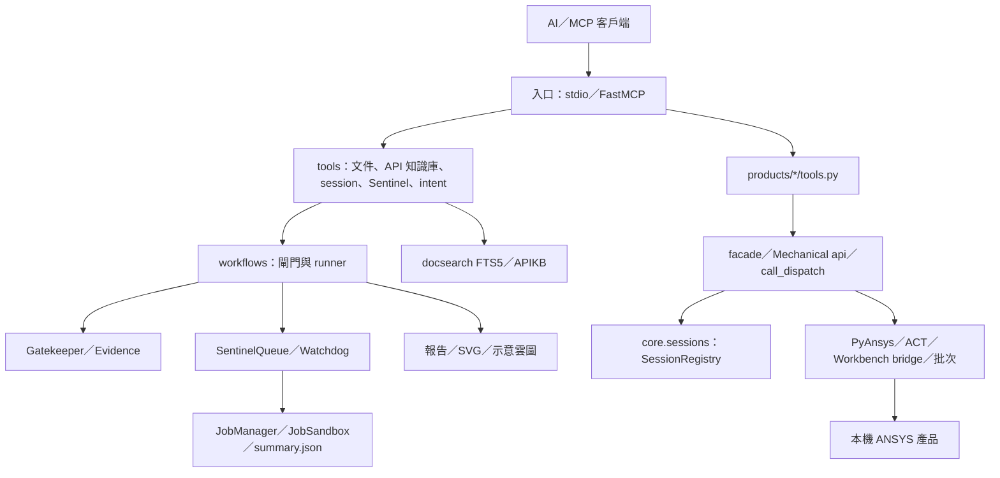
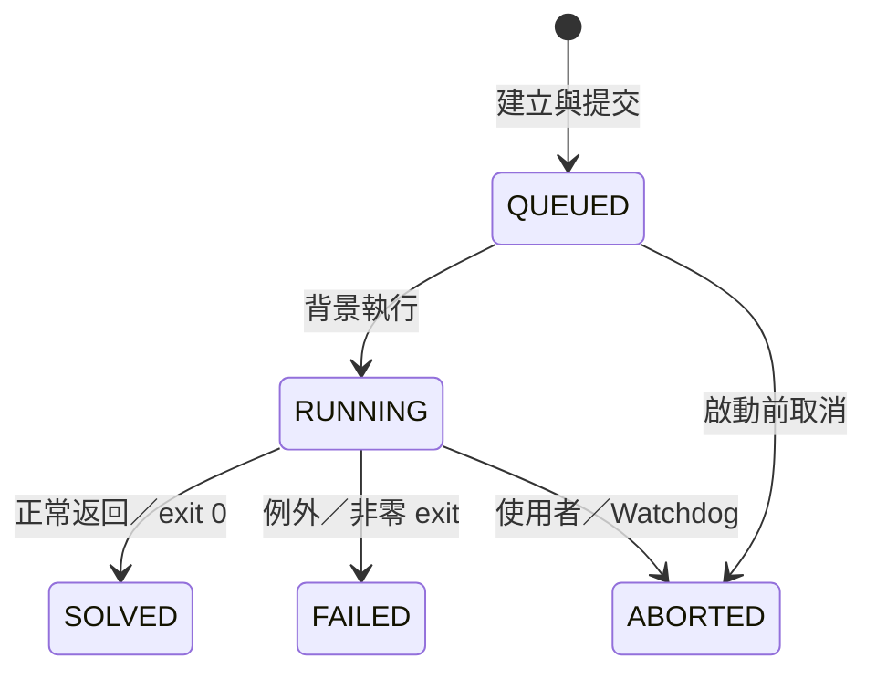

> ## ⚠️ 本文件為歷史快照，不可作為現況依據
>
> 本文件是 2026-10-14 的一次性全專案掃描報告（掃描基準提交 `2b58e4e`）。檔內的檔案數、測試數、工具數、技能數量與磁碟路徑均已過期，僅保留當時的掃描方法論與決策脈絡供追溯。
>
> 需要專案現況時，請改看：
>
> | 需求 | 應參閱 |
> | --- | --- |
> | 專案概觀與快速上手 | [`README.md`](../../README.md) |
> | 系統架構與命名慣例 | [`ARCHITECTURE.md`](../../ARCHITECTURE.md) |
> | 完整文件索引 | [`docs/index.md`](../index.md) |
> | 測試基礎設施與執行指令 | [`docs/testing/TEST_INFRA.md`](../testing/TEST_INFRA.md) |
> | 安裝與部署 SOP | [`docs/deployment/DEPLOYMENT_SOP.md`](../deployment/DEPLOYMENT_SOP.md) |

---

# ANSYS Unified MCP 現況規格

> 掃描日期：2026-10-14（Asia/Taipei）。套件版本：`2.0.0`。掃描基準提交：`2b58e4e`。
> 本文件描述工作目錄中可見的實作，供維護、交接與後續需求比對。規劃文件、技能指引、合成測試及實際求解能力分開記錄；文件中的門檻是目前程式設定，不能直接視為特定產品的工程驗收標準。

## 1. 範圍與證據

掃描涵蓋入口、全部產品工具、控制器、驅動、橋接、核心服務、分析子系統、部署與維護腳本、技能庫、測試以及文件目錄。基準版本有 610 個受版控檔案：`src/` 122、`tests/` 165、`agents/` 217、`docs/` 79、`scripts/` 21，以及 6 個根目錄檔案。`src/` 有 111 個 Python 檔案（含套件初始化與內嵌外掛）。完整 MCP 介面見附錄 A，模組索引見附錄 B。

採用下列證據優先序：實際註冊及程式分支 → 測試與設定 → 現行文件 → 歷史／規劃。程式與文件衝突時，以程式為現況。沒有逐頁讀取 ANSYS 官方手冊語料、環境套件、Git 歷史或執行輸出；不抄錄 `.env`、帳密或本機私人設定值。

狀態詞的定義：

| 狀態 | 意義 |
| --- | --- |
| 已實作 | 有可到達的程式介面與執行邏輯；不代表本次做過真機驗證 |
| 合成／估算 | 以固定數值、公式、人工日誌或示意圖建立資料流 |
| 條件式 | 需要指定套件、ANSYS 安裝、服務、外掛、原始語料或授權 |
| 已知限制 | 從目前程式或本次檢查可確認的落差；本次僅記錄，未修復 |

## 2. 系統定位與產品範圍

本專案是讓 AI 客戶端操作本機 ANSYS 的 MCP server。主要介面為工具呼叫與唯讀資源，執行核心包含原生腳本、PyAnsys API、Workbench journal、Socket／檔案 IPC，以及批次子行程。沒有獨立網站、使用者登入或雲端多租戶服務；HTML 是作業報告產物。

| 領域 | 已存在能力 | 執行條件／邊界 |
| --- | --- | --- |
| Mechanical | gRPC 連線、ACT 腳本、材料、網格、載荷、約束、結果、模型樹、批次分析 | 需 Mechanical 與適配版本 API；腳本多依賴 `ExtAPI`／`DataModel` |
| Workbench | live bridge、分析系統／專案操作、同步與非同步批次、PyWorkbench server | bridge、批次與 PyWorkbench 是不同通道 |
| Geometry／SpaceClaim | 基本 CAD、包覆域、簡化 RAM／散熱片、中面、去特徵、BGA、孔群組、壓印、截圖 | PyAnsys Geometry 與 SpaceClaim 原生腳本雙軌；部分操作依賴 GUI 選取 |
| Fluent | 連線／啟動、case／mesh、模型、邊界、材料、迭代、TUI、UDF | 需 Fluent solver session；不是完整 CFD 網格工作流工具集 |
| optiSLang | 啟動專案、腳本、專案求解、MOP 設定腳本 | 實際專案內容及演算法仍由 optiSLang 執行 |
| DPF | `.rst` 模型摘要與結構結果；內部結果路由 | 需 PyDPF 與可讀結果檔；MCP 入口和內部 reader 契約不同 |
| DYNA／LS-PrePost | keyword deck、`.k` 匯出、solver／cfile 批次、衝擊／落摔卡片骨架 | PyDYNA 是選裝；deck 骨架不是完整有限元素模型 |
| MAPDL／CFX | Workbench 工具中的直接命令列批次入口 | 沒有獨立 `products/mapdl` 或 `products/cfx` session 產品 |
| Icepak | 內部批次 driver、溫度日誌／CSV 與產物 | 無專屬 MCP 工具；真實腳本仍是骨架，合成模式需顯式啟用 |
| 高階工作流 | 落摔、衝擊、隨機振動、熱翹曲、代理模型的閘門、排程與報告 | 五個 runner 目前皆為合成／估算流程，不是自動真實 CAE 求解 |

## 3. 技術環境與相依

`pyproject.toml` 使用 Hatchling 建置、Python `>=3.10`、命令入口 `ansys-unified-mcp = ansys_unified_mcp.__main__:main`。執行設計以 Windows 為主，包含 registry、PowerShell、ACT、Windows 執行檔路徑與程序旗標；不能據此宣稱跨平臺 ANSYS 操作完整支援。

| 相依層 | 套件 |
| --- | --- |
| 核心 | `fastmcp>=3.4.5,<3.5`、`pydantic`、`python-dotenv`、`rich`、`psutil` |
| 核心 PyAnsys | `ansys-mechanical-core`、`ansys-fluent-core`、`ansys-geometry-core`、`ansys-optislang-core`、`ansys-dpf-core>=0.10.0` |
| 選裝 `workbench` | `ansys-workbench-core` |
| 選裝 `dyna` | `ansys-dyna-core>=0.12.1`、`lasso-python` |
| 選裝 `dev` | `pytest`、`ruff` |

多數相依未鎖版本。FastMCP 特別鎖定 3.4 minor 範圍以維持工具可見性契約。`uv.lock` 與本機 `mcp_config.json` 被 `.gitignore` 排除，不能保證所有部署具有同一套鎖定版本。技能腳本所需的 Excel COM、pythonnet、PDF 轉換或其他專用套件，不等於核心安裝皆已提供。

## 4. 架構與責任分層



| 位置 | 現行責任 |
| --- | --- |
| `mcp_server.py` | 保留外部部署相容入口，將 `src` 加入 `sys.path`，用 `runpy` 執行真正入口 |
| `src/ansys_unified_mcp/__main__.py` | 載入 `.env`、記錄 stderr 日誌、依 profile import 工具，啟動 stdio MCP |
| `shared.py` | 唯一 FastMCP instance、扁平信封、canonical／alias 註冊與解析、別名列舉控制、可見性 middleware |
| `products/<product>/tools.py` | 對外參數、註冊與信封；不是所有產品都只經 facade |
| `products/mechanical/api.py` | 組裝 ACT 腳本、查找 Named Selection、解析 stdout／JSON |
| `products/*/facade.py` | 產品生命週期及連線控制；DPF、DYNA 的 facade 主要做檔案／結果工作 |
| `products/{geometry,fluent}/call_dispatch.py` | 工具實際分派；仍持有模組級 session／design 變數 |
| `products/*/driver.py`、`drivers/` | 批次輸入、命令、進度、停止、產物；部分後處理採估算 |
| `bridges/` | 埠／程序探索、Socket、檔案 IPC、Workbench／Mechanical 非同步批次 |
| `connection/` | 統一 session 門面與空閒埠查找 |
| `core/` | 路徑、session、逾時、防護、作業、物理閘門、監看 |
| `analytics/` | 官方文件搜尋、API 知識庫、結果讀取、報告與圖表 |
| `workflows/` | 高階工況組態、閘門、runner 與 Workbench Cell Link 腳本生成 |
| `agents/skills/` | Agent 操作規範、參考知識、工程腳本與模板，不會全部自動註冊成 MCP 工具 |

名義依賴方向是工具 → 產品／工作流 → 驅動／核心。實作仍有例外：Workbench tools 含大量 journal 與直接程序邏輯；Geometry／Fluent tools 直接走 dispatcher；Mechanical tools 也有組合式 ACT 腳本。規格不把這些描述成已完成完全對稱分層。

## 5. MCP 介面、啟動與收斂

### 5.1 工具規模

目前原始碼可辨識 **172 個 canonical 工具、6 個 resource**；不含額外公開的舊別名。共通 22 個中包含 5 個 workflow 工具；`connection_tools.py` 雖被入口 import，沒有工具裝飾器，是診斷 helper／CLI。

| 模組 | canonical 工具數 | resource 數 |
| --- | ---: | ---: |
| Mechanical | 46 | 2 |
| Workbench | 45 | 2 |
| Geometry | 25 | 2 |
| Fluent | 19 | 0 |
| optiSLang | 6 | 0 |
| DYNA | 7 | 0 |
| DPF | 2 | 0 |
| `tools/docs_tools.py` | 4 | 0 |
| `tools/apikb_tools.py` | 4 | 0 |
| `tools/sentinel_tools.py` | 4 | 0 |
| `tools/session_manager_tools.py` | 5 | 0 |
| `tools/intent_tools.py` | 5 | 0 |
| 合計 | 172 | 6 |

### 5.2 啟動期 profile

`ANSYS_MCP_PROFILE` 在 import 時讀取，預設 `all`，會 strip／lower。共通模組無論 profile 都載入。改 profile 要重啟 server；未知值沒有顯式拒絕，會只載入共通層。

| profile 值（同列為同義值） | 載入的產品工具 |
| --- | --- |
| `all`、`full` | 全部七個產品 |
| `mechanical`、`structural` | Mechanical、DPF |
| `geometry`、`spaceclaim` | Geometry |
| `fluent`、`cfd` | Fluent |
| `workbench`、`wb` | Workbench |
| `optislang` | optiSLang |
| `dyna`、`lsdyna` | DYNA |
| `dpf` | DPF |

### 5.3 名稱與別名

Mechanical、optiSLang、高階 workflow、Workbench 部分批次工具使用 `aliased_tool`。canonical 名稱永遠註冊，舊名稱透過 `ALIAS_REGISTRY`／`CANONICAL_TO_ALIASES` 解析。`ANSYS_MCP_EXPOSE_ALIASES=1` 可公開已廢棄別名；`ANSYS_MCP_PRUNE_ALIASES=1` 優先抑制公開。內部查詢與呼叫 wrapper 會解析 alias，不等於 aliases 一律出現在 `tools/list`。

其他工具仍有無 product 前綴的名稱，例如 `open_project`、`run_mapdl_input`、`api_search`。不可僅依名稱前綴猜測工具所屬 profile。

### 5.4 執行期 workspace

`ans_session_set_workspace(products)` 將產品偏好放入 FastMCP request／session state，並兼容連線層 lifespan context；空值或空清單清除限制。接受 `mechanical`、`fluent`、`geometry`、`workbench`、`optislang`、`dpf`、`workflow`，目前不接受 `dyna`。

middleware 只過濾工具列舉，沒有改變全域工具註冊、程序連線或作業資料，也不是存取授權。其映射依賴 `TOOL_REGISTRY`，而該表主要由 `aliased_tool` 填入；直接 `@mcp.tool` 與 Geometry／Fluent 自製裝飾器多未填表，未知工具視為 common 保留。因此現行 workspace 過濾有覆蓋缺口，不能保證所有非選定產品工具都被隱藏。resources 不受此 tools/list 過濾。

### 5.5 回傳契約

一般工具回傳 dict，成功至少 `{"ok": true}`，失敗通常 `{"ok": false, "error": "..."}`。payload 放頂層；具體工具可含 `metrics`、`results`、`output`、`message`、`job_id` 等，沒有一份強制所有工具一致的完整 schema。

`as_envelope` 行為：dict 保留已存在 `ok`，缺 `ok` 時依 `error` 判斷；字串先嘗試 JSON object，否則用錯誤關鍵字推斷並放 `output`；None 為無輸出的成功；其他值放 `result`。純文字的 `error`／`fail`／`traceback` 等啟發式可能誤報；某些未連線或找不到項目的文字未帶標記，也可能不被判成失敗。

APIKB 的 `api_validate_script` 額外回 `valid`，呼叫成功的 `ok` 與腳本檢核的 `valid` 是不同概念。resources 回字串。`geometry_screenshot` 可回 MCP 文字與影像內容，為一般 dict 回傳的特殊路徑。

## 6. 設定、路徑與連線管理

### 6.1 ANSYS 安裝解析

`config.py` 提供 `AnsysConfig`／`get_config()`：根目錄、版本、available 狀態與 Workbench、Mechanical、MAPDL、Fluent、CFX 路徑。來源含 `ANSYS_ROOT`／`ANSYS_VERSION`、Windows registry 與標準安裝位置；解析成功後寫出對應 `AWP_ROOT<版本>`。`core/paths.py` 及部分產品 driver 才另外讀取既有 `AWP_ROOT<版本>` 作後備來源。預設版本為 `251`；找不到安裝時採非致命退化，讓 server 與文件工具可啟動。

`available` 主要反映根目錄存在，不是每個 exe、gRPC 或授權已可用。指定版本無法解析時仍可能走後備偵測，不能視為硬性版本鎖。`core/paths.py` 提供統一的 RunWB2、Mechanical CLI、Fluent、MAPDL、CFX resolver 與環境摘要；產品 driver 仍有各自候選清單，尚非全域唯一版本來源。

| 設定 | 現況用途 |
| --- | --- |
| `ANSYS_ROOT`、`ANSYS_VERSION`、`AWP_ROOT<版本>` | 安裝目錄及版本解析 |
| `ANSYS_RUNWB2`、`ANSYS_MECHANICAL`、`ANSYS_MAPDL`、`ANSYS_FLUENT`、`ANSYS_CFX_SOLVE`、`ANSYS_CFX_PRE` | 部分路徑覆寫入口 |
| `ANSYS_WB_EXE`、`RUNWB2_EXE` | Workbench resolver 的額外覆寫名稱 |
| `ANSYS_MECHANICAL_CLI` | Mechanical CLI 路徑覆寫 |
| `ANSYS_SPACECLAIM_EXE` | SpaceClaim 自動啟動 PowerShell 腳本覆寫 |
| `WORKBENCH_MCP_ROOT`、`WORKBENCH_MCP_QUEUE_ROOT` | ACT／listener 的專案、queue 與 registry 定位 |
| `WORKBENCH_MCP_PORT` | Socket client 預設埠 9885；不要據此假定所有 listener 都相同 |
| `ANSYS_WORKBENCH_QUEUE_DIR` | ACT listener 舊 queue 相容入口 |
| `ANSYS_WORKBENCH_MCP_HOME` | Filequeue bridge 的 commands、results、scripts、status 等根目錄 |
| `JOBS_DIR` | Workbench 批次作業根目錄覆寫；一般 JobManager 有自己的預設 |
| `ANSYS_DOCS_ROOT` | 官方文件原始／清理語料與 docsearch index 外移 |
| `ANSYS_MCP_PROFILE` | 啟動期工具模組篩選 |
| `ANSYS_MCP_EXPOSE_ALIASES`、`ANSYS_MCP_PRUNE_ALIASES` | 舊別名公開控制 |
| `ANSYS_MCP_SCRIPT_GUARD` | `warn`（預設）、`strict`、`off` |
| `ANSYS_MCP_AUDIT_DIR` | 腳本防護稽核日誌目錄 |
| `PYTHONUTF8` | 部署端 UTF-8 執行模式 |

`.env.example` 是配置樣板，不是各部署的實際值。日誌應送 stderr，stdout 留給 MCP JSON-RPC。

### 6.2 session 登錄與生命週期

`SessionRegistry` 以 RLock 保護映射，用 `(workspace, product, key)` 隔離 session；key 多為埠字串或 `default`。支援 put/get、current、set_current、活性探針 `get_live`、drop、keys、snapshot。移除 current 後可提升另一個既有 session；活性探針失敗會移除失效 session。

底層 registry 可接受 workspace，但大多產品 facade 沒傳入 workspace，仍共用 `default`。它和 `ans_session_set_workspace` 的「工具顯示偏好」不是同一套隔離機制，不能宣稱各 MCP 客戶端的 ANSYS 實例天然互相隔離。

統一 `ans_session_*` 目前只支援 Mechanical、Geometry、Fluent、optiSLang。Geometry／Fluent connect 委派 launch；未指定埠可能建立新實例。optiSLang launch 委派 connect。options 直接透傳對應控制器，不是所有產品有相同欄位。Workbench 使用專屬 server 工具，DPF／DYNA 沒有此統一 session 入口。

Geometry／Fluent facade 會用 registry，但各自 dispatcher 仍持有 `_modeler`／`_current_design`／`_fluent_session`，操作未完全收斂為每次查詢 registry。經統一 session 入口連線和經產品工具連線的狀態同步有落差風險。

### 6.3 探索與 ACT 自動啟動

`bridges/connection_manager.py` 查詢 TCP listener、PID、ANSYS 程序、Mechanical／SpaceClaim／Fluent 常見埠與 registry JSON；兼容新 `.runtime/queue/registry` 及舊 `workbench_queue/registry`，清理失效 PID 記錄。埠開放只是候選線索，不保證正確產品、協定或授權。

Mechanical 連線優先顯式 port，再由指定 PID 的 registry／listener 探測，後備掃描常見埠；未給 PID 時可能選第一個可用實例。指定 PID 找不到時仍可能掃到其他實例，因此不能將 PID 參數視為絕對目標綁定。

ACT 部署位於 `scripts/deploy/act_plugins/`：XML 定義 Project 初始化 callback 與 Mechanical toolbar；`main.py` 動態找 Mechanical 埠、啟動 gRPC、寫 PID registry／UI 提示、啟動 listener 與 SpaceClaim port watcher。`wb_event_listener.py` 用 FileSystemWatcher 加輪詢後備執行命令、收集輸出與結果。原始碼中的插件安裝或自動啟動能力不代表本次機器已安裝或已連上所有產品。

## 7. 產品功能細節

### 7.1 Mechanical

主通道為 PyMechanical gRPC，可連既有 instance 或 launch batch instance。facade 帶活性探針、失效 session 清理與有界等待。`run_script` 將腳本寫到唯一暫存檔，遠端以 stdout capture wrapper 執行，再讀輸出檔並清理。此方案預期執行端能看到相同本機檔案路徑，不是任意遠端主機的通用檔案傳輸。

| 功能組 | 現行能力 |
| --- | --- |
| 模型查詢 | body／Named Selection／analysis、材料清單、邊界條件、點質量、樹階層 |
| 材料 | 指定 body 材料；BOM Excel／關鍵字批次指派；分組及未指派追蹤 |
| 網格 | 全域尺寸 mm、生成、節點／元素統計；CFL 批次調整腳本 |
| 約束 | 固定、無摩擦、位移、遠端位移；位移省略軸的處理依 API 包裝 |
| 載荷 | 三向力 N、遠端力、壓力 Pa、力矩 N·m、重力向量（預設 -Y，乘 9.80665） |
| 結果 | 總變形、所有模態變形、方向變形、等效／主應力、Stress Tool、反力、固有頻率 |
| 工程簡化 | 依前綴或 Part 建點質量、抑制本體、刪除 Named Selection |
| 自動化 | 自訂 ACT、報告產出、靜態／模態組合工具、模型健康診斷、RM joint 群組轉接 |

`analysis_index` 通常為 0，指向已存在分析，不自動保證其分析型別。Named Selection 常用精確名稱查找。求解工具有單獨 timeout（預設 3600 秒）；一般 script facade 有預設 timeout，None／非正值可走無有界等待路徑。

靜態組合工具依序指派材料、劃網格、支承、載荷、結果、求解與極值提取；目前 `equilibrium_check` 僅記錄施力大小／方向，沒有實際反力誤差比較。模態組合工具設定階數、求解、逐階提頻率，提取失敗的模態可被略過。這些與五個高階合成 runner 不同：它們會送 ACT 到已連線 Mechanical。

BOM／joint 外掛在 `products/mechanical/plugins/`，CFL 調整引用技能腳本；是依賴 ANSYS 內嵌環境的工程實作，不能用 CPython import 成功代替真機驗證。

### 7.2 Workbench、MAPDL 與 CFX

Workbench 有四組可見操作路徑：

1. 已運行 bridge 的專案與系統操作：讀專案、開啟、存檔、更新、模板探測、建立分析系統、向 SpaceClaim／Mechanical Model cell `SendCommand`。
2. Socket／queue transport：`auto` 先試 Socket，錯誤後回退 filequeue；也能指定 Socket 或 queue。與 live journal／ACT listener 是否搭配需看實際部署。
3. 直接同步批次：RunWB2 journal、MAPDL input、Fluent journal、CFX `.def`、熱棒範例；回傳命令結果與 timeout。
4. 非同步 batch job 與 PyWorkbench server：前者落盤 job metadata、stdout／stderr；後者透過選裝 PyWorkbench launch/connect、run_script、上傳檔案、下載專案 archive、啟動 Mechanical server。

live 包裝提供穩態／暫態熱、靜態／暫態結構、模態、諧響應、反應譜、隨機振動、CFX、Fluent。generic 系統建立工具接受 geometry、template、solver 與 refresh；live generic 預設 `reset_project=True`，可能重置現有專案。`save_project` 預設允許 overwrite。模板可用性需要現場 probe，不保證所有 ANSYS 版本與授權一致。

PyWorkbench connect 預設 `security='mtls'`；launch 有 GUI、版本、埠、安全與工作目錄參數。Workbench disconnect 只丟棄 registry session，保留 server。`.runtime/jobs/workbench/` 的批次 job 模型與 Sentinel 的 `SimulationSummary` 不同，兩類 job_id／狀態查詢入口不能混用。

Filequeue 預設 MCP_HOME 是 bridge 模組目錄，可由 `ANSYS_WORKBENCH_MCP_HOME` 覆寫；ACT listener 的 queue resolver 則走 `WORKBENCH_MCP_QUEUE_ROOT` 等入口，部署時需對齊。舊、新兩份 `ansys_workbench_bridge.wbjn` 同時存在，選取優先新版產品路徑再後備舊路徑。

### 7.3 Geometry／SpaceClaim

`tool_geometry` 把參數送 dispatcher，回傳信封；基本操作使用 PyAnsys Geometry，原生操作載入 `spaceclaim_scripts/*.ironpy` 在 SpaceClaim 執行。產品工具 launch 預設 `insecure`、30 秒；統一 session facade 的預設是 `wnua`、15 秒，兩者並非完全相同。

| 功能 | 實作細節／前提 |
| --- | --- |
| 設計、基本體 | 新建 design、block、cylinder、sphere；尺寸與中心座標以 m 傳入 |
| 草圖拉伸 | 點陣列、XY 等基準面、spline／曲線類型、閉合、距離與正負拉伸方向 |
| Enclosure | 找指定 body，依 cushion 生成包覆體並布林扣除；支援保留／移除 target |
| RAM 單件 | 主板＋RAM＋socket 名稱，以 Y 為高度，建立兩段簡化體與底面 NS |
| RAM 批次 | 對同名多 instance 按 X 中心就近配對，含 mm 容差、component／source 隱藏控制 |
| 散熱片 | 重建底板／凸塊、Y 向鎖孔；多 body／instance、density／材質預設、等效密度命名、保留源、diagnose-only、長操作 timeout |
| 中面 | 對目前選取的 body，依厚度與主面／面積差門檻抽面，可檢查 sheet metal、隱藏源 |
| 去特徵 | 孔、圓弧邊、小面等；半徑、分批邊數、保護群組與目標名稱 |
| BGA | 錫球直徑／高度、上下 pad 尺寸、兩向數量／節距、array_type、貼合面 |
| 接觸壓印 | 接觸距離、曲線壓印及距離門檻，結合 Named Selection |
| 孔／RM 群組 | 目前 GUI 選取 body／edge；孔徑、軸距、角度、孔間距、配對策略與分層距離分組 |
| 抑制與隱藏 | body 名稱 glob patterns、exclude、Suppress for Physics 與 hide |
| 查詢與檔案 | body／NS、CAD import、export、status、close、無頭原生腳本 |
| 截圖 | 視角、fit、指定 bodies、輸出格式，預設回傳縮放影像；本機檔案與 MCP 影像用途分開 |

工程腳本參數多以 `_mm` 或半徑門檻 mm 表示，基本 Geometry API 則是 m；不可統一把所有 Geometry 參數當相同單位。RAM／散熱片技能要求使用者提供／確認 body 名稱；這是操作規範，程式參數本身沒有對話確認機制。

長時間散熱片操作由 `_run_geom_long` 放工作執行緒，使用非阻塞鎖與階段進度。逾時可在下個階段停止，但不能強制打斷 SpaceClaim 單一布林運算；等待背景收尾期間會拒絕其他此類長工作。

`geometry_execute_batch` 接收 `[{"operation": "geometry_create_block", "args": {...}}]`，序列執行於同 session。回 `batch_id`、total、succeeded、failed、results、execution_time_ms；預設 `stop_on_error=False`，單步失敗隔離；空清單成功。沒有回滾交易，前面已完成的幾何變更不會因後面失敗自動撤銷。

### 7.4 Fluent

有 port 時連既有 solver；無 port 時 launch double precision、3D、預設 4 processors。dispatcher 的現有連線使用 insecure／允許遠端 host 與可選 password。產品 facade 和 dispatcher 的 launch 參數及 registry 同步方式存在差異。

操作涵蓋 `.cas`／`.msh`、湍流模型、energy、steady／transient、zone 類型與屬性、cell material、hybrid／standard 初始化、迭代步數、殘差、case-data 存檔與任意 TUI；部分邊界 API 失敗會回退 TUI。UDF 支援 compiled／interpreted、檔案存在檢查、phase 名稱匹配與 momentum profile 掛鉤，以及掛鉤列舉。

`fluent_exit` 會呼叫 solver exit，與單純保留程序的 disconnect 不同。`fluent_get_script`／`fluent_get_mapping_report`／`fluent_reset_mapper` 已註冊，但 mapper 從產品目錄下 `ansys-fluent-tui-guide/scripts` 載入；目前可見專案沒有該路徑，會走「未載入」後備訊息。不能宣稱已能完整匯出可重放 `.jou`。

### 7.5 optiSLang

controller 管理單一 key session，可由 project_path 建構 Optislang，取得版本、跑原生 Python、阻塞執行專案、斷線／shutdown。`optislang_setup_mop` 接受 input_parameters、output_responses、samples（預設 100）、execute_now（預設 false），生成敏感度／MOP 設定腳本，可選立即送入連線專案。

這個直接產品 API 與 `workflow_train_surrogate_model` 的公式估算不同；後者並未真正訓練出可呼叫的代理模型。版本回報是連線控制器的結果，不能以 job metadata 的預設版本替代。

### 7.6 DYNA／LS-PrePost

`DynaController` 延遲 import PyDYNA，缺套件時回錯而不阻止 MCP 啟動。基本 deck 含 `*CONTROL_TERMINATION`；hourglass_control 會附加 `*CONTROL_ENERGY` 的 hgen／slnten 追蹤設定，不等於自動配置完整沙漏算法。keyword 清單是常用白名單，不是所有 PyDYNA 類別。

`dyna_solve` 找 LS-DYNA exe，以 input、ncpu、memory、working_dir 執行，預設 timeout 300 秒；`dyna_run_prepost` 以 `-n -c` 執行 cfile／script_content，預設 timeout 120 秒。兩者有 dry_run 可回命令，不能當求解證據；直接同步執行不會自動接入 Sentinel 的物理監看。

衝擊／落摔設定工具產生 `.k` 文字及可選輸出檔。衝擊目前採 21 點半正弦；非 half_sine 分支是固定幅值，不是完整梯形／鋸齒實作；direction 參數沒有把曲線套至對應載荷卡。落摔以 `sqrt(2gh)` 計算 -Z 初速、固定剛性平面與 timestep／energy／d3plot 設定；impact_surface 沒有完整 elastic-floor 分支。均缺完整材料／節點／元素／part 與載荷連結，需上游模型補齊。

### 7.7 DPF、內部後處理與 Icepak

MCP DPF 工具讀 `.rst` 的節點、元素、位移 norm 最大值、等效應力與 time/frequency sets，結果欄位 `max_deformation`／`max_equivalent_stress` 未自動附統一 mm／MPa 單位契約。預設複製至系統暫存目錄後讀取，最後清理；`dpf_get_model_summary` 是模型摘要入口。

內部 `DPFSandboxReader` 另有終態檢查、`.dpf_cache/isolated_result.rst` 副本、場結果讀取及 stream 釋放；`LSDynaExplicitReader` 解析 glstat／matter.out、d3plot 是否存在、沙漏比、能量及質量縮放。預設 `allow_synthetic=False`；只有顯式 true 才走帶 `is_synthetic` 的合成回退。reader 容許 `SOLVED`、`FAILED`、`ABORTED` 終態以保留失敗診斷，不是僅成功作業可讀。

`PostprocessingRouter` 以 workflow 字串優先將 drop／shock／lsdyna／explicit 路由到 explicit reader，其他走 DPF。這和目前 Mechanical shock runner 的 solve.out 來源不一致，須由呼叫者辨識實際 solver。explicit reader 只檢查 d3plot 存在，沒有在此 reader 完整解析 d3plot 場結果。

Icepak driver 可解析真實日誌 `Max_T=`；無可解析值時仍用 `ambient + power×1.55` 經驗公式，並回 `temperature_source`。沒 Icepak 安裝時，prepare_job 必須 `allow_synthetic=True` 才寫合成腳本／CSV；真實腳本目前僅初始化／日誌骨架。溫度 PASS 門檻為 `<105°C`，屬程式預設，不是所有晶片通用規格。

## 8. 作業、監看、閘門與證據

### 8.1 作業資料夾與狀態

`JobManager` 預設 `.runtime/jobs/`，識別符只允許英數、底線、連字號，拒絕空字串與 traversal。job_id 為 UTC 日期時間＋6 字元 UUID＋workflow_type＋tag。提供建立、取回、列舉與刪除；後者為內部 API，沒有獨立 MCP 刪除工具。

```text
.runtime/jobs/<job_id>/
├── inputs/                 原始資產副本與 job_config.json
├── workspace/              輸入腳本、solver 日誌、中繼資料
└── artifacts/
    ├── summary.json        機器可讀資料
    ├── overview.html       報告（若合成成功）
    ├── report_summary.md   摘要（需正確呼叫報告方法）
    └── images/             圖片
```

`protect_read_only` 複製資產、核對 SHA-256、賦予唯讀屬性；寫 workspace 時檢查 resolved path 不越界。summary 採暫存檔＋`os.replace` 原子覆寫，JobSandbox 有執行緒鎖。這是檔案組織及保護，不是 OS／容器安全沙盒；runner 仍以 server 身分運作，並非所有 runner 都會呼叫原始資產複製功能。`validate_integrity` 主要檢查資料夾結構。



前置閘門失敗在建立 job 前回 `blocked`／prescription，不是 JobStatusEnum 中的 REJECTED 狀態。

### 8.2 Sentinel 與 Watchdog

內部 queue 可接 `runner_fn`、`solver_cmd`，或只監看。每作業建立 daemon thread、註冊 Watchdog、寫 stdout／stderr、更新狀態；沒有固定容量或持久化佇列 broker，active records 在記憶體，server 重啟不會復原活動執行緒。

公開 `submit_simulation_job(workflow_type, config)` 只傳 workflow/config/tag，沒有依 workflow 名稱選 driver，也不傳 solver_cmd／runner，因此實際走監看迴圈。高階 intent 另行傳 runner。`get_simulation_status` 查狀態與監看 snapshot；`tail_simulation_log` 讀指定日誌尾端；`abort_simulation_job` 更新 ABORTED，子行程存在時停止程序樹。Python runner 執行緒不能保證被強制中斷。500ms 內提交是文件意圖，並非硬即時期限保證。

Watchdog 預設每 0.5 秒掃增量日誌，維護 offset、parser、breaker 與 callback。支援 Mechanical solve.out、LS-DYNA glstat／matter.out、Fluent residual／stdout 等，不是所有 solver 及所有版本日誌皆解析。

| 守護規則 | 目前判定 |
| --- | --- |
| LS-DYNA 數值 | NaN／Inf 立即觸發 |
| 質量縮放 | added mass `>5%` |
| 沙漏能 | 以正 total energy 為分母，否則 internal energy；`>5%` 累積超標，預設 debounce=3；`>15%` 可立即觸發 |
| 沙漏恢復 | 未超標時計數遞減，並非一定重設為零的嚴格連續三次 |
| 負滑移能 | 絕對值／total energy `>10%` |
| Mechanical | NaN／Inf、力殘差 `>1e10`、嚴重畸變與未收斂殘差組合 |
| Fluent | NaN／Inf、已判發散、任何方程殘差 `>1e8`；回流資訊收集不等於單獨觸發條件 |

### 8.3 Pre-flight Gatekeeper

預設註冊九條規則（舊註解稱八條）。依 workflow 適用集合執行，可用 rule_id 篩選；只有 FATAL 的 BLOCKED 計入致命阻斷，warning 不直接禁止。可回結構化報告，或 `raise_on_blocked=True` 拋專用例外。處方包含 action_code、診斷、建議與 code_snippet；系統不會因此自動執行所有修復建議。

| rule_id | 功能與數值邊界 |
| --- | --- |
| `GATE-VIB-001` | 有效模態質量至少 0.90；指定 X／Y／Z 時只檢該激振向，未指定時檢三向；缺資料會阻斷 |
| `GATE-VIB-002` | modal cutoff 至少 max excitation 的 1.5 倍 |
| `GATE-DRP-001` | 非零初速向量與地板法向的相向性 |
| `GATE-DRP-002` | estimated dt `<1e-7 s` 且沒有負 DT2MS 質量縮放時阻斷；缺 dt 可能放行 |
| `GATE-DRP-003` | 地板／接觸存在性檢查；只依 context，不直接查完整求解模型 |
| `GATE-THM-001` | scalar CTE 缺漏、零或 `<1e-7` 1/°C 時阻斷；材料字典檢查值 `<=0`；`1e-3` 上限只記於 threshold，尚未實際判斷過高值 |
| `GATE-THM-002` | 明確零應力參考溫度，範圍 -50 至 400°C |
| `GATE-UNI-001` | 長度、應力與可用密度／彈性值的單位一致性、數量級檢查 |
| `GATE-EVI-001` | 已提供 manifest 的檔案存在性與 SHA-256 驗證；不驗證 timestamp 新鮮度或 semantic_ids 真實性 |

`EvidenceManifest` 欄位為 `file_path`、`sha256_hash`、`semantic_ids`、`timestamp`；create helper 計算雜湊並記錄資料，verify helper 只比較檔案存在性與當前 SHA-256。不等於外部驗證者簽章、來源新鮮度驗證或完整工程追溯。未提供 manifest 的工況會略過此規則。落摔 runner 傳給 CFL rule 的 m／Pa／kg_m3 鍵與 rule 估算用的 mm／MPa／tonne_mm3 鍵不同，可能不做聲速／步長估算。

## 9. 五個高階工作流的實際行為

共通路徑：工具參數 → workflow 函式 → Gatekeeper／參數檢查 → 建 config → queue 提交 Python runner → 寫日誌、指標與示意圖 → 嘗試報告。沒有在 runner 中調用 `run_solver` 或真實 solver launch。

| 工作流 canonical 名稱 | 輸入重點與預設 | runner 實際產出 |
| --- | --- | --- |
| `workflow_run_drop_test` | CAD、1000 mm、-Z、5 ms、DT2MS=-1e-7、材料／網格 | 初速 sqrt(2gh)；50 段人工 glstat、run.k 與 driver 產物；能量使用固定 0.25 kg 假設 |
| `workflow_run_shock_analysis` | CAD、half_sine、50G、11 ms、Z、阻尼0.02 | 人工 solve.out；DAF 1.58／1.72；stress=2.8×effective_g、disp=0.015×effective_g；SF門檻1.2 |
| `workflow_run_random_vibration` | PSD `(Hz,G²/Hz)`、Z、50 modes、阻尼0.02、sigma[1,2,3] | 模態→振動 journal；1σ stress固定52.4 MPa、3σ為其三倍、第一頻率142.8 Hz；SF門檻1.2 |
| `workflow_run_thermal_warpage` | CAD／stackup、T_ref22°C、T_op125°C、3-2-1、CTE1.6e-5 | 熱→結構 journal；warpage=CTE×abs(ΔT)×120×1000 µm；stress=E×CTE×abs(ΔT)×1e-6×0.35；200µm／SF1.2裁決 |
| `workflow_train_surrogate_model` | 設計參數、響應、50 samples、LHS、CoP0.8 | 參數集→optiSLang journal、人工取樣log；CoP=min(0.96,0.72+0.003×n)；proxy_solver.json 是metadata |

random vibration 未提供質量比與 cutoff 時採預設比值與 `1.65×fmax`，不是從真模態結果抽取。surrogate 檢查每個 min<max、樣本數至少10；不是完整參數型別／solver 執行契約。

`WorkbenchCellLinkEngine` 提供 thermal→structural、modal→vibration、Parameter Set→optiSLang 的 journal 字串，可設定共享 geometry／Engineering Data／mesh model；另有 journal 存檔與執行 helper。上述 runner 只寫 journal，不呼叫 execute_journal，因此不能認定 Cell Link 已在 Workbench 實際連接或 TransferData 已完成。

## 10. 資料模型與報告

### 10.1 summary.json

| 根欄位 | 型別／用途 |
| --- | --- |
| `job_id`、`workflow_type` | 必要字串 |
| `tag` | 預設 `default` |
| `status` | QUEUED／RUNNING／SOLVED／FAILED／ABORTED |
| `verdict` | PASS／FAIL／INCONCLUSIVE，初始 INCONCLUSIVE |
| `failure_reasons` | 字串清單 |
| `metrics` | PhysicalMetrics |
| `execution` | 必要 ExecutionMetadata |
| `artifacts` | 名稱→字串路徑；目前可混用相對與絕對路徑 |

PhysicalMetrics 含應力／降伏 MPa、安全係數、總變形 mm、Z 翹曲 µm、第一模態 Hz、XYZ effective mass ratio、加速度 G、沙漏能百分比、增加質量百分比、滑移能 J、CoP 與收斂殘差。全部指標可缺值；有降伏與正應力而缺安全係數時自動計算。描述中的 0..1 並沒有全面 schema 範圍約束；模型 `extra='allow'` 容許額外欄位。

ExecutionMetadata 記錄 UTC created／started／finished、duration、solver_name／solver_version、PID、exit_code、breaker 觸發及原因。solver_version 預設字串 `2026 R1`，不是現場偵測證據。

### 10.2 呈現與圖表

`ReportGenerator` 用本地 overview.html 模板替換欄位，生成 PASS／FAIL／INCONCLUSIVE 徽章、指標卡、圖片 gallery、診斷與原生 SVG。charts 支援收斂曲線、PSD response、drop acceleration、能量平衡及 MOP surface；不依賴 CDN 圖表庫。

`generate_dialog_summary` 可產生對話摘要及 `report_summary.md`。`generate_white_contour_png` 建立白底示意雲圖，非從真實網格與節點場渲染；一般產物圖片不可據此判定真求解或熱點位置。

目前五 runner 呼叫不存在的 `build_markdown_summary`，其例外被捕捉，因此 Markdown 摘要並不保證生成。HTML 在 queue 最終寫狀態、verdict／duration 前建立，耗時可能仍為 0、完成時間回退 created_at，且 verdict 可能與最後 JSON 不一致。queue 正常返回又會把 verdict 改為 PASS，可能蓋掉 runner 算出的工程 FAIL；使用者不能只看最終 PASS 作驗收。

## 11. 文件搜尋與 API 知識庫

### 11.1 docsearch

流水線為 `Documentation_md/` → boilerplate 清理 → `Documentation_clean/` → SQLite FTS5 trigram。預設 chunk 1400 字元、overlap 180；meta 含 name、title、product、category、chunks、chars。清理處理頁碼、頁眉頁腳、目錄點線、電話、修訂表與相關雜訊。

設定白名單目前 27 份官方文件，涵蓋 Mechanical、LS-DYNA、LS-PrePost、optiSLang、SpaceClaim，不保證每份來源存在；缺檔記錄 source_missing。白名單中的主要 API／scripting 文件數與整個文件搜尋庫數量不同。LS-DYNA keyword/theory cover stub 被排除。

`search_ansys_docs` 預設 scope api，先查主要類別，無命中再擴到 all；指定 doc 優先。回 query、scope、count 與 doc／chunk_id／heading／snippet／score；get_chunk 可帶前後 context。search 是字詞／子字串檢索，不是語義 embedding 搜尋。index 不存在或過期可由 ensure_index 觸發 rebuild，搜尋並非絕對唯讀。

額外語料掃描目前看根目錄 `skills`／`SKILLs` 與 steering/reference 的後備路徑，沒有直接掃已搬到 `agents/skills` 的現況；因此不能說所有技能已自動進 RAG。`ANSYS_DOCS_ROOT` 只改官方文件根目錄，repository 仍是本地技能路徑來源。

### 11.2 APIKB

來源為 `docs/api_inventory/mechanical_api.json`、`docs/api_inventory/spaceclaim_api.json`、`docs/api_inventory/optislang_api.json`、`docs/api_inventory/lsdyna_api.json`。建置使用 SQLite `symbols`、`members`、`symbol_members`、`edges` 與 trigram `search_fts`；成員 signature hash 去重、CamelCase 拆詞、回傳型別連邊，高頻繼承成員降低權重（threshold50）。

四個工具為搜尋、符號成員／edge 詳細、型別導航路徑（預設深度4）、腳本 API 名稱檢查。validator 以 AST 抽屬性、必要時 regex 後備，排除 builtin／private，再對產品成員與符號名稱池比對及提供相似名稱建議；不推導 receiver 型別、不驗證完整參數／單位／執行正確性。

APIKB 資料庫固定在 repository 的 `Documentation_clean/api_kb.sqlite`，未跟隨 `ANSYS_DOCS_ROOT`。來源 JSON 是提取快照，不代表所有 ANSYS 安裝版本一致。API 萃取腳本、黃金查詢評估見第12節；本次不重建或覆寫既有語料。

## 12. 技能、示例與維護工具

### 12.1 技能庫

基準提交受版控的頂層 `SKILL.md` **23 個**，shock 另有 **8 個子模組**。掃描期間工作目錄又出現未追蹤的 `pr-review-zh`，因此收尾時本機頂層為 24 個；此本機新增技能不能直接當作基準套件已交付內容。技能通常含 frontmatter、用途、reference 路由、scripts 與 assets；assets/README 多為用途說明，不能當作已存在產物模板。

| 技能 | 可見涵蓋能力 |
| --- | --- |
| `act-extension-development` | ACT XML、IronPython、Watcher、Wizard 自動化 |
| `ansys-bga-modeling` | 錫球、pad、陣列、貼合 |
| `ansys-error-catalog` | Mechanical／SpaceClaim／Workbench／IronPython 診斷 |
| `ansys-fluent` | 水密網格、CFD／CHT、solver／邊界及品質判斷指引 |
| `ansys-geometry-modeling` | PyGeometry 草圖、成形、enclosure、CAD診斷、PMDB |
| `ansys-ls-prepost` | SCL／cfile、DataCenter、d3plot與圖像匯出 |
| `ansys-lsdyna` | keyword、材料、接觸、顯式 timestep、能量診斷 |
| `ansys-material-assignment` | BOM、正則／名稱規則、材料分組、未指派追蹤 |
| `ansys-mechanical` | ACT結構／模態／熱應力、非線性與結果 |
| `ansys-mesh` | 自動網格、分類、washer／局部控制、干涉、CFL與批次調優 |
| `ansys-optislang` | DoE、MOP／CoP、TSI、Pareto與演算法選型 |
| `ansys-parametric-study` | Workbench Parameter Set、DX／optiSLang選型 |
| `ansys-spaceclaim` | PyGeometry與原生SpaceClaim雙軌 |
| `ansys-spaceclaim-defeature` | 特徵掃描、保護群組、批量移除 |
| `ansys-spaceclaim-modeling` | 幾何前處理、中面、孔分組、壓印與PMDB |
| `ansys-submodeling-dpf` | DPF插值、局部子模型、MAPDL pool、切面驗證腳本 |
| `pcb-warpage-analysis` | 疊構幾何、ROM材料、3-2-1支承、熱翹曲腳本 |
| `pdf-to-md` | PDF轉Markdown語料工具；不是MCP工具 |
| `pymechanical-operations` | gRPC、ACT scoping、網格操作 |
| `shock-analysis-workflow` | 八階段衝擊／落摔操作編排 |
| `simplify-heatsink` | 原始body確認、簡化、孔／底面保留與等效密度 |
| `simplify-ram` | 主板／RAM／socket名稱確認、單件與批次簡化 |

另見未追蹤的 `agents/skills/pr-review-zh/SKILL.md`：提供繁體中文 PR 描述、review 留言改寫與 PR 前 diff 審查指引；不是本次新增，也不是已註冊 MCP 功能。

shock 子模組依序為材料、接觸、網格、RM連接、截面、約束載荷、求解監看、後處理報告。`phase_gate` frontmatter 是技能資料，不代表 MCP server 有通用 YAML 執行引擎自動強制每階段。

主要實質模板為 Mechanical 報告節、shock failure_report、PCB APDL ROM材料巨集、ACT wbex manifest。`tests/ansys-*` 及 shock/PCB 工作流目錄另保留技能／reference／scripts 副本；這些工程示範不等於所有都是 pytest 自動化測試。

### 12.2 工程示例

`docs/examples/` 包含 35G shock ACT 管線、幾何清理、mesh 分區／可見性／卡住排障、PCB疊構／ROM／熱翹曲及 LS-DYNA mesh sample。它們會對模型或檔案產生操作，有固定工況與本機路徑假設；本次只掃描角色，未執行。README 的根目錄 `examples/` 連結部分尚未更新為 `docs/examples/`。

### 12.3 scripts

| 路徑 | 角色與副作用 |
| --- | --- |
| `scripts/maintenance/setup.ps1` | 建venv、pip安裝、偵測ANSYS、部署／替換APPDATA ACT、寫mcp_config、寫ProgramData SpaceClaim manifest；不是純檢查 |
| `scripts/maintenance/preflight_env_check.py` | 套件、安裝、埠、目錄預檢與日誌 |
| `scripts/maintenance/audit_architecture_compliance.py` | 技能行數、連結、繁中與Python編譯稽核 |
| `scripts/maintenance/sync_skills.ps1` | 技能同步入口 |
| `scripts/maintenance/sync_skills_bidirectional.py` | 受控技能SHA-256、雙向複製／刪除、驗證；可修改全域技能庫 |
| `scripts/maintenance/setup_skill_junctions.py` | 建立／驗證技能junction或symlink，會替換目標 |
| `scripts/launch_spaceclaim_auto.ps1`、`.bat` | 路徑解析、空閒埠與SpaceClaim啟動 |
| `scripts/run_ram_simplify_batch.py` | 一次性連到SpaceClaim並批次修改RAM幾何 |
| `scripts/extract_mechanical_api.py` | Mechanical API AST提取 |
| `scripts/extract_spaceclaim_api.py` | pythonnet／SpaceClaim反射提取 |
| `scripts/extract_optislang_api.py` | inspect／pkgutil提取 |
| `scripts/extract_lsdyna_api.py` | DYNA／LS-PrePost API提取 |
| `scripts/extract_all_apis.py` | 四個提取腳本編排 |
| `scripts/eval_apikb_golden.py` | 固定查詢集APIKB排名評估 |
| `scripts/verify_fastmcp_tools.py` | canonical／alias工具註冊與解析驗證；既有預期數量需與新增工具保持同步 |
| `scripts/verify_directory_topology.py` | 必要目錄、禁止舊目錄與runtime gitignore檢查 |

## 13. 安全、可靠性與運行限制

`script_guard` 掃描高風險import及呼叫，預設 warn 記錄且放行、strict 才阻擋、off略過。它是regex denylist，不是完整Python沙盒，且沒有全面包住所有TUI、原生腳本或批次通道。稽核日誌可能包含腳本內容，應視為本機工程資料。

`run_with_timeout` 用有限worker pool（8）等待call；逾時回錯時worker仍可能在跑，不保證取消solver或釋放授權。程式的pending計數與實際逾時後仍占用worker不完全等價。Geometry長操作另有階段取消及鎖。

路徑保護集中於JobManager／JobSandbox等入口；任意腳本、CAD檔案匯出、Workbench reset/save、Named Selection刪除、body簡化與source移除等仍可修改使用者資料。程式沒有跨工具的交易撤銷機制、使用者身份或全域授權控制。MCP annotations與workspace收斂是提示／列舉控制，不是安全邊界。

需實際核對的部署條件包含ANSYS產品版本、授權、API service、ACT是否載入、埠與queue根目錄、資料來源單位及未完成solver輸出。檔案副本與terminal-state機制可降低爭用，但不能對所有live solver保證零檔案鎖衝突。

## 14. 測試與客觀驗證

pytest 設定路徑為 `tests`，pythonpath為src與根目錄，預設 `-m 'not integration'`。integration需顯式選擇；目前 `tests/integration/test_batch_geometry.py` 為服務依賴層。根目錄conftest會把一般JobManager／Sentinel放入tmp_path並重置單例。

| 測試組 | 可見驗證範圍 |
| --- | --- |
| `tests/unit` | session／連線、canonical與alias、profile／workspace、resource、信封、產品收斂、Geometry簡化／headless、BOM／ACT、DYNA、DPF、APIKB、jobs、gatekeeper、Sentinel、報告 |
| `tests/e2e` | 隨機振動閘門、落摔沙漏、熱翹曲Cell Link與報告、目錄重構、合成壓力場景 |
| `tests/adversarial` | traversal、證據／物理閘門、parser、Watchdog、alias、並行重連、profile、Icepak經驗公式與高負載 |
| `tests/test_*` | Mechanical／Workbench／optiSLang控制器、SessionRegistry與既有修復回歸 |
| `tests/ansys-*`／工作流scripts | 工程腳本與參考資料；不是都由pytest收集或離線可執行 |

Ruff 目標py310、E／F／W，排除官方語料、runtime與IronPython plugins；忽略長行、import順序相關選項、既有未用import／變數與star import等規則。因此「ruff零錯誤」只代表啟用規則通過，不能說所有靜態警告已清零。測試文件中的秒數上限與覆蓋標準是目標，需實際測量，不能當本次結果。

本次客觀檢查：

| 檢查 | 結果／證據界線 |
| --- | --- |
| 靜態工具盤點與獨立審查 | 172／172 canonical 名稱及全部簽名與 AST 相符，無缺漏／重複；6 resources、111 source Python 模組均列入附錄 |
| 信封契約測試 | `.venv/Scripts/python.exe -m pytest tests/unit/test_envelope_contract.py -q -x --tb=short --basetemp=.runtime/spec_pytest_tmp`：25 passed，15.04 秒；日誌 `.runtime/spec_pytest_probe.log` |
| 廣泛離線回歸 | 未完成；初輪輸出大量 E 後中止，指定 repository basetemp 的第二輪未取得完成結果。未宣稱全套通過，亦未據此判定業務功能全部失敗 |
| 全量入口動態列舉 | 載入 all-profile 等待未完成後中止；172 數量由原始碼與獨立 AST 對照證實，不是成功啟動的量測 |
| 真機與部署 | 未啟動 ANSYS、未求解、未安裝或執行具副作用的部署／工程腳本 |

本文件的數量與來源覆蓋可重複檢查；離線契約通過仍不等於真機求解、版本相容或物理誤差≤5%已驗證。掃描期間出現的其他未追蹤本機檔案未由本次修改。

## 15. 目前已確認的落差與缺口

| 項目 | 可見現況與影響 | 證據位置 |
| --- | --- | --- |
| 高階工況 | 五個runner皆合成／估算，不能當真求解 | `workflows/*.py` |
| 工程verdict | 正常runner／exit0會被queue改成PASS，蓋掉原FAIL | `core/sentinel/queue.py` `_run_job_async` |
| Markdown摘要 | runner調用不存在方法，例外被捕捉 | `workflows/*.py`、`analytics/reporting/generator.py` |
| HTML時序 | final狀態／耗時寫入前生成，可能與JSON不同 | 同上 |
| 通用提交 | 沒有依名稱啟solver，實際僅監看 | `tools/sentinel_tools.py` |
| workspace映射 | 直接decorator未全進TOOL_REGISTRY，未知工具保留；dyna不在可選集 | `shared.py`、`core/visibility.py`、`tools/session_manager_tools.py` |
| workspace連線隔離 | facade大多用default registry，顯示偏好不隔離模型 | `core/sessions.py`、產品facade |
| Geometry／Fluent雙路徑 | facade與dispatcher狀態／預設不全一致 | 對應`facade.py`／`call_dispatch.py` |
| 跨產品統一session | 不支援Workbench／DPF／DYNA | `connection/session_manager.py` |
| RAG技能路徑 | 掃skills／SKILLs，現行技能在agents/skills | `analytics/docsearch/index.py` |
| Fluent mapper | 載入路徑在可見repo不存在 | `products/fluent/call_dispatch.py` |
| DYNA骨架 | 無完整模型、部分shape／direction／floor參數沒有對應完整分支 | `products/dyna/facade.py` |
| 批次後處理 | 多個driver extract_artifacts使用固定／經驗值；SpaceClaim缺PMDB時寫文字占位 | `products/*/driver.py`、`drivers/lsdyna_driver.py` |
| 靜態平衡檢查 | 回傳施力資訊，未算反力平衡誤差 | `products/mechanical/tools.py` |
| CFL輸入鍵 | intent與rule估算鍵不同，可能略過dt估算 | `workflows/drop_test.py`、`core/gatekeeper/rules/drop_impact_rules.py` |
| 後處理shock路由 | shock走explicit reader，intent shock卻是Mechanical log | `analytics/postprocessing/router.py` |
| 版本與數量文件 | README待支援DYNA／MAPDL、舊155工具、舊examples／deploy路徑不符完整現況；技能數量需區分受版控與本機新增 | README、技能索引、部署指引 |
| 安裝與授權 | 根目錄存在／metadata版本不代表solver可用 | `config.py`、`core/jobs/models.py` |

本文件記錄現況，不承諾上述缺口已修復，也不將 `docs/planning/`、`docs/archive/` 或 historical_specs中的目標能力列為已交付。

## 附錄 A：完整 MCP 介面清單

以下取自工具裝飾器及函式簽名；列出canonical名稱、參數型別／預設、既有別名與用途。型別文字為Python原生表示，沒有將它改寫為新的API。用途需結合正文限制解讀，尤其是高階workflow、示意報告及DYNA卡片骨架。

### A.1 `src/ansys_unified_mcp/products/dpf/tools.py`

| canonical 呼叫簽名 | 舊別名 | 用途 |
| --- | --- | --- |
| `dpf_extract_structural_results(rst_path: str, copy_to_sandbox: bool=True)` | — | 從 Mechanical .rst 抽取節點／元素數、最大變形、等效應力與時間／頻率資訊。 |
| `dpf_get_model_summary(rst_path: str)` | — | 回傳 .rst 結果檔的模型摘要：節點/單元數與可用結果資訊。 |

### A.2 `src/ansys_unified_mcp/products/dyna/tools.py`

| canonical 呼叫簽名 | 舊別名 | 用途 |
| --- | --- | --- |
| `dyna_create_keyword_deck(endtim: float, hourglass_control: bool=False)` | — | 離線生成含 *CONTROL_TERMINATION 的基礎 deck；可加能量追蹤卡。 |
| `dyna_export_keyword_file(output_path: str, endtim: float, hourglass_control: bool=False)` | — | 離線生成基礎 keyword deck 並寫出為 .k 檔。 |
| `dyna_list_keyword_types()` | — | 回傳常用 LS-DYNA keyword 類別名稱清單（白名單篩選，非 PyDYNA 全集）。 |
| `dyna_solve(k_file_path: str, ncpu: int=4, memory: str='100m', working_dir: str='', dry_run: bool=False, timeout: float=300.0, precision: str='dp')` | — | 調度本機 LS-DYNA 求解器 (lsdyna_dp.exe / lsdyna_sp.exe) 執行計算；precision 放在參數列表最後以維持既有依位置傳參呼叫方相容。 |
| `dyna_run_prepost(cfile_path: str='', script_content: str='', working_dir: str='', dry_run: bool=False, timeout: float=120.0)` | — | 調度本機 LS-PrePost (lsprepost.exe) 以無頭批次模式執行 SCL/cfile 命令腳本。 |
| `lsdyna_setup_shock_analysis(pulse_type: str='half_sine', peak_g: float=50.0, duration_ms: float=11.0, direction: str='Z', output_k_path: str='')` | — | 建立衝擊曲線與 keyword 骨架；載荷方向及完整模型仍需補齊。 |
| `lsdyna_setup_drop_test(drop_height_mm: float=1000.0, impact_surface: str='rigid_floor', gravity_g: float=9.80665, output_k_path: str='')` | — | 建立 -Z 初速與剛性平面 keyword 骨架，非完整落摔模型。 |

### A.3 `src/ansys_unified_mcp/products/fluent/tools.py`

| canonical 呼叫簽名 | 舊別名 | 用途 |
| --- | --- | --- |
| `fluent_launch(processors: int=4, cwd: str=None, port: int=None, ip: str='127.0.0.1', password: str=None, connect_timeout: int=30)` | — | 啟動 Fluent solver 或連線現有例項 |
| `fluent_read_case(file_path: str)` | — | 載入 .cas 算例檔案 |
| `fluent_read_mesh(file_path: str)` | — | 載入 .msh 網格檔案 |
| `fluent_set_solver(viscous_model: str=None, energy: bool=None, transient: bool=None)` | — | 設定求解器（湍流模型/能量/瞬態） |
| `fluent_set_boundary(zone: str, bc_type: str, params: dict=None)` | — | 設定邊界條件 |
| `fluent_set_material(zone: str, material: str)` | — | 設定區域材料 |
| `fluent_initialize(method: str='hybrid')` | — | 初始化流場（hybrid/standard） |
| `fluent_iterate(iterations: int)` | — | 迭代計算 |
| `fluent_get_residuals()` | — | 獲取殘差值 |
| `fluent_save(prefix: str)` | — | 儲存 case/data |
| `fluent_tui(command: str)` | — | 執行 Fluent TUI 命令 |
| `fluent_status()` | — | Fluent 連線狀態 |
| `fluent_load_udf(source_file: str, compile: bool=False)` | — | 載入 UDF（自動處理 Windows 磁碟機代號路徑問題，解釋並驗證成功） |
| `fluent_hook_udf(zone_name: str, profile_name: str, phase_name: str='water', momentum_field: str='mass_flux')` | — | 將已載入的 UDF profile 掛鉤到邊界條件 |
| `fluent_list_udfs(zone_name: str=None)` | — | 列出已載入的 UDF 和邊界條件掛鉤狀態 |
| `fluent_exit()` | — | 關閉 Fluent |
| `fluent_get_script()` | — | 獲取當前 MCP 操作序列對應的 .jou 指令碼（Skill 聯動：自動累積 MCP→TUI 對映） |
| `fluent_get_mapping_report()` | — | 獲取 MCP 到 TUI 的完整對映報告 |
| `fluent_reset_mapper()` | — | 重置 TUI 對映器（清除歷史記錄） |

### A.4 `src/ansys_unified_mcp/products/geometry/tools.py`

| canonical 呼叫簽名 | 舊別名 | 用途 |
| --- | --- | --- |
| `geometry_launch(port: int=None, host: str='127.0.0.1', transport_mode: str='insecure', connect_timeout: int=30)` | — | 啟動 Geometry 建模器或連線現有 SpaceClaim 實例 |
| `geometry_create_design(name: str)` | — | 建立新的幾何設計（⚠️ 注意：若 SpaceClaim 中已有開啟的設計，請勿調用此工具，直接調用 create_block 等即可在當前設計中建模） |
| `geometry_create_block(name: str, length: float=0.01, width: float=0.01, height: float=0.01, center_x: float=0, center_y: float=0, center_z: float=0)` | — | 建立立方體（⚠️ 注意：所有尺寸單位皆為【公尺 m】！若使用者輸入 mm，請務必先除以 1000 轉換為公尺，例如 50mm 必須傳入 0.05，30mm 傳入 0.03，20mm 傳入 0.02） |
| `geometry_create_cylinder(name: str, radius: float=0.005, height: float=0.01, center_x: float=0, center_y: float=0, center_z: float=0)` | — | 建立圓柱體（⚠️ 注意：所有尺寸單位皆為【公尺 m】！例：半徑 5mm 傳入 0.005，高度 20mm 傳入 0.02） |
| `geometry_create_sphere(name: str, radius: float=0.005, center_x: float=0, center_y: float=0, center_z: float=0)` | — | 建立球體（⚠️ 注意：尺寸單位皆為【公尺 m】！例：半徑 10mm 請輸入 0.01） |
| `geometry_sketch_and_extrude(name: str, points: list[list[float]], plane: str='XY', curve_type: str='spline', distance: float=0.01, is_closed: bool=True, extrude_direction: str='+')` | — | 於指定基準面繪製 2D 點陣列草圖並拉伸成 3D 實體（⚠️ 注意：所有座標與尺寸單位皆為【公尺 m】！若輸入為 mm 請除以 1000） |
| `geometry_create_enclosure(target_body_name: str, enclosure_name: str='FluidDomain', shape: str='box', cushion_x_neg: float=0.05, cushion_x_pos: float=0.1, cushion_y_neg: float=0.05, cushion_y_pos: float=0.05, cushion_z_neg: float=0.05, cushion_z_pos: float=0.05, keep_target_body: bool=False)` | — | 為指定標的實體幾何自動生成外部流體包覆域 (Enclosure) 並執行布林相減扣除標的本體 |
| `geometry_simplify_ram(motherboard: str, ram: str, socket: str, result_name: str='RAM_simplified', named_selection: str='ram_bottom', move_to_component: bool=True, component_name: str='RAM_simplified', hide_source: bool=True)` | — | 將單一 RAM 卡 + 其 socket 簡化為一座落於主機板頂面的「凸字形」兩段體，並於底面（板接合面）建立 named selection【呼叫前必須先向使用者索取主機板、RAM、socket 三個 body 名稱，不可猜測或自行從 body 清單推斷】 |
| `geometry_simplify_ram_batch(motherboard: str, ram: str, socket: str, result_prefix: str='RAM_simplified', ns_prefix: str='ram_bottom', tol_mm: float=2.0, move_to_component: bool=True, component_name: str='RAM_simplified', hide_source: bool=True)` | — | 批次簡化所有同名 RAM+socket 配對（依 X 中心位置自動就近配對）【呼叫前必須先向使用者索取主機板、RAM、socket 三個 body 名稱，不可猜測或自行從 body 清單推斷】 |
| `geometry_simplify_heatsink(source: str, result_name: str=None, density: float=None, material: str='aluminum', keep_source: bool=True, named_selection: str='hs_bottom', name_density_suffix: bool=True, hole_min_dia_mm: float=2.5, extra_sources: List[str]=None, body_densities: Dict[str, Any]=None, all_instances: bool=False, contact_body: str=None, fin_box: str='largest', hole_select: str='screw', timeout_s: float=600, diagnose_only: bool=False)` | — | 將散熱片 (heatsink) 簡化為凸字形方塊組（底板＋上凸＋下凸＋鎖孔直圓柱），並反推等效密度 |
| `geometry_midsurface(max_thickness_mm: float=6.0, main_surface_ratio: float=0.7, area_difference_ratio: float=0.1, complex_area_diff: float=0.05, enable_sheet_metal_check: bool=True, hide_source_bodies: bool=True)` | — | 對目前「已選取」的 body 批次建立中曲面 (midsurface)【呼叫前請先在 SpaceClaim 視窗選取欲抽中面的鈑金/薄殼 body】 |
| `geometry_defeature_features(defeature_face_exe: bool=True, defeature_edge_exe: bool=True, max_edges_at_once: int=3000, r_max_cylinder: float=3.5, r_min_circle: float=0.0, r_max_circle: float=3.5, fs_grp_sizefilter: float=1.5, grp_dont_defeature: str='Scr_UserInput_DONT_DEFEATURE_GRP', target_body_name: str='')` | — | 自動消除 SpaceClaim 幾何模型中非關鍵微小特徵（圓柱孔、小圓弧邊、倒角、小面） |
| `geometry_create_bga_array(bga_diameter_mm: float=0.65, bga_height_mm: float=0.51, low_pad_d_mm: float=0.5, low_pad_h_mm: float=0.02, high_pad_d_mm: float=0.5, high_pad_h_mm: float=0.02, n_dir1: int=10, n_dir2: int=10, pitch_dir1_mm: float=1.0, pitch_dir2_mm: float=1.0, array_type: int=0, mating_face: str='bottom')` | — | 自動建立 SpaceClaim BGA 錫球與焊盤幾何陣列 |
| `geometry_imprint_contacts(distance_range_mm: float=0.51, imprint_curves: bool=True, imprint_distance_range_mm: float=0.01)` | — | 自動執行 SpaceClaim 接觸面壓印 (Imprint) 與共拓撲 Named Selection 偵測 |
| `geometry_create_hole_groups(diameter_min_mm: float=2.0, diameter_max_mm: float=20.0, mode: int=0, pairing_strategy: str='Ignore Component', distance_min_mm: float=0.0, distance_max_mm: float=10.0, holes_axis_dist_max_mm: float=1.0, deg_max_circles: float=10.0, grp_name_create: str='Scr_AllHoles', index_grp_start: int=1, rm_grp_create: bool=True, rm_grp_name_create: str='Scr_RMgrp', index_rm_start: int=1, grp_name_not_go: str='NOTGoConnections', enable_distance_grouping: bool=False, distance_level1_mm: float=5.0, distance_level2_mm: float=20.0)` | — | 偵測圓孔並建立 named selection 群組，再對同軸、距離在門檻內的孔兩兩配對建立 RM 連接群組【呼叫前請先在 SpaceClaim 視窗選取目標 body/edge】 |
| `geometry_screenshot(file_path: str, image_format: str=None, fit: bool=True, view: str='current', bodies: List[str]=None, return_image: bool=True)` | — | 將 SpaceClaim 3D 視窗出圖為影像檔，並（預設）把影像一併回傳供目視確認幾何或簡化結果 |
| `geometry_export(file_path: str, format: str='step')` | — | 匯出幾何為 STEP/IGES 格式 |
| `geometry_suppress_and_hide(patterns: List[str], exclude: List[str]=None, suppress: bool=True, hide: bool=True)` | — | 依 body 名稱（支援 glob 萬用字元）批次設定『Suppress for Physics』並隱藏 |
| `geometry_list_bodies()` | — | 列出當前設計中的所有幾何體 |
| `geometry_list_named_selections()` | — | 列出當前設計中的所有具名選擇 (Named Selection) |
| `geometry_import_file(file_path: str)` | — | 匯入 CAD 檔案 |
| `geometry_status()` | — | Geometry 建模器連線狀態 |
| `geometry_close()` | — | 關閉 Geometry 建模器 |
| `geometry_execute_batch(operations: List[Dict[str, Any]], stop_on_error: bool=False)` | — | 對同一已連線的 Geometry (SpaceClaim/Discovery) session 依序批次執行多個幾何操作。 |
| `spaceclaim_run_script(script_content: str='', script_path: str='', working_dir: str='', dry_run: bool=False, timeout: float=120.0)` | — | 以無頭批次模式 (Headless) 啟動 SpaceClaim.exe 執行自動化 IronPython 腳本。 |

### A.5 `src/ansys_unified_mcp/products/mechanical/tools.py`

| canonical 呼叫簽名 | 舊別名 | 用途 |
| --- | --- | --- |
| `mechanical_list_instances()` | `list_instances` | 列出運行與已註冊的 ANSYS 實例、PID 及埠。 |
| `mechanical_connect(port: int=None, pid: int=None)` | `connect_to_mechanical` | 透過 gRPC 連線 Mechanical。 |
| `mechanical_launch(batch: bool=True)` | `launch_mechanical` | 透過 PyMechanical 啟動新實例，預設無頭 batch。 |
| `mechanical_disconnect()` | `disconnect_from_mechanical` | 中斷目前 Mechanical session。 |
| `mechanical_check_connection()` | `check_mechanical_connection` | 查詢已綁定的 Mechanical session。 |
| `mechanical_get_model_info()` | `get_model_info` | 讀取本體、具名選擇與分析清單。 |
| `mechanical_list_materials()` | `list_materials` | 讀取 Engineering Data 材料清單。 |
| `mechanical_assign_material(body_name: str, material_name: str)` | `assign_material` | 將指定材料指派至本體。 |
| `mechanical_set_mesh_element_size(element_size_mm: float)` | `set_mesh_element_size` | 設定全域網格尺寸，單位 mm。 |
| `mechanical_generate_mesh()` | `generate_mesh` | 在 Mechanical 生成網格。 |
| `mechanical_get_mesh_statistics()` | `get_mesh_statistics` | 讀取節點與元素數量。 |
| `mechanical_add_fixed_support(named_selection: str, analysis_index: int=0)` | `add_fixed_support` | 在具名選擇建立固定支承。 |
| `mechanical_add_force(named_selection: str, fx_n: float=0.0, fy_n: float=0.0, fz_n: float=0.0, analysis_index: int=0)` | `add_force` | 建立三向力，單位 N。 |
| `mechanical_add_pressure(named_selection: str, magnitude_pa: float, analysis_index: int=0)` | `add_pressure` | 建立壓力，單位 Pa。 |
| `mechanical_list_boundary_conditions(analysis_index: int=0)` | `list_boundary_conditions` | 列出指定分析的邊界條件。 |
| `mechanical_solve_analysis(analysis_index: int=0, timeout_seconds: float=3600.0)` | `solve_analysis` | 求解指定分析，含有界等待。 |
| `mechanical_get_solve_status(analysis_index: int=0)` | `get_solve_status` | 查詢指定分析求解狀態。 |
| `mechanical_add_total_deformation_all_modes(num_modes: int=6, analysis_index: int=0)` | `add_total_deformation_all_modes` | 逐模態新增總變形結果。 |
| `mechanical_add_total_deformation(mode: int=0, analysis_index: int=0)` | `add_total_deformation` | 新增總變形結果，可指定模態。 |
| `mechanical_get_modal_frequencies(analysis_index: int=0)` | `get_modal_frequencies` | 提取模態固有頻率。 |
| `mechanical_generate_report(output_path: str, analysis_index: int=0, fmt: str='docx')` | `generate_report` | 輸出 Mechanical 報告，格式 docx 或 txt。 |
| `mechanical_run_script(script: str, timeout_seconds: Optional[float]=None)` | `run_mechanical_script` | 在目前 Mechanical 執行 ACT Python 腳本。 |
| `mechanical_list_named_selections()` | `list_named_selections` | 列出具名選擇及範圍資訊。 |
| `mechanical_delete_named_selection(name: str)` | `delete_named_selection` | 依名稱刪除具名選擇。 |
| `mechanical_suppress_bodies(name_prefix: str='', suppress: bool=True)` | `suppress_bodies` | 依前綴抑制／解除抑制本體；空前綴涵蓋全部。 |
| `mechanical_list_point_masses()` | `list_point_masses` | 讀取點質量、重心、pinball 與作用範圍。 |
| `mechanical_add_frictionless_support(named_selection: str, analysis_index: int=0)` | `add_frictionless_support` | 建立無摩擦支承。 |
| `mechanical_add_displacement(named_selection: str, x_mm: float \| None=None, y_mm: float \| None=None, z_mm: float \| None=None, analysis_index: int=0)` | `add_displacement` | 建立位移條件；None 表示保留自由度。 |
| `mechanical_add_remote_displacement(named_selection: str, x_mm: float \| None=None, y_mm: float \| None=None, z_mm: float \| None=None, rot_x_deg: float \| None=None, rot_y_deg: float \| None=None, rot_z_deg: float \| None=None, analysis_index: int=0)` | `add_remote_displacement` | 建立遠端位移／轉角；None 表示保留自由度。 |
| `mechanical_add_standard_gravity(analysis_index: int=0, x_component: float=0.0, y_component: float=-1.0, z_component: float=0.0)` | `add_standard_gravity` | 建立標準重力，方向預設 -Y。 |
| `mechanical_add_remote_force(named_selection: str, fx_n: float=0.0, fy_n: float=0.0, fz_n: float=0.0, analysis_index: int=0)` | `add_remote_force` | 建立遠端三向力，單位 N。 |
| `mechanical_add_moment(named_selection: str, mx_nm: float=0.0, my_nm: float=0.0, mz_nm: float=0.0, analysis_index: int=0)` | `add_moment` | 建立三向力矩，單位 N·m。 |
| `mechanical_add_equivalent_stress(named_selection: str='', analysis_index: int=0)` | `add_equivalent_stress` | 建立 von Mises 應力結果，可指定具名選擇。 |
| `mechanical_add_directional_deformation(axis: str='Y', named_selection: str='', analysis_index: int=0)` | `add_directional_deformation` | 建立指定方向變形結果。 |
| `mechanical_add_principal_stress(which: str='max', analysis_index: int=0)` | `add_principal_stress` | 建立最大／中間／最小主應力結果。 |
| `mechanical_add_stress_tool(analysis_index: int=0)` | `add_stress_tool` | 建立材料強度相關 Stress Tool。 |
| `mechanical_add_reaction_force(named_selection: str, analysis_index: int=0)` | `add_reaction_force` | 在具名選擇建立反力探針。 |
| `mechanical_convert_prefix_to_point_mass(body_name_prefix: str, proximity_multiplier: float=3.0)` | `convert_prefix_to_point_mass` | 將符合前綴的未抑制本體轉為點質量。 |
| `mechanical_convert_part_to_point_mass(part_name: str, proximity_multiplier: float=3.0)` | `convert_part_to_point_mass` | 將指定 Part 的未抑制本體合併為點質量。 |
| `mechanical_setup_and_solve_static_structural(body_name: str, material_name: str, fixed_support_ns: str, load_ns: str, force_magnitude_n: float, force_direction: List[float]=[0.0, -1.0, 0.0], mesh_element_size_mm: float=5.0, analysis_index: int=0)` | `setup_and_solve_static_structural` | 一鍵式靜態結構分析 (組合式工作流)。 |
| `mechanical_setup_and_solve_modal(fixed_support_ns: str, num_modes: int=6, mesh_element_size_mm: float=5.0, analysis_index: int=0)` | `setup_and_solve_modal` | 一鍵式模態分析 (組合式工作流)。 |
| `mechanical_diagnose_model_health()` | `diagnose_model_health` | 診斷目前 Mechanical 模型的工程健康度與潛在奇異點。 |
| `mechanical_get_tree_hierarchy(max_depth: int=5)` | `get_model_tree_hierarchy` | 遞迴遍歷 Mechanical DataModel 樹狀階層結構，提取各節點名稱、類別、抑制狀態與健全度。 |
| `mechanical_assign_materials_from_bom(bom_items: Optional[List[Dict[str, Any]]]=None, csv_path: str='')` | `assign_materials_from_bom` | 依據 BOM 表格或 CSV 檔案，批次將材料與等效密度指派給 Mechanical 中的各幾何體 (Bodies)。 |
| `mechanical_create_joints_from_groups(connection_type: str='Fixed', group_prefix: str='Joint_')` | `create_joints_from_groups` | 根據 Named Selection 命名選擇群組前綴，批次在 Mechanical 中建立 Joint 接頭連接元件。 |
| `mechanical_tune_cfl_mesh(target_timestep: float=1e-07, max_iterations: int=3)` | `tune_cfl_mesh` | 診斷並調優 Mechanical / LS-DYNA 顯式動力學網格之臨界 CFL 時間步長。 |

### A.6 `src/ansys_unified_mcp/products/optislang/tools.py`

| canonical 呼叫簽名 | 舊別名 | 用途 |
| --- | --- | --- |
| `optislang_connect(project_path: str='', ini_timeout: float=60.0)` | `connect_optislang` | 啟動並連線 optiSLang。 |
| `optislang_get_version()` | `optislang_version` | 回報目前連線 optiSLang 的已驗證版本字串（P1 冒煙用）。 |
| `optislang_run_script(script: str)` | `run_optislang_script` | 在連線的 optiSLang server 執行一段 optiSLang 原生 Python 腳本。 |
| `optislang_start_project()` | `start_optislang_project` | 執行（求解）目前 optiSLang 專案，阻塞至完成。 |
| `optislang_disconnect(shutdown: bool=True)` | `disconnect_optislang` | 關閉 optiSLang 連線並釋放資源。 |
| `optislang_setup_mop(input_parameters: list[dict], output_responses: list[str], samples: int=100, execute_now: bool=False)` | `setup_optislang_mop` | 建立或產生 optiSLang MOP (Metamodel of Optimal Prognosis) 最佳預測元模型設定腳本。 |

### A.7 `src/ansys_unified_mcp/products/workbench/tools.py`

| canonical 呼叫簽名 | 舊別名 | 用途 |
| --- | --- | --- |
| `check_ansys_installation()` | — | 檢查配置的執行檔與 bridge 路徑。 |
| `start_workbench_bridge(batch: bool=True, wait_seconds: int=20)` | — | 啟動帶 File-IPC journal 的 Workbench。 |
| `stop_workbench_bridge(timeout_seconds: int=10)` | — | 發送 bridge 停止旗標。 |
| `check_workbench_connection()` | — | 查詢 bridge 狀態與回應。 |
| `execute_workbench_script(script: str, timeout_seconds: int=60)` | — | 在已運行 bridge 執行 Workbench journal 腳本。 |
| `execute_spaceclaim_script_live(script: str, system_name: str='', timeout_seconds: int=120)` | — | 透過已啟動的 Workbench 橋接器，向活躍的 SpaceClaim 視窗發送並執行 SpaceClaim Python 腳本。 |
| `execute_mechanical_script_live(script: str, system_name: str='', timeout_seconds: int=120)` | — | 透過已啟動的 Workbench 橋接器，向活躍的 Mechanical 視窗發送並執行 ACT Python 腳本。 |
| `get_project_info(timeout_seconds: int=30)` | — | 讀取 bridge 中的專案、系統與 component 資訊。 |
| `open_project(project_file: str, timeout_seconds: int=120)` | — | 透過 bridge 開啟專案。 |
| `save_project(project_file: str='', overwrite: bool=True, timeout_seconds: int=120)` | — | 透過 bridge 存檔，預設可覆寫。 |
| `update_project(timeout_seconds: int=600)` | — | 透過 bridge 執行 Workbench Update。 |
| `probe_workbench_analysis_templates_live(timeout_seconds: int=60)` | — | 探測可用的 Workbench 分析模板。 |
| `create_workbench_analysis_system_live(analysis_type: str, project_dir: str, project_name: str='', geometry_file: str='', refresh_model: bool=False, reset_project: bool=True, template_name: str='', solver: str='', timeout_seconds: int=180)` | — | 在 bridge 中建立指定分析；預設重置專案。 |
| `create_steady_state_thermal_system_live(project_dir: str, project_name: str='steady_state_thermal', geometry_file: str='', refresh_model: bool=False, timeout_seconds: int=180)` | — | 在 Workbench bridge 建立穩態熱分析系統。 |
| `create_transient_thermal_system_live(project_dir: str, project_name: str='transient_thermal', geometry_file: str='', refresh_model: bool=False, timeout_seconds: int=180)` | — | 在 Workbench bridge 建立暫態熱分析系統。 |
| `create_static_structural_system_live(project_dir: str, project_name: str='static_structural', geometry_file: str='', refresh_model: bool=False, timeout_seconds: int=180)` | — | 在 Workbench bridge 建立靜態結構分析系統。 |
| `create_transient_structural_system_live(project_dir: str, project_name: str='transient_structural', geometry_file: str='', refresh_model: bool=False, timeout_seconds: int=180)` | — | 在 Workbench bridge 建立暫態結構分析系統。 |
| `create_modal_analysis_system_live(project_dir: str, project_name: str='modal_analysis', geometry_file: str='', refresh_model: bool=False, timeout_seconds: int=180)` | — | 在 Workbench bridge 建立模態分析系統。 |
| `create_harmonic_response_system_live(project_dir: str, project_name: str='harmonic_response', geometry_file: str='', refresh_model: bool=False, timeout_seconds: int=180)` | — | 在 Workbench bridge 建立諧響應分析系統。 |
| `create_response_spectrum_system_live(project_dir: str, project_name: str='response_spectrum', geometry_file: str='', refresh_model: bool=False, timeout_seconds: int=180)` | — | 在 Workbench bridge 建立反應譜分析系統。 |
| `create_random_vibration_system_live(project_dir: str, project_name: str='random_vibration', geometry_file: str='', refresh_model: bool=False, timeout_seconds: int=180)` | — | 在 Workbench bridge 建立隨機振動分析系統。 |
| `create_cfx_flow_system_live(project_dir: str, project_name: str='cfx_flow', geometry_file: str='', refresh_model: bool=False, timeout_seconds: int=180)` | — | 在 Workbench bridge 建立CFX 流場分析系統。 |
| `create_fluent_flow_system_live(project_dir: str, project_name: str='fluent_flow', geometry_file: str='', refresh_model: bool=False, timeout_seconds: int=180)` | — | 在 Workbench bridge 建立Fluent 流場分析系統。 |
| `create_thermal_bar_demo_live(project_dir: str='D:\\ansys-workbench-mcp\\runs\\thermal_bar_demo_live', timeout_seconds: int=600)` | — | 透過 bridge 建立並求解熱棒範例。 |
| `run_workbench_journal(journal_path: str, workdir: str='', batch: bool=True, timeout_seconds: int=600)` | — | 直接同步執行 RunWB2 journal 批次。 |
| `create_workbench_analysis_system(analysis_type: str, project_dir: str, project_name: str='', geometry_file: str='', refresh_model: bool=False, template_name: str='', solver: str='', timeout_seconds: int=600)` | — | 用直接批次 journal 建立分析系統。 |
| `create_steady_state_thermal_system(project_dir: str, project_name: str='steady_state_thermal', geometry_file: str='', refresh_model: bool=False, timeout_seconds: int=600)` | — | 用批次 journal 建立穩態熱分析系統。 |
| `run_mapdl_input(input_file: str, workdir: str='', job_name: str='ansys_mcp_job', timeout_seconds: int=600)` | — | 直接執行 MAPDL input 檔。 |
| `run_fluent_journal(journal_path: str, workdir: str='', dimension: str='3d', precision: str='double', processors: int=1, gui: bool=False, extra_args: str='', timeout_seconds: int=3600)` | — | 直接執行 Fluent journal 批次。 |
| `run_cfx_solver(definition_file: str, workdir: str='', run_name: str='', processors: int=1, double_precision: bool=False, extra_args: str='', timeout_seconds: int=3600)` | — | 直接執行 CFX definition 求解。 |
| `create_and_run_thermal_bar_demo(project_dir: str='D:\\ansys-workbench-mcp\\runs\\thermal_bar_demo', timeout_seconds: int=600)` | — | 用 Workbench 批次建立並求解熱棒範例。 |
| `workbench_detect_environment()` | `workbench_detect_tool` | 偵測 RunWB2、Mechanical CLI 與作業路徑。 |
| `workbench_run_journal(journal_path: str, cwd: str \| None=None, batch: bool=True, extra_args: list[str] \| None=None)` | `workbench_run_journal_tool` | 非同步啟動 Workbench journal，回傳批次 job。 |
| `mechanical_run_batch_script(script_path: str, revision: int=261, graphical: bool=False, project_file: str \| None=None, script_args: str \| None=None)` | `mechanical_run_script_tool` | 非同步啟動 Mechanical CLI 腳本。 |
| `workbench_get_job_status(job_id: str)` | `workbench_job_status_tool` | 查詢此批次入口建立的 job 狀態。 |
| `workbench_get_job_log(job_id: str, stream: str='stdout', tail_chars: int=12000)` | `workbench_job_log_tool` | 讀取批次 job stdout／stderr 尾端。 |
| `workbench_list_jobs(limit: int=20)` | `workbench_list_jobs_tool` | 列出最近批次 job。 |
| `workbench_launch_server(show_gui: bool=True, version: Optional[str]=None, port: int=-1, use_insecure_connection: bool=False, host: Optional[str]=None, server_workdir: Optional[str]=None, client_workdir: Optional[str]=None)` | — | 啟動 Workbench server 並連線 PyWorkbench。 |
| `workbench_connect_server(port: int, host: Optional[str]=None, client_workdir: Optional[str]=None, security: str='mtls')` | — | 以 PyWorkbench 連線既有 server。 |
| `workbench_run_script_live(script: str, key: Optional[str]=None, log_level: str='error')` | — | 在 PyWorkbench server 執行 journal 腳本。 |
| `workbench_start_mechanical_server(system_name: str, port: int=0, key: Optional[str]=None)` | — | 由 Workbench 系統的 Model cell 啟動 Mechanical gRPC。 |
| `workbench_upload_file(file_paths: list[str], key: Optional[str]=None)` | — | 上傳本機檔案到 Workbench server 工作目錄。 |
| `workbench_download_archive(archive_name: str, key: Optional[str]=None)` | — | 下載目前專案 archive。 |
| `workbench_disconnect_server(key: Optional[str]=None)` | — | 移除 PyWorkbench session，保留 server。 |
| `workbench_server_status()` | — | 列出 PyWorkbench session 與 current key。 |

### A.8 `src/ansys_unified_mcp/tools/apikb_tools.py`

| canonical 呼叫簽名 | 舊別名 | 用途 |
| --- | --- | --- |
| `api_search(query: str, product: str='', kind: str='', top_k: int=8)` | — | 依產品與種類搜尋 API 符號。 |
| `api_get(fqname: str, include: str='members,edges', limit: int=50)` | — | 讀取符號成員與型別連邊。 |
| `api_path(from_type: str, to_type: str, product: str='', max_depth: int=4)` | — | 尋找 API 型別間的物件導航路徑。 |
| `api_validate_script(code: str, product: str)` | — | 檢查腳本引用的屬性名稱是否存在於產品 API 字典；非完整語法／型別驗證。 |

### A.9 `src/ansys_unified_mcp/tools/docs_tools.py`

| canonical 呼叫簽名 | 舊別名 | 用途 |
| --- | --- | --- |
| `list_ansys_docs()` | — | 列出已索引文件與分塊資訊。 |
| `search_ansys_docs(query: str, doc: str='', top_k: int=5, scope: str='api')` | — | 搜尋文件片段，預設 API 範圍，無結果時擴大。 |
| `get_ansys_doc_chunk(doc: str, chunk_id: int, context: int=0)` | — | 讀取指定分塊及可選前後文。 |
| `rebuild_ansys_docs_index()` | — | 重新清理來源與建立 FTS5 索引，會寫入及替換索引。 |

### A.10 `src/ansys_unified_mcp/tools/intent_tools.py`

| canonical 呼叫簽名 | 舊別名 | 用途 |
| --- | --- | --- |
| `workflow_run_drop_test(cad_path: str, drop_height_mm: float=1000.0, impact_velocity_mps: Optional[float]=None, gravity_direction: List[float]=[0.0, 0.0, -1.0], drop_orientation_angles_deg: List[float]=[0.0, 0.0, 0.0], floor_type: str='rigid_wall', target_duration_ms: float=5.0, mass_scaling_dt2ms: float=-1e-07, hourglass_type: int=4, material_yield_strength_mpa: float=310.0, youngs_modulus_pa: float=70000000000.0, density_kg_m3: float=2700.0, mesh_min_size_mm: float=1.0, tag: str='drop_test')` | `run_drop_test` | 落摔閘門與合成 runner，並非真實 LS-DYNA 求解。 |
| `workflow_run_shock_analysis(cad_path: str, pulse_shape: str='half_sine', peak_acceleration_g: float=50.0, pulse_duration_ms: float=11.0, direction: str='Z', analysis_method: str='transient_dynamics', damping_ratio: float=0.02, material_yield_strength_mpa: float=250.0, youngs_modulus_pa: float=200000000000.0, density_kg_m3: float=7850.0, tag: str='shock')` | `run_shock_analysis` | 衝擊閘門與估算 runner，並非真實 Mechanical 求解。 |
| `workflow_run_random_vibration(cad_path: str, psd_table: List[Tuple[float, float]], direction: str='Z', num_modes: int=50, damping_ratio: float=0.02, sigma_levels: List[int]=[1, 2, 3], material_yield_strength_mpa: float=250.0, effective_mass_ratio: Optional[Dict[str, float]]=None, cutoff_frequency_hz: Optional[float]=None, youngs_modulus_pa: float=200000000000.0, density_kg_m3: float=7850.0, tag: str='random_vibration')` | `run_random_vibration` | 振動閘門、journal 與合成響應。 |
| `workflow_run_thermal_warpage(cad_or_stackup_file: str, temperature_ref_c: float=22.0, temperature_operating_c: float=125.0, support_type: str='3-2-1', enable_rom_composite: bool=True, secant_cte: float=1.6e-05, material_yield_strength_mpa: float=250.0, youngs_modulus_pa: float=24000000000.0, tag: str='thermal_warpage')` | `run_thermal_warpage` | 熱翹曲閘門、journal 與公式估算。 |
| `workflow_train_surrogate_model(workflow_config: Optional[Dict[str, Any]]=None, design_parameters: Optional[List[Dict[str, Any]]]=None, target_responses: Optional[List[str]]=None, num_samples: int=50, sampling_method: str='LHS', cop_target: float=0.8, tag: str='surrogate_mop')` | `train_surrogate_model` | 設計參數檢查與合成 MOP 資料流，非真實模型訓練。 |

### A.11 `src/ansys_unified_mcp/tools/sentinel_tools.py`

| canonical 呼叫簽名 | 舊別名 | 用途 |
| --- | --- | --- |
| `submit_simulation_job(workflow_type: str, config: dict)` | — | 建立背景監看作業；公開入口不會依 workflow 名稱選 solver。 |
| `get_simulation_status(job_id: str)` | — | 獲取作業即時狀態、進度百分比、時間步、殘差與物理守護健康度。 |
| `tail_simulation_log(job_id: str, lines: int=100, log_type: str='solve_out')` | — | 串流獲取作業求解即時日誌 (solve.out, glstat, matter.out, fluent.log, stdout.log)。 |
| `abort_simulation_job(job_id: str, reason: str='user_requested')` | — | 優雅中斷求解器進程，釋放授權，並將作業狀態置為 ABORTED。 |

### A.12 `src/ansys_unified_mcp/tools/session_manager_tools.py`

| canonical 呼叫簽名 | 舊別名 | 用途 |
| --- | --- | --- |
| `ans_session_connect(product: str, options: dict[str, Any] \| None=None)` | — | 連線至既有的 ANSYS 實例（跨產品統一入口）。 |
| `ans_session_launch(product: str, options: dict[str, Any] \| None=None)` | — | 啟動新的 ANSYS 實例（跨產品統一入口）。 |
| `ans_session_status(product: str, options: dict[str, Any] \| None=None)` | — | 查詢指定產品目前的連線狀態（跨產品統一入口）。 |
| `ans_session_disconnect(product: str, options: dict[str, Any] \| None=None)` | — | 中斷指定產品的連線（跨產品統一入口）。 |
| `ans_session_set_workspace(products: list[str] \| None=None)` | — | 設定當前 session 的可見工具子集 (per-session 工具可見性，方案 D)。 |

### A.13 唯讀資源

| URI | 實作檔案 | 用途 |
| --- | --- | --- |
| `ansys://geometry/model-tree` | `src/ansys_unified_mcp/products/geometry/tools.py` | Geometry 設計樹與實體清單。 |
| `ansys://geometry/named-selections` | `src/ansys_unified_mcp/products/geometry/tools.py` | Geometry 具名選擇清單。 |
| `ansys://mechanical/model-tree` | `src/ansys_unified_mcp/products/mechanical/tools.py` | Mechanical 本體、具名選擇與分析清單。 |
| `ansys://mechanical/materials` | `src/ansys_unified_mcp/products/mechanical/tools.py` | Mechanical 材料清單。 |
| `ansys-workbench://status` | `src/ansys_unified_mcp/products/workbench/tools.py` | Workbench bridge 狀態。 |
| `ansys-workbench://installation` | `src/ansys_unified_mcp/products/workbench/tools.py` | 配置的 ANSYS 執行檔路徑。 |


## 附錄 B：原始碼與輔助檔案索引

以下為本次掃描的模組入口與資源定位，方便以程式回查規格；省略環境套件、快取、私人設定及官方文件巨量內容。

### B.1 Python 原始碼

| 模組 | 類別／公開函式入口 |
| --- | --- |
| `src/ansys_unified_mcp/__init__.py` | 套件匯出／延遲載入 |
| `src/ansys_unified_mcp/__main__.py` | `main` |
| `src/ansys_unified_mcp/analytics/__init__.py` | 套件匯出／延遲載入 |
| `src/ansys_unified_mcp/analytics/apikb/build.py` | `split_camel_case`、`clean_type_name`、`build_database` |
| `src/ansys_unified_mcp/analytics/apikb/config.py` | 模組設定／相容入口 |
| `src/ansys_unified_mcp/analytics/apikb/query.py` | `search`、`get`、`path` |
| `src/ansys_unified_mcp/analytics/apikb/validate.py` | `extract_accessed_attributes`、`validate_script` |
| `src/ansys_unified_mcp/analytics/docsearch/__init__.py` | 套件匯出／延遲載入 |
| `src/ansys_unified_mcp/analytics/docsearch/clean.py` | `clean_markdown` |
| `src/ansys_unified_mcp/analytics/docsearch/config.py` | `doc_by_name`、`docs_in_categories`、`primary_doc_names` |
| `src/ansys_unified_mcp/analytics/docsearch/index.py` | `build_index`、`ensure_index`、`search`、`get_chunk`、`list_docs` |
| `src/ansys_unified_mcp/analytics/postprocessing/__init__.py` | 套件匯出／延遲載入 |
| `src/ansys_unified_mcp/analytics/postprocessing/base.py` | `JobNotReadyError`、`PostprocessingError`、`BaseResultReader` |
| `src/ansys_unified_mcp/analytics/postprocessing/dpf_reader.py` | `DPFSandboxReader` |
| `src/ansys_unified_mcp/analytics/postprocessing/explicit_reader.py` | `LSDynaExplicitReader` |
| `src/ansys_unified_mcp/analytics/postprocessing/router.py` | `PostprocessingRouter` |
| `src/ansys_unified_mcp/analytics/reporting/__init__.py` | 套件匯出／延遲載入 |
| `src/ansys_unified_mcp/analytics/reporting/charts.py` | `render_convergence_curve_svg`、`render_psd_response_svg`、`render_drop_acceleration_svg`、`render_energy_balance_svg`、`render_mop_surface_svg` |
| `src/ansys_unified_mcp/analytics/reporting/generator.py` | `ReportGenerator` |
| `src/ansys_unified_mcp/bridges/connection_manager.py` | `ConnectionManager` |
| `src/ansys_unified_mcp/bridges/transport.py` | `send_command` |
| `src/ansys_unified_mcp/bridges/workbench_batch.py` | `detect_workbench_environment`、`launch_workbench_journal`、`launch_mechanical_script`、`get_workbench_job_status`、`read_workbench_job_log`、`list_workbench_jobs` |
| `src/ansys_unified_mcp/bridges/workbench_filequeue.py` | 模組設定／相容入口 |
| `src/ansys_unified_mcp/bridges/workbench_socket.py` | `send_request` |
| `src/ansys_unified_mcp/config.py` | `AnsysConfig`、`get_config` |
| `src/ansys_unified_mcp/connection/__init__.py` | 套件匯出／延遲載入 |
| `src/ansys_unified_mcp/connection/port_finder.py` | `is_port_open`、`find_free_port` |
| `src/ansys_unified_mcp/connection/session_manager.py` | `AnsSessionManager` |
| `src/ansys_unified_mcp/core/__init__.py` | 套件匯出／延遲載入 |
| `src/ansys_unified_mcp/core/gatekeeper/__init__.py` | 套件匯出／延遲載入 |
| `src/ansys_unified_mcp/core/gatekeeper/evidence.py` | `EvidenceManifest`、`create_manifest`、`verify_manifest` |
| `src/ansys_unified_mcp/core/gatekeeper/gatekeeper.py` | `Gatekeeper` |
| `src/ansys_unified_mcp/core/gatekeeper/prescription.py` | `RuleStatusEnum`、`SeverityEnum`、`ActionCodeEnum`、`PrescriptionDetail`、`CheckResult`、`PreFlightPrescriptionReport`、`PreFlightGatekeeperError` |
| `src/ansys_unified_mcp/core/gatekeeper/rules/__init__.py` | `BaseGateRule` |
| `src/ansys_unified_mcp/core/gatekeeper/rules/drop_impact_rules.py` | `DropVelocityVectorRule`、`CriticalTimeStepRule`、`ContactIntegrityRule` |
| `src/ansys_unified_mcp/core/gatekeeper/rules/evidence_rules.py` | `EvidenceIntegrityRule` |
| `src/ansys_unified_mcp/core/gatekeeper/rules/thermal_rules.py` | `NonZeroSecantCTERule`、`ZeroStressReferenceTemperatureRule` |
| `src/ansys_unified_mcp/core/gatekeeper/rules/unit_consistency.py` | `UnitConsistencyRule` |
| `src/ansys_unified_mcp/core/gatekeeper/rules/vibration_rules.py` | `ModalEffectiveMassRatioRule`、`ModalCutoffFrequencyRule` |
| `src/ansys_unified_mcp/core/jobs/__init__.py` | 套件匯出／延遲載入 |
| `src/ansys_unified_mcp/core/jobs/manager.py` | `JobManager` |
| `src/ansys_unified_mcp/core/jobs/models.py` | `JobStatusEnum`、`VerdictEnum`、`PhysicalMetrics`、`ExecutionMetadata`、`SimulationSummary` |
| `src/ansys_unified_mcp/core/jobs/sandbox.py` | `JobSandbox` |
| `src/ansys_unified_mcp/core/paths.py` | `find_runwb2`、`find_mechanical_exe`、`find_fluent_exe`、`find_mapdl_exe`、`find_cfx_solve_exe`、`find_mechanical_cli`、`default_revision`、`environment_summary` |
| `src/ansys_unified_mcp/core/script_guard.py` | `check_script` |
| `src/ansys_unified_mcp/core/sentinel/__init__.py` | 套件匯出／延遲載入 |
| `src/ansys_unified_mcp/core/sentinel/circuit_breaker.py` | `BreakerVerdict`、`CircuitBreaker` |
| `src/ansys_unified_mcp/core/sentinel/daemon.py` | `get_sentinel_queue`、`shutdown_sentinel` |
| `src/ansys_unified_mcp/core/sentinel/parsers/__init__.py` | `create_solver_parser` |
| `src/ansys_unified_mcp/core/sentinel/parsers/fluent.py` | `FluentParseResult`、`FluentResidualParser` |
| `src/ansys_unified_mcp/core/sentinel/parsers/lsdyna.py` | `LSDynaParseResult`、`LSDynaGlstatParser` |
| `src/ansys_unified_mcp/core/sentinel/parsers/mechanical.py` | `MechanicalParseResult`、`MechanicalMAPDLParser` |
| `src/ansys_unified_mcp/core/sentinel/queue.py` | `ActiveJobRecord`、`SentinelQueue` |
| `src/ansys_unified_mcp/core/sentinel/watchdog.py` | `JobWatchContext`、`WatchdogDaemon` |
| `src/ansys_unified_mcp/core/sessions.py` | `SessionRegistry` |
| `src/ansys_unified_mcp/core/timeout.py` | `pool_status`、`BlockingCallTimeout`、`run_with_timeout` |
| `src/ansys_unified_mcp/core/visibility.py` | `product_of_module`、`WorkspaceVisibilityMiddleware` |
| `src/ansys_unified_mcp/drivers/__init__.py` | 套件匯出／延遲載入 |
| `src/ansys_unified_mcp/drivers/base.py` | `SolverDriverError`、`SolverNotFoundError`、`SolverExecutionError`、`BaseSolverDriver` |
| `src/ansys_unified_mcp/drivers/contour_helper.py` | `generate_white_contour_png` |
| `src/ansys_unified_mcp/drivers/icepak_driver.py` | `IcepakDriver` |
| `src/ansys_unified_mcp/drivers/lsdyna_driver.py` | `LSDynaDriver` |
| `src/ansys_unified_mcp/products/__init__.py` | 套件匯出／延遲載入 |
| `src/ansys_unified_mcp/products/dpf/__init__.py` | 套件匯出／延遲載入 |
| `src/ansys_unified_mcp/products/dpf/facade.py` | `DPFController` |
| `src/ansys_unified_mcp/products/dpf/tools.py` | `dpf_extract_structural_results`、`dpf_get_model_summary` |
| `src/ansys_unified_mcp/products/dyna/__init__.py` | 套件匯出／延遲載入 |
| `src/ansys_unified_mcp/products/dyna/facade.py` | `DynaController` |
| `src/ansys_unified_mcp/products/dyna/tools.py` | `dyna_create_keyword_deck`、`dyna_export_keyword_file`、`dyna_list_keyword_types`、`dyna_solve`、`dyna_run_prepost`、`lsdyna_setup_shock_analysis`、`lsdyna_setup_drop_test` |
| `src/ansys_unified_mcp/products/fluent/__init__.py` | 套件匯出／延遲載入 |
| `src/ansys_unified_mcp/products/fluent/call_dispatch.py` | `call_tool` |
| `src/ansys_unified_mcp/products/fluent/driver.py` | `FluentDriver` |
| `src/ansys_unified_mcp/products/fluent/facade.py` | `FluentController` |
| `src/ansys_unified_mcp/products/fluent/tools.py` | `tool_fluent`、`fluent_launch`、`fluent_read_case`、`fluent_read_mesh`、`fluent_set_solver`、`fluent_set_boundary`、`fluent_set_material`、`fluent_initialize`、`fluent_iterate`、`fluent_get_residuals`、`fluent_save`、`fluent_tui`、`fluent_status`、`fluent_load_udf`、`fluent_hook_udf`、`fluent_list_udfs`、`fluent_exit`、`fluent_get_script`、`fluent_get_mapping_report`、`fluent_reset_mapper` |
| `src/ansys_unified_mcp/products/geometry/__init__.py` | 套件匯出／延遲載入 |
| `src/ansys_unified_mcp/products/geometry/batch_executor.py` | `execute_batch` |
| `src/ansys_unified_mcp/products/geometry/call_dispatch.py` | `call_tool` |
| `src/ansys_unified_mcp/products/geometry/driver.py` | `SpaceClaimDriver` |
| `src/ansys_unified_mcp/products/geometry/facade.py` | `GeometryController` |
| `src/ansys_unified_mcp/products/geometry/spaceclaim_scripts/__init__.py` | `load_script` |
| `src/ansys_unified_mcp/products/geometry/tools.py` | `tool_geometry`、`geometry_launch`、`geometry_create_design`、`geometry_create_block`、`geometry_create_cylinder`、`geometry_create_sphere`、`geometry_sketch_and_extrude`、`geometry_create_enclosure`、`geometry_simplify_ram`、`geometry_simplify_ram_batch`、`geometry_simplify_heatsink`、`geometry_midsurface`、`geometry_defeature_features`、`geometry_create_bga_array`、`geometry_imprint_contacts`、`geometry_create_hole_groups`、`geometry_screenshot`、`geometry_export`、`geometry_suppress_and_hide`、`geometry_list_bodies`、`geometry_list_named_selections`、`geometry_model_tree_resource`、`geometry_named_selections_resource`、`geometry_import_file`、`geometry_status`、`geometry_close`、`geometry_execute_batch`、`spaceclaim_run_script` |
| `src/ansys_unified_mcp/products/mechanical/__init__.py` | 套件匯出／延遲載入 |
| `src/ansys_unified_mcp/products/mechanical/api.py` | `list_instances`、`connect_to_mechanical`、`launch_mechanical`、`disconnect_from_mechanical`、`check_mechanical_connection`、`get_model_info`、`list_materials`、`assign_material`、`set_mesh_element_size`、`generate_mesh`、`get_mesh_statistics`、`add_fixed_support`、`add_force`、`add_pressure`、`list_boundary_conditions`、`solve_analysis`、`get_solve_status`、`add_total_deformation_all_modes`、`add_total_deformation`、`get_modal_frequencies`、`generate_report`、`run_mechanical_script`、`list_named_selections`、`delete_named_selection`、`suppress_bodies`、`list_point_masses`、`add_frictionless_support`、`add_displacement`、`add_remote_displacement`、`add_standard_gravity`、`add_remote_force`、`add_moment`、`add_equivalent_stress`、`add_directional_deformation`、`add_principal_stress`、`add_stress_tool`、`add_reaction_force`、`convert_prefix_to_point_mass`、`convert_part_to_point_mass`、`get_model_tree_hierarchy`、`assign_materials_from_bom`、`create_joints_from_groups`、`tune_cfl_mesh` |
| `src/ansys_unified_mcp/products/mechanical/driver.py` | `MechanicalDriver` |
| `src/ansys_unified_mcp/products/mechanical/facade.py` | `MechanicalController` |
| `src/ansys_unified_mcp/products/mechanical/plugins/__init__.py` | 套件匯出／延遲載入 |
| `src/ansys_unified_mcp/products/mechanical/plugins/material_assignment_engine.py` | `isValidBOMPath`、`log_usage`、`clean_name_string`、`is_default_structural_steel`、`load_bom_mapping`、`normalize_material_name`、`match_keyword_rules`、`get_prop_val`、`cleanup_mat_grouping_folders`、`update_unassigned_named_selection`、`resolve_candidate_bodies`、`onupdateStep` |
| `src/ansys_unified_mcp/products/mechanical/plugins/mechanical_socket_listener.py` | ANSYS 內嵌 IronPython 腳本，CPython AST 不適用 |
| `src/ansys_unified_mcp/products/mechanical/plugins/rm_joint_creator.py` | `log_usage`、`onupdateStep` |
| `src/ansys_unified_mcp/products/mechanical/tools.py` | `mechanical_model_tree_resource`、`mechanical_materials_resource`、`list_instances`、`connect_to_mechanical`、`launch_mechanical`、`disconnect_from_mechanical`、`check_mechanical_connection`、`get_model_info`、`list_materials`、`assign_material`、`set_mesh_element_size`、`generate_mesh`、`get_mesh_statistics`、`add_fixed_support`、`add_force`、`add_pressure`、`list_boundary_conditions`、`solve_analysis`、`get_solve_status`、`add_total_deformation_all_modes`、`add_total_deformation`、`get_modal_frequencies`、`generate_report`、`run_mechanical_script`、`list_named_selections`、`delete_named_selection`、`suppress_bodies`、`list_point_masses`、`add_frictionless_support`、`add_displacement`、`add_remote_displacement`、`add_standard_gravity`、`add_remote_force`、`add_moment`、`add_equivalent_stress`、`add_directional_deformation`、`add_principal_stress`、`add_stress_tool`、`add_reaction_force`、`convert_prefix_to_point_mass`、`convert_part_to_point_mass`、`setup_and_solve_static_structural`、`setup_and_solve_modal`、`diagnose_model_health`、`mechanical_get_tree_hierarchy`、`mechanical_assign_materials_from_bom`、`mechanical_create_joints_from_groups`、`mechanical_tune_cfl_mesh` |
| `src/ansys_unified_mcp/products/optislang/__init__.py` | 套件匯出／延遲載入 |
| `src/ansys_unified_mcp/products/optislang/driver.py` | `OptislangDriver` |
| `src/ansys_unified_mcp/products/optislang/facade.py` | `OptislangController` |
| `src/ansys_unified_mcp/products/optislang/tools.py` | `connect_optislang`、`optislang_version`、`run_optislang_script`、`start_optislang_project`、`disconnect_optislang`、`optislang_setup_mop` |
| `src/ansys_unified_mcp/products/workbench/__init__.py` | 套件匯出／延遲載入 |
| `src/ansys_unified_mcp/products/workbench/facade.py` | `WorkbenchController` |
| `src/ansys_unified_mcp/products/workbench/tools.py` | `workbench_status_resource`、`installation_resource`、`check_ansys_installation`、`start_workbench_bridge`、`stop_workbench_bridge`、`check_workbench_connection`、`execute_workbench_script`、`execute_spaceclaim_script_live`、`execute_mechanical_script_live`、`get_project_info`、`open_project`、`save_project`、`update_project`、`probe_workbench_analysis_templates_live`、`create_workbench_analysis_system_live`、`create_steady_state_thermal_system_live`、`create_transient_thermal_system_live`、`create_static_structural_system_live`、`create_transient_structural_system_live`、`create_modal_analysis_system_live`、`create_harmonic_response_system_live`、`create_response_spectrum_system_live`、`create_random_vibration_system_live`、`create_cfx_flow_system_live`、`create_fluent_flow_system_live`、`create_thermal_bar_demo_live`、`run_workbench_journal`、`create_workbench_analysis_system`、`create_steady_state_thermal_system`、`run_mapdl_input`、`run_fluent_journal`、`run_cfx_solver`、`create_and_run_thermal_bar_demo`、`workbench_detect_tool`、`workbench_run_journal_tool`、`mechanical_run_script_tool`、`workbench_job_status_tool`、`workbench_job_log_tool`、`workbench_list_jobs_tool`、`workbench_launch_server`、`workbench_connect_server`、`workbench_run_script_live`、`workbench_start_mechanical_server`、`workbench_upload_file`、`workbench_download_archive`、`workbench_disconnect_server`、`workbench_server_status` |
| `src/ansys_unified_mcp/shared.py` | `looks_like_error`、`as_envelope`、`error_envelope`、`should_expose_aliases`、`get_canonical_name`、`get_tool_function`、`get_aliases`、`aliased_tool` |
| `src/ansys_unified_mcp/tools/apikb_tools.py` | `api_search`、`api_get`、`api_path`、`api_validate_script` |
| `src/ansys_unified_mcp/tools/connection_tools.py` | `check_mechanical`、`check_lsdyna`、`check_spaceclaim`、`check_workbench`、`check_optislang`、`check_thermal`、`main` |
| `src/ansys_unified_mcp/tools/docs_tools.py` | `list_ansys_docs`、`search_ansys_docs`、`get_ansys_doc_chunk`、`rebuild_ansys_docs_index` |
| `src/ansys_unified_mcp/tools/intent_tools.py` | `run_drop_test`、`run_shock_analysis`、`run_random_vibration`、`run_thermal_warpage`、`train_surrogate_model` |
| `src/ansys_unified_mcp/tools/sentinel_tools.py` | `submit_simulation_job`、`get_simulation_status`、`tail_simulation_log`、`abort_simulation_job` |
| `src/ansys_unified_mcp/tools/session_manager_tools.py` | `ans_session_connect`、`ans_session_launch`、`ans_session_status`、`ans_session_disconnect`、`ans_session_set_workspace` |
| `src/ansys_unified_mcp/workflows/__init__.py` | 套件匯出／延遲載入 |
| `src/ansys_unified_mcp/workflows/drop_test.py` | `run_drop_test` |
| `src/ansys_unified_mcp/workflows/random_vibration.py` | `run_random_vibration` |
| `src/ansys_unified_mcp/workflows/shock_analysis.py` | `run_shock_analysis` |
| `src/ansys_unified_mcp/workflows/surrogate_model.py` | `train_surrogate_model` |
| `src/ansys_unified_mcp/workflows/thermal_warpage.py` | `run_thermal_warpage` |
| `src/ansys_unified_mcp/workflows/workbench_links.py` | `WorkbenchCellLinkEngine` |

### B.2 原生腳本與模板

- `src/ansys_unified_mcp/analytics/apikb/schema.sql`
- `src/ansys_unified_mcp/analytics/reporting/templates/overview.html`
- `src/ansys_unified_mcp/products/geometry/spaceclaim_scripts/bga_array.ironpy`
- `src/ansys_unified_mcp/products/geometry/spaceclaim_scripts/defeature.ironpy`
- `src/ansys_unified_mcp/products/geometry/spaceclaim_scripts/imprint_contacts.ironpy`
- `src/ansys_unified_mcp/products/geometry/spaceclaim_scripts/midsurface.ironpy`
- `src/ansys_unified_mcp/products/geometry/spaceclaim_scripts/rm_group.ironpy`
- `src/ansys_unified_mcp/products/geometry/spaceclaim_scripts/screenshot.ironpy`
- `src/ansys_unified_mcp/products/geometry/spaceclaim_scripts/suppress_hide.ironpy`
- `src/ansys_unified_mcp/products/workbench/scripts/ansys_workbench_bridge.wbjn`
- `src/ansys_unified_mcp/scripts/ansys_workbench_bridge.wbjn`

### B.3 部署與維護腳本

- `scripts/deploy/act_plugins/main.py`
- `scripts/deploy/act_plugins/start_api_server.py`
- `scripts/deploy/act_plugins/wb_event_listener.py`
- `scripts/deploy/act_plugins/WorkbenchMCP.xml`
- `scripts/eval_apikb_golden.py`
- `scripts/extract_all_apis.py`
- `scripts/extract_lsdyna_api.py`
- `scripts/extract_mechanical_api.py`
- `scripts/extract_optislang_api.py`
- `scripts/extract_spaceclaim_api.py`
- `scripts/launch_spaceclaim_auto.bat`
- `scripts/launch_spaceclaim_auto.ps1`
- `scripts/maintenance/audit_architecture_compliance.py`
- `scripts/maintenance/preflight_env_check.py`
- `scripts/maintenance/setup.ps1`
- `scripts/maintenance/setup_skill_junctions.py`
- `scripts/maintenance/sync_skills.ps1`
- `scripts/maintenance/sync_skills_bidirectional.py`
- `scripts/run_ram_simplify_batch.py`
- `scripts/verify_directory_topology.py`
- `scripts/verify_fastmcp_tools.py`

### B.4 測試檔案

列出 72 個 `test_*.py`，包含工程 session 示範；是否實際由 pytest 收集以測試設定與執行結果為準。

- `tests/adversarial/test_benchmark_physics_adversarial.py`
- `tests/adversarial/test_chapter2_adversarial_verification.py`
- `tests/adversarial/test_connection_manager_adversarial.py`
- `tests/adversarial/test_final_stress_harness.py`
- `tests/adversarial/test_icepak_empirical_challenge.py`
- `tests/adversarial/test_m1_alias_challenge.py`
- `tests/adversarial/test_m1_concurrency_reconnect_challenge.py`
- `tests/adversarial/test_m1_dual_path_adversarial.py`
- `tests/adversarial/test_m1_envelope_stress_challenge.py`
- `tests/adversarial/test_m1_facade_adversarial_challenge.py`
- `tests/adversarial/test_m1_import_permutation_stress.py`
- `tests/adversarial/test_m1_massive_concurrency_stress.py`
- `tests/adversarial/test_physics_gatekeeper_adversarial.py`
- `tests/adversarial/test_profiles_verification.py`
- `tests/adversarial/test_sentinel_watchdog_adversarial.py`
- `tests/e2e/test_adversarial_stress_e2e.py`
- `tests/e2e/test_directory_refactoring_e2e.py`
- `tests/e2e/test_e2e_drop_test_hourglass.py`
- `tests/e2e/test_e2e_random_vibration_gate.py`
- `tests/e2e/test_e2e_thermal_warpage_cell_link.py`
- `tests/integration/test_batch_geometry.py`
- `tests/shock-analysis-workflow/scripts/test_session_01.py`
- `tests/shock-analysis-workflow/scripts/test_session_02.py`
- `tests/shock-analysis-workflow/scripts/test_session_03.py`
- `tests/shock-analysis-workflow/scripts/test_session_04.py`
- `tests/shock-analysis-workflow/scripts/test_session_05.py`
- `tests/shock-analysis-workflow/scripts/test_session_06.py`
- `tests/shock-analysis-workflow/scripts/test_session_07.py`
- `tests/shock-analysis-workflow/scripts/test_session_08.py`
- `tests/test_mechanical_controller.py`
- `tests/test_optislang_controller.py`
- `tests/test_remediation_m5.py`
- `tests/test_sessions.py`
- `tests/test_workbench_controller.py`
- `tests/unit/test_act_migrated_tools.py`
- `tests/unit/test_aliased_tools.py`
- `tests/unit/test_api_inventory.py`
- `tests/unit/test_apikb_build.py`
- `tests/unit/test_apikb_mcp_tools.py`
- `tests/unit/test_apikb_query.py`
- `tests/unit/test_apikb_validate.py`
- `tests/unit/test_base_drivers.py`
- `tests/unit/test_connection_manager.py`
- `tests/unit/test_dpf_controller.py`
- `tests/unit/test_dpf_reader.py`
- `tests/unit/test_dyna_keywords.py`
- `tests/unit/test_dyna_solver_prepost.py`
- `tests/unit/test_envelope_contract.py`
- `tests/unit/test_geom_long_runner.py`
- `tests/unit/test_heatsink_simplify.py`
- `tests/unit/test_intent_workflows.py`
- `tests/unit/test_job_sandbox.py`
- `tests/unit/test_mcp_resources.py`
- `tests/unit/test_mechanical_tree_hierarchy.py`
- `tests/unit/test_optislang_mop.py`
- `tests/unit/test_port_finder.py`
- `tests/unit/test_preflight_gatekeeper.py`
- `tests/unit/test_products_convergence.py`
- `tests/unit/test_report_generator.py`
- `tests/unit/test_reporting_dashboard.py`
- `tests/unit/test_sentinel_watchdog.py`
- `tests/unit/test_session_manager.py`
- `tests/unit/test_session_manager_tools.py`
- `tests/unit/test_sim_impl_geometry.py`
- `tests/unit/test_skills_audit.py`
- `tests/unit/test_skills_integrity.py`
- `tests/unit/test_spaceclaim_and_mech_v251.py`
- `tests/unit/test_spaceclaim_headless.py`
- `tests/unit/test_tool_pruning.py`
- `tests/unit/test_workbench_health_probe.py`
- `tests/unit/test_workbench_links.py`
- `tests/unit/test_workspace_visibility.py`

### B.5 技能入口

- `agents/skills/act-extension-development/SKILL.md`
- `agents/skills/ansys-bga-modeling/SKILL.md`
- `agents/skills/ansys-error-catalog/SKILL.md`
- `agents/skills/ansys-fluent/SKILL.md`
- `agents/skills/ansys-geometry-modeling/SKILL.md`
- `agents/skills/ansys-ls-prepost/SKILL.md`
- `agents/skills/ansys-lsdyna/SKILL.md`
- `agents/skills/ansys-material-assignment/SKILL.md`
- `agents/skills/ansys-mechanical/SKILL.md`
- `agents/skills/ansys-mesh/SKILL.md`
- `agents/skills/ansys-optislang/SKILL.md`
- `agents/skills/ansys-parametric-study/SKILL.md`
- `agents/skills/ansys-spaceclaim/SKILL.md`
- `agents/skills/ansys-spaceclaim-defeature/SKILL.md`
- `agents/skills/ansys-spaceclaim-modeling/SKILL.md`
- `agents/skills/ansys-submodeling-dpf/SKILL.md`
- `agents/skills/pcb-warpage-analysis/SKILL.md`
- `agents/skills/pdf-to-md/SKILL.md`
- `agents/skills/pr-review-zh/SKILL.md`
- `agents/skills/pymechanical-operations/SKILL.md`
- `agents/skills/shock-analysis-workflow/01-material-assignment/SKILL.md`
- `agents/skills/shock-analysis-workflow/02-contact-creation/SKILL.md`
- `agents/skills/shock-analysis-workflow/03-mesh-tuning/SKILL.md`
- `agents/skills/shock-analysis-workflow/04-connection-rm/SKILL.md`
- `agents/skills/shock-analysis-workflow/05-section-assignment/SKILL.md`
- `agents/skills/shock-analysis-workflow/06-constraint-load/SKILL.md`
- `agents/skills/shock-analysis-workflow/07-solve-monitor/SKILL.md`
- `agents/skills/shock-analysis-workflow/08-post-process-report/SKILL.md`
- `agents/skills/shock-analysis-workflow/SKILL.md`
- `agents/skills/simplify-heatsink/SKILL.md`
- `agents/skills/simplify-ram/SKILL.md`

### B.6 文件與示例索引

現行維護入口、歷史記錄與規劃均列出；後兩者不作為功能已完成的證據。

- `docs/AGENTS.md`
- `docs/ANTIGRAVITY.md`
- `docs/api_inventory/API_CATALOG.md`
- `docs/architecture/ansys_mcp_architecture.html`
- `docs/architecture/ANSYS_UNIFIED_MCP_ARCHITECTURE_AND_SPECIFICATION_REPORT.md`
- `docs/architecture/DIRECTORY_STRUCTURE_REORGANIZATION.md`
- `docs/architecture/executive_architecture_overview.html`
- `docs/architecture/FIX_MECHANICAL_CONNECTION_AND_SOLVE_TIMEOUT.md`
- `docs/architecture/historical_specs/ORIGINAL_REQUEST.md`
- `docs/architecture/historical_specs/PROJECT.md`
- `docs/ARCHITECTURE.md`
- `docs/ARCHITECTURE_COMPARISON_AND_REFACTOR_PLAN.md`
- `docs/archive/ANSYS_AUTOMATION_MASTER_PLAN.md`
- `docs/archive/ANSYS_MCP_DELIVERY_WALKTHROUGH.md`
- `docs/archive/CODE_AUDIT_REPORT.md`
- `docs/archive/ORIGINAL_REQUEST.md`
- `docs/archive/PROJECT.md`
- `docs/archive/README.md`
- `docs/archive/TEST_READY.md`
- `docs/deployment/DEPLOYMENT_SOP.md`
- `docs/deployment/MCP_TOOL_SCOPING_GUIDE.md`
- `docs/diagrams/act_workflow_comparison.html`
- `docs/diagrams/ansys_agent_skills_architecture.html`
- `docs/diagrams/ansys_current_actual_architecture.html`
- `docs/diagrams/ansys_mcp_architecture.html`
- `docs/diagrams/ansys_rearchitecture_overview.html`
- `docs/examples/geometry_cleanup/README.md`
- `docs/examples/mesh_debug/README.md`
- `docs/examples/shock_analysis/README.md`
- `docs/index.md`
- `docs/mesh_classification_heuristics.md`
- `docs/PCB_WARPAGE_AUTOMATION_LOG.md`
- `docs/planning/ANSYS_MCP_EVALUATION_AND_OPTIMIZATION_PLAN.md`
- `docs/planning/ANSYS_MCP_MASTER_PLAN_V4.md`
- `docs/planning/ANSYS_MCP_SESSION_OPTIMIZATION_PLAN.md`
- `docs/planning/PHASE_2_AND_3_EXECUTION_PLAN.md`
- `docs/PYANSYS_MCP_EVALUATION.md`
- `docs/README.md`
- `docs/reviews/2026-09-24-153530-chore-restructure.md`
- `docs/reviews/2026-10-02-docs-structure-audit.md`
- `docs/reviews/2026-10-02-phase2-3-feasibility-assessment.md`
- `docs/reviews/2026-10-05-engineering-lessons.md`
- `docs/reviews/2026-10-05-session-handover.md`
- `docs/reviews/2026-10-05-workspace-session-isolation-options.md`
- `docs/reviews/2026-10-06-directory-consolidation-handover.md`
- `docs/reviews/2026-10-07-backlog-decisions.md`
- `docs/reviews/2026-10-07-mcp-tool-scoping-decision.md`
- `docs/reviews/2026-10-07-pyworkbench-verification-done.md`
- `docs/reviews/README.md`
- `docs/session_learnings_and_troubleshooting.md`
- `docs/testing/TEST_INFRA.md`
