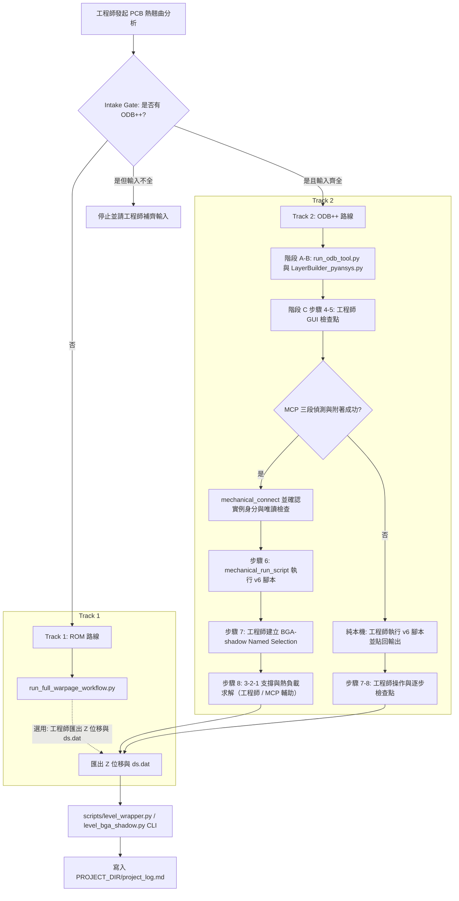

# Unified PCB Thermal Warpage Skill Integration

*   **Author:** Ikaros Chen
*   **Status:** Proposed
*   **Date:** 2026-11-26

--------------------------------------------------------------------------------

## Overview

本設計將兩套 ANSYS PCB 熱翹曲分析工作流整合至 `ANSYS-unified-MCP` 的單一 Skill `pcb-warpage-analysis`。Skill 在執行任何分析動作前，先透過 **Pre-Action Intake Gate** 確認工程師是否具備 ODB++，再路由至對應軌道：

1.  **Track 1（無 ODB++ 路線）**：當工程師僅有疊構表（各層材料、厚度）與每層鋪銅率時，沿用既有的 `pcb-warpage-analysis` 腳本，以整層 Rule of Mixtures (ROM) 計算等效材料並建立多層實體幾何，執行早期熱翹曲分析。
2.  **Track 2（有 ODB++ 路線）**：當工程師具備廠商 working-gerber ODB++（`.tgz`）、廠商疊構表與 Design 材料表時，沿用上游共享目錄 `<UPSTREAM_TOOL_DIR>` 之工作流（原 Skill 名 `pcb-thermal-warpage`）：修復並驗證 ODB++、建立 3D 疊層模型、於 Workbench 執行 External Data 與 Trace Mapping、以 `v6 腳本` 逐元素替換等效材料，最後進行 BGA-shadow 最小平方平面擬合（Leveling）。

本整合架構同時支援**純本機模式**（僅使用 Python 與本機 ANSYS 環境）與 **MCP 模式**（已連線 `ansys-unified-mcp` 工具鏈）。

### 術語

*   **Track 1**：無 ODB++ 時採用的整層均質化 ROM 路線（`01_build_pcb_geometry.py`、`02_calculate_rom_materials.py`、`03_setup_mechanical_bc_and_solution.py` 及其總控入口 `run_full_warpage_workflow.py`）。
*   **Track 2**：有 ODB++ 時採用的九步高解析 Trace Mapping 與 Leveling 路線（原 `pcb-thermal-warpage` 工作流）。
*   **Skill**：Agent 載入的一組指示與腳本套件；入口檔為 `SKILL.md`，詳細文件與輔助腳本置於 `references/` 與 `scripts/`。
*   **ODB++ / working gerber**：PCB 廠商交付的 ECAD layout 資料包（`.tgz`），內含各銅層之實際走線與鋪銅圖形。
*   **Trace Mapping**：Mechanical 將 ODB++ 各層銅箔分布映射至 3D 網格元素，以計算各元素的局部銅比例。
*   **External Data**：ANSYS Workbench 用於匯入外部網格或 ECAD（ODB++ TGZ）資料並傳遞至 Mechanical Model 的元件系統。
*   **v6 腳本**：Track 2 步驟 2 由 `run_odb_tool.py` 依專案疊構與材料庫動態產出的 Mechanical 內嵌腳本（`Mech_py_EquivalentMaterial_v6.py`），依元素銅比例套用等效材料。
*   **BGA-shadow**：PCB 表面上 BGA 封裝正下方矩形區域內的網格節點集合。
*   **Leveling**：對指定區域節點的 Z 軸位移擬合最小平方平面並扣除剛體傾斜，以取得真實平面翹曲量。
*   **Smile / Cry / Undetermined**：翹曲幾何形態判定。上游 `warpage_shape()` 回傳首字母大寫字串 `"Smile"`（板邊相對中心上翹）、`"Cry"`（板邊相對中心下垂）或 `"Undetermined"`。
*   **N+M 壓合層**：銅層兩側的 prepreg 介電材料不同（多階段壓合結構），程式無法自動決定配對 FR4，須由工程師指定。
*   **Resin Content**：介電材料規格中的樹脂含量百分比，材料庫若含多種樹脂含量版本時須由工程師擇一。
*   **3-2-1 靜定支撐**：於三個不共線頂點分別限制 3、2、1 個自由度（合計 6 自由度），消除剛體運動且不產生人為熱拘束應力。
*   **`T_REF`**：熱應力計算之零應力參考溫度（預設 30 °C）。
*   **`ds.dat`**：Mechanical 求解器輸入檔，包含節點座標定義（`NBLOCK`），Leveling 須據此讀取節點 X/Y 座標。
*   **`PROJECT_DIR`**：工程師存放單一專案輸入檔、設定 JSON、執行結果與日誌的獨立專案目錄（必須位於 git 倉庫之外）。
*   **`project_log.md`**：置於 `PROJECT_DIR` 內的專案稽核日誌，記錄 `TRACK`、`RESULT SOURCE`、各步驟證據與人類決策。

## The Problem

1.  **輸入情境不相容**：既有 `pcb-warpage-analysis` 僅接受疊構 Excel，無法處理 ODB++ 修復、N+M 壓合層歧義與 Trace Mapping；上游 `pcb-thermal-warpage` 則強依賴 ODB++，於早期無 layout 階段無法使用。
2.  **跨工具註冊未涵蓋 Antigravity**：上游 `install_skill.ps1` 僅註冊至 Kiro、Claude Code 與 Codex，未納入 `ANSYS-unified-MCP` 與 Antigravity 體系。
3.  **後處理功能隔離**：BGA-shadow Leveling 僅存在於 Track 2 步驟 9，Track 1 無法直接共用同一套最小平方平面擬合工具。
4.  **MCP 工具與實際求解能力落差**：`workflow_run_thermal_warpage`（底層函式為 `src/ansys_unified_mcp/workflows/thermal_warpage.py` 中的 `run_thermal_warpage`）目前為純解析公式估算器，未呼叫 ANSYS 求解器，不產生網格與 `ds.dat`，回傳固定標註 `RESULT SOURCE: ESTIMATED`；且 `ansys-unified-mcp` 目前不支援 Workbench External Data ODB++ 匯入與 Trace Mapping。

## Goals

*   **強制前置分流（Pre-Action Intake Gate）**：在啟動任何腳本或 MCP 工具前，先確認工程師是否具備 ODB++ 與完整輸入，路由至 `Track 1` 或 `Track 2`；輸入不齊全時依規定停止或經明確確認後降級（見 Technical Plan §4）。
*   **雙環境相容**：同一份 Skill 定義在純本機模式與 MCP 模式皆能執行完整工作流；MCP 尚不支援無頭執行的步驟維持人機檢查點。
*   **受控快照邊界與零內部資料入庫**：上游共享目錄維持唯讀；複製進 `ANSYS-unified-MCP` 的腳本與文件作為上游快照，**除 `project_config.template.json` 若檢出敏感字樣外均維持原樣不修改**，並透過 `scripts/UPSTREAM_MANIFEST.json`（記錄相對 `source_path`、SHA-256、複製時間）與驗證腳本偵測漂移。內部簡報、專案範例與材料庫 XML 不複製，並已取得上游擁有者同意且符合 `docs/maintenance/PUBLICATION_REVIEW.md` 規範。
*   **保留物理與人類決策護欄**：僅檢視 Z 軸位移 $U_z$、採用 3-2-1 靜定支撐、執行 `T_REF` 三處一致性檢查（見 Technical Plan §3），且不替工程師猜測任何人類決策參數（厚度欄位、N+M FR4、Resin Content、BGA footprint、支撐點、溫度點、單位與正負號）。
*   **共用 Leveling 後處理 CLI**：`Track 1` 與 `Track 2` 共用同一套薄層包裝與上游 `level_bga_shadow.py` CLI 執行平面擬合。

## Non-Goals

*   不合併 `Track 1` 與 `Track 2` 的物理建模演算法。
*   不將內部專有資產（`0_Guideline/`、`PPT Template/`、`Photos/`、`2_examples/`、`PCB_Material_Library.xml` 及個人或公司專屬路徑）納入 `ANSYS-unified-MCP` 倉庫。
*   不實作 Workbench GUI 鍵鼠模擬自動化。
*   不修改 `src/ansys_unified_mcp/` 下任何既有程式碼：不變更 `run_thermal_warpage` 簽名，亦不新增 MCP tool。
*   不在 `workflow_run_thermal_warpage` 解析估算流程上掛載 Leveling。

## Open Questions

None.

## Critical User Journeys (CUJs)

### CUJ 1: 無 ODB++ 的早期設計（Track 1）

*   **Given**：工程師僅具備各層材料、厚度與預估鋪銅率，尚未完成 ECAD layout；環境可能是純本機或已連線 `ansys-unified-mcp`。
*   **When**：工程師呼叫 `pcb-warpage-analysis` Skill。
*   **Then**：Intake Gate 確認無 ODB++ 後路由至 `Track 1`，記錄 `TRACK: Track 1` 與 `RESULT SOURCE: FEM-ROM`。Agent 與工程師確認 `T_REF`、目標溫度與 3-2-1 支撐點後，執行 `scripts/run_full_warpage_workflow.py`（依序呼叫 `01_build_pcb_geometry.py`、`02_calculate_rom_materials.py`，並於 Mechanical 執行 `03_setup_mechanical_bc_and_solution.py`）。若工程師僅需解析估算（不執行 FEM），可於 MCP 模式呼叫 `workflow_run_thermal_warpage`（底層 `run_thermal_warpage`），並於報告與 `project_log.md` 明確標註 `RESULT SOURCE: ESTIMATED`。

### CUJ 2: 有 ODB++ 的詳細設計（Track 2）

*   **Given**：工程師具備 ODB++（`.tgz`）、廠商疊構表、Design 材料表、2D `.stp` 與外部 `PCB_Material_Library.xml`（路徑由專案 JSON 指定），且 `PROJECT_DIR` 位於倉庫外部。
*   **When**：工程師啟動 Skill 並提供 `PROJECT_DIR` 與輸入路徑。
*   **Then**：Intake Gate 確認輸入齊全並設定專案 JSON `output.root = "runs/track2_odb"` 後路由至 `Track 2`，記錄 `TRACK: Track 2` 與 `RESULT SOURCE: FEM-TraceMapping`。依九步流程執行前處理、3D 建模、Workbench/Mechanical（MCP 輔助或純本機檢查點）與 Leveling，於 `PROJECT_DIR/project_log.md` 記錄每步證據並輸出翹曲報告。

## Technical Plan (Architecture)

### Resolved Decisions

*   **R1（複製與同步策略）**：上游共享目錄維持唯讀，將必要腳本與文件以二進位原樣複製進 `ANSYS-unified-MCP` 作為快照，透過 `scripts/UPSTREAM_MANIFEST.json` 管理版本漂移。
*   **R2（MCP 自動化邊界）**：Workbench External Data 匯入與 Trace Mapping（步驟 4–5）維持 GUI 人機檢查點。
*   **R3（Leveling 整合方式 — 選項 A）**：僅於 Skill 內提供獨立 CLI 與薄層包裝 `scripts/level_wrapper.py`，不修改 `src/ansys_unified_mcp/` 與上游 `level_bga_shadow.py`。
    *   *Rejected（複製演算法至 `src/` 並新增 MCP tool）*：會導致相同數學演算法存在雙份維護，且須同步修改工具註冊、`test_tool_pruning.py` 與 `pyproject.toml` 核心依賴。
    *   *Rejected（`src/` 以 `importlib` 動態載入 Skill 腳本）*：會造成核心套件反向依賴 Skill 目錄，於 wheel 打包或 Skill 遭驅逐時失效。

### 1. 資料與目錄邊界

*   上游來源目錄（記為 `<UPSTREAM_TOOL_DIR>`）僅供唯讀複製，實際公司或個人路徑不得寫入本文件、Skill 檔案或 `scripts/UPSTREAM_MANIFEST.json`（Manifest 內的 `source_path` 僅記錄相對於 `<UPSTREAM_TOOL_DIR>` 的路徑）。
*   複製範圍：`run_odb_tool.py`、`odbtool/`（14 模組）、`requirements.txt`、`setup_env.ps1`、`1_Scripts/`（含 `LayerBuilder_pyansys.py`、`level_bga_shadow.py`、`Mech_py_EquivalentMaterial_v6.py`、`Compare_TraceMapping_Dat.py`、`README_TraceMapping.md`）、`3_materials/`（`README_Material_Library.md`、`Update_PCB_Material_Library.py`）、`4_config/project_config.template.json`、`docs/`（含 `docs/agent/`）、`tests/`（4 支測試檔）與上游 `SKILL.md`（轉存至參考目錄）。
*   排除範圍：`0_Guideline/`、`PPT Template/`、`Photos/`、`2_examples/`、`3_materials/PCB_Material_Library.xml`、`.pytest_cache/`、`__pycache__/`。

### 2. Track 2 步驟與階段對照

| 階段 | 步驟 | 執行者 | 內容 |
| :--- | :--- | :--- | :--- |
| A | 1 | 工程師 + Agent | 收集輸入檔並檢查完整性 |
| A | 2 | Agent 執行 `run_odb_tool.py` | 產出 ANSYS-ready ODB++、疊構 CSV、專案專用 `v6 腳本` 並以 2025 R1 / 2026 R1 translator 驗證（依上游文件預估耗時 10–40 分鐘） |
| B | 3 | Agent 執行 `LayerBuilder_pyansys.py` | 依據疊構 CSV 與 `.stp` 建立 3D 疊層 `.scdocx`（需 SpaceClaim/Discovery 授權） |
| C | 4 | 工程師（GUI） | Workbench 匯入材料庫、`.scdocx` 幾何、External Data 載入 `.tgz` |
| C | 5 | 工程師（GUI） | 劃分網格與執行 Import Trace Mapping |
| C | 6 | MCP 模式：Agent；純本機：工程師 | 執行 `runs/track2_odb/<run>/mechanical/Mech_py_EquivalentMaterial_v6.py` |
| D | 7 | 工程師 | 建立 BGA-shadow Named Selection（矩形範圍由 Layout 取得） |
| D | 8 | 工程師；MCP 模式可由 Agent 輔助 | 施加 3-2-1 靜定支撐與溫度負載並求解 |
| E | 9 | 工程師匯出；Agent 執行 Leveling | 匯出 Z 位移與 `ds.dat` 後執行 Leveling CLI 產出報告 |

註：`Compare_TraceMapping_Dat.py` 為選用比對工具，用於比對兩個 `ds.dat` 的逐元素最終材料，不屬於九步必經流程。

### 3. `T_REF` 三處一致性檢查

求解前必須核對下列三處數值完全一致（預設 30 °C），任一不符即停止；`project_log.md` 須明確區分各項目來源為 `Agent 讀取` 或 `工程師回報`：

1.  專案 `v6 腳本` 頂部的 `T_REF` 參數（由 **Agent 讀取**檔案確認）。
2.  Mechanical 分析設定之環境溫度與參考溫度（MCP 模式由 Agent 以唯讀 `mechanical_run_script` 查詢；純本機模式由 **工程師回報**）。
3.  Thermal Condition 負載表格之起始溫度（MCP 模式由 Agent 以唯讀 `mechanical_run_script` 查詢；純本機模式由 **工程師回報**）。

### 4. Pre-Action Intake Gate 與環境偵測

Agent 於執行前必須依序確認並將答案寫入 `PROJECT_DIR/project_log.md`（`PROJECT_DIR` 必須位於 git 倉庫外部）：

1.  **是否有 ODB++？** 無 → `Track 1`（`RESULT SOURCE: FEM-ROM` 或 `ESTIMATED`）；有 → 進入第 2 項。
2.  **Track 2 五項必要輸入是否齊全**（ODB++ `.tgz`、廠商疊構表、Design 材料表、2D `.stp`、材料庫 XML 路徑）？齊全 → `Track 2`（`RESULT SOURCE: FEM-TraceMapping`），並於專案 JSON 設定 `output.root = "runs/track2_odb"`（不改上游範本）；缺任一項 → 停止並要求補齊，僅於工程師明確指示「改以高階估算進行」時才降級至 `Track 1` 並記錄原因。
3.  **三段式 MCP 模式偵測**：
    *   (a) 確認當前會話工具清單包含 `ans_session_status` 與 `mechanical_*` 工具；
    *   (b) 呼叫 `ans_session_status(product="mechanical")`；
    *   (c) 透過 `mechanical_list_instances` / `mechanical_connect` 附著並經工程師確認專案路徑或實例身分。僅當三段皆成功時進入 **MCP 模式**；任一步未通過即進入 **純本機模式**。

同一 `PROJECT_DIR` 內，`Track 1` 輸出置於 `runs/track1_rom/`，`Track 2` 輸出置於 `runs/track2_odb/`。

### 5. 雙軌執行流程與 GUI-to-MCP 交接協議

**GUI-to-MCP 交接與防呆協議（MCP 模式，步驟 5 完成後）：**

1.  **實例身分確認與唯讀前置檢查**：工程師完成步驟 5 後提供 Mechanical gRPC 埠號或確認實例，Agent 呼叫 `mechanical_connect` 附著並以 `mechanical_get_tree_hierarchy` 與唯讀腳本檢查：(a) 專案名稱／模型路徑與工程師確認一致；(b) 存在 Imported Trace 物件；(c) Body 數量等於步驟 2 報告層數且名稱符合 `Layer_<n>_<FR4>_<ratio>`。任一項不符立即停止。
2.  **寫入前保護與腳本傳遞**：執行步驟 6 前，工程師必須先儲存專案快照（checkpoint）。Agent 讀取已生成的實例檔 `runs/track2_odb/<run>/mechanical/Mech_py_EquivalentMaterial_v6.py` **全文字串**，透過 `mechanical_run_script(script=..., timeout_seconds=600)` 傳入執行（**嚴禁呼叫 `mechanical_run_batch_script`**，因其會啟動獨立空白批次進程而非已開啟之 GUI 實例）。若執行失敗，**禁止原地重跑**，必須先還原執行前存檔再重試。
3.  **中途斷線降級**：若 `mechanical_connect` 失敗或 `mechanical_run_script` 中途斷線，立即切換為純本機模式，由工程師於 Mechanical GUI 執行同一檔案並貼回完整輸出進行人工核對。

**長耗時任務與異常恢復**：`run_odb_tool.py`（timeout 上限 3600 秒）與 `LayerBuilder_pyansys.py`（timeout 上限 900 秒）一律以非同步背景任務啟動，Agent 結束當前回合等待喚醒事件，不得輪詢。若超過 timeout 或偵測程序掛死，使用 `manage_task`（`kill`）終止並通知工程師確認 ANSYS 行程與授權釋放；授權中斷後透過 `run_odb_tool.py --reverify <run folder>` 恢復。Exit Code 規範：`0` 通過；`1` 檢查失敗停止；`2` 存在未決人工問題（讀取 `open_questions_*.md` 詢問工程師並寫入專案 JSON 後以 `--non-interactive` 重跑）；`3` 輸入錯誤。

### 6. Leveling 薄層介面與單位契約

*   上游 `level_bga_shadow.py` 維持原樣不動；所有新增能力置於薄層 `scripts/level_wrapper.py`。
*   `level_wrapper.py` 提供 `compute_leveled_warpage(x_mm, y_mm, uz_mm, *, method="OLS", mode="detrend", flip_z=False)`：
    *   將輸入轉為 `np.asarray(..., dtype=float)`；若 `N < 3` 或點集共線（設計矩陣秩 `< 3`），拋出上游 `InputError`；`3 <= N < MIN_NODES(9)` 時允許計算但記錄警告旗標。
    *   若 `flip_z=True`，先執行 `uz_mm = -uz_mm`（與上游 `run()` 慣例一致）。
    *   呼叫上游 `level()` 與 `warpage_shape()`，並以 `MIL_PER_MM` 換算，回傳字典鍵包含：`warpage_um`、`warpage_mil`、`shape`（`"Smile"` / `"Cry"` / `"Undetermined"`）、`tilt_deg`、`z_leveled_mm`。
*   **單位與尺寸檢查**：透過 CLI 處理匯出檔時，檔頭必須具備明確單位且與 `z_unit` 一致（缺表頭或不符即 exit 3）；解析 `ds.dat` 時檢查 `/UNITS` 指令並校驗板外框尺寸位於合理物理範圍，不符則中止並回報。
*   **`Track 1` 選用 Leveling**：需工程師自 Mechanical 匯出 Z 位移文字檔與 `ds.dat`。若有提供 BGA ROI 矩形（板座標 mm）Named Selection 匯出，報告標註 `BGA-Shadow Leveled`；若為全板表面節點匯出，報告必須標註 `Full-Board Leveled`。

## Alternatives Considered

### Alternative A: 僅透過外部路徑引用上游共享目錄（不複製）

*   **Pros**：不需維護快照同步。
*   **Cons**：強依賴每位工程師本機共享路徑與離線可用性，整合後的 Skill 無法在獨立環境運行。
*   **Reason for Rejection**：整合套件必須具備獨立執行能力，故改以唯讀快照複製並搭配 `scripts/UPSTREAM_MANIFEST.json` 控管漂移。

### Alternative B: 合併 Track 1 與 Track 2 為單一腳本

*   **Pros**：單一程式碼入口。
*   **Cons**：`Track 1` 缺乏 layout 無法執行 Trace Mapping；`Track 2` 退化為均質化會遺失局部鋪銅效應，合併將迫使兩軌各自維護複雜條件分支（輸入檢查、材料計算、後處理）並增加猜測參數風險。
*   **Reason for Rejection**：兩軌輸入資料與物理粒度不同，以 Intake Gate 分流為獨立軌道。

### Alternative C: 以 GUI 鍵鼠模擬自動化步驟 4–5

*   **Pros**：可串接為無人工介入腳本。
*   **Cons**：受視窗焦點、解析度與 ANSYS 版本（2025 R1、2026 R1）介面差異影響，且失敗時缺乏結構化錯誤碼。
*   **Reason for Rejection**：維持 GUI 人機檢查點，直至原生 API 支援無頭 External Data 匯入。

### Alternative D: 於 `run_thermal_warpage` 掛載 Leveling 參數

*   **Pros**：`Track 1` 單次工具呼叫即可完成。
*   **Cons**：`run_thermal_warpage` 為無網格、無 `ds.dat` 之純解析估算器，無節點資料可供擬合。
*   **Reason for Rejection**：無有效輸入資料，改採共用 CLI（見 R3）。

--------------------------------------------------------------------------------

## Non-Functional Requirements

*   **資料衛生與 IP 隔離**：專案實例資料（`PROJECT_DIR`、材料庫 XML）僅能透過執行期參數或專案 JSON 傳入，且 `PROJECT_DIR` 必須位於倉庫外（`runs/`、`project_log.md` 禁止入庫）。本案**自寫與修改檔案**（見 Verification Plan 清單）不得出現本機帳號絕對前綴（`C` 槽 `Users` 路徑）、雲端同步目錄名稱、公司名稱或 `2_examples` 字樣；上游唯讀快照文件維持原樣不改寫。`odbtool` 對輸入檔之前後 SHA-256 校驗維持不變。
*   **授權與長耗時前置告知**：執行步驟 2 與步驟 3 前，Agent 須先告知預估耗時與所需 ANSYS 授權。
*   **純本機降級相容性**：未安裝或未連線 `ansys-unified-mcp` 時，全流程須可於 `%USERPROFILE%\.venvs\pcb_thermal_warpage`（由 `setup_env.ps1` 建立）完成。

--------------------------------------------------------------------------------

## Detailed Implementation Plan

**實作順序**：1. 產出實作前上游 SHA-256 基準 → 2. 複製上游快照（保留子結構）與設定 `.gitattributes` / `pyproject.toml` → 3. 建立 `level_wrapper.py` 與 `verify_upstream_snapshot.py` → 4. 撰寫 `SKILL.md` 與參考文件 → 5. 建立 `test_pcb_warpage_example_entrypoints.py` 與 `level_wrapper` 測試 → 6. 執行 Verification Plan。

**回退方式**：刪除 `<SKILL>/scripts/odb_workflow/`、`<SKILL>/scripts/level_wrapper.py`、`<SKILL>/scripts/verify_upstream_snapshot.py`、`<SKILL>/scripts/UPSTREAM_MANIFEST.json`、`<SKILL>/references/odb_workflow/`、`tests/unit/test_level_wrapper.py`；還原 `<SKILL>/SKILL.md`、`tests/unit/test_pcb_warpage_example_entrypoints.py`、`pyproject.toml` 與 `.gitattributes`。

**路徑基準**：以下所有相對路徑均相對於 `D:\Ikaros\ANSYS-unified-MCP`，Skill 根目錄為 `agents/skills/materials-reliability/pcb-warpage-analysis`（簡稱 `<SKILL>`）。`.agents/skills` 為指向 `agents/skills` 的符號連結，禁止直接寫入。

### Target Files to Create/Modify

#### 1. `<SKILL>/scripts/odb_workflow/` (Create — 自上游二進位原樣複製)
*   **Type / Scope**: 上游 Python 套件、腳本、設定範本與測試之唯讀快照（`TOOL_DIR` 指向此目錄）。
*   **Proposed Changes**:
    *   保留完整來源子結構，包含：`run_odb_tool.py`、`odbtool/`（14 模組）、`requirements.txt`、`setup_env.ps1`、`1_Scripts/`（`LayerBuilder_pyansys.py`、`level_bga_shadow.py`、`Mech_py_EquivalentMaterial_v6.py`、`Compare_TraceMapping_Dat.py`、`README_TraceMapping.md`）、`3_materials/`（`Update_PCB_Material_Library.py`、`README_Material_Library.md`）、`4_config/project_config.template.json`、`tests/`（`test_coverage.py`、`test_intake_build.py`、`test_leveling.py`、`test_materials.py`）。
    *   保留 `1_Scripts/README_TraceMapping.md` 與 `3_materials/README_Material_Library.md` 於原相對位置以維持內部文件連結有效。
    *   先對 `project_config.template.json` 執行禁止字串 grep：若為 0 筆則維持 `modified: false` 不修改；僅於檢出敏感字串時替換為 `<PROJECT_DIR>` 佔位符並標記 `modified: true`。

#### 2. `<SKILL>/scripts/level_wrapper.py` (Create)
*   **Type / Scope**: `level_bga_shadow.py` 之薄層 Python/CLI 包裝。
*   **Proposed Changes**:
    *   實作 `--help` 參數處理：印出 usage 並以 Exit Code 0 結束，且於處理 `--help` 分支前**不匯入 `numpy`**，確保無依賴環境亦可通過 `--help` 冒煙檢查。
    *   實作 `compute_leveled_warpage(x_mm, y_mm, uz_mm, *, method="OLS", mode="detrend", flip_z=False)`，輸入轉為 float ndarray，實作 `N < 3` 與共線（rank < 3）之 `InputError` 檢核、`flip_z` 反號與單位換算，呼叫上游 `level()` 與 `warpage_shape()`。

#### 3. `<SKILL>/scripts/UPSTREAM_MANIFEST.json` & `<SKILL>/scripts/verify_upstream_snapshot.py` (Create)
*   **Type / Scope**: 上游快照版本校驗清單與驗證工具（置於 `scripts/` 避免觸發 Skill 根目錄檔名警告）。
*   **Proposed Changes**:
    *   `UPSTREAM_MANIFEST.json` 頂層結構為物件：`{"schema_version": 1, "copied_at": "<ISO-8601>", "files": [{"source_path": "<relative>", "sha256": "<hex>", "modified": false}]}`。
    *   `verify_upstream_snapshot.py` 以二進位讀取重算所有 `modified: false` 檔案之 SHA-256（不受 `core.autocrlf` 影響），支援選用參數 `--upstream <dir>` 與上游比對；全數一致回傳 Exit Code 0，存在差異回傳 1。

#### 4. `<SKILL>/references/odb_workflow/` (Create — 自上游複製 + 新增混合檢查文件)
*   **Type / Scope**: Track 2 領域文件、Playbooks 與 MCP 交接指南。
*   **Proposed Changes**:
    *   二進位複製上游 `docs/01_overview.md` ～ `docs/10_leveling.md`（涵蓋 `03_vendor_odb_defects.md`）、`docs/agent/` 7 份檔案（`00_session_and_log.md`、`A_inputs_and_odb.md`、`B_layerbuilder.md`、`C_ansys_model.md`、`D_loads.md`、`E_export_and_leveling.md`、`human_decisions.md`），以及上游 `SKILL.md` 存為 `TRACK2_SKILL.md`。
    *   新增 `references/odb_workflow/README.md` (Create)：明定 `TOOL_DIR` 唯讀對應至 `<SKILL>/scripts/odb_workflow`，說明 `PROJECT_DIR` 不得置於 `TOOL_DIR` 或倉庫內、專案 JSON 應寫入 `output.root = "runs/track2_odb"`，並註明上游文件中提及之 `2_examples` 目錄不隨快照提供。
    *   新增 `references/odb_workflow/mcp_hybrid_checkpoint.md` (Create)：詳列 Technical Plan §5 交接協議、證據欄位表（區分 `Agent 讀取` 與 `工程師回報` 之 `T_REF` 三處值、Body 數量、Imported Trace 存在與否、`RESULT` 行、時間戳）、`mechanical_run_script(script=..., timeout_seconds=600)` 傳遞規則與存檔回滾要求。

#### 5. `<SKILL>/SKILL.md` (Modify)
*   **Type / Scope**: 統一 Skill 路由入口（總行數嚴格 `<= 150` 行，且 frontmatter `description` 空白切分單字數 `<= 120`）。
*   **Proposed Changes**:
    *   加入 Pre-Action Intake Gate 規範指令、三段式 MCP 偵測與降級規則、`Track 1` / `Track 2` 路由表，並連結至 `references/odb_workflow/TRACK2_SKILL.md`、`references/odb_workflow/README.md` 與 `references/odb_workflow/mcp_hybrid_checkpoint.md`。

#### 6. `.gitattributes` & `pyproject.toml` (Modify)
*   **Type / Scope**: 倉庫行尾保護與 Linter 排除設定。
*   **Proposed Changes**:
    *   `.gitattributes`：針對 `agents/skills/materials-reliability/pcb-warpage-analysis/scripts/odb_workflow/**` 與 `agents/skills/materials-reliability/pcb-warpage-analysis/references/odb_workflow/**` 設定 `-text`，防止 Git 換行轉換破壞快照 SHA-256。
    *   `pyproject.toml`：於 `[tool.ruff]` 之 `extend-exclude` 新增 `agents/skills/materials-reliability/pcb-warpage-analysis/scripts/odb_workflow/**`，避免上游程式碼觸發 `E741` 等風格警告。

#### 7. `tests/unit/test_pcb_warpage_example_entrypoints.py` & `tests/unit/test_level_wrapper.py` (Modify / Create)
*   **Type / Scope**: Skill 入口契約與薄層包裝單元測試。
*   **Proposed Changes**:
    *   `test_pcb_warpage_example_entrypoints.py` (Modify)：驗證 `SKILL.md` 含 `Intake Gate`、行數 `<= 150`、`description` 單字數 `<= 120`；檢查 `Track 1` 與 `scripts/odb_workflow/` 關鍵檔案存在；對 `Track 1` 與 `Track 2` Python 檔執行 `ast.parse`（註明 `03_setup_mechanical_bc_and_solution.py` 與 `Mech_py_EquivalentMaterial_v6.py` 為 Mechanical 內嵌腳本不於 repo venv 匯入）；僅驗證自寫 Markdown 連結（`SKILL.md`、`references/odb_workflow/README.md`、`mcp_hybrid_checkpoint.md`）皆有效。
    *   `test_level_wrapper.py` (Create)：以合成傾斜平面疊加已知翹曲資料（`tmp_path`）驗證 `compute_leveled_warpage` 之 `warpage_um`（絕對容差 `1e-6` mm 量級，實際數值於測試中固定）、`tilt_deg`、`shape`（含 `flip_z=True` 反轉）、`N < 3` 與共線點拋出 `InputError`；並以 `tmp_path` 合成有效 CSV 與 `.stp` 驗證 `LayerBuilder_pyansys.py --check` 回傳 Exit Code 0 且 stdout 含 `CHECK OK`。

#### 8. 不修改檔案（回歸與獨立驗證對象）
*   `src/ansys_unified_mcp/workflows/thermal_warpage.py`、`src/ansys_unified_mcp/tools/intent_tools.py`、`tests/unit/test_intent_workflows.py` 維持不修改。

### Verification Plan

*   **Compilation/Build**: N/A（純 Python 腳本與 Markdown 技能整合）。
*   **Unit Tests**:
    *   Repo venv：`pytest tests/unit/test_pcb_warpage_example_entrypoints.py tests/unit/test_level_wrapper.py tests/unit/test_intent_workflows.py` — 須 **0 failed、0 skipped、0 error**。
    *   Standalone venv（`%USERPROFILE%\.venvs\pcb_thermal_warpage`）：於 `<SKILL>/scripts/odb_workflow` 執行 `pytest tests/` — 須 **0 failed、0 error**，且 skipped 僅限依賴不複製之 `2_examples` 的 2 個既有 `skipif` 測試（`test_th5_example_reproduces_the_reference`、`test_examples_intake`）。
*   **Standalone CLI Smoke Check**:
    *   未安裝 `ansys_unified_mcp` 之環境執行 `python <SKILL>/scripts/level_wrapper.py --help`（Exit Code 0）；執行 `python -c "import odbtool"`（工作目錄 `<SKILL>/scripts/odb_workflow`，Exit Code 0）。
*   **Skill Governance & E2E/Integration**:
    *   `python scripts/skill_governance/validate_skills_ci.py` Exit Code 0（且該 Skill 無新增根層 WARNING）。
    *   `pytest tests/unit/test_stage0_links_and_eviction.py` 0 failed。
*   **Manifest & Upstream Read-Only Check**:
    *   `python <SKILL>/scripts/verify_upstream_snapshot.py --upstream "<UPSTREAM_TOOL_DIR>"` Exit Code 0，且實作前後 `<UPSTREAM_TOOL_DIR>` 全檔 SHA-256 清單比對差異為 0。
*   **Static Analysis & Linting**:
    *   `ruff check` 針對所有新增與修改檔案（含 `<SKILL>/scripts/level_wrapper.py`、`verify_upstream_snapshot.py`、`tests/unit/test_pcb_warpage_example_entrypoints.py`、`tests/unit/test_level_wrapper.py`），結果 0 警告。
*   **Data Hygiene**:
    *   對 `<SKILL>/SKILL.md`、`<SKILL>/scripts/level_wrapper.py`、`<SKILL>/scripts/verify_upstream_snapshot.py`、`<SKILL>/scripts/UPSTREAM_MANIFEST.json`、`<SKILL>/scripts/odb_workflow/4_config/project_config.template.json`、`<SKILL>/references/odb_workflow/README.md`、`<SKILL>/references/odb_workflow/mcp_hybrid_checkpoint.md`、`tests/unit/test_level_wrapper.py`、`tests/unit/test_pcb_warpage_example_entrypoints.py` 執行敏感路徑與範例關鍵字掃描（比對本機帳號 `Users` 路徑、雲端同步目錄名、公司名稱與 `2_examples`），結果必須為 **0 筆**（本設計文件除外僅允許提及 `2_examples` 用於說明排除規則，但同樣不得出現個人帳號路徑、雲端同步目錄名與公司名稱）。
*   **Test Coverage Requirement**: 所有新增公開函式（`compute_leveled_warpage`）及 `N < 3`、共線、單位錯誤與 `flip_z` 分支皆須有對應單元測試斷言。

--------------------------------------------------------------------------------

<!-- Provenance: Revised after EGM Review Round 2 -->
*Drafted with EGM*
