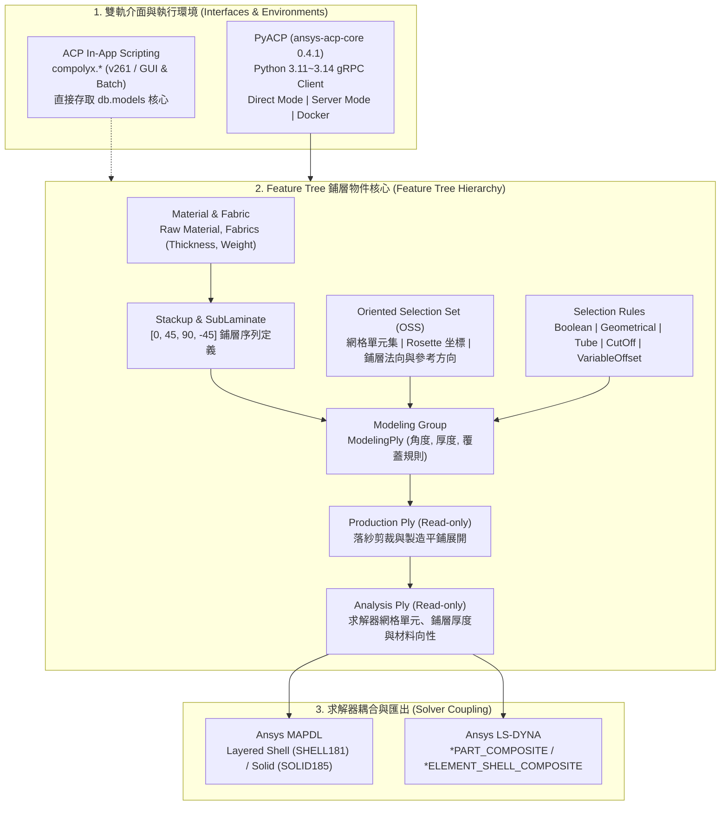

# ANSYS Composite PrepPost (ACP) 主題辭典

> 本主題深入剖析 ANSYS Composite PrepPost (ACP) 複合材料前處理與後處理的架構體系。詳細拆解 ACP 內嵌腳本 API (`compolyx`) 與現代化 Python 用戶端程式庫 `ansys-acp-core` (PyACP 0.4.1) 的介面與版本邊界、gRPC 無頭啟動與 GUI 連線邊界限制、完整 Feature Tree 樹狀物件模型（從 Raw Material、Fabric、Stackup 到 ModelingPly、ProductionPly 與 AnalysisPly）、方向與落紗 (Rosette / Draping) 演算法、失效準則 (Failure Criteria) 配置，以及進階 Selection Rules 幾何篩選與網格覆蓋率求值。

---

## 領域架構圖 (ACP Architecture & Feature Tree Map)



---

## 主題辭典與核心模組

### 1. 介面與版本邊界

#### 核心概念與辭典定義 (Core Concepts & Glossaries)
- **ACP 雙軌介面體系**：
  - **In-App `compolyx` 介面**：ACP GUI 內建的 Python 直譯環境與命令歷史紀錄器（History / Shell views）。透過全域物件 `db` 存取當前模型（例如 `db.models['class40.1']`），適用於 GUI 錄製巨集與本地批次腳本 (`File > Run Script`)。
  - **PyACP (`ansys-acp-core`)**：Ansys 官方推出的開源 gRPC 用戶端。在標準 CPython (3.11~3.14) 環境中運行，透過網路通訊協定控制無頭 ACP 後端服務 (`ACPInstance`)，適用於現代化 CI/CD、微服務整合與全自動化參數化設計。
- **版本相容性矩陣 (Compatibility Matrix)**：
  - PyACP `0.4.1` 明確要求後端 ACP 服務版本為 **Ansys 2024 R2 (v242) 或更高版本**（支援 v242, v251, v252, v261）。
  - 低於 2024 R2 的舊版 Ansys（如 2023 R2 / 2024 R1）未內建標準 gRPC 服務端點，僅支援 `compolyx` 內嵌腳本。
- **Feature Gates 與傳輸模式**：
  - **Direct Mode (直接本機模式)**：用戶端與 ACP 服務端運行在同一台主機且能存取相同的本機檔案系統。檔案傳輸開銷為零。
  - **Server / Remote Mode (遠端服務模式)**：透過網路連線遠端伺服器或 Docker 容器。必須啟用 `auto_transfer_files=True`，客戶端自動透過 gRPC 流式傳輸將 CDB/H5 網格檔案上傳至伺服器臨時工作區，並將產生的複合材料結果下載至本地。

#### 手冊章節與規格出處 (Manual & Doc Citations)
- **In-App API 手冊**：*Ansys ACP In-App Scripting API 2026 R1* ([Getting Started In-App](../ANSYS_Document/ACP/v261/api_reference/1ca9a9696a24-getting_started_acp.md))
- **PyACP 手冊**：*PyACP User Guide (SDK 0.4.1)* ([Getting Started PyACP](../ANSYS_Document/ACP/sdk/ansys-acp-core/0.4.1/guide/355b46ee8c97-getting_started.html))
- **Source IDs**：`sources.csv#ansys_54a172e10060cce93837025b`, `sources.csv#ansys_be6b9be103ce7da063f509b6`, `sources.csv#ansys_b212dc49cf7116b3ea83521f`.

#### 雙軌介面特性對照矩陣 (Interface Comparison Matrix)

| 特性維度 | In-App `compolyx` 腳本 | PyACP (`ansys-acp-core`) |
|---|---|---|
| **直譯器要求** | ACP 內建 Python 直譯器 | 標準 CPython 3.11 ~ 3.14 |
| **GUI 互動性** | 運行於 GUI 內部，即時更新視圖 | 完全無頭 (Headless)，無原生 GUI 視窗 |
| **遠端/容器化部署** | 不支援（僅限本地批次） | 原生支援 (Docker Container / Kubernetes / PyPIM) |
| **檔案相依性** | 依賴本地硬碟路徑 | 支援 gRPC 自動檔案上傳與下載流 |
| **最低 Ansys 版本** | 支援所有舊版至 v261 | 強制要求 Ansys 2024 R2 (v242) 或更新版 |

---

### 2. PyACP 啟動與 GUI 連線

#### 核心概念與辭典定義 (Core Concepts & Glossaries)
- **`launch_acp()` 啟動管線**：
  ```python
  import ansys.acp.core as pyacp
  acp = pyacp.launch_acp(mode=pyacp.LaunchMode.STANDALONE, timeout=120)
  ```
  在本地後台自動拉起一個 ACP gRPC 伺服器進程並返回 `ACPInstance` 連線物件。
- **授權檢驗與故障排除 (Licensing Requirements)**：
  - 後端服務啟動時必須簽出 `acp_preppost` 或 `ansys` 授權特徵；
  - 伺服器啟動若超時（預設 120 秒），多為授權伺服器連線延遲或通訊埠 (`ANSYSLMD_LICENSE_FILE`) 阻塞；需排查本機防火牆與環境變數設定。
- **通訊協定與傳輸安全 (gRPC Transports)**：
  - 支援 `insecure`（純明文）、`uds`（Unix Domain Socket，Linux 高速本地 IPC）、`wnua`（Windows 具名通道）及 `mtls`（雙向憑證加密安全傳輸）。
- **關鍵邊界限制：與 ACP GUI 的脫耦性**：
  - **PyACP 啟動的是完全獨立的無頭服務進程，無法即時掛載、操控或同步至已經開啟的 ACP 桌面 GUI 視窗**。
  - **模型檢視與同步策略**：在 PyACP 中完成鋪層配置後，必須調用 `model.save(path="composite_model.acp")` 進行儲存；若需在 ACP GUI 中預覽，需手動打開 GUI 執行 `File > Open`；若 GUI 已經開啟該檔案，需點擊 `Reload Model` 以重新加載修改後的拓撲。

#### 手冊章節與規格出處 (Manual & Doc Citations)
- **手冊來源**：*PyACP Getting Started & Launch Modes* ([0.4.1 Getting Started](../ANSYS_Document/ACP/sdk/ansys-acp-core/0.4.1/guide/355b46ee8c97-getting_started.html))
- **Source IDs**：`sources.csv#ansys_be6b9be103ce7da063f509b6`, `sources.csv#ansys_f4add1a91e06b1e951290115`, `sources.csv#ansys_14717918c9f71a55355f67b7`.

#### PyACP 啟動與模型生命週期範例 (Python Scripting Example)
```python
# ==============================================================================
# PyACP Script: Launch Server, Import FEA Mesh, Configure Layup, and Save
# Note: ASCII-only comments to prevent IronPython encoding issues.
# ==============================================================================
import ansys.acp.core as pyacp

# Step 1: Launch headless ACP server instance with explicit timeout
acp_instance = pyacp.launch_acp(
    timeout=180.0,
    auto_transfer_files=True
)

try:
    # Step 2: Import base finite element model (MAPDL CDB format)
    cdb_path = r"C:\Models\plate_mesh.cdb"
    model = acp_instance.import_model(
        path=cdb_path,
        format=pyacp.ModelInputFormat.ANSYS_CDB
    )

    # Step 3: Verify model status and active entities
    print("ACP Model Name: {0}".format(model.name))
    print("Element Set Count: {0}".format(len(model.element_sets)))

    # Step 4: Save populated ACP composite project to disk
    acp_project_path = r"C:\Models\final_composite.acp"
    model.save(acp_project_path)
    print("Model saved successfully for GUI inspection.")

finally:
    # Step 5: Always close connection and tear down background server process
    acp_instance.close()
```

#### 工程實務踩坑指南 (Gotchas & Limitations)
1. **背景進程孤兒化 (Orphaned Server Process)**：若未將 `acp_instance` 置於 `try...finally` 區塊或使用 Context Manager，當腳本拋出異常崩潰時，後台 `acp_server.exe` 不會自動退出，持續佔用授權直到手動在工作管理員中殺死。
2. **檔案相對路徑在 Remote 模式下的解析錯誤**：在 Docker 或遠端模式下，若使用本地相對路徑（如 `./mesh.cdb`），服務端無法定位該路徑；務必傳入絕對路徑或依賴 `auto_transfer_files=True` 由用戶端打包上傳。

---

### 3. Feature Tree 與鋪層物件

#### 核心概念與辭典定義 (Core Concepts & Glossaries)
- **Feature Tree 物件階層**：ACP 透過樹狀資料模型組織複合材料物件：
  $$\text{Model} \to \text{Material} \to \text{Fabric} \to \text{Stackup} \to \text{OSS} \to \text{ModelingGroup} \to \text{ModelingPly} \to \text{AnalysisPly}$$
- **定位坐標系 (Rosette) 與定向單元集 (Oriented Selection Set, OSS)**：
  - **Rosette**：定義空間坐標系的基準點與軸向（笛卡爾坐標、柱面坐標、球面坐標）。
  - **Oriented Selection Set (OSS)**：將特定幾何網格面 (`ElementSet`) 與坐標系 (`Rosette`) 關聯，定義鋪層的面法向 (Normal Direction, 出模方向) 與參考方向 (Reference Direction, $0^\circ$ 纖維鋪放基準角)。
- **Modeling Ply, Production Ply 與 Analysis Ply**：
  - **Modeling Ply**：工程師設計意圖的直接表達，包含指定的材料/織物、鋪層角度（例如 $45^\circ$）、厚度及所屬選擇規則。
  - **Production Ply (唯讀)**：考慮落紗 (Draping) 展開、工廠裁片邊界與重疊接縫後的製造實體。
  - **Analysis Ply (唯讀)**：有限元素求解器最終讀取的網格分層表示。包含各網格單元上的真實物理厚度、法向向量與主材料方向角。
- **落紗分析 (Draping Algorithm)**：雙曲面幾何成形時，纖維會產生剪切變形 (Shearing Angle)。ACP 支援測地線 (Geodesic) 與正交剪切落紗計算，精確預測纖維轉向與局部厚度增厚效應。
- **失效準則 (Failure Criteria)**：內建最大應力/應變、Tsai-Wu、Tsai-Hill、Hoffman、Puck、Hashin 及層間分層 (Delamination / LaRC05) 等多種失效評定模型。

#### 手冊章節與規格出處 (Manual & Doc Citations)
- **手冊來源**：*PyACP User Guide: Concepts & Feature Tree* ([Feature Tree Guide](../ANSYS_Document/ACP/sdk/ansys-acp-core/0.4.1/guide/a7d877bf146b-feature_tree.html))
- **In-App API 手冊**：*Ansys ACP In-App Scripting API 2026 R1* ([ModelingGroup.create_modeling_ply](../ANSYS_Document/ACP/v261/api_reference/acp-in-app-scripting-api-2026-r1/_autosummary/compolyx.ModelingGroup.create_modeling_ply.md))
- **Source IDs**：`sources.csv#ansys_8f627c6d092b0bc41088e921`, `sources.csv#ansys_b212dc49cf7116b3ea83521f`, `sources.csv#ansys_2a45bfe28469b764d5eab1c0`, `sources.csv#ansys_dbc5cf0818fbe6dc90b646dc`.

#### 鋪層物件建立與參數配置範例 (PyACP Scripting Example)
```python
# ==============================================================================
# PyACP Script: Build Rosette, OSS, Fabric, and Modeling Ply
# Note: ASCII-only comments to prevent IronPython encoding issues.
# ==============================================================================
import ansys.acp.core as pyacp

# Assume 'model' is an active ACP model instance
# Step 1: Create a Cartesian Rosette at origin
rosette = model.create_rosette(
    name="Global_Rosette",
    origin=(0.0, 0.0, 0.0),
    dir_x=(1.0, 0.0, 0.0),
    dir_y=(0.0, 1.0, 0.0)
)

# Step 2: Define Oriented Selection Set (OSS) on ElementSet 'Plate_Face'
elem_set = model.element_sets["Plate_Face"]
oss = model.create_oriented_selection_set(
    name="Main_OSS",
    element_sets=[elem_set],
    orientation_direction=(0.0, 0.0, 1.0), # Normal outward direction
    rosettes=[rosette],
    reference_direction=(1.0, 0.0, 0.0)    # 0-degree fiber reference direction
)

# Step 3: Create Carbon Fiber Fabric
carbon_mat = model.materials["Carbon_UD_Prepreg"]
fabric = model.create_fabric(
    name="Carbon_UD_Fabric",
    material=carbon_mat,
    thickness=0.15e-3, # 0.15 mm
    area_weight=0.20   # 200 g/m^2
)

# Step 4: Create Modeling Group and add plies
mg = model.create_modeling_group(name="Skin_Plies")

# Add 0-deg and 45-deg plies
ply_0 = mg.create_modeling_ply(
    name="Ply_0_Deg",
    oriented_selection_set=oss,
    ply_material=fabric,
    angle=0.0
)

ply_45 = mg.create_modeling_ply(
    name="Ply_45_Deg",
    oriented_selection_set=oss,
    ply_material=fabric,
    angle=45.0
)

# Update model to generate Production and Analysis plies
model.update()
```

#### 工程實務踩坑指南 (Gotchas & Limitations)
1. **OSS 參考方向投影退化**：若 OSS 的參考方向向量恰好與面法向向量完全平行（夾角為 $0^\circ$ 或 $180^\circ$），幾何投影計算無法確定纖維基準軸，系統拋出 `Degenerate Reference Direction` 錯誤；參考方向必須與面法向維持非平行投影夾角。
2. **Analysis Ply 唯讀不可篡改**：`ProductionPly` 與 `AnalysisPly` 是 ACP 幾何拓撲引擎根據 `ModelingPly` 自動衍生的唯讀物件；任何在腳本中嘗試修改其厚度或角度的語法 (`ply.thickness = ...`) 均會觸發 `AttributeError: read-only attribute`；必須在原始 `ModelingPly` 或 `Fabric` 上進行修改後調用 `model.update()`。

---

### 4. Selection Rules 與 Ply 覆蓋

#### 核心概念與辭典定義 (Core Concepts & Glossaries)
- **選擇規則 (Selection Rules)**：用於空間幾何邊界限定或特徵過濾的邏輯規則。允許將 Modeling Ply 局限在模型局部的特定區域（例如局部補強層、邊緣降層階梯）。
- **核心選擇規則類型體系**：
  - `GeometricalSelectionRule`：長方體 (Box)、圓柱體 (Cylinder)、球體 (Sphere) 等空間包絡範圍篩選。
  - `BooleanSelectionRule`：集合邏輯運算（聯集 OR、交集 AND、差集 NOT），將多個基本規則組合。
  - `CutOffSelectionRule`：用於層次階梯式遞減（Drop-off / Tapering），自動根據幾何邊界對鋪層邊緣進行漸縮修剪。
  - `VariableOffsetSelectionRule`：根據表面法向可變偏置距離動態定義覆蓋範圍。
  - `ParallelSelectionRule` & `TubeSelectionRule`：專門針對管狀構件或沿特定路徑平行的截面分層。
- **網格單元覆蓋率求值 (Mesh Coverage Evaluation)**：
  - 當 Modeling Ply 關聯了 Selection Rule 後，ACP 會在網格層級計算布林交集。
  - **未覆蓋單元 (Uncovered Elements)**：若某個網格單元未被任何有效鋪層覆蓋，或者厚度為零，求解器在組裝剛度矩陣時會出現奇異點或零厚度單元警告；調用 `model.update()` 後需主動檢查是否有未覆蓋網格單元。

#### 手冊章節與規格出處 (Manual & Doc Citations)
- **手冊來源**：*PyACP Tutorial: Selection Rules* ([003-simple-selection-rules.html](../ANSYS_Document/ACP/sdk/ansys-acp-core/0.4.1/tutorial/02646899d39a-003-simple-selection-rules.html))
- **Source IDs**：`sources.csv#ansys_c6f794a6f8190d9d9b7679ec`, `sources.csv#ansys_03a8bba38894085c0ec79c00`, `sources.csv#ansys_6a9a24379ee00d700969495e`, `sources.csv#ansys_036b266b3b8644375729edcf`.

#### Selection Rules 配置與布林組合範例 (PyACP Snippet)
```python
# ==============================================================================
# PyACP Script: Defining Box, Cylinder, and Boolean Selection Rules
# Note: ASCII-only comments to prevent IronPython encoding issues.
# ==============================================================================
# Step 1: Create a Box Geometrical Selection Rule
box_rule = model.create_geometrical_selection_rule(
    name="Center_Reinforce_Box",
    shape=pyacp.GeometricalRuleShape.BOX,
    origin=(0.0, 0.0, 0.0),
    length=0.2, # 200 mm in X
    width=0.1,  # 100 mm in Y
    height=0.05 # 50 mm in Z
)

# Step 2: Create a Cylindrical Cutout Selection Rule
cyl_rule = model.create_cylindrical_selection_rule(
    name="Mounting_Hole_Cutout",
    origin=(0.0, 0.0, 0.0),
    direction=(0.0, 0.0, 1.0),
    radius=0.02 # 20 mm hole radius
)

# Step 3: Combine with Boolean Rule (Box AND NOT Cylinder)
boolean_rule = model.create_boolean_selection_rule(
    name="Reinforce_Without_Hole",
    operation_type=pyacp.BooleanOperationType.INTERSECTION,
    rules=[box_rule],
    negated_rules=[cyl_rule]
)

# Step 4: Apply Boolean Rule to Reinforcement Modeling Ply
reinforce_ply = mg.create_modeling_ply(
    name="Local_Doubler",
    oriented_selection_set=oss,
    ply_material=fabric,
    angle=0.0,
    selection_rules=[boolean_rule]
)

model.update()
```

#### 工程實務踩坑指南 (Gotchas & Limitations)
1. **布林規則巢狀運算優先級混淆**：`BooleanSelectionRule` 的集合運算是按照 `rules` 列表做交集或聯集，再減去 `negated_rules`；若需要更複雜的巢狀邏輯（如 `(A OR B) AND (C OR D)`），必須分層建立中介布林規則，不可強行在單一規則中混合定義。
2. **單元中心點判定準則 (Centroid Filtering)**：ACP 判定網格單元是否落在幾何選取範圍內，是以**單元重心 (Element Centroid)** 為準，而非節點頂點；當網格尺寸較粗時，邊界處會出現鋸齒狀輪廓 (Jagged Ply Boundary)；對鋪層輪廓邊緣精度要求高時，應在幾何前處理階段使用壓印面 (Imprint Face) 切割出精確邊界，直接使用 `ElementSet` 限制範圍。

---

## 雙向鏈結與參照索引
- [[mechanical|Ansys Mechanical 主題辭典]]：複合材料實體/殼體網格匯入 Mechanical 後之結構求解與後處理。
- [[geometry|PyAnsys Geometry 幾何服務辭典]]：ACP 幾何表面修復、壓印與特徵邊界抽取。
- [[lsdyna|Ansys LS-DYNA 衝擊分析辭典]]：複合材料層合板衝擊破壞、分層失效與 Progressive Damage 求解。
- [[pcb_warpage|PCB 多層板熱翹曲分析辭典]]：多層各向異性材料等效與熱變形分析。


## tutorial 附件文字補件

三組教學各有 Notebook 與 Python 附件，共六份。補件保留程式與 Notebook 的 Markdown／code cells，並連回原始附件及來源 ID；Notebook outputs、圖片及其他附件未擷取，產品 release unknown，範例未執行。

- [001-materials.ipynb](ANSYS_Document/acp_example_inputs_20261104/tutorial/ansys_140e6aafd122b7a1856ea8de/acp.md)（`sources.csv#ansys_140e6aafd122b7a1856ea8de`）
- [001-materials.py](ANSYS_Document/acp_example_inputs_20261104/tutorial/ansys_365473535d0dde2c42024e96/acp.md)（`sources.csv#ansys_365473535d0dde2c42024e96`）
- [002-rosettes-ply-directions.ipynb](ANSYS_Document/acp_example_inputs_20261104/tutorial/ansys_95186a74e74d94e6c9bcba7b/acp.md)（`sources.csv#ansys_95186a74e74d94e6c9bcba7b`）
- [002-rosettes-ply-directions.py](ANSYS_Document/acp_example_inputs_20261104/tutorial/ansys_8b4b11044a90d50bf1a1b739/acp.md)（`sources.csv#ansys_8b4b11044a90d50bf1a1b739`）
- [003-simple-selection-rules.ipynb](ANSYS_Document/acp_example_inputs_20261104/tutorial/ansys_c6618184337f8684a7dfe50b/acp.md)（`sources.csv#ansys_c6618184337f8684a7dfe50b`）
- [003-simple-selection-rules.py](ANSYS_Document/acp_example_inputs_20261104/tutorial/ansys_c5fb2f44af83a03b5f2f89fc/acp.md)（`sources.csv#ansys_c5fb2f44af83a03b5f2f89fc`）

逐檔 SHA、cell 數及狀態見 [轉換清冊](../maintenance/knowledge_dictionary_passes/2026-11-04/acp_adr_systemcoupling_attachment_text_recovery.csv)。


## 2026-11-04：Wave 5 本機來源盤點與限制說明

本批完成 acp 模組既有本機 catalog 文件（共 3850 筆）與 sources 清冊（共 24 筆）之完整雜湊、正文路徑與標籤結構核對。本機未快取或具備企業授權/登入限制之線上主題誠實標記為缺口（保持現有非 complete 狀態），未擅自虛構未核實之線上 API 簽名或執行求解運算。

詳細稽核數據見 [本批轉換報告](../maintenance/knowledge_dictionary_passes/2026-11-04/acp_module_conversion_report_20261104.md)。
