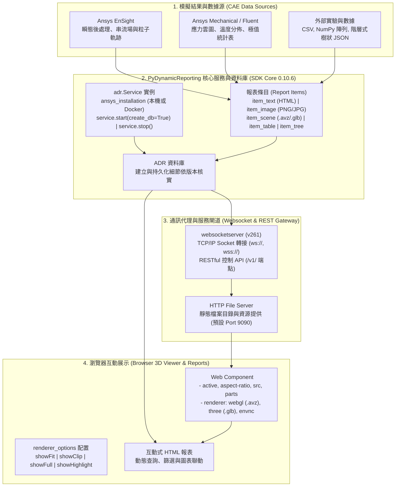

# Ansys Dynamic Reporting (ADR) 知識字典

> 範圍說明：本字典是依目前已取得的 ADR 文件所作的**部分整理**，不是 ADR 全產品或完整 API 的全面梳理。已整理主題包括 `ansys-dynamicreporting-core` 0.10.6 的部分服務／資料庫教學，以及 ADR 2026 R1 (`v261`) 的部分 websocketserver 和 3D viewer 指南。文件清冊另有版本未知、v252、v261 文件與 tutorial inputs；API reference 類別仍缺，尚未逐章覆核。版本標為 unknown 的頁面不推定版本，也不能將 SDK 套件版本等同於伺服器版本。逐來源狀態及待辦見[ADR 來源覆核紀錄](../maintenance/knowledge_dictionary_passes/2026-11-02/adr_sources_review_20261103.md)。

---

## 部分來源所示架構（概念示意，非完整資料流）

下圖只整理本字典引用內容中的元件類型。線條表示概念關聯，不代表唯一資料流、部署拓撲或所有產品組合；SDK 資料庫格式及圖中的各 CAE 來源亦未在本輪逐一核實。



---

## 主題辭典與核心模組

### 1. PyDynamicReporting 服務 (PyDynamicReporting Service Lifecycle)

#### 核心概念與辭典定義 (Core Concepts & Glossaries)
- **`adr.Service` 服務物件**：
  - `ansys.dynamicreporting.core.Service` 是控制 ADR 後台報表伺服器進程的中央管理者。
  - 負責服務的部分生命週期操作；本輪來源未完整證實執行環境、暫停行為或資料庫內部格式。
- **服務啟動與參數解析**：
  - **本機安裝模式**：
    ```python
    import ansys.dynamicreporting.core as adr
    service = adr.Service(ansys_installation=r"C:\Program Files\ANSYS Inc\v261", db_directory=r"C:\Reports\DB")
    session_guid = service.start(create_db=True, port=8000)
    ```
    - `ansys_installation`：指向 Ansys 根目錄；
    - `db_directory`：資料庫儲存目錄；
    - `create_db=True`：指示若資料庫不存在則初始化新建；
    - `port`：指定 Web/REST 服務監聽埠號（預設為隨機可用埠或自訂）。
  - 本字典目前沒有足夠來源支持 Docker 自動拉取映像或完整生命週期狀態，故不作為已確認規格。
- **生命週期終止 (`stop()`)**：
  - SDK tutorial 範例展示呼叫 `service.stop()`；本輪來源不足以確認此操作必然 flush 磁碟快取、資料完整性保證或跨版本的服務端影響。若連線的是共享服務，應先確認部署與權限，並避免未授權停止。

#### 手冊章節與規格出處 (Manual & Doc Citations)
- **手冊出處**：*PyDynamicReporting Getting Started & Launch Service* ([Launch Service Tutorial](../ANSYS_Document/ADR/sdk/ansys-dynamicreporting-core/0.10.6/tutorial/dd64195d5f35-00-launch-reporting-service.md)), ([Examples Index](../ANSYS_Document/ADR/sdk/ansys-dynamicreporting-core/0.10.6/tutorial/6d6833569974-index.md))
- **Source IDs**：`sources.csv#ansys_8327e3a6911b8d728cb12734`, `sources.csv#ansys_39c806e066c8943d65ef0ab4`.

---

### 2. 資料庫建立 (Database Creation & Item Payload Population)

#### 核心概念與辭典定義 (Core Concepts & Glossaries)
- **資料庫建立前置條件**：現有教學可用來追查 `create_db=True` 建立流程；「目標目錄必須完全空白」及非空時的例外行為尚未在本輪重新核實原文。操作前先備份並依所用版本確認 API 要求，不要依未核實描述清空或覆寫目錄。
- **報表條目型別體系 (Item Payload Types)**：
  - 透過 `service.create_item()` 建立不同物理形態的展示單元：
    1. **文字條目 (`item_text`)**：支援純文字與標準 HTML 標籤（如排版、色彩、段落）；
    2. **影像條目 (`item_image`)**：載入本機 PNG/JPG 渲染截圖或相片；
    3. **3D 場景條目 (`item_scene`)**：載入 `.avz` (Ansys 3D 輕量化幾何格式) 或 `.glb` 模型，供瀏覽器端三維自由旋轉縮放；
    4. **表格與數值圖表 (`item_table`)**：接受 NumPy 二維陣列或 Pandas DataFrame，可設定 `labels_row` 與 `labels_column` 自動生成數據表格或折線圖；
    5. **階層樹狀條目 (`item_tree`)**：接受 Python 字典結構組成的樹狀拓撲，支援節點層級與展開/收合狀態 (`expanded`/`collapsed`)。
- **工作階段過濾 (Session Filtering & Tags)**：
  - 每個 Item 建立時可附帶 `tag` 標籤與元數據。
  - 報表預覽時可利用過濾表達式（例如 `item_filter=f"A|s_guid|cont|{session_guid}"`）進行動態過濾，僅呈現當前分析工況所產生的結果項目。

#### 手冊章節與規格出處 (Manual & Doc Citations)
- **手冊出處**：*Create a Database and Populate It* ([Create DB Tutorial](../ANSYS_Document/ADR/sdk/ansys-dynamicreporting-core/0.10.6/tutorial/c5c10ef78062-01-create_db.md))
- **Source IDs**：`sources.csv#ansys_e757eaf98dbeabb8239a1309`.

---

### 3. 連線既有服務 (Connecting to Existing ADR Service)

#### 核心概念與辭典定義 (Core Concepts & Glossaries)
- **跨進程與多客戶端連線架構**：
  - 當 ADR 報表服務已在本機背景或遠端伺服器運行時，其他 Python 腳本或分析程序無需重新啟動伺服器，而是透過 URL 直接掛載：
    ```python
    connected_service = adr.Service()
    connected_service.connect(url="http://localhost:8000")
    ```
- **多工況資料庫共享與隔離**：
  - 多個並行計算任務（例如不同的優化設計點 Design Points）可同時連線至同一個 ADR Service。
  - 每個客戶端建立的 Item 都會即時寫入該中央資料庫；
  - **資料隔離實踐**：各計算腳本應使用其唯一的 `session_guid` 為其建立的 Items 打上標籤，報表產生時藉由 Session Filter 實現分組過濾與橫向對比。
- **服務停止與權限待查**：本機官方範例展示連線既有服務後呼叫 `stop()`，未說明各角色的授權邊界。實際可否停止服務須依版本、部署與權限確認；停止共享服務會影響其他使用者。[來源：Launch Service 範例](../ANSYS_Document/ADR/sdk/ansys-dynamicreporting-core/0.10.6/tutorial/dd64195d5f35-00-launch-reporting-service.md)

#### 手冊章節與規格出處 (Manual & Doc Citations)
- **手冊出處**：*Connect Services Tutorial* ([Connect Services Guide](../ANSYS_Document/ADR/sdk/ansys-dynamicreporting-core/0.10.6/tutorial/53023f23c0d6-02-connect.md))
- **Source IDs**：`sources.csv#ansys_aa9fb98999f3a3b6e59bc3c6`.

---

### 4. Web viewer 初始化 (Web 3D Viewer Component Initialization)

#### 核心概念與辭典定義 (Core Concepts & Glossaries)
- **`<ansys-adr-viewer>` 網頁自訂元件 (v261 / 2026 R1)**：
  - 現代 ADR 提供純瀏覽器端渲染的 Web Component，底層透過 WebGL 渲染 3D 幾何與雲圖場。
  - 透過 `<script src="/ansys261/nexus/viewer-loader.js"></script>` 引入載入器，並在 HTML 中宣告自訂元素：
    ```html
    <ansys-adr-viewer id="main-viewer" src="model.avz" active="true" aspect-ratio="1.777"></ansys-adr-viewer>
    ```
- **核心屬性 (Component Properties)**：
  - `active`：布林值。`true` 啟動 WebGL 即時 3D 畫布；`false` 顯示占位圖片 (`proxy_img`) 以節省瀏覽器 GPU 資源。
  - `aspect-ratio`：設定後高度為動態寬度除以該值；`proxy` 使用 proxy image 比例。文件稱元件填滿父元素，不支援明確指定寬高。
  - `src` 與格式對應：
    - `webgl` 渲染器：支援 `.avz`、`.dsco`、`.scdoc`、`.scdocx`；
    - `three` 渲染器：本地 v261 原文列出 `.glb`、`.obj`（未列 `.gltf`）；
    - `envnc` 渲染器：支援 `.evsn`，需透過 websocketserver 遠端串流。
  - `parts`：唯讀屬性，回傳當前 3D 模型包含的所有組件/零件名稱清單。
- **渲染器進階選項 (`renderer_options`)**：
  - 以 JSON 字串格式在元素建立時傳入（建立後唯讀）：
  - **重要預設差異**：若完全未設定 `renderer_options`，系統僅預設啟用 `showFit`、`showClip`、`showFull`；若傳入 `'{}'` 空物件，系統預設會開啟所有工具箱，需手動以 `"showFileOpen": false` 關閉不必要的 UI 按鈕。
- **事件與方法 (Events & Methods)**：
  - `parts-changed`：模型載入完成或組件拓撲變更時觸發；
  - `renderImage()`：直接自 3D 畫布抓取並返回目前視角的 Base64 RGB 圖片 Data URL；
  - `setAttributes(target, name, values)`：可動態修改指定零件的顏色 (`color`)、透明度與邊界顯示 (`edge_color`)。

#### 手冊章節與規格出處 (Manual & Doc Citations)
- **手冊出處**：*ADR 3D Viewer Web Component 2026 R1* ([Getting Started](../ANSYS_Document/ADR/v261/guides_and_tutorials/adr-3d-viewer-web-component-2026-r1/getting-started.md)), ([Properties](../ANSYS_Document/ADR/v261/guides_and_tutorials/adr-3d-viewer-web-component-2026-r1/properties.md)), ([Methods](../ANSYS_Document/ADR/v261/guide/47853f1b36bb-methods.md)), ([Events](../ANSYS_Document/ADR/v261/guide/91cd097b9f4c-events.md))
- **Source IDs**：`sources.csv#ansys_d3eaef6792afff7aa1813183`, `ansys_296b358b0b656392155f5ae4`.

#### Python 與 HTML 程式範例：資料庫建立、條目注入與 Web Viewer 整合

```python
# -------------------------------------------------------------
# Part 1: Python PyDynamicReporting (ansys-dynamicreporting-core 0.10.6)
# -------------------------------------------------------------
import os
import numpy as np
import ansys.dynamicreporting.core as adr

# 1. Ensure target database directory is completely empty
db_folder = r"C:\Simulations\ADR_Output\Run_01"
if not os.path.exists(db_folder):
    os.makedirs(db_folder)

# 2. Launch ADR reporting service
ansys_install = r"C:\Program Files\ANSYS Inc\v261"
service = adr.Service(ansys_installation=ansys_install, db_directory=db_folder)
session_guid = service.start(create_db=True, port=8000)
print(f"ADR Service started on port 8000 with session: {session_guid}")

# 3. Add text narrative item
text_item = service.create_item()
text_item.item_text = "<h2>Simulation Validation Report</h2><p>Structural stress and deformation results.</p>"
text_item.set_tags("type=header;analysis=static_structural")

# 4. Add tabular result data
table_item = service.create_item()
data_matrix = np.array([
    ["Component", "Max Stress (MPa)", "Safety Factor"],
    ["Bracket_Main", "245.8", "1.85"],
    ["Bolt_M12", "410.2", "1.42"],
    ["Housing_Cover", "112.5", "2.60"]
])
table_item.item_table = data_matrix[1:, :]
table_item.labels_column = data_matrix[0, :].tolist()
table_item.set_tags("type=summary_table")

# 5. Connect from second client instance to verify multi-session connectivity
secondary_client = adr.Service()
secondary_client.connect(url=service.url)
print("Secondary client successfully connected to running ADR service.")

# Clean up and stop service
service.stop()
```

```html
<!-- Part 2: Browser 3D Viewer Integration (HTML & Web Component v261) -->
<!DOCTYPE html>
<html lang="en">
<head>
    <meta charset="UTF-8">
    <title>ADR 3D Interactive Model Viewer</title>
    <!-- Load ADR Viewer Component Loader from Nexus server -->
    <script src="http://localhost:8000/ansys261/nexus/viewer-loader.js"></script>
    <style>
        .viewer-container {
            width: 800px;
            height: 450px;
            border: 1px solid #ccc;
        }
    </style>
</head>
<body>
    <div class="viewer-container">
        <!-- Declare ansys-adr-viewer custom element with renderer options -->
        <ansys-adr-viewer 
            id="cae-3d-viewer" 
            src="http://localhost:8000/media/bracket_stress_model.avz" 
            active="true" 
            aspect-ratio="1.777"
            renderer_options='{"showFit": true, "showClip": true, "showFull": true, "showFileOpen": false}'>
        </ansys-adr-viewer>
    </div>

    <script>
        const viewer = document.getElementById("cae-3d-viewer");
        // Listen for parts-changed event when AVZ model geometry is parsed
        viewer.addEventListener("parts-changed", () => {
            console.log("3D Model Parts loaded:", viewer.parts);
        });
    </script>
</body>
</html>
```

#### 工程實務踩坑與注意事項 (Gotchas, Limitations & FAQ)
- **踩坑 1：不要把未覆核的目錄限制當成操作指令**：
  - 目前來源確認教學示範 `start(create_db=True)`，但本輪未確認非空目錄的精確行為；不要自動清除既有目錄。先備份並按實際 SDK 版本核實。
- **踩坑 2：Web Viewer 屬性名稱拼寫差異**：
  - 官方 v261 文件在不同章節中存在拼寫歧義：例如在 HTML 標籤中使用連字號 `aspect-ratio` 與 `proxy-img`，但在 JavaScript API 物件中則使用底線 `aspect_ratio` 與 `proxy_img`。不要假設 HTML attribute、JS property 與 `setAttribute()` 名稱可互換；依該版原文 API 核對。
- **踩坑 3：`renderer_options` 在元件載入後修改無效**：
  - `renderer_options` 僅在 Web Component 初始化 realized 階段被解析一次，之後成為唯讀屬性。若在執行期透過 JavaScript 動態修改 `viewer.renderer_options = "..."`，底層 WebGL 渲染管線將直接忽略。如需改變工具欄或模式，必須透過特定的 API 方法（如切換全螢幕或剖面控制）。

---

## 來源與跨主題鏈結 (Cross-Topic Links)

- [EnSight 後處理字典 (ensight.md)](ensight.md) · EnSight 3D AVZ 場景與動畫匯出至 ADR 報表
- [Workbench 專案整合 (workbench.md)](workbench.md) · 設計點 (Design Points) 參數化報表批次生成
- [來源清冊](sources.csv) · `sources.csv#ansys_8327e3a6911b8d728cb12734`, `sources.csv#ansys_39c806e066c8943d65ef0ab4`, `sources.csv#ansys_e757eaf98dbeabb8239a1309`, `sources.csv#ansys_aa9fb98999f3a3b6e59bc3c6`, `sources.csv#ansys_d3eaef6792afff7aa1813183`, `sources.csv#ansys_296b358b0b656392155f5ae4`.

---

### 5. websocketserver：HTTP REST API 與權杖保護（2026 R1）

- 只有指定 `--http_directory` 才啟用 HTTP 服務；HTTP 使用 `--http_port`（文件列預設 9090）。Websocket 監聽埠是位置參數 `ws_server_port`，兩者不是同一埠。
- `GET /v1/stop` 關閉 server；`/v1/status` 回 JSON；`/v1/status_view` 回 HTML 狀態表；`/v1/reserve/{servicename}` 建立預約；`/v1/release/{token}` 釋放 token。端點使用 HTTP server 埠。
- REST API 可由 `WEBSOCKETSERVER_SECURITY_TOKEN` 環境變數或 `--security_token` 設定共享密鑰。設定後每個 REST GET 要帶 `security_token` query 欄位，缺少時回 401。這不代表 websocket、靜態 HTTP 檔案或所有 ADR 服務均受同一保護。
- **來源**：`v261/guides_and_tutorials/adr-websocket-server-2026-r1/rest-api.md`，小節「REST API」「Security token」；`command-line-options.md` 小節「usage」「HTTP based services」。

### 6. websocketserver：外部服務預約與生命週期（2026 R1）

- 外部服務以 JSON 配置服務名稱、啟動 script、最大同時數 `count` 與 `options`。script 建立 `RemoteServiceScript` 子類別負責啟停；系統傳入的 instance index 可用來避免埠號、節點或 GPU 等資源衝突。
- 使用前先透過 REST API 預約取得 token，並將 token 放入 websocket stream URL。文件指出連線中斷時 server 會安排停止所啟動的應用；token 應視為不含空白的短字串，不依賴它必然是 GUID。
- `options.group` 若設為 ADR 管理群組名稱，可限制服務類型僅供該群組成員使用；`file_ext` 可列出服務支援檢視的副檔名。`--timeout` 未指定時，預約閒置逾時為 300 秒。
- **來源**：`external-services.md` 小節「Service Configuration」及預約流程；`command-line-options.md` 小節「timeout option」。

### 7. websocketserver：HTTP 靜態檔案及 EnSight REST 轉接

- HTTP server 對 `--http_directory` 根目錄提供唯讀檔案；`/v1/` 保留給 REST API，`/ansys/` 用來提供 ADR viewer 資源，例如 `ansys###/nexus/viewer-loader.js`。
- 文件稱從 EnSight 2024 R1 起可透過 websocketserver 暴露 EnSight REST API；需設定 `--grpc_port` 建立 gRPC 連線，並提供 security key 作為 REST API 的 `sessionid`。這是文件描述的條件，非實際部署或授權驗證結果。
- **來源**：`http-server.md` 小節「Ansys ADR Viewer Service」「EnSight REST API Service」；`command-line-options.md` 小節「grpc_port」「HTTP based services」。

### 8. 3D viewer Properties：來源格式與設定邊界（2026 R1）

- v261 Properties 列出的格式：`webgl` 支援 `.avz`、`.dsco`、`.scdoc`、`.scdocx`；`three` 支援 `.glb`、`.obj`；`envnc` 支援 `.evsn`。`src_ext` 可在資料 URI 無法推斷格式時補副檔名。
- `guid` 預設只保證同一頁面內 viewer 元件 pseudo-GUID 唯一，且只能在元素建立時指定。`renderer_options` 是 renderer 專屬 JSON 字串、唯讀且元件 realized 後不能更改；一般會忽略不認得的選項。
- `renderer_options` 未指定時，文件列 WebGL 預設啟用 `showFit`、`showClip`、`showFull`；傳 `{}` 則所有 `show*` 選項預設啟用。不要將此預設泛化到其他 renderer。
- **來源**：`v261/guide/dafa7a6a8d7d-properties.md` 小節「Properties」「Renderer options」「webgl Specific options」。

### 本字典尚未整理的範圍

ADR 文件清冊現有 46 筆（unknown 24、v252 1、v261 21），其中正文 40 筆、tutorial inputs 附件 6 筆；官方 README 將 `api_reference`、`tutorial_inputs` 列為待補類別。現有字典僅覆核少量 SDK 教學及 v261 viewer/websocketserver 頁，不能代表其餘文件已讀或已納入檢索。unknown 版本維持未知；附件不視為已轉換正文。逐檔及章節待辦見來源覆核紀錄。


## tutorial 附件文字補件

三組教學各有 Notebook 與 Python 附件，共六份。補件保留程式與 Notebook 的 Markdown／code cells，並連回原始附件及來源 ID；Notebook outputs、圖片及其他附件未擷取，產品 release unknown，範例未執行。

- [00-launch-reporting-service.ipynb](ANSYS_Document/adr_example_inputs_20261104/tutorial/ansys_0671682345351cff6d1a404f/adr.md)（`sources.csv#ansys_0671682345351cff6d1a404f`）
- [00-launch-reporting-service.py](ANSYS_Document/adr_example_inputs_20261104/tutorial/ansys_f482d914c41a271679f821b9/adr.md)（`sources.csv#ansys_f482d914c41a271679f821b9`）
- [01-create_db.ipynb](ANSYS_Document/adr_example_inputs_20261104/tutorial/ansys_885db7a6c8566c67e3d34dae/adr.md)（`sources.csv#ansys_885db7a6c8566c67e3d34dae`）
- [01-create_db.py](ANSYS_Document/adr_example_inputs_20261104/tutorial/ansys_8265128ceb4ed943c408d0b2/adr.md)（`sources.csv#ansys_8265128ceb4ed943c408d0b2`）
- [02-connect.ipynb](ANSYS_Document/adr_example_inputs_20261104/tutorial/ansys_e36ab2f9709d082093f5aaf4/adr.md)（`sources.csv#ansys_e36ab2f9709d082093f5aaf4`）
- [02-connect.py](ANSYS_Document/adr_example_inputs_20261104/tutorial/ansys_fc9955b74ef20f8e2b88853f/adr.md)（`sources.csv#ansys_fc9955b74ef20f8e2b88853f`）

逐檔 SHA、cell 數及狀態見 [轉換清冊](../maintenance/knowledge_dictionary_passes/2026-11-04/acp_adr_systemcoupling_attachment_text_recovery.csv)。


## 2026-11-04：Wave 5 本機來源盤點與限制說明

本批完成 adr 模組既有本機 catalog 文件（共 46 筆）與 sources 清冊（共 46 筆）之完整雜湊、正文路徑與標籤結構核對。本機未快取或具備企業授權/登入限制之線上主題誠實標記為缺口（保持現有非 complete 狀態），未擅自虛構未核實之線上 API 簽名或執行求解運算。

詳細稽核數據見 [本批轉換報告](../maintenance/knowledge_dictionary_passes/2026-11-04/adr_module_conversion_report_20261104.md)。
