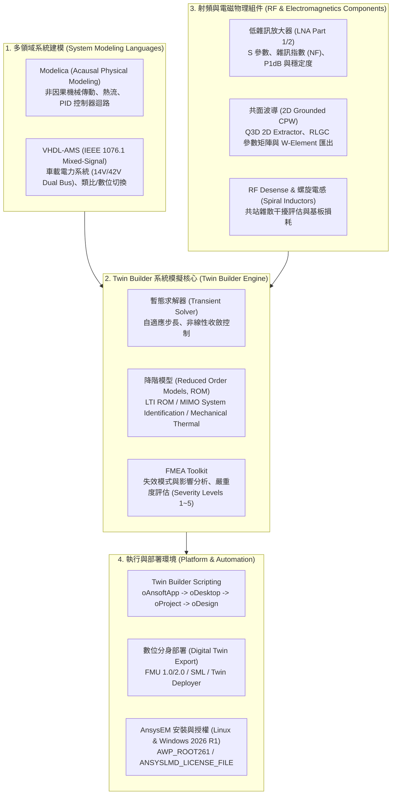

# Ansys Electronics / AnsysEM 文件集合字典

> `AnsysEM` 是本機綜合電磁、射頻與系統模擬文件資料夾，涵蓋 Twin Builder 系統與多物理整合、Modelica 與 VHDL-AMS 混合訊號建模、RF 低雜訊放大器 (LNA)、共面波導傳輸線 (GCPW) 以及 Release 2026 R1 (v261) 跨平台安裝體系。本頁依手冊來源標題與官方規格深度整理，相關求解器請參閱 [AEDT 主題字典](aedt.md)、[HFSS 主題字典](hfss.md)、[EMIT 主題字典](emit.md)、[Circuit 主題字典](circuit.md) 與 [安裝與授權主題字典](installation_and_licensing.md)。

---

## 領域架構圖 (AnsysEM & Twin Builder Ecosystem)



---

## 主題辭典與核心模組

### 1. Twin Builder 入門與 scripting

#### 核心概念與辭典定義 (Core Concepts & Glossaries)
- **Twin Builder 物件導航階層 (Automation Object Model)**：
  - **`oAnsoftApp`**：頂層 COM/gRPC 進入點。
  - **`oDesktop`**：桌面管理器，掌管專案開閉與執行環境配置。
  - **`oProject`**：專案容器，容納材料、全域變數與系統設計清單。
  - **`oDesign`**：Twin Builder (Simplorer) 設計實體，掌管局部變數、接腳網絡與模擬器配置。
  - **`oEditor`**：原理圖編輯器（固定為 `"SchematicEditor"`），負責放置電阻、電容、半導體開關、Modelica 模組及線路連接 (`CreateWire`)。
  - **`oModule`**：特定分析模組，包含 `AnalysisSetup` (設定暫態模擬步長)、`Optimetrics` (參數掃描與最佳化) 及 `ReportSetup` (繪製波形與狀態圖)。
- **腳本支援邊界 (Scripting Boundaries & Unsupported Components)**：
  - 手冊明確指出：**Reporter Editor 沒有獨立的 editor object**，其圖表命令統一由 `oDesign` 執行。
  - **不支援自動化腳本的 UI 元件**：Toolkit 項目、元件特性精靈 (Device Characterization Wizard)、內部模型編輯器 (Model Editors) 以及使用者自訂文件 (UDDs)。

#### 官方手冊章節與規格出處 (Manual & Doc Citations)
- **手冊來源**：*Twin Builder Scripting Guide (Release 2026 R1 / v261)*
- **章節定位**：
  - Scripting Object Model: [PDF physical Pages 35–38](<../ANSYS_Document/AnsysEM/v261/manuals/Twin BuilderScriptingGuide.pdf#page=35>) · `ansys_e2015fd51a1489ef0cb0e453`
  - Recording, Storing, and Running Scripts: [PDF physical Pages 38–40](<../ANSYS_Document/AnsysEM/v261/manuals/Twin BuilderScriptingGuide.pdf#page=38>)
- **資料庫引用標籤**：`sources.csv#ansys_e2015fd51a1489ef0cb0e453`, `sources.csv#ansys_290df1af137adc1f87f84e60`

#### 腳本物件的原文界線
Scripting Guide 實頁 36 將 `GetAppDesktop()` 定義為 `oAnsoftApp` 的方法；本頁不提供未經該文件逐項核對的啟動、建立 design 與求解腳本。實際使用應依目標腳本環境及物件方法逐一回查原文。

#### 工程實務踩坑指南 (Gotchas & Limitations)
1. **Report 命令作用域混淆**：不要嘗試呼叫 `oEditor.CreateReport(...)`，因為在 Twin Builder 架構下報表生成權限在 `oDesign.GetModule("ReportSetup")` 或 `oDesign` 本身，否則會丟出 COM 物件缺少成員之錯誤。
2. **Desktop configuration 的用途**：`SetDesktopConfiguration` 設定 Tools > Options > General Options 中的 Desktop configuration；原文範例為 `"Twin Builder"`。它不是文件所述的關閉警告視窗介面。本頁沒有驗證無圖形模式下的對話框或程序生命週期。[Scripting Guide 實頁 87–88](<../ANSYS_Document/AnsysEM/v261/manuals/Twin BuilderScriptingGuide.pdf#page=87>)。

---

### 2. Twin Builder Modelica 與 VHDL-AMS tutorials

#### 核心概念與辭典定義 (Core Concepts & Glossaries)
- **Modelica 非因果多領域物理建模 (Acausal Multi-Domain Modeling)**：
  - **核心架構**：使用守恆定律（克希荷夫電流/力平衡定律）的微分代數方程組 (DAE)。
  - **PID 控制器教程流程**：整合機械旋轉傳動（慣量、彈簧阻尼器）與反饋控制迴路。包含 `KinematicPTP` (軌跡點規劃器)、`LimPID` (帶積分抗飽和限制的 PID 控制器)。
  - **關鍵編譯機制**：在圖形編輯器修改 Modelica Diagram 後，**必須執行 `Compile & Update Project` 並確認 `Apply Changes`**；否則原理圖上的元件將維持舊版的符號或接腳定義。
- **VHDL-AMS 混合訊號硬體描述語言 (IEEE 1076.1)**：
  - **核心架構**：支援連續時間類比微分方程 (`'DOT`, `'INTEG`) 與離散事件驅動 (`PROCESS`, `SIGNAL`) 混合模擬。
  - **車載雙電壓電力網路 (Automotive Powernet 14V/42V Dual Bus Benchmark)**：涵蓋發電機 (Alternator)、鉛酸電池 (Battery SoC 狀態監控)、DC-DC 升降壓轉換器、點火開關 (Ignition Switch) 及動力總成速度輪廓檔案讀取 (`FILE I/O`)。

#### 官方手冊章節與規格出處 (Manual & Doc Citations)
- **Modelica Tutorial 手冊**：*Twin Builder Modelica Tutorial (Release 2026 R1 / v261)*
  - PID Controller Setup & Compilation: [PDF physical Pages 29–45](<../ANSYS_Document/AnsysEM/v261/manuals/ModelicaTutorial.pdf#page=29>) · `ansys_de01c8d43557efde5397f603`
- **VHDL-AMS Tutorial 手冊**：*Twin Builder VHDL-AMS Tutorial (Release 2026 R1 / v261)*
  - Automotive Powernet Architecture & 6 Cases: [PDF physical Pages 23–27](<../ANSYS_Document/AnsysEM/v261/manuals/VHDLAMS Tutorial.pdf#page=23>) · `ansys_2d26285107e0ce6cbc6f4df0`

#### Modelica 與 VHDL-AMS 語法實作範例 (Modeling Code Examples)
```modelica
// =============================================================================
// Modelica Code: Simple Mechanical Spring-Damper with Initial Condition
// Note: ASCII-only comments to prevent parser encoding issues.
// =============================================================================
model SpringDamperSystem
  parameter Real c = 100.0 "Damping coefficient (N*s/m)";
  parameter Real d = 1000.0 "Spring stiffness (N/m)";
  Real s_rel "Relative displacement";
  Real v_rel "Relative velocity";
  Real f "Resulting force";

initial equation
  s_rel = 0.0;
  v_rel = 0.0;

equation
  v_rel = der(s_rel);
  f = d * s_rel + c * v_rel;
end SpringDamperSystem;
```

```vhdl
-- =============================================================================
-- VHDL-AMS Code: First-Order Low Pass Filter Entity and Architecture
-- Note: ASCII-only comments to prevent compiler encoding issues.
-- =============================================================================
library IEEE;
use IEEE.electrical_systems.all;

entity LowPassFilter is
  generic (
    R_val : real := 1000.0;
    C_val : real := 1.0e-6
  );
  port (
    terminal p_in, m_in   : electrical;
    terminal p_out, m_out : electrical
  );
end entity LowPassFilter;

architecture behavioral of LowPassFilter is
  quantity v_in across i_in through p_in to m_in;
  quantity v_out across i_out through p_out to m_out;
begin
  -- Differential equation for RC low pass circuit
  v_out + (R_val * C_val) * v_out'DOT == v_in;
end architecture behavioral;
```

#### 工程實務踩坑指南 (Gotchas & Limitations)
1. **Modelica 未編譯靜默失真**：若工程師在 Modelica Package 中新增了參數或變更初始方程，但未執行 **Compile & Update Project**，Twin Builder 在求解時將自動使用暫存快取的舊二進位模型，導致結果無法反映程式碼修改。
2. **Student Version 授權限制**：在學生版授權下，VHDL-AMS 不支援包含複雜 `PROCESS` 語句的自訂控制面板 (Case 5 Control Panel)，且系統元件總數受到嚴格配額限制。

---

### 3. RF Desense、waveguide、spiral 與 LNA 範例

#### 核心概念與辭典定義 (Core Concepts & Glossaries)
- **低雜訊放大器 (Low Noise Amplifier, LNA Part 1 & 2)**：
  - 核心物理指標：前級增益 ($S_{21}$)、輸入匹配 ($S_{11}$)、雜訊指數 (Noise Figure, NF) 與三階截斷點 (IIP3/OIP3)。
  - 非線性 Nexxim 求解器：支援諧波平衡法 (Harmonic Balance) 與大訊號 S 參數掃描。
- **2D 接地共面波導 (2D Grounded Coplanar Waveguide, GCPW)**：
  - **Q3D 2D Extractor**：專門抽取準微波傳輸線的單位長度分佈參數矩陣（電阻 $R$、電感 $L$、電導 $G$、電容 $C$）。
  - **W-Element 匯出機制**：將寬頻頻率掃描結果匯出為符合 Nexxim 與 HSPICE 規範的 Tabular W-Element 檔案 (`*.sp`)，供板級訊號完整性 (SI) 模擬。
- **RF Desense 與平面螺旋電感 (Spiral Inductors)**：
  - 射頻去敏現象：當強干擾源（例如功率放大器諧波）透過空間或基板耦合至敏感接收機前端時，導致有效噪聲底層抬升、動態範圍縮減。
  - 螺旋電感建模：需嚴格考慮高頻集膚效應 (Skin Effect)、鄰近效應與矽/砷化鎵基底介電損耗。

#### 官方手冊章節與規格出處 (Manual & Doc Citations)
- **LNA Part 1 & 2 手冊**：*Training Low Noise Amplifier Part 1/2 (Release 2026 R1 / v261)*
  - Part 1 (DC Bias & S-Parameters): [PDF physical Pages 5–15](<../ANSYS_Document/AnsysEM/v261/manuals/Training Low Noise Amplifier Part 1.pdf>) · `ansys_d91660a8c2305842aa32669e`
  - Part 2 (Non-linear IP3 & Noise): [PDF physical Pages 5–18](<../ANSYS_Document/AnsysEM/v261/manuals/Training Low Noise Amplifier Part 2.pdf>) · `ansys_ef73881bd840c636eb6d9198`
- **2D Coplanar Waveguide 手冊**：*2D Extractor: A 2D Grounded Coplanar Waveguide Model (Release 2026 R1 / v261)*
  - W-Element Export & Sweep: [PDF physical Pages 45–51](<../ANSYS_Document/AnsysEM/v261/manuals/2D Extractor A 2D Grounded Coplanar Waveguide Model.pdf#page=45>) · `ansys_de86a912f0e2c158198db7dc`

#### 腳本與 API 關鍵用法 (Python Scripting Example)
```python
# ==============================================================================
# Q3D 2D Extractor: Compute RLGC Matrix and Export W-Element SPICE Deck
# Note: ASCII-only comments to prevent IronPython encoding issues.
# ==============================================================================
from ansys.aedt.core import Q2d

# Initialize 2D Extractor for Grounded Coplanar Waveguide (GCPW)
q2d = Q2d(version="2026.1", non_graphical=True)

# Add conductor polygons representing center trace and ground planes
trace = q2d.modeler.create_rectangle(["0mm", "0mm", "0mm"], ["0.5mm", "0.035mm"], name="SignalTrace")
gnd_left = q2d.modeler.create_rectangle(["-1.0mm", "0mm", "0mm"], ["0.8mm", "0.035mm"], name="GndLeft")
gnd_right = q2d.modeler.create_rectangle(["0.7mm", "0mm", "0mm"], ["0.8mm", "0.035mm"], name="GndRight")

# Assign conductors
q2d.assign_single_conductor(trace.name, conductor_type="SignalLine")
q2d.assign_single_conductor(gnd_left.name, conductor_type="ReferenceGround")
q2d.assign_single_conductor(gnd_right.name, conductor_type="ReferenceGround")

# Setup Adaptive Frequency and Sweep
setup = q2d.create_setup("GcpwSetup")
setup.props["AdaptiveFreq"] = "5GHz"
sweep = setup.create_frequency_sweep(
    unit="GHz",
    freqstart=0.1,
    freqstop=20.0,
    num_of_freq_points=200,
    sweep_type="Interpolating"
)

# Solve analysis
q2d.analyze(setup.name)

# Export Nexxim / HSPICE tabular W-Element file
output_sp = r"C:\Models\gcpw_welement.sp"
q2d.export_w_element_data(setup_name=setup.name, sweep_name=sweep.name, file_path=output_sp)
print("W-Element file exported successfully to: " + output_sp)

q2d.release_desktop(close_projects=True, close_desktop=True)
```

#### 工程實務踩坑指南 (Gotchas & Limitations)
1. **未完成求解即匯出 W-Element**：W-Element 產生器嚴格依賴已完成收斂的頻率掃描資料。若在未求解 (`Analyze`) 的狀態下呼叫匯出函數，系統將拋出空資料矩陣例外或生成全為 0 的無效 `.sp` 檔案。
2. **GCPW 幾何與參考導體**：應依所分析的截面核對 reference conductors 與幾何。此手冊是一個 GCPW 教學案例，本頁沒有來源足以將遺漏導體的影響量化為通用百分比。

---

### 4. AnsysEM 安裝文件

#### 核心概念與辭典定義 (Core Concepts & Glossaries)
- **Ansys Electronics Suite 2026 R1 (v261) 部署架構**：
  - 支援作業系統：Windows 10/11 64-bit、Windows Server 2022；Linux Red Hat Enterprise Linux (RHEL) / Rocky Linux 8.x / 9.x、SUSE Linux Enterprise Server (SLES) 15。
  - **核心環境變數**：
    - `AWP_ROOT261`：指向安裝主根目錄（例如 `C:\Program Files\AnsysEM\v261\Win64` 或 `/ansys_inc/v261/AnsysEM`）。
    - `ANSYSLMD_LICENSE_FILE`：指定授權伺服器連線字串（例如 `1055@license-server.corp.local`）。
  - **通訊埠協議**：
    - FlexNet 授權通訊埠：預設 TCP 1055。
    - Ansys 授權互聯精靈 (Anslic_admin)：預設 TCP 2325。
    - gRPC 自動化服務端點：預設從 TCP 50051 向上動態尋找可用埠。
- **無圖形化伺服器 (Headless Linux Deployment)**：
  - 在無桌面環境的 Linux HPC 節點上執行 AEDT 求解器或批次腳本時，必須啟用虛擬幀緩衝區 (`Xvfb`) 或強制附加 `-ng` (Non-Graphical) 啟動旗標。

#### 官方手冊章節與規格出處 (Manual & Doc Citations)
- **手冊來源**：*AnsysEM Linux / Windows Installation Supplement (Release 2026 R1 / v261)*
- **章節定位**：
  - Windows Installation Requirements: `sources.csv#ansys_f550ec2bc518d2f830fe3d6e`
  - Linux Installation Requirements & Dependencies: `sources.csv#ansys_c72bf7f4c99e38badb975a75`
  - License Configuration: [Installation and Licensing 字典](installation_and_licensing.md)

#### 安裝與環境檢查實用腳本 (PowerShell Environment Validation)
```powershell
# ==============================================================================
# PowerShell Script: Verify AnsysEM 2026 R1 Installation & License Settings
# ==============================================================================
$AedtRoot = $env:AWP_ROOT261
$LicFile = $env:ANSYSLMD_LICENSE_FILE

Write-Host "--- Checking AnsysEM v261 Environment ---" -ForegroundColor Cyan

# Check AWP_ROOT261 variable and executable existence
if ([string]::IsNullOrEmpty($AedtRoot)) {
    Write-Warning "AWP_ROOT261 is not defined in system environment variables."
} else {
    Write-Host "AWP_ROOT261 found: $AedtRoot" -ForegroundColor Green
    $AedtExe = Join-Path $AedtRoot "ansysedt.exe"
    if (Test-Path $AedtExe) {
        Write-Host "AEDT Executable verified: $AedtExe" -ForegroundColor Green
    } else {
        Write-Error "AEDT Executable missing at: $AedtExe"
    }
}

# Check License Server definition
if ([string]::IsNullOrEmpty($LicFile)) {
    Write-Warning "ANSYSLMD_LICENSE_FILE is not defined!"
} else {
    Write-Host "License Server target: $LicFile" -ForegroundColor Green
}
```

#### 工程實務踩坑指南 (Gotchas & Limitations)
1. **防火牆阻斷 gRPC 動態連接埠**：在企業內網或雲端環境中，若僅放行了 50051 單一埠，當開啟第二個 AEDT instance 時，伺服器會嘗試綁定 50052，此時連線將被本機防火牆阻絕。建議在防火牆中針對 `ansysedt.exe` 進程建立入站允許規則，而非單一固定連接埠。
2. **Linux 缺少 Motif / OpenGL 運行庫**：在最小化安裝的 Linux 節點上，執行 `ansysedt` 常因缺少 `libXm.so.4` (openmotif) 或 Mesa OpenGL 依賴庫而直接崩潰。務必先執行系統套件管理器補齊 `openmotif` 與 `mesa-libGL`。

---

## 歷史流程、FMEA 與降階模型 (FMEA & ROM Reference Archive)

### Twin Builder：Failure Modes and Effects Analysis (FMEA)
FMEA Toolkit Manual 將流程定位為以 Twin Builder 模型逐一分析 component failure modes，再用 scenario 時間、severity conditions 和 traces 檢視結果。此詞條只整理手冊 Pages 5–11、13–14 的 toolkit 使用流程；不取代 library instruction manual 中個別 component、failure mode 和 severity block 的定義。

| 階段 | 手冊描述的操作 | 來源限制 |
| --- | --- | --- |
| 準備模型 | 安裝 FMEA Library；以 FMEA components 建立模型；先跑 normal mode 並確認結果；加入 state transition diagram 與 severity component；再開啟 FMEA Toolkit。 | Rectifier／diode 是教學案例；元件細節需查 library instruction manual。 |
| 設定 failure mode | Transition 使用 `FAULT_MODE` 和 `FMEA_MODE`；初始狀態設 `FAULT_MODE := 0`，運行時間超過 `T_FAIL` 時切換到 `FMEA_MODE`。 | 手冊稱 `T_START`、`T_FAIL` 為 reserved words；這是該 FMEA library 流程的約定。 |
| 設定起始時間 | `T_START` 用於 scenario 的時間 offset，使 failure section 的相對時間與模擬／command-value reference time 對齊。 | 手冊圖例中的時間區間只是例子，不能作為分析建議值。 |
| 選擇案例 | 選 design 及具有 failure modes 的元件；可在 GUI 選取，或匯入符合 toolkit 格式的 Excel instance list。按 `Add Setup`／`Update Setup` 建立 Optimetrics table。 | 手冊示例中每次只評估一個元件的一種 failure mode，並包含 no-fault baseline；示例表列數依元件與模式數而定。 |
| 建立 scenario | 設定 scenario start／fail time 後產生工作表：`FMEA_Scenario{#}` 複製原設計並保存時間設定，`Plot_Scenario{#}` 接收 post-process 結果。 | Scenario 是連續運行中要分段觀察的時間區間。 |
| 分析與結果 | 選 severity instance 和 traces，執行各 component/failure-mode case；可把 severity 結果寫入 FMEA Report sheet，並檢視各 trace 的 plot。 | severity 有 5 個 level，1 為最高優先級；severity block 與 threshold 由模型定義，手冊案例值不通用。 |

來源：[FMEA Toolkit Manual，PDF physical Pages 5–11、13–14](<../ANSYS_Document/AnsysEM/unknown/manuals/FMEA_Toolkit_Manual.pdf#page=5>) · `ansys_7cf3733a03d966fc207c5ab0`。

### Twin Builder：MIMO System Identification 與 LTI ROM
MIMO guideline 說明以 multi-input/multi-output step responses 建立 LTI ROM。文件建議線性系統，或只在可接受 operating range 內近似線性的系統，且 inputs 為 decoupled／linearly coupled。來源：[System Identification Toolkit MIMO Guideline](<../ANSYS_Document/AnsysEM/unknown/manuals/System Identification Toolkit MIMO Guideline.pdf#page=1>) · `ansys_fbaf935b8072ca03bbe8c2b3`。

### Mechanical Thermal 匯出資料建立 LTI ROM（歷史流程）
本機 guideline 共 11 實頁。封面（實頁 1）標示 **Simplorer 18.2**，啟動 toolkit 的步驟（實頁 5）卻寫 **Start Simplorer R18.0**；文件內沒有勘誤或版本對照足以裁定適用版本。PDF metadata 的 2017 年建立日期也不能消除這個差異，因此產品 release 維持 unknown，版本相容主題仍為 `pending_version_review`。

該案例將 Internal Heat Generation／Heat Flow 當輸入，Temp1／Temp2 當輸出；所有溫度輸出改成 Kelvin，每次只啟用一個輸入以產生獨立 step responses。對流在這個案例被視為內部效果，不能延伸為所有熱模型的固定處理方式。

| 檔案 | 歷史 guideline 的資料契約 |
|---|---|
| `inputname.outputname.out` | 每個 input/output 配對一檔；首兩列為 labels，資料區是 TAB 或空白分隔的兩欄 |
| `Input_PortNames.txt` | 第一列列出 inputs、第二列列出 outputs；名稱對應 response 檔名 |
| `Input_StepInputValues.txt` | 與 port names 相容的矩陣；實頁 4 以列對應 output、欄對應 input，記錄各 response 使用的 step input |
| `Input_ConPins.txt`（選用） | 第一個數字為 conservative pins 數量，其後列 pin name 與要合併的 input/output 配對 |

上述設定檔與 responses 要放同一資料夾。實頁 6 使用 Time Domain Vector Fitting 與預設參數作示範；實頁 7、9 分別比較訓練用輸入及改變後的輸入，沒有給出可採用的通用擬合誤差門檻。附帶 `.wbpz` 範例與 `MechanicalThermalStepResponseGeneration.js` 本輪未在 AnsysEM 文件目錄找到，未驗證當前產品中的 toolkit、script 路徑或 conservative-pin 行為。

來源：[版本文字，實頁 1](<../ANSYS_Document/AnsysEM/unknown/manuals/CreateLTIROMfromMechanicalThermal_Guideline.pdf#page=1>)、[輸出與設定檔，實頁 2–6 起點](<../ANSYS_Document/AnsysEM/unknown/manuals/CreateLTIROMfromMechanicalThermal_Guideline.pdf#page=2>)、[比較案例，實頁 7](<../ANSYS_Document/AnsysEM/unknown/manuals/CreateLTIROMfromMechanicalThermal_Guideline.pdf#page=7>) · `ansys_ddafd9fd3aaa1f2360fb1f33`。

### SPICE3 與 CMA 歷史遺留資料
兩份原件的歷史身份已由封面及正文核實；這個來源覆核不代表已驗證目前 AEDT／Nexxim 能接受其中全部語法或安裝流程。

#### SPICE3f3：原始電路檔的有界語法
146 實頁的手冊封面寫 **SPICE3 Version 3f3 User's Manual、May 1993、University of California Berkeley**。PDF metadata 的 2001 年建立／修改日期是該 PDF 檔的屬性，沒有把來源更新成 2001 年 SPICE release 的依據。來源清冊產品 release 仍為 unknown；手冊版本與出版日期另作歷史標示。

實頁 15–16 的原始檔規則包括：第一列必須是 title，最後一列是 `.END`；延續列在第 1 欄使用 `+`；接地節點名稱是 `0`，SPICE3 將 node names 當字串，因此 `0` 與 `00` 不同。scale factor 中 `m` 是 milli、`Meg` 是 mega；文字後綴不能取代確認原始數值與量綱。這些規則限於此 Berkeley SPICE3f3 文件。

來源：[封面，實頁 1](<../ANSYS_Document/AnsysEM/unknown/manuals/Spice_3f3_Users_Manual.pdf#page=1>)、[Circuit Description，實頁 15–16 起點](<../ANSYS_Document/AnsysEM/unknown/manuals/Spice_3f3_Users_Manual.pdf#page=15>) · `ansys_a9e84ee29778a10ee0decfd8`。

#### CMA Win64：套件與 CPM 工作流
22 實頁的 CMA 封面是 **June 2017**，頁腳寫 June 7, 2017、©2015、ANSYS Confidential；**v18.1.1** 由實頁 2 的 `CMA_Win64_v18.1.1.zip` 套件名確認，不能只由檔名判定。三種 setup 類型是 Typical／Compact／Custom；授權檔可於安裝時或啟動 CMA 時加入。

實頁 8 說此套件不含 Nexxim，要先在 Tools > simulators 設定模擬器路徑。實頁 9–10 的 Hspice 安裝及 `SNPSLMD_LICENSE_FILE`、`Installdir` 等設定使用 L-2016.06-SP1-1 作例子；此處只保存其歷史前提，沒有驗證當前 Hspice 相容性。CPM 案例流程為建立 case、匯入 CPM 或建立 pseudo CPM、Validation Setting 加入 channel／連線、Connection 做 node mapping，再於 Simulation 選模擬器與設定後執行 CPM Validation。原文圖中數值未轉為通用建議。

來源：[日期／套件，實頁 1–2 起點](<../ANSYS_Document/AnsysEM/unknown/manuals/CMA_Wind64_Get_Started_Guide_V18.1.1.pdf#page=1>)、[安裝及模擬器，實頁 3–10 起點](<../ANSYS_Document/AnsysEM/unknown/manuals/CMA_Wind64_Get_Started_Guide_V18.1.1.pdf#page=3>)、[CPM 流程，實頁 12–17 起點](<../ANSYS_Document/AnsysEM/unknown/manuals/CMA_Wind64_Get_Started_Guide_V18.1.1.pdf#page=12>) · `ansys_1545b07de1d697741997d90b`。本機保留的 confidential 文件及衍生摘要依原來源條件使用。

---

## 跨主題與模組雙向鏈結 (Cross-Topic References)
- [AEDT 主題字典](aedt.md)：AEDT 跨求解器連線、桌面層級管理與通用專案架構。
- [HFSS 主題字典](hfss.md)：HFSS 3D 高頻電磁場分析與天線設計。
- [EMIT 主題字典](emit.md)：射頻系統級干擾與去敏 (RF Desense) 分析。
- [Circuit 主題字典](circuit.md)：Nexxim 類比與射頻電路求解器。
- [安裝與授權字典](installation_and_licensing.md)：Ansys License Manager 授權伺服器安裝與問題診斷。


## 2026-11-04：Wave 9 本機來源盤點與限制說明

本批完成 ansysem 模組既有本機 catalog 文件（共 27 筆）與 sources 清冊（共 27 筆）之完整雜湊、正文路徑與標籤結構核對。本機未快取或具備企業授權/登入限制之線上主題誠實標記為缺口（保持現有非 complete 狀態），未擅自虛構未核實之線上 API 簽名或執行求解運算。

詳細稽核數據見 [本批轉換報告](../maintenance/knowledge_dictionary_passes/2026-11-04/ansysem_module_conversion_report_20261104.md)。
