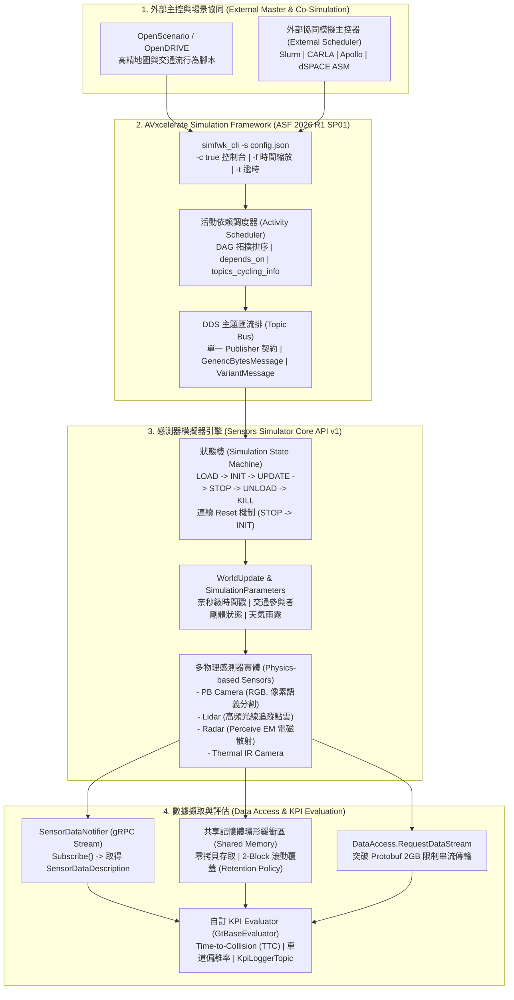

# AVxcelerate 開發與模擬架構知識字典

> 本主題深度剖析 Ansys AVxcelerate 自動駕駛高保真感測器模擬 (Sensors Simulator) 與模擬調度框架 (Simulation Framework, ASF)。系統化梳理 v251 與 2026 R1 (`v261`) 感測器 API 契約（Protocol Buffers / gRPC 服務狀態機：`LOAD`、`INIT`、`UPDATE`、`STOP`、`UNLOAD`、`KILL` 及非阻塞連續 Reset 機制）、世界狀態更新 (`WorldUpdate`) 與多感測器物理參數配置 (`SensorParameters`：相機、光達、雷達、紅外熱成像）、感測器資料擷取雙軌管線（gRPC 串流推播通知 vs 共享記憶體 Shared-Memory 零拷貝環形緩衝區與 2-Block Retention 策略）、ASF 2026 R1 SP01 週期與依賴排程引擎 (`simfwk_cli`、DAG 拓撲、時間縮放 `-f`、控制台服務）、以及基於 C++ / DDS 通訊的自訂獨立活動 (Standalone Activity) 與自訂安全關鍵績效評估器 (KPI Evaluator，如碰撞時間 TTC 計算)。

---

## 領域架構圖 (AVxcelerate Simulation & Sensor Architecture)



---

## 主題辭典與核心模組

### 1. API 與外部排程 (Sensors Simulator API & External Scheduling)

#### 核心概念與辭典定義 (Core Concepts & Glossaries)
- **感測器模擬器架構定位**：
  - AVxcelerate Sensors Simulator (AVX) 專注於提供基於物理的高保真感測器模型（相機光學傳播、光達雷射光束追蹤、毫米波雷達電磁散射）。
  - **重要架構邊界**：AVX 本身**不是**全域協同模擬的主控器。外部主控系統（如 CARLA、Apollo、dSPACE、或自訂測試台）負責推進離散時間步，並向 AVX 發送狀態命令；AVX 依序處理並回傳應答（Acknowledgment）。
- **Protocol Buffers / gRPC 介面版本演進**：
  - **v251 API**：以 `vss::simulation::Simulation` gRPC 服務定義核心調度流程。
  - **v261 (2026 R1) API v1**：交付標準化 API v1 規範，強化微服務部署、資源上傳器 (`ResourceUploader`)、及輕量化控制端點。
- **六階段狀態機生命週期 (Simulation State Machine)**：
  - 外部主控系統必須嚴格遵循狀態遷移次序，非法狀態下的呼叫將直接拋錯：
    1. `LOAD (Configuration)`：載入賽道 (Track)、3D 網格資產、感測器拓撲、自車 (Ego) ID 與部署參數；進入 `LOADED` 狀態。
    2. `INIT (WorldUpdate)`：傳入初始世界時間戳、主車與周圍交通參與者的初始空間座標（位置、旋轉矩陣四元數、線速度、角速度），進入 `RUNNING` 狀態。
    3. `UPDATE (WorldUpdate)`：在每個模擬時間步傳入環境與物件增量更新，觸發光線追蹤運算，生成當前幀感測器資料；保持 `RUNNING` 狀態。
    4. `STOP ()`：暫停模擬運算，由 `RUNNING` 轉移回 `LOADED` 狀態。
    5. `UNLOAD ()`：釋放 GPU 幾何與感測器記憶體，退回 `STARTED` 狀態；允許重新 `LOAD` 新場景而無需重啟後台 AVX 進程。
    6. `KILL ()`：強制終止 AVX 伺服器進程並釋放 gRPC 通訊埠。
- **v261 連續模擬 Reset 機制 (`STOP -> INIT`)**：
  - 在批次參數化或回歸測試中，v261 支援透過 `STOP -> INIT` 快速循環跳過耗時的資產載入 (`LOAD`)。
  - **邊界限制**：此 reset 流程只自動將感測器內部狀態與智慧照明系統重置回載入初始值；外部資產位置將保留上一輪最後狀態，必須在下一個 `INIT` 的 `WorldUpdate` 中重新明確賦值；且蒙地卡羅亂數噪聲種子不保證嚴格確定性。

#### 手冊章節與規格出處 (Manual & Doc Citations)
- **手冊出處**：*AVxcelerate Sensors Simulator API Reference (v251 & v261)* ([v251 API Introduction](../ANSYS_Document/AVxcelerate/v251/api_reference/6b2ce53fc660-index.md)), ([v261 API Description](../ANSYS_Document/AVxcelerate/v261/api_reference/avxcelerate-sensors-simulator-api-2026-r1/index.md))
- **Source IDs**：`sources.csv#ansys_649b3360fc98120585ea31cb`, `sources.csv#ansys_6d1f04895f5438cf7d37bda3`.

---

### 2. 世界更新與模擬參數 (WorldUpdate & Simulation Parameters)

#### 核心概念與辭典定義 (Core Concepts & Glossaries)
- **`WorldUpdate` 結構體核心欄位 (Protobuf Schema)**：
  - `simulation_time`：使用 `google::protobuf::Duration`，具備**奈秒級高解析度 (Nanosecond Resolution)**，嚴格單調遞增。
  - `environment_updates`：環境特徵動態變化，包含太陽天頂角、光照照度、降雨量 (mm/h)、霧氣消光係數（影響光達與相機視距）。
  - `object_updates`：包含自車與所有交通參與者（動態車輛、行人、障礙物）的 6-DOF 剛體運動狀態（Position X/Y/Z、Orientation Quaternion W/X/Y/Z、Linear Velocity、Angular Velocity）。
- **`SimulationParameters` 全域設定**：
  - 定義座標系原點與慣性系對齊標準（ISO 8855 或 FLU 車輛坐標系）。
  - `pixel_segmentation_mapping`：配置語義分割相機 (Semantic Segmentation) 的類別標籤與 RGBA 色彩對照表。
- **`SensorParameters` 感測器專屬參數**：
  - `identifier`：全域唯一識別字串，必須與 Sensor Configuration 中的配置完全吻合。
  - `ONEOF` 感測器型別矩陣：
    - `pb_cam_simulation`：基於物理的相機參數（感光元件物理尺寸、焦距、畸變多項式、動態範圍、曝光時間、快門模式 Global/Rolling Shutter）；
    - `lidar_simulation`：光達參數（雷射發射波長 905nm/1550nm、掃描頻率、垂直/水平視場角、光束發散角、最大探測距離）；
    - `radar_simulation`：雷達參數（載波頻率 77GHz、調頻連續波 FMCW 帶寬、Chirp 週期、天線陣列配置）；
    - `thermal_cam_simulation`：長波紅外 (LWIR 8~14um) 熱成像輻射率與環境溫度。
  - `serialize_data`：布林旗標（預設 `true`）。若使用共享記憶體且僅存取原始相機影像（Raw Image Buffer），可設為 `false` 消除 CPU 序列化開銷。
  - `deploy_node_id`：叢集分散式運算節點指定，未指定時預設在本地 GPU 運算。
  - `start_offset`：感測器相對於模擬起點的取樣啟動延遲（毫秒），用於模擬多感測器非同步觸發交錯。

#### 手冊章節與規格出處 (Manual & Doc Citations)
- **手冊出處**：*v251 Data Structures Reference* ([WorldUpdate Reference](../ANSYS_Document/AVxcelerate/v251/api_reference/48d685cb123f-structvss_1_1simulation_1_1_world_update.md)), ([SimulationParameters Reference](../ANSYS_Document/AVxcelerate/v251/api_reference/4cdf95c1f52f-structvss_1_1simulation_1_1_simulation_parameters.md)), ([SensorParameters Reference](../ANSYS_Document/AVxcelerate/v251/api_reference/5c2f0b491704-structvss_1_1simulation_1_1_sensor_parameters.md))
- **Source IDs**：`sources.csv#ansys_9334570324b431f9b58b5b27`, `sources.csv#ansys_f78f64ba8e7db0f1a28dc393`, `sources.csv#ansys_37033186119e8f74ea70fd39`.

---

### 3. 感測器資料擷取 (Sensor Data Acquisition & Memory Pipeline)

#### 核心概念與辭典定義 (Core Concepts & Glossaries)
- **通知服務與資料存取解耦架構**：
  - AVX 嚴格分離「數據就緒通知 (Notification)」與「數據本體存取 (Data Access)」：
    - `SensorDataNotifier`：客戶端呼叫 `Subscribe()` 建立持久 gRPC 串流，當某個感測器完成光線追蹤運算時，伺服器立即向該串流推送 `SensorDataDescription`，內含 `sensor_id`、時間戳與 `data_by_identifiers` 清單；
    - `DataAccess`：客戶端持通知中的識別元向伺服器請求具體數據區塊。
- **三種數據存取途徑與傳輸性能對比**：
  1. **標準 RPC 請求 (`DataAccess.RequestData`)**：透過單次 gRPC 呼叫回傳 `SensorDataBuffer`。受限於 Protobuf 單一訊息最大 2 GB 的二進位限制，不適合超高解析度原始雷達立方體 (Radar Data Cube)。
  2. **分塊 RPC 串流 (`DataAccess.RequestDataStream`)**：將大型緩衝區自動分塊為連續 Stream 傳輸，徹底繞過 2 GB 訊息上限。
  3. **本機共享記憶體 (Shared-Memory IPC)**：當消費端與 AVX 運行於同一台伺服器時，系統直接將感測器數據寫入作業系統共享記憶體段。客戶端藉由指標直讀，實現 **零拷貝 (Zero-Copy)** 極致傳輸吞吐。
- **資料保留原則 (Data Retention Policy)**：
  - **預設 2-Block 輪替**：AVX 記憶體池預設僅保留每個感測器最近 **2 個歷史資料區塊**。當第 $n$ 步的感測器資料生成時，系統自動標記並釋放第 $n-2$ 步的記憶體。
  - **重要邊界**：若消費端演算法（如深度學習目標檢測）運算延遲過長，未能及時讀取數據，舊資料將被直接覆蓋。可透過 `maxStoredData` 或 `retentionTimeFrame` 擴充緩衝佇列長度。

#### 手冊章節與規格出處 (Manual & Doc Citations)
- **手冊出處**：*v251 & v261 Data Access and Notification Services* ([DataAccess Reference](../ANSYS_Document/AVxcelerate/v251/api_reference/a84aecc4f2d9-classvss_1_1data__access_1_1_data_access.md)), ([SensorDataNotifier Reference](../ANSYS_Document/AVxcelerate/v251/api_reference/05a7abc45a69-classvss_1_1data__access_1_1_sensor_data_notifier.md)), ([Data Retention Guide](../ANSYS_Document/AVxcelerate/v261/api_reference/avxcelerate-sensors-simulator-api-2026-r1/desc/api-description.md#data-retention))
- **Source IDs**：`sources.csv#ansys_375928f4dea81284506a3b0b`, `sources.csv#ansys_fa1b8fbe98d8dc298c05b85a`.

---

### 4. Simulation Framework 排程 (Simulation Framework Scheduling & CLI)

#### 核心概念與辭典定義 (Core Concepts & Glossaries)
- **AVxcelerate Simulation Framework (ASF 2026 R1 SP01)**：
  - 面向複雜自動駕駛閉環測試的通用調度核心，負責協調主車動力學、真值生成器 (Ground-Truth Generator)、感測器模擬器、感知演算法與控制器模型。
- **依賴圖與週期調度機制 (Activity Dependency & Cycling)**：
  - 設定檔 `simulation_scheduling.activities` 定義參與迴圈的所有 Activities：
    - `primary activity`：真值生成器（通常為 `groundtruth_generator_activity`），為系統全域時鐘基準；
    - `depends_on`：定義 Directed Acyclic Graph (DAG) 拓撲依賴關係。下游活動僅在其所有前置依賴活動完成該步計算後方可步進；
    - `topics_cycling_info`：無依賴關係時設定固定週期時間 `topic_cycle_time_in_ms`（如相機 33ms 對應 30fps，光達 100ms 對應 10Hz）；
    - `type`：`built-in`（框架內建）或 `standalone`（外部獨立程序）。
- **`simfwk_cli` 命令列工具與互動控制器**：
  - `simfwk_cli -s <configuration.json>`：核心啟動指令。注意：**設定檔內的相對路徑均以 `simfwk_cli` 所在的 `bin` 目錄為基準**。
  - `-f <factor>`：相對真實時間的加速倍率。預設 `-f=-1.0` 表示「以計算能力盡可能最快速度執行」；設為 `1.0` 表示嚴格同步於真實時間（Hardware-in-the-Loop HIL 模式）。
  - `-c true`：拉起互動式 gRPC 控制伺服器（預設綁定 `0.0.0.0:50051`），支援透過命令列或外部 API 發送 `run`、`step`、`pause`、`resume`、`restart`、`kill` 動態控制模擬。

#### 手冊章節與規格出處 (Manual & Doc Citations)
- **手冊出處**：*Simulation Framework 2026 R1 SP01 Guides* ([Simulation Scheduling Guide](../ANSYS_Document/AVxcelerate/v261/guides_and_tutorials/avxcelerate-simulation-framework-2026-r1-sp01/getting-started/simulation_scheduling.md)), ([Command Line Tool](../ANSYS_Document/AVxcelerate/v261/guides_and_tutorials/avxcelerate-simulation-framework-2026-r1-sp01/getting-started/command_line_tool.md))
- **Source IDs**：`sources.csv#ansys_dec4212e17ed26e09c0b0138`, `sources.csv#ansys_1b0e0c1d4d232555550e0b74`.

---

### 5. 自訂 Activity 與 Evaluator (Customized Activity & KPI Evaluator)

#### 核心概念與辭典定義 (Core Concepts & Glossaries)
- **獨立活動開發契約 (Standalone Activity Protocol)**：
  - 繼承 C++ 基礎類別 `base_activity.h`，實作三大生命週期純虛擬函式：
    - `Initialize()`：初始化記憶體、訂閱與發布配置；
    - `ExecuteStep()`：核心運算步進，在每個排程週期被框架調用；
    - `TearDown()`：模擬結束時釋放連線與資源。
  - 透過 `StandaloneActivityService` 與 `IStandaloneActivityCreator` 自動接入 ASF 核心調度。
- **DDS 主題發布訂閱契約 (Topic Contract)**：
  - **重要拓撲鐵律**：在 ASF 架構中，**同一個 `TopicId` 在整個模擬網路中只允許存在一個 Publisher（發布者）**。若同一主題被多個節點發布，框架會拋出嚴重例外，以防止 Subscriber 消費到非確定性交錯數據。
  - 支援通用位元組訊息 `GenericBytesMessage`（可承載序列化 OSI / Open Simulation Interface Protobuf）與強型別 `VariantMessage`。
- **自訂安全關鍵績效評估器 (Customized KPI Evaluator)**：
  - 用於在模擬運行中即時判定自動駕駛演算法的行車安全指標（如最小碰撞時間 TTC、車道偏離量、最大減速度）。
  - **架構四要素**：
    1. `IKpi`：單一評估邏輯介面（計算當前時間步數值並判斷是否違背安全閥值）；
    2. `GtBaseEvaluator`：集中管理多個 KPI 評估器，從真值匯流排取得主車與目標物相對距離 $d$ 與相對速度 $v_{rel}$，計算碰撞時間：
       \[
       \text{TTC} = -\frac{d}{v_{rel}} \quad (v_{rel} < 0)
       \]
    3. `KpiContent`：單一 KPI 記錄結構體（包含 `timestamp`、`name`、`data_type`、`value`、`unit`）；
    4. `KpiLoggerTopic`：所有計算結果發布至日誌主題，由 Default KPI Logger 自動彙整並輸出為結構化 JSON 測試報告。

#### 手冊章節與規格出處 (Manual & Doc Citations)
- **手冊出處**：*Simulation Framework Customization Guides* ([Customized Activity](../ANSYS_Document/AVxcelerate/v261/guides_and_tutorials/avxcelerate-simulation-framework-2026-r1-sp01/user-guide/customized_activity.md)), ([Customized KPI Evaluator](../ANSYS_Document/AVxcelerate/v261/guides_and_tutorials/avxcelerate-simulation-framework-2026-r1-sp01/user-guide/customized_kpi_evaluator.md))
- **Source IDs**：`sources.csv#ansys_a0d24f55b30fc7e3d9c965f0`, `sources.csv#ansys_0eda6e634e164783cfec6625`.

#### C++ / Python 協同程式範例：自訂活動步進與 gRPC 世界更新

```cpp
// -------------------------------------------------------------
// Part 1: Standalone Activity Implementation in C++ (ASF 2026 R1 SP01)
// -------------------------------------------------------------
#include "base_activity.h"
#include "topic_registry.h"
#include <iostream>

class SafetyMonitorActivity : public simulation_framework::core::BaseActivity {
public:
    SafetyMonitorActivity() : BaseActivity("SafetyMonitorActivity") {}

    bool Initialize(const simulation_framework::core::StandaloneInitData& init_data) override {
        // Register subscriber to Ground Truth Trajectory Topic
        AddSubscriber(Topics::GroundTruthTrajectoryTopicId);
        std::cout << "[SafetyMonitor] Initialized successfully." << std::endl;
        return true;
    }

    bool ExecuteStep() override {
        // Retrieve current simulation context and timestamp
        uint64_t current_time_ns = GetCurrentTimestamp();
        
        // Execute safety threshold validation per step
        // In case of critical violation, signal emergency stop flag
        std::cout << "[SafetyMonitor] Step executed at timestamp: " << current_time_ns << " ns" << std::endl;
        return true;
    }

    void TearDown() override {
        std::cout << "[SafetyMonitor] Teardown complete." << std::endl;
    }
};
```

```python
# -------------------------------------------------------------
# Part 2: Python External Master Invoking AVX Sensors Simulator
# -------------------------------------------------------------
import grpc
import time

def send_world_update_step(stub, step_index, delta_time_s):
    """
    Constructs and dispatches WorldUpdate via gRPC to AVX simulator.
    Demonstrates external master stepping logic.
    """
    # Conceptual dictionary mirroring Google Protobuf schema
    world_update_payload = {
        "simulation_time": {"seconds": int(step_index * delta_time_s), "nanos": 0},
        "object_updates": [
            {
                "object_id": 1,  # Ego vehicle
                "position": {"x": step_index * 15.0 * delta_time_s, "y": 0.0, "z": 0.0},
                "velocity": {"linear": {"x": 15.0, "y": 0.0, "z": 0.0}}
            }
        ],
        "environment_updates": {
            "precipitation_rate": 0.0,
            "fog_density": 0.01
        }
    }
    
    # In production, call: stub.Update(world_update_proto)
    print(f"Dispatched WorldUpdate for Step {step_index} at t={step_index * delta_time_s:.2f}s")

if __name__ == "__main__":
    # Simulate 5 consecutive simulation clock steps
    for step in range(5):
        send_world_update_step(None, step, 0.05)
```

#### 工程實務踩坑與注意事項 (Gotchas, Limitations & FAQ)
- **踩坑 1：未注意 Topic 唯一發布者限制導致 Framework 崩潰**：
  - 在設定 `simulation_scheduling.json` 時，若不小心為兩個活動（例如動力學模型與自訂路徑控制器）指派發布相同的 `VehicleStateTopic`，ASF 在啟動檢查拓撲時會立即拋出 `DuplicateTopicPublisherException` 並終止進程。多輸入匯總必須建立中繼匯聚活動（Aggregator Activity）。
- **踩坑 2：Shared-Memory 緩衝區消費不及導致資料撕裂**：
  - 由於預設的 2-block retention 策略，若下游神經網絡感知算法處理時間超過感測器 2 個週期（例如相機 33ms 週期，演算法耗時 80ms），當消費端讀取共享記憶體時，後端可能正在覆寫該區塊，引發資料撕裂或讀取異常。必須根據最壞情況耗時擴大 `maxStoredData` 緩衝區深度。
- **踩坑 3：CLI 工具相對路徑解析基點問題**：
  - 執行 `simfwk_cli -s config.json` 時，許多工程師誤以為 JSON 內引用的模型、地圖路徑是相對於配置檔案自身所在目錄；實際上，**ASF 規定相對路徑一律以 `simfwk_cli` 二進位執行檔所在的 `bin` 目錄為基準**。若未以絕對路徑配置，將導致資產載入失敗。

---

## 來源與跨主題鏈結 (Cross-Topic Links)

- [Speos 光學與感測器字典 (speos.md)](speos.md) · 光學相機鏡頭畸變、雜散光與感測器材料光學特性
- [optiSLang 參數化研究字典 (optislang.md)](optislang.md) · 自動駕駛極端邊界場景 (Corner Cases) 探索與強健度評估
- [來源清冊](sources.csv) · `sources.csv#ansys_649b3360fc98120585ea31cb`, `sources.csv#ansys_6d1f04895f5438cf7d37bda3`, `sources.csv#ansys_9334570324b431f9b58b5b27`, `sources.csv#ansys_f78f64ba8e7db0f1a28dc393`, `sources.csv#ansys_37033186119e8f74ea70fd39`, `sources.csv#ansys_375928f4dea81284506a3b0b`, `sources.csv#ansys_fa1b8fbe98d8dc298c05b85a`, `sources.csv#ansys_dec4212e17ed26e09c0b0138`, `sources.csv#ansys_1b0e0c1d4d232555550e0b74`, `sources.csv#ansys_a0d24f55b30fc7e3d9c965f0`, `sources.csv#ansys_0eda6e634e164783cfec6625`.

## 本輪來源核對與使用邊界 (2026-11-03)

### 已由原文確認、可直接用於查閱的操作事實

- **CLI 路徑基準**：JSON solver settings 中的相對路徑（包含輸入檔與輸出目錄）以 `simfwk_cli` 執行檔所在的 `bin` 目錄為基準；不要依設定 JSON 所在資料夾推算。原文另指出自訂 CLI 參數值會以字串提供，活動端須自行轉型。見 [v261 R1 SP01 CLI 指南](../ANSYS_Document/AVxcelerate/v261/guides_and_tutorials/avxcelerate-simulation-framework-2026-r1-sp01/getting-started/command_line_tool.md) 的 “Simulation Configuration” 與 “Customized Parameters” 段落。
- **時間縮放**：`-f=-1.0`（負值需使用 `=`）為預設，表示依系統效能與資源盡可能快執行；`0 < f < 1` 慢於即時、`f = 1` 即時、`f > 1` 快於即時。原文亦說所有 `f <= 0` 都採預設行為。見同一 CLI 指南 “Time Scaling Factor” 段落。
- **感測器資料取得**：v261 API 說明列出共享記憶體直接讀取及 RPC 請求／串流途徑；共享記憶體要求 AVX 與取資料端在同一台機器，RPC stream 可避開單一 protobuf 訊息 2 GB 上限。見 [v261 API 說明](../ANSYS_Document/AVxcelerate/v261/api_reference/avxcelerate-sensors-simulator-api-2026-r1/desc/api-description.md) 的 “Sensor data acquisition” 段落。性能形容不應擴寫成未量測的吞吐量結論。
- **`KpiContent` 欄位型別**：參考頁宣告 `data_type` 為 `Datatype`，`value` 與 `unit` 為 `std::string`；同頁文字說明也稱 data type、value、unit 均以字串定義，兩者文字不一致。本字典保留此差異，不能只憑描述段推斷實際 JSON 序列化行為。見 [KpiContent reference](../ANSYS_Document/AVxcelerate/v261/guides_and_tutorials/avxcelerate-simulation-framework-2026-r1-sp01/reference/structsimulation__framework_1_1core_1_1kpi_1_1KpiContent.md)。

### 覆蓋範圍與信賴註記

- 目前字典是主題導讀，並非 313 份來源的逐篇摘要。此批來源清冊含 v261 217、v251 43、v252 28、版本未知 25 份；各版保留於來源清冊，未知版本不推定。
- 字典中的 Python/C++ 程式區塊是說明性示例，不代表已編譯、連線或執行驗證。特別是感測器各型別的波長、頻率、物理規格與參數預設值，須回到相應版本的型別參考頁逐項確認；本頁目前沒有完整列出這些參數的逐欄來源。
- `Perceive_EM_Manual.pdf` 已有文字 Markdown，頁標記涵蓋 PDF 第 1–294 頁且連續；這只證明頁面分隔存在，不代表表格、公式、圖說或掃描頁已做視覺／語意校對。該 PDF 在來源清冊沒有來源網址。
- 官方入口列於文件清冊；本輪未能用網頁擷取工具讀取該入口正文，因此不以此宣稱已擴展或核實網站上的全部官方文件。登入限制或權利條件仍需依實際存取狀態另行盤點。

更完整的逐來源狀態與搜尋抽查記錄見 [AVxcelerate 本輪盤點](../maintenance/knowledge_dictionary_passes/2026-11-02/avxcelerate.md) 與 [來源本文/轉換核對表](../maintenance/knowledge_dictionary_passes/2026-11-02/avxcelerate_sources.csv)。


## 2026-11-04：Wave 3 本機來源盤點與限制說明

本批完成 avxcelerate 模組既有本機 catalog 文件（共 313 筆）與 sources 清冊（共 313 筆）之完整雜湊、正文路徑與標籤結構核對。本機未快取或具備企業授權/登入限制之線上主題誠實標記為缺口（保持現有非 complete 狀態），未擅自虛構未核實之線上 API 簽名或執行求解運算。

詳細稽核數據見 [本批轉換報告](../maintenance/knowledge_dictionary_passes/2026-11-04/avxcelerate_module_conversion_report_20261104.md)。
