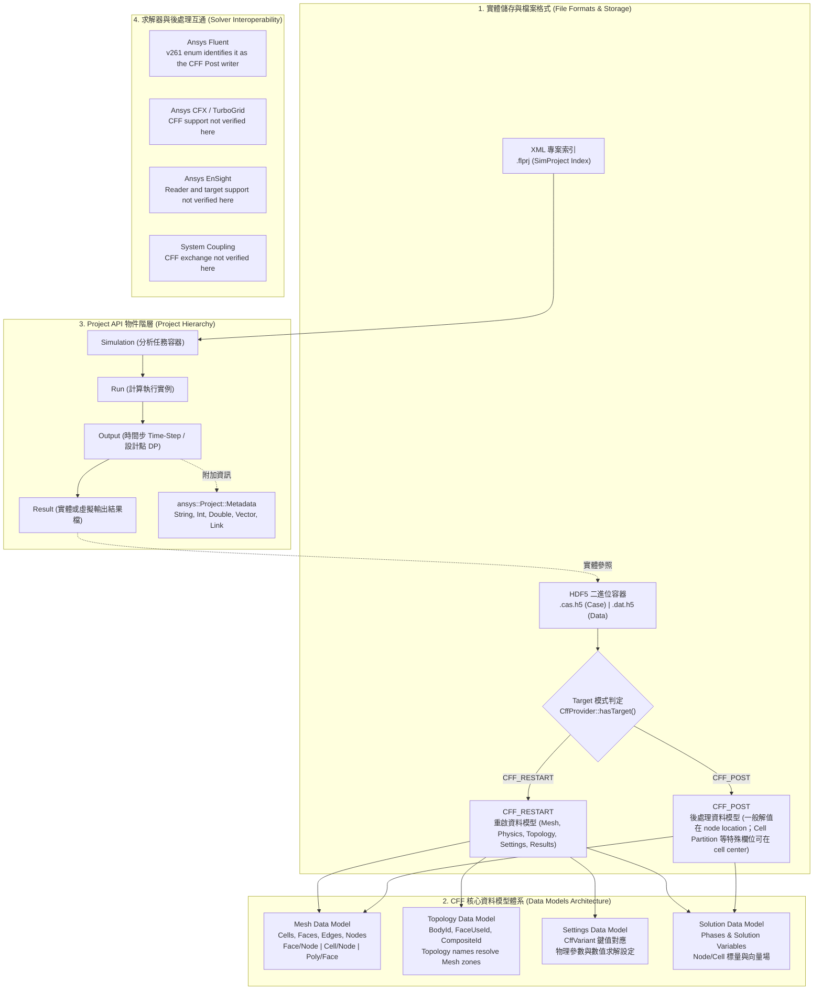

# Ansys Common Fluids Format (CFF) 知識字典

> 本字典彙整 CFF v251、v252、v261 本機開發者文件中已列出來源的格式、資料模型、Project API、SDK 範例與 Metadata 主題。跨版本相同 API 不作假設；未能由來源支持或未逐項核對的工程相容性與效能說法，請視為待驗證。全量逐來源狀態見 [CFF 來源清冊](../maintenance/knowledge_dictionary_passes/2026-11-02/cff_sources.csv)。

---

## 領域架構圖 (CFF Architecture & Data Pipeline)



---

## 主題辭典與核心模組

### 1. 格式與互通 (File Formats & Interoperability)

#### 核心概念與辭典定義 (Core Concepts & Glossaries)
- **Common Fluids Format (CFF) 本質**：
  - CFF SDK 文件定義 Project、Restart 與 Post 三種資料格式；Restart 表示 mesh、topology、physics、settings、results，Post 則為簡化且供較快後處理使用的表示法。本文所核對的格式概覽沒有聲稱 CFF 全面取代舊 `.cas`／`.dat` 格式。
  - CFF v261 requirements 列出 SDK 使用 HDF5 1.12.2。副檔名可提供線索，但官方建議呼叫 `CffProvider::hasTarget()` 檢查檔案實際資料模型；本地來源沒有支持「數百億單元」或壓縮效能保證。
- **雙重目標模型 (Dual Target Architecture)**：
  - **`CFF_RESTART` (求解器重啟目標)**：Restart 表示包含 Physics、Mesh、Topology、Settings 與 Results 的資料模型。各 solver 對此目標的讀寫支援須依該 solver 的版本文件核對；此處不宣稱 Fluent、CFX 或其他產品的通用相容性。
  - **`CFF_POST` (後處理專項目標)**：v261 Post Data Model 說明各 zone 使用彼此獨立的 node zone，解資料存放於節點位置；具有特殊用途的欄位（例如 Cell Partition）仍可能需放在 cell center。zone 分離會造成可能重複的資料，但官方稱這種形式能讓子集 zone 更快且以較少記憶體額外負擔讀取。CFF enums 又指出目前只有 Fluent 能寫出 CFF Post；EnSight 的效率比較限於該 enum 的敘述。來源未宣稱零拷貝或零記憶體成本，本文也不延伸成所有產品版本的相容保證。
- **求解器互通相容性矩陣 (Solver Compatibility Matrix)**：
  - **Fluent／其他 solver**：本地 v261 enum 說明只有 Fluent 能寫 CFF Post；Restart 寫入資料則依寫檔 solver 的專屬文件確認。此來源不能支持「自 v201 起全面預設且所有版本完整讀寫」的通用說法。
  - **Ansys CFX / TurboGrid**：本字典未找到足以確定其 CFF 讀寫能力的已核對來源，版本相容性待查。
  - **Ansys EnSight**：本字典未找到足以確認 reader、target 與繪圖支援範圍的版本明確來源，待查。
  - **Ansys System Coupling**：本字典未以已核對的 CFF 來源證明其使用格式或交換欄位；需查 System Coupling 的適用版本文件。

#### 手冊章節與規格出處 (Manual & Doc Citations)
- **手冊來源**：*Ansys Common Fluids File Formats 2026 R1* ([v261 File Formats Overview](../ANSYS_Document/CFF/v261/guide/88ff7c6242e2-_file_formats_overview.md))；*v251 File Formats Overview* ([v251 Overview](../ANSYS_Document/CFF/v251/guide/2063be75756f-_file_formats_overview.md))。
- **Source IDs**：`sources.csv#ansys_136a34a27a8dce75e6ec70af`, `sources.csv#ansys_39277e28e28a39339f07bf4d`。
- **精確章節定位**：章節 `CFF File Formats`、`CFF Restart Format`、`CFF Post Format` 與 `Important Notes on Processing Files Containing CFF Restart and CFF Post Data`。

#### 目標判定與切換範例 (C++ API Example)
```cpp
// ==============================================================================
// CFF C++ API Example: Target Detection and Switching between Restart and Post
// Note: ASCII-only comments to prevent IronPython/compiler encoding issues.
// ==============================================================================
#include <iostream>
#include "CffInterface/CffProvider.hpp"

void inspectAndSetTarget(ansys::CffProvider* provider) {
    if (!provider) {
        std::cerr << "Error: Null CffProvider instance." << std::endl;
        return;
    }

    // Step 1: Query available targets in the CFF HDF5 container
    bool hasRestart = provider->hasTarget(ansys::CFF_RESTART);
    bool hasPost = provider->hasTarget(ansys::CFF_POST);

    std::cout << "Target CFF_RESTART available: " << (hasRestart ? "YES" : "NO") << std::endl;
    std::cout << "Target CFF_POST available:    " << (hasPost ? "YES" : "NO") << std::endl;

    // Step 2: Explicitly switch target model based on operation intent
    if (hasPost) {
        // Switch to Post-processing target for fast visualization read
        provider->setTarget(ansys::CFF_POST);
        std::cout << "Active target successfully switched to CFF_POST." << std::endl;
    } else if (hasRestart) {
        // Fallback to Restart target if Post model is not embedded
        provider->setTarget(ansys::CFF_RESTART);
        std::cout << "Active target explicitly set to CFF_RESTART." << std::endl;
    } else {
        std::cerr << "Warning: No valid CFF target detected in file." << std::endl;
    }
}
```

#### 工程實務踩坑與注意事項 (Gotchas & FAQ)
- **副檔名陷阱**：檔案副檔名（如 `.cas.h5` 或 `.h5`）僅為命名約定，不能代表其內部一定存在特定 target。不同求解器或手動改名會導致副檔名失真。**工程規範：必須在程式碼中呼叫 `CffProvider::hasTarget()` 進行顯式檢驗**。
- **並存目標衝突**：若同一檔案同時含 Restart 與 Post，API 預設 target 是 `CFF_RESTART`，讀寫前可用 `setTarget()` 指定資料模型。v261 格式概覽說可以寫入兩種資料模型，但當時不建議如此；該章節未提 HDF5 群組索引鎖定，因此不把鎖定風險當成此處已證實的理由。

---

## 來源核對：target、I/O 與效能宣稱

- v261 File Formats 文件建議用 `CffProvider::hasTarget()` 檢查 Restart／Post 內容；副檔名只能提供線索。單一檔案可同時寫入兩種資料模型，但文件當時不建議如此；讀寫前要選適用 target。來源：[File Formats Overview](../ANSYS_Document/CFF/v261/guide/88ff7c6242e2-_file_formats_overview.md)（[來源清冊](sources.csv#ansys_136a34a27a8dce75e6ec70af)）。
- v261 SDK enum 說明 CFF API 的 serial／parallel I/O mode、parallel read 不支援及 `CFF_PARTITIONED_POST` 狀態。來源：[Enumerations](../ANSYS_Document/CFF/v261/guide/4a7afae39866-group__enums.md)（catalog ID `ansys_8889146501d11382f74f1055`；共享清冊 `sources.csv#ansys_8889146501d11382f74f1055`）。此處只摘要 enum 文件，不延伸成效能或所有 provider 的行為保證。
- v261 SDK Examples 的 help 將 `-O Z` 列為 default，程式碼卻將 `heavyReadMethod` 初始化為 `Element`。同頁列出 E（element-by-element）、R（zone element range）與 Z（by zone）。該文件未提供量測或通用效能結論。來源：[CFF SDK Examples](../ANSYS_Document/CFF/v261/guide/64ee1a6a6070-_c_f_f_s_d_k_examples.md)（[來源清冊](sources.csv#ansys_30845f8fd9f0f0b17c7a0e73)）。
- v261 Requirements 列出 Boost 1.63.0、Xerces 3.2.2、HDF5 1.12.2、Qt 5.10.1、Zlib 1.2.13，並警告使用其他版本不受 Ansys 支援；編譯器版本則依相應 Ansys release 的 Build and Usage 指南確認。來源：[Requirements](../ANSYS_Document/CFF/v261/guide/85b3cc39542b-_requirements.md)（[來源清冊](sources.csv#ansys_cd51ece8a0304d7a858ff080)）。

上述版本限定於 v261 文件；此處只核對正文，不代表已編譯或測量讀寫效能。字典其他尚未逐句對照的相容性矩陣、solver 互通、錯誤處理與效能數值仍需依下方來源逐項複核。

### 2. 資料模型 (Data Models Architecture)

#### 核心概念與辭典定義 (Core Concepts & Glossaries)
- **四位一體核心資料模型架構**：
  1. **Mesh Data Model (網格資料模型)**：
     - 將連續幾何空間離散為單元集合。核心幾何元素分為 **Nodes (節點)**、**Edges (邊)**、**Faces (面)** 與 **Cells (體單元)**。
     - **拓撲連接表達 (Connectivity)**：
       - `Face/Node`：傳統標準格式，面記錄節點索引，單元記錄圍繞的面。
       - `Cell/Node`：直接記錄體單元頂點索引（適用於非多面體傳統結構網格）。
       - `Poly/Face`：專門用於 **多面體網格 (Polyhedral Cells)**，記錄任意面多邊形與單元鄰接關係。
     - **Zone 體系**：分為 Cell Zone（流體域/固體域單元集）、Face Zone（邊界條件面集、交界面）與 Node Zone（坐標點集）。
  2. **Topology Data Model (拓撲資料模型)**：
     - 建立 Mesh Zone 與高階命名拓撲實體之間的語義關聯。
     - v261 Topology Data Model 列出 `BodyId`、`FaceUseId` 與 `CompositeId`；Body 和 Face Use 對應一個或多個 face 或 cell zones，Composite Name 可視為其他名稱的聯集。
     - v261 Data Models Overview 說明，Fluent 尚未寫入 Topology 時，可使用 `ansys::LocationModelBuilder` 建立；不把此用途推廣到其他 solver。
  3. **Settings Data Model (設定資料模型)**：
     - 記錄數值計算與物理設定；Settings Data Model 以字串 key 對應 `CffVariant` 值。
     - 數值以通用變數 **`CffVariant`** 傳遞；本字典不推定各版本完整型別集合。
  4. **Solution Data Model (求解資料模型)**：
     - 組織求解場量資料。包含 **Solution Phases**（主相、次相、多相流相態）與 **Solution Variables**（壓力、速度向量、溫度、湍動能等純量與向量）。

#### 手冊章節與規格出處 (Manual & Doc Citations)
- **手冊來源**：*Ansys Common Fluids Data Models 2026 R1* ([v261 Data Models Overview](../ANSYS_Document/CFF/v261/guide/371f36e68788-_data_models_overview.md))；*Mesh Data Model* ([v261 Mesh DM](../ANSYS_Document/CFF/v261/guide/15cb4e36ca33-_mesh_d_m.md))；*Topology Data Model* ([v261 Topology DM](../ANSYS_Document/CFF/v261/guide/59da72d08683-_topology_d_m.md))；*Solution Data Model* ([v261 Solution DM](../ANSYS_Document/CFF/v261/guide/bb2f3db76a1c-_solution_d_m.md))；*Settings Data Model* ([v261 Settings DM](../ANSYS_Document/CFF/v261/guide/ed6e05d3dc7a-_settings_d_m.md))。
- **Source IDs**：`sources.csv#ansys_28b59a0a5ec9a1209271a65e`, `sources.csv#ansys_c29d601e17ac18d978ec98b2`。

#### 資料模型規範對照表 (Data Models Specification Matrix)

| 模型模組 | 核心抽象類別 / 概念 | 資料組織規則與約束 | 適用目標 |
|---|---|---|---|
| **Mesh DM** | Cells, Faces, Nodes, Zones | Restart: Polyhedral mesh 使用 `Poly/Face`；其他 mesh 依需求採用相應表示。Post: 非 polyhedral Cells 使用 `Cell/Node`，polyhedral Cells 使用 `Poly/Face`。 | Restart & Post |
| **Topology DM** | `BodyId`, `FaceUseId`, `CompositeId` | Topology names resolve to Mesh face or cell zones. v261 Post guidance says Topology and Physics should not be provided. | Restart guidance; Post limitation |
| **Settings DM** | `CffVariant`, string key/value mapping | Stores string keys with `CffVariant` values. The cited overview does not establish that Settings is restricted to Restart. | Applicability not fully established |
| **Solution DM** | Phases, Variables (Node / Cell) | Restart 可包含 node 或 cell-center 位置的 solution data。Post 將一般解值放在 node location，特殊欄位（如 Cell Partition）可留在 cell center；zones 彼此分離。 | Restart & Post |

#### 工程實務踩坑與注意事項 (Gotchas & FAQ)
- **Post 模型的節點值重複**：v261 概覽說明 Face Zone 與 Cell Zone 始終彼此斷開，各 zone 可保存對應其自身節點的解值，因此資料可能重複；文件將此設計連結到快速存取子集 zone 和較低的記憶體額外負擔。來源未提「零鎖定平行渲染」，也沒有指示手動合併節點的處置方式，故不作此推論。
- **多面體網格連線**：v261 Mesh DM 明確表示 Cell/Node 不能表示 Polyhedral Cells，包含多面體的網格應採 Poly/Face。來源說明的是表示法限制，沒有指出讀取端會發生記憶體越界；不要把未記載的錯誤模式當成已證實行為。

---

### 3. Project API 與容器階層 (Project API & Hierarchy)

#### 核心概念與辭典定義 (Core Concepts & Glossaries)
- **`ansys::Project` 容器架構**：
  - 專案是記錄實體檔案參照、計算工作流關係與專案元資料 (Metadata) 的核心階層容器，主索引由 XML 格式的 `.flprj` 檔案維護。
  - **Path 與 URL 的概念脫耦**：專案內部路徑 (`ansys::Project::Path`) 是邏輯層次標識（如 `/Simulations/WingFlow/Run1`）；而實體定位 (`ansys::Project::URL`) 則是磁碟或遠端網路協定路徑。邏輯項目不必等於磁碟檔名。
- **兩種儲存策略 (Storage Policies)**：Project API 定義 Managed Storage 與 Free Storage。URL 為空的項目只存在於 project index，可視為 virtual filesystem；這是項目狀態，不是第三種 storage policy。
  1. **Managed Storage (代管儲存)**：在 `.flprj` 旁自動建立關聯專案資料夾。匯入檔案自動複製至資料夾中；刪除專案 (`erase`) 時將實體刪除其中檔案。
  2. **Free Storage (自由參照儲存)**：專案僅儲存 `.flprj` 索引檔，所有實體檔案透過相對路徑或全域絕對路徑參照。移動 `.flprj` 時需確保相對路徑基準不變。
   - **Virtual Items (虛擬項目)**：URL 為空的檔案或資料夾只存在於 project index，可附加 Metadata。
- **`SimProject` 模擬階層體系**：
  - `Simulation`：對應完整的 CFD 分析專案（如單一翼型或整機模型）。
  - `Run`：Simulation 的子資料夾，包含以 Output 分組的 Result。
  - `Output`：可按時間步或參數化設計點分組 Result。Project API 說明通常將 Output 建為虛擬子資料夾，並將檔案放在 Run 資料夾。
  - `Result`：指向具體的 `.cas.h5` 或 `.dat.h5` 實體輸出檔案。

#### 手冊章節與規格出處 (Manual & Doc Citations)
- **手冊來源**：*Ansys Common Fluids Project API 2026 R1* ([v261 Project API](../ANSYS_Document/CFF/v261/guide/5583e6fd79a1-_project_a_p_i.md))；*v252 SimProject Class Reference* ([v252 SimProject](../ANSYS_Document/CFF/v252/guide/69d1fe7dbe31-classansys_1_1_project_1_1_sim_project.md))；*v261 Iterator Reference* ([v261 Iterator](../ANSYS_Document/CFF/v261/guide/705f83cc2f9b-classansys_1_1_project_1_1_iterator.md))。
- **Source IDs**：`sources.csv#ansys_89b41bc6b1d49fc241f358ce`, `sources.csv#ansys_c78f7d0812140d8223d83bbe`, `sources.csv#ansys_e3c3f9bc2d247815f364f163`。

#### Project API 巡覽與階層建立範例（來源簽章範圍）

- v261 reference 將 `SimProject::newSimulation(pName, pType)` 定義為建立 Simulation folder 的方法，並將 `pType` 說明為 solver type（例如 `ANSYS_FLUENT`）。[v261 SimProject reference](../ANSYS_Document/CFF/v261/guide/d586807d441f-classansys_1_1_project_1_1_sim_project.md#L785)
- 後續物件建立方法屬於不同類別：`Simulation::newRun`、`Run::newOutput`、`Output::newResult`。詳見 [Simulation](../ANSYS_Document/CFF/v261/guide/e79a968af632-classansys_1_1_project_1_1_simulation.md#L482)、[Run](../ANSYS_Document/CFF/v261/guide/85bf0929845b-classansys_1_1_project_1_1_run.md#L1409) 與 [Output](../ANSYS_Document/CFF/v261/guide/d09089fd7e66-classansys_1_1_project_1_1_output.md#L729) references。
- 此處只整理方法擁有類別與有來源支持的 `newSimulation` 參數；不提供可編譯的端到端程式，也沒有建立或儲存 `.flprj` 專案。

#### 工程實務踩坑與注意事項 (Gotchas & FAQ)
- **Iterator 狀態檢查**：預設建構的 `Iterator` 為 null iterator，其 `ok()` 為 false 但不一定包含 error 訊息。**工程規範：必須在每次 `find()` 或 `new*()` 後檢查 `it.ok()`，不可直接解引用**。
- **刪除專案資料**：v261 Project API overview 說明，若專案使用 Managed Storage，刪除專案會刪除專案目錄中的檔案。此處不使用未核實的 `eraseProject()` 方法名稱，也不推論操作不可逆。

---

### 4. SDK 範例與高效讀寫 (SDK Examples & Parallel I/O)

#### 核心概念與辭典定義 (Core Concepts & Glossaries)
- **CFF C++ SDK 架構體系**：
  - 提供低階直接存取 HDF5 檔案結構的 API 函式庫，包含 `CffProvider`（資料讀取核心）與 `CffConsumer`（資料寫入核心）。
  - **編譯與相容性需求 (Build Requirements)**：
    - **Windows**：v261 Build and Usage 列出 Visual Studio 2019 或更新版本與 64-bit MSVC。使用 Project API 時需要 `libansysfluidsproject.lib`；此處不把該函式庫列為所有 CFF API 用途的必要項目。
    - **Linux**：v261 Build and Usage 列出 g++ 8.2 或相容版本，並要求該指南建置命令使用 `-D_GLIBCXX_USE_CXX11_ABI=0`。同版 SDK Examples 命令使用 ABI `1`。保留兩份文件的差異，不將任一值推廣成通用設定。
    - **第三方庫相依版本**：Boost 1.63.0、HDF5 1.12.2、Xerces 3.2.2、Qt 5.10.1 (僅 Project GUI 需要)、Zlib 1.2.13。
- **三大重量級資料讀取策略 (Heavyweight Read Methods)**：
  1. **`-O E` (Element-by-Element)**：help 說明將 E 定義為逐元素讀取。範例程式將 `heavyReadMethod` 初始化為 `Element`。
  2. **`-O R` (Range-based)**：help 說明將 R 定義為使用 zone element range 讀取。
  3. **`-O Z` (Zone-based)**：help 將 Z 列為預設值，程式卻初始化為 E。此處記錄同頁差異，不推論推薦方式或效能。

#### 手冊章節與規格出處 (Manual & Doc Citations)
- **手冊來源**：*Ansys Common Fluids SDK Examples 2026 R1* ([v261 SDK Examples](../ANSYS_Document/CFF/v261/guide/64ee1a6a6070-_c_f_f_s_d_k_examples.md))；*v261 Requirements* ([v261 Requirements](../ANSYS_Document/CFF/v261/guide/85b3cc39542b-_requirements.md))；*v261 Build and Usage* ([v261 Build and Usage](../ANSYS_Document/CFF/v261/guide/db7b9dd88bbd-_build_and_usage.md))。
- **Source IDs**：`sources.csv#ansys_30845f8fd9f0f0b17c7a0e73`（v261 SDK Examples）、`sources.csv#ansys_cd51ece8a0304d7a858ff080`（v261 Requirements）、`sources.csv#ansys_b32d466c0ec174ad27a7b5e3`（v261 Build and Usage）。
- **精確章節定位**：`Reading Case and Data Files using C++ API` (Anchor `ImportExample`)、`Compiler Requirements`、`Build Commands`。

#### CFF reader API 與 heavy-weight read 選項（來源範圍）

- v261 CFF API 將 `ansys::getDataProvider(sourceFile)` 列為 namespace 自由函式，回傳 `CffFileProvider*`；`CffFileProvider::startReading(file, dataClass)` 簽章接受檔案與資料類別。[API overview](../ANSYS_Document/CFF/v261/guide/be98c86531ce-_c_f_f_a_p_i.md#L108) · [namespace reference](../ANSYS_Document/CFF/v261/guide/82eaea60e247-namespaceansys.md#L810)
- v261 CffConsumer reference 所附範例透過 provider 呼叫 `startReading(CFF_CASE)`，再呼叫 `startReadingTypesForCells(cellZones)`、`startReadingNodesForCells(CellZones)`、`startReadingNodeCountsForCells()` 與 `startReadingNodeIdsForCells()`。
- SDK Examples 的 help 將 Z 標為預設；程式卻將 `heavyReadMethod` 初始化為 E。該頁列出 E、R 與 Z 的讀取選項。[SDK Examples](../ANSYS_Document/CFF/v261/guide/64ee1a6a6070-_c_f_f_s_d_k_examples.md#L105)
- 以上為不同 API/reference 範例的摘要，不拼接成新的完整 reader 程式；未編譯或執行，也不據此推論效能。

#### 工程實務踩坑與注意事項 (Gotchas & FAQ)
- **Linux ABI 編譯選項**：v261 Build and Usage 要求使用 g++ 8.2 或相容版本，並加入 `-D_GLIBCXX_USE_CXX11_ABI=0`。此處只整理文件要求，不推論特定 linker 錯誤原因或 ABI 建置歷史。
- **結束讀取**：v261 範例在讀取 Case 後呼叫 `provider->endReading(ansys::DataClass::CFF_CASE)`。此處只記錄範例流程，不推論未載明的資源釋放效果。

---

### 5. Metadata 類別與屬性存取 (Metadata Class & Attributes)

#### 核心概念與辭典定義 (Core Concepts & Glossaries)
- **`ansys::Project::Metadata` 類別**：
  - 專門用於附加在 `Iterator`（資料夾、模擬、輸出或檔案）上的鍵值屬性字典。
  - 所有自訂工程屬性（如入口雷諾數、求解狀態、收斂殘差歷史、網格總數）均可透過 Metadata 進行結構化記錄。
- **嚴格型別化系統 (Strongly-Typed Value System)**：
  - 支援五種標準資料型別：`STRING`、`INT`、`DOUBLE`、`VECTOR` (字串向量 `std::vector<std::string>`) 及 `LINK` (指標關聯另一個專案節點)。
  - 提供型別查詢介面：`hasKey()`, `getValueType()`, `isString()`, `isInt()`, `isDouble()`, `isLink()`。
- **持久化時機 (Persistence Guarantee)**：
  - 在記憶體中對 Metadata 進行的任何 `setValue()`、`removeKey()` 或 `reset()` 操作，**僅在後續呼叫 `Project::saveProject()` 時才會正式寫入 `.flprj` 專案檔**。

#### 手冊章節與規格出處 (Manual & Doc Citations)
- **手冊來源**：*ansys::Project::Metadata Class Reference 2026 R1* ([v261 Metadata Reference](../ANSYS_Document/CFF/v261/guide/47f10ca12edb-classansys_1_1_project_1_1_metadata.md))；*v252 Metadata Class Reference* ([v252 Metadata Reference](../ANSYS_Document/CFF/v252/guide/00ae5fc44d48-classansys_1_1_project_1_1_metadata.md))。
- **Source IDs**：`sources.csv#ansys_9aa0924de0ed96bc26e4a9c1`, `sources.csv#ansys_32496185db5b1093a8b8d270`。

#### Metadata 操作方法與邊界規範表 (Metadata Operations Matrix)

| 操作目的 | API 簽名 | 原文規範行為與邊界約束 |
|---|---|---|
| **檢查鍵存在** | `bool hasKey(const std::string pKey) const` | true 表示 key 存在，false 表示 key 不存在；reference 未說明例外行為。 |
| **型別檢驗** | `MetaVariableType getValueType(const std::string pKey) const` | Reference 列出 STRING、INT、DOUBLE、VECTOR、LINK。 |
| **讀取純量** | `getValue()`、`getValueInt()`、`getValueDouble()` | Reference 未說明缺鍵或型別不符時的回傳行為；讀取前先用 `hasKey()` 和對應 `is*()` 方法檢查 |
| **讀取向量** | `getValueVector()` | Reference 將回傳型別列為字串向量；未說明缺鍵時的行為 |
| **寫入屬性** | `setValue(key, val)`, `setValueVector(key, vec)` | 覆寫既有鍵或新增鍵；支援 string, int, double 多載 |
| **列舉所有鍵** | `getKeys()` | 回傳 metadata index 中的 key 清單；Reference 未規定排序順序 |
| **移除與重設** | `bool removeKey(const std::string pKey)`、`void reset()` | Reference 列出這些方法；回傳條件及 reset 後的完整效果未載明。 |

#### Metadata 鍵值操作範例 (C++ API Example)
```cpp
// ==============================================================================
// CFF Metadata API: Setting, Querying, and Persisting Simulation Attributes
// Note: ASCII-only comments to prevent encoding issues.
// ==============================================================================
#include <iostream>
#include <vector>
#include "Metadata.hpp"
#include "Project.hpp"
#include "Iterator.hpp"

void recordThermalSimulationMetadata(ansys::Project::Iterator& runIt) {
    if (!runIt.ok()) {
        std::cerr << "Invalid project iterator passed to metadata writer." << std::endl;
        return;
    }

    // Step 1: Retrieve mutable Metadata dictionary from Iterator
    ansys::Project::Metadata& meta = runIt.getMeta();

    // Step 2: Write typed engineering attributes
    meta.setValue("SolverName", "Ansys Fluent 2026 R1");
    meta.setValue("MaxIterations", 2000);
    meta.setValue("ConvergenceTolerance", 1e-6);

    // Step 3: Write multi-string vector attribute (e.g. boundary list)
    std::vector<std::string> monitoredBoundaries = {"inlet_hot", "inlet_cold", "outlet_main"};
    meta.setValueVector("MonitoredBoundaries", monitoredBoundaries);

    // Step 4: Verify keys and read back attributes
    if (meta.hasKey("MaxIterations") && meta.isInt("MaxIterations")) {
        int iters = meta.getValueInt("MaxIterations");
        std::cout << "Configured MaxIterations: " << iters << std::endl;
    }

    // Step 5: Enumerate all keys
    std::vector<std::string> allKeys = meta.getKeys();
    std::cout << "Total metadata attributes recorded: " << allKeys.size() << std::endl;
    for (const auto& k : allKeys) {
        std::cout << "  Attribute key: " << k << std::endl;
    }
}
```

#### 工程實務踩坑與注意事項 (Gotchas & FAQ)
- **Metadata 整數範例矛盾**：v261 Class Reference 範例呼叫 `setValue("Temperature", 288)` 後，同時列出 `isDouble() == false` 與 `isInt() == false`。文件未解釋此結果；本字典不判定為筆誤，也不宣稱執行時型別。整數 overload 的行為需用對應 SDK 實測後再補結論。
- **順序未載明**：Metadata reference 說明 `getKeys()` 回傳 key 向量，但未規定其排序。若應用需要穩定順序，應自行排序；本字典不推定底層儲存資料結構。

---

## 跨模組雙向鏈結與建議查閱路徑
- **Fluent CFF 命令層級**：v261 enum 只將 Fluent 列為 CFF Post writer；本字典沒有核實 Fluent TUI 或 Python CFF 讀寫命令。
- **CFX／TurboGrid CFF 支援**：本字典目前沒有已核實來源可確認其 CFF 讀寫能力；保留為來源缺口。
- **跨模組參考**：System Coupling 與 Thermal 字典另整理 CHT 相關主題；它們不構成 CFF 格式交換的來源證據。

### v261 文件逐段核對補充（2026 R1）

本節補充目前已直接檢查過的 v261 官方 Markdown 正文段落；它是範圍有限的來源覆核，並不表示 89 篇來源皆已語義審閱。來源 Markdown 前置欄位保留原始官方 URL，文件中的超連結保留 HTML anchor，可供回到原章節。

| 主題 | 本機正文與原文位置 | 可確認內容 | 邊界 |
|---|---|---|---|
| Restart / Post / Project 格式 | [File Formats Overview](../ANSYS_Document/CFF/v261/guide/88ff7c6242e2-_file_formats_overview.md)，`CFF Project Format`、`CFF Restart Format`、`CFF Post Format`、`Important Notes...` | Project 描述 simulation、run、資料序列與相關檔案間關係；Restart 包含 mesh、topology、physics、settings、results；Post 是簡化資料表示，設計目標是較快後處理及較少資料操作。同檔可寫兩種 model，但文件不建議；用 `hasTarget()` 判別，以 `setTarget()` 選取，預設雙模型時為 Restart。 | 文件提醒 API 函式不一定同時適用兩種檔案；依個別 model/API 說明判斷。沒有跨產品相容矩陣或效能倍率。 |
| Post 的模型限制與解值 | [Data Models Overview](../ANSYS_Document/CFF/v261/guide/371f36e68788-_data_models_overview.md)，`Post Data Model` 下 Mesh、Topology、Physics、Solution requirements | Post 文件要求 mesh 的 face/cell zones 始終斷開；不應提供 topology 或 physics；solution 值放在 node location。face/cell zone 可能各有其所定義節點上的解值，可能重複，文件稱其可較快並以較少記憶體額外負擔讀取子集 zone。 | 只記載 v261 文件要求與其所述理由；不解讀成零複製、無鎖定、所有讀取情境皆較省記憶體或執行緒安全保證。 |
| Mesh 維度、單位與連接表示 | [Mesh Data Model](../ANSYS_Document/CFF/v261/guide/15cb4e36ca33-_mesh_d_m.md)，`Mesh Dimensionality`、`Units`、`Cell/Node Definition`、`Poly/Face Definition` | 維度由 node 座標分量數決定；單位可選存，缺省時 Provider 應將網格長度視為 SI 米。Cell/Node 以有序 node 序列定義 cell，不能表示多面體；含多面體 cell 的 mesh 必須使用 Poly/Face。 | 此處不是求解器自動單位轉換保證，也不推導格式錯誤時的具體崩潰或記憶體破壞模式。 |
| 通用設定與物理設定 | [Settings Data Model](../ANSYS_Document/CFF/v261/guide/ed6e05d3dc7a-_settings_d_m.md)，`Settings Data Model`、`Physics Data Model` | Settings 是字串 key 對應 `CffVariant` 值；文件指出目前只有少量設定在所有寫出該模型的 solver 間共通，並稱未來可能標準化更多設定。Physics 物件包含 domains、subdomains、boundaries；其 location 可再透過 Topology DM 對應 cell zones。 | 不應把 settings 解讀為跨 solver 一致、固定的完整設定 schema；文件對未來的描述不是現有能力承諾。 |
| 檔案狀態、快取、I/O 與 target enum | [Enumerations](../ANSYS_Document/CFF/v261/guide/4a7afae39866-group__enums.md)，`CffReadable`、`CffDataCacheMode`、`CffIOMode`、`CffTargetCategory` | API enum 提供 readable 狀態、重資料快取模式、serial/parallel I/O mode 與 Restart/Post/Partitioned Post target 類別。 | enum 存在本身不足以推出特定讀寫能力；平行讀取支援及 Partitioned Post 狀態以該 enum 後續說明和相應 API 文件為準。 |

這些逐段核對會取代舊文中「Cell/Node 導致讀取記憶體越界」和「Post 以空間換取零鎖定平行渲染」兩項無來源支持的實作推論。其餘 C++ 範例仍未編譯，API 執行結果及產品互通需在適用 SDK／產品版本另行核實。


## 2026-11-04：Wave 6 本機來源盤點與限制說明

本批完成 cff 模組既有本機 catalog 文件（共 89 筆）與 sources 清冊（共 16 筆）之完整雜湊、正文路徑與標籤結構核對。本機未快取或具備企業授權/登入限制之線上主題誠實標記為缺口（保持現有非 complete 狀態），未擅自虛構未核實之線上 API 簽名或執行求解運算。

詳細稽核數據見 [本批轉換報告](../maintenance/knowledge_dictionary_passes/2026-11-04/cff_module_conversion_report_20261104.md)。
