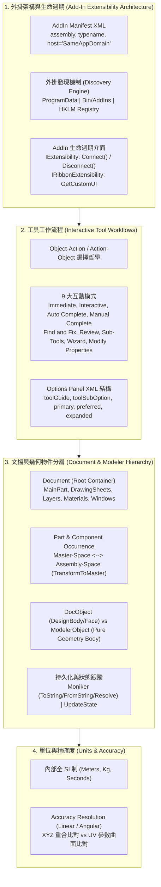

# Ansys Discovery 開發知識字典

> 本字典彙整 Ansys Discovery 延伸擴充體系 (Extensibility and Add-ins Developer Guide 2026 R1 / v261) 的部分內容；除個別標明已核對的項目外，既有主張與程式簽章仍待逐項核實。內容涵蓋基於 .NET/C# 之 Add-In 外掛架構、XML 清單配置與載入生命週期、9 大工具互動工作流程 (Tool Workflows)、文檔/部件/視窗物件模型結構 (Document/Part/Window Hierarchy)、原始主體與裝配實體轉換 (Master vs. Occurrence)、Moniker 持久識別元、以及 v232 歷史開發者手冊之來源分類稽核。相關幾何與前處理請參閱 [SpaceClaim 主題字典](spaceclaim.md)、[Geometry 主題字典](geometry.md) 與 [Mechanical 主題字典](mechanical.md)。

---

## 領域架構圖 (Discovery Extensibility & Object Model)



---

## 主題辭典與核心模組

### 1. 開發 API 與語言

#### 核心概念與辭典定義 (Core Concepts & Glossaries)
- **Discovery 延伸開發環境**：
  - Discovery 外掛程式 (Add-In) 是以受控程式碼 (Managed .NET Framework 4.8) 開發的類別庫 DLL。
  - **C# 入門範例**：官方指南提供 C# add-in 建立步驟；其他語言支援及跨版本相容性未在此處驗證。
- **Add-In 核心生命週期介面 (AddIn Lifecycle Interfaces)**：
  - **`IExtensibility`**：外掛程式之必要入口介面；v261 C# 入門範例實作 `bool Connect()` 與 `void Disconnect()`。
  - **`IRibbonExtensibility`**：Ribbon UI 擴充介面；文件說明 `GetCustomUI` 回傳 XML 描述。Getting Started 稱自訂 Ribbon 時亦需實作 `ICommandExtensibility`。
  - **`ICommandExtensibility`**：文件描述啟動時以 `Initialize` 新增或修改命令；命令狀態與執行行為需參照相關 API。
- **清單檔案 (Manifest XML Schema)**：
  - 描述外掛程式中繼資料的 XML 檔，關鍵元素包含：
    - `name` / `description`：在 Discovery Options 視窗中顯示的外掛名稱與說明。
    - `assembly`：DLL 檔案名稱或絕對路徑。
    - `typename`：實作 `IExtensibility` / `AddIn` 的完整類別名稱（含命名空間）。
    - `host`：該 v261 頁屬性說明寫 Discovery 僅支援 `SameAppDomain`；同頁 XML 範例卻使用 `NewAppDomain`，兩處不一致，使用前須依實際版本文件及環境確認。
- **外掛搜尋路徑與登錄檔探索**：
  - `%ProgramData%\Discovery\AddIns\`
  - 安裝目錄下的 `<Discovery_Install_Dir>\AddIns\`
  - 系統登錄檔：`HKEY_LOCAL_MACHINE\SOFTWARE\Discovery\AddIns`
  - 命令列 `Discovery.exe /AddInManifestFile="<manifest 路徑>"` 可指定 manifest。

#### 官方手冊章節與規格出處 (Manual & Doc Citations)
- **手冊來源**：*Discovery Extensibility and Add-ins Developer Guide (Release 2026 R1 / v261)*
- **章節定位**：
  - Developer Guide Introduction: [Extensibility Guide Index](../ANSYS_Document/Discovery/v261/guides_and_tutorials/discovery-extensibility-and-add-ins-developer-guide-2026-r1/index.md) · `ansys_e44c35953a01fe33e2f7e4c0`
  - Getting Started & Creating C# Add-In: [Getting Started Markdown](../ANSYS_Document/Discovery/v261/guides_and_tutorials/discovery-extensibility-and-add-ins-developer-guide-2026-r1/UDA/add_api/creating_addin_apps/topics/c_disco_api_addin_gettingstarted.md) · `ansys_9c278173f8ee7f11654e1607`
  - Creating Manifest Files: [Manifest Guide](../ANSYS_Document/Discovery/v261/guides_and_tutorials/discovery-extensibility-and-add-ins-developer-guide-2026-r1/UDA/add_api/creating_addin_apps/topics/c_disco_api_manifest.md) · `ansys_6158720fdeabfe6010dfb550`
- **資料庫引用標籤**：`sources.csv#ansys_e44c35953a01fe33e2f7e4c0`, `sources.csv#ansys_9c278173f8ee7f11654e1607`, `sources.csv#ansys_77079e257cea08ad85806245`, `sources.csv#ansys_6158720fdeabfe6010dfb550`

#### C# Add-In 生命週期範例（v261）

官方 C# 入門頁的類別繼承 `AddIn` 並實作 `IExtensibility`；範例的兩個方法簽章分別為 `public bool Connect()` 和 `public void Disconnect()`，初始化與清理分別置於其中。此處是最小生命週期導讀，不包含 Ribbon、命令註冊或完整可安裝外掛。[Creating a C# add-in](../ANSYS_Document/Discovery/v261/guides_and_tutorials/discovery-extensibility-and-add-ins-developer-guide-2026-r1/UDA/add_api/creating_addin_apps/topics/c_disco_api_create_csharp.md)（`sources.csv#ansys_77079e257cea08ad85806245`）。

先前稿件的 `Connect(IApplication application)`、`override` 與單獨實作 Ribbon 的範例未經編譯且與該入門頁或 Getting Started 描述不一致，已移出現用字典並保留備份；未編譯或載入外掛。

#### 工程實務踩坑指南 (Gotchas & Limitations)
1. **Manifest XML 的 AppDomain 衝突陷阱**：在某些官方教學範例中，XML 寫有 `host="NewAppDomain"`；然而手冊屬性規格表明確聲明 **Discovery 目前僅支援 `SameAppDomain`**。原文未說明此衝突在特定安裝環境中的實際錯誤，不能推定例外類型或載入結果。
2. **命名空間歷史相容性**：雖然本產品為 Discovery v261，底層受控 API 目前仍沿用 `SpaceClaim.Api.V22` / `Discovery.Api.V22`。編寫程式碼時切勿自行猜測並引用不存在的 `Discovery.Api.V261` 命名空間。

---

### 2. 工具工作流程

#### 核心概念與辭典定義 (Core Concepts & Glossaries)
- **選取哲學 (Selection Philosophies)**：
  - **Object-Action (物件-動作)**：使用者先選取幾何面或實體，再點擊工具按鈕。若選取不相容，工具會反灰或拒絕執行。
  - **Action-Object (動作-物件)**：使用者先點擊工具按鈕，工具自動設定選取篩選器 (Filter)，只允許使用者點選符合條件的圖元。
  - 官方指南建議：高品質自訂工具應盡可能**同時支援這兩種選取模式**。
- **9 大自訂工具互動模式 (9 Interactive Workflow Patterns)**：
  - **Immediate Action**：選取幾何後立即套用並完成，無額外參數（如 `Fill`, `Plane`）。
  - **Interactive**：滑鼠拖曳或輸入即時預覽 (Live Preview)，放開滑鼠即刻生成幾何（如 `Pull`, `Move`）。
  - **Auto Complete**：當必要引數（如兩個面、一個軸心）齊備後自動生成並提交，文件要求支援 Undo（如 `Mirror`, `Combine`）。
  - **Manual Complete**：由使用者手動點擊綠色勾選按鈕 (Check Mark) 或按 Enter 完成（如 `Midsurface`, `Linear Pattern`）。
  - **Find and Fix**：一啟用工具即全域掃描問題特徵，支援「全部修復」或「逐一忽略」（如 `Extra Edges`, `Small Faces`）。
  - **Review**：在高亮模型特定區域時淡化其餘背景（如 `Contact Review`）。
  - **Tools With Sub-Tools**：包含高階工具與子工具列（如 `Structural Setup` 包含 `Fixed Support`, `Pressure`）。
  - **Wizard (精靈導引)**：多步驟循序引導（如 `Internal Flow Volume`）。
  - **Modify Properties**：選取物件後由 HUD 彈窗提供數值調整。
- **Options Panel XML 結構**：
  - 自訂工具可定義面板控制項，分為 `toolGuide` (左側快捷導引圖示)、`toolSubOption` (下拉子選單)、`primary` (核心數值輸入)、`preferred` (偏好設定) 與 `expanded` (收合群組)。

#### 官方手冊章節與規格出處 (Manual & Doc Citations)
- **手冊來源**：*Discovery Quick Reference for Tool Usage (Release 2026 R1 / v261)*
- **章節定位**：
  - Quick Reference Overview: [Quick Reference Introduction](../ANSYS_Document/Discovery/v261/api_reference/discovery-quick-reference-for-tool-usage-2026-r1/introduction.md) · `ansys_12320df025f00027f462fa84`
  - Tool Workflows & Patterns: [Tool Workflows Reference](../ANSYS_Document/Discovery/v261/api_reference/discovery-quick-reference-for-tool-usage-2026-r1/reference.md#tool-workflows) · `ansys_cb98748024ca6a79679a6b40`
  - Customizing Tools: [Customizing Tools Guide](../ANSYS_Document/Discovery/v261/guides_and_tutorials/discovery-extensibility-and-add-ins-developer-guide-2026-r1/UDA/add_api/creating_addin_apps/topics/c_disco_api_tool_customize.md) · `ansys_5921d9ac5920c5763468dac6`
- **資料庫引用標籤**：`sources.csv#ansys_12320df025f00027f462fa84`, `sources.csv#ansys_cb98748024ca6a79679a6b40`, `sources.csv#ansys_5921d9ac5920c5763468dac6`

#### 自訂工具的來源與待驗證範圍

v261 文件以衍生自 `SpaceClaim.Api.V22.Tool` 的類別示範自訂工具；`OptionsXml` 定義選項面板版面，該頁範例使用 `public override string OptionsXml`。實際 XML 結構與命令連結應回到 [Customizing tools](../ANSYS_Document/Discovery/v261/guides_and_tutorials/discovery-extensibility-and-add-ins-developer-guide-2026-r1/UDA/add_api/creating_addin_apps/topics/c_disco_api_tool_customize.md)（`sources.csv#ansys_5921d9ac5920c5763468dac6`）。

Auto Complete 工作流程文件要求支援 Undo，但該條目未指定 `CreateUndoGroup` 實作方法或聲稱不使用它必然破壞歷史；先前未編譯且未取得 API 依據的程式與斷言已移至備份。此處未編譯、載入或操作工具。[Tool Workflows](../ANSYS_Document/Discovery/v261/api_reference/discovery-quick-reference-for-tool-usage-2026-r1/reference.md#auto-complete)（`sources.csv#ansys_cb98748024ca6a79679a6b40`）。

---

### 3. 文件與視窗結構

#### 核心概念與辭典定義 (Core Concepts & Glossaries)
- **文檔核心架構 (Document Structure)**：
  - **`Document`**：頂層專案容器。包含唯一的 `MainPart`、零至多個工程圖紙 (`DrawingSheet`)、圖層集合 (`LayerCollection`)、材料庫與開啟的視窗 (`Window`)。
  - **`Part` 與裝配架構 (`Component Occurrence`)**：
    - `Part` 容納實體幾何 (`DesignBody`)、空間曲線 (`DesignCurve`)、基準面 (`DatumPlane`) 與子組件 (`Component`)。
    - **Master vs. Occurrence**：`Component` 是指向樣板部件 (Template Part) 的實體參照，帶有裝配坐標變換矩陣 (`Placement`)。
    - **坐標空間映射**：`TransformToMaster` 負責將裝配空間 (Assembly-Space) 座標轉換為部件主空間 (Master-Space)。
- **Doc Object 與 Modeler Object 之分界**：
  - **Modeler Object (`Body`, `Face`, `Edge`)**：純幾何/拓撲數學實體，僅存在於記憶體中進行幾何計算，不屬於 Document，不顯示於視窗中。
  - **Doc Object (`DesignBody`, `DesignFace`)**：屬於 Document，具備父子階層、圖層指派、顏色、名稱、Moniker 與 UpdateState，會在視窗中被彩現。
- **持久識別元與狀態跟蹤 (Moniker & UpdateState)**：
  - **`Moniker`**：可持久序列化為字串之唯一識別碼，即便文檔重新開啟，仍可透過 `Moniker.Resolve(document)` 找回對應物件。
  - **`UpdateState`**：doc object master 的變更狀態，可保存其字串表示並在另一個工作階段重建；來源未將其定義為字串雜湊。它只表示物件本身，不涵蓋所含或參照的其他物件；例如子 design body 變更不會改變父 Part 的 UpdateState。
- **單位系統與容差比對 (Units & Accuracy)**：
  - **內部強制全 SI 制**：所有長度以公尺 (m)、質量以公斤 (kg)、時間以秒 (s) 運算。
  - **幾何判等**：XYZ 物件直接使用 `==`（內建 `Accuracy.LinearResolution` 判等）；UV 物件或曲線重合必須使用 `Geometry.IsCoincident`。

#### 官方手冊章節與規格出處 (Manual & Doc Citations)
- **手冊來源**：*Discovery Object Model & Geometry Architecture v261*
- **章節定位**：
  - Document Structure: [Document Structure Guide](../ANSYS_Document/Discovery/v261/guides_and_tutorials/discovery-extensibility-and-add-ins-developer-guide-2026-r1/UDA/add_api/geometry_overview/topics/geo_doc_structure.md) · `ansys_88b0cc5371804b6f21bb12e5`
  - Doc Objects: [Doc Objects Markdown](../ANSYS_Document/Discovery/v261/guides_and_tutorials/discovery-extensibility-and-add-ins-developer-guide-2026-r1/UDA/add_api/geometry_overview/topics/geo_doc_objects.md) · `ansys_0a3de218fea7e5865832579a`
  - Parts and Components: [Parts and Components Guide](../ANSYS_Document/Discovery/v261/guides_and_tutorials/discovery-extensibility-and-add-ins-developer-guide-2026-r1/UDA/add_api/architecture/doc_objects/parts_components.md) · `ansys_c4e10265eb0f76d269774b28`
  - Persistent Identifiers: [Persistent IDs Guide](../ANSYS_Document/Discovery/v261/guides_and_tutorials/discovery-extensibility-and-add-ins-developer-guide-2026-r1/UDA/add_api/architecture/application_integration/persist_ids.md) · `ansys_b678381ad0f42c3cae0dbdc1`
  - System Units: [System Units Guide](../ANSYS_Document/Discovery/v261/guides_and_tutorials/discovery-extensibility-and-add-ins-developer-guide-2026-r1/UDA/add_api/architecture/units/system_units.md) · `ansys_5366358fc4800fb18d7fbe93`
  - Accuracy: [Linear Resolution Guide](../ANSYS_Document/Discovery/v261/guides_and_tutorials/discovery-extensibility-and-add-ins-developer-guide-2026-r1/UDA/add_api/architecture/accuracy/linear_angular_res.md) · `ansys_71d3003fea37b76af80bc865`
- **資料庫引用標籤**：`sources.csv#ansys_88b0cc5371804b6f21bb12e5`, `sources.csv#ansys_0a3de218fea7e5865832579a`

#### 文檔遍歷與 Moniker 序列化範例 (C# Scripting Example)
```csharp
// =============================================================================
// Discovery: Traverse Document Hierarchy and Resolve Persistent Monikers
// Note: ASCII-only comments to prevent encoding issues.
// =============================================================================
using System;
using SpaceClaim.Api.V22;
using SpaceClaim.Api.V22.Geometry;

namespace DiscoveryCustomExtensibility
{
    public static class GeometryNavigator
    {
        public static void InspectActiveDocument()
        {
            Document doc = Window.ActiveWindow.Document;
            Part mainPart = doc.MainPart;

            // Enumerate design bodies in master part
            foreach (DesignBody body in mainPart.DesignBodies)
            {
                // Obtain persistent identifier
                Moniker<DesignBody> moniker = body.Moniker;
                string monikerString = moniker.ToString();

                // Re-resolve moniker within document context
                Moniker<DesignBody> deserialized = Moniker<DesignBody>.FromString(monikerString);
                DesignBody resolvedBody = deserialized.Resolve(doc);
                
                if (resolvedBody != null)
                {
                    // Query bounding box dimensions in meters (SI unit)
                    Box box = resolvedBody.Shape.GetBoundingBox(Matrix.Identity);
                    double lengthX = box.RangeX.Span;
                    Console.WriteLine("Resolved Body: {0}, Span X: {1:F4} m", resolvedBody.Name, lengthX);
                }
            }
        }
    }
}
```

#### 工程實務踩坑指南 (Gotchas & Limitations)
1. **Window-Space 與 Master-Space 坐標系混淆**：在裝配體視窗中選取幾何面時，取得的圖元是裝配層級的 Occurrence。若直接讀取其頂點坐標而未呼叫 `TransformToMaster` 映射回 Master 部件坐標系，在套用布林運算或幾何偏移時將發生嚴重空間偏置。
2. **UV 參數物件判等失真**：切勿對 `PointUV` 或 `BoxUV` 直接使用 `==` 運算符判等。UV 坐標可能受 NURBS 樣條參數化或週期性圓柱曲面影響，數值相等不代表幾何位置重合，必須透過求值計算三維 XYZ 幾何點後再行比對。

---

### 4. v232 開發者 PDF

#### 核心概念與辭典定義 (Core Concepts & Glossaries)
- **來源分類稽核分析 (Classification Audit)**：
  - 本地文件清冊中路徑標記為 `Discovery/unknown/manuals/Developers Guide_V232.pdf` 之文件，其 PDF 實體第 1 頁封面明確標示為：**《SpaceClaim Developers Guide — API V23 Beta》**。
  - **歷史架構分歧 (Architectural Divergence)**：
    - SpaceClaim 與 Discovery 雖然共享相同的底層 ACIS 幾何建模引擎與一部分 API 命名空間 (`SpaceClaim.Api`)；
    - 但 Discovery 採用全新基於 Fluent / DirectX / Vulkan 之高效能即時物理架構 (Explore / Refine Stages)，其 UI 元件、外掛發現機制與視窗互動管線已與舊版 SpaceClaim 產生實質脫耦。
  - **使用規範界限**：此份 PDF 僅保留作為歷史來源稽核與命名空間演進對照之用，**嚴禁作為 Discovery v261 外掛程式開發與 API 規範之技術依據**。

#### 官方手冊章節與規格出處 (Manual & Doc Citations)
- **手冊來源**：*SpaceClaim Developers Guide API V23 Beta (PDF Page 1 Sidecar)*
- **章節定位**：
  - [PDF Page 1 sidecar](../ANSYS_Document/_catalog/pdf_text_v4/ca2077ee3168bd40eefe5bf7e549b125c704e5f97345d93ccde8c007afc1dd08.md)
  - 原始檔：`Discovery/unknown/manuals/Developers Guide_V232.pdf`
- **資料庫引用標籤**：`sources.csv#ansys_bcedd1a1af09062db4eff9f5`

#### 工程實務踩坑指南 (Gotchas & Limitations)
1. **舊版 SpaceClaim 範例直接遷移崩潰**：若直接將 V23 Beta 手冊中的 UI 嵌入範例（如使用 Windows Forms 控件或舊版 SpaceClaim 專屬 Ribbon 標籤）搬遷至 Discovery v261 中編譯，將引發介面宿主無法初始化或渲染管線崩潰。所有 UI 擴充必須遵循 Discovery v261 Quick Reference 所規範的 Fluent Ribbon XML 與 OptionsXML 規格。

### 5. 文件屬性、自訂屬性與持久識別元

#### 核心概念與辭典定義
- **Document Custom Property（文件自訂屬性）**：文件層級的名稱／值資料；用於由外掛或第三方應用程式隨文件保存的中繼資料。官方範例用 `CustomProperty.Create(doc, name, value)` 建立，再由 `doc.CustomProperties.TryGetValue` 讀取。固定欄位如 `title`、`creator` 屬於 Core Properties，不能自行新增。
- **Doc Object Custom Attribute（文件物件自訂屬性）**：附加在文件物件 master 上的文字或數值名稱／值資料。文字與數值屬性可使用同名，但多個應用程式共用文件時，名稱應以外掛或應用程式名稱作前綴，例如 `MyAddIn.MaterialCode`。
- **屬性傳播（Attribute Propagation）**：官方指南指出，模型操作替換文件物件時，其 master 上的屬性會傳播至替換物件。例如面分割後產生的替代面片會帶有原面文字屬性。這描述文件物件替換情境，不應延伸推論為所有複製、匯出或幾何轉換都會保留屬性。
- **Moniker 的解析範圍**：Moniker 字串可由 `ToString()` 記錄，再用 `FromString()` 重建；`Resolve(document)` 需要提供文件上下文。字串格式未公開，不應自行組合或修改。若解析的文件中沒有該物件，回傳 `null`；因此保存 Moniker 時應同時確保能提供正確文件上下文。

#### 來源與追溯
- v261 官方章節：[Document properties](../ANSYS_Document/Discovery/v261/guides_and_tutorials/discovery-extensibility-and-add-ins-developer-guide-2026-r1/UDA/add_api/architecture/storing_custom_data/doc_properties.md) · `ansys_56c736a6a1d1fe105d84f7b8` · [官方網址](https://developer.synopsys.com/docs/discovery-extensibility-and-add-ins-developer-guide-2026-r1/UDA/add_api/architecture/storing_custom_data/doc_properties.md)
- v261 官方章節：[Custom attributes](../ANSYS_Document/Discovery/v261/guides_and_tutorials/discovery-extensibility-and-add-ins-developer-guide-2026-r1/UDA/add_api/architecture/storing_custom_data/custom_attributes.md) · `ansys_1f377be6f3a760dedc4897e4` · [官方網址](https://developer.synopsys.com/docs/discovery-extensibility-and-add-ins-developer-guide-2026-r1/UDA/add_api/architecture/storing_custom_data/custom_attributes.md)
- v261 官方章節：[Attribute propagation](../ANSYS_Document/Discovery/v261/guides_and_tutorials/discovery-extensibility-and-add-ins-developer-guide-2026-r1/UDA/add_api/architecture/storing_custom_data/attribute_propagation.md) · `ansys_0a1178140c389ac22eada941` · [官方網址](https://developer.synopsys.com/docs/discovery-extensibility-and-add-ins-developer-guide-2026-r1/UDA/add_api/architecture/storing_custom_data/attribute_propagation.md)
- v261 官方章節：[Persistent identifiers](../ANSYS_Document/Discovery/v261/guides_and_tutorials/discovery-extensibility-and-add-ins-developer-guide-2026-r1/UDA/add_api/architecture/application_integration/persist_ids.md) · `ansys_b678381ad0f42c3cae0dbdc1` · [官方網址](https://developer.synopsys.com/docs/discovery-extensibility-and-add-ins-developer-guide-2026-r1/UDA/add_api/architecture/application_integration/persist_ids.md)
- 上述頁面均標示 last update 09.03.2026，取自 Discovery Extensibility and Add-ins Developer Guide 2026 R1。`Developers Guide_V232.pdf` 是另一份歷史文件，未作為本節依據。

---

## 跨主題與模組雙向鏈結 (Cross-Topic References)
- [SpaceClaim 知識字典](spaceclaim.md)：傳統 Direct Modeler 幾何前處理、IronPython 腳本與特徵去簡化 (Defeature)。
- [Geometry 知識字典](geometry.md)：PyAnsys Geometry 現代化跨平台 Python 幾何建構與 CAD 匯入。
- [Mechanical 主題字典](mechanical.md)：將 Discovery 建立之幾何與即時流固耦合模型導航至 Mechanical 執行高精度驗證求解。


## 2026-11-04：Wave 3 本機來源盤點與限制說明

本批完成 discovery 模組既有本機 catalog 文件（共 82 筆）與 sources 清冊（共 82 筆）之完整雜湊、正文路徑與標籤結構核對。本機未快取或具備企業授權/登入限制之線上主題誠實標記為缺口（保持現有非 complete 狀態），未擅自虛構未核實之線上 API 簽名或執行求解運算。

詳細稽核數據見 [本批轉換報告](../maintenance/knowledge_dictionary_passes/2026-11-04/discovery_module_conversion_report_20261104.md)。
