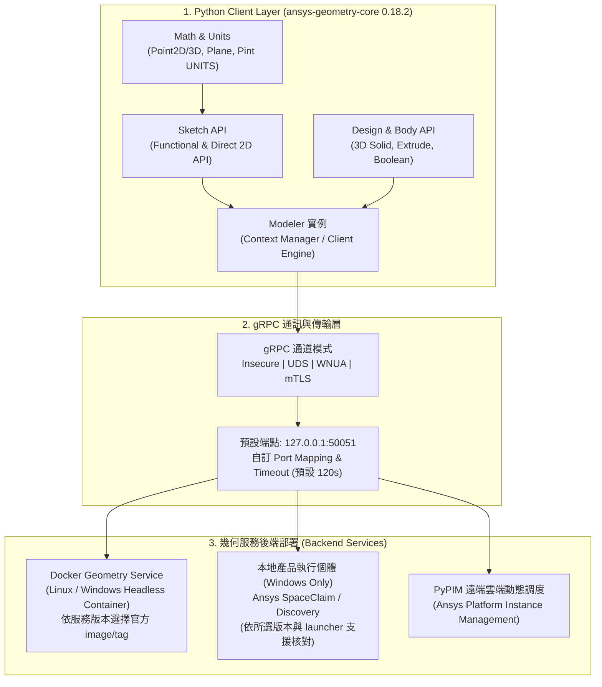

# PyAnsys Geometry 幾何服務主題辭典

> 範圍提醒：本頁只核對所引的部分 SDK 文件。既有架構圖、部署／授權表與 3D 範例尚未全面驗證；需按實際 SDK 與產品版本查原文，不能當作相容性或可執行性保證。[來源與待核項](../maintenance/knowledge_dictionary_passes/2026-11-02/geometry_deep_review.md)。

> 本主題深入剖析 `ansys-geometry-core` (SDK 0.18.2) 與 Ansys 幾何服務 (Geometry Service) 的架構體系。專注於幾何後端服務部署模式（獨立 Docker 容器、本機 SpaceClaim / Discovery 產品啟動器、PyPIM 雲端實例）、跨平台 Linux/Windows 版本界限、gRPC 通訊與傳輸模式、Modeler 生命週期與資源管理、2D Sketch 參數化草圖繪製，以及 3D 實體建模與 CAD 匯入匯出。

---

## 領域架構圖 (Geometry Service Architecture Map)



---

## 主題辭典與核心模組

### 1. 幾何服務部署及版本界線

#### 核心概念與辭典定義 (Core Concepts & Glossaries)
- **PyAnsys Geometry (`ansys-geometry-core`)**：Ansys 官方開源 Python 用戶端程式庫，封裝了 Ansys 幾何服務的底層 gRPC 通訊協定，提供現代化 Pythonic 介面。
- **幾何服務後端 (Ansys Geometry Service)**：PyAnsys Geometry 所連接的 CAD 服務。可用建模、準備或修復功能應依後端及方法版本核對；本批來源未完整證實底層 kernel 組成。
- **三大部署模式 (Deployment Modalities)**：
  1. **本機產品模式 (Local Product Instance)**：直接透過 `launch_modeler_with_spaceclaim()` 或 `launch_modeler_with_discovery()` 啟動本機已安裝的 SpaceClaim 或 Discovery 幾何進程並開啟後台 gRPC 服務。
  2. **獨立容器模式 (Docker Container)**：透過 `launch_docker_modeler()` 啟動官方 Docker 映像標籤 `ghcr.io/ansys/geometry:windows-latest`（Windows）與 `ghcr.io/ansys/geometry:core-linux-latest`（Linux），提供標準化、無雜質的 Headless 幾何解算環境。
  3. **遠端服務 (PIM / Remote Service)**：官方 remote 頁描述透過 PIM 啟動後端 session；該頁的 ZIP 下載途徑限 Ansys 員工，一般使用範圍與部署條件仍需依方案核對，見本頁 2026-11-05 來源補充。
- **跨平台版本界限 (Platform & Version Boundaries)**：
  - **Linux 支援界限待查**：本輪資料尚不足以限定 Linux 僅使用 Docker；部署與啟動器支援請依所用產品和 SDK 版本核對。
  - **SDK 與產品版本**：本機文件標示 SDK `0.18.2`。後端相容版本、平台條件與容器依賴尚未核實，不推定跨版本執行保證。

#### 手冊章節與規格出處 (Manual & Doc Citations)
- **手冊來源**：*PyAnsys Geometry User Guide & API Reference* (SDK 0.18.2 / Stable)
- **章節與錨點**：
  - Landing Page ([0.18.2 Stable Landing](../ANSYS_Document/Geometry/sdk/ansys-geometry-core/0.18.2/guide/eda2f35ab40b-stable.html))
  - Connection Package Reference ([Connection Package](../ANSYS_Document/Geometry/sdk/ansys-geometry-core/0.18.2/api_reference/07e85eaf7281-index.html))
  - User Guide: Getting Started ([User Guide Index](../ANSYS_Document/Geometry/sdk/ansys-geometry-core/0.18.2/guide/4b0322ff7d46-index.md))
  - API Reference: Modeler Class ([Modeler API](../ANSYS_Document/Geometry/sdk/ansys-geometry-core/0.18.2/api_reference/d3ab5ac63cc0-Modeler.md))
  - Source IDs: `sources.csv#ansys_5969c50e2bb952e67648b4a3`, `sources.csv#ansys_82bfdcb20cd4ee0a8b897409`, `sources.csv#ansys_32510d49bdc2ead838072784`, `sources.csv#ansys_7dc4796b4a9f3e10f5131bdd`.

#### 後端部署模式比較矩陣 (Backend Modalities Matrix)

> 本表的平台與授權欄位尚待逐項及跨版本核對，不能作為部署或授權保證。

| 部署模式 | 啟動函式 / 進入點 | 作業系統支援 | 授權特徵要求 | 典型應用場景 |
|---|---|---|---|---|
| **本機 SpaceClaim** | `launch_modeler_with_spaceclaim()` | 依產品及 launcher 支援 | 依實際產品授權；未核實 feature 名稱 | 桌面 CAD 與 SpaceClaim 流程整合 |
| **本機 Discovery** | `launch_modeler_with_discovery()` | 依產品及 launcher 支援 | 依實際產品授權；未核實 feature 名稱 | Discovery 幾何服務連線 |
| **Docker 容器** | `launch_docker_modeler()` | 依映像與版本；Linux Core Service 文件列 252 起 | 容器指引列 `LICENSE_SERVER`；未核實 feature 名稱 | 容器化幾何服務 |
| **自訂 gRPC 連線** | `Modeler(host, port)` | 跨平台 | 依伺服器端配置 | 連線既有獨立運行的幾何伺服器叢集 |
| **PIM 遠端 session** | `Modeler(remote_instance=...)` 等，依該版文件 | 依 PIM 方案 | 原頁下載途徑限 Ansys 員工；一般條件待核實 | 文件所述遠端 session 管理 |

#### 服務生命週期與所有權管理 (Service Ownership & Lifecycle)
`Modeler` 建構函式根據傳入的實例類型自動接管進程生命週期：
- SDK 0.18.2 的 Modeler API 說明所提供的 `docker_instance`、`product_instance`、`remote_instance` 在 `GrpcClient.close()` 時刪除；實際部署行為與所有權應依版本驗證。
- 對直接指定 `host` / `port` 的既有伺服器，本輪來源未證實關閉客戶端後後端的生命周期；勿推定其持續或終止。

#### 完整端到端 Python 幾何建立範例 (Python Scripting Example)
```python
# ==============================================================================
# PyAnsys Geometry: Headless Geometry Service Connection, 2D Sketch, Extrude, and Export
# Note: ASCII-only comments to prevent IronPython encoding issues.
# ==============================================================================
from ansys.geometry.core import Modeler
from ansys.geometry.core.math import Plane, Point2D, Point3D, UnitVector3D
from ansys.geometry.core.misc import UNITS
from ansys.geometry.core.sketch import Sketch

# Connect to Geometry Service (or Docker container) via Context Manager
# Default port is 50051 on localhost
# Windows local-service illustration; not executed.
with Modeler(host="127.0.0.1", port=50051, transport_mode="wnua", timeout=120) as modeler:
    # Verify backend connection and print service version
    client_status = modeler.client.healthy
    print("Geometry Service Status: {0}".format(client_status))

    # Create a new active design document
    design = modeler.create_design("HeatSink_Base")

    # Define custom construction plane at Z = 10 mm
    origin = Point3D([0.0, 0.0, 10.0 * UNITS.mm])
    plane = Plane(origin=origin, direction_x=UnitVector3D([1, 0, 0]), direction_y=UnitVector3D([0, 1, 0]))

    # Create 2D Sketch on construction plane
    sketch = Sketch(plane=plane)
    # Draw rectangle using 2D points (-25mm, -25mm) to (25mm, 25mm)
    sketch.box(center=Point2D([0, 0]), width=50.0 * UNITS.mm, height=50.0 * UNITS.mm)
    # Add a center mounting hole with radius 5 mm
    sketch.circle(center=Point2D([0, 0]), radius=5.0 * UNITS.mm)

    # Extrude 2D Sketch profile into 3D Solid Body (Extrude distance: 8 mm)
    body = design.extrude_sketch(
        name="Base_Plate",
        sketch=sketch,
        distance=8.0 * UNITS.mm
    )

    # Export final geometry to neutral STEP format and native SpaceClaim format
    design.export_to_step(r"C:\Temp\heatsink_base.step")
    # Context manager automatically triggers graceful disconnect on exit
```

#### 工程實務踩坑指南 (Gotchas & Limitations)
1. **gRPC 訊息容量限制 (`RESOURCE_EXHAUSTED`)**：實際限制應依 channel、後端及版本核對。本批 Modeler／GrpcClient 文件未證實固定 4 MB 上限或必須提高至 64 MB，這兩個數字保留為待查，不能套成現行 SDK 契約。
2. **單位系統隱蔽錯誤 (Pint Physical Units)**：`ansys-geometry-core` 原生使用 `Pint` 庫強制維度物理單位校驗（`UNITS.meter`, `UNITS.mm`, `UNITS.degree`）。若向 API 傳遞純浮點數，系統將套用 `DEFAULT_UNITS.LENGTH = meter`；例如傳遞 `50` 會被解譯為 $50\,\text{m}$ 而非 $50\,\text{mm}$，造成幾何特徵尺寸膨脹 1000 倍。
3. **Docker 容器檔案路徑映射問題**：在 Windows 主機使用 `export_to_step()` 等檔案操作時，傳入的路徑必須是容器內部掛載的路徑（例如 `/app/output.step`），若傳入 Windows 原生路徑（如 `C:\output.step`），Linux Docker 容器內部無法解析導致寫入失敗。

---

### 2. 2D Sketch 與基本幾何特徵

#### 核心概念與辭典定義 (Core Concepts & Glossaries)
- **草圖幾何基底 (Sketch & Plane)**：2D 草圖必須依附於 3D 空間中的特定基準平面 (`Plane`)。`Plane` 由基準原點 (`origin: Point3D`) 與局部坐標軸方向 (`direction_x`, `direction_y: UnitVector3D`) 唯一確定。
- **雙重風格 API 架構 (Dual-Style Sketch API)**：
  - **函數鏈式風格 (Functional-style API)**：保留前一個圖元的結束點作為當前圖元的起始點（如連續繪製多邊形折線），語意簡潔。
  - **直接獨立風格 (Direct API)**：獨立指定各幾何圖元參數（如 `sketch.circle()`, `sketch.box()`, `sketch.triangle()`），圖元之間解耦，適合參數化驅動。
- **邊 (Edge) 與面 (Face)**：草圖繪製完成後，閉合邊界會被幾何拓撲引擎自動識別為可拉伸的表面 (`Face`)，未閉合線段則保持為 `Edge`，無法進行實體生成。

#### 核心精度與常數設定 (Precision & Accuracy Constants)

| 常數名稱 | 數值 / 預設單位 | 意義與工程說明 |
|---|---|---|
| `DEFAULT_UNITS.LENGTH` | `meter` | 幾何核心標準長度單位 |
| `DEFAULT_UNITS.ANGLE` | `radian` | 幾何核心標準角度單位 |
| `LENGTH_ACCURACY` | `1e-8 m` (0.01 $\mu\text{m}$) | 幾何節點與邊界重合的數值容差極限 |
| `ANGLE_ACCURACY` | `1e-6 rad` | 向量平行/垂直判定容差 |

---

## 雙向鏈結與參照索引
- [[spaceclaim|Ansys SpaceClaim 腳本辭典]]：SpaceClaim 桌面端 IronPython 原生腳本與幾何簡化。
- [[discovery|Ansys Discovery 核心概念辭典]]：Discovery 即時物理模擬與幾何建模。
- [[mechanical|Ansys Mechanical 主題辭典]]：幾何模型匯入 Mechanical 後之材料指派與網格劃分。
- [[pcb_warpage|PCB 多層板熱翹曲分析辭典]]：利用幾何共用拓撲 (Share Topology) 進行多層板全自動化建模。

## 本輪原文核對補充（PyAnsys Geometry 0.18.2）

本節依本機保存的官方 PyAnsys Geometry 文件逐頁整理。文件首頁明示版本為 **0.18.2**；`stable` 是來源網址別名，不作為獨立版本號。下列來源位置保留原網頁路徑與本機檔案，所有程式範例僅為文件摘整，未執行。

### 客戶端、Geometry service 與連線生命週期

- **PyAnsys Geometry** 是 Geometry service 的 Python client library／wrapper；幾何運算服務端與 Python 用戶端是不同層次。`Modeler` 用來連線至已開啟的 service session。
- `Modeler()` 文件預設端點為 `127.0.0.1:50051`；可以由 `host`、`port` 指定其他位置。若 Docker 對外主機埠有改動，需與容器啟動時的埠映射一致。
- `Modeler` 建構參數包含 `channel`、`remote_instance`、`docker_instance`、`product_instance`、`timeout`、`proto_version`、`transport_mode`、`uds_dir`、`uds_id`、`certs_dir` 等。API 文件列出的 transport 選項為 `insecure`、`uds`、`wnua`、`mtls`；在 `channel` 已提供時，文件說明 `transport_mode` 不需要。
- 此版本 `timeout` 預設 120 秒；`proto_version=None` 時使用 `v0`，文件表示可用版本為 `v0`、`v1` 等，未在此處確認各後端支援矩陣。
- `Modeler` API 明確指出：透過 PyPIM 啟動時傳入的 `remote_instance`、透過 launcher 啟動的 `docker_instance` 與 `product_instance`，會在 `GrpcClient.close()` 時被刪除。這是對所傳入 instance 的文件描述；對只傳 `host`／`port` 的既有服務，來源未說明關閉客戶端會否停止服務，因此不推定其行為。
- 版本門檻需留意：`measurement_tools` 註明自 Ansys release 24R2 才可用；`rayfire_tools` 註明自 26R1 才可用。SDK 文件首頁版本 0.18.2 並不代表每個後端產品版本都提供相同屬性。

**來源定位**：
- [User guide — Simple interactive example](../ANSYS_Document/Geometry/sdk/ansys-geometry-core/0.18.2/guide/4b0322ff7d46-index.md)：預設端點及 Docker host port 說明。
- [Modeler API](../ANSYS_Document/Geometry/sdk/ansys-geometry-core/0.18.2/api_reference/d3ab5ac63cc0-Modeler.md)：建構參數、生命週期描述、transport 選項、版本可用性註記。
- [Connection package](../ANSYS_Document/Geometry/sdk/ansys-geometry-core/0.18.2/api_reference/07e85eaf7281-index.md)：`backend`、`client`、`defaults`、`docker_instance`、`launcher`、`product_instance`、`transport`、`validate` 子模組職責摘要。

### 草圖拓撲與兩種建立 API

- 草圖由 `Sketch` 建立，可指定 `Plane`；官方 guide 將基本草圖圖元分成兩類：`Edge` 是沿路徑連接點的開放形狀（例如 arc、line）；`Face` 是邊界封閉所圍成的面（例如 circle、triangle）。不要把任意線段當作可直接拉伸的封閉面。
- **Functional-style API** 會保留前一個 edge 的終點，作為下一個圖元的參考起點。guide 範例使用 `segment_to_point()` 串接線段，並可透過使用者標籤呼叫 `sketch.get("Segment2")`。
- **Direct API** 讓各圖元獨立指定座標；guide 以 `sketch.triangle(Point2D(...), ..., tag="triangle2")` 作範例。兩者是建構草圖的不同介面選擇，不表示幾何拓撲或求解品質保證。
- Guide 特別說明文件避免將 functional-style 稱為 fluent API，以免與 Ansys Fluent 產品混淆；這是文件用詞規範。

**來源定位**：[Sketch — shapes guide](../ANSYS_Document/Geometry/sdk/ansys-geometry-core/0.18.2/guide/940e6e9fd3dc-shapes.md)，`Edge`／`Face` 定義、Functional-style API、Direct API。

### Plane、單位與數值精度

- `Plane` 表示 3D 空間中的 2D 平面，具有原點與座標系；草圖相對某個 plane 定義。Primitive guide 說預設工作平面是 XY、原點為 `(0,0)`；在該平面建立的 2D 物件會轉到全域座標系。
- PyAnsys Geometry 的 math 子套件以 Pint 表示物理量。官方表列 `LENGTH_ACCURACY = 1e-8`、`ANGLE_ACCURACY = 1e-6`、`DEFAULT_UNITS.LENGTH = meter`、`DEFAULT_UNITS.ANGLE = radian`。來源表未在數值旁明列單位，故此處不補推角度或精度數值的量綱；使用者仍需依實際 API 型別與單位物件確認輸入。
- Guide 的範例使用 `UNITS.m` 及 `Point2D`／`Point3D`；字典中其他「純浮點必定套用預設單位」的更強敘述，未在本輪所核查頁面中找到直接依據，應等參數型別/Accuracy/Measurements API 的完整核對後再定稿。

**來源定位**：[Primitives guide](../ANSYS_Document/Geometry/sdk/ansys-geometry-core/0.18.2/guide/2951f66402b0-primitives.md)，`Planes` 及精度／預設單位表；[User guide](../ANSYS_Document/Geometry/sdk/ansys-geometry-core/0.18.2/guide/4b0322ff7d46-index.md)，建立 `Plane`、`Sketch` 與帶 Pint 單位的圓形範例。

### 文件範圍與尚未核實的字典敘述

本輪已能直接支援連線參數與生命週期、草圖 Edge/Face 與 API 風格、Plane 和精度／預設單位四個主題。現有字典中的 Docker/Linux 可用性矩陣、授權特徵、Docker 路徑映射、gRPC 4 MB 訊息上限、64 MB 建議、3D 拉伸匯出流程與拓撲修復能力，未由上述已逐頁核對的來源支持，不能視為已完成核實。原有內容先保留並在下方清冊列為 pending，避免把未核證內容擴寫成規格。


## 2026-11-04：Wave 0 本機來源盤點與限制說明

本批完成 geometry 模組既有本機 catalog 文件（共 331 筆）與 sources 清冊（共 332 筆）之完整雜湊、正文路徑與標籤結構核對。本機未快取或具備企業授權/登入限制之線上主題誠實標記為缺口（保持現有非 complete 狀態），未擅自虛構未核實之線上 API 簽名或執行求解運算。

詳細稽核數據見 [本批轉換報告](../maintenance/knowledge_dictionary_passes/2026-11-04/geometry_module_conversion_report_20261104.md)。


## 2026-11-05：Geometry 部署、生命週期與 3D 流程核對

本節依保存的官方原件整理，區分既有 **SDK 0.18.2** 的 317 份 HTML 與本批補存 **SDK 0.18.3** 的 20 份 HTML。版本取自每頁 `docsearch:version`；產品 release 維持 `unknown`。`stable` 網址的內容已由 0.18.2 變成 0.18.3，不能只憑相同網址認定正文相同。

本批把原草稿中未獲來源充分證實的授權 feature 名稱、固定 gRPC 4 MB 上限與一般化 PyPIM 企業部署描述改列待核。以下提供可以定位原文的有限指引；既有長範例仍未作可執行性驗證。

### 部署與連線參數（SDK 0.18.3）

| 項目 | 可核實內容 | 來源 |
|---|---|---|
| 本機 session | 文件列出 `launch_modeler_with_discovery()`、`launch_modeler_with_spaceclaim()`、`launch_modeler_with_geometry_service()`；本機指引以 Ansys 2024 R1 或更新版本為起點。`ANSYS_GEOMETRY_SERVICE_ROOT` 指定自訂服務安裝位置。 | [Local session](ANSYS_Document/Geometry/official_body_20261105/official_geometry_e935c8320f8f236a.md) |
| 既有 session | 一般 Discovery／SpaceClaim GUI session 還需要 ApiServer extension；`Modeler(host, port, transport_mode)` 連到服務，連線埠需與容器 host-port mapping 一致。 | [Existing session](ANSYS_Document/Geometry/official_body_20261105/official_geometry_b7b3ea0c3b24dcbc.md) |
| `transport_mode` | 文件要求 SDK 0.14 起，直接建立 `Modeler()` 時需提供此參數；明確提供 `channel` 時可省略。launcher 可依環境選擇預設模式。 | [Connection guide](ANSYS_Document/Geometry/official_body_20261105/official_geometry_c9c9700a772c4363.md) |
| UDS／WNUA／mTLS | UDS 對應本機 Linux，WNUA 對應本機 Windows，mTLS 用於憑證驗證。安全連線由 Ansys 24R2 起提供，部分版本還需 Service Pack；26R1 起文件描述為內建提供。 | [Securing connections](ANSYS_Document/Geometry/official_body_20261105/official_geometry_c9c9700a772c4363.md) |
| Linux Core Service | Linux 容器指引明列 Ansys 2025R2（252）起支援。必填容器環境變數為 `LICENSE_SERVER`；launcher 使用 `ANSRV_GEO_LICENSE_SERVER` 等設定。這些名稱不能當成實際授權 feature 名稱。 | [Linux container](ANSYS_Document/Geometry/official_body_20261105/official_geometry_f0dd2ec5a31ff2eb.md) |
| Windows container | 指引要求切到 Windows containers 並啟用 Hyper-V；高埠可能落在保留範圍，需同步更改 host exposed port 與客戶端連線埠。 | [Windows container](ANSYS_Document/Geometry/official_body_20261105/official_geometry_a397268f2f1ba4b7.md) |
| 遠端 PIM 範圍 | 此頁明列只有 Ansys 員工具資格下載 PIM ZIP；正文可讀不代表該安裝包或服務對一般使用者開放。原頁使用 `ansys.discovery.core` 的 launcher 範例，本批未測匯入或遠端執行。 | [Remote session](ANSYS_Document/Geometry/official_body_20261105/official_geometry_3fba54bdce19c124.md) |

容器 registry 與預建 binaries 另有存取條件，官方頁面列出 repository write access、Ansys organization 或員工資格。安裝來源、產品授權與文件分享權限須按實際取得方式確認；本批沒有下載受限 binaries、容器或安裝產品。

### 官方相容性表的讀法

原表以 inline SVG 的 `check-circle-fill`／`x-circle` 表示勾選／叉選。下表只轉寫該頁四列標示，並保留[官方表正文](ANSYS_Document/Geometry/official_body_20261105/official_geometry_3d638c23106219b1.md)中的 SVG，未推定未列出的版本組合。

| 原表 SDK 列 | 原表 Ansys 產品版本 | Dockerized service | Standalone service | Discovery | SpaceClaim |
|---|---|---|---|---|---|
| `0.2.X` | `23R2` | 勾選 | 勾選 | 叉選 | 勾選 |
| `0.3.X` | `23R2 (partially)` | 勾選 | 勾選 | 叉選 | 勾選 |
| `0.4.X` | `24R1 onward` | 勾選 | 勾選 | 勾選 | 勾選 |
| `0.5.X` | `24R1 onward` | 勾選 | 勾選 | 勾選 | 勾選 |

該頁另說明自 0.5.X 起以 `@min_backend_version` 標示方法最低後端版本；不支援的方法會提出 `GeometryRuntimeError`。這張一般表不取代 Linux 容器的 252 門檻或逐方法限制，也不是本機相容性測試結果。

### Modeler 與資源生命週期

SDK 0.18.3 的 `Modeler.close(close_design=True)` 文件描述為先關閉 design，再呼叫 client 的 close。`GrpcClient.close()` 關閉 channel；其 Notes 明列 PyPIM 啟動的 instance 會刪除，本機 Docker instance 會停止。單純以 host／port 連接的既有產品進程是否結束，仍需依實際後端及版本另行核對。

來源：[Modeler 0.18.3](ANSYS_Document/Geometry/official_body_20261105/official_geometry_d3ab5ac63cc0b9c1.md)；[GrpcClient 0.18.3](ANSYS_Document/Geometry/official_body_20261105/official_geometry_1e87deb06306c0e5.md)。舊 SDK 0.18.2 的 instance 參數描述保留原版本；不以新頁覆蓋所有舊版行為。

### 3D 建模與輸出：文件範例所示流程

| 術語／操作 | 文件中的角色或參數 | 來源 |
|---|---|---|
| `Modeler`／`Design`／`Component` | `Modeler` 管理服務連線；`create_design()` 建立 assembly 根節點；`Component` 整理 bodies 與子節點，`add_component()` 建立命名子節點。 | [Modeling 101](ANSYS_Document/Geometry/official_body_20261105/official_geometry_33e00e9dbc0676f0.md)、[Design organization](ANSYS_Document/Geometry/official_body_20261105/official_geometry_3c13a5c41e066de3.md) |
| `extrude_sketch()` | 範例把 `Sketch`、名稱及有單位的 `Distance` 交給 design/component 建立 body；建模操作依賴已啟動的服務。 | [Modeling 101](ANSYS_Document/Geometry/official_body_20261105/official_geometry_33e00e9dbc0676f0.md) |
| Boolean operations | 文件示範 solid body 的布林操作。幾何、拓撲、容差及成功條件沒有因保存程式碼而獲得執行驗證。 | [Boolean operations](ANSYS_Document/Geometry/official_body_20261105/official_geometry_af62c2efee4a7272.md) |
| CAD export | 匯出格式與呼叫以該版 Design API／範例為準；檔案在哪一端建立，需依 API 及容器映射核對。 | [Export designs](ANSYS_Document/Geometry/official_body_20261105/official_geometry_b6fb96fe5869c259.md) |
| Named selections／PMDB | 範例先 `get_all_bodies()`、`create_named_selection()`，再 `export_to_pmdb()`；文件將 PMDB 定位為向 Mechanical 傳遞幾何與 named selections 的格式。 | [STEP → named selections → Mechanical](ANSYS_Document/Geometry/official_body_20261105/official_geometry_d8c1e39591647978.md) |
| `PMDBExportOptions` | 文件示例以 `process_surface_bodies=False`、`named_selection=False`、`target_application=PMDBTargetApplication.FLUENTMESHING` 說明輸出篩選用途。這裡只記錄文件意圖，沒有確認實際輸出檔差異。 | [PMDB export options](ANSYS_Document/Geometry/official_body_20261105/official_geometry_245f7756ba36eec8.md) |

### 尚未收束的來源與品質缺口

- Modeling 101 的舊敘述仍稱 Linux Geometry service 正在開發，而同批 Linux 容器指南已列出 252 起支援；平台判讀應回到具體版本指南，不把兩段合併成跨版本結論。
- PMDB options 範例的多組已保存輸出顯示相同檔名／位元組數，不能據此證明各篩選參數確實產生不同內容。一般化 3D、部署與 PyPIM 主題維持待來源／行為覆核。
- 舊 `unknown/guide` 首頁快照缺來源 URL，其相對 `_images/logo.png` 尚不能可靠解析。保留原快照與缺口；未把相對路徑當成成功保存的圖資。
- 其他未選入本批的 gallery 頁、下載附件、第三方 URL、圖片視覺語意、完整 API 契約及跨版本差異維持清冊狀態。

原文及衍生稿先供本機使用。未執行範例、部署、建模、GUI、solver 或物理驗證；團隊分享前需核對各來源權限。
