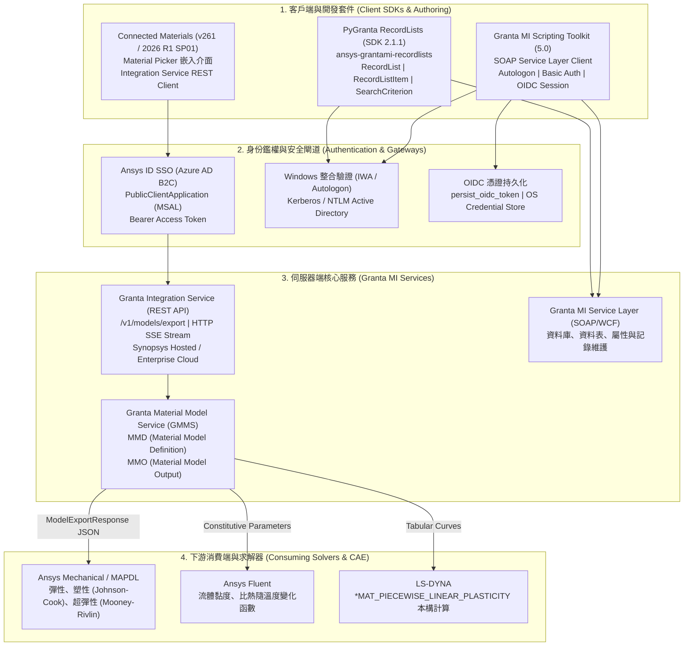

# Ansys Granta MI 與 PyGranta 知識字典

> 本主題深度剖析 Ansys Granta MI 企業級材料資訊管理系統、Connected Materials 雲端整合微服務與現代化 Python 客戶端生態（PyGranta）。系統化梳理三大核心開發與整合路徑：PyGranta RecordLists 2.1.1（材料清單建立、進階布林檢索、審批與修訂生命週期）、Granta MI Connected Materials 2026 R1 SP01（基於 Granta Integration Service REST/JSON API、HTTP Server-Sent Events SSE 與 Ansys ID SSO Bearer 權杖鑑權）、以及 Granta Material Model Service (GMMS) 材料模型定義 (MMD) 與模型輸出 (MMO) 資料架構（明確界定伺服器提供物性參數、消費端求解器負責實作本構力學方程之責任邊界）。

---

## 領域架構圖 (Granta MI Architecture & Ecosystem)



---

## 主題辭典與核心模組

### 1. PyGranta RecordLists 連線與模型 (PyGranta RecordLists Connection & Models)

#### 核心概念與辭典定義 (Core Concepts & Glossaries)
- **PyGranta RecordLists 定位**：
  - `ansys-grantami-recordlists` (SDK 2.1.1) 是專門用於管理 Granta MI 伺服器端「材料記錄清單 (Record Lists)」的現代 Python 函式庫。
  - **架構邊界**：與傳統 SOAP `granta-mi-scripting-toolkit` 的 `Session` 完全獨立。它以 `Connection` 與專用 client 驅動，專門負責跨專案的標準件材料清單管理、發布審批與協作。
- **連線架構 (`Connection`)**：
  ```python
  from ansys.grantami.recordlists import Connection
  client = Connection(service_layer_url="http://granta-server/mi_servicelayer").with_autologon().connect()
  ```
  支援 `with_autologon()`（Windows 整合驗證）與 `with_credentials(username, password)`（基本帳密）。
- **核心物件模型 (Core Object Models)**：
  - `RecordList`：代表伺服器端儲存的一份材料記錄清單。具備 `identifier`、`name`、`notes`、`is_published`、`is_revision`、`awaiting_approval` 及 `items` 屬性。
  - `RecordListItem`：清單中的具體材料條目，包含 `history_identity`、`record_guid`、`record_history_guid`。
- **搜尋與複合條件 (`SearchCriterion` / `BooleanCriterion`)**：
  - `SearchCriterion`：支援 `name_contains`、`is_published`、`is_revision`、`is_awaiting_approval`、`is_internal_use` 等旗標過濾；
  - `BooleanCriterion`：支援邏輯運算，`match_all=[...]` (AND 邏輯) 與 `match_any=[...]` (OR 邏輯)，支援高階巢狀複合查詢。
- **發布、修訂與撤銷生命週期 (Lifecycle States)**：
  - **新建立清單**：處於草稿狀態（`published=False, awaiting_approval=False`）；
  - **申請發布**：呼叫 `client.request_list_approval(list)`，狀態切換為 `awaiting_approval=True`；
  - **正式發布**：由管理員調用 `client.publish_list(list)`，狀態成為 `published=True`；已發布清單進入唯讀保護，不可直接修改；
  - **修訂機制**：若需修改已發布清單，調用 `client.revise_list(published_list)` 生成臨時副本 Revision（`is_revision=True`）；修改完成並審批後發布，自動更新父清單並銷毀 Revision。

#### 手冊章節與規格出處 (Manual & Doc Citations)
- **官方手冊**：*PyGranta RecordLists API Reference & Tutorials (SDK 2.1.1)* ([Connection API](../ANSYS_Document/Granta_MI/sdk/ansys-grantami-recordlists/2.1.1/api_reference/067dd5105e7d-connection.md)), ([Models API](../ANSYS_Document/Granta_MI/sdk/ansys-grantami-recordlists/2.1.1/api_reference/ee0bc20f6354-models.md)), ([Basic Usage](../ANSYS_Document/Granta_MI/sdk/ansys-grantami-recordlists/2.1.1/tutorial/0eeb058b3400-00_basic_usage.md)), ([Searching](../ANSYS_Document/Granta_MI/sdk/ansys-grantami-recordlists/2.1.1/tutorial/3d100f0e4874-02_searching.md))
- **Source IDs**：`sources.csv#ansys_494105bf383f8221dd8f1df8`, `sources.csv#ansys_232c45552a156d71b1b231bd`, `sources.csv#ansys_d819ff501a41a89ae7498bc8`, `sources.csv#ansys_0f1436c212428dfb860ce644`, `sources.csv#ansys_e514aa6797ca718e7ee30492`.

---

### 2. Connected Materials REST API 與 Ansys ID 認證 (Connected Materials REST & Ansys ID)

#### 核心概念與辭典定義 (Core Concepts & Glossaries)
- **Connected Materials 架構定位 (v261 / 2026 R1 SP01)**：
  - 專為 CAD/CAE 第三方應用程式、自訂外掛或雲端服務設計的現代材料挑選與導出微服務。
  - 核心基於 **Granta Integration Service REST API**，採用標準 HTTP/JSON 通訊，並支援 **HTTP Server-Sent Events (SSE)** 進行長時間非同步導出任務的事件推播與進度回報。
- **Ansys ID SSO 認證與 Bearer Token**：
  - 與傳統企業內部 Active Directory (Windows Autologon) 不同，Connected Materials 要求使用者具備經過授權的 **Ansys ID** 帳號（託管於 Azure AD B2C）。
  - **取得與傳遞流程**：
    1. 客戶端使用 MSAL (`PublicClientApplication`) 透過系統瀏覽器發起互動登入（預設本機重導向埠為 `32284`）；
    2. 登入成功後換取 JWT `access_token`；
    3. 在所有後續發往 Granta Integration Service 的 HTTP 請求中，於 Request Header 附加：
       ```http
       Authorization: Bearer <access_token>
       ```
  - **重要邊界**：該 Bearer Token 僅用於調用 Integration Service REST API；在瀏覽器中開啟 Material Picker UI 視窗時使用另一套基於 Cookie 的 SSO 工作階段。

#### 手冊章節與規格出處 (Manual & Doc Citations)
- **官方手冊**：*Granta MI Connected Materials 2026 R1 SP01 Guide* ([Getting Started](../ANSYS_Document/Granta_MI/v261/guides_and_tutorials/granta-mi-connected-materials-2026-r1-sp01/getting-started.md)), ([Authentication](../ANSYS_Document/Granta_MI/v261/guides_and_tutorials/granta-mi-connected-materials-2026-r1-sp01/authentication.md))
- **Source IDs**：`sources.csv#ansys_c6a78f758f226df4faee793e`, `sources.csv#ansys_c83a10e13ca682094697909f`.

---

### 3. GMMS、MMD 與 MMO 材料模型資料 (GMMS, MMD & MMO Data Models)

#### 核心概念與辭典定義 (Core Concepts & Glossaries)
- **GMMS 架構分層體系**：
  - **GMMS (Granta Material Model Service)**：負責將資料庫中的原始測試數據與經驗曲線轉換為特定 CAE 求解器所需的材料模型屬性集合。
  - **MMD (Material Model Definition)**：模型元數據定義，規範模型名稱、所需輸入屬性（如楊氏模數、泊松比、屈服應力）、約束條件 (Constraints) 與單位格式。
  - **MMO (Material Model Output)**：實際導出的數據載體，承載具體材料在特定約束下的模型係數與曲線點陣列。
- **關鍵責任邊界：數據提供 vs 物理方程求解**：
  - **MMO 只提供模型所需的材料屬性數值與參數（Parameters），不包含模型方程的求解器實作**。
  - **消費端責任**：接收 JSON 數據的客戶端或求解器（Mechanical、Fluent、LS-DYNA），必須自行依據物理本構定律實作方程。例如對於虎克定律（Hooke's Law），MMO 提供 $E$ (Young's Modulus)，消費端必須自行處理應力-應變關係 $\sigma = E \epsilon$ 及外加自由參數。
- **`ModelExportResponse` JSON 資料結構剖析**：
  - 呼叫 `/v1/models/export` 端點回傳頂層物件 `materials` 陣列：
    - **元數據層**：`materialName`、`materialId`、`databaseKey`、`tableName`、`unitSystem`、`exportDateTime`、`traceabilityNotes`；
    - **模型層 (`models`)**：`modelName`、`modelId`、`constraints`、`properties`；
    - **純量屬性 (Scalar Property)**：如 `numericValue: 0.3` (Poisson's Ratio) 或 `stringValue` (分類)；
    - **表格屬性 (Tabular Property)**：用於表徵溫度相關物性（如 $E(T)$），包含欄位符號 `symbol`、單位 `unit`、自由參數標記 `isFreeParameter` 及數值陣列 `numericValues`；
    - **隱含約束 (Implicit Constraints)**：若來源屬性有未在 MMD 宣告為自由參數的維度，系統會採用資料庫預設值並列於 `implicitConstraints` 中。

#### 手冊章節與規格出處 (Manual & Doc Citations)
- **手冊出處**：*Connected Materials Material Models & Output Guide* ([Material Models](../ANSYS_Document/Granta_MI/v261/guides_and_tutorials/granta-mi-connected-materials-2026-r1-sp01/material-models.md)), ([Material Model Output](../ANSYS_Document/Granta_MI/v261/guides_and_tutorials/granta-mi-connected-materials-2026-r1-sp01/material-model-output.md))
- **Source IDs**：`sources.csv#ansys_d811e518b50cdae9d03b2e2f`, `ansys_a78166bf5c35f47eb728863b`.

#### Python 腳本範例：PyGranta RecordLists 檢索與 Connected Materials 查詢 (Python Scripting Example)

```python
# -------------------------------------------------------------
# Part 1: PyGranta RecordLists (SDK 2.1.1) Search & Publish
# -------------------------------------------------------------
from ansys.grantami.recordlists import Connection, SearchCriterion, BooleanCriterion

def manage_record_lists_example():
    """Demonstrates connecting to RecordLists service and querying approved lists."""
    # 1. Establish connection with Windows Autologon
    client = Connection("http://my-granta-server/mi_servicelayer").with_autologon().connect()

    # 2. Build search criterion: Published lists matching 'Approved Steel'
    crit_published = SearchCriterion(is_published=True)
    crit_name = SearchCriterion(name_contains="Approved Steel")
    
    # Combine with BooleanCriterion match_all (AND logic)
    combined_query = BooleanCriterion(match_all=[crit_published, crit_name])

    # 3. Search and print results
    results = client.search_for_lists(criterion=combined_query, include_items=True)
    print(f"Found {len(results)} matching record lists:")
    for r_list in results:
        print(f"- List: {r_list.name} (ID: {r_list.identifier}) | Items: {len(r_list.items)}")

# -------------------------------------------------------------
# Part 2: Connected Materials REST API Invocation with Bearer Token
# -------------------------------------------------------------
import requests

def export_material_models(integration_service_url, bearer_token, material_ids):
    """
    Calls Granta Integration Service REST API to export material model properties.
    """
    headers = {
        "Authorization": f"Bearer {bearer_token}",
        "Content-Type": "application/json"
    }
    payload = {
        "materialIds": material_ids,
        "unitSystem": "Metric_SI",
        "modelIds": ["LinearElastic_Isotropic"]
    }

    url = f"{integration_service_url}/v1/models/export"
    resp = requests.post(url, json=payload, headers=headers, timeout=30)
    resp.raise_for_status()
    export_data = resp.json()

    for mat in export_data.get("materials", []):
        print(f"Exported Material: {mat.get('materialName')}")
        for model in mat.get("models", []):
            print(f"  Model: {model.get('modelName')}")
            for prop in model.get("properties", []):
                print(f"    Property: {prop.get('name')} = {prop.get('numericValue')} {prop.get('unit')}")
    return export_data
```

#### 工程實務踩坑與注意事項 (Gotchas, Limitations & FAQ)
- **踩坑 1：混淆 RecordLists Client 與 Scripting Toolkit Session**：
  - 兩者使用完全不同的架構。若嘗試把 RecordLists 的 `RecordListItem` 物件傳給 Scripting Toolkit 的 `session.get_record()`，將拋出型別錯誤。RecordLists 僅負責清單管理，深入的記錄屬性編修需使用 Scripting Toolkit 或 REST API。
- **踩坑 2：忽略表格屬性中的 `isFreeParameter` 標記**：
  - 在解析溫變材料物性（如隨溫度下降的衝擊吸收能）時，若消費端未檢查 `isFreeParameter`，直接將自變量欄位（如 Temperature）當作應變量數值計算，將導致求解器物性指派嚴重錯亂。
- **踩坑 3：直接修改已發布清單**：
  - 在 RecordLists 中，已發布清單由伺服器鎖定。嘗試直接在 `published=True` 的清單調用 `add_item()` 或 `delete()` 會被拒絕。正確流程必須先透過 `client.revise_list()` 生成 revision，編輯後重新走審批流程。

---

## 來源與跨主題鏈結 (Cross-Topic Links)

- [Granta EduPack 材料教學與 Science Notes (edupack.md)](edupack.md) · 材料屬性科學筆記與選材三階段
- [Ansys ID SSO 認證 (ansys_id_sso.md)](ansys_id_sso.md) · Bearer Token 取得與權限範圍
- [Mechanical 材料指派 (mechanical.md)](mechanical.md) · 有限元本構材料模型之載入與應用
- [來源清冊](sources.csv) · `ansys_494105bf383f8221dd8f1df8`, `ansys_232c45552a156d71b1b231bd`, `ansys_d819ff501a41a89ae7498bc8`, `ansys_c6a78f758f226df4faee793e`, `ansys_c83a10e13ca682094697909f`, `ansys_d811e518b50cdae9d03b2e2f`, `ansys_a78166bf5c35f47eb728863b`.

## 本輪官方來源抽查與版本／轉換補記

本節是抽查結果，不代表完整審閱 134 項來源或取得團隊再散布授權。逐來源狀態、原始路徑、網址、catalog SHA-256、正文長度及轉換／語意審閱欄位，見[Granta MI 來源清冊](../maintenance/knowledge_dictionary_passes/2026-11-02/granta_mi_sources.csv)；處理紀錄與索引查詢證據見[本輪紀錄](../maintenance/knowledge_dictionary_passes/2026-11-02/granta_mi.md)。

### 版本與覆蓋邊界

- 本機 catalog 共 134 項：110 Markdown、18 HTML、3 Notebook、3 Python 範例；其中 128 項標為 `body_present` 且轉換正文非空，另 6 項為無正文抽取的附件（3 Notebook、3 Python），不應把它們計為已轉換正文。catalog 版本欄為 114 項 `unknown`、20 項 `v261`；15 項來源沒有 URL。
- RecordLists 安裝套件 metadata 為 `ansys-grantami-recordlists 2.1.1`，其官方文件 URL 使用 `version/stable`，因此本機包版本可辨識，但 `stable` 網頁不等於 2.1.1 歷史版本的逐頁對應快照。Connected Materials 網頁明確標示 2026 R1 SP01（v261），頁面更新日 2026-06-17。兩者版本不可混寫。
- 官方產品入口 `https://developer.synopsys.com/docs/granta-mi.md` 本輪瀏覽擷取回傳 Cache miss/Internal Error，故入口內容和可連結範圍未核實；這不代表其在一般瀏覽器一定不可用。RecordLists 官方 SDK 網站及下列 Connected Materials 文件頁可公開讀取。Swagger 端點說明需有效 Ansys ID 並登入 MI Service Layer；本輪未登入，端點 schema 未核讀。

### 可追溯概念補充

#### RecordLists 搜尋條件與資料可見性

`SearchCriterion` 可用清單名稱及清單狀態等條件篩選；`BooleanCriterion(match_all=...)` 表示條件需同時成立，`match_any` 則用於任一條件符合。搜尋是否回傳某筆清單也受目前使用者權限影響，因此查詢條件不能視為跨使用者的完整資料列舉。官方示例顯示 `is_internal_use=False`、`user_role=UserRole.OWNER` 可限定公開用途且由目前使用者擁有的清單。`contains_records` 與 `include_items=True` 是不同用途：前者是條件，後者要求搜尋結果包含項目內容；需要讀取 `RecordList.items` 時應確認已請求項目。

出處：官方 [Searching example](https://recordlists.grantami.docs.pyansys.com/version/stable/examples/02_searching.html)，對應本機 [Searching Markdown](../ANSYS_Document/Granta_MI/sdk/ansys-grantami-recordlists/2.1.1/tutorial/3d100f0e4874-02_searching.md)（catalog SDK 版本 2.1.1、release 欄 unknown）。網頁以 `stable` 發佈，沒有在頁面證明與本機套件版逐項一致，故此處只記錄已觀察到的條件名稱與意義。

#### Connected Materials 的 MMD 與 MMO 職責

Material Model Definition (MMD) 說明模型名稱、所需材料模型性質及其格式；MMD 本身不包含本構方程。Material Model Output (MMO) 是 `/v1/models/export` 回傳的 JSON `ModelExportResponse`，提供材料、模型及物性資料。消費端仍需依模型定義與自身求解器實作正確計算，不能把「成功匯出 MMO」解讀成伺服器已替求解器執行材料本構。

表格型輸出中，`isFreeParameter` 用來區別自由參數欄與依參數變化的性質數值；`implicitConstraints` 可記錄資料屬性有參數但 MMD 未明列為自由參數或 constraint 時，依資料庫預設參數所選用的限制值。讀取數值時應同時保留欄名、符號、單位、`numericValues`、自由參數標記及隱含限制，避免只抽取一列數字而失去其座標或條件脈絡。這是資料結構解讀說明，不替代具體材料卡或求解器輸入驗證。

出處：官方 [Material models](https://developer.synopsys.com/docs/granta-mi-connected-materials-2026-r1-sp01/material-models.md) 與 [Material Model Output](https://developer.synopsys.com/docs/granta-mi-connected-materials-2026-r1-sp01/material-model-output.md)；兩頁標示 Connected Materials 2026 R1 SP01、Last update 17.06.2026。本機文件分別為 [Material Models Markdown](../ANSYS_Document/Granta_MI/v261/guides_and_tutorials/granta-mi-connected-materials-2026-r1-sp01/material-models.md)（`ansys_d811e518b50cdae9d03b2e2f`）與 [Material Model Output Markdown](../ANSYS_Document/Granta_MI/v261/guides_and_tutorials/granta-mi-connected-materials-2026-r1-sp01/material-model-output.md)（`ansys_a78166bf5c35f47eb728863b`）。

| 原文術語 | 繁中整理 | 實務閱讀方式 |
| --- | --- | --- |
| Material model | 材料模型 | 描述需模擬的材料行為之數學模型，例如線彈性關係。 |
| Material model properties | 材料模型性質 | 模型所需、且屬於材料本身的數值，例如 Young's modulus。 |
| Free Parameters | 自由參數 | 外部模擬條件或自變數，例如溫度；應辨識其在表格中的欄位角色。 |
| Material Model Definition (MMD) | 材料模型定義 | 列出模型、所需性質與格式；不含模型方程本身。 |
| Material Model Output (MMO) | 材料模型輸出 | 服務匯出的材料模型性質資料結構。 |
| Granta Material Model Service (GMMS) | Granta 材料模型服務 | 提供所選材料的模型性質匯出。 |

#### HTML／Markdown 表格轉換品質

本機 v261 `material-models.md` 的原始 Terminology 表格被攤平成 `TermDefinitionMaterial...` 連續文字，列界與欄界消失；後續的範例清單仍在正文，但原表結構不可可靠還原。上表依可讀的官方網頁同一段內容重建為術語表，並非修改或覆寫原始來源。官方頁面本輪可讀取，因此可校正這個已抽查轉換缺陷；其他 HTML／Markdown 未逐項視覺核對，不能據此推定全數保留表格、圖像或頁面順序。

### 官方網頁存取與權限紀錄

| 網址 | 版本／日期 | 本輪狀態 | 範圍與缺口 |
| --- | --- | --- | --- |
| [RecordLists Searching](https://recordlists.grantami.docs.pyansys.com/version/stable/examples/02_searching.html) | 網站 `stable`；對應本機套件 2.1.1 尚未逐版核對 | 可讀 | 已抽查 criteria、權限可見性、`include_items` 及複合條件；只代表抽樣。 |
| [RecordLists Connection API](https://recordlists.grantami.docs.pyansys.com/version/stable/api/connection.html) | 網站 `stable`；本機 SDK metadata 2.1.1 | 可讀 | 查得 Kerberos/autologon、OIDC/credentials 等連線方式；不同 server capability 可能使方法不可用並回報 `NotImplementedError`。未驗證使用者環境與權限。 |
| [Connected Materials Authentication](https://developer.synopsys.com/docs/granta-mi-connected-materials-2026-r1-sp01/authentication.md) | 2026 R1 SP01；Last update 17.06.2026 | 可讀 | 文件指出需 Ansys ID；整合服務開發者／客戶存取須啟用，Ansys ID/MSAL 登入；Material Picker 的瀏覽器登入與 API Bearer token 不可互相替代。未登入測試。 |
| [Connected Materials Getting Started](https://developer.synopsys.com/docs/granta-mi-connected-materials-2026-r1-sp01/getting-started.md) | 2026 R1 SP01；Last update 17.06.2026 | 可讀 | 有 Integration Service、REST/JSON 與部分工作流程 SSE 概述；未連接租戶或執行請求。 |
| [Connected Materials Material Models](https://developer.synopsys.com/docs/granta-mi-connected-materials-2026-r1-sp01/material-models.md) | 2026 R1 SP01；Last update 17.06.2026 | 可讀 | 已核對模型／性質／MMD 定義及本機表格轉換問題。 |
| [Connected Materials Material Model Output](https://developer.synopsys.com/docs/granta-mi-connected-materials-2026-r1-sp01/material-model-output.md) | 2026 R1 SP01；Last update 17.06.2026 | 可讀 | 已核對 `/v1/models/export` 與輸出範例；完整 Swagger 端點需登入，未核。 |
| [Granta MI 官方產品入口](https://developer.synopsys.com/docs/granta-mi.md) | 入口未能確認 | 瀏覽擷取 Cache miss/Internal Error | 不推定入口失效；本輪沒有取得內容。 |

上述網址均為官方文件網域；來源授權或可否團隊再散布未核實。第三方 PyAnsys 網站亦為官方 PyAnsys 文件網域，但仍未確認其頁面條款及原文分享權限。此批文件限本機整理使用，實際分享前仍需查核來源條款。

### RecordLists 範例附件補件（PyGranta 2.1.1）

Catalog 中 3 份 Notebook 和 3 份 `.py` 是官方教程的原始輸入附件，沒有被轉成可檢索正文。已另建逐檔補件，包含 Notebook 的 Markdown／程式碼 cells，或 Python light 格式中的說明註解與程式碼；不含 Notebook 執行輸出，且未執行任何範例。補件保留原始範例內容與順序，供本機全文索引接入，不代表曾連線或驗證服務行為。

| 原始範例 | 主題 | 補件 |
| --- | --- | --- |
| `00_basic_usage.ipynb` / `.py` | 連線、建立／讀取／複製／更新／刪除清單、讀寫項目 | [補件](ANSYS_Document/granta_mi_examples_2_1_1/tutorial/00_basic_usage.md) |
| `01_publishing_revising_withdrawing.ipynb` / `.py` | 審批發布、修訂、撤回 | [補件](ANSYS_Document/granta_mi_examples_2_1_1/tutorial/01_publishing_revising_withdrawing.md) |
| `02_searching.ipynb` / `.py` | 名稱、清單內容、使用者可見性與複合條件搜尋 | [補件](ANSYS_Document/granta_mi_examples_2_1_1/tutorial/02_searching.md) |

逐檔原始路徑、URL、SHA-256 與補件原始位元組 SHA-256 見[附件雜湊清冊](../maintenance/knowledge_dictionary_passes/2026-11-04/granta_mi_attachment_sha256.csv)。來源頁面網址使用 `version/stable`，本機輸入目錄為 SDK metadata 2.1.1；兩者不能當作已核實的逐版一致快照。來源授權及再散布限制也尚未確認，補件只供本機整理與索引評估。


## 2026-11-04：HTML 轉換與可追溯正文補齊

本批固定 catalog 134 筆（110 Markdown、18 HTML、3 Notebook、3 Python），沒有 PDF。128 個正文來源的原件 hash、正文路徑與索引 metadata 均核對；18 HTML 為 9 組重複原件，全部 `pre` 程式區塊在既有 Markdown 逐字保留、沒有 HTML table，不重新轉檔。這是機械核對，未逐份語意／圖片驗收。

既有三份 RecordLists 附件補件已核對六個原件與輸出 hash、Notebook Markdown／code cells 及 Python 全文，沿用既有索引；Notebook outputs、媒體與服務執行仍不在本批驗收範圍。SDK 目錄 2.1.1 與網站 `stable` 的逐版一致性仍未核實。

Connected Materials 2026 R1 SP01 四頁已保存原始 HTML 及可檢索 Markdown，保留表格與程式區塊。這補齊前文「原表攤平」的本機正文缺口；原先 Markdown 保留。Material Models 的 Terminology 表可由下列正文直接回讀，不能以此推定完整 API／登入流程或各站台設定均已驗證。

| 官方頁 | 本機全文 | 來源 ID |
| --- | --- | --- |
| [Getting started](https://developer.synopsys.com/docs/granta-mi-connected-materials-2026-r1-sp01/getting-started.md) | [getting-started](ANSYS_Document/Granta_MI/v261/official_body_20261104/getting-started.md) | `sources.csv#official_granta_connected_getting_started_v261` |
| [Authentication](https://developer.synopsys.com/docs/granta-mi-connected-materials-2026-r1-sp01/authentication.md) | [authentication](ANSYS_Document/Granta_MI/v261/official_body_20261104/authentication.md) | `sources.csv#official_granta_connected_authentication_v261` |
| [Material models](https://developer.synopsys.com/docs/granta-mi-connected-materials-2026-r1-sp01/material-models.md) | [material-models](ANSYS_Document/Granta_MI/v261/official_body_20261104/material-models.md) | `sources.csv#official_granta_connected_material_models_v261` |
| [Material Model Output](https://developer.synopsys.com/docs/granta-mi-connected-materials-2026-r1-sp01/material-model-output.md) | [material-model-output](ANSYS_Document/Granta_MI/v261/official_body_20261104/material-model-output.md) | `sources.csv#official_granta_connected_material_model_output_v261` |

四頁仍標示 Last update: 17.06.2026。Swagger 需登入、完整 schema 與來源分享權限仍未核實；原字典廣泛 API／模型主張的待覆核狀態不因本次轉檔而完成。詳[本批報告](../maintenance/knowledge_dictionary_passes/2026-11-04/granta_module_conversion_report_20261104.md)。
