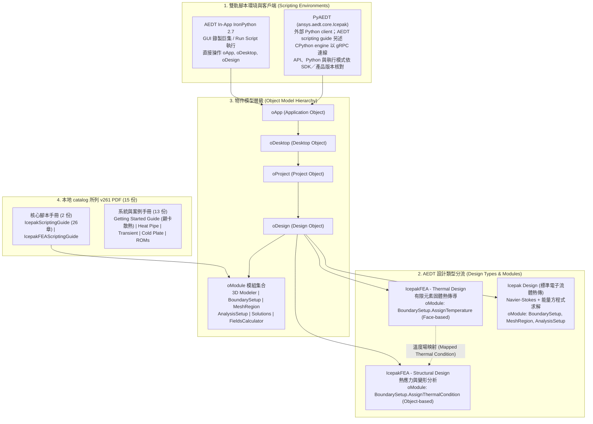

# Ansys Icepak 主題字典

> 本主題整理 Icepak 與 IcepakFEA 的有界操作/API概念。2026-11-06 已從官方 v261 目錄取得24份PDF（8,587實體頁）與Icepak/IcepakFEA兩個目錄區段，補齊本機原缺的9份文件。15份既有PDF與官方擷取的檔案雜湊不同，但每一實體頁抽取文字逐字相同；原件與對照證據均保留。不同設計類型、產品release與SDK版本依來源分別標示，圖表與完整工程語意仍有下方缺口。

---

## 領域架構圖 (Icepak Architecture & Module Hierarchy)



---

## 官方網站文件入口與本機缺口（2026 R1）

[Ansys Electronics v261 PDFs 目錄](https://ansyshelp.ansys.com/public/Views/Secured/Electronics/v261/en/Content/PDFs.htm) 將 Icepak Help、Icepak Scripting、Getting Started Guides，以及 IcepakFEA Help、Scripting 和四份 Getting Started Guide 分列。Getting Started 清單還列出本地 15 份 PDF 目錄未涵蓋的 Classic Icepak File Conversion、Non-Conformal Mesh、Extract Delphi Network。目錄本身提供閱讀入口，不代表本機 catalog 已收錄所有連結文件。

由官方 v261 目錄可直接開啟 [Icepak Scripting Guide](https://ansyshelp.ansys.com/public/Views/Secured/Electronics/v261/en/PDFs/IcepakScriptingGuide.pdf) 與 [IcepakFEA Scripting Guide](https://ansyshelp.ansys.com/public/Views/Secured/Electronics/v261/en/PDFs/IcepakFEAScriptingGuide.pdf)。網頁 PDF 分別為 1,326 與 1,554 頁，封面皆標 Release 2026 R1／January 2026；本地同名 v261 PDF 頁數相符。2026-11-06 已核對所有15份本機PDF：官方下載的原件SHA-256均不同，但實體頁數及逐頁抽取文字全部相同；這項文字一致性不證明版面/隱藏物件或byte內容相同。

目錄說明 Icepak Getting Started Guide 涵蓋材料、邊界、mesh regions、monitors、求解、後處理、fields summary 與 DOE；Transient Simulation guide 涵蓋資料集、piecewise linear transient power、時間步設定、監控與結果後處理。這是網站目錄的用途摘要，未代替逐份原始手冊內容。官方 PDF 的版權頁載明文件受 Ansys 軟體授權及保密條款約束；團隊分享原文或衍生內容前應核對實際授權。網頁工具可讀取此 v261 入口與 PDF 文字，不能由此推定所有使用者帳號、下載權限或再散布權均相同。

## 主題辭典與核心模組

### 1. v261 PDF 轉換與頁碼定位 (v261 PDF Extraction & Citation System)

#### 核心概念與辭典定義 (Core Concepts & Glossaries)
- **PDF 數位化與 Markdown Sidecar 機制**：
  - 本知識庫對 Ansys Electromagnetics Suite 2026 R1 (v261) catalog 標示為 v261 的 15 份 Icepak PDF 本機文件已有 Markdown 轉換檔，並在同目錄生成對應的 `.md` 側車檔案 (Markdown Sidecar)。
  - **`PDF Page N` 標記**：15 份 sidecar 的頁標記已核對為從 1 連續至各自末頁，可作為回查 PDF 的頁面線索；這項檢查不代表正文、表格、圖表或掃描內容已全面驗證。逐來源頁數與狀態見 `../maintenance/knowledge_dictionary_passes/2026-11-02/icepak_sources.csv`。
- **圖表、公式與版面審查邊界**：
  - 本 Icepak 清冊的 15 份 PDF 皆有連續頁標，並且未發現 sidecar 空文字頁；逐頁圖表／公式忠實度仍未全面驗收，機械檢查清單見 `../maintenance/knowledge_dictionary_passes/2026-11-02/icepak_empty_page_review_20261103.csv`。
  - **驗收準則**：當需要確認電路板 PCB 各向異性導熱係數張量設定、風扇 P-Q 特性曲線離散點或求解器收斂準則極限時，必須依 `PDF Page N` 標記回到原版 PDF 進行最終核對。

#### 15 份本地 v261 Icepak PDF 清冊（不代表網站文件全集）

| Document ID | 手冊完整名稱 | 實體檔名與側車路徑 | 涵蓋領域與核心內容 |
|---|---|---|---|
| `ansys_a0ad7c8d3f30ba37736aa6bd` | Icepak Scripting Guide | `IcepakScriptingGuide.pdf` (.md) | 核心總手冊 (26 章)：AEDT 物件模型、邊界、網格、求解與場計算器 |
| `ansys_e6e6c75160f5628b306a53ac` | IcepakFEA Scripting Guide | `IcepakFEAScriptingGuide.pdf` (.md) | 有限元素熱傳與熱應力腳本手冊：`AssignTemperature` 與 `AssignThermalCondition` |
| `ansys_f85db01edc5ff35a4e710a6d` | Icepak Getting Started Guide | `Icepak Getting Started Guide.pdf` (.md) | 系統級顯卡散熱完整流程：PCB 各向異性材料、風扇、散熱片與局部網格細化 |
| `ansys_20a97f8c82b1799648394a28` | Heat Pipe Model | `Getting Started with Icepak - Heat Pipe Model.pdf` (.md) | 熱管等效高導熱實體建模、Non-model Box 網格控制區域與監視器 |
| `ansys_bc1620da7e20295a9511ba2d` | Transient Simulation | `Getting Started with Icepak - Transient Simulation.pdf` (.md) | 暫態熱功耗分段線性曲線 (`ds_pwr`)、時間步間隔儲存與溫度歷程動畫後處理 |
| `ansys_3507139888357e25a198b115` | Scripting Example | `Getting Started with Icepak - Scripting Example.pdf` (.md) | AEDT GUI 錄製巨集修改、迴圈切面 (Plane Cut) 建立與批次匯出 JPEG |
| `ansys_fa35acb12735b9f7f9ed637d` | Cold Plate Model | `Getting Started with Icepak - Cold Plate Model.pdf` (.md) | 水冷板內部冷卻液流道 (Liquid Cooling) 建模、共軛熱傳與壓降評估 |
| `ansys_bf6155ba03c8d81c722a6647` | Finned Heat Sink | `Getting Started with Icepak - Finned Heat Sink.pdf` (.md) | 鰭片散熱器自然對流與強迫風冷對比、熱阻與流阻特性計算 |
| `ansys_8d00d495fd5805ec664a5317` | Coil and Plate | `Getting Started with Icepak - Coil and Plate.pdf` (.md) | 電磁線圈歐姆損耗熱耗散、平面感應發熱與熱傳導 |
| `ansys_5f42dd3dbab0333bbb2c31f7` | LPV ROM | `Getting Started with Icepak - LPV ROM.pdf` (.md) | 線性參數變化降階模型 (Linear Parameter-Varying ROM) 萃取與系統整合 |
| `ansys_44b4c13d8bda194732617bd3` | LTI ROM | `Getting Started with Icepak - LTI ROM.pdf` (.md) | 線性非時變降階模型 (Linear Time-Invariant ROM) 狀態空間矩陣萃取 |
| `ansys_64912b92ecabe51f17e9e029` | Optimization of Fan Location | `Getting Started with Icepak - Optimization of Fan Location.pdf` (.md) | Optimetrics 參數化掃描風扇座標、風道死區消除與最高結溫最小化 |
| `ansys_b3f82a992ae674c5d81710b1` | RF Amplifier | `Getting Started with Icepak - RF Amplifier.pdf` (.md) | 射頻功放晶片高功率密度熱源、Delphi 雙熱阻模型設定與均熱板分析 |
| `ansys_ab7bcb5462217b7587ece24b` | Waveguide Filter | `Getting Started with Icepak - Waveguide Filter.pdf` (.md) | 高頻電磁損耗匯入、波導濾波器發熱與熱漂移評估 |
| `ansys_933615912214fb1ea1827a6b` | Toolkits | `Getting Started with Icepak - Toolkits.pdf` (.md) | 電子封裝巨集、EDA 電氣走線銅皮比率匯入與自動散熱工具箱 |

#### 手冊章節與規格出處 (Manual & Doc Citations)
- **手冊來源**：`sources.csv` 中所有 15 筆 Icepak 文件清單；對應實體檔案位於 `F:\Ming_python\ansys-unified-mcp\docs\ANSYS_Document\Icepak\v261\manuals\`。
- **引用範例**：
  - *IcepakFEAScriptingGuide.pdf*：物理頁碼 Page 957–958 (`AssignTemperature`)、Page 959–960 (`AssignThermalCondition`)。
  - *Icepak Getting Started Guide.pdf*：物理頁碼 Page 19–42（Graphics Card 初始求解）、Chapter 5（局部網格細化）。
  - *Getting Started with Icepak - Transient Simulation.pdf*：物理頁碼 Page 13–29（瞬態時間步與 Piecewise Linear 功耗）。

#### 工程實務踩坑與注意事項 (Gotchas & FAQ)
- **物理頁碼與手冊內頁編碼差異**：PDF 閱讀器的實體頁數 (Physical Page) 與手冊內頁印刷頁數 (如 `1-1`, `Contents-1`) 常有 4~12 頁的封面/前言位移。**規範：所有 Markdown sidecar 的 `## PDF Page N` 均指實體物理頁碼**，避免跳轉錯位。
- **抽取文本中的分詞斷行**：在由 PDF 轉換的 Markdown 中，部分複合專業名詞可能出現多餘空格（如 `com panies`, `pro prietary`）。在撰寫腳本字串時必須查驗原始語法，避免將斷字帶入 API 參數中。

---

### 2. Icepak 與 IcepakFEA Scripting 範圍 (Scripting Scope & Architecture)

#### 核心概念與辭典定義 (Core Concepts & Glossaries)
- **AEDT 統一物件模型階層 (Object Model Hierarchy)**：
  - Icepak 內嵌於 Ansys Electronics Desktop (AEDT) 架構下，遵從樹狀物件模型：
    $$\text{oApp} \longrightarrow \text{oDesktop} \longrightarrow \text{oProject} \longrightarrow \text{oDesign} \longrightarrow \text{oModule}$$
  - **核心 oModule 模組職能**：
    - `BoundarySetup`：建立熱源、開口 (Opening)、格柵 (Grille)、散熱片 (Heatsink) 與風扇 (Fan) 邊界條件。
    - `MeshRegion`：在指定區域幾何上建立局部網格控制參數。
    - `AnalysisSetup`：設定流動/熱平衡求解器、流態（層流/湍流方程）、輻射模型（Discrete Ordinates / Surface-to-Surface）與收斂準則。
    - `Solutions`：執行計算 (`Solve`)、匯出解資料與讀取殘差。
    - `FieldsCalculator` / `ReportSetup`：後處理場量計算、監視器歷程曲線與溫度場雲圖繪製。
- **Standard Icepak vs. IcepakFEA 設計類型邊界**：
  - **Standard Icepak Design**：專注於電子設備機箱內的共軛熱傳 (Conjugate Heat Transfer, CHT) 與流場 CFD 計算。採用六面體為主之直角網格 (Cartesian Meshing) 或非結構多面體網格。
  - **IcepakFEA - Thermal Design**：專注於純固體導熱之有限元素法 (FEM) 求解。邊界條件作用於面或體單元。
  - **IcepakFEA - Structural Design**：專注於由溫度梯度引起的結構熱應力、熱形變與翹曲。
- **溫度激發 scoping 與兩種資料模式**：
  - `AssignTemperature`：**IcepakFEA - Thermal Design** 使用；參數為 boundary name、`Faces` 清單、`Temperature` 字串，手冊範例把 `90cel` 指派給 faces `[8, 17]`。編輯既有溫度邊界時，`Edit()` 不能更改 faces；手冊指示用 `AddAssignmentTo`、`RemoveAssignmentFrom` 或 `Reassign` 調整實體指派。
  - `AssignThermalCondition`：**IcepakFEA - Structural Design** 使用；`Objects` 指定目標幾何。`Uniform=True` 時給單一溫度條件；`Uniform=False` 時以 project、product、design、solution 及參數映射讀取來源結果，另有 `ForceSourceToSolve`、`PreservePartnerSoln`、`PathRelativeTo` 控制欄位。
  - 來源：*IcepakFEA Scripting Guide* v261 PDF physical pages 957–960。頁 959–960 的範例抽取文字有缺失符號，這裡只整理可辨識參數名稱，未把殘缺範例重建成程式。

#### 腳本環境與設計類型特性對比 (Scripting Scope Comparison)

| 維度特徵 | Standard AEDT Icepak | IcepakFEA - Thermal | IcepakFEA - Structural |
|---|---|---|---|
| **Design Type** | `Icepak` | `IcepakFEA` (Thermal) | `IcepakFEA` (Structural) |
| **物理主導方程** | Navier-Stokes + 能量方程 + 輻射 | 固體純熱傳導熱方程 | 線性/非線性彈性力學平衡方程 |
| **網格特徵** | Hexahedral Cartesian / Unstructured Mesh Region | 四面體/六面體有限元素網格 (FEM) | 結構有限元素共形網格 |
| **關鍵熱邊界 API** | `oBoundarySetup.AssignSourceBoundary`, `AssignOpeningBoundary` | `oBoundarySetup.AssignTemperature` (Scoping: Faces) | `oBoundarySetup.AssignThermalCondition` (Scoping: Objects) |
| **熱應力耦合方式** | 匯出溫度場雲圖或透過 System Coupling / Workbench 傳遞 | 透過專用 Mapping 直接匯入 Structural | 作為受體接受熱解溫度場產生熱應變 |

#### 手冊章節與規格出處 (Manual & Doc Citations)
- **手冊來源**：*Icepak Scripting Guide v261* ([Scripting Guide PDF](../ANSYS_Document/Icepak/v261/manuals/IcepakScriptingGuide.pdf))；*IcepakFEA Scripting Guide v261* ([IcepakFEA PDF](../ANSYS_Document/Icepak/v261/manuals/IcepakFEAScriptingGuide.pdf))。
- **Source IDs**：`sources.csv#ansys_a0ad7c8d3f30ba37736aa6bd`, `sources.csv#ansys_e6e6c75160f5628b306a53ac`。
- **精確頁碼定位**：
  - `IcepakScriptingGuide.pdf`：Chapter 1 (Scripting Environment, p. 1-1~1-9)、Chapter 11 (Boundary & Excitation Module, p. 11-1)、Chapter 14 (Mesh Region Module, p. 14-1)、Chapter 15 (Analysis Setup, p. 15-1)。
  - `IcepakFEAScriptingGuide.pdf`：PDF physical pages 957–958 (`AssignTemperature`)、pages 959–960 (`AssignThermalCondition`)。

#### v261 手冊命令片段：熱源與 Mesh Region (Manual-backed API excerpts)

以下僅摘錄手冊中的呼叫形狀與代表參數，保留 API 原名；不是完整自動化流程，也未在 AEDT 執行。`AssignSourceBoundary` 的手冊簽名使用 `Faces` 和 `Thermal Condition` 等欄位，不能把它與其他 wrapper 的同名功能混用。

```python
oModule.AssignSourceBoundary([
    "NAME:Source1",
    "Faces:=", [7],
    "Thermal Condition:=", "Total Power",
    "Total Power:=", "5W",
])
```

這些欄位摘自 *Icepak Scripting Guide* PDF physical pages 798–799；頁 799 的完整範例還含輻射、表面材料與電壓／電流設定。`5W` 是手冊範例值，不是設計建議。

```python
oModule.AssignMeshRegion([
    "NAME:MeshRegion1",
    "Enable:=", True,
    "MeshMethod:=", "MesherHD",
    "UserSpecifiedSettings:=", False,
    "MeshRegionResolution:=", 3,
    "GeometryBasedMeshing:=", True,
    "MinGapX:=", "1mm",
    "MinGapY:=", "1mm",
    "MinGapZ:=", "1mm",
    "Objects:=", ["SubRegion"],
])
```

摘自同手冊 PDF physical pages 839–840。參數是否適用需依 AEDT／Icepak 版本與設計狀態核對；`3` 與 `1mm` 是文件示例，不能當通用網格建議。

#### 工程實務踩坑與注意事項 (Gotchas & FAQ)
- **`Edit()` 命令不允許變更 Scoping 面**：對既有 `AssignTemperature` 邊界呼叫 `oModule.Edit()` 時，AEDT 僅允許修改邊界名稱與溫度量值，手冊指出 `Edit()` 不能變更 `Faces` 指派。需調整實體時，依手冊使用 `AddAssignmentTo`、`RemoveAssignmentFrom` 或 `Reassign`。
- **PyAEDT 與 IronPython 物件名衝突**：在現代 Python (PyAEDT) 中操作時，模組名稱封裝為物件屬性（如 `icepak.modeler`、`icepak.mesh`）；而在原生 IronPython 錄製巨集中則為字串獲取 `oDesign.GetModule("BoundarySetup")`。跨環境移植時需注意物件呼叫介面的封裝差異。

---

### 3. 入門分析流程與經典案例值 (Getting Started Workflows & Reference Cases)

#### 核心概念與辭典定義 (Core Concepts & Glossaries)
- **標準散熱設計四部曲**：幾何建立與物性賦予 $\to$ 域尺寸與網格分區控制 $\to$ 邊界與求解器監控設定 $\to$ 收斂驗證與溫度切面後處理。
- **經典手冊教學案例矩陣**：
  - **顯卡散熱 (Graphics Card, `ansys_f85db01edc5ff35a4e710a6d`)**：展示 PCB 各向異性導熱材料設定、進風開口 (Opening)、格柵阻力係數與雙層網格加密對比。
  - **熱管散熱 (Heat Pipe, `ansys_20a97f8c82b1799648394a28`)**：在非模型方塊 (Non-model Box) 幾何上設定局部網格區域；網格數與熱阻精度需由實際模型和收斂檢查判定，教學案例不構成通用門檻。

#### 案例流程、監視器與結果檢查對照表 (Tutorial Workflow Matrix)

| 手冊案例 | 幾何與材料特性 | 網格劃分策略 (Meshing Strategy) | 監視器 (Monitors) 與結果檢查 |
|---|---|---|---|
| **Graphics Card** | PCB 各向異性材料、風扇、開口、散熱鰭片 | 先行全域初網格求解，後續在散熱片與發熱晶片周圍建立 Mesh Region 細化 | CPU/Memory 溫度點監視器、出風口風量監視器；殘差曲線與等溫面雲圖 |
| **Heat Pipe Model** | 蒸發段、絕熱段與冷凝段；高導熱等效固體 | 於 Non-model box 建立局部 Mesh Region，兼顧高速度/溫度梯度區解析度與總單元數 | `block_1` 溫度監視器、`vent_1` 流量監視器；速度向量剖面與溫度切面雲圖 |
| **Transient Simulation** | 發熱塊 + 瞬態階梯/線性功耗曲線 (`ds_pwr`) | 依時變梯度區域劃分網格；設定每步 150 次收斂迭代 | 監控全時程溫度上升曲線，並在特定秒數 (如 24s) 輸出表面雲圖與時域動畫 |

#### 手冊章節與規格出處 (Manual & Doc Citations)
- **手冊來源**：*Icepak Getting Started Guide PDF* ([Getting Started PDF](../ANSYS_Document/Icepak/v261/manuals/Icepak%20Getting%20Started%20Guide.pdf#page=5))；*Heat Pipe Model PDF* ([Heat Pipe PDF](../ANSYS_Document/Icepak/v261/manuals/Getting%20Started%20with%20Icepak%20-%20Heat%20Pipe%20Model.pdf#page=5))；*Transient Simulation PDF* ([Transient PDF](../ANSYS_Document/Icepak/v261/manuals/Getting%20Started%20with%20Icepak%20-%20Transient%20Simulation.pdf#page=13))。
- **Source IDs**：`sources.csv#ansys_f85db01edc5ff35a4e710a6d`, `sources.csv#ansys_20a97f8c82b1799648394a28`, `sources.csv#ansys_bc1620da7e20295a9511ba2d`。

---

### 4. 暫態熱模擬與時間變化功率 (Transient Thermal & Time-Varying Power)

#### 核心概念與辭典定義 (Core Concepts & Glossaries)
- **瞬態求解器設定體系**：
  - Solution Type 設為 `Transient`，Problem Type 啟用 `Temperature and Flow`。
  - **時變功率函數 (Piecewise Linear Function, `ds_pwr`)**：
    - X 軸為時間（秒），Y 軸為基值乘數 (Multiplier)。在邊界條件啟用 Transient 後，設定基準功率 $S_0$（例如 $25\text{ W}$），並將曲線關聯至 `ds_pwr`，即時計算功耗為 $P(t) = S_0 \times \text{Multiplier}(t)$。
- **場資料儲存策略 (Save Fields Frequency)**：
  - 若需在後處理檢視各時步的完整溫度雲圖或製作流動動畫，必須在 Analysis Setup 中將 `Save Fields` 設定為每步儲存 (`Every 1 Time Steps`)；若僅需曲線監控，可僅設定 Monitor 輸出以節省磁碟空間。

#### 手冊章節與規格出處 (Manual & Doc Citations)
- **手冊來源**：*Getting Started with Icepak: Transient Simulation v261* ([Transient Simulation PDF](../ANSYS_Document/Icepak/v261/manuals/Getting%20Started%20with%20Icepak%20-%20Transient%20Simulation.pdf#page=13))；逐頁 Markdown 位於 `Getting Started with Icepak - Transient Simulation.md`（PDF Pages 13–29）。
- **Source ID**：`sources.csv#ansys_bc1620da7e20295a9511ba2d`。

---

### 5. 批次切面圖片輸出與後處理 (Batch Cut-Plane Image Export)

#### 範例流程與限制

*Getting Started with Icepak - Scripting Example* v261 說明先透過 AEDT 錄製並儲存腳本，再加入迴圈以建立多個 X 向 plane cuts、溫度場圖與圖片。手冊在 PDF physical pages 19–23 說明 `range(-240, 80, 40)` 的位置範圍（Python stop 不包含 80）、使用 `CreateCutplane` 與 `CreateFieldPlot` 中的變數，以及透過 `ExportModelImageToFile` 指定輸出路徑；第 25–26 頁說明在 AEDT 執行後檢查 plane、field overlays 和輸出圖片。

手冊的 API 參數細節以程式碼圖片呈現；目前沒有經影像辨讀或逐行比對，因此本字典不重建完整程式碼。先前字典中的 `ExportFieldPlotImageToFile`、參數結構及初始化流程未能由可抽取的正文證實，已移除。這是教學流程摘要，非已驗證可執行程式。

來源：`sources.csv#ansys_3507139888357e25a198b115`；本機 PDF：`../ANSYS_Document/Icepak/v261/manuals/Getting%20Started%20with%20Icepak%20-%20Scripting%20Example.pdf`。未執行 AEDT 腳本。

---

## 跨模組雙向鏈結與建議查閱路徑
- **跨產品熱分析路由**：詳見 [`thermal.md`](thermal.md)，了解電子散熱 (Icepak) 與結構熱傳 (Mechanical Thermal) 之選型決策。
- **封裝與 PCB 熱翹曲**：詳見 [`pcb_warpage.md`](pcb_warpage.md)，了解晶片回流焊與板級翹曲之熱應力分析。
- **高頻電磁-熱雙向耦合**：詳見 [`hfss.md`](hfss.md) 與 [`maxwell.md`](maxwell.md)，了解歐姆熱損耗導入 Icepak 之工作流。


## 2026-11-04：Wave 2 本機來源盤點與限制說明（歷史快照；目前來源狀態見下節）

本批完成 icepak 模組既有本機 catalog 文件（共 15 筆）與 sources 清冊（共 20 筆）之完整雜湊、正文路徑與標籤結構核對。本機未快取或具備企業授權/登入限制之線上主題誠實標記為缺口（保持現有非 complete 狀態），未擅自虛構未核實之線上 API 簽名或執行求解運算。

詳細稽核數據見 [本批轉換報告](../maintenance/knowledge_dictionary_passes/2026-11-04/icepak_module_conversion_report_20261104.md)。


## 2026-11-06 官方全文、版本與閱讀導覽

本批範圍取自官方 v261 Electronics PDF目錄中的 Icepak 與 IcepakFEA 兩個區段。24份產品PDF均HTTP 200並保存原件；另有一個共用 HPC Administrator’s Guide URL只列入參照清冊，交由安裝/授權模組處理。原文和衍生稿留本機，團隊分享前核對實際授權。

**版本：**24份PDF封面均列 Release 2026 R1；大多數封面日期為 January 2026，Extract Delphi Network同列July 2022，保留此差異，不推定為另一產品release。SDK版本均unknown；AEDT產品手冊版本不可當成PyAEDT版本。

| 官方文件 | 實體頁數 | 官方擷取原件／逐頁文字 |
|---|---:|---|
| Icepak Help | 2744 | [PDF](ANSYS_Document/Icepak/official_body_20261106/online_icepak_v261_help.pdf)／[文字](ANSYS_Document/Icepak/official_body_20261106/online_icepak_v261_help.md) |
| Icepak Scripting | 1326 | [PDF](ANSYS_Document/Icepak/official_body_20261106/ansys_a0ad7c8d3f30ba37736aa6bd.pdf)／[文字](ANSYS_Document/Icepak/official_body_20261106/ansys_a0ad7c8d3f30ba37736aa6bd.md) |
| Getting Started with Icepak | 64 | [PDF](ANSYS_Document/Icepak/official_body_20261106/ansys_f85db01edc5ff35a4e710a6d.pdf)／[文字](ANSYS_Document/Icepak/official_body_20261106/ansys_f85db01edc5ff35a4e710a6d.md) |
| Classic Icepak File Conversion | 34 | [PDF](ANSYS_Document/Icepak/official_body_20261106/online_icepak_v261_classic_conversion.pdf)／[文字](ANSYS_Document/Icepak/official_body_20261106/online_icepak_v261_classic_conversion.md) |
| Coil and Plate | 42 | [PDF](ANSYS_Document/Icepak/official_body_20261106/ansys_8d00d495fd5805ec664a5317.pdf)／[文字](ANSYS_Document/Icepak/official_body_20261106/ansys_8d00d495fd5805ec664a5317.md) |
| Waveguide Filter | 36 | [PDF](ANSYS_Document/Icepak/official_body_20261106/ansys_ab7bcb5462217b7587ece24b.pdf)／[文字](ANSYS_Document/Icepak/official_body_20261106/ansys_ab7bcb5462217b7587ece24b.md) |
| Transient Simulation | 29 | [PDF](ANSYS_Document/Icepak/official_body_20261106/ansys_bc1620da7e20295a9511ba2d.pdf)／[文字](ANSYS_Document/Icepak/official_body_20261106/ansys_bc1620da7e20295a9511ba2d.md) |
| Toolkits | 13 | [PDF](ANSYS_Document/Icepak/official_body_20261106/ansys_933615912214fb1ea1827a6b.pdf)／[文字](ANSYS_Document/Icepak/official_body_20261106/ansys_933615912214fb1ea1827a6b.md) |
| LTI ROM | 32 | [PDF](ANSYS_Document/Icepak/official_body_20261106/ansys_44b4c13d8bda194732617bd3.pdf)／[文字](ANSYS_Document/Icepak/official_body_20261106/ansys_44b4c13d8bda194732617bd3.md) |
| LPV ROM | 36 | [PDF](ANSYS_Document/Icepak/official_body_20261106/ansys_5f42dd3dbab0333bbb2c31f7.pdf)／[文字](ANSYS_Document/Icepak/official_body_20261106/ansys_5f42dd3dbab0333bbb2c31f7.md) |
| Scripting Example | 26 | [PDF](ANSYS_Document/Icepak/official_body_20261106/ansys_3507139888357e25a198b115.pdf)／[文字](ANSYS_Document/Icepak/official_body_20261106/ansys_3507139888357e25a198b115.md) |
| Finned Heat Sink | 33 | [PDF](ANSYS_Document/Icepak/official_body_20261106/ansys_bf6155ba03c8d81c722a6647.pdf)／[文字](ANSYS_Document/Icepak/official_body_20261106/ansys_bf6155ba03c8d81c722a6647.md) |
| RF Amplifier | 41 | [PDF](ANSYS_Document/Icepak/official_body_20261106/ansys_b3f82a992ae674c5d81710b1.pdf)／[文字](ANSYS_Document/Icepak/official_body_20261106/ansys_b3f82a992ae674c5d81710b1.md) |
| Optimization of Fan Location | 47 | [PDF](ANSYS_Document/Icepak/official_body_20261106/ansys_64912b92ecabe51f17e9e029.pdf)／[文字](ANSYS_Document/Icepak/official_body_20261106/ansys_64912b92ecabe51f17e9e029.md) |
| Cold Plate Model | 33 | [PDF](ANSYS_Document/Icepak/official_body_20261106/ansys_fa35acb12735b9f7f9ed637d.pdf)／[文字](ANSYS_Document/Icepak/official_body_20261106/ansys_fa35acb12735b9f7f9ed637d.md) |
| Heat Pipe Model | 29 | [PDF](ANSYS_Document/Icepak/official_body_20261106/ansys_20a97f8c82b1799648394a28.pdf)／[文字](ANSYS_Document/Icepak/official_body_20261106/ansys_20a97f8c82b1799648394a28.md) |
| Non-Conformal Mesh | 33 | [PDF](ANSYS_Document/Icepak/official_body_20261106/online_icepak_v261_nonconformal.pdf)／[文字](ANSYS_Document/Icepak/official_body_20261106/online_icepak_v261_nonconformal.md) |
| Extract Delphi Network | 21 | [PDF](ANSYS_Document/Icepak/official_body_20261106/online_icepak_v261_delphi.pdf)／[文字](ANSYS_Document/Icepak/official_body_20261106/online_icepak_v261_delphi.md) |
| IcepakFEA Help | 2177 | [PDF](ANSYS_Document/Icepak/official_body_20261106/official_icepak_5a83a44924409fd6.pdf)／[文字](ANSYS_Document/Icepak/official_body_20261106/official_icepak_5a83a44924409fd6.md) |
| IcepakFEA Scripting | 1554 | [PDF](ANSYS_Document/Icepak/official_body_20261106/ansys_e6e6c75160f5628b306a53ac.pdf)／[文字](ANSYS_Document/Icepak/official_body_20261106/ansys_e6e6c75160f5628b306a53ac.md) |
| Modal Solution – Coil | 35 | [PDF](ANSYS_Document/Icepak/official_body_20261106/official_icepak_dd42b2f55214be2e.pdf)／[文字](ANSYS_Document/Icepak/official_body_20261106/official_icepak_dd42b2f55214be2e.md) |
| Steady-State Thermal Solution – Heat Sink | 66 | [PDF](ANSYS_Document/Icepak/official_body_20261106/official_icepak_7893a1259b68dcd1.pdf)／[文字](ANSYS_Document/Icepak/official_body_20261106/official_icepak_7893a1259b68dcd1.md) |
| Transient Thermal Solution – Power Resistor | 51 | [PDF](ANSYS_Document/Icepak/official_body_20261106/official_icepak_33a7b4dfe49b5c00.pdf)／[文字](ANSYS_Document/Icepak/official_body_20261106/official_icepak_33a7b4dfe49b5c00.md) |
| Structural Solution – Power Resistor | 85 | [PDF](ANSYS_Document/Icepak/official_body_20261106/official_icepak_4f492f5a0134fd03.pdf)／[文字](ANSYS_Document/Icepak/official_body_20261106/official_icepak_4f492f5a0134fd03.md) |

### Icepak 與 IcepakFEA 章節入口

以下是官方PDF bookmark的實體頁定位，提供閱讀入口，沒有據此補寫未核實的參數值。

| 來源 | 入口與實體頁 |
|---|---|
| Icepak Help | 材料p819；熱邊界p1739；mesh p2033；monitors p2105；solution settings p2119；transient p2507；technical notes p2605；troubleshooting p2665 |
| IcepakFEA Help | solution type p61；Thermal Solutions p499；Structural Solutions p617；boundaries/excitations p659；meshing p2029 |

完整[PDF bookmark主題清冊](../maintenance/knowledge_dictionary_passes/2026-11-06/icepak_completion_topic_catalog_20261106.json)記錄6,620項來源標題、層級與實體頁；狀態為可取得正文而未逐項語意整理。這份清冊不代表6,620項工程主題已完成。

### 轉換品質與使用界線

- 每個PDF實體頁均保留`PDF Page N`與`<!-- page N -->`，8,587頁文字逐字回比PyMuPDF原抽取，未做OCR。全部圖表仍嵌於原PDF（5,596個影像出現次數），不表示圖像/公式語意已被FTS檢索。
- 舊catalog sidecar在兩份scripting guide共31頁出現表格欄字串黏合；本批逐頁候選保留原抽取換行。15份原PDF與同目錄舊Markdown保留，僅安排替換catalog的衍生正文，並保留可回復副本。
- 在上述31頁與8個既有字典引用頁，機器偵測107個表格、1,071個格位；[表格證據](../maintenance/knowledge_dictionary_passes/2026-11-06/icepak_completion_tables_20261106.json)保留bbox與cell字串，版面及欄位關係仍未人工驗收，不把偵測結果當成確定API參數結構。
- 原5個廣泛來源/API/工作流程題仍待覆核；未執行手冊範例、診斷腳本、AEDT host、solver或物理驗證。技能列出的D:來源目錄目前不存在，不能由設定路徑推定已讀到該來源。
