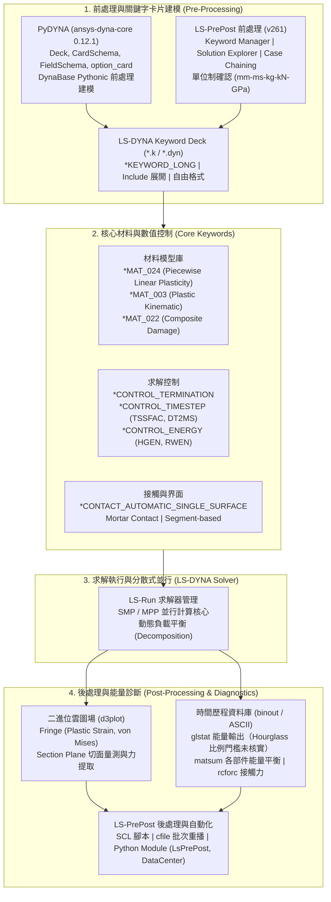

# LS-DYNA 主題辭典

> 本字典是分來源版本整理的入口。既有 R16、v261 與 PyDYNA 內容尚未逐條完成原文核驗；沒有來源 ID／頁碼的工程數值和相容性敘述均屬待核對，不得直接作為求解驗收門檻。已核對的 PyDYNA 0.12.1 API 子集與本機文件缺口見下方「本輪來源核對」。

## 本輪來源核對（2026-11-04）

### PyDYNA 0.12.1 API schema 導讀

- `FieldSchema` 是 immutable `NamedTuple`，定義欄位的 `name`、`type`、`offset`、`width`、`default` 和可選 `display_name`；`to_field()` 依 schema 建立 `Field`。
- `CardSchema` 是 immutable `NamedTuple`，保存整張卡片的 `FieldSchema` tuple 與欄位名稱索引；可由欄位建立 schema，也能依值建立 `Field`。
- `Card` 表示 keyword 的單一資料行，schema 與每個物件的欄位值分開；API 頁列出 `default`、`standard`、`long` 格式選項。

來源：[FieldSchema](../ANSYS_Document/LS-DYNA/sdk/ansys-dyna-core/0.12.1/api_reference/023535406957-FieldSchema.md)（`sources.csv#ansys_434b092c13a7f368346c0de6`）、[CardSchema](../ANSYS_Document/LS-DYNA/sdk/ansys-dyna-core/0.12.1/api_reference/8ab12142d953-CardSchema.md)（`sources.csv#ansys_9ca8f89b743c6433da81bb88`）、[Card](../ANSYS_Document/LS-DYNA/sdk/ansys-dyna-core/0.12.1/api_reference/02555cb0ebea-Card.md)（`sources.csv#ansys_fe4124a30424545f020856ac`）。SDK package version 是 0.12.1；catalog 的產品 release 標記為 unknown，不能將 SDK 版號當作 LS-DYNA 求解器版本。這是 API 文件摘要，未執行套件或驗證求解器輸入。

### PDF／HTML 轉換狀態

本機 7 份 PDF 都有逐頁轉換稿；實際頁數與連續 page marker 相符，共 8,264 頁。247 份 HTML 都有清冊所列 Markdown sidecar。此檢查只證明檔案配對和頁面標記，不表示掃描圖、圖表、公式或 HTML 語意均經過驗收。完整數量、版本及缺口見[來源覆核紀錄](../maintenance/knowledge_dictionary_passes/2026-11-04/lsdyna_source_review.md)。

> **待核對的舊稿內容：** 下方既有主題含 R16／v261／SDK 敘述；本輪未將所有斷言逐條回查原頁。數值門檻、材料卡細節、版本相容表與範例程式不得作為經驗證的官方判準。尤其能量比例和 mass scaling 門檻須依問題類型及有效參考另行核實。

---

## 領域架構圖 (LS-DYNA Simulation & Toolchain Map)



---

## 主題辭典與核心模組

### 1. Keyword 與模型架構

> R16 材料卡摘要未附手冊頁碼；本輪尚未逐欄核對，請以對應版本 Keyword User’s Manual 為準。
LS-DYNA 的模型以關鍵字文字檔案（`*.k`, `*.key`, `*.dyn`）定義。所有卡片均以 `*` 開頭，後續為固定或自由格式的欄位參數。

#### R16 `*MAT_024`（Piecewise Linear Plasticity）卡片讀法
適用於金屬材料彈塑性大應變分析。
- 支援定義任意應力-有效塑性應變曲線（LCSS / 8 點折線）。
- 應變率相依性可透過 Cowper-Symonds 參數（$C, P$）或不同應變率下的多條屈服曲線表（Table ID）定義。
- 失效準則透過斷裂塑性應變 (`FAIL`) 觸發單元刪除。

#### R16 `*MAT_003`（Plastic Kinematic）卡片與硬化、率效應
適用於雙線性彈塑性梁、殼及實體單元。
- 硬化參數 $\beta$：$\beta=0$ 為等向硬化 (Isotropic Hardening)，$\beta=1$ 為運動硬化 (Kinematic Hardening)，$0 < \beta < 1$ 為混合硬化。
- 率效應依循 Cowper-Symonds 公式：$\sigma_y = [1 + (\frac{\dot{\epsilon}}{C})^{1/P}] (\sigma_0 + \beta E_p \epsilon_{eff}^p)$。

#### R16 `*MAT_022`（Composite Damage）卡片結構與適用範圍
正交各向異性複合材料模型，適用於纖維增強層合板。
- 採用 Chang-Chang 破壞準則，區分纖維拉伸斷裂、纖維壓縮屈曲、基體拉伸開裂及基體壓縮剪切破壞模式。

---

### 2. 求解與 LS-Run

> 此處 LS-Run 組態與資源限制尚未逐項對照各版 LS-Run User’s Guide。
LS-Run 是官方圖形化作業調度器，支援配置本機多執行緒 (SMP) 與分散式叢集 (MPP) 並行解算。在配置 MPP 作業時，可指定核心分配、記憶體限制 (`memory=200m`) 及 pfile 動態負載平衡設定。

---

### 3. R16 GLSTAT、MATSUM 能量輸出與平衡判讀

GLSTAT／MATSUM 的輸出欄位與適用範圍，請按 R16 Keyword Manual 的原頁及實際分析類型核對。先前版本列出的沙漏能 10%、滑移接觸能符號與固定應對方式未取得充分來源，不能當成通用驗收條件；本輪保留舊稿備份供回查，未執行求解或物理驗證。

---

### 4. R16 時間步長與 Mass Scaling

`*CONTROL_TIMESTEP` 中 DT2MS 等欄位應以實際手冊版本及分析設定核對；先前列出的 TSSFAC 一律建議值及總質量增加率 1%–5% 並未取得充分的適用條件證據，不作統一門檻。對結果的影響須依模型與分析型態驗證，本輪沒有執行求解或驗證。

---

### 5. LS-PrePost

> v261 手冊頁碼僅有覆核紀錄列出的部分直接抽查；未逐項核讀的功能敘述仍需回到對應版本原頁確認。

#### 核心概念與辭典定義 (Core Concepts & Glossaries)
- **LS-PrePost (LSPP)**：Ansys LS-DYNA 專用前處理與後處理器，具備處理千萬級網格與超高頻時間歷程數據的能力。
- **三重腳本與自動化介面體系**：
  1. **互動式 GUI 與操作歷史**：即時編輯關鍵字、網格質量檢查與三維雲圖繪製。
  2. **命令檔案 (Command File / `.cfile`)**：操作流巨集語言，每一動均自動記錄於 `lspost.cfile`；支援完全無頭 (Headless) 批次重播 (`lspp c=script.cfile -nographics`)。
  3. **內嵌 Python 模組介面 (Internal Python Module Interface)**：內嵌解譯器公開 `LsPrePost` (`lspp`) 與 `DataCenter` (`dc`)，允許在 Python 中調用 SCL 繪圖指令、檢索有限元素節點應力張量並導出客製化工程報表。

#### 官方手冊章節與精確頁碼定位 (Manual Citations with Precise Pages)
- **手冊來源**：*Ansys LS-PrePost User's Guide* (Release 2026 R1 / v261, 全書 1,070 頁)
- **關鍵章節與物理頁碼定位**：
  - **File > Open 格式規範**：Section 1.1 "File Menu & Formats", physical page 43 (印製頁碼 15).
  - **Keyword Manager 與關鍵字編輯**：Section 4.2 "Model & Keyword Editing", physical page 429 (印製頁碼 401).
  - **後處理 Fringe 雲圖與切面分析**：Section 5.3 "Post-Processing Fringe & Section Plane", physical pages 550–560.
  - **時間歷程 ASCII / BinOut 數據提取**：Section 6.1 "ASCII/BinOut Time History & XY Plotting", physical pages 678–687 (印製頁碼 650–659).
  - **d3plot 歷程解析度與狀態切換**：Section 7.4 "State Switching & Resolution Limits", physical pages 670, 790.
  - **Solution Explorer 專案鏈接與 LS-Run 匯出流程**：Section 9.2 "Solution Explorer, Unit Systems, Case Chaining & LS-Run Export", physical pages 1035–1040 (印製頁碼 1007–1012).
  - **Command File 錄製、重播與 Headless 批次執行規範**：Section 10.1 "Command File Language, Macro Recording, and Headless Batch Execution Constraints", physical pages 1061–1063 (印製頁碼 1033–1035).
  - Source IDs: `sources.csv#ansys_66862a9147907f1b7d6eb8f1`, `agents/skills/structural-mechanics/ansys-ls-prepost/references/session_and_cfile.md`, `agents/skills/structural-mechanics/ansys-ls-prepost/references/python_module_interface.md`, `agents/skills/structural-mechanics/ansys-ls-prepost/references/states_and_results.md`.

#### v261 File > Open format routing
支援 `LS-DYNA Binary Plot` (`d3plot`, `d3eigv`)、`LS-DYNA Keyword File` (`*.k`, `*.key`, `*.dyn`)、`LS-DYNA Keyword+D3plot` (同步載入網格與結果)、`Time History File` (`d3thdt`, `binout`)、`Command File` (`*.cfile`, `*.ses`)。

#### v261 LS-PrePost Section Plane 截面、測量與導出
- 提供 `FixS` (固定空間坐標)、`FixM` (依附於動態移動零件之節點坐標) 與 `Lagr` (拉格朗日連續跟隨表面) 三種切面動態定義方式。
- 支援實時切面網格裁剪 (Clipping)、截面幾何長度與面積量測，並直接提取通過切面的合力與合力矩歷程 (Cross-section Forces)，導出為 CSV 曲線。

#### v261 LS-PrePost Fringe Component、Range 與 Plastic Strain 顯示
- 支援 von Mises 應力、主應力、有效塑性應變 (Plastic Strain)、厚度減薄率及內部接觸壓力的雲圖映射。
- 支援 `Dynamic Range` (動態自動極值標記)、`Static Range` (固定極值) 與 `User Defined Range` (自訂上下限色階)。

#### v261 Keyword Manager edit and search
提供層級化分類樹與即時文字過濾檢索；支援卡片行即時語法提示、反向查找引用零件與交叉拓撲校驗。

#### v261 LS-PrePost Keyword Input Form controls
標準化輸入卡片表單，具備即時欄位型別驗證、必填項防呆、下拉選單枚舉值關聯及卡片格式即時預覽功能。

#### v261 history data selection and resolution
從 `d3plot` 提取全域歷程曲線時，其時域解析度取決於 `*DATABASE_BINARY_D3PLOT` 的寫入間隔；高頻動態信號（如衝擊加速度峰值）應改由高頻採樣的 `*DATABASE_NODOUT` / `binout` 提取，防止欠採樣失真。

#### v261 XY PlotWindow curve display and data controls
提供曲線平滑 (SAE J211 / CFC60 / CFC180 濾波器)、微積分運算 (由加速度曲線積分計算速度與位移)、多曲線代數運算 (HIC 頭部傷害指數計算) 及曲線批次格式導出。

#### v261 LS-PrePost CFile replay and headless limits
- 命令檔案遵循循序執行語法；支援參數化變數傳遞。
- **無頭批次限制**：在無 GPU 圖形伺服器上執行時，必須使用 `-nographics` 旗標；任何涉及視窗渲染與彈窗互動的指令必須封裝在條件判斷內。

#### v261 ASCII／BinOut Basic 時間歷程操作
支援快速載入 `binout` 容器檔案，階層化展開 `glstat`, `matsum`, `rcforc` 等子分支，一鍵繪製總動能、內能與接觸力隨時間演化圖。

#### v261 LS-PrePost Solution Explorer 與 chained cases
- 集中管理材料庫、網格部件、邊界條件與接觸對。
- 支援 Case Chaining（如隱式重力加載 / 螺栓預緊分析結果作為初態，無縫串聯顯式高速衝擊分析步）。
- 一鍵匯出為標準 LS-Run 批次檔案。

#### LS-PrePost 內嵌 Python 腳本實作範例 (Python Module Scripting)

> 下方範例未執行，且字串引號存在語法錯誤；僅是待修草稿，不能複製執行或視為 API 契約。
```python
# ==============================================================================
# LS-PrePost Internal Python Script: Automated Post-Processing and State Query
# Executed inside LS-PrePost via: runpython extract_results.py
# Note: ASCII-only comments to prevent IronPython encoding issues.
# ==============================================================================
import LsPrePost as lspp
from LsPrePost import execute_command as exec_cmd
import DataCenter as dc

# Step 1: Open d3plot binary plot file
exec_cmd("open d3plot "C:\Simulations\Job1\d3plot"")

# Step 2: Configure post-processing view and display von Mises stress (Fringe 7)
exec_cmd("fringe 7")  # 7 = von Mises Stress
exec_cmd("view rot x 45")
exec_cmd("view rot y 30")

# Step 3: Switch to the final simulation state
total_states = dc.get_total_states() if hasattr(dc, "get_total_states") else 50
final_state = total_states
exec_cmd("state {0}".format(final_state))

# Step 4: Query maximum stress value from DataCenter
max_stress = dc.get_max_fringe_value() if hasattr(dc, "get_max_fringe_value") else 0.0
print("Final State: {0}, Peak von Mises Stress: {1:.2f}".format(final_state, max_stress))

# Step 5: Save high-resolution screenshot
exec_cmd("print png "C:\Simulations\Job1\final_stress_contour.png" landscape enlarge 1")
```

#### 工程實務踩坑指南 (Gotchas & Limitations)
1. **Headless 無頭模式下的顯示崩潰**：在 Linux / Windows 伺服器以批次命令列執行 `lspp c=script.cfile -nographics` 時，若腳本內部調用了依賴 OpenGL 繪圖緩衝區的指令（例如 `print png` 或 `render mode`），在無虛擬螢幕 (Xvfb) 的環境下進程會因底層圖形驅動空指標異常而崩潰；純數據提取腳本應避免呼叫渲染指令，或配置虛擬畫面緩衝區。
2. **d3plot 大小限制與切片分割**：LS-DYNA 求解器預設單個 `d3plot` 檔案大小上限為 2GB（由 `*CONTROL_OUTPUT` 中的 `OASIZ` 參數控制）。當模擬時間長且輸出頻繁時，會自動切片為 `d3plot01`, `d3plot02`...；開啟檔案時僅需選擇主檔案 `d3plot`，切勿手動重新命名或分開搬移子切片檔案，否則時間歷程將發生斷崖式丟失。

---

### 6. PyDYNA

> 此節舊版 API／求解器敘述尚未完整核對。可引用的 0.12.1 schema 摘要已置於本頁前段；SDK 文件不能證明不同 LS-DYNA 求解器版本相容。

#### 核心概念與辭典定義 (Core Concepts & Glossaries)
- **PyDYNA (`ansys-dyna-core`)**：Ansys 官方推出的 Python 用戶端程式庫，為 LS-DYNA 提供了原生 Pythonic 前處理、關鍵字卡片操作與求解器調度介面。
- **三大核心模組架構**：
  1. **`ansys.dyna.core.lib` (卡片與關鍵字底層引擎)**：包含 `Deck`、`Card`、`Field`、`CardSchema`、`FieldSchema` 及 `field_writer`。提供關鍵字純文字與結構化物件的高性能雙向解析與格式化輸出。
  2. **`ansys.dyna.core.pre` (高階前處理器)**：提供面向物件的高階抽象（包含 `DynaBase`、`Part`、`Material`、`Contact`、`BoundaryCondition`、`Control`、`Output`）。工程師無需記憶底層關鍵字卡片欄位即可建構完整衝擊模型。
  3. **`ansys.dyna.core.solver` (求解器調度與運行)**：封裝了本地與遠端 LS-DYNA 求解器執行緒調度、CPU 核心配置、SMP/MPP 並行參數設定與實時日誌監控。
- **卡片架構與欄位格式化 (CardSchema & FieldSchema)**：
  - **`FieldSchema`**：定義單一欄位之名稱、欄位寬度 (Offset/Width)、型別 (`int`, `float`, `str`) 與預設值。
  - **`CardSchema`**：管理單行卡片 (Line Card) 所包含的多個 `FieldSchema`，負責多欄位卡片對齊。
  - **`field_writer`**：底層格式化引擎，嚴格遵循 LS-DYNA 標準 8 欄位（各 10 字元寬度）或長格式 (`*KEYWORD_LONG`，各 20 字元寬度）進行字串格式化。
- **`option_card` 模組五大類別體系**：
  - `OptionSpec`：定義特定關鍵字所支援的可選後綴（例如 `*CONTACT_AUTOMATIC_SURFACE_TO_SURFACE_ID_MORTAR`）。
  - `OptionsInterface`：提供檢索與查詢可用選項的抽象介面。
  - `OptionAPI`：動態綁定選項屬性存取器。
  - `Options`：聚合具體關鍵字實例所啟用的所有選項標籤。
  - `OptionCardSet`：管理因啟用不同 Option 而動態附加或隱藏的延伸卡片行（Active Filtering 機制）。

#### LS-DYNA 求解器版本相容性矩陣 (Solver Compatibility Matrix)

> 下表未找到逐版官方相容依據，整表待查證；「完全相容」等字樣不能據此採用。
PyDYNA SDK 與 LS-DYNA 求解器版本遵循寬鬆相容原則，但在新物理特性與卡片格式上存在版本邊界：

| LS-DYNA 求解器版本 | Release 標記 | PyDYNA 支援度 | 關鍵特性與格式邊界說明 |
|---|---|---|---|
| **LS-DYNA R12** | 2021 R1 | 完全相容 | 支援標準卡片與基本材料/接觸；不支援部分新型 Mortar 參數 |
| **LS-DYNA R13** | 2022 R1 | 完全相容 | 增強 ICFD 與 CESE 流固耦合卡片支援 |
| **LS-DYNA R14** | 2023 R1 | 完全相容 | 引入全新複合材料連續損傷破壞模型與等幾何分析 (IGA) |
| **LS-DYNA R15** | 2024 R1 | 完全相容 | 完善長卡片格式 (`*KEYWORD_LONG`) 解析性能 |
| **LS-DYNA R16** | 2025 R1 / 2026 R1 | 原生對齊 | 完整支援 `*MAT_024`, `*MAT_003`, `*MAT_022` 最新硬化與破壞參數 |

#### 單位系統一致性規範 (Unit Consistency Rules)

> 單位制敘述和數值換算尚未逐項覆核；建立模型前須按來源與實際求解器設定另行檢查。
LS-DYNA 核心求解器**本身不具備物理量維度**，完全依賴使用者輸入的一致性單位系統 (Consistent Unit System)。PyDYNA 前處理必須嚴格遵守以下兩種常見單位制之一，嚴禁混用：
- **標準工程衝擊單位制 (mm-ms-kg-kN-GPa)**：長度 [$	ext{mm}$]、時間 [$	ext{ms}$]、質量 [$	ext{kg}$]、力 [$	ext{kN}$]、應力/模數 [$	ext{GPa}$]、能量 [$	ext{kN}\cdot	ext{mm} = 	ext{J}$]、密度 [$	ext{kg}/	ext{mm}^3 = 10^6\,	ext{kg}/	ext{m}^3$]。
- **SI 國際標準單位制 (m-s-kg-N-Pa)**：長度 [$	ext{m}$]、時間 [$	ext{s}$]、質量 [$	ext{kg}$]、力 [$	ext{N}$]、應力/模數 [$	ext{Pa}$]、能量 [$	ext{J}$]、密度 [$	ext{kg}/	ext{m}^3$]。

#### PyDYNA FieldSchema、CardSchema immutable schema
- 卡片 Schema 一旦載入即為不可變 (Immutable) 字典樹，確保執行期多執行緒並行解析無 Race Condition。
- 提供欄位邊界檢查，若數值超出指定寬度或格式不匹配立即拋出語法異常。

#### PyDYNA FieldSchema/CardSchema 讀寫與序列化
支援將卡片物件雙向序列化為 JSON / Dictionary，便於與外部 API 或資料庫進行參數同步。

#### PyDYNA 0.12.1 option-card 五類 API 狀態與讀寫行為
透過 `OptionCardSet` 動態增減卡片行；只有當特定後綴關鍵字被顯式宣告時，相關的進階阻尼或熱分析參數卡片才會被活化寫出。

#### PyDYNA 0.12.1 Deck parse/include expansion/write controls
- `Deck` 支援解析巢狀包含的 `*INCLUDE` 檔案樹。
- 支援控制 `write_deck(expand_includes=False)` 保持模組化檔案結構，或 `expand_includes=True` 扁平化輸出單一獨立 Deck。

#### PyDYNA Taylor Bar multivelocity solve and DPF postprocessing
- 支援透過 Python 迴圈批次修改衝擊初始速度 (`*INITIAL_VELOCITY_GENERATION`)。
- 求解後調用 PyAnsys DPF (`ansys-dpf-core`) 直接讀取 `d3plot` 提取衝擊端面塑性變形與殘餘變形量。

#### PyDYNA deck_loader 解析除錯與保留
解析既有卡片時遇到未識別關鍵字或格式不規則卡片，`deck_loader` 採用無損保留 (Lossless Preservation) 策略，將原始字串行原樣保留並標記為 `UnknownCard`，防止重新寫出時造成原始資訊遺失。

#### PyDYNA 端到端模型構建與寫入範例 (Python Pre-Processing Script)

> 此範例未執行；API 名稱、材料欄位與單位一致性尚未核實，不能當作可執行教學。
```python
# ==============================================================================
# PyDYNA Pre-Processing Script: Build Taylor Bar Impact Model and Export Deck
# Note: ASCII-only comments to prevent IronPython encoding issues.
# ==============================================================================
from ansys.dyna.core.pre import DynaBase
from ansys.dyna.core.pre.dynamaterial import MatPiecewiseLinearPlasticity
from ansys.dyna.core.lib import Deck

# Step 1: Initialize DynaBase Pre-Processor (Unit System: mm, ms, kg, kN, GPa)
dyna = DynaBase()

# Step 2: Define Non-Linear Material (*MAT_024)
# Steel properties in mm-ms-kg-kN-GPa:
# Density = 7.85e-6 kg/mm^3, E = 210 GPa, nu = 0.3, Yield Stress = 0.35 GPa
mat_steel = MatPiecewiseLinearPlasticity(
    ro=7.85e-6,
    e=210.0,
    pr=0.30,
    sigy=0.35,
    etan=1.50 # Tangent modulus
)

# Step 3: Define Termination Time and Database Outputs
dyna.set_termination(end_time=0.10) # 0.10 ms simulation termination
dyna.set_timestep(tssfac=0.90)     # Time step scale factor

# Request GLSTAT (Global Statistics) and MATSUM (Material Energies) at 0.001 ms interval
dyna.save_energy_data(dt=0.001)

# Step 4: Configure Automatic Single Surface Contact
# dyna.create_contact_single_surface(...)

# Step 5: Export to clean LS-DYNA Keyword Deck (.k format)
output_deck_path = r"C:\Simulations	aylor_bar.k"
dyna.write_deck(output_deck_path)
print("LS-DYNA keyword deck successfully written to: {0}".format(output_deck_path))
```

#### 工程實務踩坑指南 (Gotchas & Limitations)
1. **長格式卡片格式相容性 (`*KEYWORD_LONG`)**：當節點 ID 或元素 ID 超過 8 位數（$> 99,999,999$）時，標準 10 字元寬度卡片會發生數值截斷或緊黏（如 `100000000100000001`），導致求解器語法崩潰。此時必須在關鍵字頂部聲明 `*KEYWORD_LONG` 切換為 20 字元寬度格式；在使用 PyDYNA 解析既有長格式檔案時，必須明確指定 `Deck(format="long")`。
2. **`OptionCardSet.active` 活化過濾陷阱**：在自訂卡片參數時，若未正確設置 `OptionCardSet.active = True`，即使為卡片欄位賦予了具體數值，在調用 `write_deck()` 時底層格式化引擎會將其視為未啟用選項而跳過寫出，導致求解器採用隱式預設值。

---

### 7. 官方 Knowledge Base、技術指針與範例

> 本節是未附逐頁來源的入口概述，不代表所列外部指南已收錄或核讀。
PyDYNA 教學 Markdown 與 Ansys 官方資源連結：
- **官方 Canonical 入口**：`lsdyna.ansys.com` 涵蓋各物理場專案指針。
- **常見工程應用指南**：包含 ALE (流體固體耦合)、Implicit (隱式非線性)、Metal Forming (金屬成形)、Crash/Impact (車輛碰撞) 等官方最佳實務守則。

---

## 雙向鏈結與參照索引
- [[mechanical|Ansys Mechanical 主題辭典]]：Mechanical ACT 樹狀架構與靜態/暫態結構分析。
- [[motion|Ansys Motion 多體動力學辭典]]：剛柔耦合多體動力學與整車懸吊分析。
- [[acp|Ansys Composite PrepPost (ACP) 辭典]]：複合材料層合板鋪層建模與衝擊破壞模擬。
- [[error_catalog|Ansys 錯誤與診斷目錄]]：數值發散、負體積單元與能量守恆除錯手冊。


### 8. 2026-11-04 本機原碼補件與可回查來源

本批只核對來源與文字索引；舊字典的單位、相容矩陣、材料／接觸／能量與數值門檻仍須逐項核對。未執行 Notebook、Python、LS-DYNA、LS-PrePost 或任何求解。

#### PyDYNA tutorial 原碼

本機目錄為 `ansys-dyna-core/0.12.1`，只代表SDK目錄標記，產品release未知。3 Notebook共13 code／16 Markdown cells，另3 Python全文；outputs、圖片、額外網格與結果檔不因文字擷取而取得或執行。

| 原件 | 來源ID | 原碼補件 |
| --- | --- | --- |
| jupyter_plotting_demo.ipynb | `ansys_16d4a8b4de78da05d40cdafc` | [文字及原件連結](ANSYS_Document/lsdyna_example_inputs_20261104/tutorial/ansys_16d4a8b4de78da05d40cdafc/lsdyna.md) |
| jupyter_plotting_demo.py | `ansys_0ed7a51808530c08e0a17706` | [文字及原件連結](ANSYS_Document/lsdyna_example_inputs_20261104/tutorial/ansys_0ed7a51808530c08e0a17706/lsdyna.md) |
| plot_beercan.ipynb | `ansys_b4fec784cf7fc8da66acb59f` | [文字及原件連結](ANSYS_Document/lsdyna_example_inputs_20261104/tutorial/ansys_b4fec784cf7fc8da66acb59f/lsdyna.md) |
| plot_beercan.py | `ansys_59bec4e8013ef28d8374d9f2` | [文字及原件連結](ANSYS_Document/lsdyna_example_inputs_20261104/tutorial/ansys_59bec4e8013ef28d8374d9f2/lsdyna.md) |
| plot_john_reid_pendulum.ipynb | `ansys_607de382fe2c9a0b2e726d4a` | [文字及原件連結](ANSYS_Document/lsdyna_example_inputs_20261104/tutorial/ansys_607de382fe2c9a0b2e726d4a/lsdyna.md) |
| plot_john_reid_pendulum.py | `ansys_ba34681615d7a12a2bb116b4` | [文字及原件連結](ANSYS_Document/lsdyna_example_inputs_20261104/tutorial/ansys_ba34681615d7a12a2bb116b4/lsdyna.md) |

`jupyter_plotting_demo` 建立8節點六面體並示範 `deck.plot` 的Jupyter backend；Python原碼中的plot呼叫是註解，並非已執行截圖。`plot_beercan` 與 `plot_john_reid_pendulum` 包含網格下載、暫存目錄、deck輸出、繪圖與 `run_dyna` 求解；原碼內的材料、時間步與載荷數值只屬該案例，未作通用建議。原文保留版權與授權註記。

#### PDF既有轉檔與版本界線

7份PDF共8,264頁；catalog cache的 `<!-- page N -->` 和同名既有Markdown的 `PDF Page N` 均完整連續，兩份文字bytes不相同而原樣保留。沒有把差異視為可覆寫理由；表格、公式、掃描圖與工程敘述仍須逐頁覆核。R16取自封面，catalog release仍unknown；v251/v252/v261只沿用既有清冊版本。

| PDF與既有Markdown | 來源ID／版本 | 頁數 |
| --- | --- | ---: |
| [LS-DYNA_Manual_Vol_I_R16.pdf](../ANSYS_Document/LS-DYNA/unknown/manuals/LS-DYNA_Manual_Vol_I_R16.pdf)／[既有Markdown](../ANSYS_Document/LS-DYNA/unknown/manuals/LS-DYNA_Manual_Vol_I_R16.md) | `ansys_22464d02db77702ed25cff40`／unknown | 4194 |
| [LS-DYNA_Manual_Vol_II_R16.pdf](../ANSYS_Document/LS-DYNA/unknown/manuals/LS-DYNA_Manual_Vol_II_R16.pdf)／[既有Markdown](../ANSYS_Document/LS-DYNA/unknown/manuals/LS-DYNA_Manual_Vol_II_R16.md) | `ansys_46cea1557af4f2db5b745cbd`／unknown | 2174 |
| [LS-DYNA_Manual_Vol_III_R16.pdf](../ANSYS_Document/LS-DYNA/unknown/manuals/LS-DYNA_Manual_Vol_III_R16.pdf)／[既有Markdown](../ANSYS_Document/LS-DYNA/unknown/manuals/LS-DYNA_Manual_Vol_III_R16.md) | `ansys_f7cf7c55585ab8b428e949dc`／unknown | 760 |
| [LS-Run_Users_Guide.pdf](../ANSYS_Document/LS-DYNA/v251/manuals/LS-Run_Users_Guide.pdf)／[既有Markdown](../ANSYS_Document/LS-DYNA/v251/manuals/LS-Run_Users_Guide.md) | `ansys_85e467e95fe3a9b79298724f`／v251 | 22 |
| [LS-Run_Users_Guide.pdf](../ANSYS_Document/LS-DYNA/v252/manuals/LS-Run_Users_Guide.pdf)／[既有Markdown](../ANSYS_Document/LS-DYNA/v252/manuals/LS-Run_Users_Guide.md) | `ansys_0c5e513ca393c69d39d4c1c4`／v252 | 22 |
| [Ansys_LS-PrePost_Users_Guide.pdf](../ANSYS_Document/LS-DYNA/v261/manuals/Ansys_LS-PrePost_Users_Guide.pdf)／[既有Markdown](../ANSYS_Document/LS-DYNA/v261/manuals/Ansys_LS-PrePost_Users_Guide.md) | `ansys_66862a9147907f1b7d6eb8f1`／v261 | 1070 |
| [LS-Run_Users_Guide.pdf](../ANSYS_Document/LS-DYNA/v261/manuals/LS-Run_Users_Guide.pdf)／[既有Markdown](../ANSYS_Document/LS-DYNA/v261/manuals/LS-Run_Users_Guide.md) | `ansys_bab6248ade4c86cfdb2f7108`／v261 | 22 |

#### 本輪另存的官方stable入口

以下4頁為同站已列URL的有界重試。stable是動態網址，release／SDK unknown，不推定為本機0.12.1。只保存原文，不安裝套件、AI instructions或啟動求解。

| 官方頁 | 來源ID | 原文補件 |
| --- | --- | --- |
| AI assistant integration — PyDYNA | `lsdyna_web_bbd9ef92e6471cc2_556c0f028edf` | [文字及原HTML](ANSYS_Document/lsdyna_official_html_20261104/guide/bbd9ef92e6471cc2/lsdyna.md) |
| Keyword and run example — PyDYNA | `lsdyna_web_dec7153d9c44fca6_8bda77bd4266` | [文字及原HTML](ANSYS_Document/lsdyna_official_html_20261104/guide/dec7153d9c44fca6/lsdyna.md) |
| Installation — PyDYNA | `lsdyna_web_722d5389ac5bcd61_dbf174f088ff` | [文字及原HTML](ANSYS_Document/lsdyna_official_html_20261104/guide/722d5389ac5bcd61/lsdyna.md) |
| Modules — PyDYNA | `lsdyna_web_17f72ceb4baa469a_e30fa3769343` | [文字及原HTML](ANSYS_Document/lsdyna_official_html_20261104/guide/17f72ceb4baa469a/lsdyna.md) |

Installation與Modules頁將 `ansys.dyna.core.keywords`（建立keyword）和 `ansys.dyna.core.run`（啟動solver）分開介紹；Installation頁對其當時文件列Python3.9–3.12及user/developer/offline模式，不能泛化到其他發行版。Keyword and run example以工作目錄已有 `taylor_bar_mesh.k` 為前提，展示Taylor bar前後處理和求解；模型參數未驗收。AI assistant integration頁說明套件提供與已安裝版本對齊的instructions，`agent --copy`會在workspace寫檔；本輪沒有執行這些命令。

所有262份既有正文的來源hash／索引metadata與6個原碼補件已核對；這不等於262份全文語義或物理驗收。未擷取URL、未核實工程結論及全量圖表品質仍列於模組報告。
