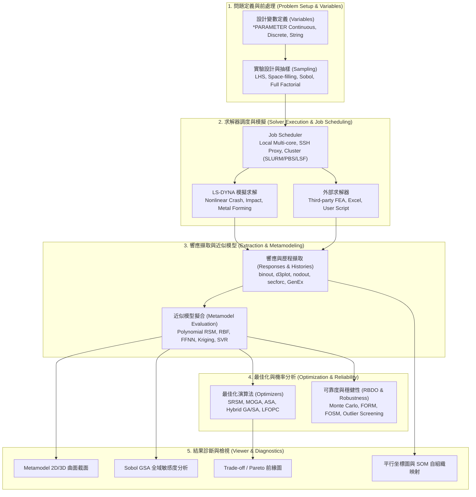

# LS-OPT 主題字典

> 本頁為整理稿；演算法選擇、數值門檻、濾波及部分 CLI／輸出格式尚未逐項核對原文，不應作為已驗證的工程建議。來源與待查項見 [處理紀錄](../maintenance/knowledge_dictionary_passes/2026-11-02/lsopt.md)。

> 本主題深入剖析 LS-OPT 2026 R1 (Version 2026 R1) 獨立最佳化與機率分析環境。涵蓋與 LS-DYNA 及外部求解器的深度耦合流程、實驗設計 (DOE)、敏感度分析 (Sobol GSA)、近似模型 (Metamodeling: Polynomial, RBF, FFNN, Kriging, SVR)、單目標與多目標最佳化 (SRSM, MOGA, ASA)、可靠度與穩健設計 (RBDO)、變數與響應擷取 (GenEx, binout, d3plot)，以及 Viewer 結果後處理與視覺化診斷。

---

## 領域架構圖 (LS-OPT Architecture & Optimization Workflow)

---

## 主題辭典與核心模組

### 1. 設計探索與最佳化主題

#### 核心概念與辭典定義 (Core Concepts & Glossaries)
- **近似模型基礎最佳化 (Metamodel-based Optimization)**：
  - 先透過實驗設計 (DOE) 抽樣並呼叫求解器（如 LS-DYNA）計算有限設計點，接著建立數學代理模型（Metamodel），最後在代理模型曲面上快速求解最佳化問題。相較於直接最佳化 (Direct Optimization)，可大幅減少高成本非線性動態模擬次數。
- **序列響應面法 (SRSM - Sequential Response Surface Method)**：
  - LS-OPT 2026 R1 手冊將 SRSM 列為 sequential metamodel-based optimization strategy 之一，並於演算法理論章節說明子區域與更新方式。本文不據此宣稱專利狀態或跨問題的收斂優越性；適用性須以實際問題與版本驗證。
- **近似模型類型體系 (Metamodeling Techniques)**：
  - **多項式響應面 (Polynomial RSM)**：線性、交互作用或二次多項式，適用於平滑且參數維度較低的物理場。
  - **徑向基函數 (Radial Basis Functions - RBF)**：特別適合全域非線性高維度問題與曲線擬合（如材料參數識別）。
  - **前饋神經網路 (Feedforward Neural Networks - FFNN)**：處理強非線性與多局部極值響應，具備優異的逼近能力。
  - **克里金法 (Kriging / Gaussian Process)**：內插型近似模型，提供精確的局部極值預測與不確定度估計。
  - **支援向量迴歸與分類 (SVR / SVC)**：利用核函數進行高維度迴歸；SVC 分類器可用於區分結構可行域與崩塌失效域。
- **多目標最佳化與 Pareto 前緣 (Multi-Objective Optimization & Pareto Frontier)**：
  - 支援多目標遺傳演算法 (MOGA) 與自適應模擬退火 (Adaptive Simulated Annealing, ASA)，生成無劣解集 (Non-dominated Set)，使用者可透過 Trade-off 圖直觀權衡不同性能指標（如車體減重 vs 碰撞吸能量）。
- **參數識別與材料校準 (System & Material Parameter Identification)**：
  - 將實驗測試曲線（如拉伸試驗應力-應變曲線）與模擬歷程進行均方誤差 (MSE) 最小化擬合，快速反演材料構成參數。

#### 手冊章節與規格出處 (Manual & Doc Citations)
- **手冊依據**：*LS-OPT Version 2026 R1 User's Manual* ([lsopt_2026R1_manual.pdf](../ANSYS_Document/optiSLang/unknown/manuals/lsopt_2026R1_manual.pdf))
  - Chapter 4: *Task Dialog – Selecting a Task and Strategy* (PDF physical Pages 86–96, printed pp. 47–57)
  - Chapter 9: *Sampling & Metamodel Dialog* (PDF physical Pages 228–257, printed pp. 189–218)
  - Chapter 12: *Optimization Dialog – Objectives, Constraints and Algorithms* (PDF physical Pages 272–283, printed pp. 233–244)
  - Chapter 24: *Metamodeling Techniques* (PDF physical Pages 621–639, printed pp. 582–600)
  - Chapter 26: *Optimization* (PDF physical Pages 652–691, printed pp. 613–652)
- **教學問題集出處**：*LS-OPT Training Class Optimization and Robust Design Tutorial Problems* ([lsopt_2026R1_intro_problemset.pdf](../ANSYS_Document/optiSLang/unknown/manuals/lsopt_2026R1_intro_problemset.pdf#page=2))
- **Source IDs**：`sources.csv#ansys_699e681cd501e36f597a42d1`, `sources.csv#ansys_3a08c2f830fc46add23072de`.

#### 近似模型架構特性對照矩陣 (Metamodel Selection Matrix)

| 模型類型 | 擬合特性 | 數值平滑抗噪性 | 計算開銷 | 推薦適用工況 |
|---|---|---|---|---|
| **Polynomial (RSM)** | 回歸擬合 (Regression) | 極高（濾除數值雜訊） | 極低 | 低維度、單調響應、常規結構剛度 |
| **Radial Basis Functions (RBF)** | 內插或平滑回歸 | 高 | 中 | 材料參數反演、衝擊載荷峰值、高度非線性 |
| **Feedforward NN (FFNN)** | 機器學習非線性逼近 | 中高 | 較高（需訓練） | 多模態響應、複雜流固耦合衝擊 |
| **Kriging (Gaussian Process)** | 精確內插 / 局部方差 | 中 | 高（協方差矩陣求逆） | 局部特徵顯著、需要預測信賴區間之工況 |
| **Support Vector Machine (SVM)** | 分類 (SVC) / 迴歸 (SVR) | 極高 | 中高 | 碰撞可行/不可行邊界分類、複雜約束判定 |

#### 手冊設定位置與限制

2026 R1 User’s Manual 將 task／strategy、sampling／metamodel、objective／constraint 設定分別放在 GUI 對話框章節（PDF Pages 86–96、228–257、272–283）。本字典不提供未經手冊證實的 `.lsopt` 命令稿語法；設定欄位和策略需按該版本 GUI 與完整手冊確認。

#### 工程實務踩坑與注意事項 (Gotchas, Limitations & FAQ)
- **過擬合與 $R^2$ 假象**：
  - 高階多項式可能在設計點上具備接近 1.0 的決定係數 ($R^2$)，但在點與點之間劇烈震盪（Runge 現象）。建議優先檢查均方根誤差 (RMS Error) 與交叉驗證 (PRESS / $R^2_{\text{prediction}}$)。
- **碰撞模擬的數值雜訊 (Numerical Noise)**：
  - 顯式動力學 (LS-DYNA) 由於接觸演算法的節點微小跳動，響應曲面常帶有高頻數值震盪。嚴禁在未經近似模型平滑的情況下直接對 LS-DYNA 模擬結果執行基於梯度的局部最佳化 (Gradient-based NLPQL)；應採用 SRSM 或 GA 搭配 RBF/多項式代理模型。
- **子區域收斂收縮停滯**：
  - 在 SRSM 迭代中，若容差收縮過快可能陷入局部極值；若未收縮則震盪不收斂。建議設定適當的終止準則 (`Design Change Tolerance` 與 `Objective Function Tolerance`；手冊未支持一組適用所有任務的固定百分比門檻。)。

---

### 2. 變數、響應與結果檢視

#### 核心概念與辭典定義 (Core Concepts & Glossaries)
- **設計變數體系 (Design Variables)**：
  - 連續變數 (Continuous)：板厚、材料彈性模數、初始速度等；
  - 離散變數 (Discrete)：標準零件規格規格尺寸（如公稱板厚清單）；
  - 字串變數 (String)：替換包含檔案路徑 (`*INCLUDE`) 或材料卡片型號；
  - 變數與 LS-DYNA 輸入檔對應：LS-OPT 直接透過正則辨識輸入檔中的 `*PARAMETER` 卡片完成變數綁定。
- **響應與歷程擷取架構 (Response & History Extraction)**：
  - **原生二進位輸出擷取**：直接解析 LS-DYNA `binout` 與 `d3plot` 檔案（如 `nodout` 節點位移/加速度、`rcforc` 接觸力、`secforc` 斷面內力、`matsum` 內能與動能、`mass` 總質量）。
  - **GenEx (Generic Extractor)**：通用正則表達式文字擷取器，可自任意文字輸出檔（如第三方求解器 log）定位指定行與列的數值。
  - **複合響應 (Composite Expressions)**：在 LS-OPT 內部以數學公式將多個基礎響應組合成複合指標（如比吸能 $SEA = \frac{E_{\text{total}}}{M}$）。
- **結果視覺化與診斷檢視器 (LS-OPT Viewer)**：
  - **Metamodel 2D / 3D Cross-Sections**：多維曲面在固定其他變數下的 2D 切片或 3D 立體投影，直觀評估變數影響趨勢。
  - **Sobol GSA 全域敏感度分析**：基於方差分解 (ANOVA) 計算一階敏感度指數 (First-order) 與總效應敏感度指數 (Total Effect Index)，辨識主導影響因子與次要變數。
  - **自組織映射圖 (Self-Organizing Maps - SOM)**：用於多目標 Pareto 前緣的高維度叢集與分佈可視化。
  - **平行坐標圖 (Parallel Coordinate Plot)**：展示所有抽樣設計點在輸入變數與輸出響應維度間的多軸連線，便於藉由滑動閥值篩選可行設計區間。
- **命令列啟動與清理參數 (CLI Execution & Cleanup Flags)**：
  - 啟動指令：`lsoptui [file.lsopt]`（圖形介面）、`lsopt [options] file.lsopt`（批次背景運算）、`viewer [options] file.lsopt`（後處理檢視器）。
  - 清理參數：`--clean`（完全刪除既有結果重跑）、`--clean-from <iteration>`（從指定迭代重新計算）、`--clean-verif`（清除驗證點）、`-y`（靜默確認）。

#### 手冊章節與規格出處 (Manual & Doc Citations)
- **手冊依據**：*LS-OPT Version 2026 R1 User's Manual* ([lsopt_2026R1_manual.pdf](../ANSYS_Document/optiSLang/unknown/manuals/lsopt_2026R1_manual.pdf))
  - Chapter 3: *Graphical User Interface & CLI Syntax* (PDF physical Pages 61–85, printed pp. 21–45)
  - Chapter 6: *History and Response Results* (PDF physical Pages 140–198, printed pp. 101–159)
  - Chapter 7: *GenEx: Extracting Responses from Text Files* (PDF physical Pages 199–213, printed pp. 160–174)
  - Chapter 8: *Setup Dialog – Defining the Variables* (PDF physical Pages 214–227, printed pp. 175–188)
  - Chapter 16: *Viewing Results* (PDF physical Pages 315–365, printed pp. 276–326)
- **Source IDs**：`sources.csv#ansys_699e681cd501e36f597a42d1`, `sources.csv#ansys_3a08c2f830fc46add23072de`.

#### 變數與響應類型對照表 (Variable & Response Definitions)

| 類型分類 | 關鍵字 / 格式 | 數值特徵 | 典型應用場景 |
|---|---|---|---|
| **Continuous Variable** | `variable 't_plate' 1.5` | 浮點實數，有上下界限制 | 車體金屬板件公稱厚度、初始車速、偏置角度 |
| **Discrete Variable** | `variable 'beam_type' {1, 2, 4}` | 離散整數或浮點集合 | 標準工字鋼規格型號、螺栓預緊力等級 |
| **String Variable** | `variable 'mat_file' "mat_dp600.k"` | 字串替換 | 換用不同材料特性模型或網格劃分層級 |
| **D3PLOT Response** | `d3plot max_stress` | 求解器空間網格場極值 | 塑性應變峰值、Von Mises 應力極限 |
| **BINOUT Response** | `binout nodout / rcforc` | 時程歷程峰值、積分或終值 | 乘員胸部加速度 3ms 指標、保險槓吸收總能量 |
| **GenEx Response** | `genex text_pattern` | 自義文字標記與位移解析 | 第三方求解器收斂步數、專用物理量輸出 |

#### 啟動與清理 CLI

2026 R1 手冊 PDF Pages 44–45 列出 GUI `lsoptui [file_name.lsopt]`、批次 `lsopt [options] file_name.lsopt` 與 Viewer `viewer [options] file_name.lsopt`。清理選項為 `--clean`、`--clean-from=ITER` 及 `--clean-verif`；`-y/--yes` 僅與清理選項搭配，會略過確認。手冊明確指出 `--clean` 會刪除 LS-OPT 建立的結果目錄結構與其中檔案；執行前須核對工作目錄與備份。來源：[Getting Started，PDF Pages 44–45](../ANSYS_Document/optiSLang/unknown/manuals/lsopt_2026R1_manual.pdf#page=44)（來源 ID `ansys_699e681cd501e36f597a42d1`）。

#### 工程實務踩坑與注意事項 (Gotchas, Limitations & FAQ)
- **覆寫全域計算警示 (`Overwrite global computations`)**：
  - 重新計算 Sobol 敏感度或變更抽樣點數量時，若勾選 `Overwrite global computations`，將清空既有 `Sobol_GSA.iteration` 資料庫。若需對比歷史結果，務必先備份工作目錄。
- **模擬異常中斷與未收斂點處理 (Aborted Run Handling)**：
  - 碰撞非線性運算常因接觸穿透或極端變形導致 LS-DYNA 非正常終止（Error Termination）。LS-OPT 預設會將失敗點標記為 `Failed`。若失敗率高於 20%，代理模型擬合將產生嚴重偏差，建議啟用 `Ignore failed designs` 或設定適當的懲罰約束 (Penalty Constraint)。
- **加速度濾波規範 (SAE Filtering Requirements)**：
  - 直接自 `nodout` 擷取的節點加速度帶有結構高頻彈性震盪，計算乘員傷害指標前必須在 LS-OPT 響應設定中啟用標準 SAE 60 或 SAE 180 數位低通濾波器，否則峰值加速度將嚴重失真。

---

## 來源與檢核點清單

- [LS-OPT Version 2026 R1 User's Manual (850 physical PDF pages)](../ANSYS_Document/optiSLang/unknown/manuals/lsopt_2026R1_manual.pdf) (`sources.csv#ansys_699e681cd501e36f597a42d1`)
- [LS-OPT Version 6.0 Training Class: Optimization and Robust Design Tutorial Problems (October 2018)](../ANSYS_Document/optiSLang/unknown/manuals/lsopt_2026R1_intro_problemset.pdf#page=1) (`sources.csv#ansys_3a08c2f830fc46add23072de`)
- [Markdown 轉檔與全文快取](../ANSYS_Document/optiSLang/unknown/manuals/lsopt_2026R1_manual.md)

---

## 已逐段回查補充（LS-OPT 2026 R1）

本節只記錄本輪實際對照 sidecar 原文的項目；原字典其他章節仍需依 [逐來源處理紀錄](../maintenance/knowledge_dictionary_passes/2026-11-02/lsopt.md)逐項覆核。

### 策略選擇、子區域與全域敏感度

- **單次與序列策略**：單次策略只建立一輪樣本；序列策略逐輪補點，並可在 metamodel、最佳點或統計量達到所需準確度時停止。手冊列出的序列預設包含 RBF、space-filling，首輪 linear D-optimal；這些是該策略的預設描述，不應泛化成所有 task 的最佳選擇。（User’s Manual，PDF pp. 89–90；第 4.8.1–4.8.2 節）
- **SRSM／domain reduction**：在序列策略上自適應縮小設計子區域，適用於著重最終最佳點的最佳化；手冊舉參數識別為例，並指出該策略當前不能建立 Pareto optimal front。其預設為 linear polynomial 與 D-optimal sampling。（PDF p. 90；第 4.8.3 節）
- **EGO**：以 expected improvement 選擇後續樣本，在目標值改善與探索稀疏區域間取捨；手冊列明限 Kriging，且不能建立 Pareto front。（PDF pp. 90–91；第 4.8.4 節）
- **Sobol GSA**：可從 Task 對話框啟用；預設 Monte Carlo integration points 為 10,000，可更改。除線性情況外，敏感度依所選設計區域而變，預設使用 Global Setup 的變數範圍。勾選 `Overwrite global computations` 會刪除舊 `Sobol_GSA.iteration` 再重建，操作前應先備份工作資料。（PDF pp. 92–93；第 4.11 節）
- **EDSD 抽樣限制**：以 classifier 近似未知可行設計域邊界，供選樣時避開不具資訊價值的區域；它只作用於 sample selection，本身不作 design constraint。手冊指出 EDSD sampling constraints 僅套用於 space-filling sampling，其他 sampling type 會忽略。（PDF pp. 254–255；第 9.7 節）

### 變數定義與時間歷程濾波

- **Discrete／String variable**：兩者都須定義允許值；字串在內部以整數表示，對照資料存於工作目錄 `StringVar.lsox`。Discrete variable 可採 continuous 或 discrete sampling；手冊稱 continuous sampling 通常較有利於設計點分布及 metamodel 品質，但實際設定仍要依問題核驗。（PDF pp. 216–217；第 8.1.3 節）
- **Filtered history**：手冊列出的濾波方式為 SAE Filter、Butterworth Filter 或 Time Average，參數包括 frequency、time unit 與 averaging point count。另明確說明使用者須負責輸入歷程所需的濾波；這不構成所有加速度響應一律必須使用 SAE 60／180 的依據。（PDF p. 166 與 p. 179；第 6.4 節及第 6.8.1 節）
- **回應校正**：原稿「失敗率高於 20%」以及「必須 SAE 60 或 SAE 180」未在本輪查到相應手冊依據，應視為未證實門檻，不可當成 LS-OPT 產品規則；SAE 濾波等級須按工程規範與資料來源確認。原稿關於直接 `binout`／`d3plot` 支援、梯度法禁用等說法也尚未逐條查證。

### 來源定位

以上頁碼使用 PDF 實體頁，與轉換檔中的 `## PDF Page N` 標記一致。來源為 [2026 R1 User’s Manual](../ANSYS_Document/optiSLang/unknown/manuals/lsopt_2026R1_manual.pdf) 及其 [Markdown sidecar](../ANSYS_Document/optiSLang/unknown/manuals/lsopt_2026R1_manual.md)，來源 ID `ansys_699e681cd501e36f597a42d1`。Tutorial PDF 封面另標示 Version 6.0、October 2018（來源 ID `ansys_3a08c2f830fc46add23072de`）；本輪僅核對其封面與頁標，未語義檢閱教學內容。策略章節、sampling/EDSD 與濾波章節在本輪做了段落層級核對；850 頁全書、圖表與其餘字典主張未完成語義驗收。

## 2026-11-04：Wave 3 本機來源盤點與限制說明

本批完成 lsopt 模組既有本機 catalog 文件（共 0 筆）與 sources 清冊（共 2 筆）之完整雜湊、正文路徑與標籤結構核對。本機未快取或具備企業授權/登入限制之線上主題誠實標記為缺口（保持現有非 complete 狀態），未擅自虛構未核實之線上 API 簽名或執行求解運算。

詳細稽核數據見 [本批轉換報告](../maintenance/knowledge_dictionary_passes/2026-11-04/lsopt_module_conversion_report_20261104.md)。
