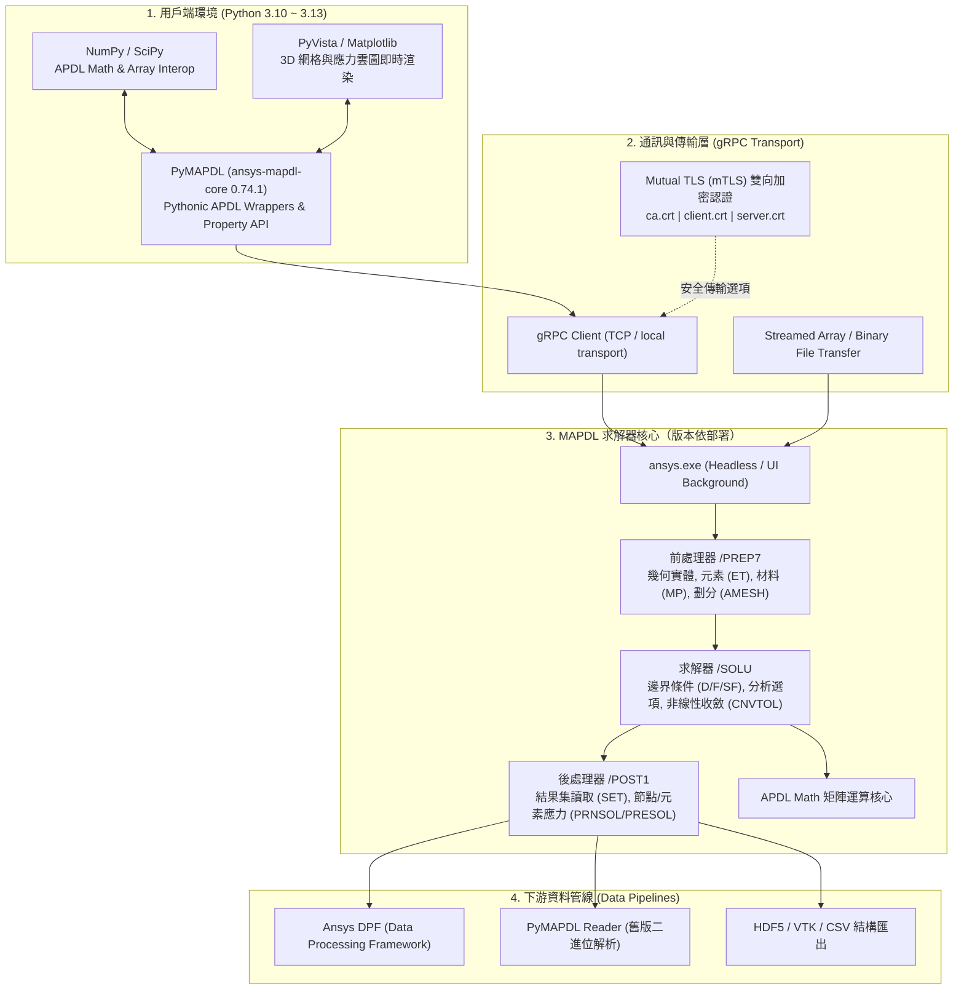

# Ansys MAPDL 與 PyMAPDL 主題字典

> 本字典整理 MAPDL 與 PyMAPDL 的概念、操作及參數，來源 SDK metadata 為 0.74.1；MAPDL 產品版本依各來源記錄。範例與求解結果須按實際模型另行驗證。本批未執行 MAPDL、安裝指令、範例或求解。

---

## 領域架構圖 (PyMAPDL Architecture & Solver Execution Pipeline)



---

## 主題辭典與核心模組

### 1. PyMAPDL SDK、MAPDL 版本與程序生命週期

`ansys-mapdl-core`（PyMAPDL）是用戶端套件；MAPDL 是另外安裝並啟動的求解器程序。這批 HTML 的 `docsearch:version` 全部為 **0.74.1**，不代表 MAPDL 產品版本也為 0.74.1；stable URL 亦可能隨網站更新。本機保留來源 SHA-256 以固定本次引用。

| 項目 | 本批官方文件可支持的內容 | 使用界線 |
| --- | --- | --- |
| Python | Install PyMAPDL 列 Python 3.10–3.13，適用 Windows、macOS、Linux 上的用戶端 | 不代表每個平台都可原生安裝 MAPDL |
| MAPDL 安裝 | 需要可供連線的本機或遠端 MAPDL；標準安裝器的 Mechanical Products 包含 MAPDL | 安裝、平台、授權依部署的產品版本確認 |
| gRPC | Versions and interfaces 稱為預設且推薦介面，支援遠端連線及串流 | 最早支援版本的正文與表格互相衝突，見下方 |
| CORBA | 同頁記載 PyMAPDL 0.68 已移除 CORBA，legacy 表仍列歷史 MAPDL 支援 | 不把歷史表的勾選當作 SDK 0.74.1 可用性保證 |
| Console | 同頁描述 Linux 上早至 MAPDL 13.0 的文字介面，並建議轉向現代版本 | 不推定目前版本維護狀態或完整功能 |

**來源內的版本衝突：** Versions and interfaces 的 gRPC 正文寫 Ansys 2020 R1 and later；同頁相容表把 2020 R1／R2 標為不支援 gRPC，從 2021 R1 才勾選。Install MAPDL 則建議最新功能使用 2021 R1 以上。這些證據不足以建立單一「最早支援版本」結論；舊部署需再依該產品版本官方文件確認。本字典刪除先前沒有逐項依據的 2021 R2 串流、2022 R2 mTLS、2024 R1 零拷貝及 2026 R1 容器功能階梯。

`launch_mapdl()` 可啟動本機 MAPDL 並建立 client；`launch_mapdl_process()` 只啟動新的本機程序並回傳連線資訊，不能用來連線既有 instance。連線已啟動的 instance 可用 `Mapdl(ip, port=...)` 或 `launch_mapdl(start_instance=False)`。遠端模式需要先在遠端啟動 gRPC server，PyMAPDL 不負責在遠端啟動 MAPDL。

Launcher 的安全傳輸段落列 `insecure`、`uds`、`wnua`、`mtls`；自動選擇依作業系統而異。該段建議遠端連線使用 mTLS，UDS 僅適用本機，不能由此推定每個舊 MAPDL 版本均支援所有模式。程序關閉與授權釋放應依 instance 的擁有方式處理，勿把停止 client 一概解讀為可終止共用遠端 server。

來源：[Install PyMAPDL](ANSYS_Document/MAPDL/official_body_20261106/official_mapdl_9d6f8e5967fb92a3.md)（`sources.csv#official_mapdl_9d6f8e5967fb92a3`）；[Install MAPDL](ANSYS_Document/MAPDL/official_body_20261106/official_mapdl_f5e7cd7c1fbfce58.md)（`sources.csv#official_mapdl_f5e7cd7c1fbfce58`）；[Versions and interfaces](ANSYS_Document/MAPDL/official_body_20261106/official_mapdl_380729160250e400.md)（`sources.csv#official_mapdl_380729160250e400`）；[Launch PyMAPDL](ANSYS_Document/MAPDL/official_body_20261106/official_mapdl_a8ba11f396c024ad.md)（`sources.csv#official_mapdl_a8ba11f396c024ad`）。

---

### 2. 官方帶孔平板教學與結果適用範圍

官方 **MAPDL 2D Plane Stress Concentration Analysis** 展示 2D 平面元素建模，再與 3D 元素比較。以下是該教學的設定摘要，供回到原文閱讀；不是本機已求解或驗證的模型。

| 設定 | 官方教學內容 |
| --- | --- |
| 單元與厚度 | `PLANE183`、`KEYOPTION(3)=3`；實常數厚度 0.001 m |
| 材料與單位 | SI；彈性模數 210e9 Pa、Poisson ratio 0.3、密度 7800 kg/m³ |
| 幾何 | 完整矩形平板，長 0.4 m、寬 0.1 m；孔徑／板寬比 0.3 |
| 邊界條件 | 左側 UX 固定，再選左側中點一個節點固定 UY；右側施加總力 1 kN |
| 名義應力 | 依 `F/(w*t)` 計算，並與離孔較遠截面的應力比較 |
| 比較方法 | 教學從結果讀取應力，用 `nanmax`／`nanmean` 處理沒有應力的 midside nodes，並考慮孔徑對有效截面的影響 |

先前字典的四分之一平板、100 mm 尺寸、壓力載入及 `get_value(...MAX,S,EQV)` 程式並非這份官方教學的逐字範例，本批以來源摘要取代。若建立自己的模型，應獨立確認元素選項、選取集合、載荷、剛體自由度、結果量與參考解的適用條件。有限板寬、孔徑比與名義應力定義會影響應力集中比較，不能把任意幾何的最大等效應力一律當作無限平板的 `Kt=3` 驗收。網格收斂與誤差門檻依專案、指標及有效參考設定。

來源：[教學完整正文](../ANSYS_Document/_catalog/mapdl_text_20261106/ansys_efc8a076229c8282990d25fb.md)（`sources.csv#ansys_efc8a076229c8282990d25fb`；SDK metadata 0.74.1，MAPDL product release unknown）。原始程式／Notebook 與來源圖像均保留；本批沒有執行它們。

---

### 3. PyMAPDL gRPC 工作目錄與檔案接收(SDK metadata 0.74.1)

#### 核心概念與辭典定義 (Core Concepts & Glossaries)
- **工作目錄隔離 (Workspace Isolation)**：
  - MAPDL 求解時會產生大量暫存二進位檔（如 `.full` 剛度矩陣檔、`.rst` 結構結果檔、`.esav` 單元狀態檔、`.err` 錯誤日誌）。官方 User guide 明載 `launch_mapdl()` 預設使用 temporary directory；指定 `run_location` 才選定工作目錄。若希望使用 Python 的當前目錄，可明確傳入 `os.getcwd()`，並避免多個程序共用相同工作檔。
- **檔案傳輸管線 (File Transfer Pipeline)**：
  - 在遠端連線或 Docker 容器模式下，用戶端與伺服器硬碟隔離，PyMAPDL 提供 `mapdl.upload()` 與 `mapdl.download()` 串流傳輸機制，透過 gRPC 區塊將 CDB 網格輸入檔上傳至遠端工作區，並在求解完成後下載結果檔。

#### 腳本與 API 關鍵用法 (File Transfer Scripting)

```python
# Upload input files and download results via PyMAPDL
# Upload a custom geometry CDB deck to remote MAPDL server
mapdl.upload("./models/chassis.cdb")

# Read the uploaded CDB deck inside MAPDL
mapdl.cdread("DB", "chassis.cdb")

# Solve structural analysis
mapdl.solu()
mapdl.solve()
mapdl.finish()

# Download solution binary file back to local machine
mapdl.download("file.rst", target_dir="./local_results")
```

---

### 4. PyMAPDL `non_interactive` 命令緩衝與查詢時機

#### 核心概念與辭典定義 (Core Concepts & Glossaries)
- **命令緩衝機制 (Command Buffering Mechanism)**：
  - 對於需要高頻迴圈執行的 APDL 腳本區塊，使用 `with mapdl.non_interactive:` 可以避免每個 APDL 命令都進行一次 gRPC 網路請求。PyMAPDL 會在記憶體中將區塊內的所有指令收集成批次檔案，並在退出區塊時一次性以 `Mapdl.input()` 提交給後端執行。
- **查詢時序禁忌**：
  - 離開 `non_interactive` 區塊前，MAPDL 伺服器並未執行任何區塊內的指令；因此在區塊內呼叫 `get_value()` 或 `get_array()` 無法取得即時運算結果。

#### 腳本與 API 關鍵用法 (Non-interactive Buffering)

```python
# Using non_interactive for fast batch geometry generation
with mapdl.non_interactive:
    for i in range(1, 101):
        x = i * 2.0
        y = np.sin(i * 0.1) * 10.0
        mapdl.k(i, x, y, 0.0)

# After exiting the block, all 100 keypoints are executed
num_kp = mapdl.get_value("KP", 0, "COUNT")
print(f"Total keypoints created: {num_kp}")
```

---

### 5. 遠端連線與 mTLS

PyMAPDL 官方強烈建議透過網路連線 MAPDL 時使用 mutual TLS (mTLS)。伺服器與用戶端均持有由同一個 Certificate Authority (CA) 簽發的 PEM 憑證；雙向驗證可確認連線身分，並加密 gRPC 傳輸。

| 角色 | 憑證檔案 | 用途與要求 |
|---|---|---|
| CA | `ca.key`、`ca.crt` | 信任根；CA 簽發 server 與 client 憑證。`ca.key` 嚴格保密，`ca.crt` 發布給通訊參與者。 |
| MAPDL server | `server.key`、`server.crt` | Server 憑證需具備 `SERVER_AUTH` extended key usage；Subject Alternative Name (SAN) 需符合 client 使用的 hostname 或 IP。 |
| PyMAPDL client | `client.key`、`client.crt` | Client 憑證需具備 `CLIENT_AUTH` extended key usage；需與 server 憑證由同一個 CA 簽發。 |

**啟動由 PyMAPDL 管理的 MAPDL instance：**`launch_mapdl()` 可指定 `transport_mode="mtls"` 與 `certs_dir`；檔案說明 `certs_dir` 會設定 MAPDL process 的 `ANSYS_GRPC_CERTIFICATES`，並檢查目錄必要檔案。手冊提供的 `generate_test_certificates()` 可產生測試憑證（預設效期 24 小時），生產環境請由組織 IT 或專屬 CA 提供。

---

## 來源與查檢清單

- [PyMAPDL 0.74.1 Documentation Landing Page](../ANSYS_Document/MAPDL/sdk/ansys-mapdl-core/0.74.1/guide/9f36558dcabc-stable.md) (`sources.csv#ansys_e0446f53fb5b951b66081c15`)
- [PyMAPDL User Guide](../ANSYS_Document/MAPDL/sdk/ansys-mapdl-core/0.74.1/guide/d68c94d6e4ab-index.md) (`sources.csv#ansys_0d9b850f91a170e558010fe2`)
- [PyMAPDL Language and Usage](../ANSYS_Document/MAPDL/sdk/ansys-mapdl-core/0.74.1/guide/be456c1b352b-mapdl.md) (`sources.csv#ansys_b81b6dd45d8b13e1effda070`)
- [mTLS Secure Connections Guide](../ANSYS_Document/MAPDL/sdk/ansys-mapdl-core/0.74.1/guide/370824a68579-tls.md) (`sources.csv#ansys_863fc315f94798a227827a8b`)
- [2D Plane Stress Concentration Analysis Example](../ANSYS_Document/MAPDL/sdk/ansys-mapdl-core/0.74.1/tutorial/7abc8f8c1413-2d_plate_with_a_hole.md) (`sources.csv#ansys_efc8a076229c8282990d25fb`)
- [PyMAPDL Examples Index](../ANSYS_Document/MAPDL/sdk/ansys-mapdl-core/0.74.1/tutorial/493495162bb6-index.md) (`sources.csv#ansys_5590907f3b7486f6376bdd66`)

### 6. 幾何非線性選項 `NLGEOM`：命令行為與版本頁碼

- `NLGEOM,ON` 啟用大撓度（large-deflection）效應；實際包含大轉動或大應變，依元素類型而定。元素的 `Special Features` 資料可用來判斷其支援特性。命令預設為 `OFF`。
- 在 `/SOLU` 中使用時，只能在第一個 load step 設定；此命令也可在 `/PREP7` 使用。啟用大撓度時會自動包含 stress stiffening。
- 大撓度分析的 pressure load 行為與其他載荷不同，應按相應載荷方向說明檢查；含 gyroscopic matrix 的理論公式只支援 small-deflection formulation。這些限制應按所用元素與分析設定核對，不能僅從 `NLGEOM,ON` 推定模型其餘假設都已成立。
- **版本定位**：2025 R1 Command Reference 的 `NLGEOM` 說明位於 PDF 實頁 1264–1265；2026 R1 位於實頁 1285–1286。兩版核心規則相同，但內部章節頁碼已變動（例如 `/SOLU` 交叉參照 2025 R1 為 p.1857、2026 R1 為 p.1894）。引用請依文件版本定位，不可跨版沿用印刷頁碼。

來源：
- [2025 R1 Command Reference，實頁 1264–1265](../ANSYS_Document/_catalog/pdf_text_v4/3e7a54e7457820a033928d9507d5d489192bb48d3a8eb7e08faecab5b30dfe86.md#pdf-page-1264)（catalog ID `ansys_035e491ecd5b2e7c0d48d6f6`）
- [2026 R1 Command Reference，實頁 1285–1286](../ANSYS_Document/_catalog/pdf_text_v4/3bb2d862b160b29fa9125fc0495e1c1bb5e0bd943b0f83b41864333780043181.md#pdf-page-1285)（catalog ID `ansys_19a5cc941850fa865eff2c93`）
- [2025 R1 Operations Guide](../ANSYS_Document/MAPDL/v251/manuals/ANSYS_Mechanical_APDL_Operations_Guide.pdf)（catalog ID `ansys_b8c6b3744342fc8294f63d34`）與 [2026 R1 Operations Guide](../ANSYS_Document/MAPDL/v261/manuals/ANSYS_Mechanical_APDL_Operations_Guide.pdf)（catalog ID `ansys_9988c8419b8828fc501dfa1f`）在本輪確認轉換檔和頁標記連續；尚未逐章整理指南內容。

### 7. 來源涵蓋範圍與使用限制

目前字典是經覆核的代表主題，不代表 MAPDL 全套命令參考或 operations guide 已整理完成。逐來源狀態見 [MAPDL 來源轉換清冊](../maintenance/knowledge_dictionary_passes/2026-11-02/mapdl_source_conversion_inventory.csv)；轉換品質檢查方法與未完成項見 [MAPDL 轉換覆核報告](../maintenance/knowledge_dictionary_passes/2026-11-02/mapdl_conversion_review.md)。PDF 頁標記只支持定位，不代表圖表、方程式或欄位對齊已人工逐頁驗證；使用相關細節時回查原 PDF。

### 8. Operations Guide：命令記錄檔的編輯與重播（2025 R1）

- **用途**：Mechanical APDL 的 command log 記錄互動工作階段中的命令；手冊說明可編輯記錄檔以改善可讀性，加入 `!` 註解或縮排，再用 `/INPUT`（互動模式選單亦可讀入）重播；批次模式可將編輯後記錄檔作為 batch input。這是記錄／重播工作流程，不保證任意修改後的指令序列有效。
- **保留註解語意**：手冊指出 `/COM`、`C***` 等註解命令會出現在輸入與輸出 listing；命令尾端 `!` 註解只出現在 input listing。此差異對檢查輸出檔很重要。
- **不要手改 GUI 產生的選取指令**：`FLST`、`FITEM` 等由 GUI 產生的命令不建議直接鍵入或編輯；手冊警告改動 `FITEM` 資料可能使其無效並導致不可預期結果。因此重播前應先辨識這類命令，不能以格式化清理方式盲目改寫。
- **來源定位**：2025 R1 Operations Guide 第 8 章 8.3.3「Step 3: Read in the Edited Log File」位於 PDF 實頁 98（印刷頁 88）；`/INPUT` 及註解／GUI 產生命令說明見實頁 97（印刷頁 87）。本輪已將實頁 97–98 渲染檢視，與轉換文字核對標題、註解規則、`FLST`／`FITEM` 警告及 `/INPUT` 流程；此節未在本輪與 2026 R1 逐條比較。

來源：
- [2025 R1 Operations Guide，實頁 97–98 轉換正文](../ANSYS_Document/_catalog/pdf_text_v4/b3d43157ddd904a02b7607ab1150452840c726599a2f4aaefb7c8cbca2377064.md#pdf-page-97)；原始 PDF 為 `MAPDL/v251/manuals/ANSYS_Mechanical_APDL_Operations_Guide.pdf`（catalog ID `ansys_b8c6b3744342fc8294f63d34`）。
- 視覺抽查：[原 PDF 實頁 97](../maintenance/knowledge_dictionary_passes/2026-11-04/mapdl_ops_guide_page97_review.png)、[實頁 98](../maintenance/knowledge_dictionary_passes/2026-11-04/mapdl_ops_guide_page98_review.png)。


## PyMAPDL tutorial 附件文字補件

兩組教學的 Notebook 與 Python 原始檔各一份，共四份。補件保留程式與 Notebook 的 Markdown／code cells，並連回原始附件及來源 ID；Notebook 執行輸出、圖片及其他附件未擷取，產品 release unknown，範例未執行。

- [2d_magnetostatic_solenoid-BodyFlux_Averaging.ipynb](ANSYS_Document/mapdl_example_inputs_20261104/tutorial/ansys_4a3b1c4f3ad16a3b1d3f6513/mapdl.md)（`sources.csv#ansys_4a3b1c4f3ad16a3b1d3f6513`）
- [2d_magnetostatic_solenoid-BodyFlux_Averaging.py](ANSYS_Document/mapdl_example_inputs_20261104/tutorial/ansys_3ef03dc3d02234f71580f725/mapdl.md)（`sources.csv#ansys_3ef03dc3d02234f71580f725`）
- [2d_plate_with_a_hole.ipynb](ANSYS_Document/mapdl_example_inputs_20261104/tutorial/ansys_cafcd05686016dc19adcfa24/mapdl.md)（`sources.csv#ansys_cafcd05686016dc19adcfa24`）
- [2d_plate_with_a_hole.py](ANSYS_Document/mapdl_example_inputs_20261104/tutorial/ansys_381d432c28ca857e3e901db1/mapdl.md)（`sources.csv#ansys_381d432c28ca857e3e901db1`）

逐檔 SHA、cell 數及狀態見 [轉換清冊](../maintenance/knowledge_dictionary_passes/2026-11-04/mapdl_attachment_text_recovery.csv)。


## 2026-11-04：Wave 2 本機來源盤點與限制說明

本批完成 mapdl 模組既有本機 catalog 文件（共 149 筆）與 sources 清冊（共 149 筆）之完整雜湊、正文路徑與標籤結構核對。本機未快取或具備企業授權/登入限制之線上主題誠實標記為缺口（保持現有非 complete 狀態），未擅自虛構未核實之線上 API 簽名或執行求解運算。

詳細稽核數據見 [本批轉換報告](../maintenance/knowledge_dictionary_passes/2026-11-04/mapdl_module_conversion_report_20261104.md)。
