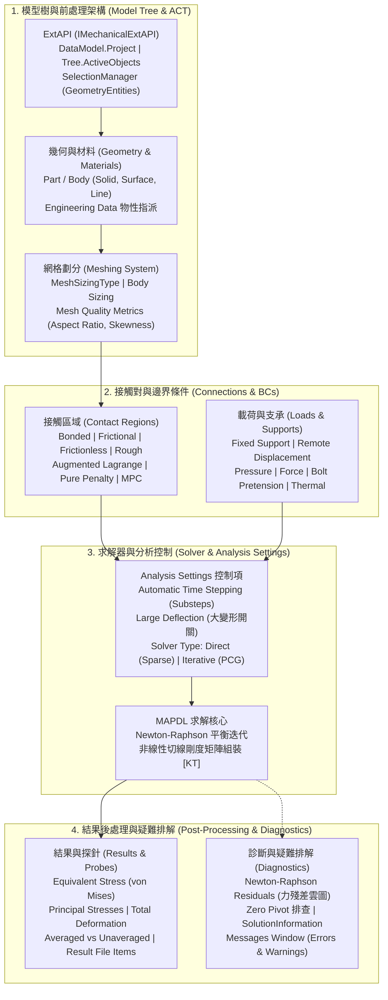

# Mechanical 主題辭典

> 深入剖析 Ansys Mechanical 有限元素結構分析、熱力學、接觸力學與動力學的理論基礎、ACT 自動化腳本、網格劃分、求解器設定、後處理數值評定與非線性收斂疑難排解體系。主要依據 v261 (2026 R1) Mechanical Scripting Guide、ACT API Reference 與 PyMechanical SDK。

---

## 領域架構圖 (Mechanical Simulation & Architecture Map)



---

## 主題辭典
### 1. ACT 與物件模型

Mechanical ACT 腳本透過物件模型讀取或修改模型樹。v261 Scripting Guide 的範例使用 `ExtAPI` 進入 ACT API，也展示 `DataModel.Project`、`Model`、`Tree.ActiveObjects` 和 `ExtAPI.SelectionManager` 等入口。

**腳本檢查順序**

1. 先確認目前作用中的分析、模型物件和單位系統。
2. 依物件型別取得目標物件，再確認該物件存在且屬於預期分析。
3. 寫入屬性後檢查 Details、訊息和模型樹的變化。

v261 API reference 列出 `IMechanicalExtAPI` 及其子介面。屬性和方法應按目標 release 查文件；同名物件在不同分析類型下不一定有相同作用。

來源：[v261 Scripting Guide，第 2 節，PDF 第 23–24 頁](../ANSYS_Document/Mechanical/v261/manuals/Ansys_Scripting_in_Mechanical_Guide.pdf#page=23)；[v261 `IMechanicalExtAPI`](https://developer.synopsys.com/docs/mechanical-scripting-interface/api/ansys/mechanical/stubs/v261/Ansys/ACT/Interfaces/Mechanical/IMechanicalExtAPI.md)；[來源清冊](sources.csv#ansys_8758de13f8caff835f87e491)。

### 2. 分析設定與求解

Analysis Settings 控制時間步或子步、非線性控制及結果輸出等設定。v261 腳本手冊展示 `AutomaticTimeStepping`、`TimeStep`、`InitialSubsteps`、`MinimumSubsteps` 和 `MaximumSubsteps` 等屬性。

手冊範例中有自動時間步關閉、時間步設為 `1e-2 [s]` 的案例，也有自動時間步開啟、初始／最小／最大子步設為 20／15／50 的案例。這些數值只屬於範例，不是通用預設值或建議值。

**設定前後的查核**

- 確認分析類型、載荷步和時間單位，再選擇以時間步或子步控制。
- 非線性分析需依模型狀態核對步控制、非線性控制與輸出控制。
- 求解前確認設定套用到預期分析；求解後檢查完成狀態與訊息。

來源：[v261 Scripting Guide，第 9 節範例，PDF 第 328、341 頁](../ANSYS_Document/Mechanical/v261/manuals/Ansys_Scripting_in_Mechanical_Guide.pdf#page=328)；[v261 `ANSYSAnalysisSettings` API](https://developer.synopsys.com/docs/mechanical-scripting-interface/api/ansys/mechanical/stubs/v261/Ansys/ACT/Automation/Mechanical/AnalysisSettings/ANSYSAnalysisSettings.md)；[來源清冊](sources.csv#ansys_8cd971701b6827808f0e4db0)。

### 3. 接觸與邊界條件

#### 核心概念與辭典定義 (Core Concepts & Glossaries)
- **接觸對 (Contact Pair)**：由接觸側 (Contact Side / `SourceLocation`) 與目標側 (Target Side / `TargetLocation`) 組成的力學界面。底層映射為 MAPDL 的 `CONTA174` (3D 高階面面接觸單元) 與 `TARGE170` (3D 目標面單元)。
- **接觸行為類型 (Contact Behaviors)**：
  - **線性接觸**：`Bonded`（法向與切向完全綁定，無分離、無滑移）、`No Separation`（法向禁止分離，允許無摩擦切向自由滑移）。可在線性求解器中一次直接求解。
  - **非線性接觸**：`Frictionless`（法向抗穿透，切向零阻力滑移）、`Rough`（法向抗穿透，切向完全鎖定不允許滑移）、`Frictional`（遵循庫倫摩擦定律 $\tau_{lim} = \mu P$）、`Forced Frictional Sliding`（強制動摩擦滑動）。需進行 Newton-Raphson 非線性迭代。
- **接觸演算法體系 (Formulations)**：
  - `Pure Penalty` (純罰函數)：以彈簧剛度 $K_n$ 抵禦穿透 ($F_n = K_n x_p$)；對剛度因子極其敏感，剛度過小穿透量大，剛度過大矩陣病態發散。
  - `Augmented Lagrange` (增廣拉格朗日法)：在罰函數基礎上引入拉格朗日乘子迭代修正，顯著降低對法向剛度的敏感性；為 Ansys Mechanical 預設推薦演算法。
  - `Normal Lagrange` (純拉格朗日法)：將接觸壓力作為額外自由度引入聯立方程，實現物理零穿透；但會使剛度矩陣對角線上出現零元素，增加計算量且易引發數值震盪 (Chattering)。
  - `MPC` (多點約束方程式)：以內部線性方程直接綁定節點自由度，不引入接觸彈簧與額外自由度；適用於 Bonded 與 No Separation，但需嚴格防範與剛性支承/遠端點重疊引發過約束 (Over-constraint)。
  - `Beam` (無質量梁單元)：使用無質量梁單元連結接觸面，適用於特定大間隙縫隙連接。
- **對稱接觸 vs 非對稱接觸 (Symmetric vs Asymmetric)**：
  - 非對稱接觸 (Asymmetric)：僅約束 Contact 節點不穿透 Target 表面（Target 節點可穿透 Contact 面）；計算速度快。
  - 對稱接觸 (Symmetric)：建立雙向互為 Contact/Target 的雙重接觸對；結果更精確，但計算量翻倍且可能引入接觸過約束。
- **Contact 與 Target 選擇五大黃金準則**：
  1. **材料剛度準則**：較硬材料（高彈性模數）表面設為 Target，較軟材料設為 Contact。
  2. **凸凹幾何準則**：凸曲面設為 Contact，凹曲面或平面設為 Target。
  3. **網格密度準則**：較細密網格面設為 Contact，較粗糙網格面設為 Target。
  4. **表面積準則**：較小表面設為 Contact，較大表面設為 Target。
  5. **單元階次準則**：高階單元（帶中間節點）設為 Target，一階單元設為 Contact。
- **邊界條件與支承載荷 (Boundary Conditions & Supports)**：
  - **支承 (Supports)**：`Fixed Support`（完全固定 $UX=UY=UZ=ROTX=ROTY=ROTZ=0$）、`Frictionless Support`（法向位移約束 $U_n=0$，切向自由滑動）、`Displacement`（分向強制位移約束）、`Remote Displacement`（透過遠端點 Pilot Node 控制空間位移與轉角，支援 Rigid, Deformable, Coupled 行為）。
  - **載荷 (Loads)**：`Force`（集中/分佈力，保持方向不變或跟隨變形）、`Pressure`（始終沿表面局部法向的表面載荷）、`Bolt Pretension`（螺栓預緊力載荷，依循 Lock / Load 雙載荷步時序）、`Thermal Condition`（熱應力分析之溫度場載荷）。

#### 官方手冊章節與精確頁碼定位 (Manual Citations with Precise Pages)
- **手冊來源**：*Ansys Scripting in Mechanical Guide* (Release 2026 R1 / v261, 全書 422 頁) 與 *Ansys Mechanical User's Guide* (v261 / v252)
- **關鍵章節與物理頁碼定位**：
  - **邊界條件 Field 離散值與時間/表格設定**：Scripting Guide Section 3.2 "Boundary Conditions & Discrete Fields", physical pages 85–92 (印製頁碼 67–74).
  - **Named Selection scope、坐標系與向量方向載荷**：Scripting Guide Section 4.1 "Scoping by Named Selection and 3D Vectors", physical pages 97–105, 190.
  - **ContactRegion API、Location.Ids 與 Connections 物件模型**：Scripting Guide Section 6.3 "Connections and Contact Region Automation", physical pages 216–224.
  - **Analysis Settings 時間步與非線性控制**：Scripting Guide Section 9.1, physical pages 328–341.
  - **User's Guide 界面與理論章節**：
    - *Mechanical User's Guide v261*, "Contact Region", "Designate Contact and Target Sides", "Contact Workflow", "Define Advanced Contact Settings", "Investigating Contact Regions", "Troubleshooting Convergence Problems".
  - Source IDs: `sources.csv#ansys_fe2dfc779b81c0c40548da4c`, `sources.csv#ansys_5e2bebb2441b5e3d3b48dbfc`, `sources.csv#ansys_ff42a74daafe4ee5898c46ff`, `sources.csv#ansys_e72dcab8aca9af04a65e76e8`, `sources.csv#ansys_cca1446761ea3149debbfcfb`, `sources.csv#web_mechanical_contact_region_v261`, `sources.csv#web_mechanical_contact_advanced_v261`, `sources.csv#web_mechanical_contact_inspect_v261`, `sources.csv#web_mechanical_contact_convergence_v261`.

#### 接觸類型、演算法與求解器適用矩陣 (Contact Formulation & Solver Compatibility Matrix)

| 接觸類型 (Type) | 推薦演算法 (Formulation) | 適用求解器 (Solver) | 物理自由度與穿透特徵 | 適用工程場景 |
|---|---|---|---|---|
| **Bonded** | `MPC` 或 `Augmented Lagrange` | MAPDL / Explicit | 法向及切向無位移跳變 ($u_c = u_t$)；零穿透 | 焊接接合、膠合、螺栓粘合等效 |
| **No Separation** | `MPC` 或 `Augmented Lagrange` | MAPDL / Explicit | 界面不開裂，但切向可無阻力自由滑移 | 滑軌、銷軸配合且不考慮摩擦 |
| **Frictionless** | `Augmented Lagrange` | MAPDL / Explicit | 抗法向侵入，切向剪切應力為零 ($	au = 0$) | 潤滑光滑接觸、模具沖壓導向 |
| **Frictional** | `Augmented Lagrange` / `Pure Penalty` | MAPDL / LS-DYNA | 庫倫摩擦定律，切向存在非線性能量耗散 | 制動摩擦副、過盈配合壓裝、微動磨損 |
| **Rough** | `Augmented Lagrange` | MAPDL | 法向開合，一旦接觸切向完全鎖定不滑動 | 極高粗糙度表面咬合、防滑齒面 |

#### 關鍵 ACT 自動化建立腳本 (Mechanical ACT Python Scripting)
```python
# ==============================================================================
# Mechanical ACT Script: Automated Contact Pair & Boundary Condition Setup
# Note: ASCII-only comments to prevent IronPython encoding issues.
# ==============================================================================
import Ansys
clr.AddReference("Ansys.ACT.Interfaces")

model = ExtAPI.DataModel.Project.Model
connections = model.Connections
analysis = model.Analyses[0]

# Step 1: Create Contact Region under Connections
connection_group = connections.Children[0] if connections.Children.Count > 0 else connections.AddConnectionGroup()
contact_region = connection_group.AddContactRegion()
contact_region.Name = "Frictional_Plate_Contact"

# Step 2: Configure Contact Type and Formulation
contact_region.ContactType = Ansys.Mechanical.DataModel.Enums.ContactType.Frictional
contact_region.ContactFormulation = Ansys.Mechanical.DataModel.Enums.ContactFormulation.AugmentedLagrange
contact_region.FrictionCoefficient = 0.25

# Step 3: Scope Contact (Source) and Target Geometry via Named Selection
contact_region.SourceLocation = ExtAPI.SelectionManager.CreateSelectionInfo(Ansys.ACT.Interfaces.Common.SelectionTypeEnum.GeometryEntities)
contact_region.Behavior = Ansys.Mechanical.DataModel.Enums.ContactBehavior.Asymmetric
contact_region.PinballRadius = Quantity("5.0 [mm]")
contact_region.InterfaceTreatment = Ansys.Mechanical.DataModel.Enums.ContactInitialEffect.AddOffsetRamped

# Step 4: Add Statically Determinate Fixed Support & Pressure Load
fixed_sup = analysis.AddFixedSupport()
fixed_sup.Name = "Base_Fixture"

pressure = analysis.AddPressure()
pressure.Name = "Top_Clamping_Pressure"
pressure.Magnitude.Output.SetDiscreteValue(0, Quantity("1.5 [MPa]"))
```

#### 工程實務踩坑指南 (Gotchas & Limitations)
1. **MPC 接觸與固定支承重合引發過約束 (Over-constraint)**：若某個節點同時被 `MPC Bonded Contact` 和 `Fixed Support`（或位移約束）選中，求解器矩陣組裝時會產生線性相關方程，觸發求解中斷或奇異主元警告 (`Zero Pivot Detected`)；應改用 `Augmented Lagrange` 演算法或調整邊界選取排除重疊節點。
2. **初始間隙導致剛體飛行 (Rigid Body Motion)**：若接觸對初始狀態存在微小幾何間隙，非線性求解第一步在無外力支承下零件直接發生剛體飛移導致發散；處置方法：在 Contact Region 中將 `Interface Treatment` 設為 `Adjust to Touch`（幾何節點平移閉合）或啟用 `Contact Stabilization Damping Factor`（引入人為數值阻尼跨越初始步）。

### 5. 結果與後處理

#### 核心概念與辭典定義 (Core Concepts & Glossaries)
- **有限元素結果數值體系**：有限元素求解器在單元內部高斯數值積分點 (Gauss Integration Points) 上計算應力與應變張量，隨後向單元節點進行數值外插 (Extrapolation)，最終在共享節點處進行節點平均 (Nodal Averaging)。
- **主要應力與變形數學定義 (Mathematical Formulations)**：
  - **von Mises 等效應力 ($\sigma_v$)**：依據第四強度理論（形變能理論），評估金屬材料屈服：
    $$\sigma_v = \sqrt{\frac{1}{2} [(\sigma_1-\sigma_2)^2 + (\sigma_2-\sigma_3)^2 + (\sigma_3-\sigma_1)^2]}$$
  - **主應力張量 ($\sigma_1 \ge \sigma_2 \ge \sigma_3$)**：應力狀態矩陣的特徵值，代表無剪應力作用正交截面上的正應力。第一主應力 ($\sigma_1$) 用於脆性材料拉伸斷裂評定，第三主應力 ($\sigma_3$) 用於最大抗壓強度評定。
  - **總變形量 (Total Deformation, $U_{tot}$)**：空間三維位移向量的二範數歐幾里得長度：
    $$U_{tot} = \sqrt{U_x^2 + U_y^2 + U_z^2}$$
  - **方向變形 (Directional Deformation)**：位移向量在指定局部坐標系或全域坐標系特定坐標軸上的正投影分量。
- **平均 (Averaged) 與未平均 (Unaveraged) 應力理論**：
  - **Unaveraged (未平均應力)**：保留相鄰單元外插至共享節點時各自獨立的應力數值。由於有限元素單元應力跨邊界不連續，相鄰單元計算值存在躍變 (Stress Jump)。
  - **Averaged (平均應力)**：對共享同一節點的所有相鄰單元外插應力取算術平均值。繪圖連續平滑。
  - **網格收斂門禁準則**：若同一個位置的未平均應力與平均應力相對跳動誤差超過 **10%**，表示該處應力梯度極陡峭，局部網格過粗，數值解尚未收斂。
- **坐標系轉換 (Coordinate Systems & Transformation)**：
  - **Global Coordinate System**：全域笛卡爾坐標系。
  - **Solution Coordinate System**：單元局部坐標系（如殼單元的面內材料坐標系）。
  - **User-Defined Coordinate System**：使用者自訂柱面、球面或局部笛卡爾坐標系。在後處理中調用 `RSYS` 進行應力/位移定向投影轉換。
- **結果檔案 (.rst) 與輸出控制 (Output Controls)**：
  - 預設求解器輸出節點自由度解 (Displacement) 與基本應力；若需提取非線性塑性應變、接觸摩擦狀態、假應變能，必須在 `Analysis Settings > Output Controls` 中明確將 `Nodal Forces`, `Contact Data`, `General Miscellaneous` 設為 `Yes`。
  - 結果精度：MAPDL 預設以單精度 (Single Precision, 32-bit float) 儲存 `.rst`，當模型空間尺寸極大而變形極微小（位移差跨越 6 個數量級）時會產生截斷誤差；大位移精密分析建議切換為雙精度結果輸出。

#### 官方手冊章節與精確頁碼定位 (Manual Citations with Precise Pages)
- **手冊來源**：*Ansys Scripting in Mechanical Guide* (Release 2026 R1 / v261) 與 *Mechanical User's Guide* (v261 / v252)
- **關鍵章節與物理頁碼定位**：
  - **結果物件建立、評估與動畫匯出 (ResultAnimationOptions)**：Scripting Guide Section 4.5, physical pages 124–125.
  - **Solution.Solve、ForceReaction、EquivalentStress 與後處理 API**：Scripting Guide Section 9.2 "Post-Processing & Evaluating Results", physical pages 328–341.
  - **User's Guide 結果章節**：
    - *Mechanical User's Guide v261*, Section "Introduction to the Use of Results", "Review Results (v252)", "Result File Items".
  - Source IDs: `sources.csv#ansys_fe2dfc779b81c0c40548da4c`, `sources.csv#ansys_e23e64c7d00dc57c1e03f5cf`, `agents/skills/structural-mechanics/ansys-mechanical/references/results_and_postprocessing.md`, `sources.csv#web_mechanical_results_intro_v261`, `sources.csv#web_mechanical_review_results_v252`, `sources.csv#web_mechanical_result_items_v261`.

#### 結果物件類型與設定矩陣 (Result Items & Evaluation Matrix)

| 結果物件 (Result Type) | 典型設定與 Scope | 核心屬性 / 數學定義 | 典型應用場景與判定門禁 |
|---|---|---|---|
| `EquivalentStress` | 幾何實體或全模型 | von Mises 應力張量第二不變量 | 金屬材料屈服判定；對比屈服極限 $\sigma_y$ |
| `MaximumPrincipalStress`| 幾何表面或脆性零件 | 第一主應力 $\sigma_1$ | 陶瓷、玻璃、脆性塑料拉伸斷裂評定 |
| `TotalDeformation` | 全模型 | 歐幾里得位移長度 $\sqrt{Ux^2+Uy^2+Uz^2}$ | 剛度評定、機構干涉檢查、全域撓度 |
| `DirectionalDeformation`| 指定坐標系與軸向 ($Z$) | 單一投影分量 $Uz$ | PCB 翹曲評估、軸承徑向跳動量測 |
| `ForceReaction` | 邊界約束 (Fixed/Displacement) | 約束反力合力 $\sum F$ | 結構外力平衡檢驗、螺栓扣件抗剪剪力 |
| `ContactTool` | 接觸對 (Contact Regions) | 接觸狀態、接觸壓力、穿透深度 | 密封壓力判定、摩擦磨損、防脫扣評估 |

#### 關鍵 ACT 後處理自動化腳本 (Mechanical ACT Python Scripting)
```python
# ==============================================================================
# Mechanical ACT Script: Automated Post-Processing and Result Extraction
# Note: ASCII-only comments to prevent IronPython encoding issues.
# ==============================================================================
import Ansys

model = ExtAPI.DataModel.Project.Model
analysis = model.Analyses[0]
solution = analysis.Solution

# Step 1: Add Stress and Deformation Results
eqv_stress = solution.AddEquivalentStress()
eqv_stress.Name = "Max_vonMises_Stress"

total_def = solution.AddTotalDeformation()
total_def.Name = "Global_Total_Deformation"

# Add Force Reaction Probe on Fixed Support
fixed_sup = [c for c in analysis.Children if c.Name == "Base_Fixture"][0]
force_rxn = solution.AddForceReaction()
force_rxn.BoundaryConditionSelection = fixed_sup

# Step 2: Solve / Evaluate All Results
solution.EvaluateAllResults()

# Step 3: Extract Scalar Values and Print Verification Evidence
peak_stress = eqv_stress.Maximum.Value
peak_disp = total_def.Maximum.Value
reaction_f = force_rxn.ReactionForceComponent(Ansys.Mechanical.DataModel.Enums.ReactionForceComponentType.Total).Value

print("Peak von Mises Stress: {0}".format(peak_stress))
print("Peak Total Deformation: {0}".format(peak_disp))
print("Total Reaction Force: {0}".format(reaction_f))

# Step 4: Export High-Resolution Animation
anim_opts = Ansys.Mechanical.Graphics.ResultAnimationOptions()
anim_opts.Duration = Quantity("4 [s]")
anim_opts.NumberOfFrames = 30
anim_path = r"C:\Temp\stress_animation.avi"
eqv_stress.ExportAnimation(anim_path, Ansys.Mechanical.DataModel.Enums.GraphicsImageExportFormat.AVI, anim_opts)
```

#### 工程實務踩坑指南 (Gotchas & Limitations)
1. **應力奇異點 (Stress Singularity) 誤判**：在尖銳凹內角 (Sharp Re-entrant Corner)、點載荷或剛性固定支承邊界處，理論彈性力學應力趨於無窮大；無論網格如何加密，該處 von Mises 應力永不收斂且持續攀升；**切勿將應力奇異點誤認為材料破壞**，應透過外角倒圓角 (Fillet)、子模型法 (Submodeling) 或在距奇異點 $1\sim 2$ 個單元外進行應力線性化取值。
2. **單精度結果檔在大位移下的數值漂移**：在經歷大位移小應變的薄板翻折或大旋轉分析中，單精度 `.rst` 會丟失微小的應變量；在 `Analysis Settings` 中應切換為雙精度求解輸出。

#### v261 結果物件插入、檢視與匯出

v261 User’s Guide 指出可用結果依分析類型而定，結果計算採用依分析類型設定的預設值（可自訂）；例如結構分析的結果隨時間評估，harmonic response 則按頻率。插入結果時先選 `Solution`，再從 Solution Context Tab 或右鍵選單選 result、probe 或 result tool；物件加入 Outline 後，還要將 scope 指定到模型幾何或網格實體。Details 的 Results 類別可顯示該結果的 minimum／maximum／average，以及 min／max 發生的 part。

| 檢視或輸出目的 | 指南列出的功能 | 使用界線 |
| --- | --- | --- |
| 看整體空間分布 | Contours；Display Options 可用 vectors、iso-surfaces、slice planes、path operations、surface cuts 等。 | 可檢視全模型或指定部分；先確認結果與 scope。 |
| 取局部或歷程資料 | Annotations／probes、Chart；v261 頁列出以 chart 顯示多個結果集隨時間的 minimum／maximum。 | 單點 probe 與跨時間曲線是不同查看方式；v252 頁另列 result 對 result（例如 force vs. displacement）。 |
| 自訂結果／位置插值 | User Defined Result；Interpolation 可在沒有 node 的位置取值，例如 path result 的任意位置。 | 插值點不是原始節點值。 |
| 匯出與報告 | 已評估的 result 可由右鍵選單匯出 Text 或 STL；另可輸出圖片並使用 Report Preview。 | 匯出前先完成 evaluate，並檢查單位與結果範圍。 |

v252 Review Results 頁另外列出 vector plots、probes、charts、animation，以及 Stress／Fatigue／Contact／Beam Tools。該頁對剛體顯示有特定限制：Transient Structural 與 Rigid Dynamics 可正確顯示剛體位移；Static Structural 或 Modal 等其他分析的結果值可正確，但 plot／animation 不會顯示剛體變形後形狀。若從不含 result files 的 project／archive 恢復模型，result tree 仍可能顯示 contour，但沒有 node-based displacement 時不能變形或動畫；依賴 real 與 imaginary result sets 的 harmonic contour 亦不可用。這些限制是 v252 文件所列情況，未據此推定 v261 是否變更。

v261 APDL 後處理另以 single precision 快取結果與節點座標以節省記憶體，高精度需求可能受影響；由 Mechanical APDL result file 後處理時須保留 mesh 資料，不能將 `/CONFIG,NORSTGM` 設為 1。以上是結果檢視功能與來源限制的摘要，不等於已核驗特定分析結果或網格精度。

來源：[Introduction to the Use of Results，Mechanical User’s Guide v261](https://ansyshelp.ansys.com/public/Views/Secured/corp/v261/en/wb_sim/ds_results_intro.html)（[來源清冊](sources.csv#web_mechanical_results_intro_v261)，Release 2026 R1）；[Review Results，Mechanical User’s Guide v252](https://ansyshelp.ansys.com/public/Views/Secured/corp/v252/en/wb_sim/ds_Review_Results_step.html)（[來源清冊](sources.csv#web_mechanical_review_results_v252)，Release 2025 R2）。兩頁官方 HTML 已核讀，但未鏡像成本機正文。

#### v261 Result File Item 結果範圍

Mechanical User’s Guide §19.2.4 的 `Result File Item` 是 result object 的一種 scoping method：分析求解完成後，從 Mechanical APDL `.rst` 結果檔的項目指定結果範圍。它按 solver 輸出的 ID／component 取資料，不是建立或變更 Named Selection 的操作。

| Item Type | 可以用來指定的範圍 | 注意事項 |
| --- | --- | --- |
| `Material IDs` | Mechanical APDL 指派給元素的 material ID。 | `Material and Element Type Information` worksheet 不顯示 Material ID = 0；使用 Condensed Part 時，worksheet 也不提供此類型的 ID 作選取。 |
| `Element Name IDs` | 元素名稱，例如 `BEAM188`、`SOLID185`、`SURF154`；也可用 group label（例如 `beam`）選同組元素。 | 支援標籤包含 `COMBIN`、`MASS`、`LINK`、`PLANE`、`SOLID`、`SHELL`、`SURF`、`TARGE`、`CONTAC`、`BEAM`、`PIPE`、`ELBOW`、`FOLLW`、`FLUID`、`PRETS`、`MPC`、`INTER`、`SOLSH`。Condensed Part 下 worksheet 不提供 Element Name IDs。 |
| `Element Type IDs` | 求解器指派給元素的 type ID。 | 只有元素的 Section ID（`SECNUM`）及 Real Constant ID（`REAL`）相同時才可使用此範圍。 |
| `Component Name` | 求解器建立或從 Mechanical 寫入 `.rst` 的 component。 | 求解器自行建立的 component 名通常以底線 `_` 開頭；可從 `Solver Component Names` worksheet 查 component type 與 entity 數。 |
| Element／Node IDs | 原始網格 ID，及求解器為載荷、接觸或支承建立的其他元素／節點 ID。 | 求解器產生的 ID 也能作後處理 scope；須先由結果檔或 worksheet 確認 ID。 |

**操作與結果限制**

1. 先完成求解，於 Solution Summary Worksheet 檢視 `Material and Element Type Information` 或 `Solver Component Names`，找出目標 ID／component。
2. 選取結果物件，把 `Scoping Method` 設成 `Result File Item`；再選 `Item Type`，並於 `Solver Component IDs` 輸入 worksheet 中的 ID／名稱。欄位接受個別 ID 或範圍，例如 `1, 2, 3`、`2-5`；Element Name 可輸入 `beam` 這類 group label。
3. `Global IDs` 只用於 Model Type 為 `Reinforcement` 的 body；ID 依 Geometry tree 中 body 順序指派，與 body 群組操作無關。
4. 含 cyclic symmetry 的分析目前不支援此方法的 Averaged result；要評估時需指定 `Unaveraged`。多材料 body 的 solver component 有少見的例外情況，手冊建議將 Solution 的 `Mesh Source` 設為 `Result File`。

以上是 v261 對 Mechanical APDL solver result file 的特定功能說明。結果種類、元素資料是否輸出及可用的 ID 仍依分析與 `.rst` 內容而定；不能推定為所有結果格式、分析類型或版本均適用。本機僅索引此主題摘要，官方 HTML 尚未鏡像。

來源：[Mechanical User’s Guide v261 §19.2.4 Result File Items](https://ansyshelp.ansys.com/public/Views/Secured/corp/v261/en/wb_sim/ds_sol_comp_output.html)（[來源清冊](sources.csv#web_mechanical_result_items_v261)，`browser_summary_only`）。


#### v261 Solution Summary Worksheet 結果摘要與求解器項目查找

求解完成後，可按 Home 頁的 Worksheet，或在 Solution 節點按右鍵選 `Worksheet: Result Summary` 開啟 Solution Quantities and Result Summary。Worksheet 分成幾個用途：

- `Available Solution Quantities`：查看結果檔中可用的 User Defined Results。
- `Material and Element Type Information`：檢視結果檔中的 material／element type 資訊，可用來選擇後續結果的 `Result File Item` scope。
- `Solver Component Names`：查看結果檔中的 solver components、其節點／元素類型及 entity 數量；求解器建立的 component 名稱通常以 `_` 開頭。
- `Result Summary`：以表格列出可用結果的最小值、最大值、單位及時間步；可右鍵跳到樹中的結果物件。支援一般 contour/vector、User Defined Results、Force／Moment Reaction、Joint、Spring 及 Bolt Pretension probes。

若結果物件尚未 evaluate，Worksheet 可能以黃色閃電圖示標示，對應欄位會顯示 `0`；不可把該值當作實際求解結果。`Material and Element Type Information` 對 Material ID = 0 不顯示元素；有 Condensed Part 時，Material ID 與 Element Name ID 不提供於該 worksheet。`Solver Component Names` 在 Modal、Harmonic Response、Transient Structural 使用 On Demand Expansion 時不可用。超過 200 列的材料／元素或 solver component 清單會分頁；Worksheet 亦支援依項目建立結果與 Plot Selection。

此摘要限定 Mechanical User’s Guide v261 的 Worksheet 頁面；顯示資料取決於已完成的求解與結果檔內容，Worksheet 的內建摘要或 validation 不代表物理解讀已完成。官方 HTML 已核讀，但原始頁面未鏡像成本機。

來源：[Solution Summary Worksheet，Mechanical User’s Guide v261 §19.6.13](https://ansyshelp.ansys.com/public/Views/Secured/corp/v261/en/wb_sim/ds_result_summary.html)（[來源清冊](sources.csv#web_mechanical_solution_summary_v261)，Release 2026 R1）；[Result File Items，§19.2.4](https://ansyshelp.ansys.com/public/Views/Secured/corp/v261/en/wb_sim/ds_sol_comp_output.html)（[來源清冊](sources.csv#web_mechanical_result_items_v261)）。

讀取或比較結果時，記錄結果種類、單位、座標系、載荷步／時間和作用位置。查看最大值時也檢查它周圍的場分布；孤立峰值不能單獨代表設計結論。若用 PyMechanical 或 DPF 讀取結果，先確認求解已完成，並讀取正確的結果檔。

來源：[v261 Scripting Guide 結果物件與求解範例，PDF physical page 321](../ANSYS_Document/Mechanical/v261/manuals/Ansys_Scripting_in_Mechanical_Guide.pdf#page=321)；[v261 `Solution` API](https://developer.synopsys.com/docs/mechanical-scripting-interface/api/ansys/mechanical/stubs/v261/Ansys/ACT/Automation/Mechanical/Solution.md)；[v261 `TotalDeformation` API](https://developer.synopsys.com/docs/mechanical-scripting-interface/api/ansys/mechanical/stubs/v261/Ansys/ACT/Automation/Mechanical/Results/DeformationResults/TotalDeformation.md)；[來源清冊](sources.csv#ansys_e23e64c7d00dc57c1e03f5cf)。

#### v261 `Result.PlotData` 讀取與節點值匯出

Mechanical Scripting Guide v261 的範例針對**已求解**的 result object 使用 `result.PlotData` 讀取表格。`PlotData["Values"]` 是結果值欄，`PlotData["Values"][4]` 取第五列（Python index 從 0 開始）；`PlotData.Dependents` 與 `.Independents` 可檢查依變數欄及獨立 ID，`PlotData["Values"].Unit` 讀取值的單位標籤。若改動 Details 設定，必須重新 evaluate 後再呼叫 PlotData，因為它反映的是目前已存結果的 snapshot。

PDF physical page 223 的匯出示例以 `Tree.FirstActiveObject` 取得目前選取的 result，從 `PlotData["Node"]` 與 `PlotData["Values"]` 成對逐列寫入文字檔；個別節點查值也是先在 Node ID 清單中找到列，再取該列的 result value。這段匯出程式只示範 Node 欄位；雖然章節標題涵蓋 nodes／elements，不在此推定每種結果的欄位鍵名相同。

單位需特別留意：Guide 指出 PlotData 顯示 Mechanical 內部儲存的結果值，不會轉成使用者選定的 unit system；匯出或比較數值時，先檢視 `Values.Unit`，不要只看 Mechanical UI 的顯示單位。此摘要限於 v261 Scripting Guide 的 tabular `PlotData` 介面，不是所有結果格式的通用匯出 API。

表格內容還會依結果位置與 scope 而異：Guide 說 `Nodal` 結果表只有 node 資訊；對 `Elemental` 結果，原文同樣寫只有 node 資訊；`Elemental Nodal` 則有 node 與 element 資訊，且為未平均結果（PDF physical Pages 138–139）。這是手冊的表述，使用時應按實際結果物件核對欄位，不應只依結果名稱猜 ID 欄。

Surface scope 有一項明確差異：`PlotData` 依 surface 上點的 X/Y/Z 座標列值；surface export 則按構成 surface 的 facets 輸出，facet 共用點可能重複，因此 PlotData 可能沒有 export 中的部分 point／element 配對。Beam 結果若要讀取截面結果，手冊要求將 Solution 的 `Beam Section Results` 設為 Yes 並重新 evaluate；此時同一 node 可對應多筆截面結果（physical Pages 152–154）。Path 結果的 tabular data 不列沿路徑距離（S parameter）；缺少結果的節點目前可能顯示極大值 `DBL_MAX`，且 column results 不支援 list slicing（physical Pages 154–155）。這些是 v261 手冊記載的介面限制，不代表所有結果類型或後續版本行為均相同。

來源：[Ansys Scripting in Mechanical Guide v261，PDF physical pages 138–139、152–155、223（印刷頁碼 128–129、142–145、146–147、215）](../ANSYS_Document/Mechanical/v261/manuals/Ansys_Scripting_in_Mechanical_Guide.pdf#page=152)（[來源清冊](sources.csv#ansys_fe2dfc779b81c0c40548da4c)）。

#### v261 結果與 probe 動畫匯出

Scripting Guide 的 `Exporting Result or Probe Animations` 章節提供 result／probe 的 `ExportAnimation(fileName, format, settings)`，支援 MP4、WMV、AVI、GIF，並明示支援 Workbench 的 no GUI mode。`GraphicsAnimationExportFormat` 指定格式；`AnimationExportSettings` 指定寬高，未提供時使用目前 graphics display 的解析度。手冊以物件名稱查找 Total Deformation，再匯出 MP4 或指定 1000 × 665 的 WMV；名稱、路徑及解析度都是案例值，不能當作模型或執行環境的預設。

動畫的全域選項位於 `Graphics.ResultAnimationOptions`：`NumberOfFrames` 針對 distributed result animation；`Duration` 是播放時長，型別為 `Quantity`；`UpdateContourRangeAtEachFrame` 控制每幀 legend contour 是否更新；`FitDeformationScalingToAnimation` 控制多時間步全範圍的變形縮放。手冊表格對 Duration 的文字描述與該頁「12 秒播放時長」範例不一致，這裡依範例與 v261 `ResultAnimationOptions.Duration` API 的 Duration 說明整理，不將它解讀成 RangeType。

這些是圖形輸出與播放設定，不是求解時間步或物理精度控制。匯出前需確認結果物件、可用資料及輸出路徑；本機未建立影片，未核驗不同作業系統、codec 或無 GUI 環境的實際輸出。

來源：[Scripting in Mechanical Guide v261，PDF physical pages 124–125（印刷頁 116–117）](../ANSYS_Document/Mechanical/v261/manuals/Ansys_Scripting_in_Mechanical_Guide.pdf#page=124)（[來源清冊](sources.csv#ansys_fe2dfc779b81c0c40548da4c)）；[v261 `ResultAnimationOptions`](../ANSYS_Document/Mechanical/v261/guides_and_tutorials/mechanical-scripting-interface/api/ansys/mechanical/stubs/v261/Ansys/Mechanical/Graphics/ResultAnimationOptions.md#ResultAnimationOptions.Duration)（[來源清冊](sources.csv#ansys_f9be6baa4dda6534bfb74d76)）。

### 6. PyMechanical

PyMechanical 是以 Python 控制 Mechanical 的 SDK。官方文件將工作模式分為嵌入式 Mechanical 與遠端工作階段；遠端模式透過 gRPC 與 Mechanical 程序通訊。啟動方式、連線生命週期和可用 API 依 PyMechanical SDK 版本而定，應把 SDK 版本和 Mechanical release 分開記錄。

**選模式前先確認**

- 腳本是否需要本機 GUI、批次執行或遠端服務。
- Mechanical 程序由誰啟動與關閉，檔案路徑在哪個環境中解析。
- 遠端連線失敗、逾時或程序結束時，工作流程如何回報狀態。

本機收錄 PyMechanical 0.13.5 的官方文件；其中 `choose your mode` 和 `remote session overview` 用於模式選擇。不要把 `stable` 文件路徑當成固定產品 release。

`mechanical_warnings` 模組頁以摘要表列出兩個函式：`connect_warnings(app)` 將 Mechanical 警告接到 Python `warnings` 模組，`disconnect_warnings(app)` 則解除連接。這是警告轉接 helper 的功能摘要；不代表會設定警告等級或改變 Mechanical 訊息集合。

| 函式 | 官方摘要 |
|---|---|
| `connect_warnings(app)` | 將 Mechanical warnings 連接至 Python `warnings` 模組。 |
| `disconnect_warnings(app)` | 解除 Mechanical warnings 與 Python `warnings` 模組的連接。 |

來源：[mechanical_warnings 模組 reference](../ANSYS_Document/Mechanical/sdk/ansys-mechanical-core/0.13.5/api_reference/e6815837cb5d-index.md)（[來源清冊](sources.csv#ansys_72e5fd5ae5ecdba065ae34b2)）。

官方 PyMechanical Stubs v261（Mechanical 2026 R1）索引列出 Mechanical namespace 下的物件、方法與屬性文件；官方頁面明示它是完整 API reference 的 focused subset，並將實務範例指向 Scripting in Mechanical Guide。此索引的產品版本為 v261，不等同 PyMechanical SDK 0.13.5；應用它尋找符號後，再以目標 release 的完整參考與操作指南確認行為。原始頁面目前只透過官方瀏覽器檢視，本機入口 HTML 是 redirect stub，未列作已下載正文。

來源：[PyMechanical 0.13.5：Choose your mode](https://mechanical.docs.pyansys.com/version/stable/getting_started/choose_your_mode.html)；[PyMechanical 0.13.5：Remote session overview](https://mechanical.docs.pyansys.com/version/stable/user_guide/remote_session/overview.html)；[來源清冊](sources.csv#ansys_e3c1d6821a22de402a906404)。 [v261 PyMechanical Stubs API reference index](https://scripting.mechanical.docs.pyansys.com/version/stable/api/ansys/mechanical/stubs/v261/index.html)；[來源清冊](sources.csv#web_mechanical_pymechanical_stubs_v261)。

### 7. 疑難排解

#### 核心概念與辭典定義 (Core Concepts & Glossaries)
- **非線性不收斂 (Non-Convergence)**：Newton-Raphson 求解非線性代數方程組 $[K_T] \{\Delta u\} = \{F_{ext}\} - \{F_{int}\}$ 時，殘差力向量 $\{R\} = \{F_{ext}\} - \{F_{int}\}$ 無法在指定迭代次數內滿足收斂容差（力殘差 $||\{R\}||_2 \le \epsilon_F ||\{F\}||_2$ 或位移增量容差）。求解器自動二分時間步長 (Bisection)；若持續發散，將觸發求解中斷。
- **主元警告與數值奇異 (Zero / Small Pivot Warnings)**：
  - 剛度矩陣在 Gauss 消去分解過程中，對角線主元值小於數值閾值（如 $< 10^{-10}$）。
  - **物理根因**：結構存在未約束的剛體運動自由度 (Rigid Body Motion)、機構未約束 (Unconstrained Mechanism)、接觸對分離且無支承零件在空間中漂移、或材料彈性模數過軟/出現負斜率剛度。
- **網格畸變與雅可比崩潰 (Excessive Distortion & Negative Jacobian)**：
  - 大塑性應變或橡膠超彈性大形變時，網格單元節點互相穿透，導致單元座標變換雅可比行列式值小於零 ($J \le 0$)，求解器拋出 `Element Excessive Distortion` 並終止解算。
- **Newton-Raphson 殘差診斷流程圖 (Mermaid Convergence Diagnostics)**：
  ```mermaid
  flowchart TD
      A[求解發散 / 頻繁 Bisection] --> B{查看 Solver Output 訊息}
      B -->|Zero Pivot / Small Pivot| C[剛體運動 / 欠約束 / 接觸未閉合]
      B -->|Negative Jacobian / Element Distortion| D[網格嚴重扭曲 / 大塑性變形]
      B -->|Force Convergence 震盪發散| E[接觸摩擦震盪 / 局部屈曲 / 步長過大]
      
      C --> C1[檢查 Fixed Support 是否遺漏<br/>啟用 Contact Stabilization Damping<br/>檢查 Contact Adjust to Touch]
      D --> D1[開啟 Large Deflection<br/>加密網格 / 改用線性單元或非協調單元<br/>縮減時間步長 Substeps]
      E --> E1[在 Solution Information 開啟<br/>Newton-Raphson Residuals = 4<br/>檢視最後一次迭代的 Force Residual 雲圖<br/>鎖定力不平衡點所在接觸面]
  ```

#### 官方手冊章節與精確頁碼定位 (Manual Citations with Precise Pages)
- **手冊來源**：*Ansys Mechanical User's Guide* & *Scripting in Mechanical Guide* (v261 / v252)
- **關鍵章節與物理頁碼定位**：
  - **非線性收斂診斷與 Newton-Raphson 殘差**：User's Guide "Troubleshooting Convergence Problems" ([ds_contact_best_prac_converge.md](../ANSYS_Document/Mechanical/v261/guide/ds_contact_best_prac_converge.md)).
  - **接觸區域調查與初始狀態排查**：User's Guide "Investigating Contact Regions" ([ds_contact_best_prac_setup.md](../ANSYS_Document/Mechanical/v261/guide/ds_contact_best_prac_setup.md)).
  - **Messages Window 訊息檢視與 API 提取**：Scripting Guide Section 7.2 "Messages API Reference", physical pages 180–185 ([Message.md](../ANSYS_Document/Mechanical/v261/guides_and_tutorials/mechanical-scripting-interface/api/ansys/mechanical/stubs/v261/Ansys/Mechanical/Application/Message.md)).
  - **SolutionInformation 診斷 API**：Scripting Guide Section 9.3 ([SolutionInformation API](../ANSYS_Document/Mechanical/v261/guides_and_tutorials/mechanical-scripting-interface/api/ansys/mechanical/stubs/v261/Ansys/ACT/Automation/Mechanical/SolutionInformation.md)).
  - Source IDs: `sources.csv#ansys_fe2dfc779b81c0c40548da4c`, `sources.csv#ansys_986acbba3982c980d60f24ed`, `agents/skills/structural-mechanics/ansys-mechanical/references/solver_diagnostics.md`, `sources.csv#web_mechanical_messages_v252`, `sources.csv#web_mechanical_contact_inspect_v261`, `sources.csv#web_mechanical_contact_convergence_v261`.

#### 求解器常見錯誤與現場急救處方表 (Solver Diagnostics & Prescriptions)

| 求解器錯誤徵兆 | 底層數學與物理根因 | 診斷提取手段 | 現場工程急救處方 |
|---|---|---|---|
| **Zero Pivot / Small Pivot** | 剛度矩陣奇異；某零件沿特定軸向無約束，剛體飛移 | 檢查 `Solver Output` 中的節點與自由度 ID (如 `Node 401 DOF UZ`) | 1. 補全 3-2-1 或固定支承；<br/>2. 接觸改為 `Adjust to Touch`；<br/>3. 開啟 Contact Stabilization。 |
| **Bisection Limit Exceeded** | 時間步內外力不平衡，力殘差持續大於收斂準則 | 開啟 `NewtonRaphsonResiduals = 4` 檢視不平衡力集中位置 | 1. 增加 Minimum/Maximum Substeps；<br/>2. 開啟 Line Search；<br/>3. 降低接觸法向剛度因子至 0.1。 |
| **Element Distortion / Jacobian** | 單元幾何在大變形下變形過大，積分點坐標翻轉 | 查詢 Distortion 警告指示之特定單元 ID | 1. 啟用 `Large Deflection = On`；<br/>2. 改善局部網格流向，加密六面體網格；<br/>3. 材料加入合適的硬化模型。 |
| **Contact Chattering** | 節點在接觸開裂與閉合之間高頻來回震盪 | 查看 Convergence Graph 中的接觸狀態迭代曲線 | 1. 將演算法由 `Normal Lagrange` 改為 `Augmented Lagrange`；<br/>2. 啟用接觸穿透容差；<br/>3. 適度增加阻尼。 |

#### 關鍵診斷自動化腳本 (Mechanical ACT Python Scripting)
```python
# ==============================================================================
# Mechanical ACT Script: Automated Convergence Diagnostics and Error Extraction
# Note: ASCII-only comments to prevent IronPython encoding issues.
# ==============================================================================
import Ansys

model = ExtAPI.DataModel.Project.Model
analysis = model.Analyses[0]
solution = analysis.Solution
sol_info = solution.SolutionInformation

# Step 1: Pre-configure Convergence Diagnostic Tools
sol_info.NewtonRaphsonResiduals = 4 # Track up to 4 residual iterations prior to failure
sol_info.UpdateInterval = 2.0       # Update log every 2 seconds

# Step 2: Query Active Errors and Warnings from Application Messages
app_messages = ExtAPI.Application.Messages
error_count = app_messages.Count
print("Total Diagnostics Messages: {0}".format(error_count))

for i in range(error_count):
    msg = app_messages[i]
    if msg.Severity == Ansys.Mechanical.DataModel.Enums.MessageSeverityType.Error:
        print("[SOLVER ERROR] {0}".format(msg.DisplayString))
        print("Timestamp: {0} | Origin: {1}".format(msg.TimeStamp, msg.Source))
        if msg.RelatedObjects is not None:
            for obj in msg.RelatedObjects:
                print("  Related Model Entity: {0}".format(obj.Name))
```


---

## 雙向鏈結與參照索引
- [[geometry|PyAnsys Geometry 幾何服務辭典]]：SpaceClaim / Discovery 幾何前處理及腳本控制。
- [[lsdyna|Ansys LS-DYNA 衝擊分析辭典]]：顯式暫態動力學、碰撞衝擊與破壞分析。
- [[acp|Ansys Composite PrepPost (ACP) 辭典]]：複合材料層合板前處理與求解器耦合。
- [[pcb_warpage|PCB 多層板熱翹曲分析辭典]]：多層板幾何自動化與熱翹曲評估。
- [[rigid_body_dynamics|Rigid Body Dynamics 剛體動力學辭典]]：機構運動學與動力學求解。
- [[error_catalog|Ansys 錯誤與診斷目錄]]：全產品求解器非線性發散、奇異主元與網格畸變急救指南。


## PyMechanical 0.13.5 教學案例補充

本節依本機 PyMechanical `ansys-mechanical-core` 教學範例 notebook 整理流程，套件版本 0.13.5 不代表 Mechanical 產品 release。官方頁面使用動態 `version/stable` 網址；本機快照資料夾標為 0.13.5，不能據此推論目前線上 stable 的內容一致。範例包含下載外部幾何／材料檔案與 `App` embedded session，未在本輪執行。

| 案例 | 文件中可追溯的模型流程 | 閱讀時的界線 |
|---|---|---|
| 螺栓預緊 (`bolt_pretension`) | 匯入 PMDB 幾何與 XML 材料，新增 Static Structural analysis，使用 Named Selections 建接觸、網格、載荷與 `BoltPretension`；新增 `BoltTool`、變形、等效應力及反力結果後呼叫 `Solve(True)`。 | 接觸係數、MPC formulation、載荷與子步均屬該示例模型設定，不可直接套為通用預設。 [官方範例](https://mechanical.docs.pyansys.com/version/stable/examples/gallery_examples/01_basic/bolt_pretension.html) · [本機 notebook](../ANSYS_Document/Mechanical/sdk/ansys-mechanical-core/0.13.5/tutorial/inputs/bolt_pretension.ipynb) |
| 冷卻孔熱分析 (`cooling_holes_thermal_analysis`) | 匯入含材料處理的幾何與材料 XML，切換 Standard BIN 單位，指定截面／材料、圓柱座標系及 Named Selections；建立網格與 Steady State Thermal analysis，再設定 convection、temperature、mass flow rate 並評估溫度結果。 | 範例質量流率 `9.9999e-4 lbm sec^-1` 是模型輸入值，不是建議工況。 [官方範例](https://mechanical.docs.pyansys.com/version/stable/examples/gallery_examples/01_basic/cooling_holes_thermal_analysis.html) · [本機 notebook](../ANSYS_Document/Mechanical/sdk/ansys-mechanical-core/0.13.5/tutorial/inputs/cooling_holes_thermal_analysis.ipynb) |
| 裂縫接觸脫黏 (`fracture_analysis_contact_debonding`) | 對 2D double cantilever beam 匯入幾何與 CZM 材料，設定 bonded contact 與網格；新增 `Fracture`／`ContactDebonding`，設定 Static Structural 大變形及子步、支承與位移，再輸出方向變形及反力。 | 範例的 `InitialSubsteps`／`MinimumSubsteps`／`MaximumSubsteps` 都是 100，僅是該教學案例設定；不構成收斂建議。 [官方範例](https://mechanical.docs.pyansys.com/version/stable/examples/gallery_examples/01_basic/fracture_analysis_contact_debonding.html) · [本機 notebook](../ANSYS_Document/Mechanical/sdk/ansys-mechanical-core/0.13.5/tutorial/inputs/fracture_analysis_contact_debonding.ipynb) |

原始範例 Markdown 與 Python/notebook 輸入均保留在 `docs/ANSYS_Document/Mechanical/sdk/ansys-mechanical-core/`；catalog 將 0.13.4 的三組 `.ipynb`／`.py` 列為附件，0.13.5 有三組 `.ipynb` 附件。本節摘要取自 0.13.5 notebook；未比較兩版本全部程式差異，也未執行求解。原檔包括命令片段與下載操作，使用前仍需按目標環境、來源檔案及授權逐項確認。


## 本機原碼補件與官方執行環境文件（2026-11-04）
九份原碼補件依本機來源保留，產品 release 仍為 unknown；`0.13.4`／`0.13.5` 僅是 SDK 快照目錄標記。Notebook 只含 code 與 Markdown cell，沒有 outputs、圖片或外部資料檔。三個案例在兩個目錄版本的 Notebook source cell 文字與順序逐組完全相同；原始 Notebook bytes hash 不同，不能據此宣稱完整檔案或兩個 SDK 等同。
| 案例／SDK | 來源 ID | 原碼文字 |
| --- | --- | --- |
| bolt_pretension.ipynb／0.13.4 | `sources.csv#ansys_033f0162d357411592fd55ab` | [補件](ANSYS_Document/mechanical_example_inputs_20261104/tutorial/ansys_033f0162d357411592fd55ab/mechanical.md) |
| bolt_pretension.py／0.13.4 | `sources.csv#ansys_1b4eb80d0ef685ba32ef0b1f` | [補件](ANSYS_Document/mechanical_example_inputs_20261104/tutorial/ansys_1b4eb80d0ef685ba32ef0b1f/mechanical.md) |
| cooling_holes_thermal_analysis.ipynb／0.13.4 | `sources.csv#ansys_4497a668e1194508f63d74f7` | [補件](ANSYS_Document/mechanical_example_inputs_20261104/tutorial/ansys_4497a668e1194508f63d74f7/mechanical.md) |
| cooling_holes_thermal_analysis.py／0.13.4 | `sources.csv#ansys_17bf672fa18cc6dddf91808c` | [補件](ANSYS_Document/mechanical_example_inputs_20261104/tutorial/ansys_17bf672fa18cc6dddf91808c/mechanical.md) |
| fracture_analysis_contact_debonding.ipynb／0.13.4 | `sources.csv#ansys_ddcbb75051c80ce16bb4c802` | [補件](ANSYS_Document/mechanical_example_inputs_20261104/tutorial/ansys_ddcbb75051c80ce16bb4c802/mechanical.md) |
| fracture_analysis_contact_debonding.py／0.13.4 | `sources.csv#ansys_25ac8b585b546d45a6535847` | [補件](ANSYS_Document/mechanical_example_inputs_20261104/tutorial/ansys_25ac8b585b546d45a6535847/mechanical.md) |
| bolt_pretension.ipynb／0.13.5 | `sources.csv#ansys_6286c758c45e39a611aeefb1` | [補件](ANSYS_Document/mechanical_example_inputs_20261104/tutorial/ansys_6286c758c45e39a611aeefb1/mechanical.md) |
| cooling_holes_thermal_analysis.ipynb／0.13.5 | `sources.csv#ansys_a861ae60fa57a0c011a093cf` | [補件](ANSYS_Document/mechanical_example_inputs_20261104/tutorial/ansys_a861ae60fa57a0c011a093cf/mechanical.md) |
| fracture_analysis_contact_debonding.ipynb／0.13.5 | `sources.csv#ansys_697f90b9a4c29c54b048bd2a` | [補件](ANSYS_Document/mechanical_example_inputs_20261104/tutorial/ansys_697f90b9a4c29c54b048bd2a/mechanical.md) |

範例原碼會建立 `App` session、下載幾何與材料、呼叫 `Solve(True)`、以 `save_as(..., overwrite=True)` 儲存，以及 `delete_downloads()` 清除下載檔案；本次只擷取文字。使用前應先確認 Mechanical 安裝、授權、下載目錄與覆寫位置，案例設定仍只適用其原模型。

以下四個官方 stable 頁面於本輪另存原 HTML／正文；其目前線上內容與舊 SDK 目錄快照分開標示，不推定目前 stable 的套件版本。
| 頁面 | 可證實的閱讀重點 | 文字與原件 |
| --- | --- | --- |
| Using Mechanical through Docker — PyMechanical | 頁面稱 Docker 配置為 experimental，目標是最小測試映像；`.dockerignore` 會排除元件，使用者需從本機 Mechanical 安裝建立映像。 | [正文](ANSYS_Document/mechanical_official_html_20261104/guide/d02811037827c716/mechanical.md)／[原 HTML](ANSYS_Document/mechanical_official_html_20261104/guide/d02811037827c716/mechanical.html)；`sources.csv#mechanical_web_d02811037827c716_255ec256484f` |
| Windows Subsystem for Linux (WSL) — PyMechanical | embedded mode 在 WSL 需使用 `mechanical-env` wrapper；remote session 視同 Linux 環境。頁面註明 VPN 情況未完整測試。 | [正文](ANSYS_Document/mechanical_official_html_20261104/guide/daedc3aafccb1fac/mechanical.md)／[原 HTML](ANSYS_Document/mechanical_official_html_20261104/guide/daedc3aafccb1fac/mechanical.html)；`sources.csv#mechanical_web_daedc3aafccb1fac_bdc599b8fa69` |
| Mechanical standalone — PyMechanical | 頁面記錄 embedded mode 傳 GeoPart list 給 `Model.DeleteParts()` 的問題，並說 scripting window／batch mode 可成功；另有明確 24R2 分節，不當作所有版本通用限制。 | [正文](ANSYS_Document/mechanical_official_html_20261104/guide/e5c7d5e101088b7a/mechanical.md)／[原 HTML](ANSYS_Document/mechanical_official_html_20261104/guide/e5c7d5e101088b7a/mechanical.html)；`sources.csv#mechanical_web_e5c7d5e101088b7a_f4f5ec00e760` |
| PyMechanical — PyMechanical | v0.13 分節記錄 Windows embedded `App(interactive=True)` 搭配 Mechanical 26 R1 的 GUI 載入問題；v0.11 分節限制 `App.plot()` 為幾何顯示。 | [正文](ANSYS_Document/mechanical_official_html_20261104/guide/3fdf10f35cb5b90a/mechanical.md)／[原 HTML](ANSYS_Document/mechanical_official_html_20261104/guide/3fdf10f35cb5b90a/mechanical.html)；`sources.csv#mechanical_web_3fdf10f35cb5b90a_7a2ebfe0a0b6` |

這四頁未執行其安裝／容器／程式操作，也未重現已知問題；其餘未擷取 URL、API 語義與指南章節仍列缺口。來源／版本陳述僅限所列頁面。
