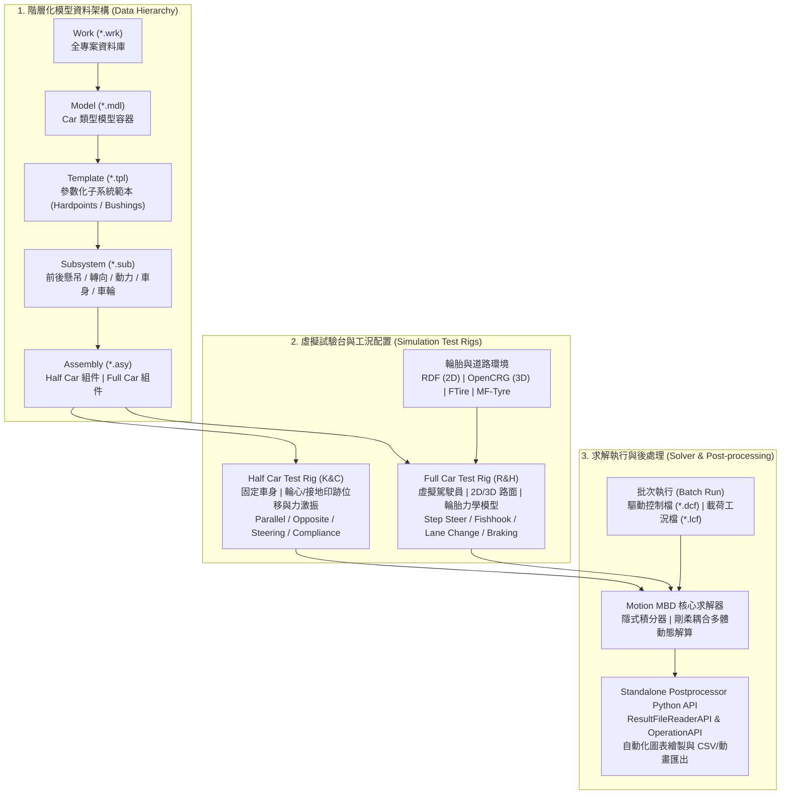

# Ansys Motion 多體動力學主題辭典 (Motion & CAR Toolkit)

> 範圍提醒：本頁列出的 Motion／CAR Toolkit 與 API 主題是有界摘要，不代表 Motion 全產品文件已完成整理。逐筆來源及 PDF 轉換狀態見 [Motion 來源清冊](../maintenance/knowledge_dictionary_passes/2026-11-02/motion_sources.csv)；來源正文尚未全面語義覆核。

> 本主題深入剖析 Ansys Motion 多體動力學 (Multi-Body Dynamics, MBD) 及其車輛專用模組 CAR Toolkit 的架構體系。涵蓋階層化資料模型 (Work/Model/Assembly/Subsystem/Template)、半車懸吊運動學與順應性 (Half Car K&C) 測試台配置、整車操縱穩定性與平順性 (Full Car R&H) 標準分析工況、輪胎/道路 (RDF & OpenCRG) 互動模型、批次解算 (Batch Run with `.dcf` / `.lcf`)，以及基於 Standalone Postprocessor Python API 的全自動化曲線與圖表後處理。

---

## 領域架構圖 (CAR Toolkit Hierarchy & Workflow Map)



---

## 主題辭典與核心模組

### 1. CAR Toolkit 模型階層與整車分析

#### 核心概念與辭典定義 (Core Concepts & Glossaries)
- **階層化資料架構 (Data Structure Hierarchy)**：CAR Toolkit 遵循嚴格的物件封裝與繼承架構：
  - **Work / Model**：頂層工作區與模型資料庫。一個 Work 可包含多個 Model；Model 專門管理 Assembly、Subsystem、Template、力元 (Force Elements) 與網格部件。
  - **Template (範本, `*.tpl`)**：參數化的子系統架構原型。定義了連桿拓撲、運動副自由度、硬點 (Hardpoints) 與襯套/彈簧參數化介面。
  - **Subsystem (子系統, `*.sub`)**：範本具體實例化的子總成。填入具體硬點三維坐標、力元檔案（如非線性襯套剛度曲線、阻尼器特徵），包含前懸吊、後懸吊、轉向系統、車身、動力傳動及輪胎車輪。
  - **Assembly (組件, `*.asy`)**：將多個子系統與試驗台環境整合為可求解實體的總成，主要分為 **Half Car Assembly**（半車懸吊）與 **Full Car Assembly**（整車）。
- **半車懸吊運動學與順應性分析 (Half Car K&C Analysis)**：
  - **車身剛性固定**：將車身子系統固定於慣性坐標系，消弭整車平動與俯仰/側傾干擾。
  - **輪跳工況 (Wheel Travel)**：對左右輪施加同向平移 (Parallel Wheel Travel) 或反向平移 (Opposite Wheel Travel)，評估輪距變化 (Track Change)、軸距變化 (Wheelbase Change)、外傾角 (Camber)、束角 (Toe)、主銷後傾角 (Caster) 及側傾中心高度 (Roll Center Height)。
  - **順應性工況 (Compliance)**：在輪心或接地面施加縱向力 ($F_x$)、側向力 ($F_y$) 或回正力矩 ($M_z$)，評估襯套彈性變形引起的彈性運動學 (Elastokinematics) 響應。
- **整車操縱穩定性與平順性分析 (Full Car R&H Analysis)**：
  - **閉環/開環控制**：虛擬駕駛員模型根據目標路徑或轉向盤輸入時序動態調節方向盤轉角、油門踏板與制動壓力。
  - **標準分析工況 (Analysis Categories)**：
    1. *Open-loop steering*：階躍轉向 (Step Steer)、斜坡轉向 (Ramp Steer)、掃頻正弦 (Swept Sine)、正弦停滯 (Sine with Dwell, ISO 19364)、魚鉤轉向 (Fishhook)。
    2. *Cornering*：穩態迴轉 (Constant Radius / Constant Steer Cornering)。
    3. *Course*：雙移線 (Double Lane Change, ISO 3888)、繞樁 (Slalom)。
    4. *Straight-line*：直線加速、直線制動 (Braking on $\mu$-split / uniform road)。

#### 手冊章節與規格出處 (Manual & Doc Citations)
- **手冊來源**：*Ansys Motion 2026 R1 CAR Toolkit Manual* (Release 2026 R1)
- **章節與精確頁碼定位**：
  - Section 1.1 "An overview of CAR toolkit" & Data Structure: PDF physical pages 2–3, 10–12 ([Car_Manual.md#L9](../ANSYS_Document/Motion/unknown/manuals/Manuals/Ansys%20Motion%202026%20R1%20Car_Manual.md#L9))
  - Section 1.2 "How to use CAR toolkit" (Work/Model/Assembly/Templates): PDF physical pages 23–30 ([Car_Manual.md#L399](../ANSYS_Document/Motion/unknown/manuals/Manuals/Ansys%20Motion%202026%20R1%20Car_Manual.md#L399))
  - Section 1.3 "Additional elements and inputs for Full Car simulation" (Tire & Road RDF/OpenCRG): PDF physical pages 67–75 ([Car_Manual.md#L1238](../ANSYS_Document/Motion/unknown/manuals/Manuals/Ansys%20Motion%202026%20R1%20Car_Manual.md#L1238))
  - Section 1.4.4 "Full Car Analysis": PDF physical pages 89–117 (Common parameters, road visualization, load cases, DCF export)
  - Section 1.4.5 "Half Car Analysis": PDF physical pages 118–128 (Wheel travel, steering analysis, compliance, LCF export)
  - Section 1.5 & 1.6 "Batch Run & Post Processing": PDF physical pages 129–192
  - Source ID: `sources.csv#ansys_0e043df6310e4a1cb10bc1ce`.

#### 分析工況與參數設定矩陣 (Simulation Setup Matrix)

| 試驗台類別 | 分析類別 (Category) | 核心工況 (Analysis Type) | 必要輸入子系統 | 關鍵輸出性能指標 |
|---|---|---|---|---|
| **Half Car Rig** | Wheel Travel | Parallel Wheel Travel | 前或後懸吊子系統、轉向 (選配) | Camber/Toe 隨輪跳變化、側傾中心高 |
| **Half Car Rig** | Wheel Travel | Opposite Wheel Travel | 前或後懸吊子系統、轉向 (選配) | 懸吊側傾角剛度、輪距變化率 |
| **Half Car Rig** | Steering | Static Steering | 前懸吊 + 轉向子系統 | 阿克曼誤差 (Ackermann Error)、轉向比 |
| **Half Car Rig** | Compliance | Longitudinal / Lateral Force | 前或後懸吊子系統 | 襯套縱向/側向順應性位移、轉向後行角 |
| **Full Car Rig** | Open-loop Steering | Step Steer / Fishhook | 前後懸吊、前後輪胎、車身、轉向 | 橫擺角速度 (Yaw Rate)、側向加速度響應 |
| **Full Car Rig** | Course | Double Lane Change (ISO 3888) | 前後懸吊、輪胎、車身、轉向、動力、制動 | 循跡路徑偏差、側翻穩定度、側傾角 |
| **Full Car Rig** | Straight-line | Braking on Split-$\mu$ | 前後懸吊、輪胎、車身、轉向、動力、制動 | 制動距離、減速度、跑偏偏航角 |

#### 批次執行與後處理整合 (Batch Run & Python API)
在完成 GUI 參數配置後，CAR Toolkit 支援將工況設定分別匯出為：
- **`*.lcf` (Load Case File)**：半車載荷工況檔案；
- **`*.dcf` (Driving Control File)**：整車駕駛控制時序檔案。
隨後可使用命令列無頭模式調用 Motion 求解器批次執行 (`MotionBatch.exe -i model.mdl -lcf case.lcf`)。

求解完成後，利用 Standalone Postprocessor Python API 進行非互動後處理與曲線輸出：
```python
# ==============================================================================
# Standalone Postprocessor Python API: Automated K&C Curve Extraction
# Note: ASCII-only comments to prevent IronPython encoding issues.
# ==============================================================================
import os
import sys

# Add Motion Postprocessor Modules directory to sys.path
post_modules_path = r"C:\Program Files\ANSYS Inc\v261\Motion\Document\Postprocessor API for Python\Modules"
if post_modules_path not in sys.path:
    sys.path.append(post_modules_path)

import ResultFileReaderAPI

result_file = r"C:\Simulations\HalfCar_ParallelTravel.dfr"

# Open result database
reader = ResultFileReaderAPI.OutputReader(result_file)

# Extract Wheel Travel Displacement (Z) and Camber Angle Curve
# Target: Left Wheel Center / Component: Camber
time_steps = reader.GetTimeSteps()
wheel_z = reader.GetResultData("Suspension.LeftWheel", "Displacement", "Z")
camber_angle = reader.GetResultData("Suspension.LeftWheel", "Orientation", "Camber")

# Write to standardized CSV for engineering report
output_csv = r"C:\Simulations\KC_Camber_vs_Travel.csv"
with open(output_csv, "w") as fp:
    fp.write("Wheel_Travel_mm,Camber_deg\n")
    for z, c in zip(wheel_z, camber_angle):
        fp.write("{0:.4f},{1:.4f}\n".format(z * 1000.0, c))

reader.Close()
```

#### 工程實務踩坑指南 (Gotchas & Limitations)
1. **硬點 (Hardpoint) 坐標系衝突**：Template 中的硬點預設參考 Subsystem 局部坐標系或車輛全域坐標系 (ISO/SAE 坐標系：X 向前、Y 向右、Z 向下；或 Ansys 標準坐標系：X 向前、Y 向左、Z 向上)。若在匯入懸吊硬點時坐標系軸向混淆，會導致連桿幾何錯位穿透，求解器初始迭代即發散。
2. **2D RDF 道路邊界越界**：使用 2D Road Data File (`*.rdf`) 進行直線制動或轉向工況時，車輛輪胎若橫向滑移超出 RDF 定義的道路寬度範圍，求解器因找不到路面接觸法向量而發生數值崩潰；對於大橫向位移工況必須配置 3D Spline 或 OpenCRG 道路。
3. **襯套剛度矩陣非線性穿透**：力元襯套檔案 (`*.bsh`) 的剛度曲線必須保證在大變形下具備漸近硬化特徵；若曲線末端斜率未外插或剛度定義過軟，在大衝擊載荷下會出現連桿穿透奇異點 (Singularity Error)。

---

### 2. Template, Subsystem 與 Assembly 關聯機制
- **參數傳遞與變更連動**：修改 Template 的連桿拓撲會自動向下廣播至所有引用該範本的 Subsystem；但在 Subsystem 層面覆寫的硬點坐標不會反向污染原始 Template。
- **介面連接器 (Interface & Communication)**：各子系統之間的力學約束透過 Interface 標記點 (Marker) 配對建立。例如前懸吊子系統的轉向節 (Upright/Knuckle) 硬點與轉向子系統的轉向拉桿 (Tie-rod) 介面進行自動運動副關聯。

---

## 雙向鏈結與參照索引
- [[rigid_body_dynamics|Rigid Body Dynamics (RBD) 剛體動力學辭典]]：Mechanical RBD 物件導向指令與底層資料庫讀寫。
- [[mechanical|Ansys Mechanical 主題辭典]]：ACT 腳本、剛柔耦合模型匯入與結構分析。
- [[lsdyna|Ansys LS-DYNA 衝擊分析辭典]]：整車碰撞、衝擊動態學與非線性大變形求解。

## Motion API Tutorial：自訂 Operation 的最小生命週期

Motion 2026 R1 API Tutorial 的 Operation 範例示範在 Motion Pre 中新增簡單的 C# 操作：建立 C# project，引用 `VMAppCore.dll` 與 `System.Windows.Forms`，並依手冊步驟設定 license；`TestOperation` 繼承 `VM.Managed.Operation.OperationBase`，建構子傳入 `VM.Managed.Document`，以 `Execute()` 實作操作、`Name` 提供名稱。建置輸出 `OPERATION.dll` 後，教學將它複製到 Motion `Pre` 目錄，再以 Ribbon resource、Ribbon XML 和 subsystem module XML 註冊按鈕與 command。範例的 `Execute()` 只顯示訊息框，不是模型修改或求解範例。

這些檔名、API 型別和安裝目錄來自本機 PDF 的案例；手冊章節沒有標出可確定的 API 版號，不能推定它與其他 Motion API、外掛或當前安裝版相容。未實際建置 DLL、改寫 Motion 安裝目錄或執行操作。

來源：[Ansys Motion 2026 R1 API Tutorial PDF](../ANSYS_Document/Motion/unknown/manuals/Tutorials/Ansys%20Motion%202026%20R1%20API%20Tutorial.pdf#page=15)，PDF Pages 15–20；轉換正文頁標見 [API Tutorial Markdown](../ANSYS_Document/_catalog/pdf_text_v4/3b66e0dba72ba4e45f8df89fef7635acf7555930937f14b6185d09e81aafa6e7.md#L174)。來源 ID `ansys_5e0c2423a63956e922ed0dc9`。

本字典僅將此案例整理為自訂 Operation 的有限範例。該手冊其餘 API、建立外部 module 的其他範例、其他 PDF／教程與 4,000 餘筆 API reference 尚未逐項整理；全量狀態見逐來源清冊。

## Standalone Solver Manager 與 Batch Solver 的檔案流程

### 名詞與工作流程

- **`*.dfsxml`**：手冊描述為由完成的 Motion 模型匯出的求解資料檔；Standalone Solver Manager 接收此檔並將其加入求解清單。手冊未在此處列出檔案 schema，不能據此推定可手動編輯 XML。
- **Standalone Solver Manager**：獨立執行的管理介面，可指定求解器、加入／移除 `dfsxml`、開始或停止求解，並檢視輸出訊息。手冊標示程式為 `Motion\bin\XmlManager.exe`。
- **Batch Solver**：批次範例設定 solver (`rundfs.exe`)、XML reader (`VMXMLReader.exe`) 及輸入 `dfsxml`，再呼叫 XML reader 將輸入交給 solver。範例以雙擊 batch 檔執行。
- **結果與 Post 資料**：手冊指出分析結果 `*.res` 會寫入包含 `dfsxml` 的工作資料夾；Motion Post 所需的圖形資料不會隨求解結果自動產生，需另由 Pre 匯出 DFG/DFM/DFR 資料。

### 有界操作順序

1. 在 Motion Pre 完成模型並匯出 `*.dfsxml`。
2. 使用 Standalone Solver Manager 指定求解器、加入輸入檔後開始求解；或按手冊的 batch 範例設定 solver、XML reader、輸入檔與執行命令。
3. 求解後確認工作資料夾中的結果檔；若要在 Motion Post 查看，另行匯出所需圖形資料檔。

上述步驟僅反映手冊說明的檔案流程。範例中的安裝路徑、環境變數拼寫及 GUI 按鈕名稱有年代／版本風險；執行前應以實際安裝版文件和程式位置核對。此摘錄沒有執行 solver、batch 檔或驗證結果檔。

來源：[Standalone Solver Manager Manual PDF](../ANSYS_Document/Motion/unknown/manuals/Manuals/Ansys%20Motion%202026%20R1%20Standalone%20Solver%20Manager%20Manual.pdf#page=3)，PDF Pages 3–14；轉換正文 [PDF text sidecar](../ANSYS_Document/_catalog/pdf_text_v4/08851b9b18335e02fd33e67787865120eaf8e6a6c6f18b3af30244f836aa0cf7.md#L1)。來源 ID `ansys_24020d16a1a3aae5921a673f`。本機目錄標記 `unknown`，文件標題雖含 2026 R1，catalog release 仍為 unknown，故不將其版本認定為已驗證的 2026 R1 相容性。


## 2025 R2 Standalone Postprocessor 入口（線上摘要）

官方 2025 R2 入口說明，Standalone Postprocessor C# library 隨 Motion 套件安裝；該頁列出 Result File Reader 與 Operation API，前者可供 Python 或 C# 讀取結果，後者以 Python script 自動化部分 Postprocessor 操作。頁面列出的開發環境需求是 .NET Framework 4.8，並提及可透過 pythonnet 或 IronPython 執行；具體 API、可用功能與相容性仍須回到該版本各章節核對。此處只整理入口可見內容，沒有執行或安裝。

來源：[Motion Standalone Postprocessor C# library 2025 R2 — Introduction](https://developer.synopsys.com/docs/motion-standalone-postprocessor-c-sharp-library-2025-r2/index.md) · `official_motion_post_csharp_v252_intro`。原始線上頁未快取，後續版本不可由此推定。


## v261 Beta 線上來源：Full Car Simulation Scenario

Ansys Help 的 Motion Beta Features 頁面將 Full Car Simulation Scenario 分成 open-loop steering、cornering、straight-line 三類，列出 Drift、Fish Hook、Impulse／Ramp／Step／Swept Sine Steer、Single Lane Change、Braking-in-Turn、Constant Radius Cornering、Acceleration、Braking 等情境。該頁說明各情境的轉向、煞車、加速輸入，以既有可運行的車輛動力學模型為前提；情境輸入不等於完整車輛模型、求解指引或合格門檻。

來源：[4.1 Full Car Simulation Scenario — Motion Beta Features](https://ansyshelp.ansys.com/public/Views/Secured/corp/v261/en/motion_beta/ch04s01.html)（`sources.csv#official_motion_beta_v261_full_car_scenario`）。此為 v261 Beta 標籤頁，未證實與穩定產品手冊或本地 CAR Toolkit PDF 等同；頁面情境摘要不代表本地 PDF 下載或完整保存。未配置模型、執行分析或比較結果。


## 2026-11-04：PDF 核對與官方正文快照

本批核對 4,295 個 catalog 原件與正文 hash、既有索引來源／版本 metadata；其中 23 PDF 逐份核實體頁數、cache／sidecar 頁標與 bytes。原件與既有轉換均保留；機械核對不等於逐頁圖表／公式或全部 API 語意驗收。PDF 來源 URL 仍空白，不能以檔名推定取得途徑與分享權限。

原先 v252 Postprocessor Introduction 與 v261 Beta Full Car 頁面現保存完整 HTML／Markdown；由 Introduction 明確連結的兩個 v252 Getting started 頁亦保存，更新前文「原文未快取」的狀態。v252 與 v261 Beta 分開保存；SDK 版本 unknown，不推定與本機標題含 2026 R1 的 PDF 或正式產品相同。

| 官方文件 | 版本欄 | 本機正文 | 來源 ID |
| --- | --- | --- | --- |
| [Introduction](https://developer.synopsys.com/docs/motion-standalone-postprocessor-c-sharp-library-2025-r2/index.md) | v252 | [post_intro](ANSYS_Document/Motion/v252/official_body_20261104/post_intro.md) | `sources.csv#official_motion_post_csharp_v252_intro` |
| [4.1. Full Car Simulation Scenario](https://ansyshelp.ansys.com/public/Views/Secured/corp/v261/en/motion_beta/ch04s01.html) | v261 Beta | [full_car_scenario](ANSYS_Document/Motion/v261_Beta/official_body_20261104/full_car_scenario.md) | `sources.csv#official_motion_beta_v261_full_car_scenario` |
| [Result File Reader using the Python language](https://developer.synopsys.com/docs/motion-standalone-postprocessor-c-sharp-library-2025-r2/getting_started_result_file_reader_using_py.md) | v252 | [result_file_reader](ANSYS_Document/Motion/v252/official_body_20261104/result_file_reader.md) | `sources.csv#official_motion_post_v252_result_file_reader_body` |
| [Operation API using the Python language](https://developer.synopsys.com/docs/motion-standalone-postprocessor-c-sharp-library-2025-r2/getting_started_operation_api_using_py.md) | v252 | [operation_api](ANSYS_Document/Motion/v252/official_body_20261104/operation_api.md) | `sources.csv#official_motion_post_v252_operation_api_body` |

兩份 v252 getting-started 原文明列各自 Python 使用方式與範例：Result File Reader 透過提供的模組讀取／關閉結果，Operation API 透過提供的模組操作 Postprocessor。這些原文條件僅適用於所取得的 v252 文件，不構成已驗證的現行 runtime 或跨版本相容性。頁面中的安裝路徑、Python.NET／IronPython 條件和程式片段保留原樣，沒有執行或驗證。Beta 頁完整正文含參數、情境與表格；所列控制輸入以既有可運行車輛模型為前提，不代表已建立模型或物理驗收門檻。

新正文的外連媒體／公式圖片／ZIP 不下載，複雜表格保留原HTML結構。其餘官方URL與第三方來源仍列清冊；4,191 API reference 與其他手冊語意尚待逐題整理。詳[本批轉換報告](../maintenance/knowledge_dictionary_passes/2026-11-04/motion_module_conversion_report_20261104.md)。
