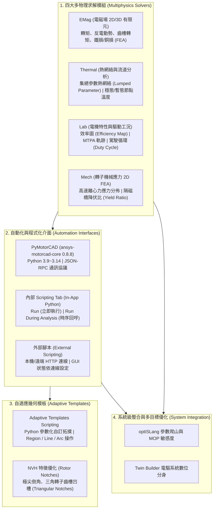

# Ansys Motor-CAD 與 PyMotorCAD 主題字典

> 本字典整理本地 Motor-CAD PDF、PyMotorCAD HTML 與範例附件中已核對的概念及來源位置。SDK 文件目錄標示 0.8.8，但官方網址使用動態 `version/stable`，多數 catalog 版本欄位未知；不能以目錄名推定網頁內容的版本或桌面產品相容矩陣。詳見下方來源覆核與待整理清單。相關字典：[Maxwell](maxwell.md)、[Icepak](icepak.md)、[optiSLang](optislang.md)、[Mechanical](mechanical.md)。

---

## 領域架構圖 (Motor-CAD Multiphysics Ecosystem)



---

## 主題辭典與核心模組

### 1. PyMotorCAD SDK、產品版本及安裝條件

#### 核心概念與辭典定義 (Core Concepts & Glossaries)
- **PyMotorCAD 系統架構**：`ansys-motorcad-core` (SDK 0.8.8) 是透過 **JSON-RPC 通訊協定** 控制 Motor-CAD 的 Python 用戶端程式庫，支援標準 CPython 3.9 ~ 3.14。
- **產品版本與 SDK 相容邊界 (Compatibility Matrix)**：
  - **一般先決條件**：Getting Started 說明本機須有授權的 Motor-CAD v2023 R1 或更新版本；這是該 SDK 頁面記載條件，非完整相容矩陣。
  - **Adaptive Templates 特徵門檻**：Adaptive Templates 指南要求 Motor-CAD v2024.1.2 或更新版本，PyMotorCAD v0.4.1 或更新版本；此條件僅適用該功能。
  - **內建與外部安裝分離**：Motor-CAD 自 2023 R1 起已在安裝包內部為 Scripting Tab 隨附了 PyMotorCAD；若在外部開發環境（如 VS Code、Jupyter）中呼叫，需透過 `pip install ansys-motorcad-core` 獨立安裝套件。
  - **授權與連線**：使用本機或遠端 Motor-CAD instance 時，須符合安裝環境的授權及 license server 設定。核對的 SDK 頁面未列出特定產品 feature 名稱或完整授權對照表。

#### 官方手冊章節與規格出處 (Manual & Doc Citations)
- **手冊來源**：*PyMotorCAD User Guide & Getting Started (SDK 0.8.8)*
- **章節定位**：
  - Getting Started: [Getting Started Index](../ANSYS_Document/MotorCAD/sdk/ansys-motorcad-core/0.8.8/guide/1bbdfb8c71e2-index.md) · `ansys_82e145d55282506d67d6631a`
  - Standard Installation: [Running Motor-CAD](../ANSYS_Document/MotorCAD/sdk/ansys-motorcad-core/0.8.8/guide/898840c75d76-running_motorcad.md) · `ansys_40af952c5b24f5c47a80afbe`
- **資料庫引用標籤**：`sources.csv#ansys_82e145d55282506d67d6631a`, `sources.csv#ansys_40af952c5b24f5c47a80afbe`

#### 本機啟動範例 (SDK 文件示例)
```python
# ==============================================================================
# PyMotorCAD: launch a local Motor-CAD instance
import ansys.motorcad.core as pymotorcad

# 官方示例：建立 MotorCAD client 並連接/啟動本機 instance。
# GUI 與程序生命週期依 SDK 版本及連線選項確認。
mc = pymotorcad.MotorCAD()
```

#### 工程實務踩坑指南 (Gotchas & Limitations)
1. **多版本安裝**：本地資料未提供多版本 Windows 註冊行為的可靠步驟。需要選定版本時，應依目前安裝的 SDK/API 文件確認可用連線參數及實際啟動目標；本文不推定 Registry 路徑。
2. **遠端與 GUI 模式**：External Scripting 文件描述本機/遠端 JSON-RPC 連線（HTTP）；是否顯示 GUI、instance 如何啟動需依使用的連線選項核實。該描述不足以支持「預設無頭」或特定效能收益。

---

### 2. Motor-CAD 連線與計算變數操作

#### 核心概念與辭典定義 (Core Concepts & Glossaries)
- **變數操作核心 API (Variable Access API)**：
  - **`set_variable(name, value)`**：將數值、字串或布林值寫入 Motor-CAD 內部資料庫。
  - **`get_variable(name)`**：讀取指定變數。有效名稱、資料型態及單位需查該版本變數文件或範例，不能假定所有 API 使用相同單位慣例。
- **文件可定位的操作**：SDK 範例展示 `get_variable`／`set_variable`，`do_magnetic_calculation` 及 `do_steady_state_analysis` 等呼叫可在相應 SDK/教學頁面查證。不同求解功能的呼叫名稱、參數、輸出變數及單位需回到目標版本 API 文件確認；本字典不把未找到來源的名稱列作通用 API。
- **時序回呼機制 (Lifecycle Callback Hooks)**：
  - 在 Motor-CAD GUI 的 `Scripting -> Settings` 勾選 `Run During Analysis`；
  - 文件分別描述 thermal、emagnetic、mechanical stress/forces 類別的回呼行為；實際回呼名稱與分析類別映射依該 SDK 文件：
    - `initial`：在計算開始前被調用（用於重設初始邊界）；
    - `main`：thermal 類別會於時間步相關流程呼叫；其他分析類別的回呼時序不同，見下方來源說明；
    - `final`：文件描述於計算後呼叫；是否儲存及後處理由腳本自行實作。

#### 官方手冊章節與規格出處 (Manual & Doc Citations)
- **手冊來源**：*PyMotorCAD Scripting & Automation Guides (SDK 0.8.8)*
- **章節定位**：
  - Internal Scripting & Callbacks: [Internal Scripting Guide](../ANSYS_Document/MotorCAD/sdk/ansys-motorcad-core/0.8.8/guide/1f7b47653c24-internal_scripting.md) · `ansys_d10bcc405609f51d5f247f91`
  - External Scripting: [External Scripting Guide](../ANSYS_Document/MotorCAD/sdk/ansys-motorcad-core/0.8.8/guide/45c58d6e7d2b-external_scripting.md) · `ansys_2ebbf43195cd40cdce690465`
- **資料庫引用標籤**：`sources.csv#ansys_40af952c5b24f5c47a80afbe`, `sources.csv#ansys_d10bcc405609f51d5f247f91`

#### SDK 文件中的操作名稱

SDK 與教學範例可見 `get_variable`、`set_variable`、`do_magnetic_calculation`、`do_steady_state_analysis`。具體模型檔、變數名稱、單位、求解順序及結果檢查均依所用版本 API 與模型設定；不在此拼接未經來源核對的可執行流程。

#### 工程實務踩坑指南 (Gotchas & Limitations)
1. **訊息彈窗設定**：SDK 文件指出 `MessageDisplayState=2` 可停用包含存檔/覆寫確認在內的重要提示。自動化前要確認此設定對流程的影響；不能忽略資料保存狀態。
2. **變數名稱與錯誤**：有效名稱依目標版本文件及模型為準。相容性指南示範讀取不存在的 `Not_A_Real_Var` 可能引發 `MotorCADError`；沒有來源支持錯誤大小寫必然回傳空值的規則。

---

### 3. 馬達範例與設計方法範圍

#### 核心概念與辭典定義 (Core Concepts & Glossaries)
- **電機拓撲範例**：本地 tutorials 含 BPM 的 Asymmetric SPM、轉子三角 Notch 與定子三角 Notch 示例；這些只代表範例模型，不作為產品支援矩陣或設計方法完整清單。
- **驅動工況熱暫態模擬 (Duty Cycle Transient Analysis)**：
  - **Lab Model 路徑**：預先建置整機性能圖表，在暫態工況中依據即時溫度查表動態求出電流與損耗並饋入熱模型（雙向耦合）。
  - **Specified-Loss 路徑**：由外部輸入功率曲線，輸入格式支援 `pu` (標么值，乘上 Losses 編輯器的基準值) 或絕對瓦特數 (W)。
- **轉子 2D 機械應力評估**：指定 PDF 說明平面應力假設，並以應力相對材料降伏值呈現結果。比值判讀須依材料、幾何、轉速及設計準則，不能直接等同斷裂或普遍放行門檻。
- **自適應幾何模板**：本地 tutorial 展示 BPM Triangular Rotor Notches。幾何操作和效果屬教程案例；實際 NVH 或轉矩改善須由目標設計分析驗證。

#### 官方手冊章節與規格出處 (Manual & Doc Citations)
- **手冊來源**：*Motor-CAD Guides & Tutorials Gallery*
- **章節定位**：
  - Adaptive Examples Index: [Adaptive Examples Index](../ANSYS_Document/MotorCAD/sdk/ansys-motorcad-core/0.8.8/tutorial/43495d0edb6d-index.md) · `ansys_780c41d18a46aaec5a0c8c5d`
  - Duty Cycle Analysis: [Duty Cycle Scripting](../ANSYS_Document/MotorCAD/unknown/guides_and_tutorials/Scripting_Control_In_Duty_Cycle.pdf#page=17) · `ansys_5c14c100c0f19e6e005ca00c`
  - Thermal Transient: [Thermal Transient PDF](../ANSYS_Document/MotorCAD/unknown/guides_and_tutorials/Thermal_Transient_Analysis.pdf#page=2) · `ansys_81be4bec7c700b26b4340cd6`
  - Mechanical Stress: [Mechanical Stress PDF](../ANSYS_Document/MotorCAD/unknown/guides_and_tutorials/Mechanical_Stress_Analysis.pdf#page=2) · `ansys_2afe7e5283bef86fe7b9a918`
  - Triangular Rotor Notches: [Triangular Rotor Notches Tutorial](../ANSYS_Document/MotorCAD/sdk/ansys-motorcad-core/0.8.8/tutorial/20d5c27079b8-BPMTriangularRotorNotches.md) · `ansys_be7ba3fd18efa78c55bd4f47`
- **資料庫引用標籤**：`sources.csv#ansys_780c41d18a46aaec5a0c8c5d`, `sources.csv#ansys_c1f8ccd899a4f1a1a4a0ac59`

#### 範例程式與來源

六個本地 Python/Notebook 教學附件已抽取文字與程式碼，保留 cell 順序及原始來源連結，見 [範例文字補件索引](../maintenance/knowledge_dictionary_passes/2026-11-04/motorcad_attachment_text_recovery.csv)。補件用於檢索與閱讀，不表示程式已執行或案例數值已獨立驗證。

#### 工程實務踩坑指南 (Gotchas & Limitations)
1. **自適應幾何持久化**：Adaptive Templates 文件說明該功能可建立/使用自訂模板；腳本是否暫存及如何載入，依該腳本流程操作。此行為不外推為所有 geometry API 的共通規則。
2. **平行連線**：Parallel Sessions PDF 比較 MATLAB `parfor` 與 `spmd` 的排程方式。文件沒有證明固定 worker 數、每個 worker 必需授權席次或必須停用彈窗；授權與部署要求依實際環境確認。

---

## 跨主題與模組雙向鏈結 (Cross-Topic References)
- [Maxwell 知識字典](maxwell.md)：將 Motor-CAD 導出之 2D 幾何與繞線匯入 Maxwell 3D 進行高精準度局部瞬態電磁場與三維端部漏感分析。
- [Icepak 知識字典](icepak.md)：整合全車水冷迴路與馬達外殼冷卻水套 (Cooling Jacket) 之三維共軛熱傳 (CFD) 模擬。
- [optiSLang 知識字典](optislang.md)：串接 PyMotorCAD 執行電磁轉矩脈動最小化與散熱流阻多目標 Pareto 前沿優化。
- [Mechanical 主題字典](mechanical.md)：馬達定子電磁力匯入 Mechanical 執行結構共振與整機 NVH 聲學輻射求解。


---

## 4. 來源覆核增補（2026-11-03）

> **覆蓋範圍提醒：**本字典是分階段整理稿，不代表 Motor-CAD 全部文件已逐章整理。全量來源列於 [來源清冊](../maintenance/knowledge_dictionary_passes/2026-11-02/motorcad_sources.csv)，逐來源整理狀態列於 [主題覆蓋清冊](../maintenance/knowledge_dictionary_passes/2026-11-02/motorcad_topic_coverage.csv)。既有來源覆核只涵蓋下方列明的 SDK 入門／安裝、內部回呼、Adaptive Templates，以及熱暫態、機械應力、並行工作流指定段落；2026-11-04 本輪另核對附件抽取及字典中列出的邊界修正；其餘來源即使有非空轉換稿，仍屬待逐章整理。

### 4.1 來源與轉換範圍

本輪逐筆核對官方文件 catalog 所列 81 項 Motor-CAD 資產：61 份 PDF、14 份 PyMotorCAD HTML 頁面，以及 3 個範例 Notebook 和 3 個 Python 範例附件。81/81 原始檔均存在且 SHA-256 與 catalog 相符；PDF/HTML 共 75/75 有非空 Markdown 轉換稿。6 個範例附件保留原始 `.ipynb`／`.py`，catalog 未提供轉換稿；其文字抽取補件與逐檔校驗見 [附件補件清冊](../maintenance/knowledge_dictionary_passes/2026-11-04/motorcad_attachment_text_recovery.csv)。逐筆清冊、來源網址、版本欄位、hash、轉換路徑及狀態見 [Motor-CAD 來源清冊](../maintenance/knowledge_dictionary_passes/2026-11-02/motorcad_sources.csv)。

本地 PyMotorCAD 頁面位於 SDK 0.8.8 目錄，但 catalog 的 80/81 筆來源 release 為 `unknown`；網址多指向 `version/stable`，不能據此推定網頁內容的發佈版本或 Motor-CAD 桌面版相容矩陣。唯一標記 `v231` 的設計方法文件為 2023 R1。個別章節中的明確最低版本仍應依該章原文引用。

HTML 轉換抽查包含 Getting started、Internal Scripting、External Scripting 及 Rotor Notches 頁面；保留標題、程式碼與超連結，但圖像有以空 alt 文字的連結形式存在，圖片語意不在文字稿內。PDF 抽查包含 Thermal Transient、Mechanical Stress、Parallel Sessions；Markdown 按 PDF 實頁分段，但表格多以純文字/欄位流呈現，數學符號、圖示、圖表曲線與版面關係仍需回原 PDF 核實。頁數連續與非空只能證明轉換輸出存在，不能證明內容無遺漏。轉換品質與待覆核項目詳見 [部分覆核紀錄](../maintenance/knowledge_dictionary_passes/2026-11-02/motorcad_partial_review.md) 及來源清冊。

### 4.2 由來源可直接支持的主題補充

- **Internal Scripting 回呼**：SDK `internal_scripting` 指出，`Run During Analysis` 啟用後，`initial` 在計算前、`final` 在計算後執行；`main` 每時間步呼叫的描述適用於 thermal 類別。emagnetic 與 mechanical stress/forces 有各自的 initial/final 行為，不應概括成每種分析均有逐步 main 回呼。`MessageDisplayState=2` 會停用包含存檔與覆寫確認在內的重要彈窗；自動化前須確認接受此行為。這是文件所述 API 行為，未在實際產品中執行驗證。來源：[Internal Scripting](../ANSYS_Document/MotorCAD/sdk/ansys-motorcad-core/0.8.8/guide/1f7b47653c24-internal_scripting.md)，catalog ID `ansys_d10bcc405609f51d5f247f91`。
- **轉子機械應力的適用邊界**：`Mechanical_Stress_Analysis.pdf` p.2 將軸向應力設為零（plane stress）；p.4 說明降伏應力是材料彈性行為上限，並作為安全係數參考值；p.7 的輸出比值是轉子疊片應力相對於其材料降伏應力。不要把比值超過 1 直接寫成「已證實斷裂」，也不要將教學模型的數值當普遍許可門檻。來源：[Mechanical Stress Analysis](../ANSYS_Document/MotorCAD/unknown/guides_and_tutorials/Mechanical_Stress_Analysis.pdf#page=2)，catalog ID `ansys_2afe7e5283bef86fe7b9a918`；此文件 release 未知。
- **並行 session 的策略差異**：`Running_Parallel_Sessions_Scripting.pdf` pp.9–11 比較 MATLAB `parfor` 和 `spmd`：`parfor` 自動排程較簡單，但示例需在每次平行連線重新啟動 Motor-CAD；`spmd` 排程需由腳本處理，彈性較高。這項來源沒有證明所有環境均需幾個授權席次，授權數與安裝註冊仍須依現場設定確認。來源：[Running Parallel Sessions Scripting](../ANSYS_Document/MotorCAD/unknown/guides_and_tutorials/Running_Parallel_Sessions_Scripting.pdf#page=9)，catalog ID `ansys_6c863c5d0ac8a650ecb7aa3f`。
- **熱暫態教學定位**：`Thermal_Transient_Analysis.pdf` p.1 將內容分為 BPM duty-cycle、specified machine losses 與熱結果分析；其餘章節可由 Markdown 的 `PDF Page` 標記定位。不要在沒有逐頁核對輸入單位、基準值與模型設定之前，把 `pu` 或損耗耦合概述成所有版本共通行為。來源：[Thermal Transient Analysis](../ANSYS_Document/MotorCAD/unknown/guides_and_tutorials/Thermal_Transient_Analysis.pdf#page=1)，catalog ID `ansys_81be4bec7c700b26b4340cd6`。

### 4.3 需保留為條件式或待查的既有敘述

目前字典前文是分階段摘要；原有未找到來源直接支持的完整授權 feature 名稱、Windows Registry 預設程式登錄、固定無頭模式、未定位的求解 API/變數、通用單位規則、worker 授權席次及 Notch 必然降低噪音等具體說法，已在本輪刪改或收窄。各版本完整相容矩陣與產品實際執行行為仍需另行驗證。

Adaptive Templates 指南明確要求 Motor-CAD v2024.1.2 或以上及 PyMotorCAD v0.4.1 或以上；此最低版本只適用該功能，不能外推為整套 PyMotorCAD 的一般需求。例子中任何工程效果也只代表該教程案例，需以自身模型與驗證結果確認。來源：[Adaptive Templates scripting](../ANSYS_Document/MotorCAD/sdk/ansys-motorcad-core/0.8.8/guide/6511363456cb-adaptive_templates.md)，catalog ID `ansys_c1f8ccd899a4f1a1a4a0ac59`。

### 4.4 搜尋與片段擷取抽查

正式文件索引 `_needs_rebuild()` 回報 `False`。使用 `search_ansys_docs` 對應的本機函式以 `product=motorcad, scope=all` 執行關鍵字查詢，並從搜尋結果呼叫 `get_ansys_doc_chunk`：

- `Running Parallel Sessions` 命中 PDF ID `ansys_6c863c5d0ac8a650ecb7aa3f`，片段可讀回平行處理示例及 PDF Page 9 對 `parfor`／`spmd` 的比較。
- `Run During Analysis` 命中 duty-cycle PDF 及 SDK internal scripting HTML；片段包含計算回呼說明。
- `thermal transient specified losses` 命中 Thermal Transient PDF，並可讀回指定損耗流程附近內容。
- `Rotor Stresses including magnets` 命中 Mechanical Stress PDF，片段可讀回應力/降伏資訊。

這是四個查詢的抽樣驗證，不等同逐一驗收全部 81 個來源。關鍵字索引依字面比對，繁中同義詞與概念跨語言檢索未驗證；未修改索引或共享資料庫。

### 4.5 尚未逐章整理的來源主題

下列分類只表示來源清冊中有相應文件，不代表本字典已完整說明其流程或參數。逐筆 source ID、原始路徑、URL、版本欄位與轉換狀態見 `motorcad_sources.csv`；對應處理狀態見 `motorcad_topic_coverage.csv`。除 4.2 列出的有界內容外，下列主題在本輪一律保留為待逐章閱讀與抽查原件：

- **電磁模型與馬達拓撲**：BPM/IPM、軸向磁通、感應馬達、同步發電機、同步磁阻與開關磁阻等模型及設計程序。
- **電磁損耗、校正與量測**：AC 繞組損耗、直流校正、牽引馬達校正、退磁、磁力分析、FEA 路徑量測、網格匯出及自訂輸出。
- **冷卻與熱網路**：軸向水套、油噴淋、濕轉子、通風、繞組溫度、不均勻銅損、簡化節點模型、熱暫態、熱 FMU 與熱路徑編輯器。
- **協同模擬與系統匯出**：Maxwell／SpaceClaim 幾何與繞線匯出、Lab Link、MATLAB/Simulink/Simscape、SPEED、Twin Builder 與 FMU。
- **NVH 與最佳化串接**：E-NVH、NVH 校正、optiSLang 整合匯出及 Python 教學。
- **授權及特定案例**：Black Box License 說明、不同電機案例及其驗證條件。

以上來源多數版本欄位為 `unknown`；不得用資料夾位置或檔名年份推定產品版本。PDF 的表格、曲線、幾何示意與公式仍須回看 PDF 原頁，HTML 的圖像連結也不一定含有可讀圖說。當前處理狀態和逐筆來源路徑見 [Motor-CAD 完整覆蓋覆核](../maintenance/knowledge_dictionary_passes/2026-11-02/motorcad_full_review_2026-11-03.md)。


## 2026-11-04：PDF 頁碼核對與 HTML／API 正文轉換

固定 catalog 81 筆原件與 75 正文 metadata 已核對。61 份 PDF 共 2,569 頁，cache 與同名 Markdown bytes 相同且 PDF Page N 連續，沒有重轉；這不代表圖片、公式或表格語意已逐頁驗收。14 個本機 HTML 有 91 個 pre，三份教程的 28 個區塊未在舊 Markdown 逐字存在，因此保留舊稿並從原 HTML 另做三份完整 Markdown 補件，33 個 pre 共 11,898 字元逐字保留。既有六附件補件的 33 個 Notebook code cells、49 個 Markdown cells 及三 Python 全文也已核對，未收錄 outputs／圖片或執行。

由既有頁面連出的官方 API reference 保存六個新 HTML／Markdown，包含 API 入口、MotorCAD class、Variables、Calculations、get_variable、set_variable；兩張表共 48 cells 以原始 matrix 重建。新頁沒有可確認的 SDK／產品版本標籤，兩欄維持 unknown；三份本機重轉稿沿用 catalog SDK metadata 0.8.8，不宣稱等同目前 stable 網站。

| 正文 | 版本依據 | 本機文件 | 來源 ID |
| --- | --- | --- | --- |
| [Triangular Rotor Notches for IPM — pymotorcad-core](https://motorcad.docs.pyansys.com/version/stable/examples/adaptive_library/BPMTriangularRotorNotches.html) | 0.8.8 | [ansys_be7ba3fd18efa78c55bd4f47](ANSYS_Document/MotorCAD/catalog_sdk_0.8.8/local_reconversion_20261104/ansys_be7ba3fd18efa78c55bd4f47.md) | `sources.csv#local_reconverted_ansys_be7ba3fd18efa78c55bd4f47` |
| [Asymmetric Surface Permanent Magnet Rotor — pymotorcad-core](https://motorcad.docs.pyansys.com/version/stable/examples/adaptive_library/AsymmetricSPM.html) | 0.8.8 | [ansys_82bdd30905c2291247362046](ANSYS_Document/MotorCAD/catalog_sdk_0.8.8/local_reconversion_20261104/ansys_82bdd30905c2291247362046.md) | `sources.csv#local_reconverted_ansys_82bdd30905c2291247362046` |
| [Triangular Stator Notches — pymotorcad-core](https://motorcad.docs.pyansys.com/version/stable/examples/adaptive_library/BPMTriangularStatorNotches.html) | 0.8.8 | [ansys_50775a023840f088ab40057d](ANSYS_Document/MotorCAD/catalog_sdk_0.8.8/local_reconversion_20261104/ansys_50775a023840f088ab40057d.md) | `sources.csv#local_reconverted_ansys_50775a023840f088ab40057d` |
| [API reference — pymotorcad-core](https://motorcad.docs.pyansys.com/version/stable/methods/index.html) | unknown | [api_index](ANSYS_Document/MotorCAD/unknown/official_api_20261104/api_index.md) | `sources.csv#official_motorcad_api_index` |
| [MotorCAD API — pymotorcad-core](https://motorcad.docs.pyansys.com/version/stable/methods/MotorCAD_object.html) | unknown | [MotorCAD_object](ANSYS_Document/MotorCAD/unknown/official_api_20261104/MotorCAD_object.md) | `sources.csv#official_motorcad_MotorCAD_object` |
| [Variables — pymotorcad-core](https://motorcad.docs.pyansys.com/version/stable/methods/_autogen_Variables.html) | unknown | [_autogen_Variables](ANSYS_Document/MotorCAD/unknown/official_api_20261104/_autogen_Variables.md) | `sources.csv#official_motorcad__autogen_Variables` |
| [Calculations — pymotorcad-core](https://motorcad.docs.pyansys.com/version/stable/methods/_autogen_Calculations.html) | unknown | [_autogen_Calculations](ANSYS_Document/MotorCAD/unknown/official_api_20261104/_autogen_Calculations.md) | `sources.csv#official_motorcad__autogen_Calculations` |
| [get_variable — pymotorcad-core](https://motorcad.docs.pyansys.com/version/stable/methods/_autosummary_Variables/ansys.motorcad.core.motorcad_methods.MotorCAD.get_variable.html) | unknown | [get_variable](ANSYS_Document/MotorCAD/unknown/official_api_20261104/get_variable.md) | `sources.csv#official_motorcad_get_variable` |
| [set_variable — pymotorcad-core](https://motorcad.docs.pyansys.com/version/stable/methods/_autosummary_Variables/ansys.motorcad.core.motorcad_methods.MotorCAD.set_variable.html) | unknown | [set_variable](ANSYS_Document/MotorCAD/unknown/official_api_20261104/set_variable.md) | `sources.csv#official_motorcad_set_variable` |

### 本批可定位的 API 概念

`MotorCAD` class 頁描述可連線既有 instance 或開啟新 instance；其 constructor 參數分別控制 port、例外、success variable、平行 instance 重用、保持 instance 開啟、遠端 URL 與 blackbox licence 請求。各參數有自己的預設與條件，不能概括成固定 GUI／授權行為。`get_variable(variable_name)` 取得變數，回傳型別列為 int、float、str 或 bool；`set_variable(variable_name, variable_value)` 接受同類型值。這兩頁未提供全量合法變數名稱、單位、範圍或特定模型資料字典，不能據此推定任意變數可用。Variables／Calculations 表格只提供方法導覽及簡述，未驗證求解順序或結果。來源為上表 class／get_variable／set_variable 六頁；未連接或執行 Motor-CAD。

仍有 61 PDF 的表格／公式／圖像及廣泛 API、授權和版本相容主題待覆核；未擷取網址、下載附件和分享權限見[批次報告](../maintenance/knowledge_dictionary_passes/2026-11-04/motorcad_module_conversion_report_20261104.md)。
