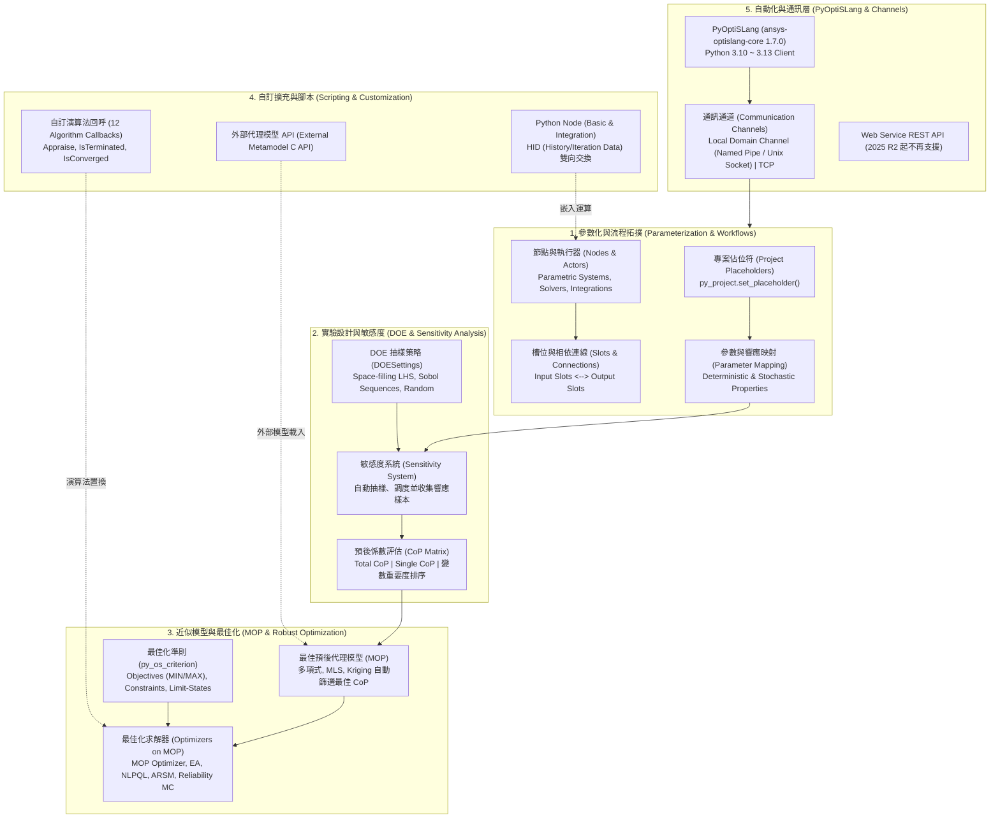

# optiSLang 知識字典

> 核讀範圍以主題清冊與來源紀錄為準；本文件仍有未逐項核實的參數、相容性與範例。使用前請回查對應版本的原文。

> 本主題深入剖析 Ansys optiSLang 與現代化 Python 用戶端程式庫 `ansys-optislang-core` (PyOptiSLang SDK 1.7.0) 的技術架構。涵蓋專案參數化體系（Project Placeholders, Actor Properties, 節點拓撲與槽位連線）、實驗設計 (DOE: Space-filling LHS, Sobol, Full Factorial)、全域敏感度分析 (GSA) 與預後係數 (CoP - Coefficient of Prognosis)、最佳預後近似模型 (MOP - Metamodel of Optimal Prognosis)、最佳化準則 (`py_os_criterion`: Objectives, Constraints, Limit-State)、可靠度與穩健設計 (Reliability, Monte Carlo, FORM)、擴充自訂腳本 (Integration Python Nodes, HID 字典資料交換, External Metamodel API, 12 個演算法回呼函式)，以及 PyOptiSLang 通訊通道 (Local Domain vs TCP)、伺服器生命週期與 REST Web API 支援狀態。

---

## 領域架構圖 (optiSLang Enterprise Optimization Architecture)



---

## 主題辭典與核心模組

### 1. 參數化與流程

#### 核心概念與辭典定義 (Core Concepts & Glossaries)
- **專案佔位符與執行器屬性 (Project Placeholders vs Actor Properties)**：
  - `Project Placeholder`：optiSLang 專案全域可命名的參數常數或巨集表達式 (Macro Expression)。可定義數值型別 (`value_type`)、數值範圍 (`range`)、參考值或關聯公式。
  - `Actor Property`：具體求解器節點（如 ANSYS Mechanical 節點、Python 節點、外部可執行檔節點）內部的設定屬性。
  - 參數化研究的核心工法：透過 `py_project` API 建立專案佔位符，並使用 `assign_placeholder(actor_uuid, property_id, placeholder_id)` 將佔位符指派至執行器屬性，實現跨系統的集中參數驅動。
- **流程拓撲與節點連接槽位 (Workflow Nodes, Connectors & Slots)**：
  - optiSLang 工作流程由系統 (Systems)、節點 (Nodes)、連接器 (Connectors) 與槽位 (Slots) 構成。
  - 每個節點具備輸入槽位 (Input Slots) 與輸出槽位 (Output Slots)。資料流傳遞必須確保上游輸出的資料型態與維度與下游輸入槽位嚴格相容。
- **求解器輸入與響應映射 (Solver Mapping)**：
  - 輸入映射：將 optiSLang 抽樣參數值格式化寫入求解器文字輸入檔（如 APDL 指令檔、LS-DYNA 關鍵字卡片）；
  - 響應映射：從求解器輸出檔定位並提取標量指標（如最大應力、頻率、質量）。
- **設計點評估失敗處理策略 (Design Failure Handling)**：
  - 求解器可能因幾何拓撲崩壞或物理不收斂而回傳錯誤。optiSLang 支援在節點層級配置失敗處置策略：重試 (Retry)、標記為無效設計 (Invalid Design)、指派懲罰值 (Penalty Assignment) 或終止流程。

#### 手冊章節與規格出處 (Manual & Doc Citations)
- **手冊依據**：*optiSLang Python API 2026 R1 SP03*
  - [py_project Module & Placeholder API](../ANSYS_Document/optiSLang/v261/api_reference/optislang-python-api-2026-r1-sp03/modules/py_project.md#py_project.Project.set_placeholder) (`sources.csv#ansys_279b5f4e62f50509f6713341`)
  - [Parametric Study Overview Reference](../../agents/skills/systems-coupling/ansys-optislang/references/parametric_study/overview.md)
- **Source IDs**：`sources.csv#ansys_279b5f4e62f50509f6713341`.

#### v261 SP03 Project placeholders 與 actor property 參數化

`py_project` 的 placeholder 是專案中可取名、查詢及指派給 actor property 的值或 macro expression。官方 oscillator 範例先從 actor 的 `ParameterManager` 建立 placeholder，再以其他 placeholders 組成參考值與上下界的 expression。這是產品內建 Python API 的專案設定操作；是否真正連到求解器輸入，仍須由 workflow 的參數映射驗證。

| 工作 | 官方 API 所述行為 | 使用界線 |
|---|---|---|
| **從既有 property 建立** | `create_placeholder_from_actor_property(actor_uuid, property_id)` 回傳實際產生的 ID；同名 ID 已存在時建立新 ID。property 無法存取會拋出 `RuntimeError`。 | 範例與參數文字另有 `create_as_expression=True`，但簽章缺少此參數；需向目標安裝版本核對。 |
| **建立或修改** | `set_placeholder()` 可設定名稱、user level、description、range、value／value_type 或 expression；value 與 expression 互斥。 | `overwrite=False` 為預設，未覆寫時 ID 可因唯一性而調整；以回傳 ID 為準。`overwrite=True` 且找到同名項目時，覆寫指定屬性。 |
| **指派至 property** | `assign_placeholder(actor_uuid, property_id, placeholder_id)` 將專案 placeholder 指派給 actor property。 | placeholder／property 不存在或型別不相符時會拋出 `RuntimeError`；建立 placeholder 不代表已完成指派。 |
| **檢視與管理** | `get_placeholder_ids()` 列出 IDs；`get_placeholder()` 回傳含 name、user_level、description、range、value、type、expression 的 dictionary；另有 rename／remove 方法。 | `get_placeholder()` 對不存在的 ID 拋出 `RuntimeError`；這些 API 不能證明參數的工程單位或取值範圍合理。 |

#### 腳本與 API 關鍵用法 (Python Project & Placeholder Scripting)

```python
# optiSLang 2026 R1 SP03: Creating Placeholders and Assigning to Actor Properties
# Encoding: Strict ASCII inside comments

from py_project import Project

# 1. Connect to current project instance
project = Project()

# 2. Register Project-level Placeholders
# Create base dimension parameter
p_width_id = project.set_placeholder(
    name="Plate_Width",
    description="Width of parametric base plate in mm",
    value=150.0,
    range="[100.0, 250.0]",
    overwrite=True
)

# Create an expression placeholder derived from Plate_Width
p_fillet_id = project.set_placeholder(
    name="Fillet_Radius",
    description="Derived fillet radius",
    expression="Plate_Width * 0.1",
    overwrite=True
)

# 3. Assign Placeholder to Solver Actor Property
# Assume solver actor UUID is obtained from workflow query
solver_actor_uuid = "a1b2c3d4-e5f6-7890-abcd-ef0123456789"
property_target = "Parameters/GeomWidth"

try:
    project.assign_placeholder(
        actor_uuid=solver_actor_uuid,
        property_id=property_target,
        placeholder_id=p_width_id
    )
    print(f"Successfully bound placeholder '{p_width_id}' to actor property.")
except RuntimeError as err:
    print(f"Failed to assign placeholder: {err}")
```

#### 工程實務踩坑與注意事項 (Gotchas, Limitations & FAQ)
- **表達式循環依賴 (Circular Dependency in Expressions)**：
  - 建立 macro expression 時，若佔位符 A 引用 B、B 又直接或間接引用 A，optiSLang 會在解析時引發無法中斷的循環求值死鎖。定義表達式前務必確認依賴拓撲為有向無環圖 (DAG)。
- **型別與單位不相容崩潰**：
  - 將數值型佔位符指派給期望字串（如檔名）或特定物理單位的 actor property 時，若未做顯式型別宣告，求解器更新時會直接拋出 `TypeError` 並導致整個批次運算中斷。

---

### 2. DOE 與敏感度

#### 核心概念與辭典定義 (Core Concepts & Glossaries)
- **實驗設計抽樣體系 (DOE - Design of Experiments)**：
  - **Space-filling Latin Hypercube Sampling (LHS)**：空間填充拉丁超立方抽樣，保證高維空間內各維度投影均勻分佈且點與點間距最大化，為敏感度分析與近似模型構建之首選方案。
  - **Sobol 準隨機序列 (Sobol Sequences)**：低差異序列 (Low-discrepancy sequence)，抽樣點在空間中分佈高度均勻且可逐步漸進追加樣本，特別適合積分求值與全域敏感度分析。
  - **全因子抽樣 (Full Factorial)**：適用於參數極少（2~3 個變數）時的邊界極限網格覆蓋。
- **敏感度指標體系 (Sensitivity Metrics)**：
  - **預後係數 (CoP - Coefficient of Prognosis)**：optiSLang 的專利核心指標。透過交叉驗證 (Cross-Validation) 在未參與擬合的測試集上評估模型預測能力：
    $$\text{CoP} = 1 - \frac{\sum (y_i - \hat{y}_{-i})^2}{\sum (y_i - \bar{y})^2}$$
    相較於傳統決定係數 ($R^2$)，CoP 能真實反映代理模型的泛化能力，徹底消除過擬合陷阱。
  - **總預後係數 (Total CoP) vs 單一變數 CoP (Single CoP)**：Total CoP 代表所有選定變數共同解釋響應變化的比例；Single CoP 代表個別輸入變數對該響應的主導貢獻度。
- **自訂演算法與設計交換回呼 (Custom Algorithm Callbacks)**：
  - v261 支援 12 個演算法回呼函式，供工程師以 Python 實作專有抽樣或最佳化啟發式演算法，在每次迭代動態評估設計點狀態 (`Appraise`, `IsTerminated`, `IsConverged`)。

#### 手冊章節與規格出處 (Manual & Doc Citations)
- **手冊依據**：*optiSLang DOE & Sensitivity Reference*
  - [py_doe_settings v261 Specification](../ANSYS_Document/optiSLang/v261/api_reference/optislang-python-api-2026-r1-sp03/modules/py_doe_settings.md) (`sources.csv#ansys_971500135d4c5e35b21c0979`)
  - [PyOptiSLang 1.7.0 Sensitivity Settings Example](../ANSYS_Document/optiSLang/sdk/ansys-optislang-core/1.7.0/tutorial/0c7a9859a66d-06_sensitivity_settings.md) (`sources.csv#ansys_512d9337fc5864cc110d3cb9`)
  - [optiSLang v252 Space-filling LHS Reference](sources.csv#ansys_be5919e12c7a3b5b5313dc58)
  - [Official Runner Source Code](../ANSYS_Document/optiSLang/sdk/ansys-optislang-core/1.7.0/tutorial/inputs/06_sensitivity_settings.py)
- **Source IDs**：`sources.csv#ansys_971500135d4c5e35b21c0979`, `sources.csv#ansys_512d9337fc5864cc110d3cb9`, `sources.csv#ansys_be5919e12c7a3b5b5313dc58`, `sources.csv#ansys_f3e47bb22cbf57421d91ba56`.

#### v261 DOESettings 與 DOETYPES 屬性清單

v261 `DOESettings` 提供抽樣控制參數：
- `num_dimensions`：設計變數維度；
- `num_points`：總抽樣點數；
- `num_discretization`：離散劃分級數；
- `sampling_method`：抽樣演算法型別；
- `seed`：亂數種子（設為固定值以確保數值可重現性）。

#### v261 自訂 algorithm 的 design-exchange callbacks

在自訂外部演算法整合中，optiSLang 規範了 12 個核心回呼方法：
1. `Init`：演算法初次啟動與記憶體配置；
2. `Start`：開啟迭代循環；
3. `GenerateInitialDesigns`：產生初始 DOE 樣本集；
4. `EvaluateDesigns`：向求解器提交樣本進行並行運算；
5. `OnDesignsEvaluated`：接收求解結果並更新內部矩陣；
6. `Appraise`：回傳布林值確認當前設計點是否滿足硬性約束；
7. `GenerateNextDesigns`：根據當前代適應度產生下一代候選點；
8. `IsTerminated`：判定是否達到最大運算時限或被手動終止；
9. `IsConverged`：判定目標函數改善量是否小於收斂容差；
10. `PostProcess`：萃取最優解與歷史曲線；
11. `Cleanup`：釋放外部連線與暫存檔；
12. `Reset`：重設演算法狀態以便重新執行。

#### 腳本與 API 關鍵用法 (PyOptiSLang Sensitivity Workflow)

```python
# PyOptiSLang 1.7.0: Setting up a Sensitivity System with Space-filling LHS
# File: sensitivity_analysis.py
# Encoding: Strict ASCII inside comments

import ansys.optislang.core as pyosl

# Connect to local optiSLang instance
with pyosl.Optislang() as osl:
    project = osl.application.project
    root_system = project.root_system
    
    # 1. Create a Sensitivity System Node
    sens_system = root_system.create_node(
        type_="Sensitivity",
        design_style="Modern"
    )
    sens_system.name = "Parametric_Sensitivity_Study"
    
    # 2. Configure DOE Settings
    # Execute python script inside optiSLang context to set DOE parameters
    setup_script = """
import py_doe_settings
settings = py_doe_settings.DOESettings()
settings.num_points = 50
settings.sampling_method = "SpaceFillingLHS"
settings.seed = 42
"""
    osl.application.run_python_script(script=setup_script)
    
    # 3. Start Workflow Execution
    print("Starting Sensitivity study execution...")
    project.start()
    
    # Wait for completion and save project
    project.save_as("sensitivity_study_completed.opf")
    print("Sensitivity study finished and saved.")
```

#### 工程實務踩坑與注意事項 (Gotchas, Limitations & FAQ)
- **$R^2$ 假象與過擬合 (Overfitting Traps)**：
  - 傳統多項式模型可輕易將 $R^2$ 擬合至 0.99，但其 CoP 可能為負值（表示該模型對未知樣本的預測能力比均值基準更差）。optiSLang 的核心原則是：**任何時候均以 CoP 作為近似模型優劣的唯一評判標準**；若 Total CoP 低於 60%（0.6），該近似模型嚴禁直接用於最佳化搜尋。
- **失敗樣本剔除與樣本充裕度**：
  - 若在 50 個抽樣點中有超過 15 個點求解失敗，強行剔除失敗點會破壞 LHS 的空間填充均勻性，造成局部區域盲區。正確做法應先排查幾何失敗邊界，收縮參數取值範圍後重新抽樣。

---

### 3. 穩健設計與最佳化

#### 核心概念與辭典定義 (Core Concepts & Glossaries)
- **最佳預後近似模型 (MOP - Metamodel of Optimal Prognosis)**：
  - optiSLang 的自動化代理模型技術。演算法會自動遍歷並比較多項式 (Polynomial)、移動最小二乘 (Moving Least Squares, MLS) 與克里金 (Kriging) 等多種模型架構，並透過貪婪向前篩選 (Forward Stepwise Selection) 剔除次要變數，最終自動合成一組具備**全域最高 CoP** 的最優近似模型。
- **MOP 基礎最佳化 (Optimization on MOP)**：
  - 由於 MOP 模型為純代數多項式或插值曲面，在其曲面上呼叫進化演算法 (EA) 或非線性規劃 (NLPQL) 進行百萬次評估僅需數秒鐘，可實現即時 Pareto 前緣探索與多目標權衡。
- **設計準則與極限狀態 (`py_os_criterion`)**：
  - `PyOSCriterion`：封裝目標函數 (Objective)、約束條件 (Constraint) 與極限狀態 (Limit-State)；
  - `DesignStatus.MIN` / `MAX`：極小化或極大化目標；
  - `DesignStatus.LESSEQUAL` / `GREATEREQUAL`：不等式約束；
  - `Limit-State Criteria`：定義失效邊界（如應力超過強度極限 $g(x) = \sigma(x) - \sigma_y > 0$），供可靠度分析計算失效機率。
- **穩健設計與可靠度分析 (Robust Design & Reliability)**：
  - **穩健性評估 (Robustness)**：評估公差與輸入隨機擾動下，輸出響應的變異數 (Variance / Standard Deviation)，追求品質 6-Sigma；
  - **可靠度分析 (Reliability)**：使用 Monte Carlo 抽樣、FORM (First-Order Reliability Method) 評估罕見極端事件的失效機率 ($P_f \le 10^{-4}$)。

#### 手冊章節與規格出處 (Manual & Doc Citations)
- **手冊依據**：*optiSLang Optimization & Metamodeling Guides*
  - [py_os_criterion Module v261 SP03](../ANSYS_Document/optiSLang/v261/api_reference/optislang-python-api-2026-r1-sp03/modules/py_os_criterion.md#py_os_criterion.PyOSCriterion) (`sources.csv#ansys_39c0d2548da6909818ff91dd`)
  - [PyOptiSLang 1.7.0 Oscillator Sensitivity to MOP Optimization](../ANSYS_Document/optiSLang/sdk/ansys-optislang-core/1.7.0/tutorial/201855b50cd6-02_4_oscillator_MOP_sensitivity_and_optimization.html) (`sources.csv#ansys_f3e47bb22cbf57421d91ba56`)
  - [ProxySolver and Optimization on MOP Tutorial](../ANSYS_Document/optiSLang/sdk/ansys-optislang-core/1.7.0/tutorial/0387d99e1275-02_optimization_on_mop.html) (`sources.csv#ansys_a16c392b2dc1203fc10de21e`)
  - [External Metamodel Solver C API Reference](../ANSYS_Document/optiSLang/v261/api_reference/953dd78af93f-opti_api_external_metamodel_solver_interfaces.md) (`sources.csv#ansys_fde73dd9fc1f7d52c06792f8`)
- **Source IDs**：`sources.csv#ansys_39c0d2548da6909818ff91dd`, `sources.csv#ansys_f3e47bb22cbf57421d91ba56`, `sources.csv#ansys_a16c392b2dc1203fc10de21e`, `sources.csv#ansys_fde73dd9fc1f7d52c06792f8`.

#### v261 SP03 objective、constraint 與 limit-state criteria 操作矩陣

| 操作類別 | 官方 API 介面 | 語意與參數 |
|---|---|---|
| **定義目標 (Objective)** | `set_objective(type, expression)` | `type` 取 `DesignStatus.MIN` 或 `MAX`；`expression` 為標量響應字串。 |
| **定義約束 (Constraint)** | `set_constraint(type, expr_left, expr_right)` | `type` 取 `LESSEQUAL` 或 `GREATEREQUAL`；左右兩側表達式建立邊界。 |
| **定義極限狀態 (Limit-State)** | `set_type(DesignStatus.LESSLIMITSTATE)` | 用於結構可靠度失效事件定義。 |
| **檢查違規狀態** | `is_inequality_constraint_violated()` | 回傳 Boolean 值判定當前點是否落於可行域內。 |

#### 腳本與 API 關鍵用法 (Configuring Criteria and MOP Optimization)

```python
# optiSLang Criteria Definition and Optimization on MOP
# File: criteria_optimization.py
# Encoding: Strict ASCII inside comments

from py_os_criterion import PyOSCriterion, PyOSCriterionContainer, DesignStatus

# 1. Initialize Criterion Container
criteria_container = PyOSCriterionContainer()

# 2. Define Minimization Objective: Minimize Mass
crit_obj = PyOSCriterion()
crit_obj.set_objective(DesignStatus.MIN, "Total_Mass")
criteria_container.add("Minimizing_Mass", crit_obj)

# 3. Define Inequality Constraint: Max Stress <= 250.0 MPa
crit_const = PyOSCriterion()
crit_const.set_constraint(DesignStatus.LESSEQUAL, "Max_Stress", "250.0")
criteria_container.add("Stress_Limit_Constraint", crit_const)

# 4. Define Limit-State for Structural Reliability Evaluation
crit_limit = PyOSCriterion()
crit_limit.set_constraint(DesignStatus.LESSLIMITSTATE, "Max_Stress - Yield_Strength", "0.0")
criteria_container.add("Yield_Failure_Event", crit_limit)

print("Criteria successfully registered in container:")
for idx in range(len(criteria_container)):
    name = criteria_container[idx]
    item = criteria_container.get(name)
    print(f" - {name} | Is Objective: {item.is_objective()} | Is Constraint: {item.is_constraint()}")
```

#### 工程實務踩坑與注意事項 (Gotchas, Limitations & FAQ)
- **邊界外推風險 (Extrapolation Hazard)**：
  - 在 MOP 上求解最佳化時，若最佳解精確落在設計變數的上下邊界上，務必警惕該解可能是由於代理模型在取樣空間邊緣向外發散所致。工程規範要求：**凡在 MOP 上尋得的最優設計點，必須提交至高精度求解器進行驗證模擬 (Confirmation Run)**；兩者偏差大於 5% 時，必須擴展採樣區間重新訓練 MOP。
- **限制條件衝突導致空集**：
  - 設定多項約束時，若物理上相互矛盾（例如要求極低重量同時要求極高剛度），演算法在 MOP 上將找不到任何可行解。應先透過 Trade-off 圖檢查可行域交集。

---

### 4. Scripting 與 customization（v261 來源核對）

**Integration Node** 的 v261 文件規定：外掛 Python 檔名需符合 `*_ci.py`，必要的 `load` 和 `execute` 函式須在同一檔案。`load` 用於定義註冊參數與 response 的輸入／輸出；`execute` 呼叫求解器並回傳 `HidSpecificOutputDataIntegrations` 的列表。`initialize`、`shutdown` 等則列為選用函式。[Integration Node 原文](../ANSYS_Document/optiSLang/v261/guides_and_tutorials/optislang-interfaces-and-customizations-2026-r1/opti_api_python_nodes_integration.md#functions-to-implement)（`sources.csv#ansys_9b365ad2da596299bc152a77`）。

文件將 HID 定義為設計變化的階層式識別碼（Hierarchical ID），例如 `[0.99.4]`；Integration Node 範例說明參數變動後可將重新讀取的值附在結果容器的 `adapted_parameter_values` 屬性。不要將 HID 誤認為裝有 `inputs`、`responses` 的全域字典。[Integration 示範](../ANSYS_Document/optiSLang/v261/guides_and_tutorials/optislang-interfaces-and-customizations-2026-r1/opti_api_python_nodes_integration_demos_file.md)（`sources.csv#ansys_0f341ef8c43079b93dad8761`）。

**ScriptInterfaceVersion** 是設定檔變數；v261 原文要求設為目前 release 版本並舉 `2610`，未設定時預設 legacy API。此處不推論其他版本必須使用特定整數，也不把它當作 Python 函式宣告。[設定檔原文](../ANSYS_Document/optiSLang/v261/guides_and_tutorials/optislang-interfaces-and-customizations-2026-r1/opti_api_python_nodes_config_files.md)（`sources.csv#ansys_6106887bbfb18d38a93b2472`）。

`OSL_DESIGN_DIR` 在 v261 檔案存取文件中是目前 design directory 的絕對路徑；是否有設定及並行設計目錄的使用方式應按實際整合流程核對，不假設不存在 response 時必然無限等待。[檔案存取原文](../ANSYS_Document/optiSLang/v261/guides_and_tutorials/optislang-interfaces-and-customizations-2026-r1/opti_api_python_file_access.md)（`sources.csv#ansys_3183b68d624a4d0659273857`）。

外部近似模型介面另見 [2025 R2](../ANSYS_Document/optiSLang/v252/api_reference/15b2484bc174-opti_api_external_metamodel_solver_interfaces.md)（`sources.csv#ansys_f00902829fafb63ac19c5a83`）及 [2026 R1](../ANSYS_Document/optiSLang/v261/api_reference/953dd78af93f-opti_api_external_metamodel_solver_interfaces.md)（`sources.csv#ansys_fde73dd9fc1f7d52c06792f8`）。oSP3D 的 [2024 R1 索引](../ANSYS_Document/optiSLang/v241/api_reference/oSP3D_Script_API_2024R1.html)（`sources.csv#ansys_cfef60aa04912a3f42f84370`）屬另一介面，不能作為 external metamodel 文件的依據。

先前此節的 `on_init`／`on_run` 模板與全域字典說法不符合上述 Integration Node 原文，已移至本輪備份，不作可執行範例；本節未啟動 optiSLang 或執行任何腳本。

---

### 5. PyOptiSLang 與 Web API

#### 核心概念與辭典定義 (Core Concepts & Glossaries)
- **PyOptiSLang 用戶端體系 (`ansys-optislang-core` 1.7.0)**：
  - 專為自動化、CI/CD 整合與 Python 生態圈設計的現代開源用戶端程式庫。相較於產品內建的 IronPython/Python 直譯器，PyOptiSLang 運行在標準 CPython (3.10 ~ 3.13) 環境下，可無縫調用 NumPy, SciPy, Pandas, PyTorch 等龐大開源庫。
- **通訊通道選擇體系 (Communication Channels)**：
  - **Local Domain Channel (本機網域通道)**：預設模式。文件指出此模式僅允許啟動該 instance 的本機使用者連線；底層實作與不同平台的安全性未於此來源核實。
  - **TCP Channel (網路通訊埠模式)**：透過 TCP/IP 跨主機連線。預設僅監聽 `localhost`。**安全警示**：官方手冊明示此模式無原生 TLS 加密，不建議直接暴露於未防護的公網環境。
- **連線與處理程序生命週期 (Lifecycle Control)**：
  - `Optislang(executable=..., shutdown_on_finished=True)`：啟動並管理本地服務；
  - `dispose()`：關閉與伺服器的連線；文件所列自動關閉情境中，呼叫後伺服器也會關閉。
  - `shutdown()`：要求伺服器關閉；文件指出，若未設定自動關閉且需要關閉伺服器，應在 `dispose()` 前呼叫。具體情況見下方原表整理。
- **Web Service REST API 廢棄宣告 (Deprecation Notice)**：
  - 開發者入口說明 optiSLang Web Service REST API 從 2025 R2 起不再受支援；該說明未證明服務二進位已移除、每個端點都會回傳 404，或所有遠端架構只能使用某一替代方案。來源：`sources.csv#ansys_cf14eb1628924f9899cfb4ae`。

#### 手冊章節與規格出處 (Manual & Doc Citations)
- **手冊依據**：*PyOptiSLang Documentation SDK 1.7.0*
  - [OptiSLang Instance Management](../ANSYS_Document/optiSLang/sdk/ansys-optislang-core/1.7.0/guide/38d25627f32a-launch.html) (`sources.csv#ansys_1693de4129b295be3afd2b81`)
  - [Direct Communication with Server API](../ANSYS_Document/optiSLang/sdk/ansys-optislang-core/1.7.0/guide/bc537582e1f3-osl_server_usage.html) (`sources.csv#ansys_45d6fa0a2e5ac2b7b4a18940`)
  - [RootSystem and Design Evaluation Guide](sources.csv#ansys_74392f3b50b669e7845198e1)
  - [Web Service REST API 支援狀態](sources.csv#ansys_cf14eb1628924f9899cfb4ae)
- **Source IDs**：`sources.csv#ansys_3bc5a322206c4444d19ee209`, `sources.csv#ansys_74392f3b50b669e7845198e1`, `sources.csv#ansys_56a600902c6763d913bee785`, `sources.csv#ansys_45d6fa0a2e5ac2b7b4a18940`.

#### 通訊模式與介面對照表 (Communication Channel Matrix)

| 通道模式 | 底層機制 | 傳輸效能 | 安全性與存取控制 | 適用場景 |
|---|---|---|---|---|
| **Local Domain** | 文件列為 local domain channel；底層實作未核實 | 未比較 | 文件稱限啟動 instance 的本機使用者 | 本機通訊 |
| **TCP Channel** | TCP/IP（可指定位址） | 未比較 | 文件警示此模式無 TLS 且不建議使用 | 遠端通訊；需按部署環境評估 |
| **Legacy REST** | HTTP Web Service | 未核實 | 未核實 | 開發者入口稱 2025 R2 起不再支援；實際可用性未核實 |

#### 腳本與 API 關鍵用法 (Full PyOptiSLang 1.7.0 Orchestration)

**待核實範例：** 下列程式的 API 相容性與執行結果尚未驗證；`project.start()` 會執行流程，不應僅為閱讀文件而執行。

```python
# Modern Headless optiSLang Orchestration via PyOptiSLang 1.7.0
# File: pyoptislang_automation.py
# Encoding: Strict ASCII inside comments

import os
from ansys.optislang.core import Optislang, CommunicationChannel

# 1. Connect to or launch local optiSLang instance using context manager
# Context manager guarantees dispose() is called even if exceptions occur
with Optislang(
    service_type=CommunicationChannel.LOCAL_DOMAIN,
    shutdown_on_finished=True
) as osl:
    
    print(f"Connected to optiSLang Server ID: {osl.local_server_id}")
    
    # 2. Access active project through application handle
    project = osl.application.project
    print(f"Current Project Location: {project.project_path}")
    
    # 3. Create a Parametric System
    root_system = project.root_system
    study_node = root_system.create_node(
        type_="Sensitivity",
        design_style="Modern"
    )
    study_node.name = "Automated_Sensitivity_Run"
    
    # 4. Trigger Asynchronous Solve and Monitor Progress
    print("Starting asynchronous workflow execution...")
    project.start()
    
    # 5. Save Finished Project and Results
    output_path = os.path.abspath("./output/robust_optimization.opf")
    project.save_as(output_path)
    print(f"Project successfully saved to: {output_path}")

print("optiSLang server shut down cleanly.")
```

#### 工程實務踩坑與注意事項 (Gotchas, Limitations & FAQ)
- **`dispose()` 與 `shutdown()`**：依本機 HTML 所列情境，`shutdown_on_finished=False` 時，僅呼叫 `dispose()` 後伺服器仍執行；若要關閉，文件示範先呼叫 `shutdown()` 再呼叫 `dispose()`。是否需要保留共用伺服器，應依實際工作流程決定；以下是原表的整理，未實際執行驗證。

  | 初始化方式 | `shutdown_on_finished` | 方法 | 呼叫後伺服器仍執行 |
  |---|---|---|---|
  | Local | True | `dispose()` | 否 |
  | Local | False | `dispose()` | 是 |
  | Local | False | `shutdown()`，再 `dispose()` | 否 |
  | Remote | True | `dispose()` | 否 |
  | Remote | False | `dispose()` | 是 |
  | Remote | False | `shutdown()`，再 `dispose()` | 否 |

  來源：[本機 OptiSLang instance management HTML](../ANSYS_Document/optiSLang/sdk/ansys-optislang-core/1.7.0/guide/38d25627f32a-launch.html)（`sources.csv#ansys_1693de4129b295be3afd2b81`）。原表 remote 的自動關閉與遠端伺服器設定有關；不得把表中條件推廣至所有遠端服務。
- **已廢棄 REST 端點依賴陷阱**：
  - 開發者入口稱 Web Service REST API 從 2025 R2 起不再受支援；是否安裝、特定端點的回應與合適的遷移方案應依部署版本確認，未經本機驗證。

---

## 來源與檢核點清單

- [optiSLang Python API 2026 R1 SP03 Modules](../ANSYS_Document/optiSLang/v261/api_reference/optislang-python-api-2026-r1-sp03/index.md) (`sources.csv#ansys_7a4fa7292a7ef1719b208ddb`)
- [PyOptiSLang instance management（本機來源）](../ANSYS_Document/optiSLang/sdk/ansys-optislang-core/1.7.0/guide/38d25627f32a-launch.html) (`sources.csv#ansys_1693de4129b295be3afd2b81`)
- [PyOptiSLang Examples & Tutorials (06 Sensitivity, 07 Oscillator, 08 ProxySolver)](../ANSYS_Document/optiSLang/sdk/ansys-optislang-core/1.7.0/tutorial/0c7a9859a66d-06_sensitivity_settings.md) (`sources.csv#ansys_512d9337fc5864cc110d3cb9`, `sources.csv#ansys_f3e47bb22cbf57421d91ba56`, `sources.csv#ansys_a16c392b2dc1203fc10de21e`)
- [optiSLang External Metamodel Solver Interfaces](../ANSYS_Document/optiSLang/v261/api_reference/953dd78af93f-opti_api_external_metamodel_solver_interfaces.md) (`sources.csv#ansys_fde73dd9fc1f7d52c06792f8`)
- [Web Service REST API 支援狀態](sources.csv#ansys_cf14eb1628924f9899cfb4ae)


## 本機原碼補件與官方頁面（2026-11-04）

本節只整理可回查來源；既有工程結論、逐項 API 語義與案例執行仍待覆核。9 個原碼附件的目錄標記為 `ansys-optislang-core/1.7.0`，不推定為產品 release 或目前 stable 網站版本。原件、Notebook outputs／metadata 與外部專案資料沒有因文字抽取而執行。

### 九個原碼附件入口

| 原碼 | 類型／來源 ID | 文字與原件連結 |
| --- | --- | --- |
| 01_basic_queries.ipynb | ipynb；`ansys_66a073fbb0873914c651d7e9` | [原碼文字](ANSYS_Document/optislang_example_inputs_20261104/tutorial/ansys_66a073fbb0873914c651d7e9/optislang.md) |
| 01_basic_queries.py | py；`ansys_28834bba3ce7f2e723c5f356` | [原碼文字](ANSYS_Document/optislang_example_inputs_20261104/tutorial/ansys_28834bba3ce7f2e723c5f356/optislang.md) |
| 01_ten_bar_truss.ipynb | ipynb；`ansys_172fdae8f13268952df51a2d` | [原碼文字](ANSYS_Document/optislang_example_inputs_20261104/tutorial/ansys_172fdae8f13268952df51a2d/optislang.md) |
| 01_ten_bar_truss.py | py；`ansys_b12e946c29cf6af5e66230c1` | [原碼文字](ANSYS_Document/optislang_example_inputs_20261104/tutorial/ansys_b12e946c29cf6af5e66230c1/optislang.md) |
| 02_4_oscillator_MOP_sensitivity_and_optimization.py | py；`ansys_be5919e12c7a3b5b5313dc58` | [原碼文字](ANSYS_Document/optislang_example_inputs_20261104/tutorial/ansys_be5919e12c7a3b5b5313dc58/optislang.md) |
| 02_optimization_on_mop.py | py；`ansys_6c27932c45ea49c6ceb627b4` | [原碼文字](ANSYS_Document/optislang_example_inputs_20261104/tutorial/ansys_6c27932c45ea49c6ceb627b4/optislang.md) |
| 06_sensitivity_settings.py | py；`ansys_641d65237d2b853cd87e2b32` | [原碼文字](ANSYS_Document/optislang_example_inputs_20261104/tutorial/ansys_641d65237d2b853cd87e2b32/optislang.md) |
| 07_simple_calculator.ipynb | ipynb；`ansys_f6564a35aa31df407f0749a4` | [原碼文字](ANSYS_Document/optislang_example_inputs_20261104/tutorial/ansys_f6564a35aa31df407f0749a4/optislang.md) |
| 07_simple_calculator.py | py；`ansys_6de280828dc55dfd08f94ad5` | [原碼文字](ANSYS_Document/optislang_example_inputs_20261104/tutorial/ansys_6de280828dc55dfd08f94ad5/optislang.md) |

`01_basic_queries` 原碼透過 `run_python_file` 建立／載入示例流程，再查詢參數、回應和 criteria；`01_ten_bar_truss` 包含 `application.save_as`、`get_reference_design` 與 `evaluate_design`，會寫檔及評估設計。其他腳本含 `project.start()`、`study.execute()`、`optimization_study.execute()`、`design_study_manager.save()` 與 `dispose()`。這些是原碼中的執行動作，文字補件沒有重現求解、最佳化或儲存結果。

### 二十個官方 stable 正文入口

來源皆為既有 Markdown 所列 URL，本輪固定重試 20 頁即停止；另存原始 HTML 與正文。stable 為動態網址，產品 release／SDK 版本維持 unknown，不能據本機 1.7.0 資料夾標記推定新頁版本。

| 官方頁 | 類別／來源 ID | 正文／原 HTML |
| --- | --- | --- |
| add_file_handler — PyOptiSLang | api_reference；`optislang_web_254b5786e2a82a70_eede76fe5806` | [正文與原 HTML](ANSYS_Document/optislang_official_html_20261104/api_reference/254b5786e2a82a70/optislang.md) |
| add_instance_logger — PyOptiSLang | api_reference；`optislang_web_e35bfdd469e24472_cafd54dde41c` | [正文與原 HTML](ANSYS_Document/optislang_official_html_20261104/api_reference/e35bfdd469e24472/optislang.md) |
| add_std_out_handler — PyOptiSLang | api_reference；`optislang_web_dc5600c57459cbdd_45aad99a4f3a` | [正文與原 HTML](ANSYS_Document/optislang_official_html_20261104/api_reference/dc5600c57459cbdd/optislang.md) |
| create_logger — PyOptiSLang | api_reference；`optislang_web_dec65254d9fe6337_8a3c20e3ee5e` | [正文與原 HTML](ANSYS_Document/optislang_official_html_20261104/api_reference/dec65254d9fe6337/optislang.md) |
| file_handler — PyOptiSLang | api_reference；`optislang_web_21e726fb90f279c0_1212e151994a` | [正文與原 HTML](ANSYS_Document/optislang_official_html_20261104/api_reference/21e726fb90f279c0/optislang.md) |
| OslLogger — PyOptiSLang | api_reference；`optislang_web_3aa3c74118eecb11_0dba40173b05` | [正文與原 HTML](ANSYS_Document/optislang_official_html_20261104/api_reference/3aa3c74118eecb11/optislang.md) |
| log_level — PyOptiSLang | api_reference；`optislang_web_ef2dbb8b3f8c5e3a_62cd3466d30e` | [正文與原 HTML](ANSYS_Document/optislang_official_html_20261104/api_reference/ef2dbb8b3f8c5e3a/optislang.md) |
| set_log_level — PyOptiSLang | api_reference；`optislang_web_543b69478e1f2c65_fe65e39bf99d` | [正文與原 HTML](ANSYS_Document/optislang_official_html_20261104/api_reference/543b69478e1f2c65/optislang.md) |
| std_out_handler — PyOptiSLang | api_reference；`optislang_web_5415e2d9d356b62d_bfcf1ff7b448` | [正文與原 HTML](ANSYS_Document/optislang_official_html_20261104/api_reference/5415e2d9d356b62d/optislang.md) |
| assign_placeholder — PyOptiSLang | api_reference；`optislang_web_9ad8e71693e8e514_4113e5d499ae` | [正文與原 HTML](ANSYS_Document/optislang_official_html_20261104/api_reference/9ad8e71693e8e514/optislang.md) |
| control — PyOptiSLang | api_reference；`optislang_web_fbcedb7d7ebb9e7a_58941ec0551e` | [正文與原 HTML](ANSYS_Document/optislang_official_html_20261104/api_reference/fbcedb7d7ebb9e7a/optislang.md) |
| copy — PyOptiSLang | api_reference；`optislang_web_8fea4e9e1f5f1ddb_741f2d799932` | [正文與原 HTML](ANSYS_Document/optislang_official_html_20261104/api_reference/8fea4e9e1f5f1ddb/optislang.md) |
| create_input_slot — PyOptiSLang | api_reference；`optislang_web_f33073fd6f63d583_94e6be18fec9` | [正文與原 HTML](ANSYS_Document/optislang_official_html_20261104/api_reference/f33073fd6f63d583/optislang.md) |
| create_output_slot — PyOptiSLang | api_reference；`optislang_web_e425b06272528caa_449f73759f7c` | [正文與原 HTML](ANSYS_Document/optislang_official_html_20261104/api_reference/e425b06272528caa/optislang.md) |
| create_placeholder_from_property — PyOptiSLang | api_reference；`optislang_web_3d461ff12341cc5f_3cbefae14b07` | [正文與原 HTML](ANSYS_Document/optislang_official_html_20261104/api_reference/3d461ff12341cc5f/optislang.md) |
| delete — PyOptiSLang | api_reference；`optislang_web_79f9f98409011ecb_0e3a3c21e9c2` | [正文與原 HTML](ANSYS_Document/optislang_official_html_20261104/api_reference/79f9f98409011ecb/optislang.md) |
| exists — PyOptiSLang | api_reference；`optislang_web_8446338b5368fe4c_7308c93d595a` | [正文與原 HTML](ANSYS_Document/optislang_official_html_20261104/api_reference/8446338b5368fe4c/optislang.md) |
| get_ancestors — PyOptiSLang | api_reference；`optislang_web_7e27abf8c4b0ceb5_7ae317fdbf3a` | [正文與原 HTML](ANSYS_Document/optislang_official_html_20261104/api_reference/7e27abf8c4b0ceb5/optislang.md) |
| get_available_input_locations — PyOptiSLang | api_reference；`optislang_web_093d87bee2a73e86_888da3da4494` | [正文與原 HTML](ANSYS_Document/optislang_official_html_20261104/api_reference/093d87bee2a73e86/optislang.md) |
| Nodes connection — PyOptiSLang | guide；`optislang_web_436388d074ec9846_e743098c3eb8` | [正文與原 HTML](ANSYS_Document/optislang_official_html_20261104/guide/436388d074ec9846/optislang.md) |

Nodes connection 頁將 `InputSlot`／`OutputSlot` 列為輸入／輸出槽，`InnerInputSlot`／`InnerOutputSlot` 列為內部槽；`Edge(from_slot, to_slot)` 用於連結。這是該頁的物件索引說明，不能直接證明每一種節點／版本都支援相同槽設定。來源：`sources.csv#optislang_web_436388d074ec9846_e743098c3eb8`。

OslLogger 頁涵蓋 logger、file／stdout handler 與 log level 入口；IntegrationNode 頁涵蓋 placeholder、control、copy、slot 建立、delete、exists 與 ancestors 查詢。`control`、`copy`、`delete`、slot／placeholder 修改可能改動專案，未執行。20 頁的參數語義與版本差異尚未逐項驗收。

3 個簡單 HTML 表格共 26 個儲存格已逐格保留，沒有 rowspan／colspan；附加表格以欄號定位並保留原表頭作資料列，原 HTML 可回查，未做視覺版面驗收。

### 本批缺口

原 catalog 的 optiSLang 923 筆來源全部已核對原件 hash，914 筆既有正文 metadata 相符；同資料夾另有 LS-OPT 來源，其產品歸屬和既有 PDF 版本警示維持原記錄。授權登入、測試主機權限不明、第三方、未擷取 URL、既有未核實主題和工程結論仍列待辦。未擷取 Notebook outputs／圖片，未啟動 optiSLang 或執行任何案例。
