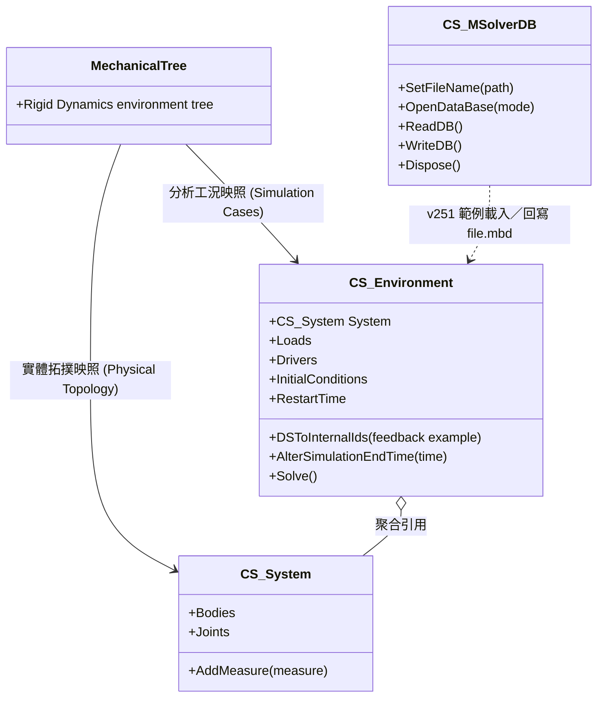

# Rigid Body Dynamics (RBD) 剛體動力學主題辭典

> 本辭典依 Ansys Developer Portal 的 Rigid Dynamics 官方 Markdown 文件整理物件模型、IronPython 命令入口、資料庫操作、載荷／驅動器與量測。手冊範例中的 ID、數值及 API 呼叫是文件範例，未在 Mechanical 執行。版本標記沿用來源目錄；只有文件明確描述的差異才列為版本差異。

---

## 領域架構圖（概念示意；以個別 API 頁為準）



---

## 主題辭典與核心模組

### 1. System 與 Environment

#### 核心概念與辭典定義 (Core Concepts & Glossaries)
- **環境物件 (`CS_Environment`)**：Rigid Dynamics 物件模型的頂層物件，可存取其他底層物件；它對應 Mechanical 樹中的 environment。官方說同一模型可有多個 environments，環境代表該模型的一次模擬。
- **系統物件 (`CS_System`)**：代表模型的物理表示。官方物件模型將 `Bodies`、`Joints` 列為屬於 System 的模型實體；Environment 則提供該模擬的載荷與關節條件。v261 的 `System` API 列出 `Bodies`、`Joints`、`AddMeasure()` 等成員。
- **物件尋址**：`CS_<Type>.Find(id)` 依物件 ID 查詢；物件模型手冊說此 ID 與 Mechanical 使用的 ID 相同。若 ID 未知或該類型只出現一次，可由全域物件表呼叫 `FindFirstNonNull()`。
- **`DSToInternalIds` 的範例用途**：v261 線性回授範例以 placeholder `_jcid` 查 `Env.DSToInternalIds[_jcid]`，取回 `ids[0]` 後用 `CS_Actuator.Find(ids[0])` 找到既有 load，再設定其輸入 measure。來源沒有說明此表是雙向映射，也沒有將其定義為求解矩陣 ID 表；請勿據此推廣其他節點類型或索引語意。

#### 手冊章節與規格出處 (Manual & Doc Citations)
- **手冊來源**：*Command Reference for Rigid Dynamics Systems* (v251 / v261)
- **章節與錨點**：
  - Section "Introduction" ([v251](../ANSYS_Document/Rigid_Body_Dynamics/v251/api_reference/3b209ab0f308-intro.md)) / ([v261](../ANSYS_Document/Rigid_Body_Dynamics/v261/api_reference/47d79706426e-intro.md))
  - Section "The Rigid Dynamics Object Model" ([v251](../ANSYS_Document/Rigid_Body_Dynamics/v251/api_reference/20cff8f277ee-rbd-object-model.md)) / ([v261](../ANSYS_Document/Rigid_Body_Dynamics/v261/api_reference/fc51fd03df08-rbd-object-model.md))
  - Source IDs: `sources.csv#ansys_834bd9a2f227091d91b306b8`, `sources.csv#ansys_7710f4fc8ac9fb2c46a34ac8`, `sources.csv#ansys_b6c52e9dc017a821cd0d9cb8`.

#### 核心物件模型互動範例 (IronPython Scripting Example)
```python
# ==============================================================================
# Rigid Dynamics: System and Environment Object Model Query
# Note: ASCII-only comments to prevent IronPython encoding issues.
# ==============================================================================
import clr
clr.AddReference("Ans.MotionSolver.MSolverLib.CSMotion")
from Ans.MotionSolver.MSolverLib.CSMotion import *

# Retrieve the top-level Environment and associated Physical System
env = CS_Environment.FindFirstNonNull()
system = env.System

# Access physical components under System
body_count = system.Bodies.Count
joint_count = system.Joints.Count

# Find specific Joint by Mechanical Tree ID
joint_id = 42
target_joint = CS_Joint.Find(joint_id)
if target_joint is not None:
    joint_name = target_joint.GetName()
    current_rot_vel = target_joint.GetVelocity()

# Query Mechanical-to-Internal ID Mapping for a Joint Condition
condition_tree_id = 105
if condition_tree_id in env.DSToInternalIds.Keys:
    internal_ids = env.DSToInternalIds[condition_tree_id]
    target_actuator = CS_Actuator.Find(internal_ids[0])
```

#### 工程實務踩坑指南 (Gotchas & Limitations)
1. **不要把第一個環境當成指定環境**：`FindFirstNonNull()` 回傳全域清單中的第一個 environment；官方說該表通常只有一個環境，因此這是常見入口。多環境時，需另外確認目標環境，不能假設它等同「目前啟動的分析」。

---

### 2. IronPython Console

#### 核心概念與辭典定義 (Core Concepts & Glossaries)
- **IronPython Console**：v251 文件指出可由 Mechanical 的 **File > Scripting > Open Command Window** 開啟命令視窗。IronPython references 頁說 Workbench scripting 使用 IronPython，並提及其與 .NET Framework（Windows）及 Mono CLR（Linux）的整合；該頁未標出 IronPython 小版本。
- **載入命令模組**：console 範例依序載入 `Ans.Utilities`、讀取 `AWP_ROOT<ver>`，將 `aisol\bin\winx64` 加到路徑，再載入 `Ans.MotionSolver.MSolverLib.CSMotion`。安裝位置及版本需依實際環境確認。
- **求解資料庫**：console 範例用 `CS_MSolverDB` 指定 `file.mbd`、呼叫 `OpenDataBase(0)`／`ReadDB()` 讀取，取得 `CS_Environment.GetDefault()` 後可調整結束時間與 `RestartTime`、呼叫 `Solve()`，最後用 `OpenDataBase(1)`／`WriteDB()` 寫回。這是文件範例流程；沒有執行或驗證資料庫相容性。

#### 手冊章節與規格出處 (Manual & Doc Citations)
- **手冊來源**：*Command Reference for Rigid Dynamics Systems*, Section "Using RBD commands from the IronPython console"
- **文檔鏈結**：[v251 Console Guide](../ANSYS_Document/Rigid_Body_Dynamics/v251/api_reference/4cfdcbe51354-using-commands-console.md)
- **Source ID**：`sources.csv#ansys_303a7c0d1b3cd405538da9af`

#### 完整的資料庫操作與重啟批次範例 (IronPython Scripting Example)
```python
# ==============================================================================
# Rigid Dynamics: Headless .mbd Database Load, Modification, and Solve
# Note: ASCII-only comments to prevent IronPython encoding issues.
# ==============================================================================
import clr
import os
import sys
import Ansys

# Resolve ANSYS installation directory dynamically from ApplicationConfiguration
clr.AddReference("Ans.Utilities")
ver_str = Ansys.Utilities.ApplicationConfiguration.DefaultConfiguration.VersionInfo.VersionString
awp_root = os.getenv("AWP_ROOT" + ver_str)

# Add MotionSolver assembly path and import CSMotion namespace
sys.path.append(os.path.join(awp_root, "aisol", "bin", "winx64"))
clr.AddReference("Ans.MotionSolver.MSolverLib.CSMotion")
from Ans.MotionSolver.MSolverLib.CSMotion import *

mbd_path = os.path.join(GetProjectDirectory(), "TestRestart_files", "dp0", "SYS", "MECH", "file.mbd")

# Step 1: Open and read existing solved database (Mode 0 = Read Mode)
db_in = CS_MSolverDB()
db_in.SetFileName(mbd_path)
db_in.OpenDataBase(0)
db_in.ReadDB()
db_in.Dispose()

# Step 2: Access default simulation environment and adjust solve parameters
env = CS_Environment.GetDefault()
env.AlterSimulationEndTime(2.5)  # Extend simulation termination time
env.RestartTime = 0.5           # Set restart checkpoint to 0.5 seconds
env.Solve()                     # Trigger native RBD implicit/explicit solver

# Step 3: Write modified states and results back to file.mbd (Mode 1 = Write Mode)
db_out = CS_MSolverDB()
db_out.SetFileName(mbd_path)
db_out.OpenDataBase(1)
db_out.WriteDB()
db_out.Dispose()
```

#### 工程實務踩坑指南 (Gotchas & Limitations)
1. **重啟適用範圍**：v251 console 頁明確說明：模型含 contact、Point On Curve joint 或 multiple load steps 時，不能依該流程 restart。來源沒有描述失敗時會崩潰、發散或造成檔案鎖；這些推論不列為已知行為。
2. **資料庫 API 版本差異**：v251 console 範例使用 `OpenDataBase`／`ReadDB`／`WriteDB`；v261 的 `MSolverDB` API 頁列的是 `OpenDatabase`／`ReadDatabase`／`WriteDatabase`／`CloseDatabase`。不要把兩頁的方法名稱合併為跨版本保證；依目標版本查 API。

---

### 3. Command Objects

#### 核心概念與辭典定義 (Core Concepts & Glossaries)
- **指令物件庫 (RBD Command Library)**：官方目錄列出可用的 Rigid Dynamics command objects，並依 parent object 組織命令參考。範例展示以命令建立或修改物件；文件未據此宣稱可繞過所有 Mechanical GUI 限制。
- **驅動器與載荷物件 (CS_Actuator vs CS_JointDOFLoad)**：
  - `CS_Actuator`：v261 API 將 Actuator 定義為 `Loads`、`Body Loads`、`Drivers` 的基底類別。可透過 variable 或 input measure 定義值；`SetInputMeasure()` 的輸入可以是 time measure 或其他 measure。
  - `CS_JointDOFLoad`：作用於指定 Joint 的特定 DOF，並在 joint reference coordinate system 中定義。DOF 編號從 0 開始，先列平移自由度，再列旋轉自由度；可用範圍與實際索引須依 joint 類型確認。
- **線性回授範例**：v261 的 Joint condition 範例以 joint velocity measure 作為既有 actuator 的 input measure；另一種寫法建立 `CS_JointDOFLoad`、指定 measure 與函數，並將 load 加到 Environment。這支持「以量測值作為輸入」的範例描述；文件沒有在此例宣稱 PI 控制或主動阻尼，也未提供實際響應驗證。

#### 手冊章節與規格出處 (Manual & Doc Citations)
- **手冊來源**：*Command Reference for Rigid Dynamics Systems*, Section "Rigid Dynamics command objects library" & "Joint condition: control using linear feedback"
- **文檔鏈結**：[Command Objects Library](../ANSYS_Document/Rigid_Body_Dynamics/v251/api_reference/7afcf1422886-rbd-command-library.md) / [Linear Feedback Example (v261)](../ANSYS_Document/Rigid_Body_Dynamics/v261/api_reference/38155487b8b3-jc-linear-feedback.md) / [Actuator API (v261)](../ANSYS_Document/Rigid_Body_Dynamics/v261/api_reference/command-reference-for-rigid-dynamics-systems-2026-r1/actuator.md) / [JointDOFLoad API (v261)](../ANSYS_Document/Rigid_Body_Dynamics/v261/api_reference/command-reference-for-rigid-dynamics-systems-2026-r1/jointdofload.md)
- **Source IDs**：`sources.csv#ansys_0472ced69ea815cf7b30504c`, `sources.csv#ansys_44bd03879eba9d0551f632ea`

#### 主要物件參考

| 物件 | 可追溯用途 |
|---|---|
| `CS_Actuator` | actuator 基底類別；提供 variable、measure、constant、table、function 等載荷值定義方式。 |
| `CS_JointDOFLoad` | 線性回授範例建立關節自由度載荷；可設定 measure／function，並加入 `Env.Loads`。 |
| `CS_Measure` | 表示時間、關節運動、力、能量等 measure；特定 measure 可由 Joint 的 `Get...()` 方法取得。 |

這是有來源頁支持的部分物件索引，不是完整類別繼承圖。

#### 線性回授命令範例（來源範例，未執行）
```python
# ==============================================================================
# Rigid Dynamics: Joint linear feedback example
# Method 1: Connect a joint velocity measure to an existing load
# Method 2: Create a joint DOF load
# Note: ASCII-only comments to prevent IronPython encoding issues.
# ==============================================================================
from Ans.MotionSolver.MSolverLib.CSMotion import *

env = CS_Environment.FindFirstNonNull()
joint = CS_Joint.Find(_jid)
vel = joint.GetVelocity()

# Method 1: Update an existing actuator/load from the condition ID
ids = env.DSToInternalIds[_jcid]
load = CS_Actuator.Find(ids[0])
load.SetInputMeasure(vel)

# Method 2: Create a joint DOF load
load = CS_JointDOFLoad(joint, 0)
load.SetInputMeasure(vel)
load.SetFunc("0.1*(-2*acos(-1)-time)", 0)
env.Loads.Add(load)
```

#### 工程實務踩坑指南 (Gotchas & Limitations)
- v261 `Actuator.SetFunc()` 頁指出：即使輸入是其他 measure，函數中的 literal variable 仍稱為 `time`；若以 expression 定義 load variation，輸入 measure 必須只有一個 component。`is_degree` 是布林值，用來表示三角函數是否以度數解讀輸入變數。
- v261 線性回授範例的 `_jid`、`_jcid` 是需由使用者模型提供的佔位 ID；範例中的 `ids[0]` 與 DOF 0 只代表該例寫法，不可假設適用所有物件／關節。`SetFunc(string, is_degree)` 的第二個參數是角度解讀旗標，不是 DOF；DOF 已在 `CS_JointDOFLoad(joint, dof)` 建構時指定。

---

### 4. 關節 measure 與結果讀取

#### 核心概念
- **Measure (`CS_Measure`)**：可表示時間、關節位置／速度／加速度／力、能量、接觸等量。多數常用 measure 可由物件的 `Get...()` 方法取得；自訂 measure 若要在每個時間步計算，須在求解前加入 `Env.System.AddMeasure(measure)`。
- **關節速度**：`CS_Joint.GetVelocity()` 回傳的 measure 分量數等於關節 DOF 數；關節座標系中的旋轉速度以 rad/s 表示。關節種類及座標系會影響分量意義，不應把 DOF 索引當成跨關節通用的全域軸。
- **時間序列**：分析完成後，`FillValuesThroughTime()` 回傳二維陣列：第一維是時間點，第二維第一欄是時間，其餘欄是 measure 分量。`FillDerivativesThroughTime()` 可讀取時間積分 measure 的導數；應先檢查 `CalculationMethod` 與關節的 `AccelerationFromVelocitiesDerivatives`，再選擇取得加速度的方法。
- **關節力**：`GetForce()` 回傳 6 個分量（3 力、3 力矩），含約束、外加及關節內力，並以 global coordinate system 表示。手冊特別指出其符號慣例與 Mechanical Joint Probe 不同。

#### 來源與定位
- [v261 Measure API](../ANSYS_Document/Rigid_Body_Dynamics/v261/api_reference/command-reference-for-rigid-dynamics-systems-2026-r1/measure.md)：`CS_Measure`、`FillValuesThroughTime()`、`CS_JointVelocityMeasure`、`CS_JointForceMeasure`。
- [v261 Joint API](../ANSYS_Document/Rigid_Body_Dynamics/v261/api_reference/command-reference-for-rigid-dynamics-systems-2026-r1/joint.md)：`GetVelocity()`、`GetForce()`、`AccelerationFromVelocitiesDerivatives`。
- [v261 System API](../ANSYS_Document/Rigid_Body_Dynamics/v261/api_reference/command-reference-for-rigid-dynamics-systems-2026-r1/system.md)：`AddMeasure()` 必須在求解前呼叫，measure 才能在模擬期間計算。
- [官方 Measure 頁面](https://developer.synopsys.com/docs/command-reference-for-rigid-dynamics-systems-2026-r1/measure.md)、[Joint 頁面](https://developer.synopsys.com/docs/command-reference-for-rigid-dynamics-systems-2026-r1/joint.md)、[System 頁面](https://developer.synopsys.com/docs/command-reference-for-rigid-dynamics-systems-2026-r1/system.md)。

#### 讀取範例（摘錄自官方 API 範例；未執行）
```python
joint = CS_Joint.Find(_jid)
velocity = joint.GetVelocity()
values = velocity.FillValuesThroughTime()
```

#### 限制
手冊明確警告 Joint measure 的表示及座標系依 joint type 而異；`GetForce()` 的符號也不同於 Joint Probe。此字典不把範例輸出解讀成設計判準。

---

### 5. 初始速度條件與非線性彈簧範例

- **初始速度 (Initial Velocity)**：v261 範例建立 `CS_Driver`，指定 Joint、作用 DOF 與 `E_Velocity`，以 System 的 time measure 作為輸入，設定常數值後加入 `Env.InitialConditions`。官方說此類條件只在 `t=0` 套用。範例數值 `-4.9033` 是教學內容，不是建議輸入值。
- **DOF 索引取決於 Joint**：同一個索引 `0` 在 translational joint 代表 x 向平移、在 revolute joint 代表 z 軸轉動、在 cylindrical joint 範例代表 z 向平移；索引語意需依 Joint 類型確認。
- **非線性彈簧阻尼**：v261 範例以 `CS_Actuator.Find(_sid)` 取得 spring，建立 elongation-force 點表並透過 `SetTable()` 設定；再以 `GetDamper()` 存取 damper。頁面指出 GUI 的一個 spring 物件實際由 spring 與 damper 組合。教學表格數值不可直接套用工程模型。

#### 來源與定位
- [v261 Initial Velocity 範例](../ANSYS_Document/Rigid_Body_Dynamics/v261/api_reference/command-reference-for-rigid-dynamics-systems-2026-r1/jc-initial-velocity.md)：DOF、driver type、time measure 與 `InitialConditions`。
- [v261 Non-linear Spring Damper 範例](../ANSYS_Document/Rigid_Body_Dynamics/v261/api_reference/command-reference-for-rigid-dynamics-systems-2026-r1/non-linear-spring.md)：`CS_PointsTable`、elongation-force table、damper 取得方式。
- [官方 Initial Velocity 頁面](https://developer.synopsys.com/docs/command-reference-for-rigid-dynamics-systems-2026-r1/jc-initial-velocity.md)、[Non-linear Spring 頁面](https://developer.synopsys.com/docs/command-reference-for-rigid-dynamics-systems-2026-r1/non-linear-spring.md)。

---

### 6. 版本與來源狀態

| 文件基線 | 本機正文 | 可核實資訊 | 不應據此推定 |
|---|---:|---|---|
| v251 / 2025 R1 | 8 篇 | 參考頁標示最後更新日 `17.07.2025`；console 範例提供 `OpenDataBase(0)`／`ReadDB()` 與 `OpenDataBase(1)`／`WriteDB()` 用法。 | IronPython 小版本、.NET Framework 次版本、跨版 `.mbd` 相容性、求解效能差異。 |
| v252 / 2025 R2 | 37 篇 | 本機有 API reference Markdown；目前本辭典尚未逐頁比較版本差異。 | 與 v251/v261 的 API 相容性或功能變更。 |
| v261 / 2026 R1 | 87 篇 | 參考頁標示最後更新日 `09.03.2026`；`MSolverDB` API 頁使用 `OpenDatabase()`／`ReadDatabase()`／`WriteDatabase()` 等名稱，線性回授例使用 velocity measure。 | 未經版本文件證實的 .NET 8、SMP 改善、二進位相容或速度提升宣稱。 |

v251/v261 物件模型頁都描述 Environment 為頂層物件、System 表示模型，並列出 `Find()`／`FindFirstNonNull()` 用法。這只能說明兩頁共同寫法，不能證明 binary compatibility。v251 與 v261 的資料庫方法拼寫不同，應以目標版本參考為準。

#### 來源與定位
- [v251 Console Guide](../ANSYS_Document/Rigid_Body_Dynamics/v251/api_reference/4cfdcbe51354-using-commands-console.md)
- [v261 MSolverDB API](../ANSYS_Document/Rigid_Body_Dynamics/v261/api_reference/command-reference-for-rigid-dynamics-systems-2026-r1/msolverdb.md)
- [v251 Object Model](../ANSYS_Document/Rigid_Body_Dynamics/v251/api_reference/20cff8f277ee-rbd-object-model.md) / [v261 Object Model](../ANSYS_Document/Rigid_Body_Dynamics/v261/api_reference/fc51fd03df08-rbd-object-model.md)
- [v251 官方 Console 頁](https://developer.synopsys.com/docs/command-reference-for-rigid-dynamics-systems-2025-r1/using-commands-console.md)、[v261 官方 MSolverDB 頁](https://developer.synopsys.com/docs/command-reference-for-rigid-dynamics-systems-2026-r1/msolverdb.md)

---

### 7. 來源轉換與涵蓋範圍

- `docs/ANSYS_Document/Rigid_Body_Dynamics/` 有 135 篇來源 Markdown（unknown 3、v251 8、v252 37、v261 87），另有一份本機 README。依來源網址及 `documents.json` 清冊逐筆核對，135/135 個正文檔案 SHA-256 相符。
- 本模組沒有 PDF、HTML 或掃描影像原件；135 個網址是官方 Developer Portal 的 Markdown 文件端點。因此本輪沒有對 PDF／HTML 重新轉換，也不能以這批 Markdown 驗證 HTML DOM、表格視覺呈現或圖片 OCR。
- 每篇正文的 URL、版本、路徑、字元數、SHA-256 及來源清冊納入情形記錄於 [來源盤點 CSV](../maintenance/knowledge_dictionary_passes/2026-11-02/rigid_body_dynamics_sources.csv)。逐筆轉換／品質限制見 [本輪檢查報告](../maintenance/knowledge_dictionary_passes/2026-11-02/rigid_body_dynamics_review.md)。
- 本機 mirror 目錄含圖片 Markdown 連結，但圖片原件未隨這 135 篇 Markdown 一併核驗；表格呈現／圖像內容不列為已視覺驗收。

## 雙向鏈結與參照索引
- [[mechanical|Ansys Mechanical 主題辭典]]：Mechanical ACT 樹狀架構、Analysis Settings 及求解器錯誤診斷。
- [[motion|Ansys Motion 多體動力學辭典]]：專業級全車與子系統彈性多體動力學 (MBD) 建模。
- [[geometry|PyAnsys Geometry 幾何服務辭典]]：機構幾何模型之參數化變換與組裝。
- [[error_catalog|Ansys 錯誤與診斷目錄]]：剛體約束不足、零主元 (Zero Pivot) 與數值震盪排查手冊。


## 2026-11-04：Wave 2 本機來源盤點與限制說明

本批完成 rigid_body_dynamics 模組既有本機 catalog 文件（共 135 筆）與 sources 清冊（共 135 筆）之完整雜湊、正文路徑與標籤結構核對。本機未快取或具備企業授權/登入限制之線上主題誠實標記為缺口（保持現有非 complete 狀態），未擅自虛構未核實之線上 API 簽名或執行求解運算。

詳細稽核數據見 [本批轉換報告](../maintenance/knowledge_dictionary_passes/2026-11-04/rigid_body_dynamics_module_conversion_report_20261104.md)。


## 2026-11-06：ContactOptions 與 SolverOptions 參數字典

`ContactOptions` 調整 contact server，`SolverOptions` 調整 RBD solver；官方 v261 說明其選項以 real/integer 數值讀寫，作為 switch 時 0 關閉、1 開啟。下列為文件列出的預設值，不代表工程模型的建議設定，也未執行範例或求解。

| 物件／參數 | v261 文件值與意義 | 注意事項 |
| --- | --- | --- |
| `CS_ContactOptions.TimeOut` | 30.0 秒 | contact server timeout |
| `CS_ContactOptions.Verbose` | 0，關閉 | 1 啟用 `contact.out` verbose output |
| `CS_ContactOptions.NumberOfThreads` | 2 | contact detection parallel threads；不推論求解加速比 |
| `CS_SolverOptions.VelocityToleranceFactor` | 100.0 | zero velocity tolerance 的乘數 |
| `CS_SolverOptions.ContactRadiusFactor` | 2.0 | contact failsafe mode 的 contact radius factor |
| `CS_SolverOptions.MaximumNumberOfCorrectionAttempts` | 2 | geometric correction 外迴圈次數 |
| `CS_SolverOptions.FrictionForShock` | 0，關閉 | shock solve friction switch |
| `CS_SolverOptions.MaximumNumberOfDiagnostics` | 10 | Mechanical UI diagnostics 訊息數 |
| `CS_SolverOptions.PurgeGST` | 0，never | 每 n steps 清理 GST；0 的特殊意義以文件為準 |
| `CS_SolverOptions.HandlePOCTransitionsWithEnergyMinimization` | 0，關閉 | 以 inertia matrix 相關方式讓 point-on-curve joint 曲線交界的轉換趨向最小動能；文件指出對 explicit integration 有效，對 implicit 不保證 |

來源：[v261 ContactOptions 原件](../ANSYS_Document/Rigid_Body_Dynamics/v261/api_reference/b9e176a86742-contactoptions.md)、[v261 SolverOptions 原件](../ANSYS_Document/Rigid_Body_Dynamics/v261/api_reference/command-reference-for-rigid-dynamics-systems-2026-r1/solveroptions.md)；本批 HTML 轉換快照：[ContactOptions](ANSYS_Document/Rigid_Body_Dynamics/official_body_20261106/official_rbd_b9e176a86742153d.md)、[SolverOptions](ANSYS_Document/Rigid_Body_Dynamics/official_body_20261106/official_rbd_d4c5ba88fd2575b2.md)。來源 ID：`ansys_8d930e6578deb098adaf6f18`、`ansys_e707ad6f24227e284fb9bdf0`、`official_rbd_b9e176a86742153d`、`official_rbd_d4c5ba88fd2575b2`。

### 本批來源與版本界線

[官方產品入口](https://developer.synopsys.com/docs/rigid-body-dynamics) 將 RBD 說明為 Mechanical Premium／Enterprise 內的分析系統，並列出 Windows IronPython／.NET Framework 與 Linux Mono CLR；這是入口文件的陳述，不是本機 runtime 驗證。

135 份既有 Markdown 原件全部保留且 hash 符合 catalog，對應 91 個唯一 URL；同 URL 的 44 組既有副本沒有刪除。本批重取 132 個同站相關 URL（原 91 加一層擴展 41），保存 132 份原始回應快照（131 HTML、1 Markdown），129 份正文成功轉為 Markdown；兩個入口 URL 沒有可核實的技術 article；其中 Markdown 入口頁沒有可驗正文，列為缺口；v261 changelog 正文過短，三項明列缺口。成功正文的程式區塊按 Markdown parser 的 fence/code token 逐塊核對，而非假定 raw HTML 與 Markdown 字串位置相同。

本批快照的 51 個圖片 URL 僅保留參照，未下載或進行語意驗收；既有 Markdown 另有 17 個未保存本機圖片的參照。跨版本 37 組同名 leaf 的文字都存在差異，尚未逐節判斷 API 語意或 binary compatibility，因此原 5 項 `pending_source_review` 保留。詳見 [本批來源清冊](../maintenance/knowledge_dictionary_passes/2026-11-06/rigid_body_dynamics_completion_inventory_20261106.json) 與 [版本比對](../maintenance/knowledge_dictionary_passes/2026-11-06/rigid_body_dynamics_completion_structure_comparison_20261106.json)。
