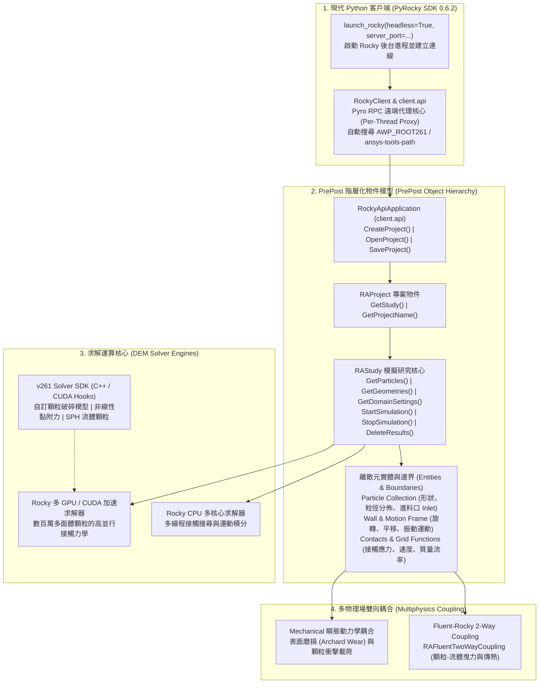

# Ansys Rocky 與 PyRocky 知識字典

> 已核範圍以逐來源覆核紀錄與主題清冊為準；部分物理數值、版本相容與腳本行為尚未逐項查證，使用前請回查目標版本原文。

> 本主題深度剖析 Ansys Rocky 離散元模擬 (Discrete Element Method, DEM) 體系與現代化 Python 自動化介面。系統化梳理開源用戶端程式庫 `ansys-rocky-core` (PyRocky 0.6.2) 的遠端 RPC 架構、Pyro Proxy 生命週期與版本邊界；詳細拆解 PrePost Scripting 階層化物件路徑（從 `launch_rocky`、`client.api`、`RAProject`、`RAStudy` 到粒子/幾何/領域/求解器控制）；深入對比 PyRocky 與 Rocky 內嵌 Python Shell 的三大 API 核心差異（`GetTimeSet` 回傳型別、`GetCurve` 不相容改用 `GetNumpyCurve`、UI 互動 Modal Dialog 懸掛阻塞）；嚴格界定教學示範案例預設值與真實 DEM 散體物理驗證的工程邊界；並整合 v261 Solver SDK (C++/CUDA GPU) 自訂接觸模型與網格特徵函數 (Grid Functions) 提取規範。

---

## 領域架構圖 (Rocky DEM & PyRocky Automation Architecture)



---

## 主題辭典與核心模組

### 1. PyRocky SDK 與產品版本 (PyRocky SDK Architecture & Version Matrix)

#### 核心概念與辭典定義 (Core Concepts & Glossaries)
- **PyRocky 架構定位**：
  - `ansys-rocky-core` (SDK 0.6.2) 是 Ansys 官方提供的開源 Python 用戶端，允許工程師在標準外部 CPython (3.10~3.12) 環境中透過 RPC (Remote Procedure Call) 協定遠端操控 Rocky 離散元模擬軟體。
  - **通訊核心與執行緒模型**：PyRocky 底層採用 Pyro5 RPC 機制。每個存取 `client.api` 的執行緒會建立專屬的連線 Proxy；當執行緒結束或 Client 物件被記憶體回收時自動釋放連線資源。
- **啟動參數管線 (`launch_rocky`)**：
  - `rocky_exe` / `rocky_version`：可明確指定可執行檔路徑或版本字串；未指定時自動依據環境變數（如 `AWP_ROOT261`）定位本機最新安裝版本。
  - `headless=True`：預設以無介面模式啟動，適合叢集運算與背景批次排程；若設定 `headless=False` 則拉起桌面 GUI 視窗。
  - `server_port`：指定 RPC 監聽連接埠；搭配 `close_existing=True` 可強制關閉該端口上殘留的無效工作階段。
  - `connect_timeout`：連線交握逾時秒數（預設為等待至伺服器就緒）。
- **版本相容性邊界**：
  - SDK 常數宣告 `MINIMUM_ANSYS_VERSION_SUPPORTED = 242`，確認 PyRocky 最低相容版本為 Ansys 2024 R2 (v242)，並完整支援 v251、v252 及 2026 R1 (`v261`)。

#### 手冊章節與規格出處 (Manual & Doc Citations)
- **官方手冊**：*PyRocky User Guide & API Reference (0.6.2)* ([Launcher API](../ANSYS_Document/Rocky/sdk/ansys-rocky-core/0.6.2/api_reference/a6ae8d8c1306-index.md)), ([RockyClient Reference](../ANSYS_Document/Rocky/sdk/ansys-rocky-core/0.6.2/api_reference/fc103f31bc30-RockyClient.md)), ([Documentation Index](../ANSYS_Document/Rocky/sdk/ansys-rocky-core/0.6.2/guide/394d75750909-stable.md))
- **Source IDs**：`sources.csv#ansys_a50faf6addc305baac4816cc`, `sources.csv#ansys_1a6a96298fcdc4e3c58f532f`, `ansys_57b182fd93c561ed71dcbc03`, `ansys_bb5f3bd1abb7f4c23e726457`.

---

### 2. PyRocky PrePost Scripting 物件路徑 (PrePost Object Hierarchy & Workflow)

#### 核心概念與辭典定義 (Core Concepts & Glossaries)
- **階層化物件模型結構 (Hierarchy Tree)**：
  - `RockyClient.api` (`RockyApiApplication`)：所有專案層級操作的頂層入口。
  - **專案管理層 (`RAProject`)**：
    - `CreateProject()`：初始化空白專案；
    - `OpenProject(filename)`：載入既有 `.rocky` 專案檔；
    - `SaveProject(filename=None)`：存檔，傳入 `None` 則直接覆寫當前檔案；
    - `CloseProject(check_save_state=False)`：關閉專案，可選擇跳過存檔確認。
  - **研究運算層 (`RAStudy`)**：
    - 透過 `project.GetStudy()` 取得模擬實體控制器。
    - **幾何與顆粒集合**：`study.CreateParticle()` 建立自訂形狀（多面體、圓柱體、球體）與粒徑篩分分佈 (Sieve Size Distribution)；`study.ImportWall(filename)` 匯入 STL/CAD 壁面幾何。
    - **進料與運動**：`study.CreateCircularSurface()` 配合 `study.CreateParticleInlet()` 設定連續進料；透過 `study.GetMotionFrameSource().NewFrame()` 與 `AddRotationMotion()` 指派壁面旋轉或振動。
    - **計算域與求解調度**：`study.GetDomainSettings().SetCoordinateLimitsMaxValues(...)` 劃分計算邊界；`study.SetSimulationDuration(seconds)` 設定模擬時長；`study.StartSimulation()` 啟動求解運算。

#### 手冊章節與規格出處 (Manual & Doc Citations)
- **手冊出處**：*PyRocky User Guide & Basic PrePost Usage* ([RockyApiApplication](../ANSYS_Document/Rocky/sdk/ansys-rocky-core/0.6.2/api_reference/b3b198d605df-RockyApiApplication.md)), ([RAStudy Reference](../ANSYS_Document/Rocky/v261/guides_and_tutorials/rocky-prepost-scripting-2026-r1/RAStudy.md))
- **Source IDs**：`sources.csv#ansys_1a6a96298fcdc4e3c58f532f`, `ansys_cea7d8b0356558b526dd3f38`, `ansys_30c34b95ebb62b049ac76220`.

---

### 3. PyRocky 與內建 shell 的 API 差異 (API Divergences & RPC Boundary)

#### 核心概念與辭典定義 (Core Concepts & Glossaries)
- **遠端 RPC vs 原生直譯器執行環境差異**：
  - Rocky 桌面軟體內部內建了嵌入式 Python Shell，可直接存取記憶體中的 C++ 物件指標；而 PyRocky 是透過網路 RPC 呼叫操作遠端物件代理，因此在資料型別與同步機制上存在三大核心差異：
- **三大核心介面差異**：
  1. **`GetTimeSet()` 回傳型別差異**：
     - 在 Rocky 內嵌 Shell 中，`study.GetTimeSet()` 回傳原生的 `TimeSet` 集合物件；
     - 在 PyRocky 客戶端中，`study.GetTimeSet()` 被封裝並回傳**以秒為單位的標準 NumPy 1D 浮點數陣列**，更利於數值運算與 Matplotlib 繪圖。
  2. **`GetCurve()` 不受支援，強制改用 `GetNumpyCurve()`**：
     - 內嵌環境下的 UI 視覺化曲線物件 `KAElementItem.GetCurve()` 無法跨網路序列化傳輸；
     - PyRocky 必須改用 `study.GetParticles().GetNumpyCurve(curve_name, unit="...")`，直接回傳包含時間軸與物理量數值的二元 NumPy 陣列 `(times, values)`。
  3. **非無頭模式下 UI 互動 Modal Dialog 的掛起阻塞風險**：
     - 在非無頭模式 (`headless=False`) 下呼叫 `CloseProject()` 或遇到未處理例外時，桌面 GUI 會彈出「是否儲存變更」的確認對話方塊。由於 PyRocky 無法透過遠端 RPC 模擬點擊該視窗按鈕，Python 腳本將在 `CloseProject()` 呼叫處陷入永久死鎖（Hang）。
     - **工程防禦準則**：無人值守腳本必須設定 `headless=True`，或調用 `CloseProject(check_save_state=False)` 明確略過互動詢問。

#### 手冊章節與規格出處 (Manual & Doc Citations)
- **手冊出處**：*PyRocky User Guide — Differences with Rocky In-App Shell* ([User Guide](../ANSYS_Document/Rocky/sdk/ansys-rocky-core/0.6.2/guide/368dca4844cb-index.md))
- **Source IDs**：`sources.csv#ansys_1a6a96298fcdc4e3c58f532f`.

---

### 4. 案例預設值與結果解讀邊界 (Tutorial Presets vs Physics Validation)

#### 核心概念與辭典定義 (Core Concepts & Glossaries)
- **教學示範預設值 (Tutorial Presets)**：
  - 官方教學範例（如 `minimal.py` 單純粒子下落、`particle_wall_interaction_with_motion.py` 旋轉 L 型管）為了讓使用者能在一般個人電腦上於數秒內快速重現計算流程，預設採用極端簡化的數值參數：
    - 單一球體粒子，篩分粒徑高達 $0.1\text{ m}$ (10 公分直徑)；
    - 簡化接觸力學參數（楊氏模數通常設為 $1\times 10^7\text{ Pa}$，遠低於真實鋼材 $2\times 10^{11}\text{ Pa}$）；
    - 粗糙的壁面三角形網格與僅 $2\sim 5\text{ 秒}$ 的模擬時長。
- **物理正確性與結果解讀邊界 (Physical Validation Boundaries)**：
  - **數值教學不等於物理驗收**：教學案例輸出的粒子累積數（如 28 顆）、質量流率及極值速度（$0.5\text{ m/s}$），僅供驗證代碼是否正常跑通，**絕不能直接外推為工業級散體物理行為或篩分設備設計依據**。
  - **時間步長雷利準則 (Rayleigh Time Step Criterion)**：
    - 真實 DEM 模擬中，數值積分時間步長必須小於雷利波在顆粒內傳播時間的臨界上限（$\Delta t \le 0.2 \Delta t_{Rayleigh} = \frac{\pi R}{0.1631 \nu + 0.8766} \sqrt{\frac{\rho}{G}}$）。教學案例常藉由人為降低楊氏模數來放大時間步長（如 $\Delta t = 10^{-3}\text{ s}$）；若直接將真實鋼材高剛度代入同一時間步，求解器將發生嚴重顆粒重疊穿透與數值爆炸。
  - **宏觀散體標定要求 (Bulk Calibration Requirement)**：
    - 真實工程應用中，顆粒間摩擦係數、滾動阻力係數 (Rolling Resistance) 與恢復係數 (COR) 必須透過安息角實驗 (Angle of Repose) 或直剪試驗 (Direct Shear Test) 進行多輪反演標定，方能具備工程可信度。

#### 手冊章節與規格出處 (Manual & Doc Citations)
- **教學手冊出處**：*Simple Particle Simulation Tutorial* ([minimal.html](../ANSYS_Document/Rocky/sdk/ansys-rocky-core/0.6.2/tutorial/1cd36b44077a-minimal.md)), *Moving Wall Particle Interaction* ([moving_wall.md](../ANSYS_Document/Rocky/sdk/ansys-rocky-core/0.6.2/tutorial/374218407b45-particle_wall_interaction_with_motion.md))
- **Source IDs**：`sources.csv#ansys_65546f1b6ce2745e4ba9b6f6`, `sources.csv#ansys_0708440aef97238120ff1a91`.

#### 雙軌介面與 API 特性對照矩陣 (Rocky Interface Comparison Matrix)

| 特性維度 | Rocky In-App Python Shell | PyRocky (`ansys-rocky-core 0.6.2`) |
|---|---|---|
| **直譯器架構** | Rocky 內建 Python 直譯器 | 標準外部 CPython (3.10 ~ 3.12) |
| **通訊與傳輸** | 記憶體內部直接存取 (In-Process) | Pyro5 RPC 網路遠端連線 (Out-of-Process) |
| **`GetTimeSet` 型別** | 原生 `TimeSet` 物件 | NumPy 1D 浮點數陣列（單位：秒） |
| **曲線擷取** | `KAElementItem.GetCurve()` | `study.GetParticles().GetNumpyCurve()` |
| **UI 對話框處理** | 人工點擊 GUI 對話框 | 無法處理彈出對話框；強烈建議 `headless=True` |
| **執行緒模型** | 單主執行緒 | 每個存取 Thread 自動建立獨立 Pyro Proxy |

#### Python 腳本範例：PyRocky 批次模擬與結果萃取 (Python Scripting Example)

```python
import os
import tempfile
import ansys.rocky.core as pyrocky

# 1. Prepare temporary directory and launch Rocky in headless mode
temp_dir = tempfile.mkdtemp(prefix="rocky_sim_")
print(f"Temporary simulation directory: {temp_dir}")

# Launch Rocky backend via Pyro RPC
rocky = pyrocky.launch_rocky(
    headless=True,  # Ensure no blocking UI modal dialogs
    close_existing=True
)

try:
    # 2. Access top-level API and create new DEM project
    api = rocky.api
    project = api.CreateProject()
    study = project.GetStudy()
    
    # Save initial project state
    project_file = os.path.join(temp_dir, "hopper_discharge.rocky")
    project.SaveProject(project_file)

    # 3. Create particles and inlet boundary
    particle = study.CreateParticle()
    particle.SetShape("Spherical")
    
    inlet_surface = study.CreateCircularSurface()
    inlet_surface.SetCenter((0.0, 1.0, 0.0))
    inlet_surface.SetMaxRadius(0.5)
    
    inlet = study.CreateParticleInlet(entry_point=inlet_surface, particle=particle)
    inlet.SetMassFlowRate(500.0)  # Mass flow rate

    # 4. Configure domain limits and duration
    domain = study.GetDomainSettings()
    domain.DisableUseBoundaryLimits()
    domain.SetCoordinateLimitsMaxValues((5.0, 5.0, 5.0))
    domain.SetCoordinateLimitsMinValues((-5.0, -1.0, -5.0))
    
    study.SetSimulationDuration(3.0)  # 3 seconds duration
    project.SaveProject()

    # 5. Execute simulation run
    print("Starting DEM particle simulation...")
    study.StartSimulation()

    # 6. Extract results using PyRocky NumPy curve API
    particles_result = study.GetParticles()
    # In PyRocky, GetNumpyCurve returns (times_array, values_array)
    times, mass_flow = particles_result.GetNumpyCurve("Particles Mass Flow Out", unit="kg/s")
    print(f"Extracted {len(times)} result timesteps.")
    if len(times) > 0:
        print(f"Final Outlet Mass Flow at t={times[-1]:.2f}s: {mass_flow[-1]:.2f} kg/s")

finally:
    # 7. Clean up and close Rocky safely without UI prompt hanging
    project.CloseProject(check_save_state=False)
    rocky.close()
    print("Rocky simulation session terminated cleanly.")
```

#### 工程實務踩坑與注意事項 (Gotchas, Limitations & FAQ)
- **踩坑 1：在 GUI 模式下呼叫 `CloseProject(check_save_state=True)` 導致死鎖**：
  - 若在開發時使用 `headless=False` 預覽畫面，執行結束時若專案有微小改動且傳入 `check_save_state=True`，Rocky GUI 會彈出確認視窗。由於遠端 RPC 無法回應此確認，腳本會永久停滯在關閉語句。務必在腳本中先調用 `SaveProject()` 再調用 `CloseProject(check_save_state=False)`。
- **踩坑 2：直接套用教學彈性模數導致真實高衝擊穿透**：
  - 教學案例為節省計算時間，普遍將 Young's Modulus 設定在 $10^7\text{ Pa}$ 數量級。若在高速撞擊（如破碎機或拋料槽）中沿用此低模數，顆粒間會產生超過半徑 $50\%$ 以上的過度重疊，引發不可信的黏滯或非物理飛濺。必須依據材料真實剛度設定，並配合縮減時間步長。
- **踩坑 3：重新求解前未清除舊結果導致參數修改被鎖定**：
  - 在 v261 中，當 study 已存在先前計算的結果時，修改入口位置、形狀或材料接觸參數會引發衝突或被求解器直接忽略。若需從頭重啟計算，必須先呼叫 `study.DeleteResults()`，再呼叫 `study.StartSimulation(delete_results=True)`。

---

## 來源與跨主題鏈結 (Cross-Topic Links)

- [Fluent 求解器字典 (fluent.md)](fluent.md) · Rocky-Fluent 雙向流固耦合 (2-Way DEM-CFD Coupling)
- [Mechanical 結構力學字典 (mechanical.md)](mechanical.md) · 顆粒衝擊載荷匯出與結構應力分析
- [來源清冊](sources.csv) · `sources.csv#ansys_a50faf6addc305baac4816cc`, `sources.csv#ansys_1a6a96298fcdc4e3c58f532f`, `sources.csv#ansys_65546f1b6ce2745e4ba9b6f6`, `sources.csv#ansys_0708440aef97238120ff1a91`, `ansys_cea7d8b0356558b526dd3f38`, `ansys_30c34b95ebb62b049ac76220`.

## 來源與覆核範圍（2026-11-02）

Rocky catalog 有 620 筆文件（318 HTML、296 Markdown、3 notebooks、3 Python）；614 筆正文原始檔雜湊相符且有非空文字，6 個附件未轉為正文。逐筆狀態見 [來源與轉換清冊](../maintenance/knowledge_dictionary_passes/2026-11-02/rocky_sources.csv)；本文所列主題不代表整個 catalog 已整理或全部技術宣稱已逐一覆核。PyRocky metadata 0.6.2 與 v261 PrePost 文件分屬不同來源版本；產品 release unknown，不作相容性推定。

## 已核讀補充：PyRocky 啟動、資料存取與結果限制（2026-11-03）

### 版本與 API 核實

本節依 PyRocky 0.6.2 `RockyClient` API reference 更正 RPC 描述：建構參數 `pyro_uri` 明確說明為 Pyro5 proxy URI；每個呼叫 `api` 的執行緒有各自 proxy，執行緒退出或 client 關閉／回收時 proxy 釋放。PyRocky User Guide 也明確說明它是 Rocky PrePost Scripting API 的遠端呼叫薄層。

`launch_rocky`（PyRocky 0.6.2）參數可直接從 reference 核對：`rocky_exe=None`、`rocky_version=None`、`headless=True`、`server_port=PYROCKY_DEFAULT_PORT`、`close_existing=False`、`connect_timeout=None`。未給 executable 和版本時，文件說明會透過 `ansys-tools-path` API 尋找最新 Ansys 安裝路徑；這是安裝路徑選擇規則，不代表所有 Rocky release 均與該 SDK 相容。Launcher constants 列最低支援版本 `242`；請把它理解為 Ansys 2024 R2 的版本代碼，並在使用前按目前安裝和 SDK 文件核對。這裡沒有依此推論 v251、v252、v261 均由 0.6.2 支援。

### 腳本流程和結果生命週期

官方 PyRocky User Guide 的基本呼叫鏈為 `launch_rocky()` → `rocky.api` → `CreateProject()` → `project.GetStudy()` → `study.SetName()` → `api.SaveProject(...)`。v261 PrePost Scripting `RAStudy` reference 將 `DeleteResults()` 定義為刪除目前模擬結果；v261 Basic Usage 特別警告：已有結果時，改動會影響結果的參數可能報錯，必要時先刪除結果。它也提醒有些為 restart 儲存後在 UI 被鎖的參數，雖能由腳本更改，仍不建議這樣做，因可能造成模擬問題。因此，`delete_results=True` 確實是 v261 `RAStudy.StartSimulation()` 文件列出的參數；是否先刪除結果取決於欲保留或重算的結果及受影響設定。不可把「必要時先刪」推廣成所有修改都必須先刪。

### Grid Function 資料解讀

v261 的 `about-grid-functions.md` 範例以名稱字串取得 property：`study.GetElement('Particles').GetGridFunction('Particle Size')`。Stress Tensor 範例要求啟用 contacts collection，透過 `GetArray(time_step=1)` 取得資料；文件說明陣列為 N×9，N 是該時間步的顆粒數，九欄順序為 σXX、σXY、σXZ、σYX、σYY、σYZ、σZX、σZY、σZZ。這是網格函數輸出格式描述，不足以單獨證明應力單位、張量平均方式或物理有效性；需要依研究設定和相應變數文件確認。

### 已抽核來源（版本和定位）

- PyRocky User Guide 0.6.2（SDK；官方文件頁面，無 PDF 頁碼）：[本機轉換正文](../ANSYS_Document/Rocky/sdk/ansys-rocky-core/0.6.2/guide/368dca4844cb-index.md)，章節 `Use Rocky PrePost Scripting`、`Known issues`；[線上來源](https://rocky.docs.pyansys.com/version/stable/user_guide/index.html)。
- `RockyClient` 與 Launcher API 0.6.2（API Reference；無 PDF 頁碼）：[RockyClient](../ANSYS_Document/Rocky/sdk/ansys-rocky-core/0.6.2/api_reference/fc103f31bc30-RockyClient.md)、[Launcher](../ANSYS_Document/Rocky/sdk/ansys-rocky-core/0.6.2/api_reference/a6ae8d8c1306-index.md)。
- PrePost Scripting Basic Usage（v261，頁首更新日期 2026-05-13；HTML 原站以 Markdown 快照提供）：[本機正文](../ANSYS_Document/Rocky/v261/guides_and_tutorials/rocky-prepost-scripting-2026-r1/basic-usage.md)，章節 `Introduction` 和結果已存在時的兩則注意事項；[線上來源](https://developer.synopsys.com/docs/rocky-prepost-scripting-2026-r1/basic-usage.md)。
- `RAStudy`（v261；同一 class reference）：[本機正文](../ANSYS_Document/Rocky/v261/guides_and_tutorials/rocky-prepost-scripting-2026-r1/RAStudy.md)，`DeleteResults()`、`StartSimulation()` API 條目；[線上來源](https://developer.synopsys.com/docs/rocky-prepost-scripting-2026-r1/RAStudy.md)。
- Grid Functions（v261，頁首更新日期 2026-02-23）：[本機正文](../ANSYS_Document/Rocky/v261/guides_and_tutorials/rocky-prepost-scripting-2026-r1/about-grid-functions.md)，`Stress Tensor`；[線上來源](https://developer.synopsys.com/docs/rocky-prepost-scripting-2026-r1/about-grid-functions.md)。

> Rocky 此批官方網站檔案包含 Ansys/PyAnsys 文件與 Ansys Developer Portal / Synopsys 網站頁面快照。保留原始 HTML/Markdown；本字典為必要摘要和短 API 名稱引用。網站或授權條款未在本批逐項查明，因此此本機整理不代表可向團隊外散布原文或轉換全文。


## PyRocky 教學附件文字補件

六份 `.py`／`.ipynb` 原附件另有供索引的 source-only 文字補件，保留原附件；Notebook output、圖片及附件未擷取，原始相對連結需回原件確認。逐筆來源及雜湊見 [附件補件清冊](../maintenance/knowledge_dictionary_passes/2026-11-03/rocky_attachment_text_recovery.csv)；未執行範例或求解。


## 2026-11-04：Wave 10 本機來源盤點與限制說明

本批完成 rocky 模組既有本機 catalog 文件（共 620 筆）與 sources 清冊（共 626 筆）之完整雜湊、正文路徑與標籤結構核對。本機未快取或具備企業授權/登入限制之線上主題誠實標記為缺口（保持現有非 complete 狀態），未擅自虛構未核實之線上 API 簽名或執行求解運算。

詳細稽核數據見 [本批轉換報告](../maintenance/knowledge_dictionary_passes/2026-11-04/rocky_module_conversion_report_20261104.md)。


## 2026-11-04：Wave 10 本機來源盤點與限制說明

本批完成 rocky 模組既有本機 catalog 文件（共 620 筆）與 sources 清冊（共 626 筆）之完整雜湊、正文路徑與標籤結構核對。本機未快取或具備企業授權/登入限制之線上主題誠實標記為缺口（保持現有非 complete 狀態），未擅自虛構未核實之線上 API 簽名或執行求解運算。

詳細稽核數據見 [本批轉換報告](../maintenance/knowledge_dictionary_passes/2026-11-04/rocky_module_conversion_report_20261104.md)。
