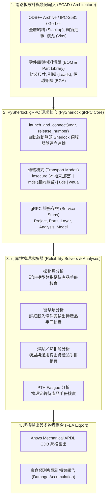

# Ansys Sherlock 與 PySherlock 主題字典

> 範圍說明：本文整理已列出的 PySherlock SDK API、連線、專案匯入與分析案例，不能視為完整 Sherlock 桌面產品手冊。SDK 文件版號與 Sherlock 產品版號分開標示；未知版號不推定。catalog 有 1,235 筆 Sherlock 文件，其中 1,094 筆 API reference、130 筆 tutorial；逐來源 SHA 與文字檔狀態見 [來源清冊](../maintenance/knowledge_dictionary_passes/2026-11-02/sherlock_sources.csv)。清冊僅證明原始檔雜湊及轉換檔狀態，正文語義尚未逐篇核對；本字典中既有工程分析主張也須以各段所列來源與頁面為準，不構成已驗證的分析建議。相關電路板與多物理分析請參閱 [Mechanical 主題字典](mechanical.md)、[PCB Warpage 主題字典](pcb_warpage.md) 與 [Icepak 主題字典](icepak.md)。

---

## 領域架構圖 (Sherlock Reliability & PySherlock Architecture)



---

## 主題辭典與核心模組

### 1. PySherlock 與產品版本邊界

#### 核心概念與辭典定義 (Core Concepts & Glossaries)
- **PySherlock 架構定位**：`ansys-sherlock-core` 是 Ansys 官方為 Sherlock 可靠性物理軟體提供的現代化 Pythonic gRPC 用戶端。運行於標準 CPython 3.9 ~ 3.14，可完全無頭 (Headless) 運行於 Windows 與 Linux 環境。
- **產品版本與 SDK 版本分離原則**：
  - **PySherlock SDK 版號**：本機文件庫對應 `ansys-sherlock-core 2.1.4` 與 `2.1.5`（兩版 API 結構逐行一致）。
  - **Sherlock 桌面產品版號**：例如 `2022 R2`、`2024 R1`、`2025 R2`、`2026 R1`。
- **關鍵功能可用性矩陣 (Availability Matrix)**：
  - **最低產品先決條件**：PySherlock 一般操作要求本機安裝授權版 **Sherlock 2022 R2 或更新版本**。
  - **`launch_and_connect()` 邊界**：該 API 方法明確標記為 **`Available Since: 2025 R2`**。在 2022 R2 ~ 2024 R2 環境下，無法呼叫此方法自動啟動並連線，必須使用傳統方式手動啟動 Sherlock gRPC 伺服器，再透過 `SherlockClient.connect()` 連線。
  - **專案匯入與分析**：`Project.import_odb_archive` 與 `Analysis.run_analysis` 自 **Sherlock 2021 R1** 起即已提供。

#### 官方手冊章節與規格出處 (Manual & Doc Citations)
- **手冊來源**：*PySherlock Getting Started & User Guide (SDK 2.1.4 / 2.1.5)*
- **章節定位**：
  - Getting Started: [PySherlock Getting Started Guide](../ANSYS_Document/Sherlock/sdk/ansys-sherlock-core/2.1.4/guide/c2ee2b1e27cf-index.md) · `ansys_03a01675e3ec0448a4609447`
  - User Guide: [PySherlock User Guide](../ANSYS_Document/Sherlock/sdk/ansys-sherlock-core/2.1.4/guide/300bab1b1621-index.md) · `ansys_5b9ab0d537f7ee42bb3355bb`
  - Launcher API: [Launcher API Reference](../ANSYS_Document/Sherlock/sdk/ansys-sherlock-core/2.1.4/api_reference/04dba55e2b3b-launcher.md) · `ansys_8fe2c6d2e3a266ee8921dd62`
- **資料庫引用標籤**：`sources.csv#ansys_03a01675e3ec0448a4609447`, `sources.csv#ansys_dd9d04316ba5a87573d77458`, `sources.csv#ansys_48a487536247777ce3260d58`

#### 版本檢查與啟動參數範例 (Python Scripting Example)
```python
# ==============================================================================
# PySherlock: Verify Version Prerequisites and Launch Server
# Note: ASCII-only comments to prevent IronPython encoding issues.
# ==============================================================================
import ansys.sherlock.core.launcher as launcher

# Explicitly target specific Sherlock release if multiple versions installed
target_year = 2026
target_release = 1

try:
    # launch_and_connect is available since Sherlock 2025 R2
    client, install_dir = launcher.launch_and_connect(
        year=target_year,
        release_number=target_release,
        port=9090,
        timeout=120
    )
    print("Successfully connected to Sherlock {0} R{1}".format(target_year, target_release))
    print("Sherlock Binary Directory: {0}".format(install_dir))
    
    # Perform operations...
    
finally:
    # Always close gRPC connection channel
    client.close()
```

#### 工程實務踩坑指南 (Gotchas & Limitations)
1. API 參考標示 `launch_and_connect` 自 Sherlock 2025 R2 起提供；更舊版的連線方式及錯誤行為需查該版文件，本字典不推定。

---

### 2. gRPC server 與連線生命週期

#### 核心概念與辭典定義 (Core Concepts & Glossaries)
- **Sherlock gRPC 無頭伺服器架構**：
  - Sherlock 底層後端伺服器在無 GUI 模式下監聽 gRPC 請求，預設監聽位址為 `127.0.0.1:9090`。
  - 啟動連線等待上限 `timeout` 預設為 120 秒；API 頁未指明內部等待階段。
- **四大傳輸模式 (Transport Modes)**：
  - **`insecure`**：未加密連線；文件未提供部署適用性或效能比較。
  - **`mtls` (相互 TLS 驗證)**：預設傳輸模式；`certs_dir` 預設 `./certs`。
  - **`uds` (Unix Domain Socket)**：`uds_dir` 預設 `$HOME/.conn`；作業系統支援條件需依目標安裝環境確認。
  - **`wnua` (Windows Named User Authentication)**：Windows 專屬具名使用者管道驗證。
- **生命週期管理原則**：
  - 範例以 `client.close()` 關閉用戶端連線；`try...finally` 是確保例外時仍執行清理的 Python 寫法。

#### 官方手冊章節與規格出處 (Manual & Doc Citations)
- **手冊來源**：*PySherlock Launcher API Reference (SDK 2.1.4 / 2.1.5)*
- **章節定位**：
  - `launch_and_connect` API Parameters: [launch_and_connect Markdown](../ANSYS_Document/Sherlock/sdk/ansys-sherlock-core/2.1.4/api_reference/d29290408d8f-ansys.sherlock.core.launcher.launch_and_connect.md) · `ansys_dd9d04316ba5a87573d77458`
- **資料庫引用標籤**：`sources.csv#ansys_5b9ab0d537f7ee42bb3355bb`, `sources.csv#ansys_8fe2c6d2e3a266ee8921dd62`, `sources.csv#ansys_dd9d04316ba5a87573d77458`

#### 連線與傳輸模式配置範例 (Python Scripting Example)
```python
# ==============================================================================
# PySherlock: Headless Connection with Custom Transport and Timeout
# Note: ASCII-only comments to prevent IronPython encoding issues.
# ==============================================================================
import ansys.sherlock.core.launcher as launcher

# Step 1: Connect to an existing Sherlock server or launch a new one
client, install_dir = launcher.launch_and_connect(
    host="127.0.0.1",
    port=9090,
    timeout=180,                         # 3 minutes initialization timeout
    transport_mode="insecure",           # Plaintext transport for local IPC
    single_project_path=None             # Multi-project workspace mode
)

try:
    # Step 2: Check server service availability via Ping/Echo or basic query
    print("Sherlock gRPC channel established successfully.")
    
finally:
    # Step 3: Ensure channel is torn down
    client.close()
    print("Sherlock connection closed cleanly.")
```

#### 待驗證的部署風險
原稿曾列背景程序殘留與 Windows 防火牆對話框為確定行為；本輪核讀的 `launch_and_connect` API 頁沒有說明這些情況，故不當作已證實產品行為。若團隊要保留此操作建議，應以目標 Sherlock 版本實測並附產品支援文件。

---

### 3. 範例瀏覽與分析類型

#### 核心概念與辭典定義 (Core Concepts & Glossaries)
- **分析類型列舉（API 範圍，非完整產品分析目錄）**：本機 PySherlock 2.1.4 `analysis_types` API 參考列出 `RunAnalysisRequestAnalysisType` 常數，包括 `NATURAL_FREQ`、`HARMONIC_VIBE`、`ICT`、`MECHANICAL_SHOCK`、`RANDOM_VIBE`、`COMPONENT_FAILURE_MODE`、`DFMEA`、`PTH_FATIQUE`、`PART_VALIDATION`、`SEMICINDUCTOR_WEAROUT`、`SOLDER_JOINT_FATIGUE`、`THERMAL_DERATING`、`THERMAL_MECH`。名稱照來源原樣保留；此 API 類別清單不能單獨證明各分析的物理模型、輸入條件或適用標準。原字典中 Steinberg、Engelmaier、溫度範圍及各型分析結果的描述尚未在本批 API 原文中找到足夠依據，應視為待產品手冊核實，不作為已驗證定義。
- **`run_analysis` API 契約與資料形狀**：
  - 輸入參數：`project` (專案名稱)、`cca_name` (電路板裝配名稱)、`analyses` (分析項目列表)。
  - **`analyses` 資料結構**：清單中每一項包含 `AnalysisType` 列舉與其關聯的 Phase/Event 名稱映射，例如 `[("Phase 1", ["Harmonic Event"])]`。
  - **回傳值契約**：文件只定義整數狀態碼 `0` 為成功；沒有在該 API 頁說明成功碼等同物理驗收、結果品質合格或特定收斂判準。
  - **輸入形狀注意**：API 參數型別描述與頁面範例對 event 結構的表示不完全一致：型別區塊寫 `tuple[str, str]`，範例則使用 `(phase_name, [event_name, ...])`。呼叫端應依目標 SDK 版本的可執行範例／實際 API 契約確認，不應將其中一種表示推廣為跨版本保證。

#### 官方手冊章節與規格出處 (Manual & Doc Citations)
- **手冊來源**：*PySherlock Tutorial Gallery & Analysis API (SDK 2.1.4)*
- **章節定位**：
  - Examples Index: [Examples Index](../ANSYS_Document/Sherlock/sdk/ansys-sherlock-core/2.1.4/tutorial/b98583e290d4-index.md) · `ansys_4d6c70cdacef6521937cb816`
  - Analyses Gallery: [Analyses Gallery](../ANSYS_Document/Sherlock/sdk/ansys-sherlock-core/2.1.4/tutorial/6f1a91e57b1a-index.md) · `ansys_734afb44baeee0f172c48723`
  - `run_analysis` API: [run_analysis Markdown](../ANSYS_Document/Sherlock/sdk/ansys-sherlock-core/2.1.4/api_reference/39e85360fbfe-ansys.sherlock.core.analysis.Analysis.run_analysis.md) · `ansys_24deb09636a8155ca46bbafb`
- **資料庫引用標籤**：`sources.csv#ansys_4d6c70cdacef6521937cb816`, `sources.csv#ansys_734afb44baeee0f172c48723`, `sources.csv#ansys_24deb09636a8155ca46bbafb`

#### 完整 ODB++ 匯入與分析執行範例 (Python Scripting Example)
```python
# ==============================================================================
# PySherlock: Import ODB++ Archive and Execute Natural Frequency Analysis
# Note: ASCII-only comments to prevent IronPython encoding issues.
# ==============================================================================
import ansys.sherlock.core.launcher as launcher
import SherlockAnalysisService_pb2

# Step 1: Connect to Sherlock
client, _ = launcher.launch_and_connect(port=9090, timeout=120)

try:
    project_name = "CardViewer_Demo"
    cca_name = "Main_Board"
    odb_archive_path = r"C:\SherlockProjects\CardViewer.zip"

    # Step 2: Import ODB++ PCB archive
    print("Importing ODB++ archive...")
    import_status = client.project.import_odb_archive(
        archive_file=odb_archive_path,
        process_layer_thickness=True,
        include_other_layers=True,
        process_cutout_file=True,
        guess_part_properties=True,
        project=project_name,
        cca_name=cca_name
    )
    assert import_status == 0, "ODB++ import failed with status: {0}".format(import_status)

    # Step 3: Configure Natural Frequency Analysis
    # The event mapping expects a list of tuples: [(PhaseName, [EventNames])]
    analyses_to_run = [
        (
            SherlockAnalysisService_pb2.RunAnalysisRequest.Analysis.AnalysisType.NaturalFreq,
            [("Phase 1", ["Harmonic Event"])]
        )
    ]

    # Step 4: Execute reliability physics analysis
    print("Triggering Natural Frequency calculation...")
    run_status = client.analysis.run_analysis(
        project=project_name,
        cca_name=cca_name,
        analyses=analyses_to_run
    )

    if run_status == 0:
        print("Analysis completed successfully. Results ready for inspection.")
    else:
        print("Analysis finished with non-zero error code: {0}".format(run_status))

finally:
    client.close()
```

#### 工程實務踩坑指南 (Gotchas & Limitations)
1. **成功狀態的解讀範圍**：API 頁只說明狀態碼 `0` 表示 success；字串大小寫規則、非零碼含義、求解器收斂及結果報表取得方式需查對應產品版本文件。此處不推定。
2. Phase/Event 大小寫規則與未知名稱的錯誤行為未由本 API 頁說明；應查對應產品版本的 Life Cycle Scenario 文件後再補充。

---

### 4. 匯入 ODB++ 專案細節 (ODB++ Import Parameters)

`Project.import_odb_archive()` 匯入 ODB++ archive，API 頁列出的 `Available Since` 為 Sherlock 2021 R1。方法回傳整數狀態碼，文件只明確定義 `0` 為成功。

| 參數 | API 頁的說明／預設值 |
|---|---|
| `archive_file` | ODB++ archive 的完整路徑 |
| `process_layer_thickness` | 是否指定 stackup thickness；必填布林值 |
| `include_other_layers` | 是否納入 other layers；必填布林值 |
| `process_cutout_file` | 是否處理 cutouts；必填布林值 |
| `guess_part_properties` | 是否推測零件屬性；必填布林值 |
| `ims_stackup` | 是否產生 IMS stackup；預設 `False` |
| `project`、`cca_name` | project 與 CCA 名稱；預設 `None` 時，名稱由 archive filename 推得 |
| `polyline_simplification` | 是否簡化 polylines；預設 `False` |
| `polyline_tolerance`、`polyline_tolerance_units` | 容差與單位；API 預設 `0.1`、`mm` |

來源：[`Project.import_odb_archive`](../ANSYS_Document/Sherlock/sdk/ansys-sherlock-core/2.1.4/api_reference/e2999e6e1d16-ansys.sherlock.core.project.Project.import_odb_archive.md) · `ansys_4f16fc9feb40b756186fa148`。

---

## 跨主題與模組雙向鏈結 (Cross-Topic References)
- [Mechanical 主題字典](mechanical.md)：將 Sherlock 建立之 PCB 實體結構與網格匯入 MAPDL 進行熱應力與非線性接觸分析。
- [PCB Warpage 主題字典](pcb_warpage.md)：封裝回焊 (Reflow) 過程之基板殘餘熱應力與翹曲模擬。
- [Icepak 主題字典](icepak.md)：電子散熱與 CFD 溫度場分佈，作為 Sherlock 焊點熱疲勞之輸入場。


## 5. 本機範例附件：CCA、Harmonic Event 與 Profile

本節只核讀 `ansys-sherlock-core/2.1.5/tutorial/inputs` 內三組 Notebook／Python 範例。`2.1.5` 是來源資料夾的 SDK 標記，產品 release 保留 `unknown`。Notebook 依 cell 順序保存 Markdown 與 code；Python 保存來源文字與授權註記。未執行範例、未驗證 Sherlock 環境，也未擷取 Notebook outputs、圖片或外部範例專案。

| 主題 | 原始碼可確認的操作與資料形狀 | 使用邊界 |
| --- | --- | --- |
| CCA（Circuit Card Assembly） | `add_cca.py` 先匯入專案，再呼叫 `sherlock.project.add_cca(project="Test", cca_properties=[{...}])`；清單內字典含 `cca_name`、`default_solder_type`、`default_stencil_thickness` 與對應單位等欄位。 | 程式中的材料、厚度與溫升是該範例的輸入值，不能當作設計值或工程建議。 |
| Harmonic Event | `add_harmonic_event.py` 先呼叫 `create_life_phase`，再以相同 `project`、`phase_name` 呼叫 `add_harmonic_event`；範例另傳 `duration`、`duration_units`、`num_of_cycles`、`cycle_type`、`sweep_rate`、`orientation`、`profile_type` 與 `load_direction`。 | 這是範例呼叫形狀；參數有效範圍、座標與物理意義仍須查目標版本 API／產品手冊。原稿 docstring 的 thermal analysis 描述不在此推廣為振動模型定義。 |
| Harmonic Vibration Profile | `add_harmonic_profile.py` 接續建立 phase／event，呼叫 `add_harmonic_vibe_profiles`；`harmonic_vibe_profiles` 原樣使用 `[(phase_name, event_name, "Profile z axis", "HZ", "G", [(10, 1), (1000, 1)], "z")]`。 | 保留 tuple 的原始次序與單位字串；這個取樣點與範圍不是產品限制或分析驗收門檻。 |

三份 Python 原件都包含 `sherlock.project.delete_project("Test")`，且連線使用 `launcher.connect(port=9092, timeout=SHERLOCK_CONNECT_TIMEOUT, transport_mode="wnua")`。這些是有外部狀態影響的範例來源，這次只處理文字；執行前須另行確認專案名稱、範例 ZIP、服務與授權環境。來源中 `print`／`LOG` 成功字串不構成本次執行證據。

可追溯文字補件：

- [add_cca.ipynb](ANSYS_Document/sherlock_example_inputs_20261104/tutorial/ansys_cc5d09f52664278ef1dc0850/sherlock.md) · `sources.csv#ansys_cc5d09f52664278ef1dc0850`
- [add_cca.py](ANSYS_Document/sherlock_example_inputs_20261104/tutorial/ansys_3a1b850b079df4f879a6e603/sherlock.md) · `sources.csv#ansys_3a1b850b079df4f879a6e603`
- [add_harmonic_event.ipynb](ANSYS_Document/sherlock_example_inputs_20261104/tutorial/ansys_3661003fbf60641243635f28/sherlock.md) · `sources.csv#ansys_3661003fbf60641243635f28`
- [add_harmonic_event.py](ANSYS_Document/sherlock_example_inputs_20261104/tutorial/ansys_d67407da2cc2d19c4863a7c2/sherlock.md) · `sources.csv#ansys_d67407da2cc2d19c4863a7c2`
- [add_harmonic_profile.ipynb](ANSYS_Document/sherlock_example_inputs_20261104/tutorial/ansys_51f3d3e1b362f082976d2667/sherlock.md) · `sources.csv#ansys_51f3d3e1b362f082976d2667`
- [add_harmonic_profile.py](ANSYS_Document/sherlock_example_inputs_20261104/tutorial/ansys_9014a5d4be3410810c86fcc1/sherlock.md) · `sources.csv#ansys_9014a5d4be3410810c86fcc1`

## 6. 來源、轉換與待補範圍（2026-11-04）

[逐來源核對清冊](../maintenance/knowledge_dictionary_passes/2026-11-04/sherlock_source_conversion_audit.csv) 覆蓋 catalog 的 1,235 筆：1,066 HTML、163 Markdown、6 個附件，沒有 PDF。全部原件 SHA-256 與 catalog 相符；1,229 份既有正文非空且在原索引有來源列，六個附件另建文字補件。HTML 表格沿用既有 117 份補件，表格語義與圖像尚未逐項人工驗收。

[本地伴隨檔清冊](../maintenance/knowledge_dictionary_passes/2026-11-04/sherlock_uncataloged_files.csv) 另列 1,029 個未入 catalog 的 Markdown：1,028 份的 SHA-256 與其已登記 HTML 的正文快取完全相同，另一份為產品 README；不將這些副本計為額外完成的來源。

[網址清冊](../maintenance/knowledge_dictionary_passes/2026-11-04/sherlock_markdown_urls.csv) 保留 Markdown 目的地、既有下載紀錄、原始失敗訊息與本輪重試狀態。網址清冊包含跨版本、原始碼與外部目的地，不等於全部都是待轉換技術頁。無法擷取及尚未分類的網址仍是缺口；這次沒有證明整個官方網站已完整收錄。

本次完成文字轉換與來源追溯，不代表 1,094 筆 API、130 筆 tutorial 與 11 筆 guide 的語義均已逐篇整理，也未證明 SDK／產品跨版本相容性、求解或可靠性模型。產品版本未知處保留 `unknown`。
