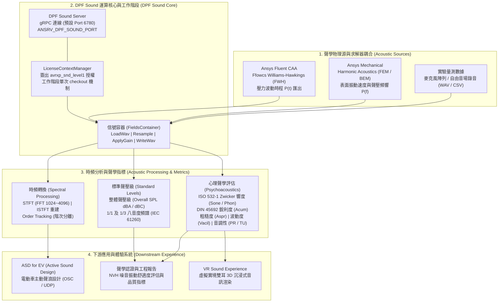

# Ansys Sound 與 PyAnsys Sound 知識字典

> 本字典分開整理 PyAnsys Sound SDK 與 2026 R1 的 ASDforEV／VR Sound／Car Sound Simulator 文件。各節說明其核對依據及未覆蓋範圍；標準、物理求解器與工程門檻的未核實草稿已集中標示為待來源覆核。

---

## 領域架構圖 (Sound & Psychoacoustics Architecture)

---

## 主題辭典與核心模組

### 1. DPF Server 與授權工作階段

#### 核心概念與辭典定義 (Core Concepts & Glossaries)
- **DPF Sound Server 架構**：PyAnsys Sound 透過 DPF Server 執行其操作；User Guide 說明可連線遠端 DPF Server 或啟動本機 server。此版本快照的產品 release 未知，套件路徑有 0.3.0 與 0.4.0，不混為產品版本。
- **連線機制 (`connect_to_or_start_server`)**：
  - 若系統設定環境變數 `ANSRV_DPF_SOUND_PORT`，客戶端將嘗試連線遠端或本機既有 DPF Server（預設連接埠為 `6780`）。
  - 若未設定該環境變數，客戶端會依 PyDPF-Core 文件所述的 server installation priority 嘗試尋找本機 DPF Server。Sound User Guide 沒有在此處明列 `AWP_ROOT261`，所以此處不推定固定搜尋環境變數或安裝路徑。
- **授權情境管理 (`LicenseContextManager`)**：
  - 聲學運算運算子需要簽出 `avrxp_snd_level1` 授權特徵（Increment）。
  - **工作階段共用模式** (`use_license_context=True`)：在工作階段啟動時由 `LicenseContextManager` 一次性完成授權簽出，多個運算子執行期間共用同一授權，直至物件銷毀或工作階段關閉時釋放。
  - **未使用 context 模式** (`use_license_context=False`)：教學說明每次使用 DPF Sound operator 時都 checkout license；不外推其他授權管理器行為。

#### 手冊章節與規格出處 (Manual & Doc Citations)
- **官方手冊**：*PyAnsys Sound User Guide & Tutorials* ([User Guide](../ANSYS_Document/Sound/sdk/ansys-sound-core/0.4.0/guide/247f8b71797b-user_guide.md))
- **授權範例**：*Initialize DPF Server and Deal with License* ([Tutorial 001](../ANSYS_Document/Sound/sdk/ansys-sound-core/0.4.0/tutorial/4525497c243e-001_initialize_server_and_deal_with_license.md))
- **本機路徑**：如上所列 User Guide 與 Tutorial 001。這兩頁是 `version/stable` 的快照，目錄標示 0.4.0；線上 stable 現行版未核實。

---

### 2. WAV 訊號匯入、重取樣、增益與輸出（PyAnsys Sound SDK 文件版）

#### 概念與原文可支持的操作

- `LoadWav(path_to_wav)` 讀取 WAV，`process()` 後可用 `get_output()` 取得 DPF `FieldsContainer`、`get_output_as_nparray()` 取得 NumPy array，並可讀取格式及取樣頻率。文件沒有在此 API 條目中保證聲壓校準或某一取樣位元格式的轉換語意。
- `Resample(signal, new_sampling_frequency)` 將輸入 signal 重取樣至指定 Hz。範例把 44,100 Hz 重取樣為 20,000 Hz；這是教學例值，不是建議所有工作都降到 20 kHz。
- `ApplyGain(signal, gain, gain_in_db=True)` 接受 dB（預設）或線性增益（`gain_in_db=False`）。範例對訊號施加 10 dB。來源沒有描述削波偵測或自動正規化，所以增益後峰值／削波檢查仍是使用者需另行確認的處理步驟。
- `WriteWav(signal, path_to_write, bit_depth)` 可輸出單聲道或多聲道的 DPF signal；文件列出的 `bit_depth` 選項為 `float32`（預設）、`int32`、`int16`、`int8`。既有草稿中的 `int24` 未在此版本 API 文件列出，已改以文件明列的選項為準。

#### 教學範例資料流

`LoadWav` → `Resample(new_sampling_frequency=20000.0)` → `ApplyGain(gain=10.0, gain_in_db=True)` → `WriteWav(bit_depth="int16")`。範例原 WAV 取樣頻率為 44,100 Hz，示範讀取／處理／輸出；數值只代表案例。輸出路徑由範例檔名加 `_modified.wav` 建立。

來源： [WAV 操作教學](../ANSYS_Document/Sound/sdk/ansys-sound-core/0.4.0/tutorial/1cfc7e2b79ea-002_load_resample_amplify_write_wav_files.md)、[`LoadWav`](../ANSYS_Document/Sound/sdk/ansys-sound-core/0.4.0/api_reference/5f1f3a6b763e-ansys.sound.core.signal_utilities.LoadWav.md)、[`Resample`](../ANSYS_Document/Sound/sdk/ansys-sound-core/0.4.0/api_reference/f3eec8985075-ansys.sound.core.signal_utilities.Resample.md)、[`ApplyGain`](../ANSYS_Document/Sound/sdk/ansys-sound-core/0.4.0/api_reference/fbbef9a79e58-ansys.sound.core.signal_utilities.ApplyGain.md)、[`WriteWav`](../ANSYS_Document/Sound/sdk/ansys-sound-core/0.4.0/api_reference/645b680877fb-ansys.sound.core.signal_utilities.WriteWav.md)。來源為 `version/stable` 動態網址，本機副本置於 0.4.0 文件目錄；線上 stable 目前版號未由本機快照證明。

---

### 3. 時頻轉換與頻譜分析（PyAnsys Sound SDK 文件版）

`Stft(signal, fft_size=2048, window_type="HANN", window_overlap=0.5)` 執行短時傅立葉轉換。API 文件明列窗型：`TRIANGULAR`、`BLACKMAN`、`BLACKMANHARRIS`、`HAMMING`、`HANN`、`GAUSS`、`FLATTOP`、`RECTANGULAR`；overlap 可介於 0 與 1。文件說 FFT size 使用 2 的次方可有較佳效能，未將此描述成準確度保證，也未規定普遍適用的 overlap 建議值。

教學流程用 `fft_size=1024` 計算並繪圖，接著改為 4096、`window_overlap=0.95`、`window_type="TRIANGULAR"` 後重新 `process()`；再把 STFT 輸出傳給 `Istft(stft)` 重建時域 signal。這些是範例參數；手冊只展示結果圖，未給重建誤差門檻或保證任意輸入均無損重建。參數改動後須再呼叫 `process()`，符合使用者指南對共通 class method 的說明。

來源： [STFT／ISTFT 教學](../ANSYS_Document/Sound/sdk/ansys-sound-core/0.4.0/tutorial/03aba93b04b0-003_compute_stft.md)、[`Stft` API](../ANSYS_Document/Sound/sdk/ansys-sound-core/0.4.0/api_reference/641c42720d7f-ansys.sound.core.spectrogram_processing.Stft.md)、[`Istft` API](../ANSYS_Document/Sound/sdk/ansys-sound-core/0.4.0/api_reference/9567a978f814-ansys.sound.core.spectrogram_processing.Istft.md)。原先草稿所稱 `HANNING` 別名、普遍 50–95% overlap 建議、OLA 重建細節均不由這些引用頁支持，未在此作為建議保留。

---

### 4. 聲學判讀與待來源覆核項目

現有一般聲學文字有部分合理的工程方向，但當前引用的 PyAnsys Sound User Guide 與 tutorial 只證明 SDK 操作，不證明相關國際標準內容、標準版本、判定條件、Fluent CAA 網格截止頻率、聲場比較條件或舒適度門檻。故下表內容標記為待核來源，不應直接用作設計或驗收門檻：

| 待核主張 | 缺少的證據 | 可保留的目前說法 |
|---|---|---|
| `L_eq`、`OASPL`、dBA/dBC、20 µPa 參考值與 IEC 61672-1 對應 | 標準正文或明確說明其測量條件的可靠來源；SDK 的 `OverallLevel` API 名稱不足以證明標準符合性 | SDK 有 `OverallLevel`、`LevelOverTime` 等標準 level 類別，不能只憑類別名宣稱符合某 IEC 方法 |
| 1/1 與 1/3 octave、IEC 61260、中心頻率與適用範圍 | 標準版本與方法條件 | SDK API 有 octave 與 one-third-octave level operators，來源章節列出 signal／PSD 輸入類別 |
| ISO 532-1／ISO 532-2、DIN 45692、ECMA／ISO 音調性演算法與 Sone／Acum／Vacil 等解釋 | 標準正文／官方方法說明，及所用 SDK class 對應的方法與版本 | 0.4.0 API 目錄含 `psychoacoustics` 類別；這僅是功能存在證據，計算細節與適用域仍待逐類核對 |
| Fluent FWH 波長至少 8–12 cells、Cutoff Frequency、模擬與量測比較界線 | 對應 Fluent/Mechanical 技術手冊、網格／時間步條件與有效性參考 | Sound SDK 使用時域 signal；無法由 Sound 手冊推導聲源求解品質 |
| `S > 1.5` 尖銳度不適、粗糙度／波動度調變頻率峰值與其他主觀門檻 | 標準或特定研究來源及測試條件 | 暫不提供普遍的人類感受門檻 |
| WAV 輸出 clipping、自動 normalization、Pa/FS 校準流程 | SDK/API 或量測鏈校準文件 | SDK API 列出增益與位深選項，但上述流程未在已核頁面定義 |

已核 API 導覽：`standard_levels` 說明從時域 signal 或 PSD 計算 overall、level-over-time、octave 與 one-third-octave levels；`spectral_processing` 說明其子套件含 PSD 計算。此兩個索引頁沒有詳述 IEC 符合性，也沒有列出可作為通用實務規範的頻帶或計權條件。來源：[`standard_levels` API 導覽](../ANSYS_Document/Sound/sdk/ansys-sound-core/0.4.0/api_reference/2e88f6a4c427-standard_levels.md)、[`spectral_processing` API 導覽](../ANSYS_Document/Sound/sdk/ansys-sound-core/0.4.0/api_reference/2e370aa2fc88-spectral_processing.md)。

---

### 5. PyAnsys Sound Server 與授權生命週期（SDK 0.4.0 文件快照）

`connect_to_or_start_server()` 可連接遠端 DPF Server 或啟動本機 DPF Server。User Guide 說明：設定 `ANSRV_DPF_SOUND_PORT` 時會嘗試連接遠端伺服器，預設 port 為 6780，也可明確傳入 `port`；未設定時會依 PyDPF-Core 的 server installation priority 嘗試定位本機伺服器。這是 SDK server discovery 行為，不等於此機器已安裝或已成功啟動伺服器。

授權教學指出所需 increment 為 `avrxp_snd_level1`。`use_license_context=True` 會讓 `LicenseContextManager` 在 context 建立時簽出 increment，並可於該 session 的多個 operator 間共用；文件示例刪除 manager 物件後釋放。`use_license_context=False` 範例說明每次呼叫 DPF Sound operator 都會 checkout license。教學執行時間是其示例環境的觀測值，不保證其他機器效能。未檢查本機授權伺服器，未連線或執行任何 operator。

來源：[PyAnsys Sound User Guide](../ANSYS_Document/Sound/sdk/ansys-sound-core/0.4.0/guide/247f8b71797b-user_guide.md)、[Initialize DPF Server and Deal with License 教學](../ANSYS_Document/Sound/sdk/ansys-sound-core/0.4.0/tutorial/4525497c243e-001_initialize_server_and_deal_with_license.md)。兩個頁面為 `version/stable` 動態來源的本機副本，目錄標示 0.4.0；不可單憑目錄推定官方 stable 現行版。

---
## 5. ASDforEV 訊息與 UDP 通訊（2026 R1）

ASDforEV API 使用 OSC message over UDP。每則訊息由 keyword 與單一資料值（float 或 string）組成；`ACTIVE` 是文件列出的例外，只有 keyword 而沒有 data。keyword 與字串資料區分大小寫。大部分控制值的有效範圍沒有在訊息表中規定，應依 ASDforEV 的圖形介面設定確認，不從名稱推定單位或範圍。

### 連線方向與存活訊息

| 方向 | UDP port | 用途 |
| --- | ---: | --- |
| 外部應用程式 → ASDforEV | 7450 | 發送 vehicle、sound function 與其他控制訊息。 |
| ASDforEV → 外部應用程式 | 7460 | 接收音效名稱等回覆。 |

讀取 CAN 資料的專用應用程式應每 5 秒送出不帶 data 的 `ALIVE`，讓 ASDforEV 知道資料仍在讀取。不要把此訊息格式套用到本機 DPF Sound Server 的 gRPC 連線；它屬於 ASDforEV 的應用程式通訊介面。

### Vehicle 與 sound function 訊息

| Keyword 範例 | Data | 文件定義 |
| --- | --- | --- |
| `Speed` | float | 車速，單位 kph。 |
| `RPM` | float | 引擎轉速。 |
| `Load` | float | Accelerator pedal load，百分比。 |
| `Acceleration` | float | 車輛加速度，單位 g。 |
| `Torque` | float | 引擎扭矩，單位 N·m。 |
| `Brake` | float | Brake pedal position，百分比。 |
| `Ambiance1_Activate`、`Ambiance1_Angle` | float | 控制音效啟用及方位角；同類型訊息延伸至 Ambiance2、Ambiance3。 |
| `ADAS1_Activate`、`ADAS1_Silence`、`ADAS1_Angle` | float | 控制 ADAS1 啟用、靜音時間與方位角；同類型訊息延伸至 ADAS2–ADAS5。 |
| `ICEASD_RPM`、`ICEASD_Speed`、`ICEASD_Load` | float | 分別提供 ICE-ASD 音高／增益控制所用引擎轉速、車速及負載。 |

從 ASDforEV 接收的訊息包含 `Ambiance1`–`Ambiance3`、`ADAS1`–`ADAS5` 及 `HMI1`–`HMI15`。資料是音效功能名稱字串，供讀取 CAN 資料的應用程式顯示。這是回傳名稱，不應與發送方向的 float 控制值混淆。

來源：[訊息總覽與大小寫規則](../ANSYS_Document/Sound/v261/api_reference/6bd191fbe2fc-SEV_API_SEV_Driving.md)（v261，文件 last update 09.03.2026）；[送往 ASDforEV 的訊息](../ANSYS_Document/Sound/v261/api_reference/6cd86ea22540-SEV_API_sending.md)；[從 ASDforEV 接收的訊息](../ANSYS_Document/Sound/v261/api_reference/11840c48e348-SEV_API_receiving.md)；[UDP ports](../ANSYS_Document/Sound/v261/api_reference/9a4020f6493e-SEV_API_UDP_connection.md)。來源清冊 ID 建議見本模組處理報告。

## 6. Car Sound Simulator OSC 訊息格式（2026 R1）

Car Sound Simulator 文件將外部模擬資料提供者描述為 OSC client、Car Sound Simulator 描述為 OSC server；OSC packet 經 Ethernet 上的 UDP 傳送。此應用程式僅使用 OSC Message，不使用 OSC Bundle。OSC packet 的資料長度須為 4 bytes 的倍數。

OSC message 由 address pattern、type tag string 及 binary data 組成。一般 OSC 標準的 address pattern 以 `/` 起始，但 Car Sound Simulator 文件特別要求 keyword 前不要加 slash。文件列出的 type tags 為 `i`（32-bit integer）、`f`（32-bit single precision float）及 `s`（OSC string）。OSC string 以 null 結尾，並補 0–3 個 null bytes，使長度對齊 32 bits。組封包時應遵循該應用程式文件的例子，不要只依通用 OSC 慣例推定 address。

來源：[Car Sound Simulator OSC Protocol](../ANSYS_Document/Sound/v261/api_reference/08d0c597ea28-car_ost_osc_prot.md)（v261，文件 last update 09.03.2026）。本節只整理訊息格式，未執行 C++ 範例或連線測試。

## 7. Sound 字典來源可信度與待覆核內容

本地來源 catalog 包含 834 筆 Sound 文件：822 筆有正文及非空轉換文字，12 筆為附件。逐筆來源 SHA-256 與 catalog 相符；此項不代表 Markdown 轉換語義正確。版本分布包含 unknown、v251、v252、v261；不同產品的 ASDforEV／VR Sound／Car Sound Simulator 文件不能與 PyAnsys Sound SDK 版本混為一談。

此字典原有 SDK、聲學標準與物理解讀文字，尚未逐條對應至版本明確的原文段落。尤其 FFT/window 建議範圍、SPL 與心理聲學標準定義、Fluent 網格解析度門檻、量測與模擬的比較界線、聲音主觀不適門檻及 WAV 量化細節，現階段列為待來源覆核；引用來源未明確支持的內容不可當作工程準則。逐來源狀態見 [Sound 來源清冊](../maintenance/knowledge_dictionary_passes/2026-11-02/sound_sources.csv)，逐主題與缺口見 [Sound 處理報告](../maintenance/knowledge_dictionary_passes/2026-11-02/sound.md)。

## 來源與跨主題鏈結 (Cross-Topic Links)

- [DPF 架構字典 (dpf.md)](dpf.md) · DPF 核心場容器與資料流處理
- [Fluent 求解器字典 (fluent.md)](fluent.md) · CAA Ffowcs Williams-Hawkings (FWH) 聲學求解與時域壓力波動匯出
- [Mechanical 振動分析 (mechanical.md)](mechanical.md) · 諧響應聲學模態與輻射聲功率分析
- [來源清冊](sources.csv) · `ansys_fcc093bb84f2b5065f2fdbb7`, `ansys_3fa160544c9ca5b71153709d`, `ansys_2e8a31b819e66f2ef613b35f`, `ansys_d2e7a339c4df9aa557abbdce`, `ansys_399624922acb95fb64909461`.

## 6. VR Sound 訊息介面與播放限制（2026 R1）

### 連線與訊息封裝

VR Sound 可透過 Open Sound Control (OSC) over UDP 或 TCP/IP 由外部程式控制；文件指出 TCP/IP 需要安裝 Java Runtime Environment (JRE)。訊息以字串形式傳遞，內容為 `KEY_WORD VALUE1 VALUE2 ...`，值可為 string、int 或 float，結尾為 line feed（ASCII 10）。音訊 PC 在 UDP 與 TCP/IP 都可透過 5555–5564 範圍的十個 port 接收；訊息傳送頻率不得超過 60 Hz。

VR Sound 的 OSC 文件另外明確說明：只使用 OSC Message；通用 OSC address pattern 的 `/` 在 VR Sound 關鍵字前不得出現；支援 type tags `i`、`f`、`s`，分別為 32-bit integer、32-bit float、OSC string；OSC packet 長度為 4 bytes 的倍數。字串訊息格式（文字、換行）與 OSC binary packet 描述出現在同一組文件中；應按所用 API 介面／文件範例選擇，不把兩種敘述擅自合併成同一 wire-format。實際訊息列表將內容稱為以字串傳送，但 OSC Protocol 頁描述 binary packet；此處標示為文件層面待釐清差異。

### 播放流程與容量

3D Sources 與 Ambiance Sources：先將音檔預載並關聯識別碼，再以識別碼觸發 slot 播放，以 slot 停止。若同一檔案需在兩個以上 track 同時播放，文件要求重複載入並使用不同 ID。3D Input Streams 透過啟用／停用音效卡專用輸入通道開始／停止。3D Interpolated Sources 由 Play／Stop 控制；文件稱其 pitch 和 samples overlap 分別受 `Control`、`Overlap` 參數控制。

文件明列同時播放上限：20 個 3D sources、10 個 3D interpolated sources、2 個 Ambiance sources、3 個 3D input streams。這些是產品文件限制，不推廣為其他 Sound 應用程式限制。

### 訊息類別與範例

Messages List 將訊息分為 control（全域指令，例如 rendering／座標模式）、event service（載入或觸發聲源）、recurrent service（定期更新 listener／source 位置）。例：`GLOBAL_3D_MODE` 的模式含 `Binaural`、`VBAP`、`Transaural`、`DoubleTransaural`、`Ambisonic`；座標模式 `API_COORDINATES_MODE` 為 A（Virtools/Unity）、B（Polhemus）、C（Angular mode）。`SOUND_LOAD` 以 ID 與檔案路徑預載；`SOUND_PLAY_3D` 提供聲源 ID、sound ID、loop 次數、volume (dB) 和初始位置。詳細參數範圍與條件應查閱原始訊息清單，字典不重抄整個 API 表。

來源： [VR Sound 2026 R1 index](../ANSYS_Document/Sound/v261/api_reference/vr-sound-api-2026-r1/index.md)、[OSC Protocol](../ANSYS_Document/Sound/v261/api_reference/vr-sound-api-2026-r1/VRS_communication_osc.md)、[Messages Format](../ANSYS_Document/Sound/v261/api_reference/vr-sound-api-2026-r1/VRS_communication_messages.md)、[Sound Playback Process](../ANSYS_Document/Sound/v261/api_reference/vr-sound-api-2026-r1/VRS_communication_sound.md)、[Messages List](../ANSYS_Document/Sound/v261/api_reference/vr-sound-api-2026-r1/VRS_communication_messages_list.md)。文件標示 v261 / 2026 R1、Last update 09.03.2026。本節未建立 socket、執行範例或測量播放容量。

## 7. Car Sound Simulator 控制訊息概覽（2026 R1）

Car Sound Simulator 的外部 simulation data provider 是 OSC client，Car Sound Simulator 是 server；使用 Ethernet 上的 UDP 與 OSC Message，不使用 OSC Bundle。協定頁要求 packet 長度為 4 bytes 倍數、字串以 null 終止並按 32-bit 邊界補零、type tag `i`/`f`/`s` 分別代表 32-bit integer／single precision float／OSC string，且此應用程式的 keyword 前不要加 slash。

`Car Sound Simulator - OSC Messages` 將訊息按車速／RPM／輸出格式等基礎管理、最多 8 車的 traffic noise、最多 10 個 harmonic sources、主車輪胎噪音、天氣、附加噪音檔、最多 10 個 sound playback slots、錯誤回報與 head-tracking 分類。部分文件例子和參數需留意：車速單位為 m/s、RPM 為 rev/min、`CHARGE` 介於 0 至 1；traffic 角度以 radians 表示，文件稱 Doppler effect 由 `TRAFIC_UPDATE` 的相對位置更新控制，單獨指定的車速只用於 sound source synthesis。`HS_VOL` 範圍為 -15 至 +15 dB；`WEATHER_RAIN`、`WEATHER_WIND` 是 0–100 整數。上述均限於該 2026 R1 訊息表，不外推為其他產品設定。

原文： [OSC Protocol](../ANSYS_Document/Sound/v261/api_reference/08d0c597ea28-car_ost_osc_prot.md)、[Car Sound Simulator - OSC Messages](../ANSYS_Document/Sound/v261/api_reference/efab2c155249-car_ost_simdrive.md)、[C++ Program](../ANSYS_Document/Sound/v261/api_reference/8752fd278eae-car_ost_c_prog.md)。協定文件標示 Last update 09.03.2026。C++ 範例的資料型別推斷程式未執行或驗證，勿直接視為可靠 parser 實作。此處概覽未取代完整訊息表。

## 8. ASDforEV、VR Sound、Car Sound Simulator 協定差異

| 產品介面 | 文件指定的 transport | 主要訊息表示 | port／頻率 | 版本來源 |
|---|---|---|---|---|
| ASDforEV | UDP | OSC Message；文件要求關鍵字前不要有 `/` | 外部→ASDforEV 7450；反向 7460；CAN reader `ALIVE` 每 5 秒 | v261，ASDforEV API 2026 R1 |
| VR Sound | UDP 或 TCP/IP | Messages Format 頁稱 line-feed 結尾的文字訊息；OSC 頁另述 binary OSC packet，需照所用介面釐清 | 接收 port 5555–5564；發送率 <=60 Hz；TCP/IP 需要 JRE | v261，VR Sound API 2026 R1 |
| Car Sound Simulator | Ethernet 上 UDP | OSC Message，不用 Bundle；keyword 前不加 `/` | 本節引用頁未見通用 port | v261，Car Sound Simulator API 2026 R1 |
| PyAnsys Sound | DPF gRPC server | SDK operators／DPF FieldsContainer | User Guide 預設 6780（`ANSRV_DPF_SOUND_PORT`） | 本機 0.4.0 文件快照；產品 release unknown |

以上為文件介面對照，不互相套用 port、OSC 格式或 license 行為。官方應用文件頁面的使用權／團隊再散布權未在本輪核實；此字典屬本機整理，分享前須依文件授權狀態檢查。

## 9. 來源與轉換覆核狀態

本地 catalog 有 834 筆 Sound 文件：822 筆正文（725 HTML、97 Markdown）、12 筆附件（6 Jupyter notebooks、6 Python files）。其中 725 HTML 對應 catalog `text_path` 非空，97 Markdown 就地作為正文，12 附件沒有 `text_path`。822 筆正文 SHA-256 與 catalog 相符；這證明檔案與清冊對應，不代表 HTML→Markdown 欄位、表格、圖片、程式碼、公式或語義已逐筆驗收。所有 834 筆來源的逐筆狀態與版本可見 [Sound 來源清冊](../maintenance/knowledge_dictionary_passes/2026-11-02/sound_sources.csv)。

清冊本身顯示：API reference 801、tutorial 25、guide 8；release unknown 776、v251 15、v252 15、v261 28；48 筆 source URL 空白。上述 822 筆正文皆為 `semantics_unreviewed`，12 筆附件未閱讀或執行。SDK `version/stable` URL 為動態網址，本機 0.3.0/0.4.0 目錄不證明網上目前版本；應用協定頁則使用 v261 / 2026 R1。Sound catalog 中沒有以 PDF 記錄的來源，所以本輪沒有 PDF 需要轉換；未另行爬取來源網址外的新網站。來源頁面授權及衍生文件再分享權尚未核實。

### 已核讀及可追溯的章節

| 主題 | 文件定位 | 狀態 |
|---|---|---|
| DPF Server 與 license context | SDK 0.4.0 User Guide；Tutorial 001 | 有界核讀；未 runtime 測試 |
| WAV 載入、取樣頻率轉換、增益、輸出位深 | SDK Tutorial 002；LoadWav/Resample/ApplyGain/WriteWav API | 已核對文件列出的參數與範例值；未執行 SDK |
| STFT/ISTFT | SDK Tutorial 003；Stft/Istft API | 已核讀；不代表訊號重建誤差驗證 |
| 標準 level 與 PSD 功能索引 | SDK `standard_levels`、`spectral_processing` 模組導覽 | 確認 API 範圍；標準符合性仍 pending |
| ASDforEV | 2026 R1 index／OSC／messages／UDP | 現有字典已整理範圍；完整訊息表以原文為準，未連線 |
| VR Sound | 2026 R1 index／OSC／messages／playback／message list | 本次有界核讀；純文字 vs OSC binary 表述差異待產品文件釐清，未連線 |
| Car Sound Simulator | 2026 R1 OSC／C++／simulation messages | 本次有界核讀；範例程式未執行，完整訊息表留在原文 |
| IEC／ISO／DIN 指標、Fluent/Mechanical 聲源品質、其他 801 API reference、剩餘 tutorial/guide 及附件 | 待逐文件核實 | pending；不作為已證實操作準則 |

## 10. 原文使用與分享權限

Sound SDK 文件與 Developer Portal 協定文件均在本機留有正文或 HTML 轉換副本；此處以短摘錄式摘要和來源路徑追溯，尚未核實對外分享或大段複製官方文件的權利。`docs/maintenance/PUBLICATION_REVIEW.md` 對官方手冊衍生內容要求確認授權；本地整理不等於可公開散布。公開或團隊外傳前，需由權利負責者確認來源條款與可分享範圍。

## 11. DPF Sound v261 指標運算子補充

本節依 DPF Framework 2026 R1（v261）operator specification 補充 SDK 0.4.0 文件未涵蓋的標準相關 API。頁面標示 `Last update: 31.07.2026`、operator `Version: 0.0.0`。這些頁面證明運算子所宣告的輸入、輸出與參數，不能單獨證明 Ansys 的標準認證、完整標準正文要求或量測流程合規；現有工程門檻與聲源求解品質仍須其他來源支持。

| 運算子 | 文件明列內容 | 使用邊界 |
|---|---|---|
| [`compute_overall_level`](../ANSYS_Document/DPF/v261/guides_and_tutorials/dpf-framework-2026-r1/operator-specifications/sound/compute_overall_level.md) | 輸入為 signal field；輸出可選 dB 或 RMS。dB reference value 與 frequency weighting 可設定；頁面舉 `2e-5 Pa` 為 SPL 及 A/B/C 加權的參考值，Z weighting 不加頻率加權。 | 輸入為 RMS 時 reference 與 weighting 會被忽略；採 A/B/C weighting 時文件要求 reference 為 `2e-5 Pa`。不將 API 描述解讀為任意輸入皆符合 IEC 61672。來源 ID `ansys_30d0e1d24cb09701a6365a6d`。 |
| [`compute_loudness_iso532_1`](../ANSYS_Document/DPF/v261/guides_and_tutorials/dpf-framework-2026-r1/operator-specifications/sound/compute_loudness_iso532_1.md) | 計算 stationary sound 的 ISO 532-1 loudness；輸入 signal 以 Pa 表示，可選 recording field type `Free` 或 `Diffuse`（預設 `Free`）；輸出 sone、phon 及 sone/Bark specific loudness。 | 適用文件標示的 stationary operator；不把其輸出泛化到所有時變訊號或錄音條件。來源 ID `ansys_fa971b0189e5e14ff652f49d`。 |
| [`compute_loudness_iso532_2`](../ANSYS_Document/DPF/v261/guides_and_tutorials/dpf-framework-2026-r1/operator-specifications/sound/compute_loudness_iso532_2.md) | DPF 另列 ISO 532-2 loudness operator。 | 其量測與輸入條件需閱讀該 operator 原頁，不以 ISO 532-1 的條件替代。來源 ID `ansys_10b5ed53ba89c0504cca51b3`。 |
| [`compute_tonality_iso1996_2`](../ANSYS_Document/DPF/v261/guides_and_tutorials/dpf-framework-2026-r1/operator-specifications/sound/compute_tonality_iso1996_2.md) | 依 ISO 1996-2:2007 Annex C 計算 tonal audibility 與 tonal adjustment；signal 輸入單位 Pa；`noise_threshold` 須為正、預設 1 dB；`effective_analysis_bw` 範圍 `]0, 5]` Hz、預設 5 Hz；`noise_bandwidth` 範圍 `[0.75, 2]`、預設 0.75。 | 頁面將 tonal adjustment 輸出欄名拼作 `tonal_adjustement`；此處保留原 API 標識可能有的拼字差異，程式實作請以實際 operator schema 核對。來源 ID `ansys_ccb9cb34f98bd519f6be4dfb`。 |
| [`compute_tonality_ecma418_2`](../ANSYS_Document/DPF/v261/guides_and_tutorials/dpf-framework-2026-r1/operator-specifications/sound/compute_tonality_ecma418_2.md) | DPF 另列 ECMA-418-2 tonality operator。 | 不將 ISO 1996-2 的參數、定義或結果門檻套用到 ECMA operator。來源 ID `ansys_813d43ca6fbfe5df74a755a8`。 |
| [`compute_sound_power_level_iso3744`](../ANSYS_Document/DPF/v261/guides_and_tutorials/dpf-framework-2026-r1/operator-specifications/sound/compute_sound_power_level_iso3744.md) | 依 ISO 3744 計算 SWL；頁面列半球／半半球量測面、半徑、背景修正 `K1`、環境修正 `K2`、氣象修正 `C1/C2` 和多位置麥克風 signals 為輸入；輸出含未加權與 A 加權 SWL 及 octave/one-third-octave bands。 | 修正值與量測面條件都是必要輸入；此 API 描述不是量測佈置或標準完整程序的替代品。來源 ID `ansys_5415fc4b913bcf83f29f00b3`。 |
| [`compute_octave_levels_from_psd_ansi_s1_11_1986`](../ANSYS_Document/DPF/v261/guides_and_tutorials/dpf-framework-2026-r1/operator-specifications/sound/compute_octave_levels_from_psd_ansi_s1_11_1986.md) | 由 PSD 模擬 ANSI S1.11-1986 / IEC 61260:1995 fractional-octave filterbank；文件描述連續三個 1/3 octave levels 相加得到 octave level，列出 31.5–16000 Hz 的 10 個中心頻率。 | 輸入 PSD 單位為 signal 單位平方每 Hz；輸出量綱由輸入而來。operator 頁面標示為其實作方法，不代表其他資料路徑或標準版本。來源 ID `ansys_84f98747f55dc9d929cf8b94`。 |

本補充來自本機 DPF v261 Markdown 正文，沒有改動來源 catalog 或執行運算子。來源頁的 HTML／表格扁平化可能影響欄位視覺對應；本節只引用可直接辨識的欄名與值。索引與檢索驗證狀態見本輪整合紀錄。官方資料再分享權仍待確認。

## 10. 本機原碼補件與 SDK 來源差異（2026-11-04）

本輪沿用 834 筆 Sound catalog 原件（822 正文、12 附件），逐件原件 bytes SHA 與既有正文 metadata 通過。未發現 Sound PDF；既有 HTML／Markdown 文字轉檔維持原件。六份 Notebook 的 43 code／51 Markdown cells 及六份 Python 全文均已核對；下列入口只提供來源文字，未包含 Notebook outputs、圖片或執行結果。

| 附件 | SDK 目錄標記 | 文字補件 |
| --- | --- | --- |
| `001_initialize_server_and_deal_with_license.ipynb` | `0.3.0` | [原碼與原件連結](ANSYS_Document/sound_example_inputs_20261104/tutorial/ansys_f11696c46d43b0d240ad05d7/sound.md)；`ansys_f11696c46d43b0d240ad05d7` |
| `001_initialize_server_and_deal_with_license.py` | `0.3.0` | [原碼與原件連結](ANSYS_Document/sound_example_inputs_20261104/tutorial/ansys_5bd8af99705feadddeead0f3/sound.md)；`ansys_5bd8af99705feadddeead0f3` |
| `002_load_resample_amplify_write_wav_files.ipynb` | `0.3.0` | [原碼與原件連結](ANSYS_Document/sound_example_inputs_20261104/tutorial/ansys_d6db84b01132e5bd2a203568/sound.md)；`ansys_d6db84b01132e5bd2a203568` |
| `002_load_resample_amplify_write_wav_files.py` | `0.3.0` | [原碼與原件連結](ANSYS_Document/sound_example_inputs_20261104/tutorial/ansys_d26a6ccdbf6341202c06fe76/sound.md)；`ansys_d26a6ccdbf6341202c06fe76` |
| `003_compute_stft.ipynb` | `0.3.0` | [原碼與原件連結](ANSYS_Document/sound_example_inputs_20261104/tutorial/ansys_5275221898c9ac4a2093afad/sound.md)；`ansys_5275221898c9ac4a2093afad` |
| `003_compute_stft.py` | `0.3.0` | [原碼與原件連結](ANSYS_Document/sound_example_inputs_20261104/tutorial/ansys_f7cb1c94ad12037cca85ec1c/sound.md)；`ansys_f7cb1c94ad12037cca85ec1c` |
| `001_initialize_server_and_deal_with_license.ipynb` | `0.4.0` | [原碼與原件連結](ANSYS_Document/sound_example_inputs_20261104/tutorial/ansys_2b6c922217588e393f8ec642/sound.md)；`ansys_2b6c922217588e393f8ec642` |
| `001_initialize_server_and_deal_with_license.py` | `0.4.0` | [原碼與原件連結](ANSYS_Document/sound_example_inputs_20261104/tutorial/ansys_dbc6b67b9d628fbbcdd414d7/sound.md)；`ansys_dbc6b67b9d628fbbcdd414d7` |
| `002_load_resample_amplify_write_wav_files.ipynb` | `0.4.0` | [原碼與原件連結](ANSYS_Document/sound_example_inputs_20261104/tutorial/ansys_60779485c5d5f2bf3c3f63d1/sound.md)；`ansys_60779485c5d5f2bf3c3f63d1` |
| `002_load_resample_amplify_write_wav_files.py` | `0.4.0` | [原碼與原件連結](ANSYS_Document/sound_example_inputs_20261104/tutorial/ansys_251bd029404d664840d11cf6/sound.md)；`ansys_251bd029404d664840d11cf6` |
| `003_compute_stft.ipynb` | `0.4.0` | [原碼與原件連結](ANSYS_Document/sound_example_inputs_20261104/tutorial/ansys_fab8d40abec6ac6c62f754a5/sound.md)；`ansys_fab8d40abec6ac6c62f754a5` |
| `003_compute_stft.py` | `0.4.0` | [原碼與原件連結](ANSYS_Document/sound_example_inputs_20261104/tutorial/ansys_c0936754b67e98bb28315ce4/sound.md)；`ansys_c0936754b67e98bb28315ce4` |

三組 Notebook 的 0.3.0／0.4.0 source cell 文字與順序均不相同；outputs 與 metadata 沒有比較。這些版本是本機 SDK 目錄標記，不推定為 Ansys Sound 產品 release。下列差異直接依兩版 Python 原碼，不推廣為其他 API 或版本的行為：

| 案例 | 本機 0.3.0／0.4.0 原碼差異 |
| --- | --- |
| server／license | 0.3.0 用 `not my_server.has_client()` 判斷本機；0.4.0 用 `my_server.local_server`，並加入 `get_sound_version()`；0.4.0 的 `download_flute_wav()` 未傳入原有 `server=` 參數。 |
| WAV 讀取／resample／gain／write | 0.3.0 範例使用 `fc_signal_original` 容器；0.4.0 明確取 `LoadWav.get_output()[0]` 的單一 Field，將單一 signal 傳給 `Resample`、`ApplyGain`、`WriteWav`。這是範例的資料流差異，尚未做執行相容性測試。 |
| STFT／ISTFT | 0.3.0 初始只傳 `fft_size=1024`；0.4.0 初始明列 `window_type="HANN"`、`window_overlap=0.5`，新增 `plot_custom(reference_value=REFERENCE_ACOUSTIC_PRESSURE_IN_AIR, max_magnitude=80)` 的顯示範例。教學參數及顯示上限不是通用工程門檻。 |

[逐版本 source 比較](../maintenance/knowledge_dictionary_passes/2026-11-04/sound_notebook_source_version_comparison_20261104.json)保留 cell 數與序列雜湊。上述原碼會連線／啟動 DPF Server、簽出授權、下載範例 WAV，WAV 範例還會寫出 `_modified.wav`；本輪沒有執行這些動作。

## 11. 官方 stable 正文與表格補件（擷取快照）

本輪固定重試已列出的 30 個同站 URL：12 頁成功、18 個舊 API URL 回 HTTP 404。初次一般環境 DNS 失敗與獲准網路重試分別保留；404 只代表這些 URL 當時不可取，不推定相應 API 已移除。新頁的產品 release／SDK 版本未知，與既有 0.3.0／0.4.0 本機來源分開。

| 官方頁 | 分類／來源 ID | 本機正文 |
| --- | --- | --- |
| Contribute — PyAnsys Sound | guide；`sound_web_eb70c367dd25ad5c_98196e546642` | [文字、原HTML與來源URL](ANSYS_Document/sound_official_html_20261104/guide/eb70c367dd25ad5c/sound.md) |
| Isolate orders — PyAnsys Sound | tutorial；`sound_web_402a2577ab3db082_74bf69eaf5ab` | [文字、原HTML與來源URL](ANSYS_Document/sound_official_html_20261104/tutorial/402a2577ab3db082/sound.md) |
| Extract tonal, transient, and noise components (Xtract) — PyAnsys Sound | tutorial；`sound_web_5eaff25da03560ef_723d71454aa7` | [文字、原HTML與來源URL](ANSYS_Document/sound_official_html_20261104/tutorial/5eaff25da03560ef/sound.md) |
| Calculate TNR and PR — PyAnsys Sound | tutorial；`sound_web_eb9a24dfa18e5614_32ce9e9458d3` | [文字、原HTML與來源URL](ANSYS_Document/sound_official_html_20261104/tutorial/eb9a24dfa18e5614/sound.md) |
| Calculate psychoacoustic indicators — PyAnsys Sound | tutorial；`sound_web_b199c3f97fd4b7f4_1ccd259f5b5a` | [文字、原HTML與來源URL](ANSYS_Document/sound_official_html_20261104/tutorial/b199c3f97fd4b7f4/sound.md) |
| Calculate RMS, dBSPL and dBA levels — PyAnsys Sound | tutorial；`sound_web_8b5671ae5d382112_4800d48ecacb` | [文字、原HTML與來源URL](ANSYS_Document/sound_official_html_20261104/tutorial/8b5671ae5d382112/sound.md) |
| Calculate tonality indicators — PyAnsys Sound | tutorial；`sound_web_b32ec49c6cee663f_f606be01c3a2` | [文字、原HTML與來源URL](ANSYS_Document/sound_official_html_20261104/tutorial/b32ec49c6cee663f/sound.md) |
| Use an existing Sound Composer project file — PyAnsys Sound | tutorial；`sound_web_931efa4ea53ea124_b0d920c14b2f` | [文字、原HTML與來源URL](ANSYS_Document/sound_official_html_20261104/tutorial/931efa4ea53ea124/sound.md) |
| Create a Sound Composer project — PyAnsys Sound | tutorial；`sound_web_0ae74fbdc7c2e15c_52026e3b018a` | [文字、原HTML與來源URL](ANSYS_Document/sound_official_html_20261104/tutorial/0ae74fbdc7c2e15c/sound.md) |
| Predict listening test ratings — PyAnsys Sound | tutorial；`sound_web_25abe8d3cf6d15ce_0c38d8b9e43d` | [文字、原HTML與來源URL](ANSYS_Document/sound_official_html_20261104/tutorial/25abe8d3cf6d15ce/sound.md) |
| Octave and one-third-octave levels computation — PyAnsys Sound | tutorial；`sound_web_b5151d5dae6c69e4_18ffc75b2e53` | [文字、原HTML與來源URL](ANSYS_Document/sound_official_html_20261104/tutorial/b5151d5dae6c69e4/sound.md) |
| Getting started — PyAnsys Sound | guide；`sound_web_6d02b2725d198428_784a2a96c908` | [文字、原HTML與來源URL](ANSYS_Document/sound_official_html_20261104/guide/6d02b2725d198428/sound.md) |

[Getting started](ANSYS_Document/sound_official_html_20261104/guide/6d02b2725d198428/sound.md)的擷取快照列 DPF Server／SDK 對照：8.0（Ansys 2024 R2 pre0）→ 0.1.0 and later、10.0（2025 R2 pre0）→ 0.2.0 and later、11.0（2026 R1 pre0）→ 0.3.0 and later、12.0（2027 R1 pre0）→ 0.4.0 and later。`pre0` 與 `and later` 是來源表格標示，沒有用它推定本機安裝、產品發布狀態或任意後續版本相容性。

[Octave／one-third-octave 教學](ANSYS_Document/sound_official_html_20261104/tutorial/b5151d5dae6c69e4/sound.md)表格分別列 Signal／PSD 路徑、`OctaveLevelsFromSignal`／`PowerSpectralDensity`／`OctaveLevelsFromPSD`、`use_ansi_s1_11_1986` 以及 standard-compliant、neighboring-band leakage、PSD parameters 效應欄位。這是該教學的演算法路徑比較，不能單憑欄名判斷其他版本、實作或量測程序的標準符合性。兩頁的 2 個表格、52 個儲存格已另保留 Markdown 逐格文字；原 HTML 可回查，未做視覺驗收。

新十個詳細 tutorial 尚未逐篇語義整理；既有聲學標準、物理與數值門檻待覆核主題保留。[本輪來源及檢索報告](../maintenance/knowledge_dictionary_passes/2026-11-04/sound_module_conversion_report_20261104.md)記錄 URL、失敗、未涵蓋與索引驗證範圍。
