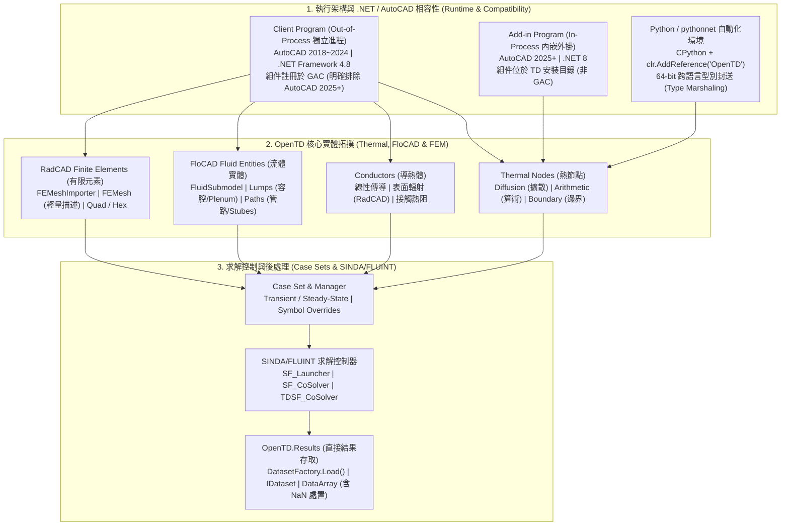

# Ansys Thermal Desktop／OpenTD 主題字典

> 本字典整理已標明版本的 OpenTD 開發指南、歷史 Getting Started PDF 與既有有界主題；不是完整 Thermal Desktop 手冊。來源、頁碼及未核對項目見本字典末尾的來源覆核註記。不同版本及文件類型分開標示；未由來源支持的 runtime 相容與工程宣稱不作確定建議。

---

## 領域架構圖 (OpenTD Architecture & Entity Pipeline)



---

## 主題辭典與核心模組

### 1. OpenTD Runtime 與版本相容 (Runtime & Version Compatibility)

#### 核心概念與辭典定義 (Core Concepts & Glossaries)
- **OpenTD 雙軌應用程式架構**：
  - **Client Program (外部獨立進程客戶端)**：作為獨立的 `.exe` 控制台或桌面程式啟動，透過進程間通訊 (IPC) 連線至背景或現有的 Thermal Desktop (AutoCAD) 進程。
  - **Add-in Program (內部外掛擴充程式)**：作為 DLL 載入 AutoCAD 進程；本批來源未量測執行效能或證明所有記憶體存取情境。
- **AutoCAD 與 .NET 執行環境嚴格邊界矩陣**：
  - **AutoCAD 2018 ～ 2024**：v261 OpenTD client/add-in 的目標框架為 **.NET Framework 4.8**。OpenTD 組件版本號為 `26.1.4.x`，安裝於 Windows 全域組件快取 (**GAC**, Global Assembly Cache)。
  - **AutoCAD 2025 及以上版本**：v261 OpenTD add-in 的目標框架為 **.NET 8**。OpenTD 組件版本號為 `26.1.8.y`，安裝於 Thermal Desktop 本地安裝目錄（.NET 8 不再支援 GAC）。
- **關鍵邊界約束：Client 模式對 AutoCAD 2025+ 之不相容性**：
  - **Prerequisites 官方明文限制**：截至 OpenTD 2026 R1，**外部 Client Program 明確不支援 AutoCAD 2025 及更高版本**。若使用 AutoCAD 2025+，僅能開發 .NET 8 Add-in 外掛程式。

#### 跨版本執行環境相容性矩陣 (Compatibility Matrix)

| 應用類型 | AutoCAD 版本範圍 | 目標 .NET 框架 | 組件版本與存放位置 | 官方支援狀態 (v261) |
|---|---|---|---|---|
| **Client Program** | AutoCAD 2018 ~ 2024 | .NET Framework 4.8 | `26.1.4.x`，位於 64-bit GAC | v261 Prerequisites 指定此目標；未做 runtime 驗證 |
| **Client Program** | AutoCAD 2025+ | .NET 8 | N/A | v261 Prerequisites 明示 client 不適用 |
| **Add-in Program** | AutoCAD 2018 ~ 2024 | .NET Framework 4.8 | `26.1.4.x`，位於 GAC | v261 Prerequisites 指定此目標；未做 runtime 驗證 |
| **Add-in Program** | AutoCAD 2025+ | .NET 8 | `26.1.8.y`，位於 TD 安裝目錄 | v261 Prerequisites 指定 .NET 8；逐 release 支援範圍須以該版文件為準 |

#### 手冊章節與規格出處 (Manual & Doc Citations)
- **手冊來源**：*OpenTD 2026 R1 Prerequisites* ([Prerequisites Guide](../ANSYS_Document/Thermal_Desktop/v261/guides_and_tutorials/opentd-2026-r1/getting-started/prerequisites.md))；*OpenTD 2026 R1 Changelog* ([Changelog Guide](../ANSYS_Document/Thermal_Desktop/v261/guides_and_tutorials/opentd-2026-r1/changelog.md))；*Getting Started with OpenTDv242 PDF* ([v242 PDF](../ANSYS_Document/Thermal_Desktop/unknown/manuals/Getting%20Started%20with%20OpenTDv242.md))。
- **Source IDs**：`sources.csv#ansys_2c6f4fd8806fb07e16cd3519`, `sources.csv#ansys_4f5e41c5734fe487baea0f05`, `sources.csv#ansys_da6516dfd7c36e331781bbd5`。

#### 工程實務踩坑與注意事項 (Gotchas & FAQ)
- **平台與位元設定**：本批保存的 Net4 demo 專案提供 x64 組態；部署仍須逐一核對 AutoCAD、.NET、OpenTD 組件及呼叫端的目標平台。本批未做 Any CPU／x64 runtime 比較，不能宣稱特定設定必然造成 `BadImageFormatException`。
- **連線與授權生命週期**：本批未啟動 Client 或 AutoCAD，未驗證 `Disconnect()` 對背景行程及授權釋放的實際效果；需依同版 API 與現場程序確認。

---

### 2. Thermal、FloCAD 實體與有限元素 (Thermal / FloCAD Entities & FEM)

#### 核心概念與辭典定義 (Core Concepts & Glossaries)
- **Thermal Desktop 三大核心建模範式**：
  1. **Thermal Entities (熱實體網路)**：
     - **Nodes (節點)**：分為 Diffusion Node（具備熱容之擴散節點）、Arithmetic Node（零熱容即時熱平衡節點）與 Boundary Node（恆溫或時變邊界節點）。
     - **Conductors (導熱體)**：連接兩節點傳遞熱量，支援純線性傳導導熱體、表面輻射導熱體 (RadCAD) 及接觸面導熱體。
  2. **FloCAD Fluid Entities (流體熱水力實體)**：
     - **授權前置**：操作 FloCAD 類別必須具備有效的 **FloCAD License**。
     - **Fluid Submodel (流體子模型)**：定義工作流體物性庫，如水（ID 6070）、空氣或自訂氣體。
     - **Lumps (容腔/流體節點)**：代表流體質點體積，支援設定為 `PLENUM`（進出口大容腔壓力邊界）並指定初始壓力與溫度。
     - **Paths / Stubes (流體路徑/管道)**：連接兩 Lumps 之間的管道元件，定義流通截面積 (FlowArea)、水力直徑與壓降係數。
  3. **Finite Elements (有限元素整合)**：
     - 在 Thermal Desktop 中，有限元素可直接附著於節點建立，但官方**最佳實踐是採用 `FEMeshImporter` 類別**。
     - **`FEMesh` 輕量描述容器**：使用 `OpenTD.RadCAD.FEModel.FEMesh` 建構包含頂點座標與四邊形/三角形單元之輕量幾何拓撲，最後一次性傳入 `meshImporter.SetMesh(feMesh)` 完成幾何映射。

#### 手冊章節與規格出處 (Manual & Doc Citations)
- **手冊來源**：*Create nodes and a conductor* ([Nodes & Conductor](../ANSYS_Document/Thermal_Desktop/v261/guides_and_tutorials/opentd-2026-r1/getting-started/creating-td-model/nodes-and-conductor.md))；*Create fluid entities* ([Fluid Entities](../ANSYS_Document/Thermal_Desktop/v261/guides_and_tutorials/opentd-2026-r1/getting-started/creating-td-model/fluid-entities.md))；*Create finite elements* ([Finite Elements](../ANSYS_Document/Thermal_Desktop/v261/guides_and_tutorials/opentd-2026-r1/getting-started/creating-td-model/finite-elements.md))。
- **Source IDs**：`sources.csv#ansys_f01ef3481051ed36ffc8fa67`, `sources.csv#ansys_082ebac71acbf33692b31c1d`, `sources.csv#ansys_8bbae549d2ec0b2c88f7a9e7`。

#### 熱實體與 FloCAD 建模實例 (C# Scripting Example)
```csharp
// ==============================================================================
// OpenTD C# Example: Create Thermal Network, FloCAD Fluid Loop, and FE Mesh
// Note: ASCII-only comments to prevent encoding issues.
// ==============================================================================
using System;
using System.Collections.Generic;
using OpenTD;
using OpenTD.FloCAD;
using OpenTD.RadCAD.FEModel;

namespace OpenTDModelingSuite
{
    class Program
    {
        static void Main(string[] args)
        {
            var td = new ThermalDesktop();
            td.Connect();

            // -------------------------------------------------------------
            // Step 1: Create Thermal Nodes and Conductor
            // -------------------------------------------------------------
            var node1 = td.CreateNode();
            node1.Submodel = "SolidBlock";
            node1.Id = 101;
            node1.Origin = new Point3d(0, 0, 0);
            node1.Update();

            var node2 = td.CreateNode();
            node2.Submodel = "SolidBlock";
            node2.Id = 102;
            node2.Origin = new Point3d(0.1, 0, 0);
            node2.Update();

            var cond = td.CreateConductor(node1, node2);
            cond.Value = 2.5; // Conductance in W/K
            cond.Update();

            // -------------------------------------------------------------
            // Step 2: Create FloCAD Fluid Entities (Requires FloCAD license)
            // -------------------------------------------------------------
            var fluidSub = td.CreateFluidSubmodel("COOLING_LOOP");
            fluidSub.ClearFluidLists();
            fluidSub.FluidIds.Add(6070); // Water fluid library ID
            fluidSub.FluidLetters.Add(0); // Letter 'A'
            fluidSub.FluidFilenames.Add("");
            fluidSub.Update();

            var inletLump = td.CreateLump();
            inletLump.Submodel = "COOLING_LOOP";
            inletLump.Origin = new Point3d(0, 0.05, 0);
            inletLump.LumpType = RcLumpData.LumpTypes.PLENUM;
            inletLump.InitialPres = 200000.0; // 2 bar
            inletLump.Update();

            var outletLump = td.CreateLump();
            outletLump.Submodel = "COOLING_LOOP";
            outletLump.Origin = new Point3d(0.1, 0.05, 0);
            outletLump.LumpType = RcLumpData.LumpTypes.PLENUM;
            outletLump.InitialPres = 101325.0; // 1 atm
            outletLump.Update();

            var flowPath = td.CreatePath(inletLump, outletLump);
            flowPath.FlowArea = 0.0005; // 5 cm^2
            flowPath.Update();

            // -------------------------------------------------------------
            // Step 3: Create Finite Element Mesh via FEMeshImporter
            // -------------------------------------------------------------
            var importer = td.CreateFEMeshImporter("PlateImporter", false);
            var feMesh = new FEMesh();

            // Add 4 corner nodes
            feMesh.Nodes.Add(new Node { id = 1, x = 0, y = 0, z = 0 });
            feMesh.Nodes.Add(new Node { id = 2, x = 0.1, y = 0, z = 0 });
            feMesh.Nodes.Add(new Node { id = 3, x = 0.1, y = 0.1, z = 0 });
            feMesh.Nodes.Add(new Node { id = 4, x = 0, y = 0.1, z = 0 });

            // Add Quad element
            var quad = new QuadElement { id = 1 };
            quad.nodeIds.AddRange(new int[] { 1, 2, 3, 4 });
            feMesh.Elements.Add(quad);

            importer.SetMesh(feMesh);
            importer.Update();

            td.ZoomExtents();
            Console.WriteLine("Thermal, FloCAD, and FEM entities built successfully.");
        }
    }
}
```

#### 工程實務踩坑與注意事項 (Gotchas & FAQ)
- **`Update()` 與物件持久化**：本批指南範例會在可更新資料物件修改後呼叫 `.Update()`；不能推廣成所有 OpenTD 屬性一律需要 Update。應依該類別同版文件確認，未做求解器辨識驗證。
- **FloCAD 授權逾時**：FloCAD 模組為獨立計費 Feature。若呼叫 `CreateFluidSubmodel` 時授權池耗盡，將拋出 `LicenseException`；在批次程式碼中建議包裝 `try...catch` 捕捉授權異常。

---

### 3. Python／pythonnet 範例與版本限制 (Python Scripting & pythonnet Limits)

#### 核心概念與辭典定義 (Core Concepts & Glossaries)
- **OpenTD Python 橋接技術原理**：
  - OpenTD 原生基於微軟 .NET 平台（C# 組件）。Python 用戶端透過開源套件 **`pythonnet` (Python for .NET)** 動態加載 CLR (Common Language Runtime)，在 CPython 進程內建立 .NET 運行時主機。
- **官方附錄歷史版本基線 (Legacy Baseline)**：
  - 官方手冊 Appendix B 所收錄之教學範例歷史標註為 **Python 2.7.15** 與 **pythonnet 2.3.0** (發布於 2022 年)。
  - **來源未界定的版本**：v261 附錄範例的程式註記寫明建立環境為 Python 2.7.15 與 pythonnet 2.3.0（沿用 2022 年範例）；本地文件沒有提出 CPython 3.x 或 pythonnet 3.x 的支援矩陣，故本文不推薦未核實的現代版本組合。
- **執行緒靜態單位系統 (`Units.WorkingUnits`)**：
  - OpenTD 的數值解讀與 AutoCAD 圖面單位 (Drawing Units) 完全解耦。API 數值透過 thread-static 變數 `Units.WorkingUnits` 解析。
  - 在 Python 腳本中，**強烈建議在建立任何實體前先呼叫 `Units.WorkingUnits.SetToSI()` 或 `td.SetUnits(Units.SI)`**，防止數值被預設的英制單位（BTU, ft, lbf）解讀導致物理量偏差數倍。

#### 手冊章節與規格出處 (Manual & Doc Citations)
- **手冊來源**：*Appendix B: Using OpenTD with Python* ([Appendix B Guide](../ANSYS_Document/Thermal_Desktop/v261/guides_and_tutorials/opentd-2026-r1/getting-started/appendix-B-using-opentd-with-python.md))；*Getting Started with OpenTDv242 PDF* ([v242 PDF](../ANSYS_Document/Thermal_Desktop/unknown/manuals/Getting%20Started%20with%20OpenTDv242.md))。
- **Source IDs**：`sources.csv#ansys_ec86c3663c597e846d006f89`, `sources.csv#ansys_da6516dfd7c36e331781bbd5`。

#### Python Heated-Bar 建模與雙 Case Set 執行實例 (Python Script)
```python
# ==============================================================================
# OpenTD Python Example: Heated Bar Model with Nominal and Cold Case Sets
# Note: ASCII-only comments to prevent pythonnet/IronPython encoding issues.
# ==============================================================================
import clr
import sys

# Step 1: Add OpenTD .NET Assembly reference via pythonnet
# For .NET Framework 4.8 GAC registered assembly:
clr.AddReference("OpenTD")
import OpenTD
from OpenTD import ThermalDesktop, Point3d, Units, Dimension

def run_heated_bar_workflow():
    # Step 2: Connect to Thermal Desktop session
    td = ThermalDesktop()
    td.Connect()

    # Step 3: Establish explicit SI Working Units
    Units.WorkingUnits.SetToSI()

    # Step 4: Create a 1D bar with 10 nodes and series conductors
    bar_nodes = []
    for i in range(10):
        node = td.CreateNode()
        node.Submodel = "BarSubmodel"
        node.Id = 10 + i
        node.Origin = Point3d(0.05 * i, 0.0, 0.0)
        node.InitialTemp = 293.15  # 20 degC in Kelvin
        node.Update()
        bar_nodes.append(node)

    for i in range(9):
        cond = td.CreateConductor(bar_nodes[i], bar_nodes[i + 1])
        cond.Value = 1.5  # Conductance W/K
        cond.Update()

    # Step 5: Create heat torch symbol with parameter expression
    td.CreateSymbol("qTorch", 80.0, "Nominal torch heating power [W]")
    torch_load = td.CreateHeatLoad(bar_nodes[0])
    torch_load.ValueExp.Value = "qTorch"
    torch_load.Update()

    # Step 6: Configure Nominal Transient Case Set
    case_nominal = td.CreateCaseSet("Nominal_Transient")
    case_nominal.SteadyState = 0
    case_nominal.Transient = 1
    case_nominal.SindaControl.timend = 600.0  # End time 600 seconds
    case_nominal.Update()

    # Step 7: Configure Cold Case Set with Symbol Override
    case_cold = td.CreateCaseSet("Cold_Transient")
    case_cold.SteadyState = 0
    case_cold.Transient = 1
    case_cold.SindaControl.timend = 1200.0
    # Override torch power to 50W in cold condition
    case_cold.SymbolNames.Add("qTorch")
    case_cold.SymbolValues.Add("50.0")
    case_cold.SymbolComments.Add("Reduced heating power in cold case")
    case_cold.Update()

    # Step 8: Run Case Sets via CaseSetManager
    case_nominal.Run()
    print("Nominal case execution completed successfully.")
    
    td.ZoomExtents()

if __name__ == "__main__":
    run_heated_bar_workflow()
```

#### 工程實務踩坑與注意事項 (Gotchas & FAQ)
- **GAC 路徑與字串 Placeholder**：官方舊範例程式碼中常出現包含 `ReplaceMe` 的組件目錄字串。**現代規範：使用 `clr.AddReference("OpenTD")` 直接由 Windows GAC 解析組件，切勿寫死本機實體絕對路徑**。
- **.NET 型別封送**：保存的 Python 範例向 `SymbolNames.Add()` 傳入字串；不同 Python／pythonnet 版本的自動型別轉換與 overload 行為未在本批測試，不據此保證數值參數會產生特定例外。

---

### 4. WorkingUnits、圖面單位與 Expressions

#### 核心概念與辭典定義 (Core Concepts & Glossaries)
- **三大獨立單位維度**：
  1. `Drawing Units`：AutoCAD 圖面幾何顯示單位（如 Inches、Millimeters）。透過 `td.SetDwgUnits()` 設定。
  2. `WorkingUnits`：Thread-static 執行緒靜態 API 數值解讀系統。在 SI 下傳入 8000 表示 $8000\text{ kg/m}^3$；若切換為 cm 則以 $0.008\text{ kg/cm}^3$ 讀出。
  3. `Expression Units`：公式表達式內部維度。以 `SomethingExp` 結尾之成員（如 `ValueExp.Value`）支援符號公式連結。

---

### 5. OpenTD.Results 直接結果讀取與後處理

#### 核心概念與辭典定義 (Core Concepts & Glossaries)
- **直接資料存取模式 (Direct Result Extraction)**：
  - 專案直接參照 64-bit `OpenTD.Results.dll`，無需啟動 AutoCAD 或 Thermal Desktop 進程，即可直接讀取 SINDA/FLUINT `.sav` (Save files) 與 `.csr` 檔案。
  - **`DatasetFactory.Load(path)`**：建立 `IDataset` 實例，透過 `GetData()` 取回包含物理量綱之 `DataArray`。
  - **`NaN` 數值防禦**：當瞬態記錄僅在首尾輸出或特定暫態暫存器缺值時，資料陣列將傳回 `double.NaN`。繪圖與統計函式必須包含 `double.IsNaN()` 過濾機制。

---

## 跨模組雙向鏈結與建議查閱路徑
- **跨產品熱求解器路由**：詳見 [`thermal.md`](thermal.md)，了解 Thermal Desktop 與 Mechanical Thermal、Icepak 之分流原則。
- **流固共軛熱傳分析**：詳見 [`system_coupling.md`](system_coupling.md)，了解系統耦合界面換熱規範。
- **結構熱應力評估**：詳見 [`mechanical.md`](mechanical.md)，了解溫度場自 SINDA 匯出至 APDL 進行應變計算之流程。


## 來源覆核註記（2026-11-02）

本地文件 catalog 清冊與 `docs/ANSYS_Document/Thermal_Desktop/README.md` 數量不同：catalog 有 1,098 筆（1,085 Markdown、7 PDF、5 CHM、1 ZIP），其中 1,092 筆正文、6 筆附件；README 的版本表加總也是 1,098 筆，但列為 1,090 筆正文、8 筆待補附件。以下逐來源清冊依 catalog 逐筆核對，不能將 README 分類摘要當成完整來源 ID 清單。

7 份本機 PDF 原件 SHA-256 均符合 catalog，抽取 Markdown 頁標均連續涵蓋該 PDF 頁數；合計 3,297 頁。此頁標檢查不代表逐頁語義或圖表已驗收。逐 PDF 頁數、原件路徑、sidecar 及雜湊見 [Thermal Desktop 逐來源清冊](../maintenance/knowledge_dictionary_passes/2026-11-02/thermal_desktop_sources.csv)。

已核對的版本證據限制兩項舊宣稱：

- v261 Appendix B PDF Page 81 的程式註記為 “Created with Python 2.7.15 and pythonnet 2.3.0”，並稱範例供讀者將 C# 範例轉寫為 Python；附錄沒有承諾 CPython 3.8–3.11／pythonnet 3.x 支援。來源：[Appendix B 原文](../ANSYS_Document/Thermal_Desktop/v261/guides_and_tutorials/opentd-2026-r1/getting-started/appendix-B-using-opentd-with-python.md)；catalog source ID `ansys_ec86c3663c597e846d006f89`。
- v261 Prerequisites 的 “Technical requirements” 指明 AutoCAD 2018–2024 client/add-in 使用 .NET Framework 4.8；AutoCAD 2025+ add-in 目標為 .NET 8，並明示 2025+ client 不適用。v261 Changelog 的 Version 2025 R2 notes 又將 .NET 8／AutoCAD 2025 描述為 “very limited use”，只有 add-ins 支援，client/server 不支援；Version 2026 R1 notes 記載 .NET 8 組件版本與安裝位置，但沒有宣稱所有 Add-in 情境均 “complete support”。因此上方相容表只列來源明文要求，不宣稱未證實的完整支援。來源：[v261 Prerequisites](../ANSYS_Document/Thermal_Desktop/v261/guides_and_tutorials/opentd-2026-r1/getting-started/prerequisites.md) (`ansys_2c6f4fd8806fb07e16cd3519`)、[v261 Changelog](../ANSYS_Document/Thermal_Desktop/v261/guides_and_tutorials/opentd-2026-r1/changelog.md) (`ansys_4f5e41c5734fe487baea0f05`)。兩處是官方 HTML 轉換 Markdown，不是 PDF，章節位置與 release 已明列。

未逐篇審查 1,092 筆正文，7 份 PDF 也未逐頁檢視內容、圖表、公式或掃描品質；5 個 CHM 與 1 個 ZIP 沒有檢索正文。12 筆來源 URL 為空。全部逐筆狀態及限制見上方來源清冊。

## 補充主題與來源定位（2026-11-03）

以下內容依 v261 OpenTD Getting Started 官方 HTML 轉換頁覆核；每頁帶有來源 URL、更新日期 `09.03.2026` 及本地頁面錨點。這是對文件正文的主題整理，不代表完整 Thermal Desktop 使用手冊覆核。

### 6. 連接、Handle、Marker 與 Domain

- **Connection** 由 `Handle` 與整數 `Marker` 組成。Handle 用於唯一定位圖面物件，OpenTD 亦透過它在 `Update()` 時尋回圖面實體；不能以 SINDA 名稱假設所有實體唯一。
- 對 FD brick，Marker 以位元旗標描述作用面：`1`（`0b000001`）代表 `XMIN`，`42`（`0b101010`）代表 `XMAX/YMAX/ZMAX`，`63`（`0b111111`）代表六個面。應先確認實體類型與面編碼，再套用熱負載連接。
- 特殊 Marker `-999` 表示連到 TD domain；此時 Connection 的 Handle 欄位是 Domain 名稱，而不是單一物件 Handle。範例以 `new Connection("HEATED", -999)` 將熱負載施加至名稱為 `HEATED` 的 domain。
- **來源**：v261 *Work with connections, handles, markers, and domains*，章節全文（無 PDF 頁碼）；[官方 URL](https://developer.synopsys.com/docs/opentd-2026-r1/getting-started/creating-td-model/connections-handles-markers-domains.md)，本地 [轉換頁](../ANSYS_Document/Thermal_Desktop/v261/guides_and_tutorials/opentd-2026-r1/getting-started/creating-td-model/connections-handles-markers-domains.md)，source ID `ansys_c83947f5aff588c8ee243bf6`。

### 7. FloCAD 流體網路入門

- **前置條件**：OpenTD 操作 FloCAD entities 需要 FloCAD license。範例先建立 Fluid Submodel `PRIMARY`，清空 fluid lists，加入 fluid ID `6070`、letter `0`（A），並以空檔名字串讓其解析為 Water；勿把該範例推廣成所有版本的完整流體物性清單。
- **Lump / Plenum / Path**：Lump 以 `Volume` 與幾何位置建立；範例將首末 Lump 設為 `PLENUM`，分別給定 `InitialPres=2e5` 與 `1e5`，再以 `CreatePath` 連接相鄰 Lump，設定 `FlowArea=0.003`。這些是示例輸入值，不是通用設計值或單位建議；量綱依 WorkingUnits 及該版本 API 規則確認。
- **來源**：v261 *Create fluid entities*，章節全文（無 PDF 頁碼）；[官方 URL](https://developer.synopsys.com/docs/opentd-2026-r1/getting-started/creating-td-model/fluid-entities.md)，本地 [轉換頁](../ANSYS_Document/Thermal_Desktop/v261/guides_and_tutorials/opentd-2026-r1/getting-started/creating-td-model/fluid-entities.md)，source ID `ansys_082ebac71acbf33692b31c1d`。

### 8. WorkingUnits、圖面單位與公式單位

- `Units.WorkingUnits` 是執行緒靜態的 API 讀寫單位設定，與 TD 圖面單位 `SetDwgUnits()` 獨立；例如範例將密度 `8000` 以 SI 寫入，再把 WorkingUnits 的長度切成 cm 後，讀值為 `0.008 kg/cm^3`。圖面另以英制與 inch 顯示，不會改變該 API 讀值。
- `SomethingExp`（例如 `ValueExp`）屬於公式/Expression 單位系統，亦與 WorkingUnits、圖面單位分開。符號 `heatload` 的表達式 `34.12 * 2` 被標註為 Btu/hr；對應熱負載 expression 明確指定 `energy=BTU`、`time=HR`。部分成員自身名稱含單位（如 `radiusKm`），須按 API 成員標註輸入。
- **操作提示**：批次建模開始時明確設定工作單位，並對 expression 指定其單位；不要由 DWG 顯示單位推斷 API 數值或符號公式量綱。
- **來源**：v261 *Work with units, symbols, and expressions*，章節全文（無 PDF 頁碼）；[官方 URL](https://developer.synopsys.com/docs/opentd-2026-r1/getting-started/creating-td-model/units-symbols-expressions.md)，本地 [轉換頁](../ANSYS_Document/Thermal_Desktop/v261/guides_and_tutorials/opentd-2026-r1/getting-started/creating-td-model/units-symbols-expressions.md)，source ID `ansys_a009f17f90528343bbdcbd9c`。

### 9. Case Set 執行與結果讀取

- Case Set 範例先建模，再建立 transient case：`SteadyState=0`、`Transient=1`、`SindaControl.timend=600`，呼叫 `Update()` 後 `Run()`。第二個 case 以 `SymbolNames`、`SymbolValues`、`SymbolComments` 覆寫同一符號（範例將 `qTorch` 由 80 改為 50），並將 `SaveAll=1`；輸出檔位於 `ConnectConfig.StartDirectory` 指定的工作目錄。這些數值僅為示例。
- `CaseSet.Run()` 對應 GUI 執行單一 Case；多 Case Demand/Batch 執行用 `CaseSetManager.Run(IEnumerable<int> caseIndices)`，索引來自 `GetCaseSets()` 清單，勿混用成 Case 的 ID。
- 結果有兩條路徑：在 TD 執行個體內建立 contour/後處理，或參照 `OpenTD.Results.dll` 直接讀取 save/CSR 等 dataset。結果 assembly 是 64-bit，因此直接讀取專案亦須 64-bit；`IDataset.GetData(...)` 可一次取多個 SINDA/FLUINT 名稱，`GetValues(Units.SI/Eng)` 回傳每個項目的值序列。缺記錄的資料會以 `NaN` 呈現，需在統計與繪圖前處理缺值。
- **來源**：v261 *Working with case sets* 及 *Reading results*，章節全文（無 PDF 頁碼）；[Case Sets 官方 URL](https://developer.synopsys.com/docs/opentd-2026-r1/getting-started/working-with-case-sets.md)，source ID `ansys_621ddf54cc8563a883bfec21`；[Results 官方 URL](https://developer.synopsys.com/docs/opentd-2026-r1/getting-started/reading-results.md)，source ID `ansys_3a3c5ad1009970b0cc722e9e`。本地頁面均位於 `../ANSYS_Document/Thermal_Desktop/v261/guides_and_tutorials/opentd-2026-r1/getting-started/`。

### 10. 已確認的舊內容限制

- v261 Python 附錄描述的是 Python 2.7.15 / pythonnet 2.3.0 範例，並明說其用途是協助把 C# 範例轉寫至 Python；不能據此宣稱 CPython 3、pythonnet 3 或現行版本相容。歷史附錄中的 GAC `ReplaceMe` 路徑是範例佔位符，不宜當成可複製的安裝路徑。
- v261 文件對 FloCAD license 有明文要求；詞條已標示授權前置，不推論授權組態或其他授權條件。
- **來源**：v261 *Appendix B: Using OpenTD with Python*，source ID `ansys_ec86c3663c597e846d006f89`；*Create fluid entities*，source ID `ansys_082ebac71acbf33692b31c1d`。官方 URL 分別為 `https://developer.synopsys.com/docs/opentd-2026-r1/getting-started/appendix-B-using-opentd-with-python.md` 及 `https://developer.synopsys.com/docs/opentd-2026-r1/getting-started/creating-td-model/fluid-entities.md`。
- **來源程式的資料刪除副作用**：*Working with case sets* 範例在建立工作目錄前先執行 `Directory.Delete(workingDir, true)`。這是範例清理步驟，會遞迴刪除該路徑；正式程式應先核實目標與保留需求，不可不加檢查照抄。


## 2026-11-04：Wave 5 本機來源盤點與限制說明

本批完成 thermal_desktop 模組既有本機 catalog 文件（共 1098 筆）與 sources 清冊（共 19 筆）之完整雜湊、正文路徑與標籤結構核對。本機未快取或具備企業授權/登入限制之線上主題誠實標記為缺口（保持現有非 complete 狀態），未擅自虛構未核實之線上 API 簽名或執行求解運算。

詳細稽核數據見 [本批轉換報告](../maintenance/knowledge_dictionary_passes/2026-11-04/thermal_desktop_module_conversion_report_20261104.md)。


## 2026-11-06：完整來源、PDF 與靜態範例核對

本批逐檔核對 1,098 個 catalog 原件：1,085 Markdown、7 PDF、5 CHM、1 ZIP；原件皆保留。來源清冊擴充為 1,101 列，含一份從既有 ZIP 衍生的靜態文字文件與兩份歷史指南官方 HTML 快照。1,052 個 API 頁完成 hash 與 Markdown 結構核對，不代表已逐項驗證 API 語意或跨版本相容。

7 PDF 共 3,297 個實體頁均有文字，新逐頁 Markdown 與 PyMuPDF 原頁文字逐字相同，保留頁標記供引用。舊 canonical 保留；其 3,103 個 U+0002 控制字元與部分字序/版面差異另有品質證據，本批索引使用新的 literal page text。1,342 個圖片實例未目視解讀，表格僅保留文字，公式/複雜版面及 OCR 未驗收。

| 文件 | 封面明示版本 | Ansys release metadata | 原始來源 ID |
| --- | --- | --- | --- |
| [EZXY_Manual](../ANSYS_Document/Thermal_Desktop/converted_20261106/ansys_cfc24857de278d9590481171.md) | EZXY 5.8 | unknown | `ansys_cfc24857de278d9590481171` |
| [Getting Started with OpenTD 63](../ANSYS_Document/Thermal_Desktop/converted_20261106/ansys_1a70111ca4ce7ec759e72eab.md) | OpenTD 6.3 / Rev 10, 2022 | unknown | `ansys_1a70111ca4ce7ec759e72eab` |
| [Getting Started with OpenTD 92_0_0_0](../ANSYS_Document/Thermal_Desktop/converted_20261106/ansys_4b70ab35d27fd89ee8576f92.md) | Assembly 92.0.0.0 / Rev 0, 2024 | unknown | `ansys_4b70ab35d27fd89ee8576f92` |
| [Getting Started with OpenTDv232](../ANSYS_Document/Thermal_Desktop/converted_20261106/ansys_46506c86ce882ed5a28ca047.md) | 2023 R2 | v232 | `ansys_46506c86ce882ed5a28ca047` |
| [Getting Started with OpenTDv241](../ANSYS_Document/Thermal_Desktop/converted_20261106/ansys_f935081945449aa8529c14c8.md) | 2024 R1 | v241 | `ansys_f935081945449aa8529c14c8` |
| [Getting Started with OpenTDv242](../ANSYS_Document/Thermal_Desktop/converted_20261106/ansys_da6516dfd7c36e331781bbd5.md) | 2024 R2 | v242 | `ansys_da6516dfd7c36e331781bbd5` |
| [TDSuite](../ANSYS_Document/Thermal_Desktop/converted_20261106/ansys_ccc81a748b193e828e71be69.md) | Release 2025 R1 / January 2025 | v251 | `ansys_ccc81a748b193e828e71be69` |

來源版本採封面明示：2023 R2、2024 R1/R2 對應 v232/v241/v242；OpenTD 6.3、92.0.0.0 與 EZXY 5.8 是各自文件/assembly 版本，沒有推定成 Ansys 產品 release。TDSuite 是 2025 R1，不能與 v261 API 頁視為同版。

[OpenTD 92.0.0.0 Introduction official snapshot](../ANSYS_Document/Thermal_Desktop/converted_20261106/ansys_81084667e5975cf985cd3411.md) 保存目前官方歷史指南入口正文；release=unknown、SDK=92.0.0.0，只作來源版本定位，不證明完整舊版 API 已轉換。

[OpenTD 2024 R2 Introduction official snapshot](../ANSYS_Document/Thermal_Desktop/converted_20261106/ansys_9f8877969e9344573d1dec4d.md) 保存目前官方歷史指南入口正文；release=v242、SDK=unknown，只作來源版本定位，不證明完整舊版 API 已轉換。

[OpenTD 2026 R1 Net4 靜態來源](../ANSYS_Document/Thermal_Desktop/converted_20261106/ansys_cf3a771b2532028342d0839d.md) 保存 ZIP 內 122 個 C#/project/XML entry，依內容 SHA 合併為 120 組並保留全部原路徑。模型、DLL、EXE、求解與範例都未執行；這是可查閱原始碼，不是 runtime 通過證據。

5 個 CHM 原件皆為有效 ITSF，原生 hh.exe 解包退出 0 但沒有輸出，因此仍是轉換缺口。官方 previous 頁中的 92.0.0.0 CHM 與本機該檔 Git blob 相同；官方 2024R2 下載卻指向同一 92 blob，和本機 v242 檔不同，不據此填入 v242 的來源或推定相容。另有 11 筆歷史來源 URL 未確認；TDSuite 候選官方路徑為 404。可讀替代來源是已列版號的官方 OpenTD 2024 R2、92.0.0.0、2025 R2、2026 R1 指南與現存 v261 API 正文，不能替代未解析 CHM 的全部成員。

本次只根據來源文件修正前段未經測量的效能與完整支援措辭；AutoCAD/.NET 的條件以 v261 Prerequisites/Changelog 為準，未啟動 AutoCAD、編譯或測試 Python/.NET runtime。未知 URL、授權分享、圖片和完整參數語意仍在來源/主題清冊保留缺口。
