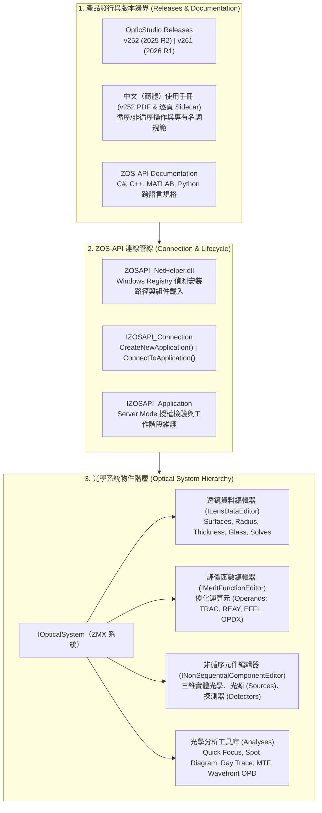

# Zemax OpticStudio 與 ZOS-API 主題字典

> 本主題深度整理 Zemax OpticStudio (Ansys 旗下光學設計旗艦軟體) 與其程式化擴充介面 ZOS-API 的核心架構。涵蓋 OpticStudio 產品線與版本標記規範、v252 中文（簡體）使用手冊與逐頁 Markdown sidecar 檢索體系、ZOS-API .NET/Python 雙軌連線生命週期、循序 (Sequential) 與非循序 (Non-Sequential) 光學物件階層、透鏡資料編輯器 (LDE)、評價函數 (MFE) 操作及 Quick Focus 官方基準範例。相關光學與微納光子學整合請參閱 [Lumerical 主題字典](lumerical.md)、[Speos 主題字典](speos.md) 與 [AnsysEM 主題字典](ansysem.md)。

---

## 領域架構圖 (OpticStudio & ZOS-API Architecture)



---

## 主題辭典與核心模組

### 1. OpticStudio 產品與版本標示

#### 核心概念與辭典定義 (Core Concepts & Glossaries)
- **產品線版本演進與雙重標籤 (Product Release Boundaries)**：
  - **產品版號 (Product Release)**：OpticStudio 採用年度發行標記，例如 `2025 R2`（內部標記為 `v252`）與 `2026 R1`（內部標記為 `v261`）。
  - **API 組件版號 (ZOS-API Assembly Version)**：ZOS-API 作為 .NET 程式庫，其二進位介面組件 (`ZOSAPI.dll`, `ZOSAPI_Interfaces.dll`) 具有獨立的組件版本與建置編號（例如 `v252` 對應 2025 R2 SP02；`v261` 對應 2026 R1）。
  - **版本分離原則**：產品發行版號、ZOS-API 文件版號與本機實際安裝的 OpticStudio build 必須分開驗證；不可將 v261 API 文件所述的最新特性推定相容於 v252 或更早版本。
- **授權層級 (Edition Tiers)**：
  - **Standard**：基礎循序光學透鏡設計與像差優化。
  - **Professional**：增加基礎非循序光學追跡與偏振分析。
  - **Premium / Enterprise**：完整支援 CAD 雙向匯出入、自由曲面 (Freeform Surfaces)、高階雜散光分析、光熱效能 (STOP) 與完整 ZOS-API 自動化。

#### 官方手冊章節與規格出處 (Manual & Doc Citations)
- **手冊來源**：*OpticStudio Developer Portal & v252 Manual*
- **章節定位**：
  - Developer Portal Overview: `sources.csv#ansys_a8d6a90b66f20d654fb896a9`
  - v252 User Manual Release Notes: `sources.csv#ansys_cee9d96acf92045606853b99`
- **資料庫引用標籤**：`sources.csv#ansys_a8d6a90b66f20d654fb896a9`, `sources.csv#ansys_cee9d96acf92045606853b99`

#### 產品與版本檢查腳本 (Python Scripting Example)
```python
# ==============================================================================
# ZOS-API: Check Installed OpticStudio Version and Edition
# Note: ASCII-only comments to prevent IronPython encoding issues.
# ==============================================================================
import clr
import winreg

# Query Windows Registry for OpticStudio installation path
reg_path = r"Software\Zemax"
try:
    with winreg.OpenKey(winreg.HKEY_CURRENT_USER, reg_path) as key:
        install_dir, _ = winreg.QueryValueEx(key, "ZemaxRoot")
        print("Detected OpticStudio Install Directory: {0}".format(install_dir))
except WindowsError:
    print("Warning: OpticStudio registry key not found in HKCU.")
```

#### 工程實務踩坑指南 (Gotchas & Limitations)
1. **API 組件與安裝版本失配 (Assembly Version Mismatch)**：若在 Python 腳本中引用了較新版本（如 v261）的 `ZOSAPI.dll`，但本機背景安裝執行的為舊版（如 v252）OpticStudio 伺服器，將在建立連線時引發 `COMException` 或 `TypeLoadException`。務必使用 `ZOSAPI_NetHelper` 自動解析本機匹配路徑。

---

### 2. 中文（簡體）使用手冊 PDF 與頁碼 sidecar

#### 核心概念與辭典定義 (Core Concepts & Glossaries)
- **中文使用手冊（v252 User Manual zh）**：
  - 本地收錄 `OpticStudio_UserManual_zh.pdf`（Release 2025 R2 / v252）；sidecar 抽出的本文使用簡體中文。來源取得及授權狀態尚未核實，檔名 `zh` 本身也不能證明地區版本。
  - **逐頁 Markdown Sidecar 檢索**：文字 sidecar 以 `PDF Page N` 實體頁碼標記；頁標連續且機械檢查未發現空文字頁，但未測搜尋延遲，也未驗證字元、公式、圖表或表格的抽取準確度。
- **光學核心專有名詞標準術語表 (Standard Optical Glossaries)**：
  - **LDE (Lens Data Editor)**：透鏡資料編輯器，定義折射/反射面曲率半徑、厚度、玻璃材質、圓錐常數及半直徑。
  - **MFE (Merit Function Editor)**：評價函數編輯器，以數值運算元 (Operands) 定義優化目標與權重。
  - **NSC (Non-Sequential Component)**：非循序元件編輯器，支援任意三維空間實體、散射模型、探測器與雜散光分析。
  - **EPD (Entrance Pupil Diameter)**：入瞳直徑，決定系統集光能力與數值孔徑 (NA)。
  - **Primary Wavelength & Field**：主波長（通常為 d 光 587.6 nm）與視場設定（視場角、物高）。
  - **Quick Focus**：快速聚焦工具，自動微調指定透鏡厚度以達到最小光斑半徑。

#### 官方手冊章節與規格出處 (Manual & Doc Citations)
- **手冊來源**：*OpticStudio v252 中文（簡體）使用手冊*
- **章節定位**：
  - [v252 中文（簡體）OpticStudio User Manual PDF](../ANSYS_Document/Zemax/v252/manuals/OpticStudio_UserManual_zh.pdf) · `ansys_cee9d96acf92045606853b99`
  - [頁碼 Markdown sidecar](../ANSYS_Document/_catalog/pdf_text_v4/a5fe1e5f371c37acc95abad088b9b5220414753a3a49739a5532090cc6ddea50.md)
- **資料庫引用標籤**：`sources.csv#ansys_cee9d96acf92045606853b99`

#### 工程實務踩坑指南 (Gotchas & Limitations)
1. **圖表與光路圖人工核對原則**：Sidecar 文字檢索專注於參數定義與操作步驟；複雜的光線追跡扇形圖 (Ray Fan Plots)、干涉圖樣 (Interferograms) 與機械公差圖表，受限於純文字抽取，在進行高精度量產公差分配時，仍應回到原 PDF 實體頁碼視覺核對。

---

### 3. ZOS-API release 入口

#### 核心概念與辭典定義 (Core Concepts & Glossaries)
- **ZOS-API 四大執行模式 (Execution Modes)**：
  - **Standalone Mode (獨立模式)**：外部程式透過 ZOS-API .NET/COM 連線介面啟動背景 OpticStudio instance；官方文件將 `CreateNewApplication()` 描述為啟動 headless instance，並明確指出仍需有效授權。此處來源未提及 gRPC，不應把 gRPC 當成已確認的連線方式。
  - **User Extensions (使用者擴充)**：從 OpticStudio GUI 主選單的 `Extensions` 啟動，可在外部程式視窗中即時讀取並修改當前已開啟的光學系統。
  - **User Analysis (自訂分析)**：在 GUI 內部以圖表視窗形式嵌入自訂的偏振、波動光學或特殊探測器後處理。
  - **User Operands (自訂運算元)**：在評價函數編輯器中自訂 DLL 運算元，即時介入局部或全域優化循環。
- **NetHelper 連線引導管線 (Connection Pipeline)**：
  - 透過 `ZOSAPI_NetHelper.dll` 的 `ZOSAPI_Initializer.Initialize()` 自動定位安裝目錄並載入二進位依賴項；
  - 建立 `IZOSAPI_Connection`，呼叫 `CreateNewApplication()` 取得 `IZOSAPI_Application`；
  - 存取主光學系統 `application.PrimarySystem`。
- **生命週期與釋放原則**：
  - Standalone 模式結束時，必須明確釋放 Application 物件（在 Python 中呼叫 `del zos` 或在 C# 中調用 `FinishStandaloneApplication()`），否則後台 `OpticStudio.exe` 伺服器進程將長期殘留並佔用授權。

#### 官方手冊章節與規格出處 (Manual & Doc Citations)
- **手冊來源**：*ZOS-API Reference (v252 & v261)*
- **章節定位**：
  - v252 API Introduction: [v252 ZOS-API Index](../ANSYS_Document/Zemax/v252/api_reference/0101b6c3fdc0-index.md) · `ansys_4088c338ca97a11c08745788`
  - v261 API Introduction: [v261 ZOS-API Index](../ANSYS_Document/Zemax/v261/api_reference/362a6a6afcba-index.md) · `ansys_aab461b941fe7d1abdaf66f4`
  - Previous Releases: [Previous Releases Overview](../ANSYS_Document/Zemax/unknown/guide/9cd326f9597e-previous.md) · `ansys_008933dde3ceeb3ca2f1d9a5`
- **資料庫引用標籤**：`sources.csv#ansys_008933dde3ceeb3ca2f1d9a5`, `sources.csv#ansys_4088c338ca97a11c08745788`, `sources.csv#ansys_aab461b941fe7d1abdaf66f4`

#### 連線與生命週期範例 (Python Standalone Script)
```python
# ==============================================================================
# ZOS-API Python Standalone Connection Template
# Note: ASCII-only comments to prevent IronPython encoding issues.
# ==============================================================================
import os
import sys
import clr

# Step 1: Initialize NetHelper to register assemblies
# Typically ZOSAPI_NetHelper.dll resides in the OpticStudio installation folder
net_helper_path = r"C:\Program Files\Ansys Zemax OpticStudio 2026 R1"
if net_helper_path not in sys.path:
    sys.path.append(net_helper_path)

clr.AddReference("ZOSAPI_NetHelper")
import ZOSAPI_NetHelper

# Resolve OpticStudio installation directory
success = ZOSAPI_NetHelper.ZOSAPI_Initializer.Initialize()
if not success:
    raise RuntimeError("Failed to locate and initialize OpticStudio installation.")

# Step 2: Load core API assemblies
clr.AddReference("ZOSAPI_Interfaces")
clr.AddReference("ZOSAPI")
import ZOSAPI

# Step 3: Create standalone connection
connection = ZOSAPI.ZOSAPI_Connection()
application = connection.CreateNewApplication()

try:
    # Verify server license status
    if not application.IsValidLicenseForAPI:
        raise RuntimeError("Valid OpticStudio license for API was not found.")

    system = application.PrimarySystem
    print("ZOS-API Connected. Optical System initialized in Standalone Mode.")
    print("Current File Path: {0}".format(system.SystemFile))

finally:
    # Step 4: Always shut down application to release server process and license
    application.CloseApplication()
    del application
    del connection
    print("OpticStudio session terminated successfully.")
```

#### 工程實務踩坑指南 (Gotchas & Limitations)
1. **孤兒伺服器進程堆積 (Orphaned Server Leak)**：若在 Python 交互式工作區 (Jupyter Notebook / IPython) 中頻繁建立 Standalone 連線且未呼叫 `CloseApplication()`，作業系統工作管理員中將累積大量未釋放的 `OpticStudio.exe` 背景進程，最終導致本機授權被全數佔用而無法開啟新檔案。

---

### 4. API 概念與待人工檢視範圍

#### 核心概念與辭典定義 (Core Concepts & Glossaries)
- **`IOpticalSystem` 系統中樞結構**：
  - 官方 v261 `Getting Started` 將 `IOpticalSystem` 說明為對應一個 ZMX 檔案；本地材料不足以核實 `.ZOS` 的格式與此物件關係，該格式主張待查。
- **透鏡資料編輯器 (ILensDataEditor, LDE)**：
  - 透過 `LDE.GetSurfaceAt(index)` 操作光學表面。
  - 表面參數包含：曲率半徑 (`Radius`)、厚度 (`Thickness`)、玻璃材質 (`Material`)、圓錐常數 (`Conic`)、半直徑 (`SemiDiameter`)。
  - **求解型別 (Solves)**：例如在最後表面曲率半徑設定 `FNumber=10` Solve，或在透鏡間距設定邊緣光線邊界 Solve。
- **評價函數編輯器 (IMeritFunctionEditor, MFE)**：
  - 操作優化目標運算元：如 `TRAC` (光線追跡座標)、`EFFL` (有效焦距)、`OPDX` (光程差)、`SPHA` (球差貢獻)。
- **分析與優化演算法 (Analyses & Optimizers)**：
  - **Quick Focus**：自動微調指定厚度以最小化徑向光斑尺寸 (`SpotSizeRadial`, `UseCentroid=True`)。
  - **光線追跡 (Ray Tracing)**：`system.Tools.OpenBatchRayTrace()` 支援大量光線追跡與相空間分佈抽取。

#### 官方手冊章節與規格出處 (Manual & Doc Citations)
- **手冊來源**：*ZOS-API Object Model & Interfaces (v261)*
- **章節定位**：
  - `IZOSAPI_Application`: [v261 Application API](../ANSYS_Document/Zemax/v261/api_reference/019b2af77903-interface_z_o_s_a_p_i_1_1_i_z_o_s_a_p_i___application.md) · `ansys_efe451eaf56eaff47a53d97d`
  - `IOpticalSystem`: [v261 OpticalSystem API](../ANSYS_Document/Zemax/v261/api_reference/6df0582450bf-interface_z_o_s_a_p_i_1_1_i_optical_system.md) · `ansys_eb90d82380073725e4dd5a1a`
  - `IZOSAPI_Connection`: [v261 Connection API](../ANSYS_Document/Zemax/v261/api_reference/5fa8060fd40a-interface_z_o_s_a_p_i_1_1_i_z_o_s_a_p_i___connection.md) · `ansys_94ce4148c458138a4ac87141`
- **資料庫引用標籤**：`sources.csv#ansys_c3c40c27cfb2772be9cc9934`, `sources.csv#ansys_efe451eaf56eaff47a53d97d`, `sources.csv#ansys_eb90d82380073725e4dd5a1a`

#### 雙膠合透鏡建模與 Quick Focus 範例 (Python Scripting Example)
```python
# ==============================================================================
# ZOS-API: Create Singlet Lens in LDE, Apply F/# Solve, and Run Quick Focus
# Note: ASCII-only comments to prevent IronPython encoding issues.
# ==============================================================================
import clr
import ZOSAPI

def create_singlet_and_focus(TheSystem):
    # Step 1: Clear current system and create a new lens file
    TheSystem.New(False)
    
    # Step 2: Set System Aperture to Entrance Pupil Diameter = 40 mm
    sys_aperture = TheSystem.SystemData.Aperture
    sys_aperture.ApertureValue = 40.0
    
    # Step 3: Add FdC visible wavelength preset
    wavelengths = TheSystem.SystemData.Wavelengths
    wavelengths.AddWavelength(0.5875618, 1.0) # d-line
    
    # Step 4: Access Lens Data Editor (LDE)
    TheLDE = TheSystem.LDE
    
    # Insert Surface 1 (Front surface of lens)
    surf1 = TheLDE.InsertNewSurfaceAt(1)
    surf1.Comment = "Lens Front"
    surf1.Radius = 100.0
    surf1.Thickness = 10.0
    surf1.Material = "N-BK7"
    
    # Surface 2 (Back surface of lens)
    surf2 = TheLDE.GetSurfaceAt(2)
    surf2.Comment = "Lens Back"
    surf2.Radius = -100.0
    surf2.Thickness = 90.0 # Initial distance to image plane
    
    # Step 5: Run Quick Focus on Surface 2 thickness
    quick_focus = TheSystem.Tools.OpenQuickFocus()
    quick_focus.Criterion = ZOSAPI.Tools.General.QuickFocusCriterion.SpotSizeRadial
    quick_focus.UseCentroid = True
    quick_focus.RunAndWaitForCompletion()
    quick_focus.Close()
    
    focused_thickness = surf2.Thickness
    print("Quick Focus completed. Optimized Back Focal Distance: {0:.4f} mm".format(focused_thickness))

    # Step 6: Save design file
    save_path = r"C:\Models\singlet_focused.zos"
    TheSystem.SaveAs(save_path)
    print("Optical system saved to: " + save_path)
```

#### 工程實務踩坑指南 (Gotchas & Limitations)
1. **.NET 二維陣列在 Python 索引的維度轉置**：官方 v261 Python Example 01 的 `reshape()` 以 `GetLength(0)`、`GetLength(1)` 取得維度，並將轉置設為選用參數；文件只指出某些多維線列資料（例如 FFT PSF）需要轉置。因此，不應推定所有 `System.Double[,]` 都必須轉置，需依個別 API 的維度定義驗證。
2. **循序與非循序坐標系差異**：在 LDE (循序模式) 中，每個表面位置以前一個表面為基準並沿著光軸 ($Z$ 軸) 累計厚度；而在 NSC (非循序模式) 中，每個物件具有獨立的三維全域或局部坐標系 ($X, Y, Z$ 偏置與倾斜角)，切勿將 LDE 的厚度觀念直接套用於 NSC 物件擺放。

---

### 5. v261 官方範例：建立新檔與 Quick Focus (Example 01)

`Example 01: New File and QuickFocus` 示範建立並儲存 lens file、調整 aperture、加入 field point、選擇 FdC wavelength preset、修改 Lens Data Editor 中的 comment／thickness／radius、在最後一面半徑設定 F/# solve，最後開啟並執行 Quick Focus。

#### v261 Python 範例步驟
Python standalone 範例先用 Windows Registry 尋找 `ZOSAPI_NetHelper.dll`，初始化已安裝的 OpticStudio（或指定安裝路徑），載入 `ZOSAPI.dll` 與 interfaces，建立 standalone connection 和 application，檢查 API license，並取得 primary system。範例明確處理初始化、連線、授權及 system 不存在等例外。

範例接著以 `TheSystem.New(False)` 建立新系統並存至 `SamplesDir\API\Python\e01_new_file_and_quickfocus.zos`；載入 SCHOTT catalog、將 aperture value 設為 40、透過 `GetField(1)` 新增 `(0, 5.0, 1.0)` field，並選用 `d_0p587` wavelength preset。Lens Data Editor 插入兩個 surfaces，設定 thickness、comment、radius `100` 與 material `N-BK7`，再於 surface 3 的 radius 設定 `FNumber=10` solve。最後使用 `SpotSizeRadial`、`UseCentroid=True` 執行 Quick Focus，等待完成、關閉工具並儲存。

#### v261 C# 範例步驟
C# standalone 範例初始化 OpticStudio 與 API connection，檢查授權有效且 `Mode == Server`，再取得 primary system。建立 `SamplesDir\API\CS\e01_new_file_and_quickfocus.zos`，後續 aperture、field、wavelength、兩個 surfaces、N-BK7、F/# solve 與 Quick Focus 的流程與 Python 範例對應。正常結束時呼叫 `FinishStandaloneApplication` 關閉 API application。

來源：[v261 Example 01: New File and QuickFocus](../ANSYS_Document/Zemax/v261/api_reference/zemax-opticstudio-zos-api-2026-r1/apiexamples/example_01.md) · `ansys_21a702ce30f3cf1c0f3f03d1`。

---

## 跨主題與模組雙向鏈結 (Cross-Topic References)
- [Lumerical 知識字典](lumerical.md)：微納光子學、超穎透鏡 (Metalens) 與 FDTD 波動光學至 OpticStudio 光線追跡整合。
- [Speos 知識字典](speos.md)：高階照度分析、光學人眼視覺感知與雜散光渲染。
- [AnsysEM 主題字典](ansysem.md)：多物理系統級整合與高頻電磁場分析。

### ZOS-API 連線選擇與文件範圍（官方 v261）

`IZOSAPI_Connection` 是建立 ZOS-API 工作階段的入口。官方 v261 文件將用途分為兩種：外部 standalone 程式呼叫 `CreateNewApplication()` 啟動不可見的 OpticStudio instance，且仍需有效授權；由 OpticStudio 啟動的 plugin、user analysis 與 user operand 則呼叫 `ConnectToApplication()` 連接既有 instance。後者若呼叫情境不是由 OpticStudio 啟動，會連線失敗。這些方法定義可回查 [IZOSAPI_Connection v261](../ANSYS_Document/Zemax/v261/api_reference/5fa8060fd40a-interface_z_o_s_a_p_i_1_1_i_z_o_s_a_p_i___connection.md) 的 `ConnectToApplication`、`CreateNewApplication` 段落（文件更新日 2026-03-13）。

官方目前可讀的 [ZOS-API 2026 R1 入口](https://developer.synopsys.com/docs/zemax-opticstudio-zos-api-2026-r1/index.md) 說明其涵蓋 classes、methods、properties、enums，提供 C#、C++、MATLAB、Python 範例，且示例不會逐一實作全部介面或成員；其 `Getting Started` 將 `IOpticalSystem` 描述為對應單一 ZMX 檔案的主類別。官方入口也說明 ZOS-API 是 Windows 上的 COM-enabled .NET library。這是文件導航與範例範圍說明，不代表本字典已逐一核對完整 API，也不代表範例已在 OpticStudio 中執行。

**版本差異及使用界線：**目前在本機可回查 v261（2026 R1）與 v252（2025 R2）文件；官方 v252 API 入口更新日為 2025-07-16，v261 入口更新日為 2026-03-13。這裡只確認兩版入口皆有多語言 API 參考、範例與連線導覽；未逐成員比較 API 差異，不能據此推定方法、參數或二進位組件跨版本相容。官方 v261 與 v252 入口均標示：範例只展示部分介面成員；Support license 不涵蓋除錯使用者自製程式碼。較舊 Extensions 被標示為 deprecated，官方建議新專案使用 ZOS-API。

來源： [2026 R1 ZOS-API Introduction](https://developer.synopsys.com/docs/zemax-opticstudio-zos-api-2026-r1/index.md)（2026-03-13）、[2025 R2 ZOS-API Introduction](https://developer.synopsys.com/docs/zos-api-interface-2025-r2/index.xhtml)（2025-07-16）、[OpticStudio Developer Portal](https://developer.synopsys.com/docs/zemax)（Windows / COM-enabled .NET 說明）、[Previous releases](https://developer.synopsys.com/docs/zemax/previous)。

> **整理狀態：**此字典仍含未逐條重新核實的既有內容。尤其授權版本功能矩陣、API assembly/build 對應、`.ZOS` 檔案格式、Python 陣列維度、授權釋放與背景程序行為，以及範例程式能否直接執行，均應視為待查事項；請以對應產品版本的官方來源或實際執行證據確認後再用於工程決策。


### v252 中文（簡體）使用手冊：序列／非序列建模、Quick Focus 與 Merit Function

以下條目逐頁核對本地 v252 中文（簡體）使用手冊 PDF 及其頁標 sidecar；PDF 的書內頁碼與 sidecar 的實體頁標一致。

- **序列模式 (Sequential Mode)**：表面依設計順序追跡，光線依指定路徑逐面傳遞，手冊指出其運算較簡單、速度較快，適合一般成像系統。
- **非序列模式 (Non-sequential Mode, NSC)**：依光線與三維物件的實際相交順序追跡；光線可多次碰到同一物件或略過其他物件。手冊以棱鏡、導光管、反射器及散射／雜散光分析為例。混合模式使用入口／出口 port，並可接續序列光路；完整 NSC 模式則由 NSC 光源發射並以探測器物件取得分布。選擇模式會影響光源、探測器、可用分析及能量解讀，不能只視為不同的編輯器外觀。
  - 來源：v252 簡體中文手冊，`PDF Page 357–358`（章節 `Non-sequential Overview`）。
- **快速聚焦 (Quick Focus)**：位於 Optimize > Manual Adjustment。它調整像面前一個表面的厚度，使所選標準下的 RMS 達到最佳。標準包括 Spot Size Radial、X-only、Y-only 與 Wavefront Error；`UseCentroid` 以像面質心而非主光線作參考，會增加計算時間。手冊另指出，非軸對稱系統須能在所有視場追跡主光線才可使用；RMS 通常依指定視場、波長及權重計算多視場／多波長結果。
  - 來源：v252 簡體中文手冊，`PDF Page 1035–1036`（章節 `Quick Focus`）。
- **評價函數編輯器 (Merit Function Editor, MFE)**：用操作數及其欄位定義、檢查系統優化目標。手冊列出 `Int1`、`Int2` 與 `Data1`–`Data6` 欄位，但明確說明不是每個操作數都使用全部欄位。操作數依一階性能、像差、MTF、鏡頭／玻璃限制、光線資料、數學運算等用途分類；選用操作數仍須查該操作數本身的欄位定義，不能把分類表當作操作數完整規格。
  - 來源：v252 簡體中文手冊，`PDF Page 1039–1041`（章節 `Merit Function Editor` 與 operands summary）。
- **非序列光度學／輻射度學單位**：手冊區分 NSC 光源單位與探測器分析顯示單位。前者描述光源通量／能量（例如 W、lm、J），後者描述探測器照度／輻照度或能量密度（例如每面積單位）；lm 與 W 的物理意義不同，不能只按數值大小互換。
  - 來源：v252 簡體中文手冊，`PDF Page 168`（章節 `Lens Units and Source Units`）。

### v261 官方 Python Example 01：New File and QuickFocus

本機 `example_01.md` 是範例導覽頁，僅列操作摘要與語言連結；Python 程式正文目前由官方網址提供，未快取至本機。依官方 Python 頁面核對，範例先從 Windows Registry 的 `Software\Zemax` 取得安裝根目錄、載入 `ZOSAPI_NetHelper` 並初始化，再建立 standalone connection、檢查 API 授權及 `PrimarySystem`。主流程建立 `.zos` 樣本檔、加入 SCHOTT catalog、設定 aperture、視場與 d-line wavelength，修改 LDE 表面，在第三面的 radius 設 `FNumber=10` solve，執行 `SpotSizeRadial` 且 `UseCentroid=True` 的 Quick Focus，最後儲存。範例結束時刪除 Python 包裝物件以清理連線；這是範例流程摘要，尚未在本機 OpticStudio 執行。

來源：[官方 v261 Example 01 Python](https://developer.synopsys.com/docs/zemax-opticstudio-zos-api-2026-r1/apiexamples/example_01_py.md)（頁面更新 2026-03-09）；本地導覽頁 `sources.csv#ansys_21a702ce30f3cf1c0f3f03d1`。

> **本輪內容審閱狀態：**逐頁核讀 v252 簡體中文手冊的 `PDF Page 168, 357–358, 1035–1041`，並核讀官方 v261 Python Example 01 網頁；上述內容只涵蓋這些章節與單一範例。其餘 PDF 頁面、日文與英文手冊、其餘 811 份 Markdown 來源及授權層級／版本相容性主張仍未逐份語意核對。


## 2026-11-04：本機 PDF／HTML 轉換與檢索補齊

本批固定核對 catalog 的 814 筆來源：811 份既有 Markdown 與 3 份 PDF。原件 SHA、正文檔案與索引 metadata 均對應；沒有本機 HTML 原件列於這批 catalog，也沒有程式附件待抽取。完整來源清冊已補齊；這只完成機械盤點，原先待覆核的產品分級、二進位相容性及廣泛操作主張仍保留待覆核。

| PDF 原件 | catalog release | 實體頁數 | 既有轉換 |
| --- | --- | ---: | --- |
| [英文手冊](../ANSYS_Document/Zemax/unknown/manuals/OpticStudio_UserManual_en.pdf) | unknown；封面 Version 2026 R1，未改 catalog | 1,871 | cache／同名 Markdown bytes 相同，頁標連續 |
| [日文手冊](../ANSYS_Document/Zemax/v252/manuals/OpticStudio_UserManual_ja.pdf) | v252 | 2,019 | cache／同名 Markdown bytes 相同，頁標連續 |
| [中文（簡體）手冊](../ANSYS_Document/Zemax/v252/manuals/OpticStudio_UserManual_zh.pdf) | v252 | 1,760 | cache／同名 Markdown bytes 相同，頁標連續 |

三份共 5,650 頁，沿用 `PDF Page N` 定位；不重新轉檔。少於 100 字元的快取頁為英文 1871、日文 1926／2019、中文 104／1438；只列低文字量，未判為掃描頁。三份 PDF 沒有來源 URL，取得途徑與分享權限仍待確認；圖片、表格、公式及閱讀順序尚未逐頁視覺驗收。

Example 01 landing 連結的五個官方語言 HTML 子頁已保存原始 HTML，並轉成可檢索 Markdown；五個 `pre` 程式碼區塊與轉換正文逐字一致，頁面均標示 Last update: 09.03.2026。這補齊前文「語言子頁正文未快取」的缺口。原始 HTML 及其衍生文字保留在受保護的本機目錄，範例未執行。

| 語言 | 本機可檢索正文 | 來源 ID |
| --- | --- | --- |
| Python | [Example 01 - Python](ANSYS_Document/Zemax/v261/tutorial/official_example_01_py.md)；[官方頁](https://developer.synopsys.com/docs/zemax-opticstudio-zos-api-2026-r1/apiexamples/example_01_py.md) | `sources.csv#official_zosapi_example_01_py_v261` |
| C# | [Example 01 - C#](ANSYS_Document/Zemax/v261/tutorial/official_example_01_cs.md)；[官方頁](https://developer.synopsys.com/docs/zemax-opticstudio-zos-api-2026-r1/apiexamples/example_01_cs.md) | `sources.csv#official_zosapi_example_01_cs_v261` |
| C++ | [Example 01 - C++](ANSYS_Document/Zemax/v261/tutorial/official_example_01_cpp.md)；[官方頁](https://developer.synopsys.com/docs/zemax-opticstudio-zos-api-2026-r1/apiexamples/example_01_cpp.md) | `sources.csv#official_zosapi_example_01_cpp_v261` |
| Mathematica | [Example 01 - Mathematica](ANSYS_Document/Zemax/v261/tutorial/official_example_01_nb.md)；[官方頁](https://developer.synopsys.com/docs/zemax-opticstudio-zos-api-2026-r1/apiexamples/example_01_nb.md) | `sources.csv#official_zosapi_example_01_nb_v261` |
| Matlab | [Example 01 - Matlab](ANSYS_Document/Zemax/v261/tutorial/official_example_01_m.md)；[官方頁](https://developer.synopsys.com/docs/zemax-opticstudio-zos-api-2026-r1/apiexamples/example_01_m.md) | `sources.csv#official_zosapi_example_01_m_v261` |

詳細來源、頁碼、URL 狀態與實測證據見 [本批轉換報告](../maintenance/knowledge_dictionary_passes/2026-11-04/zemax_module_conversion_report_20261104.md)。其餘網站及官方語言範例未全部擷取，未推定可執行性或跨版本相容性。
