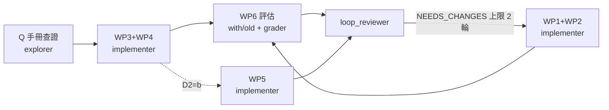

# Skills 知識歸納實作計畫（2026-10-16，草案 v3 → 2026-10-17 已完成）

狀態：**已完成**。WP1–WP4 文件工作與 WP6 評估已執行並通過 loop_reviewer 第 2 輪 Claims-Evidence 門禁審查（PASS）。WP5（程式碼變更）依 D2 決議本輪不執行，列入待分類。
依循：`D:\Ikaros\skill-creator`（progressive disclosure、evals 迭代）、`D:\Ikaros\mcp-builder`（命名、annotations、可行動錯誤）、專案 steering（SKILL.md ≤150 行、防過擬合、Maker-Checker）。
v1 → v2：依 loop_reviewer 審查修正 WP6 grading 流程、WP5 annotations、既有 cfile 指令清單、鏡像同步、版權邊界，並刪減過度設計。
v2 → v3：修正 WP6 目錄佈局（`eval-*/<config>/run-*`、`new_skill`/`old_skill` 排序）、`sync_skills.ps1` 實際無作用的描述與 D5 選項。

## 執行結果摘要（2026-10-17）

- **D1-D5 決議**：D1(a) 路由列、D2(a) 本輪僅文件、D3 無法提供 GUI cfile 故不建 assets 模板、D4(a) 僅留技術結論、D5(a) 不動全域副本。
- **WP1/WP2**：已於 commit `bf25b09` 完成（6 份 SKILL.md 路由列 + `ansys-mesh/references/sizing_strategy_and_quality_workflow.md`），本輪另補齊 Bias Factor/Growth Rate 關係、MultiZone/Hex Dominant/Sweep 分區策略、課程範例「單一範例」標註 3 項缺漏，SKILL.md 根檔維持 148 行未超標。
- **WP3/WP4**：`ansys-ls-prepost/references/gui_result_review_sop.md`、`ansys-lsdyna/references/solver_execution_lsrun.md` 已完成，出處標註至官方手冊 chunk 層級，未驗證內容明確標記。
- **WP6**：ansys-mesh、ansys-ls-prepost、ansys-lsdyna 三個 skill 的 new_skill vs old_skill benchmark 通過率分別為 100%/44%、100%/33%、100%/55%，均達通過條件。
- **軌道 B（SKILL.md 瘦身，本任務追加範疇）**：實測 `agents/skills/` 下全部 37 份 SKILL.md 行數為 39–148 行，均 ≤150 行，無超標項目，**取消執行**（原盤點報告「28 份超標」為誤判，已於 `docs/reviews/2026-10-17-project-wide-inventory.md` 更正）。
- **待分類技術債**：`ansys-mesh/SKILL.md` 148/150 行逼近上限，日後新增路由列前須先搬移既有內容釋出餘裕；`aggregate_benchmark.py` 於 cp950 環境須加 `-X utf8` 旗標。

---

## 1. 來源盤點（實測）

| 來源 | 規模 | 性質 | 抽取 |
|---|---|---|---|
| `docs/api_inventory/` | 5 檔、25.8 MB | API 快照（v251），已編進 APIKB | 不需再抽 |
| `Documentation_clean/api_kb.sqlite` | symbols 3,362、members 10,668、edges 35,017 | APIKB 索引 | SQL 統計 |
| `Ansys_Mesh_課程心得.docx` | 45 段、2,574 字、12 張圖 | 個人課程筆記（Meshing Intro 2025R2） | `.tmp_extract/mesh_docx.md` |
| `LS-PrePost_Result_SOP.pptx` | 25 頁、16,066 字元 | GUI SOP，改寫自 LS-PrePost UG 2026R1（附頁碼） | `.tmp_extract/lspp_pptx.md` |
| `LS-Run_Setup_Guide.pptx` | 22 頁、12,969 字元 | 訓練教材，改寫自 LS-Run UG 2025R1（附頁碼） | `.tmp_extract/lsrun_pptx.md` |

`.tmp_extract/` 已加入 `.git/info/exclude`。

| APIKB product | symbols | 主要命名空間 |
|---|---|---|
| mechanical | 1,728 | `Ansys.ACT.Automation.Mechanical`（867）、`Ansys.Mechanical.DataModel.Enums`（627） |
| spaceclaim | 1,214 | `SpaceClaim.Api.V251.Scripting` |
| optislang | 374 | `ansys.optislang.core.tcp`（239）、`settings`、`project_parametric`、`nodes` |
| lsdyna | 46 | `*CONTROL_*` keyword 卡；LS-PrePost 僅 2 個符號 |

---

## 2. 關鍵發現

1. **APIKB 與文件檢索工具存在，但沒有任何 SKILL.md 引用**（reviewer 對 48 份 SKILL.md grep 為 0）。references 層只有 3 處提到 `search_ansys_docs`（`ansys-spaceclaim/references/design_and_bodies.md:28-29`、`session.md:32`、`ansys-mechanical/references/act_scripting_foundation.md:160`），`api_*` 工具 0 處。工具：`api_search / api_get / api_path / api_validate_script`（`tools/apikb_tools.py:13,31,52,70`）、`search_ansys_docs / get_ansys_doc_chunk`（`tools/docs_tools.py:21,39`，26 份手冊，含 `LS-Run_Users_Guide`、`Ansys_LS-PrePost_Users_Guide`、`lsppscripting`）。api_inventory 該做的是「讓 skill 叫工具查」，不是複製內容。
2. **LS-DYNA / LS-PrePost 在 APIKB 很薄**，cfile 語法要用 `search_ansys_docs` 或 GUI 錄製的 `lspost.cfile` 驗證。
3. **repo 已有一批用過的 cfile 指令**，可直接當驗證基準：`genselect target part`、`genselect allvis`、`print png … LANDSCAPE nocompress`（`ansys-ls-prepost/scripts/lspp_mvp_post_bga_eps.py:60,70,101,113`），`range userdef`、`range fringelimit`、`range pal hue max`、`range identmax`、`xyplot`（`references/python_module_interface.md:58-59`），以及 `runscript`、`runpython`、`SCLSwitchStateTo`、`SCLGetDataCenter*`。SOP 中的開檔、fringe component、section plane、measure、movie 對應指令仍未驗證。
4. **`dyna_solve` 缺口**（`products/dyna/tools.py:52-58`、`facade.py:186-191`）：只組 `i= ncpu= memory=`；負 `ncpu` 沒有阻擋也沒有說明（行為未宣告），沒有 SP/DP 選擇、沒有 sense switch。`sentinel_tools.py:36,59,74,90` 已提供非同步提交/狀態/tail/中止。
5. **`products/dyna/tools.py` 所有工具都沒有 MCP annotations**；`products/mechanical/tools.py:72,82,96,109` 已有四鍵標註慣例。
6. **Skills 有多處副本**：專案 `.kiro/skills` 是 junction 指向 `agents/skills`（唯一來源，`setup_skill_junctions.py:20-22`），改 `agents/skills` 會直接反映。全域 `~/.kiro/skills` 是另一份獨立副本，描述已與專案版不同。`sync_skills.ps1:3` 只認 `skills/` 或 `SKILLs/` 為來源，兩者都不存在，所以這支腳本目前什麼都不會做；它的目標也只有 `~/.gemini/config/skills`。換句話說，現在沒有可用的自動同步機制。
7. `ansys-mesh/SKILL.md` 已 145 行。

---

## 3. 歸納決策

### 3.1 不新建 skill

| 候選 | 判定 | 理由（skill-creator：觸發是否獨立、內容量） |
|---|---|---|
| LS-Run 設定 | 併入 `ansys-lsdyna` | 是「求解 LS-DYNA」的子流程，獨立會搶觸發 |
| LS-PrePost GUI SOP | 併入 `ansys-ls-prepost` | 同一工具，該 SKILL.md 僅 27 行 |
| Meshing 課程 | 併入 `ansys-mesh` | 主題重疊 |
| API 查證 | 各 skill 路由表加一列（D1） | 每次使用都依附特定產品情境 |

### 3.2 去向總表

| WP | 來源 | 目標 | 動作 |
|---|---|---|---|
| WP1 | APIKB / docsearch | `ansys-mechanical`、`ansys-spaceclaim`、`ansys-optislang`、`act-extension-development`、`ansys-ls-prepost`、`ansys-lsdyna` SKILL.md | 路由表各加 1 列 |
| WP2 | 課程心得 | `ansys-mesh/references/sizing_strategy_and_quality_workflow.md`（新）＋路由 1 列；`ansys-mechanical/references/mesh.md` 加交叉引用 1 行 | 新增 |
| WP3 | LS-PrePost SOP | `ansys-ls-prepost/references/gui_result_review_sop.md`（新）；補強 `states_and_results.md`；路由 +2 列 | 新增＋補強 |
| WP4 | LS-Run 教材 | `ansys-lsdyna/references/solver_execution_lsrun.md`（新）；`shock-analysis-workflow/07-solve-monitor/SKILL.md` 路由 1 列 | 新增＋路由 |
| WP5 | 工具缺口 | `products/dyna/tools.py`、`facade.py` | 選做（D2） |
| WP6 | — | WP2–WP4 的 skill | skill-creator 評估 |

### 3.3 撰寫與版權邊界

- 來源投影片是改寫自 Ansys 官方手冊的內容。寫進 repo 時**用自己的話寫操作要點與陷阱**，附「手冊名＋章節/頁碼」出處，不逐字複製投影片句子，不放截圖。
- 詳細操作步驟以 `search_ansys_docs` 路由取代全文抄錄：reference 寫「做什麼、為什麼、陷阱」，細節讓 agent 查手冊。
- 防過擬合：不寫 WS02.1 / WS04.2 等課堂練習編號、個人心得句、主機名稱、帳號。

---

## 4. 各工作包規格

> **完成記錄**：WP1、WP2 已於 commit `bf25b09`（docs: 補齊 6 個 skill 的 APIKB/docsearch 查證路由與 3 份新 reference）完成並提交。`6e8cef9` 為後續另一筆 commit（docs: 以 NotebookLM 查證結果補強既有技能內容缺口），與 WP1/WP2 無關，不可誤引用為 WP1/WP2 完成 commit。

### WP1 APIKB / docsearch 路由

- 每份 SKILL.md 路由表加一列：「寫或改 ACT/SpaceClaim/optiSLang 腳本前，用 `api_search` 找類別、`api_validate_script` 檢查腳本；查手冊用 `search_ansys_docs`」，依產品調整 `product` 參數。
- 抽查 `ansys-mechanical`、`ansys-spaceclaim` references 中 10 個 API 名稱，用 `api_get` 驗證；查無者只回報，不在本 WP 修改。
- 驗收：grep 比對工具名稱與 `tools/*.py` 函式名一致；不跑 benchmark。

### WP2 Meshing（`ansys-mesh`）

新檔 `sizing_strategy_and_quality_workflow.md`：

1. Adaptive Sizing 當第一版網格：Resolution 1–7、Transition Fast/Slow 的成本差異（講義範例：節點約 1.7 萬 → 3.6 萬、元素 7.5 萬 → 18 萬，標註「單一範例，非通用倍率」）。
2. Sizing Function：Curvature、Proximity、Growth Rate。
3. Edge Sizing：Bias Factor 與 Growth Rate 的關係；Soft/Hard 差異；Hard 或 Bias 會覆蓋 Max Face Size 並在鄰近造成尺寸跳躍。
4. 品質量化流程：Element Quality、Error Limits = Aggressive Mechanical 的失敗行為、Target Element Quality、Mesh Metric 直方圖定位差元素、Quality Worksheet → Show Contours / Named Selection。
5. 幾何決定網格上限：Feature Detection + Suppress（以圓角半徑條件批次抑制）、Virtual Topology。
6. 方法選擇：MultiZone / Hex Dominant / Sweep（Source/Target）與分區策略。
7. 一行交叉引用：Resolution/Transition 可當網格收斂研究參數；代理模型資料篩選屬 `ansys-optislang`，不在此展開。

規則：
- 寫入前 grep 既有 4 份 references，已覆蓋者只寫交叉引用。explorer 的覆蓋判定部分沒有附行號，執行時重驗。
- 品質門檻數值以 `metrics_and_quality_standards.md` 為唯一來源，新檔不重複定義。
- 不新增 script。
- SKILL.md 長度規則：加入路由後若超過 150 行，把既有的長段說明移到 references，不刪路由列。

### WP3 LS-PrePost（`ansys-ls-prepost`）

新檔 `gui_result_review_sop.md`（每節：目的、選單路徑、陷阱、手冊頁碼）：

1. 載入結果：Binary Plot、Keyword+D3plot（局部/材料座標系應力需要 keyword）、Update（求解中刷新）、從 LS-Run 的 LSPP 按鈕開啟。
2. States：先跳到最大變形 state 再量測。
3. Fringe：Ndv；殼元素預設取所有積分點的最大值；Fringe Range Dynamic / Static / User（跨 state 比較用 Static）；讀 header 的 min/max 與 ID；引用數值前確認單位制。
4. Displacement Scale Factor：量測與出圖前重設為 1.0。
5. 量測：Dist N2N → History 繪圖；Nodal History；Separation（第一個 part 為參考、Axis、方向、殼厚、Tracer）。
6. Section Plane：FixS / FixM / Lagr（Lagr 最接近 `*DATABASE_CROSS_SECTION`）、定義方式、Clip、Project View、Meas、Force（需 shell resultants 或 `*DATABASE_CROSS_SECTION`）。
7. 輸出：Print、Movie、Save Post.db。
8. GUI → cfile 對照表：先填第 2 節第 3 點的已用指令，其餘經驗證才填，否則標「未驗證」。

補強 `states_and_results.md`：d3plot 時間解析度等於 state 數；高頻歷史用 d3thdt / binout / ASCII。

cfile 驗證協定（滿足其一才可進對照表）：
- `search_ansys_docs(doc="Ansys_LS-PrePost_Users_Guide" 或 "lsppscripting")` 找到語法原文，記錄 doc 與 chunk id。
- 使用者提供 GUI 操作後的 `lspost.cfile`（D3）。
- `assets/*.cfile` 模板只在「開檔 → fringe → 輸出圖片」整條路徑驗證後建立，並以 `dyna_run_prepost(dry_run=True)` 確認命令構造。

`dyna_run_prepost` 已接受 cfile 路徑或字串、有 dry_run 與 stdout/stderr 尾段，不新增工具。

### WP4 LS-Run（`ansys-lsdyna`）

新檔 `solver_execution_lsrun.md`：

1. LS-Run 是命令產生器：Preset Expression（`$SOLVER $INPUT $NCPU $MEMORY`）→ Preview 就是實際執行命令；對應到 `dyna_solve` 參數。
2. License type 預設 ANSYS；第一個以外的每個行程需 HPC license（SMP、MPP 皆同）。
3. NCPU：Max running proc. 設為核心數；負 NCPU 讓 SMP 結果可重現，CPU 時間最多約多 15%。目前 `dyna_solve` 會原樣傳遞負值，但未宣告此行為。
4. MEMORY AUTO 依節點數估算。
5. SMP vs MPP；Intel MPI（Windows/Linux）vs MS-MPI（僅 Windows）；MPP 結果用 LS-PrePost 檢視。
6. Job dependency（0 / job ID / -1）；關閉 Command window 時輸出到 `lsrun.stdout.txt`。
7. Sense switch：寫 `d3kil` 到輸入目錄；sw1 停止並寫 `d3dump`；用 simple restart 接續。
8. 風險：Re-run 會刪除既有結果檔。
9. Remote / WinHPC / 叢集前置條件（只寫通則）：共用檔案系統、路徑對應、UNC 路徑、同版本 Ansys 與 MPI。

命令列語法（`r=d3dump`、sense switch 代碼等）先用 `search_ansys_docs` 查 LS-DYNA Keyword Manual Vol. I Execution Syntax，查到才寫，並記錄出處。

### WP5 MCP 工具（選做，D2）

依 mcp-builder：擴充既有工具優先，不建 `dyna_solve_v2`。

| 變更 | 內容 |
|---|---|
| `products/dyna/tools.py` 全部工具補 annotations | 依 `products/mechanical/tools.py:72` 四鍵慣例（`readOnlyHint / destructiveHint / idempotentHint / openWorldHint`）。`dyna_solve`：`readOnlyHint=False, destructiveHint=False, idempotentHint=False, openWorldHint=False` |
| `dyna_solve` docstring 與參數 | 說明負 `ncpu` 的 SMP 一致性模式；新增 `precision: "dp" \| "sp" = "dp"`（預設維持現行行為）；找不到執行檔時回報已搜尋路徑 |

- 不新增 `dyna_sense_switch`：sense switch 只是往輸入目錄寫一個 `d3kil` 檔，WP4 文件說明做法即可，而且單元測試無法在真實求解器上驗證。若日後要做，annotations 用 `readOnlyHint=False, destructiveHint=True`（sw1 會終止求解）。
- SMP/MPP、MPI 選擇不做。
- 測試：`tests/unit/` mock subprocess，驗證命令字串與 annotations；不啟動真實求解器。
- 驗收：`ruff check .` 零錯誤、`pytest` exit 0、回傳沿用既有 `_envelope`。

### WP6 skill-creator 評估迴圈（WP2–WP4）

工作區：`agents/skills-workspace/<skill>-workspace/`（skill-creator 的 sibling 慣例；整個 `agents/skills-workspace/` 加入 `.git/info/exclude`）。

1. 修改前快照：`<skill>-workspace/skill-snapshot/`。
2. `agents/skills/<skill>/evals/evals.json`：每個 skill 3 題，例如：
   - ansys-ls-prepost：「d3plot 打開後要量兩個零件在撞擊瞬間的最小間隙，步驟？」
   - ansys-lsdyna：「LS-DYNA 跑到一半想停下來存 restart，之後再接著算，怎麼做？」
   - ansys-mesh：「Edge sizing 設 Hard 加 bias 之後旁邊網格尺寸跳很大，為什麼？」
3. 每題同一輪派出新版與舊版快照兩個 subagent。目錄佈局必須符合 `aggregate_benchmark.py:77-105`（目錄名須為 `eval-*`、config 下須有 `run-*`）：
   ```
   iteration-1/
   └── eval-<name>/
       ├── eval_metadata.json
       ├── new_skill/run-1/{outputs/, grading.json, timing.json}
       └── old_skill/run-1/{outputs/, grading.json, timing.json}
   ```
   config 用 `new_skill` / `old_skill`（腳本支援的命名）。腳本以排序後第一個 config 當主組（`aggregate_benchmark.py:100,206-208`），`new_skill` 排在 `old_skill` 前，delta 方向才正確；不可用 `with_skill` 搭 `old_skill`。
   `eval_metadata.json` 在 `eval-<name>/` 放一份（給 aggregate_benchmark），並複製到各 `run-*/`（`generate_review.py` 只在 run 目錄與其上一層找，否則審閱頁會顯示 No prompt found）。
4. subagent 完成時立即寫 `timing.json`（total_tokens、duration_ms、total_duration_seconds）。
5. 派 grader subagent 依 `D:\Ikaros\skill-creator\agents\grader.md` 評分，產生每個 run 的 `grading.json`（欄位 `text / passed / evidence`）。可程式檢查的 assertion 用腳本判定，例如：有提到 Separation、有提醒 Scale Factor 回 1.0、有提到 `d3kil` 與 sw1、cfile 指令都在驗證清單內。
6. 在 `D:\Ikaros\skill-creator` 目錄執行 `python -m scripts.aggregate_benchmark <workspace>/iteration-1 --skill-name <skill>`。
   > [!NOTE]
   > 在 cp950 編碼環境（Windows 預設終端編碼）下必須改用 `python -X utf8 -m scripts.aggregate_benchmark <workspace>/iteration-1 --skill-name <skill>`，否則腳本輸出含非 cp950 可編碼字元時會以 exit code 1 崩潰。
7. `python D:\Ikaros\skill-creator\eval-viewer\generate_review.py <workspace>/iteration-1 --skill-name <skill> --benchmark <...>/benchmark.json --static <html>`，給使用者審閱。
8. 通過條件：new_skill 在每題通過的關鍵 assertion 數不少於 old_skill，且 0 個編造指令。單次執行有雜訊，若 new_skill 某題落後，該題補跑 `run-2` 再判定。
9. Description 最佳化（`run_loop.py`）依賴 `claude -p`（`run_eval.py:71-72`），本機是 kiro-cli，**不執行**；由使用者在審閱頁確認描述。

---

## 5. Subagent 執行管線



| Stage | 角色 | 輸出 | 完成條件 |
|---|---|---|---|
| Q | explorer | cfile 與 LS-DYNA 執行語法查證表（doc＋chunk id） | 每列有出處或標「未驗證」 |
| WP1+WP2 | implementer | skill 文件變更＋基線/變更後行數 | 第 6 節 |
| WP3+WP4 | implementer | skill 文件變更 | 第 6 節，指令只用查證表內容 |
| WP5 | implementer（選做） | 程式碼＋測試 | ruff 0、pytest exit 0 |
| WP6 | 平行 subagents＋grader | grading.json、benchmark.json、review HTML | 第 4 節 WP6 第 8 點 |
| R | loop_reviewer | Claims-Evidence 判決 | 無 `contradicts`，關鍵項無 `says_nothing` |

Q 與 WP1+WP2 修改範圍不重疊，平行執行。同一錯誤自愈上限 3 次，超過就停下回報。

---

## 6. 驗收條件

| 項目 | 檢查方式 | 通過標準 |
|---|---|---|
| Frontmatter | `python D:\Ikaros\skill-creator\scripts\quick_validate.py <skill>`（只檢查 frontmatter、name、description） | exit 0 |
| SKILL.md 長度 | 行數統計 | 每份 ≤150 行 |
| 路由連結 | 腳本解析 SKILL.md 相對連結並檢查檔案存在 | 0 個斷鏈 |
| 防過擬合／版權 | grep 絕對路徑、主機名、`WS0`、個人用語；抽查新增段落與投影片原句，不可逐句相同 | 0 筆 |
| 指令與語法 | 對照 Q 查證表與第 2 節第 3 點清單 | 每個指令都有出處 |
| 程式碼（WP5） | `ruff check .`、`pytest` | 0 錯誤、exit 0 |
| Skill 效果 | WP6 | 第 4 節 WP6 第 8 點 |

---

## 7. 需要你決定的事

- **D1 API 查證路由**：(a) 各 skill 路由表加一列【建議】；(b) 新建 `ansys-api-lookup` skill。
- **D2 程式碼變更**：(a) 本輪只做文件 WP1–WP4＋WP6【建議】；(b) 加做 WP5（補 annotations、`precision` 參數、負 ncpu 說明）。
- **D3 cfile 驗證**：`search_ansys_docs` 查不到語法時，你是否在 LS-PrePost GUI 操作一次並提供 `lspost.cfile`？不提供就不建 `assets/` 模板。
- **D4 課程心得的個人應用段**：只保留技術結論【建議】，或完整保留。
- **D5 全域副本**：本計畫只改 `agents/skills`（專案內 `.kiro/skills` 經 junction 自動生效）。全域 `~/.kiro/skills` 沒有可用的同步腳本：(a) 不動全域副本【建議，在本專案內工作時以專案版為準】；(b) 完成後只把本次新增/修改的檔案複製到 `~/.kiro/skills` 對應位置，複製前先列 diff 給你確認。修復 `sync_skills.ps1` 列入待分類。

---

## 8. 預估變更量（僅 `agents/skills` 單一來源）

| WP | 新增檔 | 修改檔 | 預估行數 |
|---|---|---|---|
| WP1 | 0 | 6 SKILL.md | +6～12 |
| WP2 | 1 | 2 | +100～140 |
| WP3 | 1 | 2 | +130～180 |
| WP4 | 1 | 2 | +100～140 |
| WP5（選做） | 1 測試檔 | 2 | +80～120 |
| WP6 | 3 evals.json | 0 | +60 |

---

## 9. 待分類（不在本計畫範圍）

- `lsdyna_drop_test_setup.py` 與 `lsdyna_drop_setup.py`（SHA 5C2FD23A…）、`lsdyna_shock_analysis_setup.py` 與 `lsdyna_shock_setup.py`（SHA 0B4BA55D…）內容相同，應各保留一份並改用路由。
- `check_mesh_quality.py` 在 `ansys-mesh`（9E9B79F5…）與 `ansys-mechanical`（63A49399…）版本不同，需比對後合併。
- `ansys-geometry-modeling` 與 `ansys-spaceclaim-modeling` 有 6 份同名 references。
- `scripts/extract_{lsdyna,mechanical,optislang,spaceclaim}_api.py` 輸出路徑寫死 `F:\Ming_python\...`。
- APIKB 中 LS-PrePost 只有 2 個符號，可評估把 `lsppscripting` 抽成符號。
- `dyna_sense_switch` 工具、SMP/MPP 與 MPI 選擇、叢集提交。
- `quality_worksheet_to_named_selection` 腳本（需先確認 Mechanical 有可讀取 Worksheet 失敗元素的 API）。
- `scripts/maintenance/sync_skills.ps1` 來源路徑判斷不含 `agents/skills`，目前是 no-op。
- skills 依模組／功能重組資料夾（先前討論，暫緩）。
